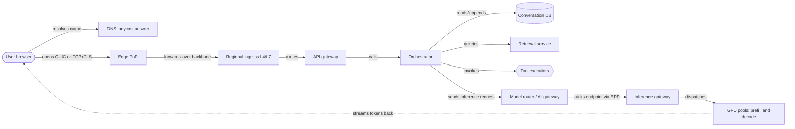
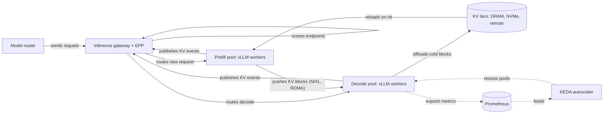

# Reference architecture

Status: **v1** (2026-10-09).

This file defines the hypothetical system that the manuscript and the video explain. It is a reference architecture. It is not a description of any company's private system.

- Every choice here is class C ("In this reference system, …"). Each choice has an ID (`RA-nn`), a reason, and the public evidence it rests on.
- Mechanisms that public software implements are class A. They cite the source through `docs/claims.md`.
- All traffic and fleet numbers are **hypothetical**. They live in `constants/hypothetical.json` and are labelled as hypothetical wherever they appear.

---

## 1. The system in one sentence

A global edge terminates the user's connection close to the user. A regional CPU tier authenticates the request, builds the context and runs tools. A regional GPU tier runs a continuously batched, prefix-cached, disaggregated inference engine and streams tokens back over the same open connection.

## 2. The reference models and hardware

| Role | Choice | Where it runs |
|---|---|---|
| `M-frontier` | Kimi K3: 2.8T total / 104B active MoE, 93 layers (69 KDA linear-attention + 24 gated MLA), native image input, MXFP4 weights | `H-frontier`: GB300 NVL72 racks, disaggregated prefill and decode pools |
| `M-dense` | Mistral Medium 3.5 128B: 88 layers, GQA 96 Q / 8 KV heads, head_dim 128 | `H-teach`: one 8× H100 SXM node, TP=8 (one KV head per GPU) |
| `M-draft` | Mistral-Medium-3.5-128B-EAGLE (2-layer head) | Same GPUs as `M-dense` |
| `M-vision` | Kimi K3's own vision encoder (MoonViT-V2) | Inside the `M-frontier` deployment |
| `M-embed`, `M-rerank` | Qwen3-Embedding-8B, Qwen3-Reranker-4B | A separate small-GPU retrieval pool |

`M-dense` on `H-teach` carries the hand-checkable math (shapes, KV bytes, TP collectives, roofline). `M-frontier` on `H-frontier` carries the realistic frontier case (MoE, wide expert parallelism, hybrid attention, rack-scale NVLink). Both appear in the same chapters, side by side, where the comparison teaches something.

**`M-frontier` deployment (RA-55).** One Kimi K3 replica needs 1,560.9 GB for weights alone (MXFP4 routed experts + BF16 rest), so it never fits in one 8-GPU H100 or H200 node. In this reference system, each GB300 NVL72 rack (72 GPUs, one NVLink domain) is laid out as:

| Unit | GPUs | Parallelism | Source of the layout |
|---|---|---|---|
| Prefill worker × 2 | 8 each | TEP8 (tensor + expert parallel over 8 GPUs) | vLLM's validated P/D topology "TEP8 prefill to DEP16 decode" (K3 day-0 post) |
| Decode worker × 3 | 16 each | DEP16 (attention data-parallel, experts over 16 GPUs) | same; TensorRT-LLM documents DEP16 per-rank weights of 210 GB on GB300 |
| Warm spare | 8 | idle, weights loaded | class C; covers a failed GPU and absorbs bursts (R-XIX.4) |

KV moves from prefill to decode by NIXL inside the rack's NVLink domain. Moonshot recommends "supernode configurations with 64 or more accelerators", and this layout uses 64 active GPUs per rack. The split of 2 prefill to 3 decode workers per rack is a class C choice, not a documented ratio. Every measured throughput number shown with it is quoted with its own recipe's conditions (research note `01b-kimi-k3.md` §2.11). It is never presented as Moonshot's fleet.

**Pool ratio.** The 2 : 3 split is the rack template used for the reference request in every part. Part 14.3 shows that with the hypothetical traffic mix the pools need about 2.7 prefill workers per decode worker, so prefill binds the rack count and decode slots stay empty. A real fleet sets the split per rack from its workload; the reference system keeps the template for the story and shows the free split as the comparison.

Per-request memory for `M-frontier` has two parts: a fixed 449.4 MB of KDA state (fp32 recurrent state plus bf16 short-conv state across 69 layers) and 27,648 B/token of MLA latent KV in BF16 (13,824 B/token in FP8) across 24 layers. Below about 16k tokens the fixed state is the larger part.

## 3. Global edge and network

Legend: rounded node = client; rectangle = service; cylinder = store; hexagon = external tools; dotted arrow = the token stream back to the user. Colours in the video follow `03-visual-style.md` §4.2. The one thing to notice: the CPU tier decides everything before the GPU tier runs, and the stream returns on the same connection. This diagram leaves out the control plane on purpose (§10).

| ID | Choice | Reason and evidence |
|---|---|---|
| RA-01 | DNS returns anycast addresses announced from many edge PoPs. Behind the anycast address, an L4 consistent-hash balancer (Maglev-style) spreads connections over L7 Envoy proxies. | Anycast gives topological nearness but weak load control, so a second layer balances load. Maglev and Envoy document these patterns (note 06, rec. 5). Class B pattern. |
| RA-02 | The client uses HTTP/3 over QUIC when available (advertised with HTTPS DNS records and `Alt-Svc`) and falls back to HTTP/2 over TCP + TLS 1.3. TLS is cited as RFC 9846. | Saves round trips on new connections; TCP fallback covers networks that block UDP (note 06, rec. 4). |
| RA-03 | 0-RTT early data is accepted only for idempotent GET paths. A chat `POST` sent as early data gets `425 Too Early`. | 0-RTT data can be replayed, and a chat POST consumes quota and GPU time (note 06, rec. 4). |
| RA-04 | Edge check order: TLS termination → size and header limits → IP reputation and DDoS filters → WAF → bot score → coarse per-IP rate limit → forward. Per-tenant quotas and authentication run at the regional API gateway. | Cheap checks run first; per-tenant limits need identity, which only the gateway has (note 06, rec. 6). |
| RA-05 | Four regions with availability zones: `us_east`, `eu_west`, `ap_south`, `ap_northeast` (coordinates in `hypothetical.json`). The reference user sits in Nairobi, far from every region, so region choice and distance matter. | Makes the RTT-from-distance math (R-II.6) visible. |
| RA-06 | Global traffic management picks the region by health, capacity, latency, data residency and model availability. A saturated nearest region overflows to the next healthy region. | R-II.6 routing signals; failover is shown with the RTT penalty computed in `sim/network_latency.py`. |

## 4. Regional CPU tier

| ID | Choice | Reason and evidence |
|---|---|---|
| RA-07 | The browser sends the chat request with `fetch()` and reads a `ReadableStream` of SSE-format events over HTTP/2 or HTTP/3. The request authenticates with a bearer token in the `Authorization` header (not a cookie), so cross-site request forgery has no ambient credential to abuse. | `fetch` allows a POST body and an `Authorization` header that `EventSource` cannot send; SSE fits one-way token deltas (note 06, rec. 1). |
| RA-08 | File uploads go first: browser → upload service → presigned PUT URL (short expiry) → object storage; multipart above about 100 MB. The chat request carries only file IDs. | Keeps file bytes off the API servers (note 07; R-II.1). |
| RA-09 | The same Envoy-based AI gateway software (Agent Router, formerly Envoy AI Gateway) runs in two tiers: as the regional API gateway (authentication, quotas, requests-per-minute limits) and as the model router in front of the inference gateway (model extraction, token limits, fallback). | A documented two-tier gateway pattern with public code (note 04, rec. 2). |
| RA-10 | Rate limits: token buckets in Redis, updated atomically by Lua scripts, per tenant for requests per minute and tokens per minute, plus a local per-pod bucket as a safety net. The requests-per-minute check runs at the API gateway. The tokens-per-minute reservation of `prompt_tokens + max_tokens` runs at the model router, once per inference pass, because only after context construction is the prompt length known; the unused part is refunded at completion. Agent Router's documented token limit charges after the response, so the reservation is a custom step on top of it. Expensive GPU paths fail closed. `429` carries `Retry-After`. | Simple to explain and matches a published provider design; the alternative (count output as produced) is mentioned (note 06, rec. 7). |
| RA-11 | Internal calls use gRPC with Protobuf and propagate deadlines: each child deadline is smaller than the time that remains. The top-level deadline is 120 s (hypothetical). | gRPC documents deadline propagation (note 06, rec. 10). |
| RA-12 | One retry layer (the caller closest to the failing dependency), at most 3 attempts, full-jitter exponential backoff, a retry budget of 10% of requests. Side-effecting tools retry only with an `Idempotency-Key` (a convention; its IETF draft expired). | Notes 06 rec. 8. |
| RA-13 | Circuit breakers per dependency (search provider, vector store, each tool), and Envoy outlier detection for replicas. | Note 06, rec. 9. |
| RA-14 | The orchestrator is the only component that calls models and tools. It is deterministic application code. The model only produces tokens; the orchestrator parses, validates, authorizes and executes. A turn runs at most 8 tool passes (`hypothetical.tool_loop.max_tool_iterations`); read-only tool calls of one pass run in parallel, calls with side effects run one at a time. | The boundary R-III.6 asks for; misconceptions 6–8 (R-XXV.1). |
| RA-15 | Model routing is rule-based: the user's model choice, the plan, the modality (images go to an image-capable model) and the context length select a deployment. No hidden pre-processing model runs on every request. | The spec forbids claiming a hidden pre-model without evidence (R-III.7). |
| RA-16 | Service identity: SPIFFE/SPIRE-style X.509 identities and mTLS between services; authorization on the SPIFFE ID. | Note 06, rec. 18. |

**Additions from Part 03:**

| ID | Choice | Reason and evidence |
|---|---|---|
| RA-56 | Model routing uses an explicit rule table (user's model choice, plan, modality, context length, tool needs → deployment), evaluated in order. | Part 03 §3.7; keeps RA-15 concrete. |
| RA-57 | On deployment unavailability, the fallback is the same model in the next-nearest healthy region before any smaller model. | Part 03 §3.7. |
| RA-58 | A policy classifier on the input runs in parallel with context construction; how real providers order such checks is not public (class D wording). | Part 03 §3.8. |
| RA-59 | A stream that the user stops or that breaks is persisted as a partial assistant message with status `stopped` or `interrupted`. A turn that exceeds the top-level deadline (RA-11) is persisted as `interrupted` with reason `deadline`. | Part 03 §3.5; complements RA-18. |
| RA-60 | `max_tokens` covers reasoning tokens as well as visible output tokens, so the TPM reservation includes them. | Part 03 §3.2; R-X.13. |

## 5. Data stores

| ID | Choice | Reason and evidence |
|---|---|---|
| RA-17 | Conversations, messages, settings and quota counters live in a distributed SQL database (Spanner- or CockroachDB-class) with a home region per user and synchronous quorum replication inside the region. | Message append and quota need strong consistency; the cross-region cost is paid only for region survival (note 07). |
| RA-18 | The assistant message is written once when it is finalized (plus a partial write on Stop or failure). Tokens are never written as individual rows. The user message row is written at the start of the turn, in parallel with the history read and retrieval (Part 21). | R-III.5: buffered and finalized writes. |
| RA-19 | Derived caches (embedding cache, query results, search results) live in a Redis-compatible store with `allkeys-lru`, TTLs, and the tenant ID in every key. | Note 07; R-XVI.3. |
| RA-20 | Usage, audit and analytics events go to a Kafka-class log (replication factor 3, `min.insync.replicas` 2, `acks=all`, idempotent producer). The token path never waits for a consumer. Hard quota state stays in the strongly consistent store. | Note 07; R-XVI.2, R-XVI.4. |
| RA-21 | Files live in an S3-class object store. Parsed text, chunks and embeddings are derived and can be rebuilt. | Note 07. |
| RA-62 | The same text is tokenized three times for different purposes: by the orchestrator (token budget, RA-14), by the endpoint picker (prefix-cache scoring, RA-37) and by the model server (the token IDs the model runs on). Only the model server's tokenization is authoritative. | Part 04 §4.2. |
| RA-63 | Image bytes reach the model server through a short-lived signed object-store URL; the request carries the URL, not the bytes. | Part 04 §4.3; RA-08. |
| RA-64 | EXIF orientation is applied by the model server's image loader (vLLM's loader applies the EXIF rotation). A separate orientation step runs only on paths that bypass that loader. | Part 04 §4.3. |
| RA-65 | Tool calls are decoded under vLLM's structural-tag grammar with `--tool-strict-level parameter` (the envelope and every argument schema are constrained). The call's end token is a stop token for the engine, so each tool call ends its inference pass. The orchestrator still validates every call against its schema before execution. | Part 06 §6.1–6.2; which level real providers use is not public (class D). |
| RA-66 | The model decides when to search (no separate query model). A deterministic policy layer in the orchestrator can forbid search (the tenant disabled web access: `web_search` is left out of the tool list) or force it (the user pressed an explicit search control: pass 1 must be a tool call, enforced by constrained decoding). | Part 07 §7.1; how real assistants combine the two is not public (class D). |
| RA-67 | Citation provenance: the orchestrator gives every source in a tool result a numeric source ID (workspace chunks first, 1–6 for the reference request; web sources from 7). The model cites source IDs only; the orchestrator resolves each ID to its URL or document and span, checks that the cited span exists in the fetched text, and drops or flags a citation that does not resolve. The system prompt asks the model to prefer the primary source, to prefer agreement between independent domains, and to report a remaining conflict with both sources cited. | Part 07 §7.6–7.7. |
| RA-68 | Context construction limits: the orchestrator caps each prompt at 131,072 tokens (`hypothetical.context_budget_ref.prompt_budget_tokens`); compaction starts when history passes 24,000 tokens and keeps the last 4 turns verbatim; the reranker reads the first 300 tokens of each candidate on 4 replicas; the embedding pool serves query batches first and fills idle capacity with ingestion batches. | Part 05 §5.1, 5.3, 5.6, 5.7. |
| RA-69 | Sandbox details (refines RA-30): sandbox hosts run cgroup v2 only; one template snapshot per base-image version, taken after the imports; the `run_python` VM has no network interface; MMDS is never enabled; a session lives 120 s idle with its VM, and its files stay 3,600 s before cleanup. | Part 08 §8.1. |
| RA-70 | Computer use: the orchestrator prefers an API tool whenever one exists; it sends the accessibility tree first and a screenshot only when the tree is not enough; it removes old screenshots in batches (keep the last 3, prune every 25 steps), so the prefix stays byte-identical between prune events. | Part 08 §8.2. |
| RA-71 | Routing details (refine RA-37 and RA-41): the inference gateway registers one endpoint per DEP16 rank; the decode pool runs `prefix-cache-affinity-filter` + `token-load-scorer` + `kv-cache-utilization-scorer`, equal weights of 1 (class C choice; the scorer reads `vllm:kv_cache_usage_perc` and scores 1 − usage), so decode load counts; speculative indexing of a routed prefix is on; the model router adds `Retry-After` to a 429 from the gateway (llm-d's 429 carries none); fairness inside a priority band is least attained service keyed by tenant (input + 2 × output tokens, halved every 60 s); the model router sets the fairness header from the verified tenant, never from the client; the EPP prefill calibration is 16,000 tokens/s per `M-frontier` endpoint (hypothetical). `token-load-scorer` alone counts only queued prefill tokens and cannot see decode load; Part 24 shows that effect, and the KV-cache scorer is the reason it is added. | Part 09. |
| RA-72 | Reasoning and sampling: the client gets only a reasoning-status event; the raw reasoning stays on the server and is never streamed. Long-reasoning requests share the RA-41 priority bands (no separate pool). Sampling uses the model publisher's recommended values (K3: temperature 1.0, top-p 0.95–1.0). Generation guards: a repetition detector (patterns of 8–64 tokens repeated at least 6 times) stops the sequence, and malformed output gets at most 1 regeneration (`hypothetical.generation_guards`). | Part 10 §10.13–10.14; what real providers do is not public (class D). |
| RA-73 | Usage and quota accounting: hard-quota counters are sharded (32 shards for a large tenant); the model router reserves tokens per pass and settles once when the pass ends; it emits one usage event per pass with a deterministic event ID; each topic has its own partition key; the billing ledger stores consumer offsets with its rows, so a replay never double-counts. Cached prompt tokens are billed by the hash-block rule of part 5.6. | Part 16. |
| RA-74 | Streaming details (refine RA-47–RA-49): the API gateway writes the SSE `event:` line when it turns the orchestrator's gRPC messages into SSE; the server sends the response headers and `message.start` at once, before the first token; each hop keeps a bounded 16 KiB stream buffer and drops a client stalled for 30 s. A client disconnect cancels the turn at once (RA-49): the message is stored as `interrupted` with its partial text (RA-59), and a client that reconnects later fetches that message and may regenerate; no grace period. | Part 15. |
| RA-75 | Output safety while streaming: a hold-back check classifies each 16-token window (8-token overlap) with a small classifier before the window is released; it fails closed. A stopped stream is stored as `interrupted` with reason `content_policy` (extends RA-59). | Part 18 §18.3; what real providers do is not public (class D). |
| RA-76 | Encryption at rest: envelope encryption with one KMS key per tenant per region and one data key per object or storage range; unwrapped data keys stay in memory at most 300 s. | Part 18 §18.2. |
| RA-77 | Log privacy: every log record follows a fixed schema per event (allowlist); each service's logging library redacts before a record leaves the process; traces carry no prompt text (RA-52); retention 30 / 7 / 14 / 90 / 400 days for app / debug / traces / security / audit; pseudonym keys rotate every 90 days. DEBUG records are kept only for a sampled share of requests (value in `hypothetical.d/part18.json`). | Part 18 §18.4. |
| RA-78 | Data residency: a tenant may pin a jurisdiction (US, EU, IN, JP); the residency filter runs before the RA-57 cross-region fallback, so a pinned tenant gets 503 with `Retry-After` instead of an out-of-jurisdiction region. The reference tenant has no pin. | Part 18 §18.5. |
| RA-79 | Conversation-store disaster recovery (refines RA-17): each home region replicates asynchronously to a passive standby in another region (`ap_south` → `ap_northeast`); RPO ≈ the replication lag (10 s, hypothetical), history RTO ≈ 320 s until promotion. Inference traffic fails over separately by global traffic management (RA-06, RA-57; for the Nairobi PoP that is `eu_west`, part 2.8), so after a region loss the user is served in one region while history returns from another. | Part 17 §17.4. |
| RA-80 | Observability details (refine RA-52, RA-53, RA-54): tail-based trace sampling on top of a 1 % baseline; every SLO threshold is also a histogram bucket bound, so burn rates need no interpolation; online quality evals score sampled turns offline, outside the request path; quality metrics gate each canary stage of a rollout. SLO targets: 99.9 % availability, p95 TTFT 1,500 ms, p95 TPOT 60 ms (`hypothetical.slo`). | Part 19; how real providers do it is not public (class D). |
| RA-81 | Image generation (extends RA-56 with an image-output rule): the text model requests an image through a tool call; the model router sends it to an image-model pool; a prompt classifier runs before the GPU and an output classifier after it; the image carries C2PA provenance and reaches the client by a short-lived signed URL (RA-63). | Part 20 §20.1. |
| RA-82 | Voice: a cascaded pipeline (streaming ASR → text model → streaming TTS) by default, with a native speech model as the alternative; the client connects by WebRTC to a voice gateway; barge-in cancels TTS and the running pass. | Part 20 §20.2. |
| RA-83 | Long-running agent tasks run as durable background tasks: the orchestrator checkpoints its state outside the request, the tool-pass limit and a cost budget are raised per task, compaction applies (RA-68), and the user gets a push notification at the end. A client disconnect does not cancel a background task (exception to RA-49 and RA-74). | Part 20 §20.3. |
| RA-84 | Conversation history across turns: a later turn's context keeps the user message (with its attachments) and the final answer (with citations); reasoning tokens and tool results stay out of later contexts. | Part 21 §21.6. |
| RA-85 | The operator system prompt is versioned deployment configuration: it ships with each release, rolls out by canary (RA-54) and is loaded by the orchestrator. Its token IDs (tokenizer cache) and its KV blocks (prefix cache, salted per tenant where RA-40 requires it) are cached copies, never the source. Where real providers keep it is not public (class D). | Part 23 §23.4. |
| RA-86 | When a pool scales up, a rack's 8 spare GPUs (RA-55) join as one 8-GPU serving unit after one readiness probe (5 s, RA-51); they carry a burst until autoscaled workers finish their cold start (Part 19). | Part 22 §22 overload burst. |
| RA-61 | Model artifacts (sharded weight files and engine configs) live in a model registry backed by the regional object store. Each GPU node keeps a local NVMe cache of the checkpoints it serves; scale-out pulls from a peer node's cache over the RDMA fabric first and falls back to the object store. Rack layout numbers for RA-55 are in `hypothetical.deployment.*`. | Part 01 §1.7; R-I.4. |

## 6. Retrieval and memory

| ID | Choice | Reason and evidence |
|---|---|---|
| RA-22 | Documents are parsed asynchronously after upload with Docling 2.x (layout model, TableFormer, OCR only on pages without a text layer). Chunks are structure-aware, 300–800 tokens, with heading path, page, bounding box and ACL metadata. | Note 07; R-IV.4, R-V.1. |
| RA-23 | Embeddings: `M-embed` (4,096 dims) truncated by Matryoshka to 1,024 dims, normalized, stored as float16 (2,048 bytes per vector). | pgvector cannot index 4,096 dims; Matryoshka truncation is documented for the model (note 07). |
| RA-24 | One search engine holds BM25 and HNSW (M = 16, ef_construction = 200) together. Small per-user corpora may use pgvector. | Hybrid search in one engine avoids two systems (note 07). |
| RA-25 | Fusion with RRF, k = 60. Retrieve 100–150 fused candidates, rerank with `M-rerank`, keep the top 20, then trim to the token budget. | Original RRF default; public pipeline shapes (note 07). |
| RA-26 | Authorization in retrieval: the tenant ID is a hard filter inside the index; ACL principals are metadata; a final ACL check by chunk ID runs before any text enters the context. | Avoids post-filter leaks and empty top-k (note 07; R-V.4). |
| RA-27 | Long-term memory: per-user editable records with embeddings, extracted in the background after a turn, with view, edit, delete and pause controls; sensitive categories are excluded by default. | Mirrors public memory controls (note 07; R-V.5). |

## 7. Tools

| ID | Choice | Reason and evidence |
|---|---|---|
| RA-28 | Web search uses an external search provider (Option A) in the story. An own index (Option B) is explained as a design, never claimed for a real product. | Avoids class D claims (note 07). |
| RA-29 | Web pages are fetched by a separate egress service: resolve once, check every address against a blocklist (private ranges, metadata endpoints), connect to the pinned IP, re-validate every redirect hop, enforce size, time and content-type limits. | SSRF and DNS-rebinding defense (note 06, rec. 14; R-VII.4). |
| RA-30 | Code runs in a Firecracker microVM per session, restored from a warm snapshot pool. Egress is denied by default; there is no route to cloud metadata and no credential inside the VM. gVisor is the lighter alternative for low-risk tools. | Note 06, rec. 13; R-VIII.1. |
| RA-31 | Tool credentials stay in a broker that issues short-lived tokens from vault leases. The model sees only a logical connection ID. Connectors use MCP revision `2026-07-28` over Streamable HTTP with OAuth 2.1; MCP is optional, not required. | Note 06, rec. 17; R-VI.4, R-VI.5. |
| RA-32 | Prompt-injection defense is layered: an instruction hierarchy (system > developer > user > tool and web data), per-tenant tool allowlists and scopes, human approval for side effects, structured outputs between steps, and egress and CSP limits on rendering. No layer is complete alone. | Note 06, rec. 15; R-VII.5. |
| RA-33 | Model output is sanitized before rendering: no raw HTML, a strict CSP with `img-src` limited to owned origins or a signing image proxy. | Blocks exfiltration through Markdown image URLs (note 06, rec. 16; R-XVIII.1). |

## 8. Inference platform

Legend: rectangle = service; cylinder = store; solid arrow = data plane; dotted arrow = control plane. The one thing to notice: routing uses live KV-cache state from the engines, not request counts. This diagram leaves out tensor and expert parallelism inside a pool on purpose (part 12).

| ID | Choice | Reason and evidence |
|---|---|---|
| RA-34 | Inference gateway = Kubernetes Gateway API + `InferencePool` (`inference.networking.k8s.io/v1`) + the llm-d Router endpoint picker (EPP) over Envoy `ext_proc`. | The only cross-vendor, Kubernetes-standard design with public code and a stable v1 API (note 04, rec. 1). |
| RA-35 | The engine is vLLM v0.31.0 (V1 engine, Model Runner V2). SGLang v0.5.21 is the comparison for the radix-tree prefix cache and its router rule. | Explained in Part 09 and Part 23. |
| RA-36 | `M-dense` runs with TP=8 on one 8× H100 node of `H-teach` (one KV head per GPU). Scheduler defaults on `H-teach`: token budget 8,192 tokens per step, `max_num_seqs` 1,024, KV block size 16 tokens, `gpu_memory_utilization` 0.92. On B200-class GPUs the token budget is 16,384. Preemption recomputes (no swap). | vLLM serve defaults on that hardware (note 03, rec. 2 and 4). |
| RA-37 | Cache-aware routing is taught with NVIDIA Dynamo's cost function (overlap credit; prefill and decode blocks). The routing policy in the reference system is llm-d's default: `prefix-cache-affinity-filter` + `token-load-scorer`. Prefix state comes from engine KV events plus a speculative insert on route. | note 04, rec. 3 and 4. |
| RA-38 | Prefill and decode run in separate pools for `M-frontier`. Selection is decode-first with conditional disaggregation: a short uncached suffix is prefilled on the decode worker. KV moves by NIXL pull (RDMA READ) over GPUDirect RDMA. In a disaggregated pass, the decode worker pulls the KV blocks (and K3's KDA state) for all but the trailing prompt token(s), recomputes those locally and samples the first streamed token itself (vLLM NIXL connector `_prefill_backoff` [vllm@8cbd5d0:vllm/distributed/kv_transfer/kv_connector/v1/nixl/base_scheduler.py#L379-L403]); that pass's TTFT includes the KV transfer and this first decode step. A locally prefilled pass samples its first token at the end of prefill, so it takes one decode step fewer. Pass 1 of the reference request pulls its whole uncached prompt from a prefill worker. | llm-d and Dynamo document this pattern (note 04, rec. 5). |
| RA-39 | KV tiers use the Dynamo KVBM names: G1 HBM, G2 pinned DRAM, G3 NVMe, G4 object store, with routing credits 1.0 / 0.75 / 0.25 for hits in G1 / G2 / G3. Mooncake's Eq. 2 decides when recompute beats transfer. | Note 04, rec. 6. |
| RA-40 | Prefix-cache isolation: `cache_salt` = tenant (organization) ID on every request that carries tenant content. vLLM mixes the salt into block 0 only, and the chained hashes carry it forward, so a salted request shares no blocks with unsalted requests or other tenants: the operator system prompt is reused only within one tenant. Block hashes are SHA-256 chained. | Timing side channels (note 03, rec. 5; R-XIII.5). |
| RA-41 | Admission control: EPP flow control with priority bands; saturation = mean(max(queue/5, kv/0.8)); requests wait at most 60 s; overload returns 429. | Public llm-d design (note 04, rec. 7; R-IX.4). |
| RA-42 | Autoscaling: KEDA on EPP and engine metrics (queue, running requests, token backlog, latency) with a warm floor of at least one replica per pool; prefill and decode pools scale separately. Racks also follow a schedule from the daily demand curve; racks that the chat pools release at night stay powered and run batch work (Part 19). | llm-d deprecates WVA in favour of KEDA (note 04, rec. 8; R-XIX.4). |
| RA-43 | Attention kernels: FlashAttention-3 on Hopper, FlashAttention-4 on Blackwell, with varlen `cu_seqlens` and a block table for sequence isolation. CUDA Graphs: full graphs for pure-decode batches, piecewise for mixed batches. | What vLLM selects (note 03, rec. 7 and 10). |
| RA-44 | Sampling runs on the GPU; only token IDs (8 bytes each: `int64` in Model Runner V2 at vLLM v0.31.0) go to the CPU. Per-request seeds with a counter-based RNG (Model Runner V2). Batch-invariant mode is off by default, so logits can depend on the batch. | Note 03, rec. 8; R-X.12. |
| RA-45 | Speculative decoding: EAGLE for `M-dense`; MTP explained with GLM-5.3 and DeepSeek-V3 as public examples. | Explained in Part 11. |
| RA-46 | Tensor-parallel decode uses vLLM's custom all-reduce for small messages, and NCCL (ring, tree or NVLS) for large ones. | Note 04, rec. 9. |

## 9. Streaming back

| ID | Choice | Reason and evidence |
|---|---|---|
| RA-47 | Event framing: one JSON object per `data:` line, explicit `event:` types, a 15 s comment keep-alive; the server sets `X-Accel-Buffering: no` and `TCP_NODELAY`. | Survives proxy read timeouts and buffering (note 06, rec. 2; R-XV.2). |
| RA-48 | Streams are not natively resumable. After a broken stream, the client fetches the finished message by ID or regenerates. | A replay buffer would make the edge stateful (note 06, rec. 3; R-XV.6). |
| RA-49 | Bounded per-stream buffers; HTTP/2 and QUIC flow control are honoured end to end; a client disconnect cancels work down to the scheduler, which frees the KV blocks. | R-XV.4, R-XVII.2. |
| RA-50 | Tool-call tokens are detected incrementally and held back; the client sees a tool-status event instead. | R-XV.3. |

## 10. Control plane, observability and operations

| ID | Choice | Reason and evidence |
|---|---|---|
| RA-51 | Service discovery: Kubernetes Service and EndpointSlice inside a cluster; an xDS management server feeds Envoy (EDS) for L7 routing; readiness probes gate traffic (model-server pods: every 5 s, failure threshold 2, so about 10 s to detect; hypothetical, Part 17 §17.3); outlier detection handles faults between probes. A node agent on every GPU node reads Xid messages and GPU health counters (Part 17). | Note 06, rec. 12; R-I.6. |
| RA-52 | Tracing: a W3C `traceparent` is created at the edge; OpenTelemetry spans for the nine named stages; baggage is dropped at trust boundaries (tools, fetchers); Prometheus histograms with exemplars link metrics to traces. | Note 06, rec. 19; R-XIX.1. |
| RA-53 | The counter HUD uses the exact vLLM metric names (`vllm:num_requests_running`, `vllm:num_requests_waiting`, KV-cache usage, prefix-cache hits and queries, TTFT and inter-token latency histograms). | Note 03, rec. 11; 00 §4.6. |
| RA-54 | Deployments roll out by canary with traffic weights; inference workers drain (no new routes, bounded time for active decodes; the drain bound is 300 s, hypothetical, Part 17) before termination. Before each canary stage, the new version's prefix caches are warmed and its prefill pool is scaled up (Part 19). | R-XVII.10. |

## 11. What is not public, and the choices made instead

These are class D gaps. Each one follows the gap-filling procedure of 00 §3 rule 4: state what cannot be known, give realistic options, pick one, and explain why.

| Gap | Options | Choice | Why it is plausible |
|---|---|---|---|
| Fleet size and GPU count of any real provider | Derive from public statements; derive from capacity math | Capacity math only, from hypothetical traffic (`capacity_math.py`) | Teaches the method without claiming a fact (R-XIV.2). |
| Whether a real provider disaggregates prefill and decode | Colocated; disaggregated; mixed | Disaggregated for `M-frontier`, conditional (RA-38) | Several public stacks document it for large MoE models. |
| Real routing policy of any provider | Round robin; least loaded; cache-aware | Cache-aware with load penalty (RA-37) | Public engines and gateways document it. |
| Whether a hidden small model pre-processes prompts | Always; sometimes; never | Not assumed (RA-15) | No public evidence. |
| The provider's private model and serving code | — | Open models and open engines as stand-ins (§2) | Their configs and code are public, so every number can be checked. |

## 12. The reference request through this architecture

The request is defined in `constants/hypothetical.json` → `reference_request`: turn 4 of a conversation, a text question, one phone photo (4032×3024 JPEG), one 18-page PDF uploaded earlier, two memory records, private workspace documents, three web searches, one code run, and a 450-token streamed answer with five citations.

Its path, at the level of this file:

1. Upload (earlier): PDF → presigned PUT → object store → Docling → chunks → `M-embed` → index (RA-08, RA-22, RA-23).
2. Send: `fetch` POST over an existing HTTP/3 connection to the nearest PoP (RA-02, RA-07).
3. Edge checks → regional ingress → API gateway: authentication, tenant quotas (RA-04, RA-09, RA-10).
4. Orchestrator: history from the conversation DB, memory records, hybrid retrieval with ACL filters, context budget (RA-14, RA-17, RA-24 – RA-27).
5. Model router → inference gateway: KV-aware endpoint choice, admission (RA-15, RA-34, RA-37, RA-41).
6. Prefill on the prefill pool, KV transfer, decode on the decode pool (RA-38).
7. The model emits a `web_search` tool call → the orchestrator runs it through the search provider and the safe fetcher → second inference pass (RA-28, RA-29).
8. The model emits a code tool call → Firecracker sandbox → result → third inference pass (RA-30).
9. Tokens stream back as SSE events through the gateway and edge; the browser renders Markdown incrementally (RA-47 – RA-50).
10. The finalized message is written; usage events flow to the log; KV blocks are freed (RA-18, RA-20, RA-49).

Part 21 of the manuscript numbers every event of this path (R0…Rn) and shows the data structure at each boundary.
