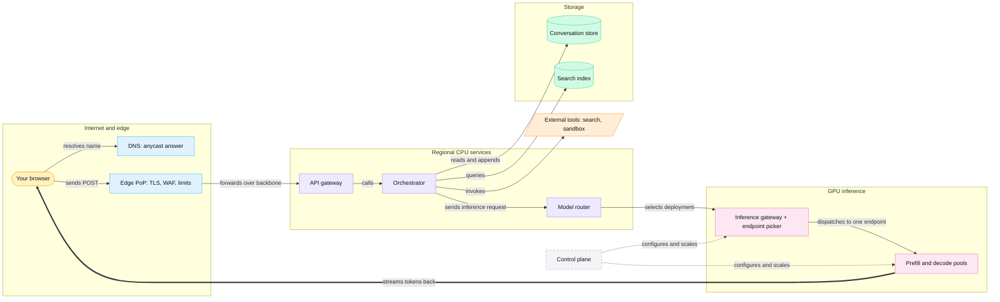

<!-- GENERATED from manuscript/src/part-00-the-question-and-the-reference-request.md by tools/render_manuscript.py. Edit the source, not this file. -->
# Part 00: The question, the reference request, and how to read this

This part states the question, defines the request that every later part follows, and fixes the notation.

The rest of the text follows that request from the keyboard to the pixels. It opens every component on the way. Before it starts, you need four things:

1. The question that every part answers (0.1).
2. The request that every part follows (0.2).
3. The symbols, units and counters that every part uses (0.3 and 0.4).
4. The way the wording tells you how a fact is known (0.5).
5. The three levels of concurrency (0.6).
6. One map of the whole system (0.7).

---

## 0.1 The central question

No single technique explains it: the answer is a stack of layers, and each removes a wait or shares hardware.

The question is this. You press Send in a ChatGPT-like application. A globally distributed platform runs many model replicas on GPUs in several regions. Each request reaches one replica (part 1.3). How does it show the first tokens of your answer quickly, often in about a second? And how does it do that while thousands or millions of other requests run on the same machines?

Two numbers frame the question. Both are hypothetical, because no provider publishes them. In this reference system (hypothetical load, `hypothetical.traffic`):

- The target for the first token is p95 TTFT ≤ 1,500 ms for text-only requests without tools. TTFT (time to first token) ends when the model generates its first token, reasoning tokens included. The first visible text can come much later.
- At the daily peak, 50,000 new requests arrive every second across the world, and 25,000,000 users hold an open session.

A single GPU cannot serve that load, and a fresh GPU machine cannot start in a second (1.2). So the answer is a composition. Each layer below removes waiting time, or lets many users share one piece of hardware:

1. An edge PoP (point of presence) near you terminates the connection. So the long path carries an open, encrypted stream (Part 2).
2. A regional CPU tier checks identity and quota, builds the context and runs tools. Its asynchronous code holds thousands of requests per process (Parts 3 to 8).
3. An inference gateway picks the GPU replica that already holds useful cached state and has room (Part 9).
4. The inference engine adds your request to a running batch. So your tokens share each weight read with other users' tokens (Part 11).
5. The KV cache keeps per-request state in fixed blocks. So the engine reuses shared prefixes and fits many sequences on one GPU (Part 13).
6. Every token streams back on the connection that is already open, as soon as the engine samples it (Part 15).
7. Everything slow happens before your request exists: weights in GPU memory, compiled kernels, open connections and warm caches (Part 1).

Part 25 returns to this question and assembles the full answer from the parts in between.

You can now state the central question and name the layers whose composition answers it.

---

## 0.2 The single reference request

One request carries every feature at once, so every part follows it and the numbers add up across parts.

The text calls it **your request**. It is a hypothetical request in this reference system (class C). It is not a recording of any real user. Every value below is fixed once and reused everywhere.

| Part of your request | Value (hypothetical) | Where it is processed |
|---|---|---|
| Conversation position | turn 4; 3 earlier turns hold 2,600 tokens of history | Parts 3, 5 |
| Your text | "Here is our Q3 report and a photo of last week's whiteboard plan. Using our pricing policy, check the current list prices of our three main competitors, compute our gross margin at each of their price points, and plot it. Cite your sources." | Parts 4, 10 |
| A photo | one JPEG of a whiteboard, 4032 × 3024 pixels, 2.9 MB | Parts 2, 4 |
| A PDF | `q3-report.pdf`, 18 pages, 2.1 MB; two-column, 6 tables, 4 figures; 16 pages with a text layer and 2 scanned pages. You uploaded it before this turn, so it is already parsed and indexed. | Parts 4, 5 |
| Long-term memory | 2 stored records, for example "reports figures in EUR" and "prefers results as a table" | Part 5 |
| Private documents | a workspace of 4,200 documents; retrieval selects 6 chunks | Part 5 |
| Current web information | 3 web searches; 8 results considered; 3 pages fetched | Part 7 |
| Code execution | one run: "compute gross margin at three price points and render a PNG chart" | Part 8 |
| The answer | 450 visible tokens, streamed, with a table, 5 citations and a link to the chart | Parts 11, 15 |

**Where you are.** You sit in Nairobi. The nearest edge PoP is in Nairobi. The round trip from your device to it takes 20 ms over your access network. These values are hypothetical. In this reference system, the GPUs run in four regions (RA-05):

| Region | City (hypothetical location) |
|---|---|
| `us_east` | Ashburn, Virginia |
| `eu_west` | Dublin |
| `ap_south` | Mumbai |
| `ap_northeast` | Tokyo |

Every region is far from you. So the choice of region costs real time, and Part 2 computes that cost.

**Which model serves it.** In this reference system, `M-frontier` serves your request (RA-15). `M-frontier` is Kimi K3, an open-weight mixture-of-experts model that reads images natively. So one model reads the text and the photo as tokens. The same model writes the tool calls and the answer as tokens.

A second model, `M-dense`, carries the hand-checkable math. `M-dense` is Mistral Medium 3.5, a dense 128B model. Both appear side by side wherever the comparison teaches something.

**The path of your request**, at the level of the whole system:

1. Earlier, the PDF went to object storage. A background task parsed, chunked, embedded and indexed it (Parts 4, 5).
2. You press Send. The browser sends one HTTP POST over a connection that is already open to the nearest edge PoP (Part 2).
3. The edge checks the request and forwards it to a region. The regional API gateway authenticates you and checks your quota (Parts 2, 3).
4. The orchestrator reads the conversation history and your memory records. It retrieves chunks from your workspace and builds the context (Parts 3, 5).
5. The model router and the inference gateway pick one GPU replica and admit the request (Part 9).
6. A prefill worker reads the whole context, and a decode worker generates tokens (Parts 10 to 13).
7. The model asks for web searches. The orchestrator runs them and starts a second inference pass (Parts 6, 7).
8. The model asks for a code run. A sandbox runs it, and a third inference pass writes the answer (Part 8).
9. Tokens stream back through the gateway and the edge. The browser renders them as they arrive (Part 15).
10. The system stores the final message, records usage and frees the GPU memory your request held (Parts 16, 21).

Part 21 numbers every event on this path and shows the data at each boundary.

You can now describe your request, where you sit, which model serves it, and the ten steps its path takes.

---

## 0.3 Notation, units and number style

One set of symbols and units is used everywhere, and each symbol always means the same thing.

**Symbols.** The table gives each symbol and its value for the two reference models.

| Symbol | Meaning | `M-dense` | `M-frontier` |
|---|---|---|---|
| B | Batch: the number of sequences in one scheduler iteration | varies | varies |
| L | Sequence length inside one tensor: tokens per sequence in this forward pass | varies | varies |
| T | Context length: tokens a sequence already holds in its KV cache | varies | varies |
| d_model | Width of the hidden state (`hidden_size` in the config) [SRC-329] [SRC-378] | 12,288 | 7,168 |
| layers | Number of decoder layers (`num_hidden_layers`) [SRC-329] [SRC-378] | 88 | 93 (69 linear-attention + 24 latent-attention) |
| H | Query heads per attention layer | 96 | 96 |
| H_kv | KV heads per attention layer | 8 | none: each latent-attention layer stores one latent of 512 + 64 values |
| d_head | Dimension of one head | 128 | 128 (value head) |
| vocab | Vocabulary size | 131,072 | 163,840 |
| b | Bytes per element of one number format | 2 (BF16), 1 (FP8), 0.5 (FP4, plus scales) | same |

The text writes a tensor shape in brackets. For example, the hidden state of a batch is `[B, L, d_model]`. A formula names its terms in words or symbols, for example `2 × layers × H_kv × d_head × b`. With `M-dense` in BF16, that formula gives 360,448 B of KV cache per token (Part 13, from the config [SRC-329]).

**Bytes and bits.** Decimal units count in powers of ten, and binary units count in powers of two:

| Decimal | Bytes | Binary | Bytes |
|---|---|---|---|
| 1 KB | 10³ | 1 KiB | 2¹⁰ |
| 1 MB | 10⁶ | 1 MiB | 2²⁰ |
| 1 GB | 10⁹ | 1 GiB | 2³⁰ |
| 1 TB | 10¹² | 1 TiB | 2⁴⁰ |

Vendors state GPU memory sizes, link speeds and storage speeds in decimal units. Software often reports binary units, for example vLLM's log of free KV memory in GiB. A lower-case "b" means bits, so 1 Gb/s = 10⁹ / 8 B/s. A 400 Gb/s port therefore moves 50 GB/s in each direction.

**Rates.** A bandwidth is per direction unless the text says otherwise. NVIDIA prints NVLink and PCIe rates as the sum of both directions, so the text halves them [SRC-005] [SRC-007]. FLOPs counts floating-point operations, and FLOP/s is a rate. TFLOP/s means 10¹² FLOP/s.

**Context lengths.** "k" after a context length means 1,024 tokens. So 8k is 8,192 tokens and 128k is 131,072 tokens.

**Numbers.** Large numbers use commas as thousands separators. Every computed number comes from a script that shows each step. Its inputs are public sources, published model configurations, or values that the text labels hypothetical.

You can now read every shape, unit and symbol in the later parts without a second definition.

---

## 0.4 The counters

Eight counters show the state of a GPU replica, and most come straight from the inference engine's own metrics.

A counter is a number that a component updates as it works. The engine exposes its counters on an HTTP `/metrics` endpoint in Prometheus format. A monitoring system reads them every few seconds. The text uses the exact vLLM metric names [vllm@v0.31.0:vllm/v1/metrics/loggers.py#L462-L927]. The Prometheus client library adds the suffix `_total` to a counter's name when it exports it [SRC-043].

| Counter | What it counts | Where the number comes from |
|---|---|---|
| queue depth | Requests that wait for the scheduler and do not run yet | `vllm:num_requests_waiting` (gauge) |
| free KV blocks | KV blocks that no running sequence holds | derived from `vllm:kv_cache_usage_perc`; vLLM computes usage = 1 − free blocks / (all blocks − 1) [vllm@v0.31.0:vllm/v1/core/block_pool.py#L880-L891] |
| active sequences | Requests that the scheduler runs in the current batch | `vllm:num_requests_running` (gauge) |
| batched tokens | Tokens that one scheduler iteration processes | `vllm:iteration_tokens_total` (histogram) |
| HBM used | Bytes of GPU memory in use | the GPU driver, not the engine |
| GPU utilization | Fraction of time the GPU runs any kernel | the GPU driver, not the engine |
| tokens per second | Output tokens the engine produces each second | the rate of `vllm:generation_tokens` (and `vllm:prompt_tokens` for input) |
| TTFT timer | Time since the click on Send, until the first generated token reaches your screen (a reasoning status, or text) | your browser; the engine reports its own part as `vllm:time_to_first_token_seconds` |

Four counters need a remark:

- **HBM used stays almost flat.** The engine allocates its whole KV block pool once, at startup (1.3) [vllm@v0.31.0:vllm/v1/engine/core.py#L255-L324]. After that, requests move blocks between "free" and "in use" inside the pool. So the driver's number barely moves, and `free KV blocks` shows the real pressure.
- **GPU utilization misleads.** llm-d notes that it can sit near 100% during batching on a lightly loaded server and on a saturated one [SRC-285]. So autoscaling in this reference system reads queue and KV counters instead (RA-42).
- **The engine's TTFT is only part of yours.** The engine measures from the moment the request reaches it [vllm@v0.31.0:vllm/v1/metrics/stats.py#L466-L475]. Your TTFT also contains the network, the edge, the CPU tier and the browser (Part 22).
- **Two more counters appear where they matter.** `vllm:prefix_cache_queries` and `vllm:prefix_cache_hits` count prompt tokens looked up and found in the prefix cache (Part 13.3). `vllm:num_preemptions` counts sequences removed from the batch under KV pressure (Part 13.8).

Every stage-like section ends with a **Meanwhile in the fleet** paragraph. It describes what other requests do at the same instant, and it shows the counters that change. So the text keeps two views at once: your request (micro) and the fleet (macro).

You can now read each counter in the later parts and say which component produces it.

---

## 0.5 What is known and what is not

The wording of each claim tells you how it is known: documented, common, chosen, or not public.

No public source describes the private system of any real provider. So the text builds a reference system from public parts and marks every claim with one of four wordings:

| Class | Wording | Example from the text |
|---|---|---|
| A. Publicly documented mechanism | "vLLM does X." "The standard specifies X." The claim carries a citation. | vLLM stores the KV cache in blocks of 16 tokens by default [vllm@v0.31.0:vllm/config/cache.py#L71]. |
| B. Common production design | "A common design is X." | A common design runs per-tenant rate limits at the regional gateway, after authentication. |
| C. Reference-system choice | "In this reference system, X." The choice has an ID, for example (RA-38). | In this reference system, prefill and decode for `M-frontier` run on separate GPU pools (RA-38). |
| D. Not public | "This part is not public. Two realistic options are X and Y. Here we use X." | The fleet size of any real provider is not public. Here, fleet size follows from hypothetical traffic and capacity math (Part 14). |

Three more rules complete the picture:

1. **Hypothetical numbers say so.** Traffic, request sizes, regions and service targets are hypothetical. The text labels each one where it appears.
2. **Measurements carry their conditions.** A measured number names its hardware, its software version and its load, because a different setup gives a different number.
3. **Citations point to the exact source.** `[SRC-NNN]` points to a document in the bibliography. `[repo@commit:path#Lx-Ly]` points to lines of source code at a pinned commit.

You can now tell, from the wording alone, whether a statement is documented, common, chosen or unknown.

---

## 0.6 The three levels of concurrency

Concurrency happens at three different levels, and each level has its own mechanism and its own limit.

**Concurrency** means that many tasks are in progress during the same period. **Parallelism** means that many tasks execute at the same instant on separate hardware. A CPU process can hold ten thousand open requests concurrently with one event loop. A GPU runs thousands of arithmetic operations in parallel in one clock cycle.

The three levels are:

1. **Application and network concurrency.** CPU services hold many open connections and in-flight calls. An event loop waits on thousands of sockets at once and runs whichever is ready. The limit is memory per connection and CPU time per event (Part 3.3).
2. **Inference-scheduler concurrency.** The engine's scheduler keeps many sequences in one batch and chooses the batch again at every scheduler iteration. The limit is free KV blocks and the token budget per iteration. vLLM allows up to 1,024 sequences and 8,192 tokens per iteration by default on H100 [vllm@v0.31.0:vllm/engine/arg_utils.py#L2868-L2877] (Part 11).
3. **GPU hardware parallelism.** One batch's matrix multiplications run as kernels across all streaming multiprocessors (SMs). An H100 has 132 SMs, each with 4 Tensor Cores [SRC-003]. The limit is FLOP/s and HBM bandwidth (Part 11).

Your request passes through all three. It is one of many open streams at level 1. It is one sequence in a batch at level 2. At level 3, it is a few rows of a matrix. Part 3.3 defines the three levels in full, and every later part says which level it describes.

You can now place any mechanism in the text at one of the three levels of concurrency.

---

## 0.7 The reference system at a glance

The reference system has five groups: the edge, regional CPU services, storage, GPU inference pools and external tools.

Legend: amber = your browser; blue = edge; violet = CPU services; green cylinder = store; pink = GPU. Orange parallelogram = external tools; dashed grey = control plane. Solid arrows carry requests and data, the thick arrow carries the token stream back, and dashed arrows carry configuration.

The one thing to notice: CPUs decide everything before the GPU runs, and the answer returns on your open connection. The diagram leaves out the object store, caches, event log and ingress balancers on purpose; Part 1 opens them.

The five groups do five jobs:

1. **The edge** resolves the name, terminates your connection close to you and filters bad traffic (Part 2).
2. **The CPU services** authenticate you, keep conversation state, build the context and run the tool loop (Parts 3 to 8).
3. **Storage** holds conversations, files, chunks and embeddings in each region (Parts 5, 16).
4. **The GPU pools** turn the context into tokens, many users per batch (Parts 9 to 13).
5. **The control plane** deploys, configures and scales everything, but no user byte passes through it (1.8).

Part 23 redraws this diagram with every box opened.

You can now name the five groups of the reference system and say which part opens each one.

---

## What Part 00 established

One question, one hypothetical request, one notation, eight counters, four wordings and one map now frame everything that follows.
