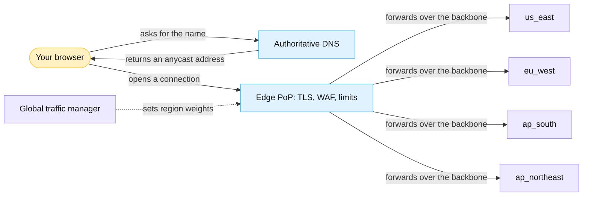
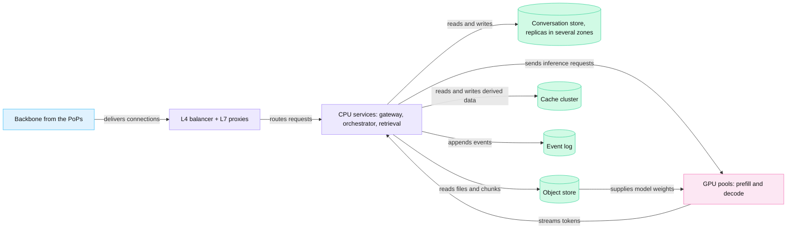
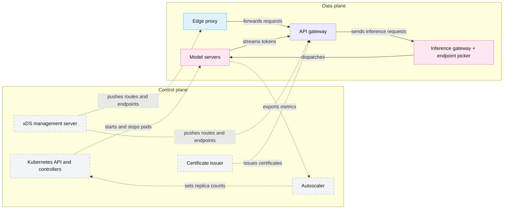
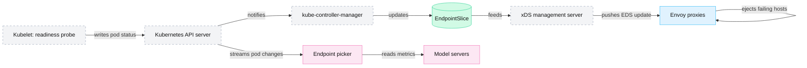

<!-- GENERATED from manuscript/src/part-01-t-minus-infinity.md by tools/render_manuscript.py. Edit the source, not this file. -->
# Part 01: T−∞, the system before a request arrives

Before your request exists, the whole system already runs: PoPs announce addresses, regions run services, and GPUs hold weights.

Your request has about one second to show a first token (0.1). Any step that takes longer than that must finish before you press Send. This part lists those steps, what each one leaves behind, and what it costs. It covers ten topics:

1. The global layout of edge, backbone and regions (1.1).
2. Why a request never waits for a GPU machine to start (1.2).
3. What a warm replica holds (1.3).
4. How a model version reaches production (1.4).
5. Number formats and block scaling (1.5).
6. Weight memory, and why real memory use is larger (1.6).
7. How the fleet moves terabytes of weights (1.7).
8. The control plane and the data plane (1.8).
9. How routers learn which endpoints are healthy (1.9).
10. Why power and cooling limit where GPUs can run (1.10).

The time "T−∞" means "long before your request". Everything in this part exists at T−∞, so its cost never appears in your TTFT.

---

## 1.1 The global layout

The system is edge PoPs near users, a private backbone, and four regions that hold CPU services, stores and GPUs.

### From your device to a region

A **PoP** (point of presence) is a group of proxies in one metro that accept user connections. The reference system has PoPs in many metros and GPUs in only four regions (RA-01, RA-05). So the first hop is short, and the long distance runs between machines that the operator controls.

Five mechanisms connect your device to a region:

1. **DNS.** Your browser asks for the service name. Authoritative DNS servers hold the answer, and resolvers, the operating system and the browser cache it until its TTL ends [SRC-128]. An HTTPS DNS record can also say that the service speaks HTTP/3, so the browser can try QUIC first [SRC-130].
2. **Anycast.** In this reference system, DNS returns an anycast address (RA-01). Many PoPs announce the same address prefix over BGP. The internet's routing system then picks the PoP that receives your packets [SRC-133]. It decides from the network topology and from where the packets start. RFC 4786 notes that load balancing between anycast nodes is "typically difficult to achieve" [SRC-133].
3. **Load balancing inside the PoP.** Behind the anycast address, an L4 balancer spreads connections over L7 proxies (RA-01). Maglev, a published L4 balancer, hashes each connection's 5-tuple and keeps a connection table [SRC-135]. So an open connection keeps its proxy when the proxy set changes.
4. **Edge checks.** The PoP terminates TLS and runs cheap checks first (RA-04). They are size limits, IP reputation and DDoS filters, the WAF, a bot score and a coarse rate limit. A common design also caches the application's static files in the PoP: the CDN function. That cache never answers a chat request (Part 16.3).
5. **Global traffic management.** A global traffic manager tells each PoP which region should receive new requests. It weighs health, free capacity, latency, data residency and model availability (RA-06). When the nearest region is full, new requests overflow to the next healthy region.

A common design carries traffic from the PoP to the region over a private backbone, not over the public internet. The operator then controls the path, its capacity and its encryption.



Legend: amber = your browser; blue = edge; violet = regional services and the global traffic manager; dashed arrow = configuration. The one thing to notice: anycast picks the PoP, but the global traffic manager picks the region. The diagram leaves out the other PoPs and the backbone links between regions on purpose.

### Inside one region

A **region** is a group of data centers that the global traffic manager can choose as one unit. An **availability zone** is an isolated failure domain inside a region, with its own power and network. In this reference system, every region runs a CPU tier and a GPU tier (RA-05), with the same shape:



Legend: blue = edge; violet = CPU services; green cylinder = store; pink = GPU. The one thing to notice: the GPUs talk only to CPU services and the object store, never to the internet. The diagram leaves out the control plane on purpose (1.8).

Each store has one purpose:

| Store | What it holds | Choice in this reference system |
|---|---|---|
| Conversation store | conversations, messages, settings, quota counters | distributed SQL with a home region per user and quorum replication across zones (RA-17) |
| Object store | uploaded files; model files | S3-class storage for files; parsed text and chunks are derived and can be rebuilt (RA-21). A common design keeps model files in the same kind of store. |
| Cache cluster | embeddings, query results, search results | Redis-compatible, with the tenant ID in every key (RA-19) |
| Event log | usage, audit and analytics events | Kafka-class log; the token path never waits for it (RA-20) |
| Search index | BM25 and HNSW indexes over chunks | one search engine for both (RA-24) |

A quorum needs a majority of replicas [SRC-218]. So a database needs at least 3 replicas in different zones to survive the loss of one zone. One zone failure then leaves a majority alive.

### Where the users are

The demand is hypothetical. In this reference system, requests come from four parts of the world:

| Area | Share of requests (hypothetical) |
|---|---|
| North America | 35% |
| Europe | 25% |
| Asia-Pacific | 30% |
| Rest of the world | 10% |

You sit in Nairobi, in the last group. Your nearest PoP is in your metro, but every region is thousands of kilometers away. Part 2 computes which region serves you and what the distance costs.

**Meanwhile in the fleet.** Before your request exists, the fleet already serves the hypothetical daily load: 250,000,000 daily users send 12 requests each. At the peak, 50,000 requests arrive every second. PoPs accept connections, regions run their CPU and GPU tiers, and the traffic manager moves overflow between regions.

You can now draw the path from a device through DNS, anycast, a PoP and the backbone to a region.

---

## 1.2 Why a prompt never boots a GPU machine

A first token has about one second, but a new GPU replica needs minutes, so replicas start ahead of demand.

### What a cold start contains

A **cold start** is the work that turns an idle GPU into a replica that can accept requests. For vLLM on Kubernetes, it has eight steps:

1. The Kubernetes scheduler places a pod on a node with free GPUs.
2. The kubelet pulls the container image, unless the node already has it. By default it pulls images one at a time [SRC-203].
3. The pod starts its processes: an API server, an engine-core process and one GPU process per GPU [vllm@v0.31.0:vllm/v1/executor/multiproc_executor.py#L189-L200].
4. Each GPU process initializes CUDA and creates its NCCL communicators [vllm@v0.31.0:vllm/v1/worker/gpu_worker.py#L466-L476].
5. Each GPU process loads its share of the weights into HBM (1.7).
6. The engine runs a profiling pass and allocates the KV block pool [vllm@v0.31.0:vllm/v1/engine/core.py#L252-L367].
7. The engine compiles the model, warms up kernels and captures CUDA Graphs [vllm@v0.31.0:vllm/v1/worker/gpu_worker.py#L829-L886].
8. The pod passes its readiness probe and joins the set of endpoints (1.9).

Steps 5 to 7 hold the GPU-specific work. Even at full link speed, one `M-dense` GPU needs 1.2 s to read its 16.7 GB share from local NVMe. One `M-frontier` decode GPU needs 15 s for its 210 GB share. Section 1.7 works these numbers out.

Published measurements show the whole sequence. For Qwen3-32B on H100 GPUs, llm-d measured about 135 s from pod creation to Ready [SRC-285]. A compile cache cut it to about 100 s. In another llm-d run, engine start-up alone (profiling, KV cache, warm-up) took 94.6 s for gpt-oss-120b on H200 GPUs [llm-d@2f95c24:guides/modelexpress-p2p/benchmark-results/h200-ib-gpt-oss-120b.md].

### Why the request path cannot contain it

Compare the two time scales:

1. Measured pod-ready time: 135 s.
2. Target p95 TTFT (hypothetical): 1.5 s.
3. Ratio: 135 s ÷ 1.5 s = 90.

A request that waited for a cold start would miss its target by that factor. So no step on the request path starts a machine or a replica. The request path only chooses among replicas that already run.

Something else must add capacity, and it must act before the demand arrives. In this reference system, that component is the autoscaler (RA-42):

- It reads aggregate counters, such as queue depth, running requests and KV usage. It never reacts to one request.
- It keeps a warm floor of at least one replica per pool, so a pool never drops to zero.
- It scales the prefill and decode pools separately.
- Its control loops run every few seconds. The Kubernetes HPA evaluates every 15 s, and KEDA polls every 30 s by default [SRC-305] [SRC-304].

For `M-frontier`, each rack also keeps a warm spare unit with weights loaded (RA-55). It replaces a failed GPU group or absorbs a burst without a cold start.

**Scale from zero is the exception.** llm-d can hold a request in the endpoint picker's queue while KEDA starts the first replica. The queue's time limit must then exceed the cold-start time [SRC-285]. The reference system never uses this path for user-facing pools, because the floor is never zero (RA-42).

**The machines themselves stay on.** A common design keeps GPU servers powered and in the cluster. Racking, power-on and burn-in of new servers are capacity planning, weeks or months ahead of demand (1.10).

### What this changes in the design

The ratio above drives four design choices:

1. **Warm floors.** Every pool keeps at least one ready replica, and the idle capacity costs GPU-hours.
2. **Early scaling.** The autoscaler must add replicas before queues grow, because new capacity arrives minutes later.
3. **Spare units.** A spare with weights loaded replaces a failed unit in seconds, not minutes.
4. **Faster starts.** Every second removed from steps 2 to 7 lets the autoscaler run with less spare capacity (1.7).

**Meanwhile in the fleet.** A new replica starts while the existing replicas carry the load. The endpoint picker does not see it until its readiness probe passes. Then its counters appear: `free KV blocks` at the full pool size, `active sequences` at zero, `queue depth` at zero.

You can now explain why a request never waits for a machine, and which component adds capacity instead.

---

## 1.3 The warm inference fleet

A warm replica is a set of running processes that already hold everything a request needs.

That means weights in HBM, compiled kernels, recorded CUDA Graphs, an allocated KV block pool and open communication channels.

### Replicas, model servers, workers

Four terms describe the processes and their groups:

- A **replica** is one complete copy of the model weights that can serve requests on its own. It can span one GPU, one 8-GPU node or many nodes.
- A **model server** is the process group that runs one replica and exposes one endpoint.
- A **GPU process** drives one GPU inside a model server; vLLM calls it a worker process. Its index inside a communication group is its **rank**.
- A **worker** is the group of GPUs that serves one replica, or one phase of it, as one unit. The system starts, routes to and drains a worker as a whole (RA-55).

vLLM splits a model server into three kinds of process. The API server process holds the tokenizer, turns text into token IDs and streams text back [vllm@v0.31.0:vllm/v1/engine/async_llm.py#L157-L185]. The engine-core process runs the scheduler. One GPU process per GPU runs the model [vllm@v0.31.0:vllm/v1/executor/multiproc_executor.py#L189-L200].

The two reference models need very different replicas:

| | `M-dense` on `H-teach` | `M-frontier` on `H-frontier` |
|---|---|---|
| GPUs per replica | 8 H100 GPUs in one node | 16 GB300 GPUs per decode worker; 8 per prefill worker |
| Parallel layout | TP=8: each GPU holds 1/8 of every weight matrix and one KV head | decode: DEP16, attention data-parallel, experts split over 16 GPUs; prefill: TEP8 (RA-55) |
| Weights per GPU | 16.7 GB | 210 GB per decode rank [SRC-389] |

### The warm components

Each component below exists before your request. The table says what it is, where it lives and what it costs to create.

| Warm component | What it is | Where it lives | What creating it costs |
|---|---|---|---|
| Weights in HBM | each GPU process's share of the weight tensors | GPU HBM | reading GB to hundreds of GB from storage (1.7) |
| Model sharding | the map of which slice of which tensor sits on which rank | GPU processes | fixed when the replica starts; a new layout needs a new start |
| Tokenizer | the vocabulary and merge rules, loaded and indexed | API server process | reading the tokenizer files and building lookup tables |
| CUDA context | the driver state of one process on one GPU: memory mappings, streams, loaded kernel code | GPU and driver | done once per process at start |
| Compiled kernels | kernels that `torch.compile` generated for this model and GPU | GPU processes, plus an on-disk cache | compilation at start; a cache cuts it |
| CUDA Graphs | recorded kernel sequences, one per batch size | GPU memory pool | 51 captures on H100 defaults |
| KV block pool | all KV blocks, allocated once, with a free queue | GPU HBM | a profiling pass, then one allocation |
| NCCL communicators | the rings and trees that collectives use between ranks | GPU memory and NICs | a setup exchange among all ranks |
| Connection pools | open TCP + TLS (or QUIC) connections and gRPC channels between services | CPU services | handshakes, avoided on every later call |
| Warm containers and pods | the image on local disk and the started pod | node disk and memory | the image pull and the pod start |
| Warm prefix caches | KV blocks of common prompt prefixes, kept with their hashes | GPU HBM | the first request with that prefix pays a full prefill |
| Minimum replica counts | the autoscaler's floor | autoscaler configuration | GPUs that sit ready, sometimes idle |

The rest of this section opens the components whose details matter later.

**Memory pools and the KV block pool.** The engine decides its memory budget once, at startup. vLLM requests a fraction of the GPU's memory, 0.92 by default [vllm@v0.31.0:vllm/v1/worker/utils.py#L536-L546]. It then runs a forward pass with dummy inputs at the full token budget and measures the peak memory [vllm@v0.31.0:vllm/v1/worker/gpu_worker.py#L612-L627]. The KV pool gets what remains:

```
KV pool = requested memory − (weights + peak activations + other non-KV memory) − CUDA Graph memory
```

vLLM computes exactly this subtraction and logs the result as "Available KV cache memory" [vllm@v0.31.0:vllm/v1/worker/gpu_worker.py#L673-L695]. It then allocates the whole pool at once. For `M-dense` on one H100, the pool is 52.6 GB, or 72,969 usable blocks of 16 tokens (Part 13.1). This number rests on a hypothetical overhead of 4.0 GiB per GPU, because a real engine measures it.

**Preallocated GPU memory.** After startup, the engine allocates no new large buffers [vllm@v0.31.0:vllm/v1/engine/core.py#L255-L324]. A request takes blocks from the free queue and returns them. So `HBM used` stays near 73.6 GB per H100 from the moment the replica starts.

**CUDA Graphs.** A CUDA Graph records a sequence of kernel launches once and replays the whole sequence with one launch [SRC-088]. Every layer runs separate kernels for its norms, projections, attention and MLP. So one decode step of `M-dense`'s 88 layers launches hundreds of kernels, and replay replaces them with one CPU call.

A recorded graph has fixed tensor shapes. So vLLM records one graph per batch size and pads a batch up to the next recorded size [vllm@v0.31.0:vllm/v1/cudagraph_dispatcher.py#L71-L90]. With H100 serve defaults and no speculative decoding, the rule gives 51 sizes from 1 to 512 tokens [vllm@v0.31.0:vllm/config/vllm.py#L2450-L2460] [vllm@v0.31.0:vllm/config/vllm.py#L2569-L2582]. The count comes from the code rule, not from a log. A step with 37 tokens therefore runs the graph for 40. By default, vLLM records full graphs for pure-decode batches and piecewise graphs for mixed batches [vllm@v0.31.0:vllm/config/compilation.py#L614-L631] (RA-43).

**NCCL communicators.** Tensor parallelism needs collectives, such as an all-reduce after each attention block and each MLP [vllm@v0.31.0:vllm/model_executor/layers/linear.py#L1780-L1781]. NCCL builds a communicator per group of ranks, and each GPU gets a unique rank in it [SRC-920]. At creation, NCCL exchanges addresses, picks rings and trees, and allocates buffers [SRC-295]. vLLM creates the communicators before it measures free memory, so their buffers count as used [vllm@v0.31.0:vllm/v1/worker/gpu_worker.py#L466-L476]. For messages up to 8 MiB, vLLM uses its own all-reduce kernel instead of NCCL (RA-46).

**Connection pools.** CPU services keep connections open to their downstream services. A new TCP connection with TLS 1.3 needs 2 round trips before the first request byte [SRC-136]. HTTP/2 and gRPC carry many concurrent calls over one connection [SRC-138] (RA-11). A database pooler such as PgBouncer holds 20 server connections per user and database by default [SRC-282]. So a warm service pays no handshake on your request's path (Part 3.3).

**Warm prefix caches.** A KV block of a common prefix keeps its hash after its request ends (Part 13.3). So the next request with the same system prompt skips that part of prefill. In this reference system, operator-owned system prompts carry no cache salt, so they hit across tenants (RA-40). For a hypothetical 8,000-token prefix on `M-dense`, a hit cuts prefill from 570 ms to 35.7 ms. A replica that just started has an empty prefix cache, so its first requests pay the full time.

**Minimum replica counts.** KEDA's default minimum is zero replicas [SRC-304]. llm-d's shipped autoscaling example sets the minimum to one [SRC-285]. The reference system keeps at least one warm replica in every pool (RA-42).

### Counters on one idle replica

The counters of one `M-dense` replica just after startup, before any request:

- `queue depth`: 0.
- `active sequences`: 0.
- `free KV blocks`: 72,969, the whole pool.
- `HBM used`: about 73.6 GB per GPU, already.
- `GPU utilization`: near zero.

**Meanwhile in the fleet.** Every other warm replica looks like this one, except that it is busy. Each exports its counters on `/metrics`. In this reference system (RA-34), the endpoint picker reads each model server's metrics every 50 ms [SRC-284] (RA-34). The autoscaler reads aggregates on a scale of seconds.

You can now list what a warm replica holds, and say what each item would cost to create on demand.

---

## 1.4 The model deployment lifecycle

A model version passes a fixed pipeline before it serves users, and every new replica repeats the last steps.

### The release pipeline, once per model version

```mermaid
flowchart LR
  CK[(Trained checkpoint)]:::store -->|registers| REG[Model registry]:::cpu
  REG -->|records digests, stores files| ART[(Artifact store)]:::store
  ART -->|supplies files| VAL[Validation]:::cpu
  VAL -->|passes| Q[Quantization, if used]:::cpu
  Q -->|produces final weights| ENG[Engine build and compile cache]:::cpu
  ENG -->|produces| SH[(Per-rank shards)]:::store
  SH -->|stage on| NODE[(Node caches and peers)]:::store
  classDef store fill:#d1fae5,stroke:#34D399,color:#111
  classDef cpu fill:#ede9fe,stroke:#A78BFA,color:#111
```



Legend: green cylinder = stored artifact; violet = CPU step. The one thing to notice: every arrow produces a stored artifact, so a later replica reuses the work. The diagram leaves out the evaluation suites inside validation on purpose.

### The replica start, once per replica


Legend: green = stored weights; pink = GPU work; violet = control steps; grey = user traffic. The one thing to notice: a replica receives traffic only after its health check passes. The diagram leaves out rollback on purpose; Part 17.10 covers it.

### Each step

1. **Trained checkpoint.** A **model checkpoint** is the set of files that holds the trained weights, the config and the tokenizer. The released `M-frontier` checkpoint is 1,560.9 GB in 96 safetensors files [SRC-378]. The released `M-dense` checkpoint is 133.6 GB (1.6).
2. **Model registry.** A common design records each model version with its file digests, config, license and evaluation results. Every later step refers to that record, so all replicas load the same bytes.
3. **Artifact store.** A common design copies the files to object storage in every region that serves the model.
4. **Validation.** A common design checks file digests and parses the config. It then loads the model on a test node and runs a fixed evaluation set. A version that fails stops here.
5. **Quantization, if used.** `M-frontier` needs no separate step. Moonshot used quantization-aware training in MXFP4 for the routed experts during post-training. So the released weights are the served weights [SRC-380]. `M-dense` ships with FP8 weights and one scale per tensor [SRC-329]. Section 1.5 explains these formats.
6. **Engine build and compile cache.** vLLM compiles the model with `torch.compile` when a replica starts (RA-43). A shared compile cache cut this step from 20.1 s to 3.4 s in one llm-d measurement [llm-d@2f95c24:guides/modelexpress-p2p/benchmark-results/h200-ib-gpt-oss-120b.md].
7. **Weight sharding.** Each rank needs only its own slice. vLLM can load pre-sharded files, one set per rank. Then "each worker only needs to read its own shard" [vllm@v0.31.0:vllm/model_executor/model_loader/sharded_state_loader.py#L29-L37].
8. **Distribution to inference nodes.** The weights move to local disks or to running peers before a replica needs them (1.7).
9. **GPU loading.** Each GPU process copies its slice into HBM.
10. **Warm-up.** The engine profiles memory, allocates the KV pool, compiles kernels and records CUDA Graphs (1.3).
11. **Health check.** vLLM's `/health` endpoint returns 200 while the engine core runs and 503 when it has died [vllm@v0.31.0:vllm/entrypoints/serve/instrumentator/health.py#L22-L32]. A readiness probe calls such an endpoint (1.9).
12. **Registration with the endpoint picker.** The pod becomes Ready, and the endpoint picker adds it to its list of endpoints (1.9).
13. **Production traffic.** In this reference system, a new version first receives a small share of traffic as a canary (RA-54). The share grows only while its metrics stay healthy.

You can now trace a model version from its checkpoint to production, and name the steps each replica repeats.

---

## 1.5 Number formats

A number format sets the bytes per weight and the usable Tensor Core instructions, so it sets memory and speed.

### Bit layouts

A floating-point number has a sign bit, exponent bits and mantissa bits. The exponent sets the range. The mantissa sets the precision: the gap between neighbouring values, relative to the value. The table comes from the format definitions [SRC-003] [SRC-012]:

| Format | Sign / exponent / mantissa bits | Bits | Largest value | Relative step | Tensor Core support |
|---|---|---|---|---|---|
| FP32 | 1/8/23 | 32 | 3.40 × 10³⁸ | 1.19 × 10⁻⁷ | as TF32 inputs |
| BF16 | 1/8/7 | 16 | 3.39 × 10³⁸ | 7.81 × 10⁻³ | Ampere and later |
| FP16 | 1/5/10 | 16 | 65,504 | 9.77 × 10⁻⁴ | Volta and later |
| FP8 E4M3 | 1/4/3 | 8 | 448 | 0.125 | Hopper and later |
| FP8 E5M2 | 1/5/2 | 8 | 57,344 | 0.25 | Hopper and later |
| FP4 E2M1 | 1/2/1 | 4 | 6 | 0.5 | Blackwell and later |
| INT8 | integer | 8 | 127 × scale | uniform | Turing and later |
| INT4 | integer | 4 | 7 × scale | uniform | no native path on Hopper |

The table shows four trade-offs:

- **BF16 against FP16.** Both take 2 bytes. BF16 keeps FP32's 8 exponent bits, so its range matches FP32. FP16 has 3 more mantissa bits, so its steps are finer, but values above 65,504 overflow. So most models train and serve in BF16.
- **The two FP8 variants.** E4M3 has more precision and a largest value of 448. E5M2 has more range and a largest value of 57,344. Weights and activations usually use E4M3.
- **Integers need scales.** INT8 and INT4 store evenly spaced codes. A separate scale per tensor, per channel or per group maps the codes to real values. Hopper Tensor Cores have no native INT4 path [SRC-013]. So the kernel unpacks INT4 weights to a wider format before the multiply.
- **FP4 has eight magnitudes.** E2M1 can represent only 0.0, 0.5, 1.0, 1.5, 2.0, 3.0, 4.0, 6.0 and their negatives. Without a scale, almost every weight would round to one of those few values.

### Speed

The number format also sets the Tensor Core rate. Dense peak rates per GPU, from NVIDIA's pages [SRC-001] [SRC-011]:

| GPU | BF16 | FP8 | FP4 (NVFP4) |
|---|---|---|---|
| H100 SXM | 989.5 TFLOP/s | 1,979 TFLOP/s | none |
| GB300 | 2.5 PFLOP/s | 5 PFLOP/s | 15 PFLOP/s |

On one GB300, FP4 runs 6 times faster than BF16. Each step down in width also halves the bytes that a matrix multiply reads from HBM. Decode reads every active weight at every step. So fewer bytes per weight give more tokens per second (Part 11.4).

### Block scaling

**Block scaling** gives each small block of consecutive values its own scale. Each 4-bit code holds a value relative to its block's scale, so it covers whatever range the block needs. Two FP4 formats use it:

| Format | Element | Block size | Scale per block | Bits per value | Bytes per value |
|---|---|---|---|---|---|
| MXFP4 (OCP standard) [SRC-012] | FP4 E2M1 | 32 values | E8M0: a power of two | 4.25 | 0.53125 |
| NVFP4 (NVIDIA) | FP4 E2M1 | 16 values | FP8 E4M3, plus one FP32 scale per tensor | 4.5 | 0.5625 |

The bits per value follow from one 8-bit scale per block [SRC-012] [SRC-014]:

```
MXFP4: 4 + 8 / 32 = 4.25 bits per value
NVFP4: 4 + 8 / 16 = 4.5 bits per value
```

The scale costs 6.25% extra bytes in MXFP4 and 12.5% in NVFP4. Against BF16, NVFP4 stores 3.56 times fewer bytes. Against FP8, it stores 1.78 times fewer.

### Block scaling, worked by hand

Take one block of 8 illustrative values. Real blocks hold 32 or 16 values, and the rules do not depend on the length:

```
values = [0.12, -0.47, 0.89, -1.31, 2.6, 0.05, -0.73, 1.94]
amax   = 2.6        (largest magnitude in the block)
```

**MXFP4 rule.** The OCP rule, which vLLM's quantizer implements, picks a power-of-two scale [SRC-012] [vllm@v0.31.0:vllm/model_executor/layers/quantization/utils/mxfp4_utils.py#L233-L246]:

1. floor(log2(amax)) = floor(log2(2.6)) = 1.
2. E2M1's largest value is 6 = 1.5 × 2², so its top exponent is 2.
3. Shared exponent = 1 − 2 = -1. The E8M0 byte stores -1 + 127 = 126.
4. Scale = 2^-1 = 0.5.
5. Divide each value by the scale and round to the nearest E2M1 value.

**NVFP4 rule.** vLLM's reference quantizer divides amax by FP4's largest value and rounds the result to FP8 E4M3 [vllm@v0.31.0:vllm/model_executor/layers/quantization/utils/nvfp4_emulation_utils.py#L399-L412]. The per-tensor scale is 1 here, because the example has one block:

1. amax / 6 = 2.6 / 6 = 0.4333.
2. Round to E4M3, which keeps 3 mantissa bits: scale = 0.4375.
3. Divide each value by the scale and round to the nearest E2M1 value.

The results, value by value:

| Value | MX: value / 0.5 | MX code | MX restored | NV: value / 0.4375 | NV code | NV restored |
|---|---|---|---|---|---|---|
| 0.12 | 0.24 | 0.0 | 0 | 0.274 | 0.5 | 0.21875 |
| -0.47 | -0.94 | -1.0 | -0.5 | -1.074 | -1.0 | -0.4375 |
| 0.89 | 1.78 | 2.0 | 1 | 2.034 | 2.0 | 0.875 |
| -1.31 | -2.62 | -3.0 | -1.5 | -2.994 | -3.0 | -1.3125 |
| 2.6 | 5.20 | 6.0 | 3 | 5.943 | 6.0 | 2.625 |
| 0.05 | 0.10 | 0.0 | 0 | 0.114 | 0.0 | 0 |
| -0.73 | -1.46 | -1.5 | -0.75 | -1.669 | -1.5 | -0.65625 |
| 1.94 | 3.88 | 4.0 | 2 | 4.434 | 4.0 | 1.75 |

The mean squared error is 0.0288 for the MX scale and 0.0070 for the NV scale. In this block, the NV scale gives 4.1 times less error.

The reason is visible in the fifth row. A power-of-two scale maps amax to 5.2, which rounds to 6 with a large error. The E4M3 scale maps amax to 5.94, close to 6. NVIDIA reports the same effect in its own example [SRC-014]. NVFP4 pays for it with smaller blocks, so more scale bytes.

### What the formats change in the system

Block scaling is cheap only when the hardware applies the scales inside the multiply. NVIDIA documents FP4 Tensor Core support with block scales on Blackwell and later; Hopper has no FP4 Tensor Core path [SRC-014] [SRC-013]. So the format choice ties a model to hardware:

- `M-frontier`'s MXFP4 experts run natively on GB300 (`H-frontier`).
- On H100 or H200, the kernel must unpack the same weights to a wider format. They still save memory, but not Tensor Core time.
- NVIDIA reports that NVFP4 stays within about 1% of FP8 on key benchmarks for one model, DeepSeek-R1-0528 [SRC-014]. This is a vendor result for one model.
- Moonshot applied quantization-aware training in MXFP4 to `M-frontier`'s experts, with MXFP8 activations. Everything else stays in BF16 [SRC-380].

You can now read a format's bit layout, compute its bytes per value, and quantize a small block by hand.

---

## 1.6 Weight memory for M-dense and M-frontier

Weight memory is parameters × bytes per parameter, and it sets how many GPUs one replica needs.

```
weight memory ≈ parameter_count × bytes_per_parameter
```

### M-dense

`M-dense` has 125,025,988,608 text parameters [SRC-329]. Each format gives one product:

| Format | Bytes per parameter | Weight memory |
|---|---|---|
| FP32 | 4 | 500.1 GB |
| BF16 | 2 | 250.1 GB |
| FP8 or INT8 | 1 | 125.0 GB |
| NVFP4 | 0.5625 | 70.3 GB |
| MXFP4 | 0.53125 | 66.4 GB |
| INT4, scales not counted | 0.5 | 62.5 GB |
| Released checkpoint: decoder matrices in FP8, the rest in BF16 | mixed | 133.6 GB |

For example, BF16 gives 125,025,988,608 × 2 B = 250.1 GB. The released checkpoint also contains the vision encoder in BF16. Split over TP=8, each H100 holds 16.7 GB of it.

### M-frontier: the parameters

`M-frontier` is a mixture-of-experts model. Most of its parameters sit in routed experts, and each token uses only a few of them:

| Group | Parameters | What it contains |
|---|---|---|
| Total | 2,779,931,837,184 | everything in the released files [SRC-378] |
| Routed experts | 2,722,740,830,208 | 896 experts in each of the 92 MoE layers |
| Everything else | 57,191,006,976 | attention, expert router, shared experts, layer 0's dense MLP, embedding, LM head, norms, vision encoder |
| Active per token | 104,189,614,848 | 16 routed experts per MoE layer, plus everything a token passes through |

The routed experts are 97.9% of all parameters. The active parameters are 3.7% of the total.

### M-frontier in one format

If every parameter used the same format, the memory would be:

| Format | All parameters | Active parameters per token |
|---|---|---|
| FP32 | 11,119.7 GB | 416.8 GB |
| BF16 | 5,559.9 GB | 208.4 GB |
| FP8 | 2,779.9 GB | 104.2 GB |
| NVFP4 | 1,563.7 GB | 58.6 GB |
| MXFP4 | 1,476.8 GB | 55.4 GB |

### M-frontier: the released checkpoint, step by step

The released files use two formats: MXFP4 for the routed experts and BF16 for everything else [SRC-378]. A few small tensors are stored in FP32. The size follows in five steps:

1. Routed experts: 2,722,740,830,208 × 0.53125 B = 1,446,456,066,048 B (1,446.5 GB).
2. Everything else: 57,191,006,976 × 2 B, plus 2 B more for each of 11,122,432 FP32 parameters = 114,404,258,816 B (114.4 GB).
3. Tensor data: step 1 + step 2 = 1,560,860,324,864 B. This equals the `total_size` in the checkpoint's index file exactly.
4. Files: the 96 files add JSON headers of 75,766,584 B in total, so the files hold 1,560,936,091,448 B (1,560.9 GB).
5. Per parameter: 1,560,936,091,448 B ÷ 2,779,931,837,184 = 0.5615 B.

Three facts follow from these steps:

- The routed experts hold 92.7% of the bytes. Their E8M0 scales alone are 85.1 GB, or 5.9% of the expert bytes.
- The checkpoint is 28% of an all-BF16 copy.
- A public NVFP4 conversion of the same model is 1,646.1 GB [SRC-391]. NVFP4 experts plus the same BF16 rest give 1,645.9 GB, within 0.01%. The smaller NVFP4 blocks cost the extra bytes.

### Active bytes

The active parameters are not spread evenly over the two formats. Each MoE layer holds 33,030,144 parameters per routed expert. A token uses 16 experts in each MoE layer:

1. Routed active: 16 × 92 × 33,030,144 = 48,620,371,968 parameters, in MXFP4.
2. Other active: 104,189,614,848 − 48,620,371,968 = 55,569,242,880 parameters, in BF16.
3. Active bytes: 137.0 GB, which is 8.8% of the checkpoint.

The BF16 part is 81% of the active bytes. Every token passes through it, so it sets much of the memory traffic per decode step (Part 11.4).

### How many GPUs the weights alone need

Divide the weight bytes by one GPU's HBM and round up:

| Weights | Bytes | H100, 80 GB | H200, 141 GB | GB300, 288 GB |
|---|---|---|---|---|
| `M-frontier`, released | 1,560.9 GB | 20 | 12 | 6 |
| `M-frontier`, all BF16 | 5,559.9 GB | 70 | 40 | 20 |
| `M-dense`, released FP8 | 133.6 GB | 2 | 1 | 1 |
| `M-dense`, BF16 | 250.1 GB | 4 | 2 | 1 |

For example, 1,560.9 GB ÷ 80 GB = 19.5, so at least 20 H100 GPUs. These are lower bounds. With vLLM's 0.92 memory fraction, the H100 count becomes 22, still with no room for a single sequence. Real layouts also need GPU counts that split the heads and experts evenly. The vLLM recipe for `M-frontier` asks for at least 32 H100 GPUs [SRC-390]. It names "1x 8xB300 (or GB300 NVL72) node; 16x B200 also supported" as the minimum on Blackwell.

So an `M-frontier` replica never fits in one 8-GPU H100 or H200 node. It is a multi-node or rack-scale unit. An `M-dense` replica fits in one 8-GPU node with room for the KV cache.

### Why real memory use is larger

The product of parameters and bytes is only the start. Eight other items take HBM, or more bytes than the formula suggests:

1. **Metadata.** Block scales, per-tensor scales and FP32 tensors add bytes. In `M-frontier`, the E8M0 scales alone are 85.1 GB. File headers (0.076 GB) stay on disk.
2. **Temporary buffers.** Kernels such as the MoE layers need workspace buffers whose size grows with the batch [vllm@v0.31.0:vllm/v1/worker/gpu_worker.py#L617-L623].
3. **Kernels and workspace.** The CUDA context, library workspaces and the CUDA Graph memory pool take memory on every GPU. vLLM measures the graph pool during startup by default since v0.21.0 [vllm@v0.31.0:vllm/v1/worker/gpu_worker.py#L708-L714].
4. **Allocator overhead.** PyTorch's caching allocator keeps freed blocks for reuse. vLLM limits how the allocator splits large blocks during profiling, so that freed workspace can return to the pool [vllm@v0.31.0:vllm/v1/worker/gpu_worker.py#L617-L624].
5. **KV cache.** The KV block pool is usually the largest item after the weights. It holds 52.6 GB per H100 for `M-dense` (Part 13).
6. **Activation workspace.** The largest batch of the token budget sets the peak activation memory. The profiling pass measures it.
7. **Communication buffers.** NCCL and the custom all-reduce allocate buffers on every rank (1.3).
8. **Replication across ranks.** A parallel layout can store the same weights on many GPUs. A DEP16 decode worker keeps the 114.4 GB of non-expert weights on every one of its 16 ranks. The ranks split only the experts, 90.4 GB per rank [SRC-389].

The last item is large. One DEP16 worker holds 16 × 210 GB = 3,360 GB of weights. That is 2.15 times the checkpoint, and 1,716 GB of it are copies. Part 12.4 explains why attention data parallelism needs those copies.

Items 2, 3, 4, 6 and 7 have no public per-GPU size for these models. A real engine measures them together in its profiling pass. The reference system replaces them with one hypothetical figure of 4.0 GiB per GPU. The engine also leaves 1 − 0.92 of HBM unallocated: 6.4 GB on an H100 and 23.04 GB on a GB300.

The per-GPU budgets then read:

| Step | `M-dense`, one H100 (TP=8) | `M-frontier`, one GB300 (DEP16 rank) |
|---|---|---|
| HBM | 80 GB | 288 GB |
| × 0.92 | 73.6 GB | 264.96 GB |
| − weights | 16.7 GB | 210 GB |
| − non-KV overhead (hypothetical) | 4.29 GB | 4.29 GB |
| = KV pool | 52.6 GB | 50.7 GB |

Weights take 21% of an H100 for `M-dense`. They take 73% of a GB300 for an `M-frontier` decode rank.

### What these numbers change

- **Replica size.** `M-dense` fits one 8-GPU node. `M-frontier` needs a group of 16 GB300 GPUs for one decode worker.
- **Concurrency per GPU.** What the weights leave becomes the KV pool. That pool sets how many sequences run at once (Part 13.1).
- **Format choice.** FP8 weights instead of BF16 grow `M-dense`'s KV pool per H100 from 37.4 GB to 52.6 GB.
- **Load time.** Every byte here must reach HBM before the replica serves (1.7).

You can now compute weight memory in any format, count the GPUs it needs, and list what else takes HBM.

---

## 1.7 Moving model artifacts

Each new replica fills its GPUs with weights, so the fleet keeps weight copies close to the GPUs.

### Why object storage is too slow

Object storage holds the authoritative copy of every model checkpoint (1.4). It is far from the GPUs in network terms, and many nodes share it. Four reasons rule it out as the source for every scale-out:

1. **Time.** In this reference system, a node reads from the object store (RA-61) at a hypothetical 12.5 GB/s. The whole `M-frontier` checkpoint then needs at least 125 s through one node's port.
2. **Bytes multiply.** If each rank of one DEP16 worker reads its own share, the store serves 3,360 GB. That is 2.15 times the checkpoint, because every rank needs the replicated non-expert weights.
3. **Bursts.** A scale-out event starts many replicas at once. They all read the same files at the same moment from the same store.
4. **Real loaders reach less than the link.** In one llm-d test, the default loader read a warm network file system at 1.1 GB/s per rank [llm-d@2f95c24:guides/modelexpress-p2p/benchmark-results/h200-ib-gpt-oss-120b.md].

### The paths a weight byte can take

Five paths bring bytes to a GPU. Their rates per direction:

| Path | Rate | Scope |
|---|---|---|
| Regional object store (hypothetical) | 12.5 GB/s | per node, shared by its GPUs |
| Local NVMe drive, PCIe Gen5 | 14 GB/s | per drive, one drive per GPU |
| Peer GPU over a 400 Gb/s NIC | 50 GB/s | per GPU on DGX H100 |
| Peer GPU over an 800 Gb/s NIC | 100 GB/s | per GPU on GB300 NVL72 |
| Host memory into HBM over PCIe Gen5 x16 | 63 GB/s | per H100 |

Sources: Samsung's PM1743 page for NVMe [SRC-350], and NVIDIA's DGX and GB300 pages for the NICs [SRC-006] [SRC-007]. The PCIe rate follows from PCIe Gen5's 32 GT/s per lane over 16 lanes [SRC-349]. A DGX H100 node has 8 data drives for its 8 GPUs [SRC-006], so the table gives one drive per GPU.

The time for one GPU's share over its own link, at the full rated speed:

| Path | `M-dense`: 16.7 GB per GPU | `M-frontier`: 210 GB per decode rank |
|---|---|---|
| Local NVMe | 1.19 s | 15.0 s |
| Peer over 400 Gb/s | 0.33 s | 4.2 s |
| Peer over 800 Gb/s | 0.17 s | 2.1 s |
| Host memory over PCIe | 0.27 s | not shown: GB300 attaches its GPUs to the CPU by NVLink-C2C |

For comparison, the whole `M-dense` checkpoint through one node's object-store port takes 10.7 s. The arithmetic is bytes ÷ rate, for example 210 GB ÷ 14 GB/s = 15.0 s. These times are lower bounds. Real loaders parse files, allocate tensors and copy through host memory, so they reach less than the link rate.

### Five techniques

The fleet combines five techniques to keep load time near these bounds.

**1. Local SSD caches.** A node keeps the checkpoints it served recently on local NVMe. A restart then reads from the local drives, not from the network. vLLM memory-maps safetensors files by default, so it reads only the tensors it touches [vllm@v0.31.0:vllm/config/load.py#L65-L86].

The loader must also read the drive well. In one llm-d test without GPUDirect Storage, a single-threaded read from local NVMe reached about 2.3 GB/s. That was slower than a parallel network mount [llm-d@2f95c24:guides/modelexpress-p2p/benchmark-results/coreweave-h200-llama-3.3-70b.md].

**2. Node image caches.** The container image holds the engine, CUDA libraries and Python packages. The kubelet keeps pulled images on the node, so a second pod on the same node skips the pull [SRC-203]. A common design keeps the weights out of the image. A new engine version then does not move the weights again.

**3. Peer-to-peer distribution.** A running replica already holds the weights in HBM. A new replica can copy them GPU to GPU over RDMA, with no disk on either side. llm-d documents this with NVIDIA ModelExpress [llm-d@2f95c24:guides/modelexpress-p2p/README.md].

One seed replica downloads the weights once. Every other replica pulls them "straight into GPU HBM over RDMA". vLLM accepts ModelExpress as a load format [vllm@v0.31.0:vllm/config/load.py#L59]. Measured results, with their conditions:

| Measurement (llm-d, environment-specific) | Bytes per rank | Time | Rate |
|---|---|---|---|
| 8×H200 + InfiniBand, gpt-oss-120b at TP2, from a warm network file system | 33.51 GB | 30.3 s | about 1.1 GB/s |
| same, peer to peer over RDMA | 33.51 GB | 0.93 s | 285 to 289 Gb/s |
| 8×H200 + InfiniBand, Llama-3.3-70B at TP2, fastest storage path (fastsafetensors, warm network file system) | 70.6 GB | 11.6 s | about 6.1 GB/s |
| same, peer to peer over RDMA | 70.6 GB | 2.7 s | about 210 Gb/s |

Sources: [llm-d@2f95c24:guides/modelexpress-p2p/benchmark-results/h200-ib-gpt-oss-120b.md] and [llm-d@2f95c24:guides/modelexpress-p2p/benchmark-results/coreweave-h200-llama-3.3-70b.md]. In both runs, the peer path was at least four times faster than the storage paths. Peer-to-peer also changes what the store serves when one DEP16 worker of `M-frontier` starts:

| Strategy | Bytes from the object store |
|---|---|
| each rank reads its own share | 3,360 GB |
| the worker reads the checkpoint once and spreads it over the fabric | 1,560.9 GB |
| each rank copies from a running replica's HBM | 0 GB |

**4. Sharded weight files.** A checkpoint is many files, not one. The safetensors format starts each file with a JSON header [SRC-379]. The header lists every tensor's name, type, shape and byte range. A loader reads the header and then reads only the byte ranges it needs. `M-frontier` ships as 96 files.

vLLM can also save and load one set of files per rank, so each rank reads only its own bytes [vllm@v0.31.0:vllm/model_executor/model_loader/sharded_state_loader.py#L29-L37]. For expert parallelism, vLLM can skip non-local expert tensors before it reads them from disk. The feature is off by default [vllm@v0.31.0:vllm/model_executor/model_loader/ep_weight_filter.py#L3-L9] [vllm@v0.31.0:vllm/config/parallel.py#L181].

**5. Prefetch.** The system moves bytes before anyone needs them:

- vLLM's `prefetch` strategy reads checkpoint files into the operating system's page cache before the GPU processes load them [vllm@v0.31.0:vllm/config/load.py#L79-L81].
- llm-d's Fast Model Actuation puts an idle vLLM process to sleep, moving its weights from HBM to CPU memory. A wake-up moves them back over PCIe and "resumes in seconds" [SRC-285].
- In this reference system, a warm spare unit in each `M-frontier` rack holds the weights in HBM already (RA-55).

### What this means for startup time

Faster bytes shorten only one step of a cold start. In the llm-d run with peer-to-peer loading, engine start-up still took 77.8 s with a shared compile cache. The pod reached Ready after 156 s. The report adds that CUDA Graph capture "runs per pod on every path and dominates the remaining Ready time" [llm-d@2f95c24:guides/modelexpress-p2p/benchmark-results/h200-ib-gpt-oss-120b.md]. So fast distribution reduces the cold start, but it never brings it near one second. Warm floors stay necessary (1.2).

**Meanwhile in the fleet.** During a rollout, new replicas of the next model version pull weights from their peers. The old replicas keep serving. The endpoint picker sends each new request to whichever ready endpoint scores best, old or new.

You can now compute a GPU's load time over each path, and choose techniques that keep it low.

---

## 1.8 Control plane and data plane

The data plane carries user bytes in milliseconds, and the control plane changes configuration in seconds, off the request path.

**The control plane** decides what runs where and how traffic flows. In this reference system it contains:

- Deployment configuration, and the Kubernetes controllers that act on it.
- The model registry (1.4).
- Scheduler metadata, such as which pods belong to which pool.
- The autoscaler: KEDA and the HPA (RA-42).
- Service discovery: EndpointSlices and the xDS management server (RA-51).
- Certificate management: SPIFFE-style identities for every service (RA-16).
- Health management and configuration rollout, including canary weights (RA-54).

In this reference system, the certificate issuer gives each service an X.509 identity of the SPIFFE kind (RA-16). Services use it for mTLS and for authorization.

**The data plane** carries the work itself:

- User request traffic from the browser to the gateway and back.
- Model requests from the orchestrator to the inference gateway.
- Tool calls.
- Token streaming.
- KV transfer between prefill and decode workers (Part 13.7).



Legend: dashed grey = control-plane components; solid colours = data-plane components; solid arrows = user traffic; dashed arrows = configuration and metrics. The one thing to notice: no solid arrow touches the control plane, so a request never waits for it. The diagram leaves out the endpoint picker's own pod watch on purpose (1.9).

The separation matters for three reasons:

1. **Failure isolation.** A common design keeps the data plane working on its last applied configuration when the control plane fails. New pods cannot start, and routes cannot change, but existing replicas keep serving. The reverse also holds: a burst of user traffic does not slow down a configuration change.
2. **Different scaling.** Data-plane load grows with requests per second. Control-plane load grows with the number of endpoints and the rate of changes. In this reference system, the data plane serves up to 50,000 requests per second at peak (hypothetical). The control plane applies a much smaller stream of changes, such as new endpoints and route updates.
3. **Different latency needs.** A data-plane decision, such as the endpoint picker's choice, takes milliseconds. By default, the picker refreshes each server's metrics every 50 ms [SRC-284] (RA-34). A control-plane loop, such as the HPA, evaluates every 15 s [SRC-305]. Mixing the two would put a seconds-scale loop on a millisecond path.

Some signals cross the line. Engine metrics and KV-cache events flow from the data plane to the endpoint picker and the autoscaler. The rule is that they flow asynchronously: no request waits for them.

**Meanwhile in the fleet.** While requests flow, the control plane applies a canary weight change for a new model version (RA-54). The xDS server pushes the new route weights to the proxies over streams that are already open. Requests in flight keep their old route, and new requests see the new weights.

You can now sort a component into the control or data plane, and say what fails when it fails.

---

## 1.9 Service discovery

Routers learn which endpoints are healthy from lists that a control loop keeps current, plus signals they measure themselves.

**Service discovery** is the mechanism that tells a client which network addresses currently serve a name. Three public designs exist, and the reference system uses all three at different layers (RA-34, RA-51):

### Kubernetes Service and EndpointSlice

A Kubernetes Service names a set of pods. An **EndpointSlice** lists the addresses of those pods, with three conditions per endpoint [SRC-156]:

- `ready`: the pod passes its readiness probe and has not started to shut down.
- `serving`: the pod passes its readiness probe, also during shutdown.
- `terminating`: the pod has started to shut down.

A slice holds up to 100 endpoints by default, and an operator can raise the limit to 1,000 [SRC-156]. Every change to a slice reaches every node that watches it. So kube-controller-manager limits changes rather than keeping slices full [SRC-156].

**Registration** happens in four steps:

1. The kubelet runs the pod's readiness probe, for example an HTTP call to the engine's `/health` endpoint (1.4).
2. The kubelet writes the result into the pod's status.
3. kube-controller-manager updates the endpoint's `ready` condition in the EndpointSlice [SRC-156].
4. Every consumer that watches the slice updates its own list.

The probe also removes a hung server. By default, the kubelet probes every 10 s with a 1 s timeout [SRC-200]. It needs 3 failures in a row. So a server that stops answering leaves the list after about 10 s × 3 = 30 s.

### Envoy xDS

Envoy proxies receive their configuration from a management server through the xDS APIs [SRC-155]. Endpoints travel in EDS (the endpoint discovery service). Clusters, listeners and routes travel in CDS, LDS and RDS. The protocol works like this:

1. The proxy opens one long-lived gRPC stream to the management server. ADS carries all types on that one stream.
2. The server sends a resource set with a `version_info` and a `nonce`.
3. The proxy applies it and acknowledges with the same version and nonce, or rejects it with an `error_detail`.
4. The server orders updates "make before break": clusters first, then their endpoints, then listeners and routes, and removals last.

So a health change reaches a proxy as an EDS update on a stream that is already open. Nothing polls. For a requested resource that never arrives, the xDS documentation recommends that the proxy waits about 15 s [SRC-155]. Then it treats the resource as absent.

### A custom control plane: the endpoint picker

The inference gateway's endpoint picker needs more than "ready". It needs each model server's queue and KV state. In llm-d, the endpoint picker watches pods directly. It keeps a pod in its datastore only while the pod matches the pool's labels and is Ready [llm-d-router@a9f2f71:pkg/epp/controller/pod_reconciler.go#L97-L105]. It then reads each model server's metrics every 50 ms [SRC-284] and scores the endpoints for each request (Part 9).



Legend: dashed grey = control plane; green = stored list; blue = proxies; pink = inference components. The one thing to notice: two chains carry the same Ready bit, to the proxies and to the endpoint picker. The diagram leaves out kube-proxy on purpose, because the inference path does not use it.

### Health signals between probes

Probes run every few seconds, so a proxy also watches its own traffic. Envoy's outlier detection ejects a host after consecutive 5xx responses or local errors. The ejection time grows with the number of ejections, and `max_ejection_percent` caps how many hosts it may eject [SRC-175]. In this reference system, Envoy outlier detection guards the replicas between probes (RA-13, RA-51). The endpoint picker adds a third signal: a busy server scores low and receives fewer requests (Part 9).

### Propagation

A change travels through several hops: the probe, the pod status, the EndpointSlice, the xDS server and the proxy. After the probe, each hop is a watch or a stream, so no later hop polls on a timer. The end-to-end delay of this chain in a real fleet is not public. It depends on the cluster's load and settings, so the reference system does not assume a number. During a drain, an endpoint is `serving` and `terminating` at once. The endpoint picker stops sending new requests, and the server finishes the ones it holds (RA-54, Part 17.10).

**Meanwhile in the fleet.** At any moment, some replicas start, some drain and some fail. Each change becomes a watch event. The proxies and the endpoint picker update their lists while requests keep flowing over the old entries.

You can now trace how a new replica becomes visible to routers, and how a failed one leaves.

---

## 1.10 Power and cooling

Power and cooling cap the GPUs a region can run, so regional capacity grows slowly and routing must respect it.

**Power per GPU doubled from Hopper to Blackwell Ultra.** An H100 SXM draws up to 700 W [SRC-001]. A Blackwell Ultra GPU in a GB300 draws up to 1,400 W [SRC-011]. So one GB300 GPU needs 2 times the power of one H100.

**Density grew more.** A GB300 NVL72 rack holds 72 GPUs in one NVLink domain [SRC-007]. Its GPUs alone draw up to 72 × 1,400 W = 100.8 kW. The GPUs of one H100 node draw up to 8 × 700 W = 5.6 kW. One rack's GPUs therefore need 18 times the power of one H100 node's GPUs. Both figures count GPUs only; CPUs, switches, NICs and fans add more.

**Air cannot remove that heat.** NVIDIA builds the GB300 NVL72 as a fully liquid-cooled rack [SRC-007]. Air carries little heat per unit of volume, so fans cannot move enough air through a rack at this density. A liquid loop carries far more heat per unit of flow. So a data center needs liquid-cooling plumbing before it can host such racks.

**Data centers already use a measurable share of the grid.** The IEA reports that data centers used 415 TWh of electricity in 2024 [SRC-035]. Spread over a year, that is an average of 47.4 GW.

**What this means for regions and routing.** A common pattern follows from these facts:

1. Contracted power and cooling bound a region's GPU capacity, not only the GPUs it can buy.
2. New power and cooling take months or years to build, so a region's capacity grows in large, slow steps.
3. Regions therefore differ. One region may have GB300 racks, and another may have only older H100 nodes. The model a region can serve depends on what it holds (1.6).
4. The global traffic manager must use each region's real capacity and model availability as routing signals (RA-06). When a region is full, new requests overflow to another region and pay the extra distance (Part 2.8).

NVIDIA also states throughput per megawatt as a design goal. It claims "5x" tokens per second per megawatt for GB300 NVL72 against Hopper, under its own test conditions [SRC-007]. Power, not GPU count, is the unit that a capacity plan must fit.

You can now explain why power and cooling limit where GPU capacity can grow, and how that limit reaches routing.

---

## What Part 01 established

Everything slow happens before your request exists: weights sit in HBM, graphs are ready, and capacity sits where power allows.
