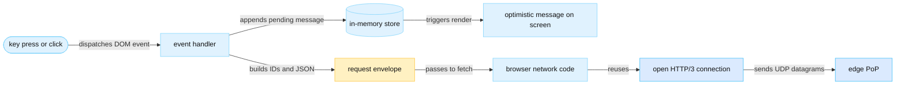
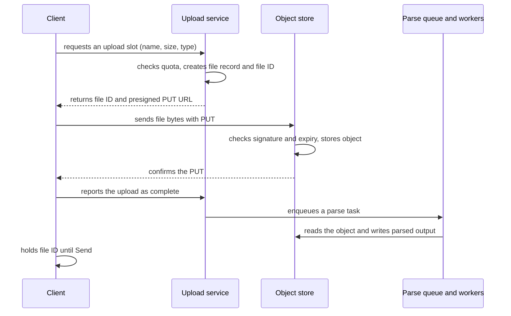
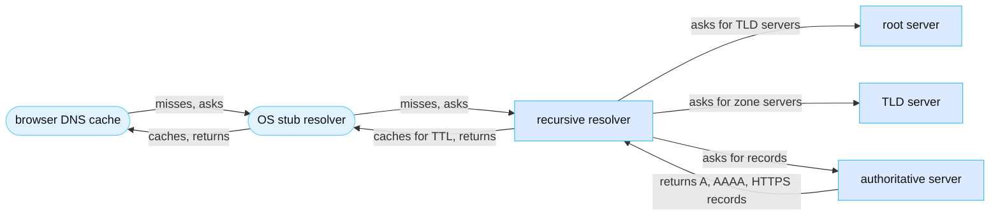
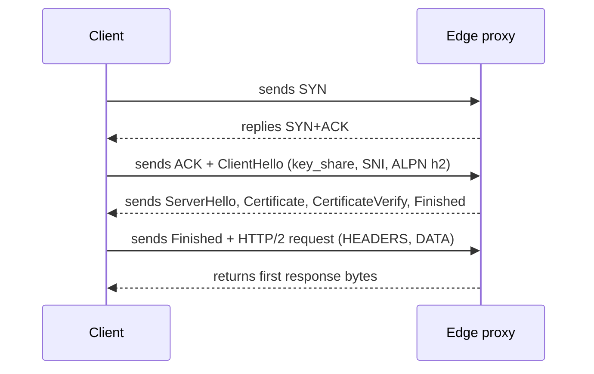
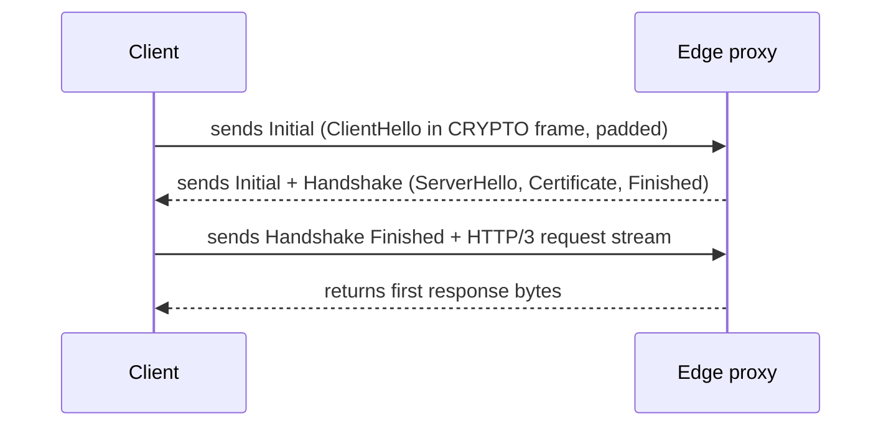
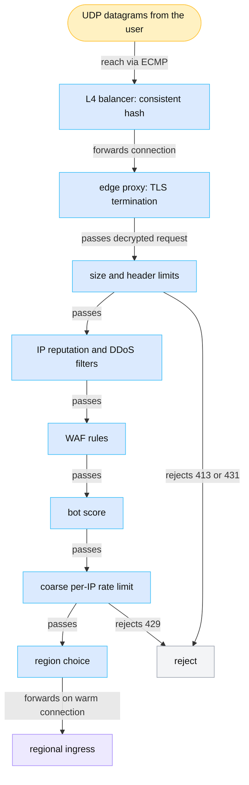
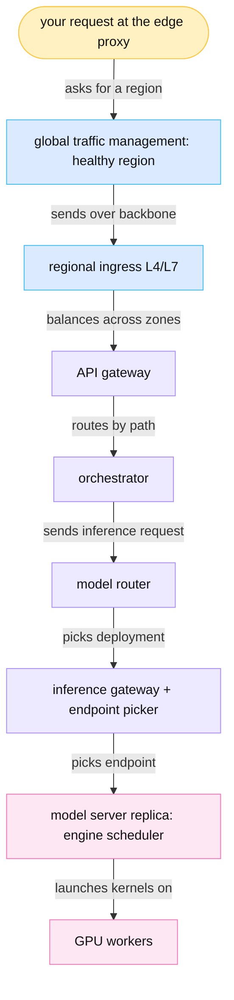

<!-- GENERATED from manuscript/src/part-02-client-and-global-network.md by tools/render_manuscript.py. Edit the source, not this file. -->
# Part 02: The client and the global network

Your request leaves the browser as a small JSON envelope on an open encrypted connection. A nearby edge checks it and sends it to a healthy region.

This part follows your request from the key press to the regional ingress. The reference user sits in Nairobi (hypothetical). This reference system has four regions, and all of them are far from the user (RA-05):

| Region | City (hypothetical) | Great-circle distance from the user | Fiber round trip, lower bound |
|---|---|---|---|
| `ap_south` | Mumbai | 4,542 km | 44.5 ms |
| `eu_west` | Dublin | 7,262 km | 71.1 ms |
| `ap_northeast` | Tokyo | 11,248 km | 110.2 ms |
| `us_east` | Ashburn, Virginia | 12,176 km | 119.2 ms |

The path has eight steps, one per section:

1. The browser builds the request (2.1).
2. The files travel before the click (2.2).
3. DNS gives the browser an IP address (2.3).
4. BGP and anycast carry the packets to a nearby point of presence (PoP), a group of edge servers (2.4).
5. The client and the edge share an open connection (2.5).
6. The edge checks the request (2.6).
7. Eight separate routing layers choose where the request goes (2.7).
8. A saturated region sends the request to another region, at a cost in round trips (2.8).

Two numbers decide most of the network latency in this part. The round-trip time (RTT) is the time from sending a packet to receiving the reply. The RTT from the user to the nearest PoP is 20 ms (hypothetical). The RTT from that PoP to each region comes from distance and the speed of light in fiber (2.8).

---

## 2.1 Pressing Send ▣

The click on Send runs one JavaScript function. That function updates the page, creates IDs and hands a small JSON request to the browser's network code.

### From the key press to the event handler

The path from the keyboard to the page's code has five steps:

1. The keyboard or touch screen sends an input event to the operating system.
2. The operating system delivers the event to the browser process.
3. The browser process forwards the event to the renderer process that runs the page.
4. The renderer dispatches a DOM event to the target element: `keydown` for the Enter key, or `click` for the button.
5. The page's handler for that event runs.

The handler belongs to the frontend application: the JavaScript code of the chat page. From here on, the word "client" means that code, or the code of a mobile app. The renderer runs the page's JavaScript on one event loop. The event loop takes one task at a time from a queue and runs it to the end [SRC-375]. So the page cannot repaint while the handler runs. A good handler therefore does a little synchronous work and starts all slow work as asynchronous operations.

### State and the optimistic render

The client keeps the conversation in an in-memory store. The store is a JavaScript object, and the UI library reads it to draw the page. For the open conversation, the store holds:

- The conversation ID and its title.
- An ordered list of message IDs.
- A map from message ID to message (role, text, attachments, status).
- The text in the input box and the list of attached file IDs.
- The selected model and the enabled tools.

The handler appends your message to the list with the status `pending`. It clears the input box. It also adds an empty assistant message with a typing indicator. The name of this technique is optimistic rendering: the page shows the expected result before the backend confirms it. The browser paints the change at its next rendering update. In that update, the HTML standard runs `requestAnimationFrame` callbacks before style, layout and paint [SRC-152].

Optimistic rendering hides one network round trip from the user. It also creates a duty: the client must later reconcile its guess with the real answer. Three outcomes are possible:

1. The backend accepts the message. The first SSE event confirms the message ID, and the client sets the status to `sent`.
2. The backend rejects the message, for example with `429` or `401`. The client sets the status to `failed` and offers a retry.
3. The connection breaks before any answer arrives. The client does not know whether the backend stored the message. So it retries with the same idempotency key (below).

### Three IDs and one key

Four identifiers travel with the request. Each one has a different owner and a different lifetime:

| Identifier | Who creates it | Lifetime | Purpose |
|---|---|---|---|
| conversation ID | the backend, at turn 1 | the whole conversation | selects the stored conversation; the backend loads the history by this ID |
| message ID | the client, at the click | permanent | matches the optimistic message to the stored message; becomes the parent of the assistant's answer |
| request ID | the client, for each HTTP attempt | one attempt | joins the client's logs with the edge and backend logs for one attempt |
| idempotency key | the client, at the click | one Send, across all its retries | lets the backend recognize a retry of a Send that it already accepted |

An idempotency key is a value that the client attaches to every attempt of one operation. With it, the operation runs at most once. A retry after a broken connection needs it. The first attempt may have reached the backend and started an inference pass. A second attempt without a key would start a second pass. It would also charge the quota twice and store the message twice.

With the key, the backend stores the key and the outcome of the first attempt for a limited time. A request with a known key then gets the stored outcome, or it attaches to the running attempt. It never starts new work.

A common design creates the key at the click, with the message ID. It sends the key in an `Idempotency-Key` header. Every retry of that Send carries the same key. This header is a convention, not a standard. Its IETF draft expired on 2026-04-18 and never became an RFC [SRC-208]. The draft proposed three answers [SRC-208]:

- `400` when a route requires a key and the request has none.
- `422` when a known key arrives with a different payload.
- `409` when a retry arrives while the first attempt still runs.

### What the envelope carries, and what it does not

The request body names the new message and points at everything else. Its fields are:

- **Model selection.** The value of the model picker, as an alias such as `assistant-frontier`. In this reference system, the model router turns the alias into a deployment by rules (RA-15, part 3.7). The rules use the user's choice, the plan, the modality and the context length.
- **Attachment references.** Only file IDs. The bytes went to object storage before the click (2.2).
- **Tools and tool permissions.** The tools that the user enabled in the UI. The backend intersects this list with the tenant's policy (part 6.3).
- **User settings.** Locale, time zone, and whether long-term memory is on.
- **Feature flags.** The client fetched its flags when the page loaded, so it can draw the right controls. It does not need to send them. The backend evaluates every flag again on its own side.

The envelope does not carry the earlier turns, the long-term memory records, the workspace documents or the system prompt. The backend loads them by conversation ID and by the user's identity (part 3.4, part 5). This keeps the request small. It also keeps every trust decision on the backend.

The rule behind these fields: every field from the client is a request, not a permission. A modified client can send any model name or any tool list. So the backend derives every entitlement again from the authenticated identity.

### The envelope

The following envelope is illustrative only. It is a conceptual envelope filled with the reference request. It is not the private API of any product. All IDs are opaque example strings.

```json
{
  "conversation_id": "conv_6f1d2a9c3b7e4058",
  "message_id": "msg_01JA4Q7Z3K9W2T6R8Y5U0P1M4N",
  "parent_message_id": "msg_01JA4Q2B8D5F7H1J3L6N9Q0S2V",
  "model": "assistant-frontier",
  "input": [
    {
      "role": "user",
      "content": [
        {
          "type": "text",
          "text": "Here is our Q3 report and a photo of last week's whiteboard plan. Using our pricing policy, check the current list prices of our three main competitors, compute our gross margin at each of their price points, and plot it. Cite your sources."
        }
      ]
    }
  ],
  "attachments": [
    {
      "file_id": "file_9c2e71b04d5a48f3",
      "kind": "image"
    },
    {
      "file_id": "file_3a8f60d2c1e94b7a",
      "kind": "document",
      "name": "q3-report.pdf"
    }
  ],
  "tools": [
    "web_search",
    "code_execution",
    "workspace_search"
  ],
  "settings": {
    "memory": true,
    "locale": "en-KE",
    "timezone": "Africa/Nairobi"
  },
  "stream": true
}
```

HTTP/3 has no text request line. It sends the method and path as pseudo-header fields. The illustrative header fields of the request are:

```http
:method: POST
:scheme: https
:authority: chat.example
:path: /api/conversation
content-type: application/json
accept: text/event-stream
authorization: Bearer <short-lived access token>
idempotency-key: "4b7e2c91-0d3a-4f6e-9a58-2c1b7d3e8f40"
x-request-id: req_7Hq2Lm9Xv4Bn
```

The compact JSON body has 764 bytes.

### Authentication and CSRF

The backend must know who sends the request. Browsers support two common designs:

1. **A session cookie.** The backend sets an `HttpOnly` cookie at login [SRC-900]. The browser attaches the cookie to every request to that origin. Page scripts cannot read it.
2. **A bearer access token.** The page holds a short-lived token in memory. The page's code puts the token in the `Authorization` header of each request.

In this reference system, the client sends a short-lived access token in the `Authorization` header (RA-07). The API gateway validates it (part 3.4). When the token has expired, the gateway returns `401`. The client then gets a new token and retries with the same idempotency key.

Cross-site request forgery (CSRF) is an attack in which another website makes the user's browser send a state-changing request. It works against cookies, because the browser attaches cookies automatically [SRC-173]. OWASP lists these defenses [SRC-173]:

- A synchronizer token: a random value tied to the session and checked on every state change.
- A signed double-submit cookie, bound to the session.
- A custom request header, which forces a CORS preflight for any cross-origin call.
- The `Sec-Fetch-Site` request header, with `Origin` or `Referer` as a fallback.
- `SameSite` cookies, as defense in depth only, never as the main defense.

The browser never attaches a header such as `Authorization` on its own. Only page script can set it, and a foreign website cannot run script in this origin. So a bearer token in a header is not exposed to CSRF in the same way as a cookie. This follows from how browsers attach credentials; the OWASP page does not state it. Any cookie that the chat service still uses keeps one of the defenses above.

### Serialization and compression

The client serializes the envelope as JSON in UTF-8. JavaScript strings are UTF-16 in memory [SRC-901], so `JSON.stringify` and the encoder in `fetch()` convert them. The compact body of the reference request has 764 bytes. gzip at level 6 shrinks it to 510 bytes, a saving of 254 bytes.

That saving is small, and compression has costs. Both sides spend CPU time. The edge must decompress the body before it can inspect it (2.6). OWASP also warns that size limits must apply after decompression [SRC-194]. The `fetch()` API sends the body bytes as the page gives them, so request compression would be extra page code. For these reasons, a common design sends small JSON bodies without compression.

Header fields are different. HTTP/3 compresses them with QPACK on every request [SRC-139]. So repeated fields such as `authorization` and `content-type` cost few bytes after the first request on a connection.

The photo in the reference request has 2,900,000 bytes. That is 3,796 times the size of the envelope. This ratio is the main reason the chat request carries file IDs, not files (2.2).

### Handing the bytes to the network code

The handler calls `fetch()` with the method `POST`, the JSON body, the header fields and the signal of an `AbortController` [SRC-153]. `fetch()` returns a promise at once, and the handler returns. The event loop is free again, so the page stays responsive.

The browser's network code then does five things:

1. It looks for an open connection to the origin. For your request, an HTTP/3 connection to the nearest PoP is already open (2.5).
2. It opens a new request stream on that connection.
3. It compresses the header fields with QPACK and frames the body [SRC-139].
4. QUIC encrypts the frames and packs them into UDP datagrams.
5. The operating system sends the datagrams through the Wi-Fi or mobile radio.

When the response header fields arrive, the promise resolves. `response.body` is a `ReadableStream` [SRC-153]. In this reference system, the client reads SSE-format events from that body (RA-07, part 15). The Stop button calls `abort()` on the `AbortController`. That cancels the request, and the cancellation travels down to the engine's scheduler (RA-49).

Why `fetch()` and not the browser's `EventSource` API? `EventSource` sends only GET requests and cannot add custom header fields [SRC-146]. The chat request needs a POST body and an `Authorization` header. This is why this reference system uses `fetch()` (RA-07).



Legend: light blue = client code and state; blue = network; amber = your request's data. The one thing to notice: one click updates the screen and sends the request, and neither waits for the other. The diagram leaves out the token refresh on `401` on purpose.

### Stage card: the client at Send

| # | Question | Answer |
|---|---|---|
| 1 | Which component runs? | The frontend application's event handler, then the browser's network code. |
| 2 | On what hardware? | The user's device: its CPU for JavaScript and rendering, its Wi-Fi or mobile radio for the packets. |
| 3 | What data enters? | A DOM event, the text in the input box, the IDs of files uploaded earlier, and the store's state. |
| 4 | In what representation? | DOM event objects and JavaScript objects; text as UTF-16 strings. |
| 5 | What computation happens? | Input checks, ID creation, a store update, the optimistic render, JSON serialization to UTF-8, QPACK header compression and QUIC encryption. |
| 6 | What data leaves? | One HTTP/3 request: compressed header fields plus a JSON body of 764 bytes, inside encrypted UDP datagrams. |
| 7 | Where is state stored? | In the tab's memory: the store, the access token and the open connection. Cookies, if any, live in the browser's cookie store. |
| 8 | Is it synchronous? | The handler runs synchronously on the event loop. The network work is asynchronous behind a promise. |
| 9 | Can different users' requests run here at the same time? | No. Each user has a separate device. One tab can still have several requests open on one connection. |
| 10 | How is that concurrency achieved? | The event loop plus asynchronous I/O inside the tab; HTTP/3 request streams on one connection. |
| 11 | What is cached? | The DNS answer, the open connection, a TLS session ticket, the knowledge that the origin speaks HTTP/3, the page's code, the feature flags and the conversation list. |
| 12 | What can fail? | No network, an expired token (`401`), a network change, a closed tab, or a double click (the idempotency key removes the duplicate). |
| 13 | What does it add to latency? | A few milliseconds of CPU work. On a reused connection, no handshake round trip. |
| 14 | What limits its capacity? | Nothing at fleet scale. Over HTTP/1.1, a browser opens only about 6 connections per origin [SRC-154]. Over HTTP/2, the limit is a negotiated number of streams, 100 by default [SRC-154]. |
| 15 | How does it scale horizontally? | Every user brings a separate device, so the client tier grows with the number of users. |
| 16 | What security boundary exists? | The browser sandbox and the page's origin. The device is untrusted, so the backend checks every field again. TLS protects the bytes in transit. |

**Meanwhile in the fleet.** Your click is one of about 50,000 requests per second at the global peak (hypothetical). Each of them starts on its user's own device, so the client tier has no shared bottleneck. At the same moment, about 25,000,000 users hold an open app session (hypothetical). Most of their connections are idle. Some of them carry the tokens of answers in progress.

Counters at this moment:

- The TTFT timer starts at 0 ms.
- No backend counter has changed yet.

You can now list the fields of the chat request and explain why a retry needs an idempotency key.

---

## 2.2 Why uploads happen before Send

Files go to object storage while the user types, so the chat request carries only short file IDs.

The reference request has two files (hypothetical). The photo is a 4032 × 3024 JPEG of 2,900,000 bytes. The PDF has 18 pages and 2,100,000 bytes. Both left the browser before the click.

### The upload flow



Legend: solid arrows = requests; dashed arrows = replies. The one thing to notice: the file bytes go straight to the object store, and no API server touches them. The diagram leaves out multipart upload on purpose (below).

In this reference system, the upload flow has seven steps (RA-08):

1. The user attaches a file. The client asks the upload service for an upload slot, with the file name, size and declared type.
2. The upload service checks the user's storage quota and the size limit. It creates a file record with the status `uploading` and a new file ID.
3. The upload service returns the file ID and a presigned PUT URL with a short expiry.
4. The client sends the bytes with an HTTP PUT to the object store.
5. The object store checks the signature and the expiry in the URL, and it stores the object.
6. The client reports the finished upload. The upload service sets the status to `uploaded` and puts a parse task on a queue.
7. Parse workers check the file's real type, scan it, parse it and index it (part 4.4, part 5.1).

A presigned URL is a time-limited URL that carries the signer's permission for one operation on one object [SRC-226]. Anyone who holds the URL can use it, so it acts as a bearer token. In Amazon S3, a URL signed with an IAM user's long-term keys lives at most 7 days [SRC-226]. This reference system signs each URL with a short expiry instead (RA-08). A leaked URL then stays usable only for a short time.

Large files use multipart upload: the client sends parts in parallel, and it retries only a failed part. AWS suggests multipart from about 100 MB, and S3 allows up to 10,000 parts per object [SRC-227]. This reference system switches to multipart at that size (RA-08). Both reference files are far below it, so each one needs a single PUT.

### Why the files go first

Five reasons put the upload before the click:

1. **No API server holds file bytes.** A chat request occupies a gateway connection and an orchestrator task for the whole answer. Megabytes of upload in the same request would hold that memory far longer.
2. **The slow work starts early.** Parsing, OCR and embedding of the PDF run at upload time (part 4.4, part 5.1). At Send, only retrieval remains.
3. **The chat request stays small.** It has 764 bytes instead of several megabytes. A retry resends only those bytes.
4. **The transfer time leaves the TTFT path.** The photo alone needs 8 round trips at the start of a new connection (2.5). The user types while those round trips happen.
5. **One place checks every file.** The client supplies the declared content type, so OWASP warns that the service cannot trust it [SRC-194]. It recommends an extension allowlist, size limits applied after decompression, and an antivirus scan or sandbox [SRC-194]. The upload service and the parse workers apply these checks once, for every later use of the file.

When the chat request names a file ID, the backend checks three things before it uses the file:

- The file belongs to the same user and tenant.
- The file's status is `uploaded` or `parsed`, not `uploading` or `rejected`.
- The parse result exists, or the request waits for it with a deadline.

### How mobile clients differ

A native mobile app follows the same flow, with four differences:

1. **Native networking stacks.** The app uses the platform's HTTP library instead of the browser's `fetch()`. That library has its own connection pool, its own HTTP/3 support and its own certificate rules.
2. **Background limits.** Mobile operating systems suspend apps in the background. An open stream can stop when the user switches apps. A common design lets the backend finish the answer anyway. The app then fetches the stored message by ID when it returns (RA-48).
3. **Network handoff.** A phone moves between Wi-Fi and mobile data, and its IP address changes. A TCP connection dies with the old address. QUIC can migrate a connection to the new address, because it identifies the connection by connection IDs, not by addresses [SRC-140].
4. **Push notifications.** A long answer can finish while the app sleeps. The backend can then send a push notification through the platform's push service. The notification carries only an ID, and the app then fetches the message.

Uploads on mobile also use multipart more often, because the link breaks more often. A part retry costs less than a full retry.

**Meanwhile in the fleet.** Uploads run all the time, not only at Send. While your PDF waits in the parse queue, parse workers parse the documents of other users. The queue absorbs bursts, so a spike of uploads delays parsing but never delays chat requests. The object store sees PUTs from presigned URLs, and the API servers see only small JSON requests.

You can now explain why the chat request carries only file IDs, and how the backend checks them.

---

## 2.3 DNS resolution and what is already cached

DNS turns the chat service's domain name into an IP address. For your request, every cache already holds the answer.

### The resolvers

The Domain Name System (DNS) maps names to records. RFC 1034 defines three roles [SRC-128]:

- A **stub resolver** runs on the user's device. It forwards questions to a recursive resolver.
- A **recursive resolver** answers for many users. It queries the root servers, then the TLD servers, then the authoritative server, and it caches every answer.
- An **authoritative server** holds the zone data for a domain and gives the final answer.

Caches exist in the browser, the operating system's stub resolver and the recursive resolver [SRC-128]. A forwarder between them can add one more. Every cached record expires after its TTL. The TTL (time to live) is a 32-bit count of seconds with only positive values [SRC-129]. Zero means "do not cache" [SRC-129]. Negative answers ("no such name") are cached too, with a lifetime from the zone's SOA record [SRC-131].



Legend: light blue = on the user's device; blue = DNS servers on the network. The one thing to notice: each layer answers from its cache when it can. So a full lookup from the root is rare. The diagram leaves out DNS over HTTPS and other encrypted transports to the resolver on purpose.

### A full miss, step by step

When no cache holds the answer, resolution takes six steps:

1. The browser checks its own DNS cache and misses.
2. The browser asks the operating system's stub resolver, which misses.
3. The stub resolver sends a UDP query to the recursive resolver. This costs one round trip to the resolver.
4. The recursive resolver asks a root server, then a TLD server, then the authoritative server. It reuses any of these answers that it has cached.
5. The authoritative server returns the records.
6. Each layer stores the answer for its TTL and passes it down.

A classic DNS message over UDP is at most 512 bytes [SRC-129]. Larger answers need the EDNS(0) extension or a retry over TCP.

### Records that matter for the connection

The browser asks for three record types:

- `A` and `AAAA` records give the IPv4 and IPv6 addresses.
- The `HTTPS` record (RFC 9460) gives connection hints in the same lookup, including the `alpn` parameter [SRC-130]. A value of `h3` tells the browser that the origin speaks HTTP/3, so the browser can try QUIC first.

The older way to learn about HTTP/3 is the `Alt-Svc` response header [SRC-139]. It needs one earlier visit over HTTP/1.1 or HTTP/2. So the first visit to an origin may use TCP even when the origin supports QUIC.

### Anycast answers and geo-aware answers

DNS can steer users in two ways:

1. **Anycast answers.** The authoritative server returns the same addresses to everyone. Many PoPs announce those addresses, and the internet's routing picks a PoP (2.4).
2. **Geo-aware answers.** The authoritative server returns different addresses for different users. It guesses the user's location from the recursive resolver's address. Some resolvers also send part of the client's subnet.

A geo-aware answer guesses from the resolver, not the user. A user of a distant public resolver can get a distant edge. An anycast answer needs no guess, but it gives weak control over load (2.4).

This part is not public. How a real provider steers users to its edge is not documented. Two realistic options are pure anycast and geo-aware DNS, and a provider can combine them. In this reference system, DNS returns anycast addresses (RA-01).

### What is already cached before Send

For your request, every piece of setup state already exists. The user had the page open:

| State | Where it lives | What bounds its life |
|---|---|---|
| the `A` / `AAAA` answer | browser, OS stub resolver, recursive resolver | the record's TTL |
| the `HTTPS` record with `alpn=h3` | the same caches | the record's TTL |
| the knowledge that the origin speaks HTTP/3 | the browser | the `Alt-Svc` lifetime |
| an open QUIC connection to the edge | the browser and the edge | idle timeouts at both ends |
| a TLS session ticket | the browser | at most 7 days [SRC-136] |

So DNS adds no round trip to your request. A cold visit pays at least one round trip to the recursive resolver. It pays more when the resolver must query the root, TLD and authoritative servers.

**Meanwhile in the fleet.** Recursive resolvers around the world answer millions of lookups for the chat service's domain name from their caches. Only when a TTL expires does a resolver ask the authoritative servers again. So a short TTL gives faster control during a failover, and a long TTL gives fewer queries. The authoritative servers see a small fraction of the users' lookups.

You can now name each DNS cache, explain what a TTL bounds, and say why your request skips DNS.

---

## 2.4 BGP and anycast: how the nearest edge is chosen

The internet's routing protocol chooses paths by policy and by the number of networks crossed, not by distance. So anycast delivers packets to the topologically preferred PoP, which is not always the geographically nearest one.

### BGP at an engineering level

The internet is a set of autonomous systems (AS). An AS is a network under one operator's routing policy, such as an ISP or a cloud provider. The Border Gateway Protocol (BGP-4) carries reachability information between autonomous systems [SRC-132]. Two BGP routers keep a TCP session on port 179 and exchange four message types [SRC-132]:

| Message | What it does |
|---|---|
| `OPEN` | starts the session and sets the hold time |
| `UPDATE` | announces or withdraws IP prefixes, with path attributes |
| `KEEPALIVE` | keeps the session alive inside the hold time |
| `NOTIFICATION` | reports an error and closes the session |

An `UPDATE` carries path attributes. Three of them decide most choices [SRC-132]:

- `AS_PATH`: the list of autonomous systems that the route crossed. A router rejects a route that already contains its own AS, so loops cannot form.
- `LOCAL_PREF`: a preference value inside one AS. A higher value wins.
- `MULTI_EXIT_DISC` (MED): a hint from a neighbor AS about which link to use. A lower value wins, and routers compare it only between routes from the same neighbor AS.

When a router knows several routes to one prefix, RFC 4271 picks one in this order [SRC-132]:

1. The highest `LOCAL_PREF`. The operator sets this value by policy.
2. The shortest `AS_PATH`.
3. The lowest origin type.
4. The lowest MED, among routes from the same neighbor AS.
5. A route learned from another AS (eBGP) over one learned inside the AS (iBGP).
6. The lowest interior cost to the exit point.
7. The lowest BGP identifier, as the final tie-break.

No step measures latency or distance. The "best" path is a policy choice and a count of networks.

### Anycast

Anycast means that two or more locations announce the same IP prefix [SRC-133]. RFC 4786 says that the routing system decides which node receives each request [SRC-133]. The choice depends on the topology of the routing system and on where the request starts [SRC-133]. So the user's ISP and its BGP policy decide which PoP receives the packets.

Anycast has three properties that shape the design:

1. **Nearness by topology.** Packets go to the PoP that BGP prefers from the user's network. That PoP is usually close in network terms.
2. **Weak control over load.** RFC 4786 says that balancing load between anycast nodes "is typically difficult to achieve" [SRC-133]. One PoP can receive far more traffic than another.
3. **Risk for long connections.** When a route changes, later packets of one connection can reach a different node [SRC-133]. Equal-cost paths can do the same [SRC-133]. The new node has no state for the connection.

This reference system adds a second layer behind each anycast address (RA-01). Routers spread packets over a group of Layer 4 balancers. Every balancer uses the same consistent hash, so each one picks the same proxy for a given connection [SRC-135]. Each balancer also keeps a connection table, so a connection keeps its proxy when the set of proxies changes [SRC-135]. Google's Maglev documents this pattern [SRC-135].

This layer fixes point 2 inside a PoP. It also fixes the part of point 3 that comes from routers inside one PoP. A move to a different PoP still breaks the connection, and the client reconnects. For QUIC, a balancer can also route by connection ID instead of by addresses and ports. That keeps a migrated connection on the same proxy.

### Distance is not topology

Distance sets a lower bound on delay. Topology sets the real path. A packet can only follow cables that exist, through networks that agree to carry it.

Take an illustrative case. Suppose the BGP policy of the user's ISP sends all traffic to Mumbai through an exchange in Dublin. This path is hypothetical, not a measured route. The fiber lower bounds are then:

| Path | Great-circle length | Fiber RTT, lower bound |
|---|---|---|
| user → Mumbai, direct | 4,542 km | 44.5 ms |
| user → Dublin | 7,262 km | 71.1 ms |
| user → Dublin → Mumbai | 14,865 km | 145.6 ms |

On the detour, the geographically nearest region costs 3.3 times the direct round trip. It is then slower than the second-nearest region. So a routing layer that ranks regions by map distance can choose wrong. In this reference system, global traffic management therefore ranks regions by latency, not by map distance (RA-06).

Real paths are longer than great circles even without such a detour. Cables follow coasts and seabeds, and routers add queueing and processing delay. No sourced factor for this extra length exists for these routes. So every fiber number in this part is a lower bound.

This part is not public. Which edge a real provider's users reach, and over which paths, is not documented. Two realistic options are pure BGP anycast and DNS-based steering, or both together. In this reference system, DNS returns anycast addresses and BGP picks the PoP (RA-01).

**Meanwhile in the fleet.** Each PoP announces the same prefixes to its upstream networks. When a PoP fails or goes into maintenance, it withdraws its announcements. BGP then moves that PoP's users to their next-preferred PoP. Their open connections break, and their clients reconnect to the new PoP.

You can now explain why BGP chooses by policy, and why the nearest region on a map can be slower.

---

## 2.5 Opening the connection: round trips, reuse and 0-RTT

An already-open connection lets your request leave at once. A new connection first costs one to three round trips, depending on the protocol stack.

The client and the edge can talk over two protocol stacks. In this reference system, the client uses HTTP/3 over QUIC when it can (RA-02). It falls back to HTTP/2 over TCP and TLS 1.3. RFC 9846 specifies TLS 1.3 and replaces RFC 8446 [SRC-136].

### Path 1: TCP, then TLS 1.3, then an HTTP/2 stream



Legend: solid arrows = client to edge; dashed arrows = edge to client. The one thing to notice: the request leaves only on the third flight, after two full round trips. The diagram leaves out the HTTP/2 connection preface and SETTINGS frames on purpose.

The handshake has three parts:

1. **TCP.** The client sends SYN, the edge replies SYN+ACK, and the client sends ACK [SRC-137]. This costs one round trip before the client can send data.
2. **TLS 1.3.** The client's ClientHello carries a key share, the server name (SNI) and the application protocol list (ALPN). The edge replies with its key share, its certificate, a signature and its Finished message. The client checks the certificate and sends its own Finished. This costs one more round trip [SRC-136].
3. **HTTP/2.** The client may send its request in the same flight as its Finished message [SRC-136]. The request is one HTTP/2 stream on the connection [SRC-138].

### Path 2: QUIC with TLS 1.3 inside, then an HTTP/3 stream



Legend: as above. The one thing to notice: QUIC merges the transport and TLS handshakes, so the request leaves after one round trip. The diagram leaves out the HTTP/3 control streams on purpose.

QUIC runs over UDP. It carries the TLS 1.3 handshake messages inside its own CRYPTO frames [SRC-141]. So one round trip sets up both the transport and the keys [SRC-140]. Each HTTP/3 request uses one bidirectional QUIC stream, and the ALPN token is `h3` [SRC-139].

QUIC adds one guard against abuse. The client's first datagram must have at least 1,200 bytes [SRC-140]. Before the edge validates the client's address, it may send at most 3 times the bytes it received [SRC-140]. For one minimum-size Initial, that budget is:

```
3 × 1,200 bytes = 3,600 bytes
```

A long certificate chain can exceed this budget. The edge must then wait for the client's next datagram, and the handshake costs one more round trip. So operators keep certificate chains short.

### Round trips for each path

The table counts round trips from the first packet until the request leaves, and until the first response byte arrives. It assumes no loss, zero processing time and a cached DNS answer [SRC-136] [SRC-137] [SRC-140]. The last two columns convert the counts with the hypothetical RTTs of the reference user:

- 20 ms to the PoP in the user's metro.
- 64.5 ms to Mumbai, the nearest region, if no PoP existed.

| Path | RTTs before the request leaves | RTTs to the first response byte | Request leaves (PoP) | Request leaves (no edge, Mumbai) | Allowed for the chat POST? |
|---|---|---|---|---|---|
| new TCP + TLS 1.2 (for comparison) | 3 | 4 | 60 ms | 193.4 ms | not offered |
| new TCP + TLS 1.3 + HTTP/2 | 2 | 3 | 40 ms | 129.0 ms | yes |
| TCP + TLS 1.3 resumed, no early data | 2 | 3 | 40 ms | 129.0 ms | yes |
| TCP + TLS 1.3 with 0-RTT | 1 | 2 | 20 ms | 64.5 ms | no: `425` (RA-03) |
| new QUIC + HTTP/3 | 1 | 2 | 20 ms | 64.5 ms | yes |
| QUIC with 0-RTT | 0 | 1 | 0 ms | 0.0 ms | no: `425` (RA-03) |
| reused open connection | 0 | 1 | 0 ms | 0.0 ms | yes |

Each round trip costs a full RTT, so the counts multiply the distance. A first visit also pays the DNS lookup in front of every new path (2.3).

### Why an open connection saves whole round trips

In this reference system, your request uses an HTTP/3 connection that the page opened earlier (RA-02, RA-07). It needs no handshake, so it leaves at 0 ms. Compare it with a new TCP + TLS 1.3 connection:

```
round trips saved   = 2 RTT
saved at the edge   = 2 × 20 ms = 40 ms
saved with no edge  = 2 × 64.5 ms = 129.0 ms
```

The saving is a count of round trips times the RTT, so it grows with distance. That is why the client keeps its connection open between messages. HTTP keep-alive does the same for HTTP/1.1. Each end closes an idle connection after its own idle timeout.

The PoP saves round trips in a second way. It ends the client's connection in the user's metro. It then forwards the request to the region over a connection that is already open. A common design keeps a pool of such warm connections from each PoP to each region. The handshake round trips then cross only the short access link. The first response byte arrives at:

```
through the edge:  (n + 1) × RTT_edge + RTT_backbone
without an edge:   (n + 1) × (RTT_edge + RTT_backbone)
saving:            n × RTT_backbone
```

Here `n` is the number of handshake round trips. For each path to Mumbai:

| Path | First response byte through the edge | First response byte with no edge | Saving |
|---|---|---|---|
| reused connection | 64.5 ms | 64.5 ms | 0.0 ms |
| new QUIC + HTTP/3 | 84.5 ms | 129.0 ms | 44.5 ms |
| new TCP + TLS 1.3 | 104.5 ms | 193.4 ms | 89.0 ms |

These are network floors with zero processing time. They show the design rule: put the handshake close to the user, and keep the long path warm.

### Resumption and 0-RTT, with the replay caveat

After a full handshake, the edge sends the client a session ticket (`NewSessionTicket`) [SRC-136]. A ticket lives at most 7 days [SRC-136]. On the next connection, the client presents the ticket as a pre-shared key (PSK). Resumption skips the certificate and the signature check. It still takes one round trip, so without early data it saves CPU and bytes, not time [SRC-136].

0-RTT goes further. The client sends application data in its first flight, encrypted with keys from the ticket [SRC-136]. RFC 9846 gives two warnings about this early data [SRC-136]:

- "The protocol does not provide any forward secrecy guarantees for this data."
- "There are no guarantees of non-replay between connections."

An attacker can record the first flight and send it again on a new connection. TLS can limit this. Each server that accepts the ticket must accept the same 0-RTT handshake at most once [SRC-136]. A large deployment still has many such servers, and HTTP requests need protection at the application layer anyway.

RFC 8470 defines that layer [SRC-145]. An intermediary that forwards early data adds the header field `Early-Data: 1`. A server that does not want to process a request as early data answers `425 Too Early`. "Clients that use early data MUST retry requests upon receipt of a 425" [SRC-145]. The retry goes out after the handshake ends.

A chat POST is not safe to replay. It starts an inference pass, uses GPU time, charges quota and may run tools. In this reference system, the edge accepts 0-RTT only for idempotent GET paths, such as static assets (RA-03). It answers `425 Too Early` to a chat POST sent as early data. So the best new-connection path for the chat POST is a new QUIC connection with one round trip.

### Multiplexing

HTTP/2 and HTTP/3 carry many requests on one connection. Each request is a separate stream with its own ID [SRC-138] [SRC-139]. RFC 9113 recommends that a server allow at least 100 concurrent streams [SRC-138]. HTTP/1.1 has no multiplexing, so browsers open about 6 connections per origin instead [SRC-154]. A long-lived SSE response would hold one of those few connections for the whole answer.

On your connection, the chat POST is one stream. The page may also load images, send telemetry or poll the conversation list on other streams of the same connection.

### Flow control

Flow control stops a fast sender from filling a slow receiver's memory. HTTP/2 gives each stream and the whole connection a window of bytes that the sender may send without acknowledgement. The initial window is 65,535 bytes [SRC-138]. The receiver grows the window with `WINDOW_UPDATE` frames as it consumes data. QUIC has the same two levels: per stream (`MAX_STREAM_DATA`) and per connection (`MAX_DATA`) [SRC-140].

A window caps the rate at one window per round trip. With the initial HTTP/2 window:

| Leg | RTT | Maximum rate with a 65,535-byte window |
|---|---|---|
| user → PoP | 20 ms | 3.28 MB/s |
| PoP → Mumbai | 44.5 ms | 1.47 MB/s |
| user → Mumbai, no edge | 64.5 ms | 1.02 MB/s |

A token stream at about 21 tokens per second (hypothetical, part 14.2) carries a few kilobytes per second. So these caps never bind it. A file upload is different. At the initial window, the photo would need 45 round trips. So receivers raise their windows early, and the edge and the gateway grant large windows on long paths.

HTTP/2 flow control works hop by hop [SRC-138]. Each proxy has its own window toward each side. A proxy must therefore pass backpressure on: when the client reads slowly, the proxy must stop reading from upstream. In this reference system, every hop honours flow control and keeps only a bounded buffer per stream (RA-49, part 15).

### Congestion control

Congestion control stops a sender from overloading the network path. The sender keeps a congestion window: the bytes it may have in flight without acknowledgement. QUIC's default congestion control algorithm starts with this window [SRC-142]:

```
initial window = min(10 × max_datagram_size, max(2 × max_datagram_size, 14,720 bytes))
               = min(10 × 1,200, max(2 × 1,200, 14,720)) = 12,000 bytes
```

The second line assumes the 1,200-byte minimum datagram size. TCP's equivalent starts at 10 segments [SRC-144]. In slow start, the window grows by the bytes acknowledged [SRC-142]. If the receiver acknowledges the whole window within one round trip, the window therefore doubles. Round k sends `IW × 2^(k−1)` bytes, so k rounds send `IW × (2^k − 1)` bytes. The rounds a new connection needs for the reference files, with no loss:

```
photo: k = ceil(log2(2,900,000 / 12,000 + 1)) = 8 round trips
PDF:   k = ceil(log2(2,100,000 / 12,000 + 1)) = 8 round trips
```

| Where the upload connection ends | RTT | Photo transfer time |
|---|---|---|
| the PoP in the user's metro | 20 ms | 160 ms |
| the nearest region, with no edge | 64.5 ms | 516 ms |

This is the time that leaves the TTFT path when the upload runs before Send (2.2). The chat envelope itself fits inside the initial window, so it needs no extra round trip.

When the sender detects loss, it shrinks the window. QUIC's default congestion control algorithm halves it: the loss reduction factor is 0.5 [SRC-142]. CUBIC, the common choice for TCP, reduces it to 0.7 of its earlier maximum [SRC-143]. CUBIC then regrows the window along a cubic curve [SRC-143]:

```
W_cubic(t) = C × (t − K)³ + W_max,   with C = 0.4 and K = cuberoot((W_max − cwnd_epoch) / C)
```

Here `t` is the time since the last reduction, and `W_max` is the window just before the loss. BBR takes a different approach: it estimates the path's bottleneck bandwidth and minimum RTT, and it paces packets to match. BBR is an experimental IETF draft, not an RFC [SRC-205].

### Head-of-line blocking: TCP versus QUIC

TCP delivers one ordered byte stream. When one segment is lost, the receiver holds every later byte until the retransmission arrives. HTTP/2 puts all its streams on that one byte stream. So one lost segment stalls every stream on the connection, including unrelated ones. RFC 9113 says plainly: "TCP head-of-line blocking is not addressed by this protocol" [SRC-138].

QUIC orders bytes per stream, not per connection. RFC 9000 states that a lost packet blocks only the streams with data in that packet [SRC-140]. Other streams continue to make progress [SRC-140]. One caveat remains. A packet that carries data of several streams blocks all of them when it is lost [SRC-140].

For your request, this matters on lossy mobile links. With HTTP/2, a lost segment of a page image also delays your token stream. With HTTP/3, the token stream continues.

**Meanwhile in the fleet.** At the global peak, about 25,000,000 users hold an open app session (hypothetical). Their clients keep their connections open between messages, so most chat requests skip every handshake. Each PoP shares its session-ticket keys across its servers. So a client that reconnects to another server of the same PoP can still resume. New connections still arrive all the time from new page loads, phones that changed networks, and expired idle timeouts.

You can now count the round trips of each connection path and compute what an open connection saves.

---

## 2.6 The edge: what must pass before the backend ▣

The PoP decrypts your request and runs cheap checks in a fixed order. Only a request that passes every check enters the private backend.

### Inside the PoP

A PoP is a group of edge servers close to users (part 1.1). In this reference system, each PoP has three layers (RA-01):

1. Routers receive packets for the anycast prefix. They spread them over the L4 balancers with equal-cost multipath (ECMP) [SRC-135].
2. An L4 balancer (Maglev-style) picks one edge proxy per connection by consistent hashing. It remembers the choice in a connection table [SRC-135].
3. An L7 edge proxy (Envoy) terminates TLS and runs the checks.



Legend: amber = your request's packets; blue = edge components; violet = regional CPU tier; grey = rejection. The one thing to notice: the checks run from cheapest to most expensive, and a failed check stops the request. The diagram leaves out the blocks and challenges of the middle checks on purpose; each of them can also reject.

### The checks, in order

In this reference system, the edge runs its checks in this order (RA-04):

1. **TLS termination.** The edge proxy holds the PoP's certificate and private key. It completes the handshake, selects the certificate by SNI, and decrypts the request. The edge must decrypt first, because every later check reads HTTP fields.
2. **Size and header limits.** The proxy rejects a body above the route's limit with `413 Content Too Large` [SRC-210]. It rejects oversized header fields with `431 Request Header Fields Too Large` [SRC-160]. These checks cost almost nothing. They also bound the memory that one request can hold in every later stage.
3. **IP reputation and DDoS filters.** The proxy drops traffic from addresses on blocklists. A common design applies packet-level (L3/L4) DDoS rules to raw packets before TLS. HTTP-level rules need decryption, so they act after TLS. DDoS systems also sample traffic outside the request path and derive a fingerprint of each attack [SRC-158]. They then push a mitigation rule to the edge [SRC-158]. Cloudflare, as one documented example, reports that its managed rules mitigate an attack in up to 3 s on average [SRC-158].
4. **WAF.** A web application firewall (WAF) matches the request against rules for known attack patterns. Cloudflare, as one documented example, evaluates IP access rules, then custom rules, then rate-limiting rules, then managed rules [SRC-159]. A terminating action, such as Block or a challenge, stops the evaluation [SRC-159].
5. **Bot score.** A model scores how likely the request comes from automation. Cloudflare's score runs from 1 (likely a bot) to 99 (likely a human). It does not block on its own; rules use it [SRC-159].
6. **Coarse per-IP rate limit.** A local token bucket per source address caps request bursts (part 3.2). An exceeded limit returns `429 Too Many Requests` [SRC-160], with a `Retry-After` header [SRC-210].
7. **Forward.** The proxy chooses the region (2.7) and sends the request to the regional ingress.

### What must finish before the private backend

Every check above must finish before the request crosses into the private backend. Two kinds of checks wait for the region:

- **Authentication.** The API gateway validates the access token (part 3.4).
- **Per-tenant quotas.** Token-based rate limits need the tenant's identity and the request's token count (part 3.2).

The edge does not run them. It has no session database and no tenant quota state. So the edge filters by network properties, and the gateway filters by identity. This order puts the cheap checks first and keeps attack traffic away from the expensive tiers.

### Other edge duties

- **Certificate handling.** The PoPs hold certificates for the chat origin and renew them before they expire. They also share the session-ticket keys within a PoP, so resumption works on any of its servers.
- **Geolocation.** The edge maps the client's IP address to a country and region. Global traffic management uses this to apply data-residency rules (2.7). The mapping guesses from the address, so it can be wrong for VPN and mobile users.
- **Abuse prevention.** Signals from many requests feed shared lists: abusive addresses, stolen-token patterns, and fingerprints of automated clients.
- **Traffic shaping.** Under load, the edge limits new connections per PoP and sorts requests by priority. It slows or rejects the lowest priority first.
- **Header hygiene.** The edge removes header fields that a client could forge, such as internal trace or identity fields. It then adds its own: the W3C `traceparent` (RA-52), the client's country, and the TLS and bot verdicts.
- **Early data.** The edge marks a 0-RTT request with `Early-Data: 1`, or it answers `425` itself (RA-03, 2.5).

After the checks, the request crosses the provider's backbone to the region on a warm encrypted connection. The one-way trip from the Nairobi PoP to Mumbai takes at least 22.2 ms.

### Stage card: the edge PoP

| # | Question | Answer |
|---|---|---|
| 1 | Which component runs? | The PoP's routers, the L4 balancer (Maglev-style) and the L7 edge proxy (Envoy) with its filters (RA-01, RA-04). |
| 2 | On what hardware? | CPU servers and their NICs in the PoP; routers in front of them. |
| 3 | What data enters? | Encrypted QUIC datagrams over UDP, or TCP segments carrying TLS records. |
| 4 | In what representation? | Packets; after decryption, HTTP/3 frames, then a map of header fields and the body bytes. |
| 5 | What computation happens? | Packet hashing, TLS decryption, HTTP parsing, rule matching, bot scoring, rate-limit counting, region choice, header rewriting. |
| 6 | What data leaves? | The same HTTP request with added header fields, sent on a warm encrypted connection to the regional ingress; or a rejection (`413`, `425`, `429`, `431`, `403`). |
| 7 | Where is state stored? | Connection state and TLS keys in the proxy's memory; ticket keys shared within the PoP; rule sets, reputation lists and the region table pushed by a control plane; local rate-limit counters. |
| 8 | Is it synchronous? | The checks run in sequence for one request, on an asynchronous, event-driven proxy. The body streams through without full buffering. |
| 9 | Can different users' requests run here at the same time? | Yes; one proxy serves many thousands of connections at once. |
| 10 | How is that concurrency achieved? | Each proxy server runs event loops over non-blocking sockets. The L4 layer spreads connections over many proxy servers. |
| 11 | What is cached? | TLS sessions, static page assets, DNS answers for upstreams, rule sets and reputation lists. The chat POST itself is never cached. |
| 12 | What can fail? | A proxy server (the L4 layer rehashes new connections, and the connection table keeps the old ones in place); a whole PoP (BGP withdraws it, and clients reconnect elsewhere); a false positive in a WAF rule or the bot score. |
| 13 | What does it add to latency? | CPU work of well under one RTT, plus the backbone trip: at least 22.2 ms one way to Mumbai. |
| 14 | What limits its capacity? | CPU for TLS and rules, NIC bandwidth, memory for connection tables, and attack traffic. |
| 15 | How does it scale horizontally? | More proxy servers behind the L4 layer in each PoP, and more PoPs that announce the same anycast prefix. |
| 16 | What security boundary exists? | The public internet ends here. TLS from the user ends here. Beyond it, traffic travels on the provider's private backbone, encrypted again between services (RA-16). |

**Meanwhile in the fleet.** While the edge proxy checks your request, the same proxy server holds thousands of other connections. Most are idle chat sessions, some stream tokens, some load page assets. DDoS systems sample this traffic out of the request path. A new attack fingerprint becomes a rule at every PoP without any proxy restart.

Counters at this moment:

- The TTFT timer shows about 10 ms: the one-way trip from the user to the PoP.
- When the request reaches the regional ingress, it shows about 32.2 ms.

You can now list the edge checks in order and name the checks that only the region can run.

---

## 2.7 Eight kinds of routing, the routing hierarchy and its signals

Eight separate mechanisms choose where your request goes. Each one works at a different layer, with different inputs and on a different time scale.

### Eight mechanisms, kept separate

| Kind | Layer | What it chooses | Main inputs | Time scale |
|---|---|---|---|---|
| DNS load balancing | DNS answer | which addresses a resolver receives | resolver location, weights | TTL (seconds to hours) |
| anycast routing | IP (BGP) | which PoP receives the packets | BGP policy and AS paths | route changes |
| Layer 4 load balancing | TCP / UDP | which proxy server gets a connection | hash of addresses and ports, or the QUIC connection ID | per connection |
| Layer 7 load balancing | HTTP | which upstream cluster and endpoint get a request | path, header fields, endpoint health | per request |
| global traffic management | region | which region serves the request | health, capacity, RTT, residency, model availability | seconds |
| regional load balancing | inside a region | which zone and gateway server | zone health and load | per request |
| service-to-service load balancing | inside the backend | which server of an internal service | endpoint lists, health, outstanding requests | per request |
| inference-specific routing | model tier | which model deployment, then which model server | model, KV-cache state, queue depth | per request |

The eight mechanisms in turn:

1. **DNS load balancing.** The authoritative server returns different addresses, or the same addresses in different weights. It works only at lookup time. Resolvers cache the answer for its TTL, so a change reaches users slowly. In this reference system, DNS returns the same anycast addresses everywhere (RA-01). So DNS balances nothing here; it only publishes the addresses and the `HTTPS` record.
2. **Anycast routing.** BGP sends the packets to the PoP that the user's network prefers (2.4). It reacts to failures by route withdrawal, not to load.
3. **Layer 4 load balancing.** The balancer sees only addresses, ports and protocol. Maglev hashes the 5-tuple with consistent hashing and keeps a connection table [SRC-135]. So existing connections keep their proxy when the set of proxies changes. Maglev forwards packets by encapsulation, and the proxy replies to the client directly [SRC-135]. An L4 balancer cannot read paths or header fields.
4. **Layer 7 load balancing.** The edge proxy terminates TLS and parses HTTP. It chooses an upstream cluster by route (path and header fields) and an endpoint by health and load. It can retry and apply per-route limits. Envoy receives its clusters and endpoints from a control plane over xDS [SRC-155].
5. **Global traffic management.** A control plane decides, for each PoP, which regions may receive which traffic and in what proportions. In this reference system, it chooses by health, capacity, latency, data residency and model availability (RA-06).
6. **Regional load balancing.** Inside the region, the regional ingress spreads requests over the API gateway's servers in several availability zones. It drains a zone that fails its health checks.
7. **Service-to-service load balancing.** Inside the backend, each call from one service to another picks one server of the callee. In Kubernetes, a Service with its EndpointSlices lists the ready endpoints [SRC-156]. HTTP/2 and gRPC keep long-lived connections. An L4 balancer would pin every request of one connection to one server. So this layer balances each request at L7. In this reference system, Envoy does this with endpoints from xDS (RA-51).
8. **Inference-specific routing.** The model router picks the deployment by rules (RA-15, part 3.7). The inference gateway's endpoint picker then scores that deployment's model servers by KV-cache affinity and load (RA-34, RA-37, part 9). Round-robin fails here, because model servers differ in cached prefixes, queue depth and free KV blocks.

### The routing hierarchy



Legend: amber = your request; blue = network routing; violet = CPU services; pink = GPU tier. The one thing to notice: each level chooses among the children of the level above. Only the last levels know the GPUs' state. The diagram leaves out the retrieval and tool services that the orchestrator also calls on purpose (parts 5 to 8).

The hierarchy narrows the choice at each step. Global traffic management picks one region out of four. The regional ingress picks a zone and a gateway server. The model router picks one deployment. The endpoint picker picks one model server. The engine's scheduler then places your sequence in a batch on that replica's GPU workers (part 11).

### The routing signals

| Signal | Which layer uses it | Where the signal comes from |
|---|---|---|
| geography and latency | anycast (implicitly); global traffic management | BGP paths; RTT measurements from each PoP to each region |
| endpoint health and available capacity | every layer | active health checks; passive checks on real traffic; capacity reports from each region |
| data residency | global traffic management | the tenant's residency policy, which allows only some regions |
| model availability and model version | global traffic management; model router | the deployment registry: which regions run which model versions |
| user plan and feature availability | API gateway; model router | the user's entitlements, loaded after authentication |
| cost | global traffic management; model router | per-region and per-model cost tables |
| queue depth and current TTFT | global traffic management (regional totals); endpoint picker (per model server) | engine metrics such as `vllm:num_requests_waiting` (RA-53) |
| KV-cache affinity | endpoint picker; global traffic management, as conversation stickiness (a common design) | engine KV events and prefix hashes (RA-37, part 13.3) |
| GPU type | model router; endpoint picker | the deployment's hardware (`H-teach` or `H-frontier`) |

Each layer uses only the signals it can see. The edge knows RTTs and regional health, but not which model server holds your prefix. The endpoint picker knows every model server's queue and KV state, but only inside one region.

### Health checks

Every routing layer needs a list of healthy targets. Two kinds of checks build that list:

1. **Active health checks.** A checker sends a probe on a schedule and marks a target unhealthy after several failures. A Kubernetes readiness probe runs every 10 s by default [SRC-200]. Its default timeout is 1 s, and its failure threshold is 3 [SRC-200]. So with the defaults, a dead pod stays ready for up to about 30 s.
2. **Passive health checks.** The proxy watches real responses. Envoy's outlier detection ejects a host after consecutive errors [SRC-175]. The ejection time grows with each repeated ejection [SRC-175]. A cap limits the fraction of hosts that one cluster may eject [SRC-175].

A health change then travels to the data plane in steps:

1. The kubelet runs the probe and updates the pod's status.
2. The Kubernetes control loop for EndpointSlices updates the endpoint's `ready` condition [SRC-156].
3. kube-proxy, or an xDS control plane, pushes the new endpoint list to the proxies [SRC-155] [SRC-156].

Each step adds delay. No measured end-to-end figure is available, so this text gives none. Passive checks fill the gap between probes, because they react to the first failed real requests.

Global traffic management needs regional health, not pod health. A common design combines three inputs:

1. Synthetic requests from each PoP to each region.
2. The error rate of real traffic.
3. Capacity reports from each region's control plane.

**Meanwhile in the fleet.** Every layer makes its choice for thousands of requests per second, each with its own state. The L4 balancers update connection tables. The edge proxies apply new endpoint lists from xDS. The endpoint pickers read KV events from hundreds of model servers. None of them waits for another, so each layer stays fast and fails on its own.

You can now name the eight routing mechanisms, place each in the hierarchy, and list the signals it sees.

---

## 2.8 Failover across regions, and the RTT cost of distance

When the nearest region saturates, global traffic management sends new requests to the next healthy region. Each of those requests pays the extra fiber round trip, and often more.

### RTT from distance, worked for Mumbai

Light in standard single-mode fiber travels at c / n, where n is the refractive index [SRC-036]:

```
v = c / n = 299,792.458 km/s / 1.468 = 204,220 km/s
delay per km = 1 / v = 4.897 µs/km one way, so 9.79 ms RTT per 1,000 km
```

The great-circle distance between two points on a sphere comes from the haversine formula. With the mean Earth radius R = 6,371.0088 km [SRC-905], latitude φ and longitude λ:

```
PoP (Nairobi):  φ1 = -1.2921°, λ1 = 36.8219°
region (Mumbai):     φ2 = 19.076°, λ2 = 72.8777°

Δφ = 0.355490 rad      Δλ = 0.629292 rad
h  = sin²(Δφ/2) + cos φ1 · cos φ2 · sin²(Δλ/2) = 0.121757
c  = 2 · atan2(√h, √(1 − h)) = 0.712874 rad
d  = R · c = 6,371.0088 km × 0.712874 = 4,542 km

one way = d / v = 4,542 km / 204,220 km/s = 22.24 ms
RTT     = 2 × one way = 44.48 ms
```

These numbers are lower bounds. Real cables are longer than great circles, and routers, amplifiers and queues add delay. No sourced factor for the extra length exists for these routes, so this part applies none.

### From the user to every region

| Region | Distance from the PoP | One way | RTT (fiber lower bound) | Network floor of TTFT through the edge, reused connection | Penalty against Mumbai |
|---|---|---|---|---|---|
| `ap_south` (Mumbai) | 4,542 km | 22.2 ms | 44.5 ms | 64.5 ms | — |
| `eu_west` (Dublin) | 7,262 km | 35.6 ms | 71.1 ms | 91.1 ms | +26.6 ms |
| `ap_northeast` (Tokyo) | 11,248 km | 55.1 ms | 110.2 ms | 130.2 ms | +65.7 ms |
| `us_east` (Ashburn, Virginia) | 12,176 km | 59.6 ms | 119.2 ms | 139.2 ms | +74.8 ms |

The network floor is the user-to-PoP RTT plus the backbone RTT. It covers the request going out and the first token coming back. It excludes all processing.

### Between regions

| Region pair | Distance | RTT (fiber lower bound) |
|---|---|---|
| Ashburn, Virginia – Dublin | 5,461 km | 53.5 ms |
| Ashburn, Virginia – Mumbai | 12,854 km | 125.9 ms |
| Ashburn, Virginia – Tokyo | 10,874 km | 106.5 ms |
| Dublin – Mumbai | 7,603 km | 74.5 ms |
| Dublin – Tokyo | 9,585 km | 93.9 ms |
| Mumbai – Tokyo | 6,720 km | 65.8 ms |

### When the nearest region is saturated

A region saturates when its model servers cannot admit new work within the latency objective. The endpoint pickers see it first: long queues, high KV-cache use, and rising TTFT (part 9.4). Each region reports these totals to global traffic management.

A request that reaches a saturated region has four possible outcomes:

1. **Wait in the region's queue.** The request keeps the nearest region and its cache. Its TTFT grows by the queue time. In this reference system, a request waits at most 60 s before rejection (RA-41).
2. **Get rejected.** The gateway returns `429` with `Retry-After`. The user sees an error or a retry.
3. **Overflow to the next healthy region.** The request pays more round trips but starts sooner.
4. **Use a smaller model.** The service answers sooner but with less quality. This changes the answer that the user asked for.

In this reference system, a saturated nearest region overflows to the next healthy region (RA-06). For the reference user, the nearest region is `ap_south` and the next one is `eu_west`. A common design shifts only new requests, and only the fraction that the nearest region cannot take. Open streams stay where they are.

### What the overflow costs

The client connection still ends at the Nairobi PoP, so the handshakes do not change. Only the backbone leg changes. The overflow cost has three parts:

1. **The longer backbone round trip.** The network floor grows from 64.5 ms to 91.1 ms, a penalty of 26.6 ms. That is 1.8% of the hypothetical p95 TTFT objective of 1,500 ms. Every later token arrives with the same extra delay, so the gap between tokens does not change.
2. **Calls back to the home region.** In this reference system, each user's conversation data has a home region (RA-17). If that home is `ap_south`, the orchestrator in `eu_west` must read and write it across regions. Each such synchronous call adds at least 74.5 ms. A design with several sequential calls multiplies this cost.
3. **A cold prefix cache.** The other region's model servers hold none of this conversation's KV blocks. Part 13.3 computes a prefix-cache hit for `M-dense` on one H100 node. A hit on 8,000 prefix tokens saves 534 ms of prefill. That is 20 times the round-trip penalty.

So overflow saves time only when the expected queue wait in the nearest region exceeds the sum of these costs. The RTT penalty is the smallest of the three. Cache affinity often decides. For this reason, a common design keeps a conversation in one region while that region has capacity (2.7).

### Why distance between continents hurts

No signal in fiber travels faster than light in glass. Every 1,000 km of path adds at least 9.79 ms of RTT, from the refractive index of fiber [SRC-036]. Moving your request from Mumbai to Ashburn, Virginia would add 74.8 ms to every round trip on the backbone. A request crosses that distance at least twice per answer: once out and once back.

Each synchronous dependency in another region adds more crossings. Neither more servers nor faster GPUs can remove this delay. Only a shorter path can.

### Cross-region failover of a whole region

When a whole region fails, the response has four steps:

1. Health checks from the PoPs and the region's own reports show failures.
2. Global traffic management sets the region's weight to zero. Edge proxies then send new requests to other regions.
3. Open streams in the failed region break. The client fetches the stored message by ID, or it regenerates the answer (RA-48).
4. The surviving regions serve the users whose home region failed, from a replicated copy of their data (RA-17).

Anycast and DNS do not need to change for this step. The PoPs stay the same; only their choice of region changes. That is one reason to terminate connections at the edge: a regional failure does not break the client's connection.

**Meanwhile in the fleet.** At the global peak, the hypothetical regional split puts 10% of requests outside North America, Europe and Asia-Pacific. Users like the reference user reach a region far away even on a normal day. When `ap_south` saturates, global traffic management moves only part of the new traffic. Requests already in prefill or decode finish where they started.

You can now compute the fiber RTT between two cities and decide when overflow to another region saves time.

---

## What Part 02 established

Your request reaches the region as a small envelope on an open connection, after cheap checks at a nearby edge. Distance still sets a floor on every round trip that crosses the backbone.
