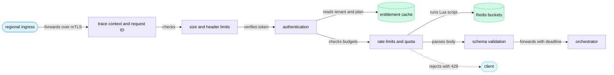
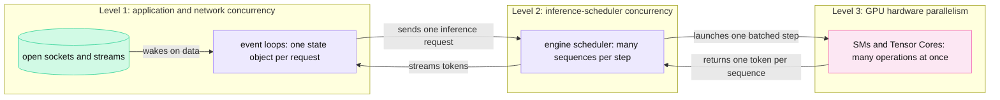
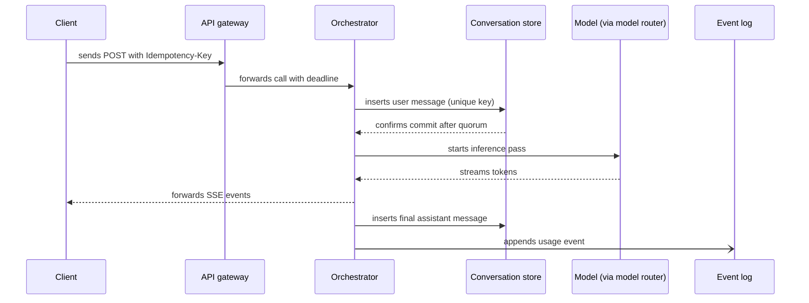
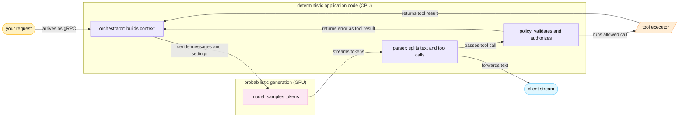
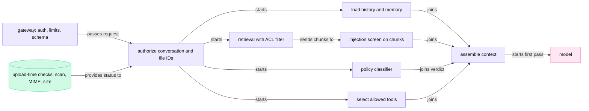

<!-- GENERATED from manuscript/src/part-03-application-backend.md by tools/render_manuscript.py. Edit the source, not this file. -->
# Part 03: The application backend and orchestration

The regional CPU tier checks, admits and prepares your request before any GPU work starts.

Your request has crossed the edge (part 2.6) and the backbone. The global traffic manager sent it to the nearest region, `ap_south` in Mumbai (part 2.8). The TTFT timer reads 32.2 ms as the request reaches the regional ingress. This part follows it through the CPU services of that region in eight steps:

1. The API gateway checks identity, limits and shape (3.1).
2. Token buckets decide whether the tenant may spend more GPU time now (3.2).
3. Event loops and connection pools hold your request while it waits (3.3).
4. The gateway and the orchestrator resolve the user, the tenant and the conversation (3.4).
5. The orchestrator writes the messages at fixed points (3.5).
6. The orchestrator builds the context and runs the tool loop (3.6).
7. The model router picks one model deployment (3.7).
8. Safety checks run before the first inference pass (3.8).

Everything in this part runs on CPUs. The GPU tier sees nothing of your request until 3.6 sends the first inference pass. Every check here is cheap compared with GPU time, so the system spends it freely.

---

## 3.1 The API gateway and regional ingress ▣

The API gateway turns an anonymous HTTP request into a checked call to the orchestrator, or it rejects the request.

### Where it sits

Part 2.6 ended at the regional ingress. That ingress is a set of L7 proxies behind an L4 balancer (RA-01). It terminates the client's HTTP/2 or HTTP/3 stream and opens a new stream to the API gateway. From here on, every hop runs inside the private network.

In this reference system, the API gateway is an Envoy-based AI gateway (RA-09). Agent Router, formerly Envoy AI Gateway, is the public example [SRC-302]. Its data plane has three parts [agent-router@35307e5:site/docs/concepts/architecture/data-plane.md#L11-L49]:

1. **Envoy proxy.** It accepts streams, runs a chain of filters and forwards each request.
2. **AI gateway external processor.** Envoy calls it through `ext_proc`. It reads the model name from the JSON body and transforms requests between provider schemas. It also adds upstream credentials and reads token usage from responses.
3. **Rate-limit service.** It keeps token-based budgets in Redis.

The project recommends two tiers [SRC-302]. Tier one does authentication, top-level routing, global rate limits and provider fallback. Tier two is the ingress to a self-hosted model cluster with an endpoint picker. This reference system uses the same software in two places (RA-09). The API gateway in this section is tier one. The model router in 3.7 uses the same route rules in front of the inference gateway (part 9).

### The filter chain

Each request passes an ordered chain of checks. Cheap checks run first, so most bad requests fail before any expensive step:



Legend: blue = network ingress; violet = CPU checks; green cylinders = stores; light blue = the client; dotted arrow = a rejection. The one thing to notice: a rejected request never reaches the orchestrator or the GPUs. The diagram leaves out the logging filter on purpose, because it runs after the response.

The chain has ten responsibilities.

**1. Trace context and request IDs.** The edge creates a W3C `traceparent` header (RA-52). Its format is `version-traceid-parentid-flags`, with 2, 32, 16 and 2 hex characters [SRC-197]:

```
traceparent: 00-4bf92f3577b34da6a3ce929d0e0e4736-00f067aa0ba902b7-01
```

The gateway keeps the 32-character trace ID and starts its own span with the edge's span as parent. OpenTelemetry defines a span as a timed operation with a parent span ID and attributes [SRC-196]. The gateway also creates a request ID and returns it to the client in a response header. The request ID names this one HTTP call. The client's idempotency key from part 2.1 names the user's intent, and it survives retries (3.5).

**2. Size and header limits.** The edge already applied coarse limits (part 2.6). The gateway applies limits per route. A chat `POST` carries text, settings and file IDs, never file bytes, because uploads go to object storage first (RA-08). So the gateway can set a small body limit for this route. A larger body gets `413` at once.

**3. Authentication.** The gateway verifies the credential on the request. A signed token needs only a signature check with cached public keys. An opaque session token needs one lookup in a session store. Section 3.4 explains both paths.

A cookie-based session also needs a defense against cross-site request forgery (CSRF). OWASP lists a synchronizer token, a signed double-submit cookie and a custom request header that forces a CORS preflight [SRC-173]. It also lists `Sec-Fetch-Site` checks, and it treats `SameSite` cookies as defense in depth only [SRC-173]. A bearer token in an `Authorization` header is a different case. Page code sets that header, and the browser never attaches it on its own. So a forged cross-origin request cannot carry it.

**4. Account and plan lookup.** The verified identity names a user. The gateway maps the user to a tenant (the organization) and reads the tenant's plan and entitlements. These values change rarely, so the gateway reads them from a cache with a short time to live (TTL). In this reference system, the cache is a Redis-compatible store, and every key starts with the tenant ID (RA-19).

**5. Quota enforcement.** A quota is a budget over a long period, such as tokens per month. In this reference system, hard quota counters live in the strongly consistent SQL store (RA-17, RA-20). The gateway reads the remaining quota and rejects the request when none remains.

**6. Rate limits and abuse controls.** A rate limit is a budget over a short period, such as requests or tokens per minute. The gateway checks the tenant's request bucket here (RA-10). The token bucket waits for the model router, because only the orchestrator knows the full prompt (3.2). Abuse controls add per-user and per-IP signals, such as account age and earlier violations. The edge's bot score (part 2.6) arrives as a header and feeds the same decision.

**7. Request and schema validation.** The gateway parses the JSON body and checks it against the route's schema. The schema fixes field names and types, allowed model names, the text length and the number of file IDs. An unknown field or a wrong type gets `400`. Validation here means that later services can trust the shape of the data.

**8. Routing.** The route table maps the method and path to an upstream cluster. `POST /conversations/{id}/messages` goes to the orchestrator. Envoy receives route tables and endpoint lists from a management server over xDS (RA-51) [SRC-155]. A change of endpoints therefore reaches every gateway pod as a pushed update.

**9. Deadlines and cancellation.** A deadline is the absolute time by which a call must finish. In this reference system, the top-level deadline is 120 s (hypothetical, RA-11). The gateway passes the remaining time to the orchestrator as a gRPC deadline. gRPC sets no deadline by default, so a caller must set one [SRC-148].

gRPC sends the remaining time, not an absolute timestamp, so clock differences between machines do not matter [SRC-148]. If the client closes the stream, the gateway cancels the upstream call. The cancellation then travels down to the inference scheduler, which frees the request's KV blocks (RA-49; part 17.2).

**10. Logging.** After the response ends, the gateway writes one access-log record. It holds the request, trace and tenant IDs, the route, the status, the latency and the token counts. It holds no prompt text by default (part 18.4).

W3C Baggage carries key-value pairs on every outgoing call. Its specification warns that baggage must not carry confidential data across trust boundaries [SRC-198]. So this reference system drops baggage before calls to tools and fetchers (RA-52).

### The data that leaves the gateway

The gateway forwards one gRPC call to the orchestrator (3.3 explains why gRPC). The call carries:

| Field | Example | Set by |
|---|---|---|
| verified user ID, tenant ID, workspace ID | opaque IDs | authentication and account lookup |
| plan and entitlements | allowed models, tool permissions, limits | account lookup |
| conversation ID and turn | turn 4 of your conversation (hypothetical) | the client, then validated |
| the new message | text and two file IDs (the photo and the PDF) | the client, then validated |
| idempotency key | a UUID | the client (part 2.1) |
| request ID, `traceparent` | as above | the gateway and the edge |
| deadline | the remaining time | the gateway |

**Meanwhile in the fleet.** Each gateway pod holds thousands of open streams at once. In the same millisecond, other requests fail with `401` or `429`. Finished streams write their log records. The pods share no request state with each other. Any pod can take the next request.

Counters at this moment:

- gateway requests in flight: up by one.
- Redis script calls per second: up by one RPM check (3.2).
- 429 responses per second: unchanged, because your tenant has budget left.

### Stage card: the API gateway

| # | Question | Answer |
|---|---|---|
| 1 | Which component runs? | Envoy with an authentication filter, the AI gateway external processor and a Redis-backed rate-limit service (RA-09) [SRC-302]. |
| 2 | On what hardware? | CPUs and NICs in the regional CPU cluster; Redis on CPU memory. |
| 3 | What data enters? | One HTTP/2 or HTTP/3 request from the regional ingress: headers (`Authorization`, `traceparent`, `Idempotency-Key`, `Content-Type`) and a JSON body. |
| 4 | In what representation? | HTTP frames, then a header map and the JSON body bytes, held in memory up to the route's size limit. |
| 5 | What computation happens? | Signature checks, cache reads, one Lua script per admission, JSON schema validation, route matching. |
| 6 | What data leaves? | A gRPC call with verified identity, plan, IDs, trace context and a deadline; or an error such as `400`, `401`, `403`, `413` or `429`. |
| 7 | Where is state stored? | Nowhere in the pod. Buckets and cached entitlements live in Redis; quota counters live in the SQL store (RA-10, RA-17). |
| 8 | Is it synchronous? | Yes for the checks: each one finishes before the request moves on. The gateway writes the access log after the response. |
| 9 | Can different users' requests run here at the same time? | Yes. One pod holds many streams from many tenants at once. |
| 10 | How is that concurrency achieved? | A small number of event-loop threads, each over many nonblocking sockets (3.3). |
| 11 | What is cached? | Token-signing keys, tenant entitlements with a short TTL, route tables from xDS, and open connections to Redis and the orchestrator. |
| 12 | What can fail? | Redis can become unreachable. Then the gateway falls back to a local per-pod bucket and fails closed for GPU routes (RA-10). The identity provider or the orchestrator can also fail; the gateway returns an error. |
| 13 | What does it add to latency? | No real service publishes this. In this design, it is CPU work for parsing and signature checks, plus about one in-region round trip to Redis. Redis documents its rate-limit decision as sub-millisecond [SRC-161]. |
| 14 | What limits capacity? | CPU for TLS and JSON parsing, open sockets per pod, and script throughput per Redis shard. |
| 15 | How does it scale horizontally? | Add stateless pods behind the L4/L7 balancer; shard Redis by tenant key. |
| 16 | What security boundary exists? | The boundary between the public request and the private backend. Past the gateway, every call carries a verified identity, and services authenticate each other with mTLS and SPIFFE IDs (RA-16) [SRC-188]. |

You can now list, in order, the checks a chat request passes before it reaches the orchestrator.

---

## 3.2 Rate limiting math ⚙

A token bucket admits a request only if enough tokens remain, so it caps the sustained rate and the burst.

### The token bucket

A token bucket has two parameters and two state variables:

- **capacity B**: the most tokens the bucket can hold, which is also the largest burst.
- **refill rate r**: tokens added per second, which is also the sustained rate.
- **tokens n**: the tokens available now.
- **t₀**: the time of the last update.

A request costs c tokens. For a requests-per-minute (RPM) limit, c = 1. For a tokens-per-minute (TPM) limit, c is a number of model tokens.

The word "token" has two senses in this section. A bucket token is a unit of budget. A model token is a unit of text. Each sentence below says which one it means.

On every arrival at time t, the limiter runs three steps:

```
refill:  n ← min(B, n + r × (t − t₀));   t₀ ← t
admit:   if n ≥ c:  n ← n − c, and the request passes
reject:  else return 429 with Retry-After = ceil((c − n) / r) seconds
```

Over any window of length T, at most `B + r × T` units pass. The rate in the long run is r, and the burst never exceeds B. Envoy's local rate-limit filter implements this bucket with `max_tokens`, `tokens_per_fill` and `fill_interval` [SRC-162]. Anthropic's API documents the same algorithm [SRC-163]. Its capacity refills continuously up to the maximum, and no fixed interval resets it.

### A worked example

Take an illustrative bucket with B = 10 and r = 5 per second. Each request costs 1. The bucket starts full. Five groups of requests arrive:

| Step | Time (s) | Arrivals | Tokens before | Refill | After refill | Admitted | Rejected (429) | Tokens after |
|---|---|---|---|---|---|---|---|---|
| 1 | 0 | 4 | 10 | 5 × 0 = 0 | 10 | 4 | 0 | 6 |
| 2 | 0.4 | 8 | 6 | 5 × 0.4 = 2 | 8 | 8 | 0 | 0 |
| 3 | 0.5 | 3 | 0 | 5 × 0.1 = 0.5 | 0.5 | 0 | 3 | 0.5 |
| 4 | 1.5 | 2 | 0.5 | 5 × 1 = 5 | 5.5 | 2 | 0 | 3.5 |
| 5 | 4 | 12 | 3.5 | 5 × 2.5 = 12.5 | 10 | 10 | 2 | 0 |

Three steps show the rules at work:

- **Step 3.** Only 0.5 tokens are available, and a request needs 1. All 3 requests get 429. The bucket holds a whole token again after 0.1 s, so `ceil((1 − 0.5) / 5) = ceil(0.1) = 1`. `Retry-After` carries whole seconds [SRC-210].
- **Step 5.** The idle gap would add 12.5 tokens, but the cap is 10. So 6 tokens are lost. Idle time never builds a burst larger than B.
- **The window bound.** From step 1 to step 5 the window is 4 s. The bound is `10 + 5 × 4 = 30`, and 24 requests passed.

### A burst, and what 429 protects

The same bucket meets two bursts:

1. **15 requests at the same instant.** The bucket admits 10 and rejects 5. Each rejection carries `Retry-After: 1`, because `ceil((1 − 0) / 5) = ceil(0.2) = 1`.
2. **50 requests spread evenly over one second.** The bound is `10 + 5 × 0.98 = 14.9`. Only whole tokens admit a request, so 14 pass and 36 get 429.
3. **After 2 idle seconds,** `min(10, 0.9 + 5 × 2) = 10`. The full burst is available again.

HTTP 429 means "the user has sent too many requests in a given amount of time" [SRC-160]. The response may carry `Retry-After`, and caches must not store it [SRC-160]. `Retry-After` holds either a date or a number of seconds [SRC-210]. Envoy's local limiter sends a `Retry-After` of at least 1 s and marks the response with `x-envoy-ratelimited` [SRC-162]. OpenAI's guide tells clients to treat `Retry-After` as a minimum wait. It also says that failed requests still count toward the per-minute limit [SRC-164].

The rejection protects the GPU tier because of where it happens. A rejected request never enters an inference queue and never takes a KV block. In the two bursts above, the gateway rejected 41 requests. With the hypothetical mean prompt of 3,000 tokens, that keeps 123,000 prompt tokens of prefill work off the GPUs. Each rejection costs a little CPU work and one store round trip. An admitted request that later times out costs GPU time for an answer that nobody reads (part 17.7).

The response headers tell the client its state. No standard header set exists yet. The IETF draft `draft-ietf-httpapi-ratelimit-headers-11` defines `RateLimit-Policy` and `RateLimit` fields, but it is still an Internet-Draft [SRC-209]. Public APIs use their own names, such as `x-ratelimit-remaining-tokens` [SRC-164] and `anthropic-ratelimit-tokens-remaining` [SRC-163].

### Why not a fixed window

A fixed-window counter is simpler: one `INCR` per request and one `EXPIRE` per window [SRC-161]. It resets at every window boundary, and that reset allows a double burst. Take an illustrative limit of 300 requests per 60 s:

| Limiter | Requests that pass when 300 arrive at 59.9 s and 300 more at 60.1 s |
|---|---|
| fixed window | 600, within 0.2 s |
| token bucket, B = 10, r = 5/s (the same 300 per minute) | 11, because `10 + 5 × 0.2 = 11` |

The two batches fall into different windows, so the fixed window lets both through. For a GPU fleet, a burst of that size lands on the inference queues at once. The bucket spreads the same budget over time.

### Distributed rate limiting

One tenant's requests reach many gateway pods, so a bucket in one pod's memory sees only part of the traffic. Redis's documentation says it plainly: local per-process counters "break behind load balancers" [SRC-161]. The common answer is a shared store with an atomic read-decide-update step.

**The central bucket in Redis.** In this reference system, each tenant has one RPM bucket and one TPM bucket in Redis (RA-10). Redis runs a Lua script as one atomic step. Its documentation states that this keeps the read-decide-update cycle atomic, "so concurrent requests cannot double-spend tokens" [SRC-161]. One script works for both buckets, in outline:

```lua
-- KEYS[1] = "rl:<tenant>:rpm" or "rl:<tenant>:tpm"
-- ARGV[1] = refill rate r per second, ARGV[2] = capacity B, ARGV[3] = cost c
local now = redis.call("TIME")              -- one clock for every caller
local t = now[1] + now[2] / 1e6
local r, B, c = tonumber(ARGV[1]), tonumber(ARGV[2]), tonumber(ARGV[3])
local s = redis.call("HMGET", KEYS[1], "n", "t0")
local n = tonumber(s[1]) or B               -- a new bucket starts full
local t0 = tonumber(s[2]) or t
n = math.min(B, n + r * (t - t0))           -- refill
local ok = 0
if n >= c then n = n - c; ok = 1 end        -- admit and take c
redis.call("HSET", KEYS[1], "n", n, "t0", t)
redis.call("EXPIRE", KEYS[1], math.ceil(2 * B / r))
if ok == 1 then return {1, 0} end
return {0, math.ceil((c - n) / r)}          -- 429 with Retry-After in seconds
```

Two components call the scripts at three moments (RA-10):

1. **The API gateway** calls it with the RPM key and a cost of 1, when the request arrives (3.1).
2. **The model router** calls it with the TPM key before each inference pass (3.7). The cost is `prompt_tokens + max_tokens`, because only then does the full prompt exist.
3. **The model router** calls a refund script after each pass. That script adds the unused part back, up to the capacity B.

So a request with one inference pass costs `1 + 1 × (1 + 1) = 3` script calls. At the hypothetical peak of 50,000 requests per second, the fleet runs at least 150,000 script calls per second. Every extra inference pass adds two calls. Sharding by tenant spreads the calls over many Redis nodes.

**Local approximate buckets.** The alternative gives each of N pods a local bucket with 1/N of the limit. It needs no network call, but it fails when traffic is uneven. Take a hypothetical region with 8 pods and a tenant limit of 300 requests per minute:

1. Each pod allows `5 / 8 = 0.625` requests per second.
2. The tenant sends 4 requests per second, which is 80% of its limit.
3. Its clients hold long-lived HTTP/2 connections, so all its requests land on 2 pods.
4. Those pods admit `min(4, 2 × 0.625) = 1.25` requests per second.
5. So 69% of the tenant's requests get 429, although the tenant is under its limit.

A central bucket admits all of them. Its cost is one round trip to the store per check, and one more dependency that can fail.

| | Central bucket (shared store) | Local buckets (limit / N per pod) |
|---|---|---|
| Accuracy | exact, up to store failures | wrong whenever traffic is uneven across pods |
| Extra latency | one in-region round trip per check | none |
| Failure domain | the store; needs a fallback | none beyond the pod |
| Burst behaviour | one burst budget B per tenant | N separate bursts of B / N |

This reference system uses both (RA-10). The central bucket decides. A local per-pod bucket sits behind it. If Redis is unreachable, the local bucket still caps each pod, and GPU routes fail closed. A third design leases tokens: each pod takes a batch of tokens from the central bucket and spends them locally. It cuts store calls, but tokens stranded on an idle pod are unavailable to busy pods.

**Clocks.** The refill step needs the time since the last update. If each gateway used its own clock, two clocks that differ by 0.1 s (hypothetical) would give a wrong refill. For a TPM bucket of the hypothetical plan below, the error per update is `400,000 / 60 × 0.1 ≈ 667` model tokens. The script above reads Redis's own `TIME`, so every gateway uses one clock. Redis 5.0 and later replicate the effects of a script, so a script may call `TIME` before a write [SRC-926].

**Consistency across regions.** A tenant can send requests to several regions. Redis offers Active-Active replication with conflict-free replicated data types for limits across regions [SRC-161]. Cross-region counters converge after a delay. So a tenant can briefly exceed its global limit, by up to one region's burst. This reference system keeps rate-limit buckets per region and keeps exact, billing-grade counters in the SQL store (RA-20).

### Why LLM services limit tokens, not only requests

Requests differ in cost by orders of magnitude, so a count of requests says little about GPU load. Take one hypothetical plan with an RPM limit of 300 and a TPM limit of 400,000. Two tenants use it:

| | Tenant A: chat (hypothetical traffic means) | Tenant B: long documents (hypothetical) |
|---|---|---|
| Requests per minute | 100 | 20 |
| Prompt + output tokens per request | 3,000 + 400 | 60,000 + 1,000 |
| Tokens per minute | 100 × 3,400 = 340,000 | 20 × 61,000 = 1,220,000 |
| Share of the RPM limit | 33% | 7% |
| Share of the TPM limit | 85% | 305% |
| Requests per minute admitted, RPM limit only | 100 | 20 |
| Requests per minute admitted, RPM and TPM | 100 | `min(20, floor(400,000 / 61,000)) = 6` |
| Prefill FLOPs per request, `M-dense` | 7.60 × 10¹⁴ | 2.26 × 10¹⁶ |
| H100 GPUs kept busy by prefill alone | 2.6 | 15.2 |

The prefill FLOPs use the formula of part 13.3: `2 × N_matmul × T + 2 × H × d_head × L × T × (T + 1)` for T prompt tokens. The GPU count follows from the FLOPs:

```
GPUs busy = FLOPs per minute ÷ 60 s ÷ (H100 dense BF16 peak × prefill utilization)
```

The H100's dense BF16 peak is 989.5 TFLOP/s. The prefill utilization is an assumption of 0.5 (hypothetical). The count assumes no prefix-cache reuse and leaves out decode cost.

Read the table from the top. An RPM limit alone admits all of tenant B, which sends 20% as many requests as tenant A. Tenant B still keeps 5.9 times as many GPUs busy. A TPM limit sees the difference and cuts tenant B to 6 requests per minute.

Even tokens understate the cost of long prompts. Per request, tenant B has 17.9 times the tokens of tenant A, but 29.7 times the prefill FLOPs. Attention grows with the square of the prompt length, and it is 34% of tenant B's prefill FLOPs.

Public APIs show the same reasoning. Anthropic's API sets separate limits for requests (RPM), input tokens (ITPM) and output tokens (OTPM) [SRC-163]. Cached input tokens do not count toward ITPM for most models [SRC-163]. OpenAI's API sets RPM, TPM and longer-period limits [SRC-164]. Agent Router can count `InputToken`, `CachedInputToken`, `OutputToken`, `TotalToken`, or a custom formula over them in the CEL expression language [agent-router@35307e5:site/docs/capabilities/traffic/usage-based-ratelimiting.md#L39-L44].

### Reserving output tokens before they exist

A TPM limiter has a timing problem: at admission, nobody knows how many output tokens the answer will have. Three public designs answer it differently:

| Design | What the limiter counts | Public example |
|---|---|---|
| reserve, then refund | prompt + `max_tokens` at admission; the unused part goes back at completion | OpenAI's guide: the limit counts the maximum of `max_tokens` and an estimate from the request's characters [SRC-164] |
| count as produced | input at admission; each output token as the model produces it | Anthropic's docs: output-token limits count "only the actual tokens generated", and `max_tokens` does not count [SRC-163] |
| charge at completion | nothing at admission; prompt + output when the response ends | Agent Router: "Token usage is charged after the response completes" [agent-router@35307e5:site/docs/capabilities/traffic/usage-based-ratelimiting.md#L34-L37] |

Agent Router's documentation adds that it never cuts an admitted stream. A stream can therefore end above the budget, and later requests get 429 until the window recovers [agent-router@35307e5:site/docs/capabilities/traffic/usage-based-ratelimiting.md#L59-L69]. These are documented behaviours of those public APIs and that gateway only. How any chat product counts tokens internally is not public.

In this reference system, admission reserves `prompt_tokens + max_tokens` and refunds the unused part at completion (RA-10). The model router makes the reservation before each inference pass. For one request with the hypothetical traffic means and a hypothetical `max_tokens` of 4,096:

1. **Reserve at admission:** `3,000 + 4,096 = 7,096` model tokens leave the TPM bucket.
2. **Hold:** the stream lasts `400 / 20 = 20` s at the hypothetical per-user target speed (part 14.2). The reservation is 2.09 times what the request will use.
3. **Charge at completion:** `3,000 + 400 = 3,400` model tokens.
4. **Refund:** `4,096 − 400 = 3,696` model tokens return to the bucket.

In this reference system, `max_tokens` caps every output token of one inference pass, including reasoning tokens (RA-60). `M-frontier` always runs with thinking enabled [SRC-378], so its hidden reasoning tokens count against the reservation too. Your request runs three inference passes (3.6), and each pass reserves and refunds on its own.

### The three policies under one burst

Which policy protects the GPUs best? A simulation runs one tenant through all three.

The tenant has the hypothetical TPM limit of 400,000. Its bucket holds one minute's budget and refills at 6,667 model tokens per second. A batch script sends 150 requests at once, then 1 per second until 120 s. The burst size is hypothetical, and the trickle is illustrative. The script does not retry rejected requests. Each request has the hypothetical mean shape: 3,000 prompt tokens, 400 output tokens, and a stream of 20 s.

| | Reserve, then refund (this reference system) | Count as produced | Charge at completion |
|---|---|---|---|
| Admitted in the burst at t = 0 | 56 | 133 | 150 |
| Admitted in total | 175 | 253 | 243 |
| Rejected in total | 95 | 17 | 27 |
| First 429 at | 0 s | 0 s | 20 s, with `Retry-After: 17` |
| Lowest bucket level (model tokens) | 48 | 1,000 | -110,000 |
| Most requests in flight at once | 74 | 152 | 169 |
| Their context if each grows to `max_tokens` | 525,104 | 1,078,592 | 1,199,224 |
| The limiter's guarantee on that context | at most 533,333 | at most 1,255,992 | none |

The table shows three different trade-offs:

- **Charge at completion** admits the whole burst. At 20 s the burst completes, and the bucket drops 110,000 model tokens below zero. The tenant then gets 429 for many seconds, although its GPU work is already over. The limiter reacts after the GPUs have done the work.
- **Count as produced** admits 133 requests at once, one per 3,000 prompt tokens in the bucket. Its accounting is exact. But every admitted request may still grow to `max_tokens`. So its guarantee is `floor(533,333 / 3,000) × 7,096 = 1,255,992` context tokens.
- **Reserve, then refund** admits only 56 at once and never goes below zero. Within one stream duration D, the bucket hands out at most `B + r × D`. So its guarantee is `400,000 + 6,666.67 × 20 = 533,333` context tokens.

The last row connects the limiter to GPU memory. Every context token in flight occupies KV cache (part 13.1). Reservation turns the TPM limit into a hard cap on one tenant's KV footprint. So one tenant's burst cannot fill the decode pool. Its price is quota that sits reserved but unused for the length of each stream. OpenAI's guide gives the matching advice to clients: set `max_tokens` close to the expected answer [SRC-164].

**Meanwhile in the fleet.** At the hypothetical peak, gateways and model routers in all regions run at least 150,000 rate-limit scripts per second. Most return "allow". A few tenants with batch scripts hit their buckets and receive 429 with `Retry-After`. Refund scripts from finished streams return unused reservations, and the next requests of those tenants pass.

Counters at this moment:

- tokens left in your tenant's TPM bucket: down by your first pass's reservation.
- 429 responses per second: a small, steady share of arrivals.

You can now compute a token bucket's decisions, and explain why an LLM service reserves output tokens at admission.

---

## 3.3 Concurrency before the GPU

A CPU service holds huge numbers of requests at once, because a waiting request is just a small object.

### Concurrency is not parallelism

**Concurrency** means that many tasks are in progress during the same period. **Parallelism** means that many operations execute at the same instant on different hardware units. One CPU core can run thousands of requests concurrently. It runs one instruction stream at a time and switches between requests whenever one must wait.

Your request spends almost all its life waiting. It waits for the database, retrieval, the search provider, the sandbox and, above all, the GPU stream. The orchestrator's own CPU work per request is small. So the CPU tier needs concurrency far more than parallelism.

Little's Law gives the scale. The number of requests in a system equals the arrival rate times the time each request stays: L = λ × W. Take W as the stream time: 400 output tokens at 20 tokens per second. Both are hypothetical; the speed is the per-user target of part 14.2. At the hypothetical peak, the CPU tier then holds `50,000 × 20 = 1,000,000` open streams at once. Every one of those streams has an open socket and a request object in some CPU service.

### Four ways to wait

| Model | What waits | Cost of one waiting request | Where it is common |
|---|---|---|---|
| process per request | one OS process | a whole address space and process-switch cost | older CGI-style servers |
| thread-per-request | one kernel-scheduled OS thread per request | a stack and a kernel scheduling entry each | many classic Java and C++ servers |
| event loop with callbacks or `async`/`await` | one small state object per request | a small heap object, no kernel object | proxies, gateways, async web services |
| lightweight tasks multiplexed onto OS threads | one goroutine or coroutine | a small stack that grows on demand | languages with lightweight tasks, such as Go |

A common design for proxies and gateways uses a few OS threads, often one per core. Each of those threads runs one event loop over many sockets. The rest of this section opens that event loop.

### Nonblocking sockets and readiness

A **blocking** socket call stops the caller until data arrives. A **nonblocking** socket call returns at once. If no data is ready, it returns the error `EAGAIN` [SRC-170]. So one event loop can watch many sockets if it learns which ones are ready.

Linux's `epoll` gives that answer [SRC-170]. An epoll object holds two lists:

- an **interest list**: the file descriptors to watch, with the events of interest.
- a **ready list**: the descriptors that have events now.

Three system calls operate on it [SRC-170]:

1. `epoll_create` makes the epoll object.
2. `epoll_ctl` adds, changes or removes descriptors in the interest list [SRC-170].
3. `epoll_wait` returns ready descriptors, and blocks only if none is ready.

The default mode is level-triggered: a descriptor stays ready while data remains. Edge-triggered mode (`EPOLLET`) reports only changes, so the code must read until `EAGAIN` [SRC-170]. The man page says epoll "scales well to large numbers of watched file descriptors" [SRC-170]. BSD systems offer `kqueue` for the same purpose [SRC-923].

The event loop of a gateway or orchestrator, in outline:

```python
while True:
    ready = epoll_wait(epfd, timeout=next_timer_deadline())
    for fd, events in ready:
        conn = connections[fd]          # a small per-connection state object
        if events & READABLE:
            data = recv_nonblocking(fd)  # never blocks; may return EAGAIN
            conn.feed(data)              # parse frames, resume waiting coroutines
        if events & WRITABLE:
            conn.flush()                 # send queued bytes until EAGAIN
    run_expired_timers()                 # deadlines, keep-alives, retries
```

Each request is a state object plus the coroutine that waits for its next event. A request that waits for the database costs no CPU at all.

`io_uring` changes the model from readiness to completion [SRC-171]. The program and the kernel share two ring buffers through `mmap`: a submission queue and a completion queue. The program writes operations as submission entries. One `io_uring_enter` call can submit many of them [SRC-171].

The kernel posts each result as a completion entry with the caller's `user_data` and a result code [SRC-171]. Completions can arrive out of order [SRC-171]. With `SQPOLL`, the kernel itself polls the submission queue, so submission needs no system call at all [SRC-171]. The gain is fewer system calls per operation at high rates.

### Many requests on one connection

HTTP/2 carries many streams on one TCP connection, as independent sequences of frames [SRC-138]. Each request and its response form one stream. The setting `SETTINGS_MAX_CONCURRENT_STREAMS` caps the open streams per connection. RFC 9113 recommends a value of at least 100 [SRC-138].

Each stream has its own flow-control window, which starts at 65,535 bytes [SRC-138]. HTTP/3 maps each request to one QUIC stream, so a lost packet does not stall other streams [SRC-139]. Over HTTP/2, a lost TCP segment still stalls every stream on that connection [SRC-138].

Inside the region, the gateway, the orchestrator and the model router keep a few long-lived connections to each other. Thousands of calls share them as streams. So no call pays a handshake.

### gRPC between services

gRPC defines four kinds of call: unary, server streaming, client streaming and bidirectional streaming [SRC-149]. Protocol Buffers are its default interface definition language and message format [SRC-149]. A common setup runs gRPC over HTTP/2, so each call is one stream on a shared connection. gRPC guarantees message order within one call [SRC-149]. The token stream from the model to the orchestrator is a server-streaming call: one request, then a sequence of messages.

### Task queues for work outside the request

Some work does not need to finish before the answer. The orchestrator puts it into a queue, and separate consumer processes run it later:

- extraction of long-term memory after a turn (RA-27).
- parsing and indexing of uploaded documents (RA-22).
- usage, audit and analytics events (RA-20).

In this reference system, events go to a Kafka-class log (RA-20). Kafka decouples the two sides: producers never wait for consumers [SRC-222]. So a slow analytics consumer never slows the token stream.

### The three levels of concurrency

The whole system runs many requests at once on three different levels. Each level has its own unit, its own mechanism and its own limit. Every later part refers back to these three names.



Legend: violet = CPU code, including the engine's scheduler; pink = GPU work; green = held state. The one thing to notice: one request passes all three levels, but it stays at each for a different time. The diagram leaves out the tools and retrieval on purpose; they are level-1 waits too.

| | Level 1: application and network concurrency | Level 2: inference-scheduler concurrency | Level 3: GPU hardware parallelism |
|---|---|---|---|
| What runs at once | open requests and streams in CPU services | sequences inside one engine replica | arithmetic operations inside one GPU |
| Mechanism | event loops, nonblocking sockets, multiplexed connections | continuous batching: the scheduler picks the batch again at every scheduler iteration (part 11.5) | thousands of threads on many SMs and Tensor Cores (part 11.1) |
| Unit | request, stream, socket | sequence | thread, warp, tile |
| Typical limit | memory per request, file descriptors, CPU for parsing | free KV blocks (part 13.1); `max_num_seqs` = 1,024 by default in vLLM on H100 [vllm@v0.31.0:vllm/engine/arg_utils.py#L2868-L2877] | SMs (132 on an H100 [SRC-004]), HBM bandwidth |
| Counter | requests in flight, open streams | `vllm:num_requests_running`, `vllm:num_requests_waiting` (RA-53) | GPU utilization, SM occupancy |
| How long your request occupies it | its whole life, from Send to the last token | from admission to the last decode step of each pass | only during the kernels of each step |

Two mistakes come from mixing the levels. The first says "a million users need a million model copies". Level 1 holds a million streams in CPU memory. Level 2 packs many sequences into one replica (part 14.1). The second says "the GPU runs one request at a time". Level 3 runs one batched step, and that step computes a token for every sequence in the batch.

### Internal protocols: JSON outside, Protobuf inside

In this reference system, the browser uses HTTP with JSON and SSE events (RA-07). Services use gRPC with Protobuf (RA-11). The reasons:

| Concern | JSON over HTTP (public edge) | Protobuf over gRPC (inside the region) |
|---|---|---|
| Serialization | text; field names repeat in every message | binary; fields are numbered, and names never travel |
| Schema | optional (JSON Schema, OpenAPI) | required: a `.proto` file, with generated client and server code |
| Streaming | SSE events or chunked responses | four call types, including bidirectional streams [SRC-149] |
| Backward compatibility | by convention; parsers often accept unknown fields | by field numbers: a new field gets a new number, and old readers ignore it [SRC-925] |
| Deadlines and cancellation | by convention | built in: the remaining time travels with every call [SRC-148] |
| Observability | headers | metadata on every call [SRC-149]; a status per call, such as `DEADLINE_EXCEEDED` [SRC-148] |
| Browser support | native | gRPC-Web lets a browser call gRPC services through a translating proxy such as Envoy [SRC-924] |

This split is common, but it is not universal. Many systems use JSON over HTTP inside the data center too, because it is easier to debug. Others use different binary formats. The choice matters most where messages are small and frequent, such as one token per message.

### Connection pools

A **connection pool** keeps open connections to one upstream and lends one to each operation. It exists because a new connection per operation is expensive:

1. TCP and TLS 1.3 need 2 round trips before the first request byte (part 2.5).
2. The TLS handshake costs public-key operations on both sides.
3. The server allocates memory and, for some databases, a process or session per connection.
4. A database login adds its own authentication round trips.

Three kinds of pools sit in the CPU tier:

- **Database pools.** The orchestrator keeps a few connections to the SQL store. PgBouncer is a public example of a separate pooler: it multiplexes many client connections onto a few server connections [SRC-282]. Its `pool_mode` decides when a server connection returns to the pool [SRC-282]. The modes are `session` (at client disconnect, the default), `transaction` (at transaction end) and `statement` (after each statement). Transaction pooling means a client must not rely on session state [SRC-282].
- **HTTP upstream pools.** Envoy keeps a pool of connections to each upstream cluster, and HTTP/2 multiplexes many requests on each one.
- **gRPC channels.** A gRPC channel is a long-lived object over one or more HTTP/2 connections. Services create a channel once and reuse it for every call.

**Sizing a pool, worked.** A pool is a small queue. Take one orchestrator pod with hypothetical numbers. It receives 100 requests per second, and each request runs 4 database transactions. Each transaction holds a connection for 5 ms on average.

1. Arrival rate: `100 × 4 = 400` transactions per second.
2. Little's Law gives the busy connections on average: `400 × 0.005 s = 2` connections [SRC-902].
3. A pool of c connections works only if c is above that number. Otherwise the queue grows without bound.
4. For random arrivals and hold times, the Erlang C formula gives the chance that every connection is busy [SRC-903]. A seeded simulation of 200,000 transactions checks it.

| Pool size c | Utilization | P(wait) by formula | P(wait), simulated | Mean wait in the pool | p99 wait, simulated |
|---|---|---|---|---|---|
| 3 | 67% | 0.444 | 0.449 | 2.22 ms | 18.8 ms |
| 4 | 50% | 0.174 | 0.169 | 0.43 ms | 6.8 ms |
| 5 | 40% | 0.060 | 0.059 | 0.10 ms | 2.9 ms |
| 6 | 33% | 0.018 | 0.017 | 0.023 ms | 0.7 ms |
| 8 | 25% | 0.0011 | 0.0014 | 0.0010 ms | 0.0 ms |

Each connection completes μ = `1 / 0.005 s = 200` transactions per second. The mean wait for c = 3 is `0.444 / (3 × 200 − 400) s = 2.22 ms`. One extra connection beyond the minimum removes most of the waiting. More connections help the pod less and less.

A bigger pool is not free, because the database pays for every connection. Take a hypothetical 200 orchestrator pods with 4 connections each: `200 × 4 = 800` server connections. PostgreSQL's `max_connections` is typically 100 by default [SRC-283], so this region needs 8 times that. So a pooler such as PgBouncer sits in between. Or a distributed SQL store spreads the connections over many nodes (3.4).

HikariCP's pool-sizing guide makes the same point from the database side. It quotes the PostgreSQL rule `connections = (core_count × 2) + effective_spindle_count`, and it reports a test in which a much smaller pool cut response times [SRC-172]. More connections than the database can run at once only add contention.

**Meanwhile in the fleet.** At this instant, the CPU tier holds about 1,000,000 open streams (hypothetical peak). Almost all of them wait on level 2. Their sequences sit in decode batches and receive one token per decode step. Your request is one more state object in one orchestrator's event loop. It costs that pod one small heap object and no CPU time while it waits.

You can now explain how one CPU core holds thousands of waiting requests, and size a pool with Little's Law.

---

## 3.4 Authentication, sessions and conversation state ▣

The backend proves who sent the request, finds what the user and tenant may do, and loads the conversation. Each kind of data lives in a store whose consistency fits it.

### From credential to tenant

Four lookups turn the credential into everything the orchestrator needs:

1. **Verify the session token.** A self-contained signed token (for example a JWT) carries the user ID, an expiry and a signature. The gateway checks the signature against a cached public key and checks the expiry. No network call is needed. An opaque session token is a random string. The gateway looks it up in a session store, which costs one round trip but allows instant revocation. A common design combines both. Access tokens carry a signature and expire soon. The identity service checks a refresh token at each renewal.
2. **Resolve user, organization and workspace.** The user ID maps to a tenant (the organization) and a workspace inside it. The tenant is the unit of isolation for data, quotas and the prefix cache (RA-40). Your request belongs to the tenant of your organization.
3. **Read entitlements.** The plan sets limits (3.2), allowed models (3.7), tool permissions (3.8) and features such as long-term memory. These come from the cache of 3.1, keyed by tenant ID.
4. **Load the conversation.** The orchestrator reads the conversation row: its owner, its settings and its message list. The settings hold the selected model, the memory switch and the enabled tools.

For your request, the conversation holds 3 earlier turns of 2,600 tokens (hypothetical). The orchestrator needs every one of those messages to build the context (part 5.6).

### Four kinds of storage

| Store | What it holds in this reference system | Why this store |
|---|---|---|
| Distributed SQL (Spanner- or CockroachDB-class) | conversations, messages, settings, quota counters (RA-17) | transactions and strong consistency for appends and limits |
| Redis-compatible key-value cache | entitlement cache, rate-limit buckets, derived caches with TTLs and tenant keys (RA-10, RA-19) | sub-millisecond reads; losing an entry costs only a recompute |
| S3-class object store | uploaded files: your photo and your PDF (RA-21) | large immutable objects; strong read-after-write for each object [SRC-224] |
| Kafka-class event log | usage, audit and analytics events (RA-20) | an ordered, replicated append-only log that consumers read at their own pace [SRC-222] |

### Inside the SQL store

The conversation store follows PostgreSQL-style semantics, so its mechanisms are worth opening. The orchestrator reaches it through the connection pools of 3.3.

**Indexes.** The messages table has an index on `(conversation_id, seq)`. "The last N messages of conversation X" is then one index range scan, not a table scan. The idempotency key of 3.5 has a unique index on `(conversation_id, idempotency_key)`.

**MVCC.** Multi-version concurrency control (MVCC) gives each PostgreSQL statement a snapshot of the data "as it was some time ago" [SRC-211]. Each row version records the transaction that created it (`xmin`) and the one that deleted it (`xmax`) [SRC-212]. An update writes a new row version instead of changing the old one [SRC-212]. So "reading never blocks writing and writing never blocks reading" [SRC-211]. Your history read does not wait for another user's message insert.

**Transactions and isolation.** PostgreSQL's default isolation level is Read Committed [SRC-213]. It takes a new snapshot for each statement. Repeatable Read keeps one snapshot for the whole transaction. Serializable adds conflict detection, and a conflicting transaction fails with SQLSTATE `40001`; the application must retry the whole transaction [SRC-213].

**The write-ahead log (WAL).** PostgreSQL may change a data file only after the WAL records that describe the change reach durable storage [SRC-214]. So a commit needs only one sequential WAL flush, and one flush can commit many concurrent transactions (group commit) [SRC-214]. After a crash, PostgreSQL replays the WAL to restore every committed change [SRC-214]. Archived WAL also allows point-in-time recovery [SRC-214].

**Replication and read replicas.** A standby receives WAL records from the primary as soon as the primary writes them [SRC-215]. Replication is asynchronous by default [SRC-215]. Synchronous commit makes the primary wait for standbys at one of three levels [SRC-215]:

| `synchronous_commit` | The commit returns after the standby has … |
|---|---|
| `remote_write` | received the WAL and written it to its operating system |
| `on` | flushed the WAL to durable storage |
| `remote_apply` | replayed the WAL, so its queries see the change [SRC-215] |

The setting `synchronous_standby_names` chooses the standbys, by priority (`FIRST 2 (s1, s2, s3)`) or by quorum (`ANY 2 (s1, s2, s3)`) [SRC-215]. PostgreSQL calls a standby that answers read-only queries a hot standby [SRC-215]. Other systems call it a read replica. An asynchronous replica can return data older than the latest commit. So a read that must see the user's own last write goes to the primary. A replica can answer it only after it has replayed that write.

### Distributed SQL and the home region

A single primary cannot survive the loss of its zone without a failover, and it cannot spread writes. Distributed SQL stores split the data into ranges and replicate each range with a consensus protocol [SRC-218].

- **CockroachDB** replicates each range with Raft. A change commits when a majority of replicas have it; 3 replicas is the smallest group with a quorum [SRC-218]. The group tolerates (replication factor − 1) / 2 failures [SRC-218]. One replica, the leaseholder, answers reads and proposes writes [SRC-218]. A table can have one home region, or each row can have its own [SRC-219].
- **Spanner** adds TrueTime, a clock API that returns an interval guaranteed to contain the true time [SRC-217]. A commit waits until its timestamp has surely passed, which gives external consistency [SRC-217]. The paper reports a typical uncertainty of 4 ms [SRC-217]. Its single-datacenter benchmark shows a commit wait of about 5 ms [SRC-217]. Those are single-datacenter numbers, not cross-region costs.

In this reference system, each user has a home region, and the conversation store replicates synchronously inside that region (RA-17). Your home region is the region that normally receives your requests, `ap_south`. So the common write is a quorum inside one region, across its availability zones.

The trade-off appears when the home region is not the serving region. Suppose your nearest region has no spare capacity, and global traffic management sends you to `eu_west` (part 2.8). Every synchronous call from there to your home region then adds at least 74 ms of fiber round trip. A history read and two message writes add at least three of those. A design that survives the loss of a whole region pays a cross-region quorum on every write instead. This reference system pays it only for data that must survive a region loss (RA-17, part 17.4).

### Which data needs strong consistency

| Data | Consistency it needs | Why |
|---|---|---|
| message append and order within a conversation | strong, one writer per conversation | a lost or reordered message corrupts every later context |
| the idempotency record of a message | strong (unique constraint) | a duplicate send must find the first write |
| hard quota counters and billing usage | strong | an eventually consistent counter lets a burst of concurrent requests pass the limit (RA-20) |
| session revocation | strong at the source; short token lifetimes bound the delay elsewhere | a revoked user must lose access within a known time |
| plan and entitlements | strong at the source; caches may lag by their TTL | an upgrade that takes a few seconds to apply harms nobody |
| rate-limit buckets | approximate (3.2) | an error of one burst is acceptable for a short-period limit |
| conversation list, titles, search over past chats | eventual | a title that appears a second later is fine |
| analytics and dashboards | eventual | consumers read the event log at their own pace |
| derived caches (embeddings, search results) | eventual, rebuildable | the source data stays authoritative (RA-19, RA-21) |

### Stage card: authentication and conversation state

| # | Question | Answer |
|---|---|---|
| 1 | Which component runs? | The gateway's authentication filter, then the orchestrator's state loader; the distributed SQL store and the entitlement cache answer them. |
| 2 | On what hardware? | CPUs in the regional CPU cluster; the SQL store on CPU servers with local SSDs; Redis in CPU memory. |
| 3 | What data enters? | The credential, the conversation ID and the verified user ID. |
| 4 | In what representation? | A token string in a header; IDs in the gRPC call; SQL rows and cache values on the way back. |
| 5 | What computation happens? | Signature verification, key lookups, index range scans, MVCC visibility checks. |
| 6 | What data leaves? | User, tenant and workspace IDs, entitlements, conversation settings and 3 earlier turns. |
| 7 | Where is state stored? | Conversations and quotas in distributed SQL (RA-17); entitlements in the cache (RA-19); signing keys in process memory. |
| 8 | Is it synchronous? | Yes: the orchestrator needs all of it before it can build the context. The reads can run in parallel with each other. |
| 9 | Can different users' requests run here at the same time? | Yes. MVCC lets many readers and writers work on the same tables without blocking each other [SRC-211]. |
| 10 | How is that concurrency achieved? | Event loops in the services (3.3), pooled connections, and MVCC snapshots in the store. |
| 11 | What is cached? | Public signing keys, entitlements with a short TTL, prepared statements on pooled connections. |
| 12 | What can fail? | An expired or revoked token (`401`), a missing conversation (`404`), a slow store (part 17.5), or a failover that moves the leaseholder. |
| 13 | What does it add to latency? | No real service publishes it. In this design: a local signature check, one cache read and one or two in-region store round trips, more after a cross-region failover. |
| 14 | What limits capacity? | Store throughput per range, connections per node (3.3), and hot conversations with one writer each. |
| 15 | How does it scale horizontally? | The store splits ranges and adds nodes; the cache shards by tenant key; services add pods. |
| 16 | What security boundary exists? | Tenant isolation: every query filters by the verified tenant and user, never by an ID the client alone supplied. |

**Meanwhile in the fleet.** The conversation store answers history reads for requests that start now. It also takes message writes for requests that end now. Other tenants' quota counters change in their own rows, so they do not contend with yours. A replica in another zone applies the WAL of your region's commits.

You can now say which conversation data needs strong consistency, and what a read replica can safely answer.

---

## 3.5 Message persistence ◇

The orchestrator writes the user message before inference and the assistant message once, at the end. So database writes follow the request rate, not the token rate.

### When each write happens

In this reference system, a turn writes two message rows (RA-18):



Legend: solid arrows = calls; dashed arrows = replies and streams; open arrowhead = an asynchronous append. The one thing to notice: no write happens while tokens stream, because the orchestrator keeps the partial answer in memory. The diagram leaves out the tool loop on purpose (part 6.2). Each extra inference pass streams into the same buffer.

The steps, in order:

1. **Request accepted.** The gateway's checks pass (3.1).
2. **User message written.** The orchestrator inserts the user message with the next sequence number and the idempotency key. The commit returns after a quorum inside the home region (RA-17). From now on, the user's text survives the loss of a minority of the home region's replicas. The standby region copies writes asynchronously. So a loss of the whole region can lose the last seconds of writes (RA-79, part 17.4).
3. **Inference.** The orchestrator calls the model. Tokens stream to the client and into an in-memory buffer in the orchestrator.
4. **Assistant response finalized.** The stop condition arrives (part 11.9). The orchestrator now holds the complete text, the token counts, the model ID and the citations.
5. **Assistant message stored.** The orchestrator inserts one row with the full answer and status `complete`.
6. **Usage recorded.** The orchestrator appends a usage event to the event log and does not wait for consumers (RA-20).

The alternatives move these writes:

| Alternative | Gain | Cost |
|---|---|---|
| write the user message only after inference | one write per turn | a crash during inference loses the user's text |
| write both messages in one transaction at the end | atomic turn | the same loss on a crash; the conversation looks empty while the answer streams |
| insert an assistant row with status `streaming` at the start, then finalize it | other devices can show "answer in progress" | one more write, and a cleanup task for rows that never finalize |
| buffered flushes during the stream | a crash loses only the text since the last flush | many more writes and dead row versions (below) |
| one row per token | nothing lost on a crash | the write rate follows the token rate (below) |

### Idempotency, duplicates and retries

A network failure after Send leaves the client unsure whether the server got the request. So the client sends again with the same idempotency key (part 2.1). An **idempotency key** is a client-chosen random ID that names one intent. The server uses it to recognize a repeat.

The orchestrator inserts the user message with that key. The unique index on `(conversation_id, idempotency_key)` lets exactly one insert win:

- **First arrival:** the insert succeeds, and the turn proceeds.
- **Repeat after completion:** the insert hits the unique index. The orchestrator returns the existing turn, and the client fetches the finished answer by message ID.
- **Repeat while the first is still in progress:** the orchestrator returns a conflict, and the client waits and fetches later.
- **Same key with a different body:** the orchestrator rejects it, because a key names one exact request.

The expired IETF draft for the `Idempotency-Key` header describes the same behaviour [SRC-208]. It returns `400` for a missing required key and `422` for a reused key with a different payload. It returns `409` while the original request is still in flight.

The draft never became a standard, so the header is a widely copied convention. Kafka applies the same idea on the event path. Its idempotent producer is on by default, so a retried send adds no duplicate record [SRC-223].

A retry must happen at one layer only. If every layer retried, the attempts would multiply. In this reference system, only the caller closest to the failing dependency retries, within a budget (RA-12; part 17.8).

### Stop, disconnects and crashes

**The Stop button.** The client aborts its `fetch`, which resets the HTTP stream, or it calls a stop endpoint. The gateway cancels the gRPC call to the orchestrator. The orchestrator cancels the inference call, and the scheduler frees the sequence's KV blocks (RA-49). The orchestrator then writes the partial answer once, with status `stopped` (RA-59).

The limiter refunds the unused part of the reservation (3.2). So the tenant pays only for the tokens that the model produced.

**A browser disconnect.** A closed tab or a lost network looks the same to the server as Stop: the stream ends. In this reference system, a client disconnect cancels the work down to the scheduler (RA-49). The orchestrator writes the partial answer with status `interrupted` (RA-59). When the client returns, it fetches the conversation by ID, shows the partial answer and offers to regenerate (RA-48).

The alternative design keeps generating after a disconnect, so the answer is complete when the user returns. That design spends GPU time on answers that nobody may read. This reference system does not use it (RA-18).

**A backend crash.** Each component fails differently:

| What crashes | What is lost | What happens next |
|---|---|---|
| the orchestrator pod | the in-memory partial answer | The stream breaks. The engine sees the cancelled call and frees the sequence. The user message is already stored, so the client shows it with a regenerate option. |
| a database node | nothing committed | A commit returned only after a quorum, so another replica has every acknowledged write. The leaseholder moves, and writes resume (part 17.5). |
| an inference worker | the sequence's KV cache | Before the first token, the orchestrator can retry the pass on another endpoint. After tokens have streamed, it ends the answer with an error and writes the partial text (part 17.3). |

### Why one row per token is inefficient

Every committed write costs the same fixed work, whatever its size:

1. a WAL flush to durable storage before the commit returns [SRC-214], shared only between concurrent commits;
2. in this reference system, a quorum acknowledgement inside the home region (RA-17);
3. a new row version [SRC-212], plus one entry in each index.

The reference request's visible answer has 450 tokens. At the decode step of part 14.2 it streams in `450 × 47.238 ms = 21.26` s. The four approaches cost:

| Approach | Writes (commits) | Row versions (dead) | Index entries (2 indexes, hypothetical) | Tokens lost if the writer crashes |
|---|---|---|---|---|
| one row per token | 450 | 450 (0) | 900 | 0 |
| buffered, one `UPDATE` every 50 tokens (hypothetical) | `ceil(450 / 50) = 9` | 9 (8) | up to 18 | up to 49 |
| buffered, one `UPDATE` every 1 s (hypothetical) | `ceil(21.2571 / 1) = 22` | 22 (21) | up to 44 | up to 21 |
| one write when final (this reference system, RA-18) | 1 | 1 (0) | 2 | up to 450 |

The buffered rows update the same message row again and again. Under MVCC, each update leaves the previous version dead, and vacuum must reclaim it later [SRC-904].

The fleet multiplies these numbers. At the hypothetical peak of 50,000 requests per second with a mean answer of 400 tokens:

| Approach | Assistant-message writes per second, whole fleet | Times the finalized rate |
|---|---|---|
| one row per token | `50,000 × 400 = 20,000,000` | 400 |
| buffered, every 1 s | `50,000 × 20 = 1,000,000` | 20 |
| buffered, every 50 tokens | `50,000 × 8 = 400,000` | 8 |
| one write when final | 50,000 | 1 |

User-message writes add 50,000 per second in every row. So the reference design writes 100,000 message rows per second at the peak. The per-token design would write 20,050,000, and each of those writes pays its own quorum and WAL flush.

The design consequence is direct. With finalized writes, the database load grows with requests per second. With per-token rows, it grows with tokens per second, which is 400 times larger here. The price of the finalized design is the text at risk during the stream. This reference system accepts that risk, because streams are not resumable anyway (RA-48). A crash mid-stream already means "regenerate", whatever the database holds.

**Meanwhile in the fleet.** About 1,000,000 answers stream at this moment (hypothetical peak), and none of them touches the database. Every second, about 50,000 of them end and write one row each. The event log receives the same number of usage events, and billing consumers read them at their own pace.

You can now place each message write on a turn's timeline, and compute the cost of per-token writes.

---

## 3.6 The request orchestrator ▣ ◇

The orchestrator is deterministic code that builds the model's input and decides what each output may do. The model only produces tokens.

### What the orchestrator does

For your request, the orchestrator runs these responsibilities:

| Responsibility | What it decides or does | Opened in |
|---|---|---|
| context construction | which system prompt, history, memory records, chunks and files go into the context, in which order, within the context budget | part 5.6 |
| model selection | which deployment receives the request (rule-based, RA-15) | 3.7 |
| reasoning-mode selection | the reasoning effort parameter of the chosen model | below |
| tool availability | which tool schemas enter the context, from the tenant's allowlist and the request's needs (RA-32) | 3.8, part 6.3 |
| RAG and memory retrieval | calls to the retrieval service with the tenant filter and access control lists (ACLs) (RA-26) | part 5 |
| attachments | file IDs to parsed chunks and image bytes from the object store | part 4 |
| safety policy | which checks run before inference, and what a verdict changes | 3.8 |
| context budget | context window minus the output reservation; what to trim when the context is too long | part 5.6 |
| the tool-call loop | parse, validate, authorize and execute each tool call; append the tool result; call the model again | part 6.2 |
| deadlines | a child deadline for every downstream call, always smaller than the time that remains (RA-11) | part 17.1 |
| streaming | forward text tokens as SSE events; hold back tool-call tokens (RA-50) | part 15 |
| retries and breakers | one retry layer within a budget (RA-12); a circuit breaker per dependency (RA-13) | part 17.8, 17.9 |

**Reasoning mode.** The two reference models expose reasoning as a request parameter. `M-frontier` (Kimi K3) accepts `reasoning_effort` of `low`, `high` or `max`, defaults to `max`, and "always has thinking enabled" [SRC-378]. `M-dense` (Mistral Medium 3.5) accepts `none` or `high` [SRC-329].

The orchestrator picks the value from the user's setting and the plan. That is a deterministic choice of an input. What the model then writes inside its reasoning is not.

### The boundary between code and model

Two kinds of computation meet in the orchestrator, and they have opposite properties:

| | Deterministic application code | Probabilistic model generation |
|---|---|---|
| What it is | the orchestrator, the gateway, the tool executors | one inference pass on the GPU |
| Output | the same output for the same input and state | tokens sampled from a probability distribution over the vocabulary (part 10.9) |
| Repeatability | exact | none in general: even greedy decoding can change with the batch (part 10.12; RA-44) |
| Failure mode | reproducible: the same input fails the same way, and tests can cover each branch | silent: valid-looking text, invalid JSON, a wrong tool name, a fabricated argument |
| Side effects | performs them: writes, network calls, tool runs | none: it only emits token IDs |
| Who it trusts | its own configuration and verified identity | nothing; it is an input source to validate |

The rule that follows: the model proposes, and the code decides. In this reference system, only the orchestrator calls models and tools, and the model only produces tokens (RA-14). Anthropic's tool-use documentation states the same division: the model "never executes anything on its own" [SRC-191]. The model "emits a structured request", and the application's code runs the operation [SRC-191].



Legend: violet = code; pink = the model; orange = a tool executor; amber = your request; light blue = the client. The one thing to notice: every arrow out of the model enters code that checks it. No arrow goes from the model to a tool. The diagram leaves out retrieval and the database on purpose; they feed the orchestrator box.

### The orchestration loop

The orchestrator's main loop, in outline:

```python
async def run_turn(req, deadline):
    ctx = await build_context(req)                 # history, memory, chunks, files, tool schemas
    for pass_no in range(MAX_PASSES):              # bounded tool loop
        stream = await model_router.infer(ctx, max_tokens=req.max_tokens,  # reserves TPM first (3.2)
                                          reasoning_effort=req.effort,
                                          deadline=deadline.child(reserve=FINALIZE_TIME))
        text, calls = await relay(stream, to=req.client)   # text out now, tool calls held back
        if not calls:
            return await finalize(req, text)       # the one assistant write (3.5)
        for call in calls:
            spec = validate(call, schemas=ctx.tools)        # JSON Schema; error -> tool result
            authorize(spec, user=req.user, tenant=req.tenant)
            ctx.append(await execute(spec, deadline=deadline.child()))
    return await finalize(req, text, status="tool_limit")
```

Each line is a decision that code makes, with a known outcome for each branch. The model appears in one line, `model_router.infer`. Its output enters `relay`, `validate` and `authorize` before anything happens.

### Your request through the orchestrator

For the reference request, the orchestrator does the following (all counts hypothetical):

1. It reads 3 earlier turns and 2 long-term memory records.
2. It queries retrieval, which returns 6 chunks from 4,200 workspace documents after the ACL filters (part 5).
3. It resolves the two file IDs. The photo goes to the image path, and the PDF's chunks already sit in the index (part 4).
4. It selects the tools this tenant allows: web search and code execution.
5. **Inference pass 1.** The model emits a `web_search` tool call with 3 queries. The orchestrator validates it, runs it through the search provider and fetches 3 pages through the safe fetcher (part 7).
6. **Inference pass 2.** The model emits a code tool call. The orchestrator runs it in a sandbox (part 8).
7. **Inference pass 3.** The model writes the answer: 450 visible tokens with 5 citations. The orchestrator streams it and writes it once (3.5).

### Stage card: the orchestrator

| # | Question | Answer |
|---|---|---|
| 1 | Which component runs? | The orchestrator service: one async process per pod, with clients for the store, retrieval, the model router and the tool executors. |
| 2 | On what hardware? | CPUs in the regional CPU cluster. |
| 3 | What data enters? | The gateway's gRPC call (identity, plan, message, file IDs, deadline); later, token streams and tool results. |
| 4 | In what representation? | Protobuf messages; inside the process, typed objects for messages, chunks and tool calls. |
| 5 | What computation happens? | Context assembly and token counting, schema validation, authorization, stream parsing; no model math. |
| 6 | What data leaves? | Inference calls with the context and settings; tool calls; SSE events to the client; one assistant message; usage events. |
| 7 | Where is state stored? | The turn state lives in process memory during the turn; durable state lives in the SQL store, the object store and the event log. |
| 8 | Is it synchronous? | Each inference pass and each tool call is awaited; independent calls (retrieval, history, classifiers) run in parallel (3.8). |
| 9 | Can different users' requests run here at the same time? | Yes, thousands per pod. |
| 10 | How is that concurrency achieved? | Coroutines on an event loop (3.3); each turn is a task that waits on I/O. |
| 11 | What is cached? | Tool schemas, tenant configuration, gRPC channels, tokenizer state for budget counting. |
| 12 | What can fail? | A dependency (retrieval, search, sandbox), an invalid tool call, a model error, a deadline. Each has a code path: a retry, a breaker, an error tool result, or a partial answer. |
| 13 | What does it add to latency? | Its own CPU work is small. Its waits on retrieval, tools and three inference passes make up most of your request's time. |
| 14 | What limits capacity? | Memory per open turn and outbound connections; CPU for token counting on long contexts. |
| 15 | How does it scale horizontally? | Stateless pods: any pod can run any turn, because durable state is outside the pod. |
| 16 | What security boundary exists? | The boundary between model output and action: no tool runs unless the orchestrator validated and authorized the call (RA-14, RA-32). |

**Meanwhile in the fleet.** The same orchestrator pod runs many other turns. Some wait for retrieval, some wait for a sandbox, and many relay token streams. A pod that crashes loses only its in-memory turns. Their user messages are already stored (3.5), and other pods take new requests at once.

You can now draw the boundary between deterministic code and model generation in a turn.

---

## 3.7 Model routing

The model router maps each request to one model deployment by fixed rules over known inputs. In this reference system, no hidden model reads the prompt first (RA-15, RA-56).

### Kinds of models in the fleet

A large assistant runs many models, and each kind has a different role:

| Kind | Role | In this reference system |
|---|---|---|
| large frontier model | the main chat model for hard requests | `M-frontier`: Kimi K3, a mixture-of-experts model with 104B active parameters |
| dense mid-size model | chat on smaller hardware | `M-dense`: Mistral Medium 3.5, 128B parameters, on one 8-GPU node |
| small low-latency model | titles, short completions, cheap helpers | not chosen; a common design |
| reasoning model | long hidden reasoning before the answer | both reference models expose a reasoning-effort setting (3.6) |
| vision-language model (VLM) | images in the input | `M-frontier`'s own vision encoder (part 4.3) |
| embedding model and reranker | retrieval (part 5) | `M-embed`, `M-rerank` |
| moderation classifier | policy checks on input and output | 3.8 |
| search-query model | rewrites a question into search queries | none: the main model writes the queries inside its tool call (part 7.1) |
| image and speech models | image generation, speech in and out | part 20 |

### Router inputs and methods

The router reads these inputs:

- the model the user selected explicitly.
- the subscription tier and its allowed models.
- the prompt's complexity, if a classifier estimates it (method 3 below).
- the modality: an image in the input needs an image-capable model.
- the context length: the context must fit the model's context window.
- the tools the request needs.
- latency and cost targets of the plan.
- availability and capacity of each deployment.

Public routers use five methods:

1. **Deterministic.** The request names the model, and the router obeys. Agent Router copies the model name from the JSON body into the header `x-ai-eg-model`, so route rules can match it [agent-router@35307e5:site/docs/capabilities/traffic/usage-based-ratelimiting.md#L23-L26].
2. **Rule-based.** Ordered rules over the inputs above, such as "images go to an image-capable model". The rules are code and configuration, so their behaviour is known.
3. **Classifier-based.** A small model predicts which model can answer well enough, and cheap requests go to a cheaper model. It saves cost but adds a model call and a probabilistic decision to every request.
4. **Semantic.** The router compares an embedding of the request with embeddings of example requests for each route. The nearest route wins.
5. **Canaries and A/B tests.** A small share of traffic goes to a new deployment by weight (RA-54). The weights are deterministic per request, often a hash of the request or user ID.

**Fallbacks** sit on top of every method. Agent Router lists ordered backends in an `AIGatewayRoute` [SRC-302]. It moves to the next backend on errors that the retry policy names, such as 5xx responses and connection failures [SRC-302].

### The reference design: rule-based

In this reference system, routing is rule-based (RA-15). The rules read the user's model choice, the plan, the modality and the context length. They select a deployment, and the inference gateway then picks an endpoint inside it (part 9).

The model router is the second tier of the AI gateway software of 3.1 (RA-09). The orchestrator calls it once per inference pass. Before it forwards a pass, it reserves the pass's tokens in the tenant's TPM bucket (3.2).

In this reference system, the rules form an ordered table (RA-56). Rules apply in order, and the first match wins:

| Order | Rule | Result |
|---|---|---|
| 1 | the plan does not allow the selected model | reject with `403` and name the allowed models |
| 2 | the context exceeds the selected model's context window | trim by the budget rules (part 5.6), or reject |
| 3 | the input has an image and the selected model is text-only | send to an image-capable model |
| 4 | otherwise | send to the selected model's deployment in the serving region |
| fallback | that deployment is saturated or failing | the same model in the next-nearest healthy region, before any smaller model (RA-06, RA-57) |

Your request selects `M-frontier`. Your plan allows it. The context fits its window of 1,048,576 tokens [SRC-378]. `M-frontier` accepts images natively (part 4.3). So rule 4 applies, and the request goes to the `M-frontier` deployment in `ap_south`.

**What is not public.** No public source says whether a real assistant runs a hidden small model on every prompt. Three realistic options are always, for some requests, or never. Here we use never, because no public evidence shows such a model. A rule-based router also keeps model choice in deterministic code, on the code side of the boundary in 3.6.

**Meanwhile in the fleet.** The router sends most requests to the deployment the user selected. A canary deployment of a new model version receives a small weighted share. If a region's `M-frontier` pool reports saturation, new requests go to that model in the next region (RA-57). Requests already running stay where they are.

You can now trace a request through rule-based model routing, and name the inputs a router uses.

---

## 3.8 Safety checks before inference

Safety checks run at three times: before Send, in sequence before the first pass, or in parallel with other work.

### Three timings

Each check has one of three timings:

- **asynchronous, before Send:** the check ran at upload time, and Send only reads its stored result.
- **synchronous:** the request waits for the check, and its time adds to TTFT.
- **parallel:** the check runs at the same time as other work, and the request waits only for the slowest one.

For a group that runs in parallel, the added time is the maximum of the members, not the sum:

```
T_before_first_pass = T_synchronous_checks + max(T_history, T_retrieval, T_classifier, T_tool_selection) + T_context_assembly
```

### The checks

| Check | What it inspects | Timing in this reference system | What it adds to latency |
|---|---|---|---|
| malware scanning | uploaded files | asynchronous, at upload; Send reads a `clean` status | one status read at Send |
| MIME validation | the real type of each file | asynchronous, at upload; re-read as status at Send | one status read |
| decompression-bomb defense | archive, image and PDF sizes after decoding | asynchronous, during parsing (RA-22) | none at Send |
| authorization of IDs | the conversation and each file ID belong to this user and tenant | synchronous, before anything else | one or two store reads |
| tool-access restrictions | the tenant's allowlist and scopes | synchronous, before the first pass, because tool schemas enter the context | in-memory work |
| content and policy classifier | the user's text | parallel with retrieval (RA-58); the first pass waits for the verdict | the cost is not public |
| prompt-injection and jailbreak detection | the user's text, retrieved chunks, later tool results | parallel with retrieval; again on each tool result | the cost is not public |
| handling of personally identifiable information (PII) | logs and traces | at log time, outside the request path | none for the request |
| URL validation | URLs in the request and every URL a tool fetches | synchronous at fetch time, in the egress service (RA-29) | inside the tool call (part 7.4) |

No public source gives a millisecond figure for any of these checks in a production assistant. So the table names the timing and the kind of work, and no number.

**Files: malware, MIME and bombs.** OWASP's file-upload guidance warns that the client supplies the `Content-Type`, so the server must not trust it [SRC-194]. It recommends allowlisted extensions and signature checks, but never signature checks alone [SRC-194]. It also recommends a scan "through an antivirus or a sandbox if available" [SRC-194].

The same guidance applies the size limit "after file decompression" [SRC-194]. A small compressed file can expand into gigabytes. So the parser stops when the decoded size or the pixel count passes a limit. Your photo is 4,032 × 3,024 pixels, well inside any sensible pixel limit. All of these checks ran at upload time, so Send only reads two status fields.

**Authorization of IDs.** The client sent a conversation ID and two file IDs. An attacker can send any ID. So the orchestrator checks each one against the verified user and tenant before it reads any content. Retrieval applies the same rule inside the index (RA-26). The tenant ID is a hard filter, and a final ACL check runs before any chunk enters the context.

**Tool-access restrictions.** The tool schemas are part of the context (part 6.1). So the orchestrator decides the tool list before the first pass, from the tenant's allowlist and scopes (RA-32). A tool that is not in the context cannot appear in a valid tool call. The policy step of 3.6 checks every call again anyway.

**Content and policy classifiers.** A classifier reads the user's text and returns a policy verdict. This part is not public: providers do not publish where their classifiers run or how long they take. Two realistic options are a classifier that blocks before all other work, and one that runs in parallel with retrieval. Here we use the parallel option, and the first pass waits for the verdict (RA-58).

The parallel option is plausible because most requests pass. So the check overlaps work that the request needs anyway. A blocked request cancels the retrieval work in flight.

**Prompt injection and jailbreaks.** OWASP ranks prompt injection first among risks to LLM applications (LLM01) [SRC-184]. A jailbreak comes from the user's own text. An indirect injection hides in data: a retrieved chunk, a fetched web page, a tool result. Detectors reduce both risks, but no detector is complete.

So this reference system layers defenses (RA-32). The first layer is an instruction hierarchy: system text outranks user text, which outranks tool and web data [SRC-185]. The other layers are deterministic controls that do not depend on the model. They are tool allowlists, human approval for side effects, and the validation step of 3.6. Part 7.5 opens the web case.

**Personally identifiable information (PII).** The user wants the model to read the user's own data. So the request path leaves personal data in the context. PII handling applies to copies: logs, traces and analytics. In this reference system, those pipelines redact before storage (part 18.4).

**URLs.** A URL in the user's text is only text until a tool fetches it. The egress service runs the fetch (RA-29). It resolves the name once, checks every address against blocked ranges, and connects only to a checked address. OWASP's guidance on server-side request forgery (SSRF) lists these rules [SRC-182]. Part 7.4 opens them.

### What runs in sequence and what runs in parallel



Legend: violet = CPU steps; green = stored results; pink = the model. The one thing to notice: four branches start together, so the slowest branch sets the wait, not the sum. The diagram leaves out the checks inside the tool loop on purpose (part 6.2).

**Meanwhile in the fleet.** Upload-time scanners and parsers work through files that users attached minutes ago, far from any GPU. At the same moment, classifiers return verdicts for thousands of new requests, and almost all of them pass. A few blocked requests end here, and the GPU tier never sees them.

Counters at this moment:

- requests waiting for the policy verdict: a few, for a short time each.
- `vllm:num_requests_waiting` in your region's `M-frontier` pool: unchanged until the first pass arrives (part 9.4).

You can now say when each safety check runs, and why most of them add little to TTFT.

---

## What Part 03 established

Deterministic CPU code identifies, limits and prepares your request, so every GPU second goes to an allowed and complete request.
