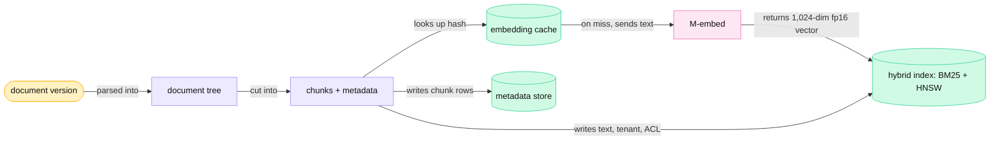
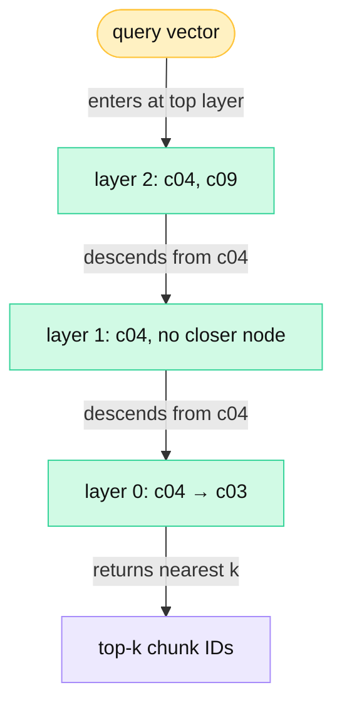
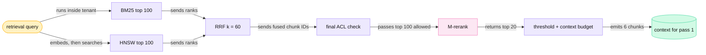
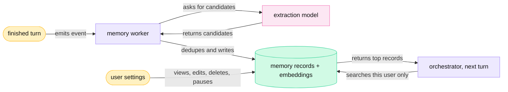

<!-- GENERATED from manuscript/src/part-05-retrieval-memory-context.md by tools/render_manuscript.py. Edit the source, not this file. -->
# Part 05: Retrieval, memory and context construction

The orchestrator finds the chunks and memory records that matter and checks your access to them. It then packs them with your request into one ordered token sequence.

Your request is in the orchestrator (part 3.6). The orchestrator knows your identity, your tenant and your conversation. Your PDF sits in the index already (part 4.4). Your photo is ready to become 15,552 visual tokens (part 4.3). Before the first inference pass, the orchestrator must answer three questions:

1. Which pieces of the workspace documents answer your question (5.1 to 5.3)?
2. Which of those pieces may you read (5.4)?
3. What does the model see, in what order, and at what token cost (5.5 to 5.7)?

Section 5.8 shows how this work fails and how to measure it.

Two numbers frame this part. The reference workspace holds 4,200 documents (hypothetical). Retrieval returns 6 chunks from them for your request. Everything between those two numbers runs on the CPU tier and on a small GPU pool for retrieval models. No `M-frontier` GPU sees your request before it ends.

---

## 5.1 RAG ingestion: chunks, embeddings and the index

At upload time, a pipeline cuts each document into chunks and turns each chunk into one dense vector. It writes vector, text and metadata into one index.

### Ingestion time and query time

Retrieval-augmented generation (RAG) gives the model text that a retriever found at request time. The original RAG paper trained a retriever and a generator together over 21,000,000 Wikipedia passages [SRC-228]. A common current design is a pipeline instead. Application code runs the search and puts the found text into the prompt. The model does not query a database by itself.

The work splits into two phases:

| Phase | When | Steps | Cost paid by |
|---|---|---|---|
| ingestion | after upload, before Send | parse → chunk → embed → write vector, text and metadata into the index | the parser workers and the embedding pool, once per document version |
| query | after Send, on the TTFT path | embed the query → search with permission filters → fuse → final permission check → rerank → pack into the context | your request, every turn |

Part 4.4 covered parsing and the chunk fields for your PDF. This section continues from the chunker.



Legend: amber = your data; violet = CPU work; pink = GPU work; green = stores. The one thing to notice: the cache sits in front of the embedding model. So an unchanged chunk never reaches the GPU again. The diagram leaves out the parser stages of part 4.4 on purpose.

### Chunking strategies

A chunk is one retrievable piece of a document, with metadata. Its size sets a trade-off. A small chunk matches a query precisely but carries little context. A large chunk carries context but dilutes the match, and it costs more tokens in the prompt.

Six strategies are common (class B, except where a source says otherwise):

| Strategy | How it cuts | Strength | Weakness |
|---|---|---|---|
| fixed token window | every T tokens | simple; predictable embedding cost | cuts sentences, tables and facts in two |
| overlapping window | windows of T tokens, start every T − O tokens | a fact near a boundary appears whole in one chunk | stores T / (T − O) times the tokens; near-duplicate results |
| paragraph-based | at blank lines or sentence ends, then packs to a size | keeps units of meaning | uneven sizes |
| semantic | where the embedding similarity of neighbouring sentences drops | topic-coherent chunks | one more embedding pass; a threshold to tune |
| hierarchical | parent sections and child paragraphs; match the child, return the parent | precise match, more context | more storage and a join |
| structure-aware | at headings, tables and lists from the parser | keeps tables whole; carries the heading path | needs a good parser |

Docling's hierarchical chunker emits one chunk per document element. Its hybrid chunker starts from that output. It splits chunks that exceed a token limit, using a tokenizer that matches the embedding model. It then merges small neighbours under the same heading [SRC-241]. In this reference system, chunks are structure-aware, 550 tokens on average, inside a range of 300 to 800 tokens (RA-22).

**Overlap, worked.** An overlap of O tokens repeats the last O tokens of one window at the start of the next. With T = 500 and O = 50, the index stores 500 ÷ (500 − 50) = 1.111 times the tokens. Section 5.8 shows a fact that a fixed window cuts in two and an overlapping window keeps whole.

### From a chunk to a vector

An embedding is a dense vector that represents a chunk or a query. `M-embed` is Qwen3-Embedding-8B, a decoder Transformer with 36 layers and a hidden size of 4,096 [SRC-273]. It maps one chunk to one vector in five steps:

1. The tokenizer turns the chunk text into T token IDs.
2. The 36 layers produce hidden states of shape `[T, 4096]`.
3. The model keeps the hidden state of the last token only (last-token pooling): shape `[4096]`.
4. It divides that vector by its length (L2 normalization), so the vector has length 1.
5. Optional: it keeps only the first d dimensions and normalizes again.

The result is one point on the unit sphere. Similar texts land near each other, because training pulled matching query and passage pairs together. The model card asks for a task instruction on the query side only [SRC-273].

Step 5 works because of Matryoshka representation learning (MRL). MRL trains one embedding to carry information from coarse to fine granularity [SRC-461]. A truncated MRL embedding stays useful, at some loss of quality. The `M-embed` card supports output sizes from 32 to 4,096 dimensions [SRC-273].

In this reference system, the index stores 1,024 dimensions in float16 (RA-23):

```
bytes per vector = dimensions × bytes per element
full output, fp32:      4,096 × 4 B = 16,384 B
full output, fp16:      4,096 × 2 B = 8,192 B
stored (MRL), fp16:     1,024 × 2 B = 2,048 B
```

Two reasons drive this choice. pgvector cannot build an index on a `vector` column above 2,000 dimensions, or on `halfvec` above 4,000 [SRC-230]. And every byte per vector multiplies by the chunk count, as the next table shows.

### Storage for the reference workspace

The workspace holds 4,200 documents with 24 chunks each on average (hypothetical):

1. Chunks: 4,200 × 24 = 100,800 chunks.
2. Tokens indexed: 100,800 × 550 = 55,440,000 tokens.
3. Stored vectors: 100,800 × 2,048 B = 206.4 MB.
4. Full fp32 vectors would need 1.65 GB, 8 times as much.
5. HNSW neighbour links (5.2) add about 132.3 B per chunk, or 13.3 MB.

So one chunk costs about 2,180 B of vector index, before its text and metadata. The text is usually larger than the vector. The index keeps the text, so that BM25 can score it and the orchestrator can quote it.

In this reference system, the metadata store keeps one row per chunk (RA-22, RA-26). The row holds the document version, heading path, tenant and ACL principals. The store holds derived data, so the system can rebuild it from the documents (RA-21).

### What embedding costs

The embedding pool runs `M-embed` on GPUs of type H100 SXM (class C). A common estimate is about 2 FLOPs per parameter per token: one multiply and one add per weight. The attention terms are small at these lengths, so this estimate leaves them out:

- **Ingestion of the workspace:** 2 × 7,567,295,488 × 55,440,000 = 8.39 × 10¹⁷ FLOPs. At 0.5 of the BF16 dense peak, that is 28.3 GPU-minutes, spread over many uploads.
- **One query:** 80 tokens give 1.21 × 10¹² FLOPs, or 2.45 ms of compute. But the GPU must also read all weights once: 15.1 GB at 3.35 TB/s takes 4.52 ms.

A single query is therefore memory-bound. The embedding pool batches queries from many requests, so one weight read serves many queries. This is the same batching argument as for decode (part 11).

### The embedding cache

In this reference system, derived caches live in a Redis-compatible store with the tenant ID in every key (RA-19). The embedding cache has two kinds of entry:

| Entry | Key | Value | Lifetime |
|---|---|---|---|
| chunk embedding | `emb:{tenant}:{model_id}:{dims}:{sha256(chunk text)}` | 2,048-byte vector | until the chunk text or the model version changes |
| query embedding | `qemb:{tenant}:{model_id}:{dims}:{sha256(instruction + query)}` | 2,048-byte vector | TTL of 3,600 s |

The model ID belongs in the key because two model versions map the same text to different spaces. A dot product between vectors of two models means nothing. The tenant ID belongs in the key so that one tenant's cache entry never answers another tenant's lookup (5.4). When a user uploads a new version of a document, only the changed chunks miss the cache.

**Meanwhile in the fleet.** While your request runs, the embedding pool also embeds chunks of other tenants' new uploads. Those ingestion batches are large and can wait. Query embeddings sit on someone's TTFT path. So the pool serves query batches first and fills idle capacity with ingestion batches (RA-68).

You can now compute the vector storage of a workspace and explain why the index truncates the embeddings.

---

## 5.2 Vector search: exact similarity, HNSW and IVFFlat

Exact search compares the query with every vector. HNSW and IVFFlat compare it with a small subset, and sometimes miss a true neighbour.

### Three similarity measures

For a query vector q and a chunk vector d of n dimensions:

```
dot(q, d)       = Σ q_i × d_i
cosine(q, d)    = dot(q, d) / (|q| × |d|)
euclidean(q, d) = sqrt( Σ (q_i − d_i)² )
```

A hand example with three dimensions: q = (1, 2, 2) and d = (2, 0, 1).

1. dot = 1×2 + 2×0 + 2×1 = 4.
2. |q| = sqrt(1 + 4 + 4) = 3.0; |d| = sqrt(4 + 0 + 1) = 2.2361.
3. cosine = 4 ÷ (3.0 × 2.2361) = 0.5963.
4. euclidean = sqrt(1 + 4 + 1) = 2.4495.

`M-embed` vectors have length 1. For unit vectors, cosine equals the dot product, and |q − d|² = 2 − 2 × dot. So all three measures give the same order, and the index computes only dot products.

**A toy corpus.** The rest of this part uses a small illustrative corpus of 12 chunks. Most belong to a fictional company, Acme; one belongs to another fictional tenant, Birch. Their 8-dimensional vectors are illustrative topic vectors, set by hand plus seeded noise. They are not `M-embed` outputs.

The retrieval query is "pricing policy competitor list price gross margin per seat". For the query and chunk `c04` ("3.2 Gross margin by plan"):

| | pricing | margin | competitor | revenue | cost | people | security | roadmap |
|---|---|---|---|---|---|---|---|---|
| q | 0.4523, 0.6784, 0.5276, 0.0754, 0.2261, 0.0, 0.0, 0.0 |
| d (c04) | 0.2788, 0.8123, 0.201, 0.3563, 0.308, 0.0135, 0.0, 0.0 |
| q_i × d_i | 0.1261, 0.5511, 0.106, 0.0269, 0.0696, 0.0, 0.0, 0.0 |

The products sum to dot = cosine = 0.8797. The Euclidean distance is 0.4904, and its square equals 2 − 2 × 0.8797 = 0.2406.

### What exact search costs

Exact search (brute force) computes the dot product with every stored vector and keeps the top k. For N vectors of n dimensions, it does N × n multiply-adds and reads N × n × bytes:

| Corpus | FLOPs per query | Bytes read per query |
|---|---|---|
| your workspace, 100,800 vectors × 1,024 fp16 | 2.06 × 10⁸ | 206.4 MB |
| 10⁸ vectors × 1,024 fp16 (hypothetical) | 2.05 × 10¹¹ | 204.8 GB |
| 10⁸ vectors × 4,096 fp32 | 8.19 × 10¹¹ | 1.64 TB |

One query does 1 FLOP per byte it reads in fp16. So exact search is memory-bound, far below the H100 ridge point of 295 FLOPs per byte. Reading 204.8 GB at 3.35 TB/s takes 61.1 ms. The vectors alone also need 3 H100s of HBM. For your workspace, exact search is cheap. For a large shared corpus, every query would pay that full read.

### HNSW: a layered neighbour graph

Hierarchical Navigable Small World (HNSW) is a graph index [SRC-229]. Each vector is a node. Each node links to some of its nearest neighbours. Layer 0 holds all nodes. Each higher layer holds a random subset of the layer below.

The paper defines four parameters [SRC-229]:

| Parameter | Meaning | Effect of a larger value |
|---|---|---|
| `M` | links a new node makes on each layer | higher recall, more memory; the paper calls the range [5, 48] reasonable |
| `Mmax0` | the link limit on layer 0; the paper's automatic choice is 2 × M | — |
| `efConstruction` | candidate list size while the index inserts a node | better links, slower build |
| `ef` (efSearch) | candidate list size at query time; at least k | higher recall, more distance computations |

**Levels.** At insert time, a node draws its top layer as `l = floor(−ln(U) × mL)`, with U uniform on (0, 1). The paper suggests mL = 1 / ln(M) [SRC-229]. Then a node reaches layer l or higher with probability M^(−l). For M = 16, mL = 0.36067376.

So a node reaches layer 1 with probability 1/M and layer 2 with probability 1/M². A graph of 10⁸ nodes has about ln(N) ÷ ln(M) = 6.64 layers above layer 0.

**Search.** A K-nearest-neighbour search runs in three steps [SRC-229]:

1. Start at the entry point on the top layer.
2. On each layer above 0, move greedily: go to the neighbour closest to the query until no neighbour is closer. That node becomes the entry point one layer down. This is greedy descent, with ef = 1.
3. On layer 0, run a best-first search with a candidate list of size ef. Stop when the closest unexplored candidate is farther than the farthest of the ef results. Return the best k.

A larger ef delays the stop in step 3. The search explores more neighbours, so it is less likely to stop in a local minimum. Recall rises, and so do distance computations and latency.

**The toy graph.** The simulation builds HNSW over the 12 toy chunks with M = 2, Mmax0 = 4 and efConstruction = 6 (seeded). With M = 2, mL = 1.4427, so more nodes reach the upper layers than with M = 16. The graph has 3 layers:

| Layer | Nodes and their links |
|---|---|
| 2 | c04 → c09; c09 → c04 |
| 1 | c01 → c02, c04; c02 → c01, c04; c04 → c06, c01; c06 → c04, c02; c08 → c06, c04; c09 → c02, c01 |
| 0 | all 12 nodes; for example c03 → c07, c12, c01, c04 |

The entry point is `c04`. The search for the query with ef = 1 follows this path (distance = 1 − cosine):

1. Layer 2: compute the distance to `c04`: 0.1203. Its only layer-2 neighbour, `c09`, is farther, so descend.
2. Layer 1: the layer-1 neighbours of `c04` (c06, c01) are farther too. Descend again.
3. Layer 0: among the neighbours of `c04`, `c03` is closer, at 0.0793. Move there.
4. No neighbour of `c03` is closer. The search returns `c03` after 12 distance computations.

With ef = 5 the search returns c03, c04, c07, c12, c01 after 15 distance computations. That equals the exact top 5. An exact scan needs only 12 distance computations. On a tiny corpus HNSW does more work than exact search, because it recomputes distances on each layer. Its advantage appears only on large corpora. The toy graph holds both tenants on purpose, so 5.4 can show the post-filter problem on it.



Legend: amber = your query; green = graph layers in the index; violet = the result. The one thing to notice: each upper layer only finds a good starting node for the layer below. The diagram leaves out the links that the search does not follow.

**Memory of the graph.** Each node stores neighbour IDs. With 4-byte IDs, layer 0 stores up to 2M IDs per node. A node has on average 1 / (M − 1) layers above 0, with up to M IDs each:

```
link bytes per node = 4 B × (2M + M × 1/(M − 1))
                    = 4 B × (2 × 16 + 16 × 0.0667)
                    = 132.3 B
```

This is a lower bound. Real engines add per-node headers and allocation overhead. Against a 2,048-byte vector, the links add about 6%. For 10⁸ nodes they take 13.2 GB. HNSW keeps the graph in memory for fast random access. So memory, not compute, limits the vectors per index node.

**Defaults in real systems.** pgvector uses `m` = 16, `ef_construction` = 64 and `hnsw.ef_search` = 40 [SRC-230]. Elasticsearch uses `m` = 16 and `ef_construction` = 100 [SRC-231]. In this reference system, one search engine holds BM25 and HNSW with M = 16 and ef_construction = 200 (RA-24). Queries use ef_search = 100, so the vector side can return 100 candidates.

### IVFFlat: inverted lists

IVFFlat clusters the vectors first. A k-means step picks `nlist` centroids, and each vector goes into the list of its nearest centroid. The index needs this training stage, and the training data should resemble the stored data [SRC-232]. A query runs in two steps:

1. Compare the query with all `nlist` centroids.
2. Scan only the `nprobe` closest lists exactly.

FAISS's default `nprobe` is 1, and `nprobe` = `nlist` equals exact search [SRC-232]. Search time grows about linearly with `nprobe`, because each probe scans one more list [SRC-232]. pgvector suggests `lists` = rows ÷ 1,000 up to one million rows, and sqrt(rows) above that [SRC-230].

### Recall versus latency, measured on a synthetic set

Recall@10 is the share of the true 10 nearest neighbours that the index returns. The simulation measures it on 4,000 synthetic clustered unit vectors of 48 dimensions, with 100 queries (illustrative, seeded). Distance computations stand in for latency. Exact search needs 4,000 per query.

| HNSW (M = 16, efConstruction = 200) ef_search | recall@10 | distance computations | share of exact |
|---|---|---|---|
| 10 | 0.65 | 144 | 3.6% |
| 20 | 0.71 | 174 | 4.3% |
| 40 | 0.82 | 222 | 5.5% |
| 80 | 0.92 | 316 | 7.9% |
| 160 | 0.95 | 609 | 15.2% |

| IVFFlat (nlist = 64) nprobe | recall@10 | distance computations | share of exact |
|---|---|---|---|
| 1 | 0.70 | 137 | 3.4% |
| 2 | 0.91 | 193 | 4.8% |
| 4 | 0.96 | 322 | 8.1% |
| 8 | 0.99 | 572 | 14.3% |
| 64 | 1.00 | 4,064 | 101.6% |

Both tables show the same shape. Each step up in ef_search or nprobe buys less recall for more work. On this clustered toy set, IVFFlat does well, because the clusters match the data. Real recall depends on the data, so a deployment measures its own curve on its own queries. No single number holds across corpora.

The two indexes differ in more than recall:

| | HNSW | IVFFlat |
|---|---|---|
| Build | incremental inserts, slow per insert | needs a training pass over sample data |
| Memory | vectors + links | vectors + centroids; smaller |
| New data | inserts link in at once | new vectors join old lists; centroids age and recall drifts |
| Filtered search | traversal can skip nodes that fail a filter | each probed list scans fully |

**Meanwhile in the fleet.** Your query is one of many on the same index node. Each query runs a separate graph walk on read-only memory, so queries need no locks between them. Index writers insert new chunks from other tenants' uploads at the same time. In HNSW, each insert updates the links of a few nodes, under fine-grained locks in common implementations.

You can now explain how ef_search trades recall for latency, and estimate the memory of an HNSW graph.

---

## 5.3 Hybrid retrieval: BM25, fusion and reranking

Lexical search and vector search miss different chunks. So the retrieval service runs both, fuses their rankings with RRF, and reranks the best candidates.

### BM25

BM25 scores a chunk by the query terms it contains. Lucene and Elasticsearch use these defaults: k1 = 1.2 and b = 0.75 [SRC-234]. Lucene's form [SRC-235]:

```
idf(t)        = ln(1 + (N − df_t + 0.5) / (df_t + 0.5))
score(q, d)   = Σ over terms t in q of  idf(t) × tf / (tf + k1 × (1 − b + b × dl / avgdl))
```

The symbols:

- N: chunks in the index (here, in the tenant's partition).
- df_t: chunks that contain term t.
- tf: how often t occurs in chunk d.
- dl and avgdl: the length of d and the average length.

Three parts do three jobs:

1. **IDF** rewards rare terms. A term in every chunk tells little. Lucene adds 1 inside the logarithm, so idf is never negative [SRC-234].
2. **tf ÷ (tf + k1 × …)** saturates. The second occurrence of a term adds less than the first, and the score never exceeds idf. k1 sets how fast it saturates.
3. **The length factor** `1 − b + b × dl / avgdl` makes a long chunk need more occurrences for the same score. b = 1 normalizes fully; b = 0 not at all.

The textbook form multiplies by (k1 + 1) as well [SRC-233]. That factor is the same for every chunk, so the ranking does not change.

**Worked on the toy corpus.** BM25 runs inside the `tenant_acme` partition: N = 11 chunks, avgdl = 16.45 words. The top chunk is `c03` ("3 Competitor price matching"), with dl = 21. Its length factor is 1 − 0.75 + 0.75 × 21 ÷ 16.45 = 1.2072. Each matched term occurs once, so its tf part is 1 ÷ (1 + 1.2 × 1.2072) = 0.4084:

| Term | df | idf | tf part | term score |
|---|---|---|---|---|
| competitor | 1 | 2.0794 | 0.4084 | 0.8492 |
| list | 3 | 1.2321 | 0.4084 | 0.5032 |
| price | 4 | 0.9808 | 0.4084 | 0.4006 |
| gross | 2 | 1.5686 | 0.4084 | 0.6406 |
| margin | 2 | 1.5686 | 0.4084 | 0.6406 |

The sum is 3.0342. "competitor" occurs in only 1 chunk, so it carries the largest idf. The full BM25 order is c03, c01, c04, c10, c02, c06, c07, c08. The vector order over the same tenant is c03, c04, c07, c01, c10, c06, c02, c05, c09, c11, c08.

BM25 finds exact words: plan codes, product names, error strings, numbers. It fails on synonyms: a query about "rival vendors" shares no word with a chunk about "competitors" (5.8). Vector search catches the synonym and blurs the exact code. So the two retrievers complement each other.

### Reciprocal Rank Fusion

BM25 scores have no upper bound and depend on the corpus. Cosine scores lie in [−1, 1]. Adding them without normalization mixes two scales. Reciprocal Rank Fusion (RRF) uses only ranks [SRC-236]:

```
RRF(d) = Σ over rankings r of 1 / (k + rank_r(d))
```

The authors fixed k = 60 in a pilot study and report that the choice was not critical [SRC-236]. A chunk absent from one ranking adds nothing from that ranking. In this reference system, fusion uses RRF with k = 60 (RA-25).

On the toy corpus, after the permission filters of 5.4, the two inputs are:

- BM25: c03, c01, c04, c02, c06, c08
- vector: c03, c04, c01, c06, c02, c05, c09, c11, c08

| Chunk | ranks | RRF terms | RRF score |
|---|---|---|---|
| c03 | 1, 1 | 1/(60+1) + 1/(60+1) | 0.03279 |
| c01 | 2, 3 | 1/(60+2) + 1/(60+3) | 0.032 |
| c04 | 3, 2 | 1/(60+3) + 1/(60+2) | 0.032 |
| c02 | 4, 5 | 1/(60+4) + 1/(60+5) | 0.03101 |
| c06 | 5, 4 | 1/(60+5) + 1/(60+4) | 0.03101 |
| c08 | 6, 9 | 1/(60+6) + 1/(60+9) | 0.02964 |
| c05 | 6 | 1/(60+6) | 0.01515 |

Two things show here. First, `c01` and `c04` swap places between the inputs, so they tie, and a fixed rule breaks the tie. Second, `c08` appears in both lists, low in each. It still beats `c05`, which appears in one list only. RRF rewards agreement between retrievers.

**Weighted score fusion** is the alternative. It normalizes each retriever's scores, for example by min-max, and then adds them with weights. OpenSearch documents this with `min_max`, `l2` and `z_score` normalization [SRC-237]. Its documentation warns that a chunk missing from one retriever gets 0 there. With equal weights, the toy order becomes c03, c04, c01, c02, c06, c05, c08, c09, c11. Weights need tuning on labelled queries, and RRF needs none.

### Cross-encoder reranking

Both retrievers use a **bi-encoder** view: the query and each chunk become vectors separately. So chunk vectors exist before the query arrives. A **cross-encoder** reads the query and one chunk together in one forward pass. Every query token attends to every chunk token, so it judges relevance better. It produces no reusable vector, and it must run once per pair at query time [SRC-238].

`M-rerank` is Qwen3-Reranker-4B. It is a decoder LLM used as a pointwise classifier, not a BERT-style encoder [SRC-274]. The prompt holds an instruction, the query and the chunk inside its chat template. The model then reads two logits at the last position, for the tokens "yes" and "no". The score is P(yes) = softmax over [no, yes] [SRC-274].

The publisher reports an MTEB-R score of 69.76 for the 4B model on candidates from a small embedder [SRC-239]. That number is publisher-reported; no independent reranker leaderboard exists.

In this reference system, the pipeline shape is (RA-25):

1. BM25 and HNSW each return 100 candidates from the tenant partition.
2. RRF fuses them. The final ACL check by chunk ID (5.4) drops any chunk the user may not read. The top 100 allowed chunks go to the reranker.
3. `M-rerank` scores each candidate; the service keeps the top 20.
4. The orchestrator adds chunks in rerank order while P(yes) ≥ 0.5 and the chunk budget holds (5.6).

For your request, 6 chunks pass step 4. Anthropic's public evaluation used the same shape: 150 candidates reranked to 20 [SRC-240]. It reports a top-20 retrieval failure rate of 5.7% with embeddings alone. With contextual embeddings, contextual BM25 and reranking, the rate falls to 1.9% [SRC-240]. These are one vendor's measurements on its own data sets.

**The toy rerank.** The toy uses an illustrative scorer, P(yes) = sigmoid(5.0 × cosine + 0.5 × BM25 + (-4.0)). It is not `M-rerank`. It only shows that a reranker can reorder the fused list:

| Chunk | c03 | c04 | c01 | c06 | c02 | c05 |
|---|---|---|---|---|---|---|
| P(yes) | 0.89 | 0.81 | 0.57 | 0.32 | 0.30 | 0.07 |

With a threshold of 0.5, the chunks c03, c04, c01 would enter the context.

### What reranking costs

Each pair is one prefill of the reranker. The cost grows with candidates × pair length:

| | tokens per pair | tokens per query | FLOPs (2 × 4,021,784,576 × tokens) | time on one GPU |
|---|---|---|---|---|
| full chunks (550 + 60 template tokens) | 610 | 61,000 | 4.91 × 10¹⁴ | 992 ms |
| chunks cut to 300 tokens | 360 | 36,000 | 2.90 × 10¹⁴ | 585 ms |

Times assume 0.5 of the H100 SXM BF16 dense peak (hypothetical). Full chunks would add almost one second to TTFT. In this reference system, the reranker reads the first 300 tokens of each candidate (RA-68). It splits the pairs over 4 replicas, so the step takes about 146.3 ms. The pairs are independent, so they parallelize without any coordination. Three levers trade quality for latency: fewer candidates, shorter pairs, or a smaller reranker.



Legend: amber = your query; violet = CPU work; pink = the reranker on the retrieval GPU pool; green = the result. The one thing to notice: the expensive model sees only the candidates that two cheap retrievers agree on. The diagram leaves out the embedding cache on purpose.

**Meanwhile in the fleet.** Suppose every request at the hypothetical peak of 50,000 requests per second ran one retrieval. Then the rerankers would read 1.8 billion tokens per second. Only some requests retrieve, so the real load is lower. The bound still shows why the rerank pool scales separately from the `M-frontier` fleet. The retrieval pool emits its own queue-depth and latency metrics to the autoscaler (part 19).

You can now compute BM25 and RRF scores by hand, and explain why the reranker sees few candidates.

---

## 5.4 Permissions in retrieval ▣

Similarity says what is close, never what is allowed. So permissions filter inside the index and inside the query, and a final check runs by chunk ID.

### The rule

Users from different tenants must never see each other's documents. Inside one tenant, a user must see only the documents that the user may read. An embedding carries no permission. Two chunks with nearly equal vectors can belong to two tenants. So authorization is part of the query, not a step after similarity.

In this reference system, authorization in retrieval has three layers (RA-26):

1. **Tenant ID as a hard filter inside the index.** Every query carries the tenant ID from the authenticated session. The search engine evaluates it during the search, so other tenants' chunks never become candidates.
2. **ACL principals as metadata.** Each chunk stores the principals that may read it, such as `group:finance` or `user:u_93` (part 4.4). The query carries your principals. The engine keeps only chunks whose principals intersect yours. This is a row-level filter, evaluated at retrieval time.
3. **A final ACL check by chunk ID.** Before the orchestrator puts any chunk text into the context, it checks each chunk ID against the ACL service. This catches changes after indexing, such as a revoked share.

The tenant ID and the principals come from the gateway's verified identity (part 3.2). They never come from the request body or from model output.

### Isolation designs

Three designs isolate tenants in an index (class B):

| Design | How | Strength | Weakness |
|---|---|---|---|
| index or collection per tenant | separate physical index | strongest isolation; easy deletion | many small indexes; overhead per index |
| partitions inside one index | list partitioning, shards or namespaces by tenant | isolation with shared operations | large tenants still need their own shards |
| shared index with a tenant field | one index, tenant as a filter | simplest; best for many small tenants | isolation depends on every query carrying the filter |

pgvector's documentation recommends list partitioning or separate tables for tenant isolation [SRC-230]. Qdrant recommends one collection with a tenant payload field that has a tenant index (`is_tenant: true`). It says one collection per tenant is rarely the most efficient, and it can promote large tenants to dedicated shards [SRC-243].

### The post-filtering problem

A post-filter runs the vector search first and removes forbidden results afterwards. Two things go wrong:

1. **The top k shrinks or empties.** The index returns ef_search candidates, and most can belong to others.
2. **The placement can leak.** A forbidden chunk can reach a later step before the filter. Then its text can appear in logs, caches or the answer.

pgvector documents the first problem. With a filter that matches 10% of rows and ef_search = 40, only about 4 rows match on average [SRC-230]. The fix it documents is the iterative index scan, capped by `hnsw.max_scan_tuples` = 20,000 [SRC-230].

**On the toy corpus.** The toy HNSW graph holds both tenants, so the problem shows. Your principals are user:u_93, group:all_staff, group:finance.

1. The vector search returns the top 5: c03, c04, c07, c12, c01.
2. `c07` is a board memo that only `group:exec` may read. `c12` belongs to `tenant_birch`.
3. The post-filter removes c07, c12, so only 3 of 5 results remain: c03, c04, c01.
4. With the filters inside the search, the top 5 are c03, c04, c01, c06, c02: 5 results.

**On a shared index.** The simulation also builds an HNSW graph of 3,000 synthetic vectors from 50 tenants, 2% each (illustrative). With ef_search = 40 and a post-filter, a query keeps on average 1.55 of the 10 results it wants. The formula ef_search × fraction predicts 0.8. The measured value is higher, because each query starts near one of its own tenant's vectors. With the filter inside the traversal, every query gets 10.

At real scale the gap is extreme. Your workspace's 100,800 chunks would be 0.10% of a shared index of 10⁸ vectors. A post-filter at ef_search = 100 would keep about 0.1 chunks per query. Raising ef_search until enough survive would cost close to an exact scan.

**Filters inside the graph walk.** In the simplest design, the greedy graph search uses only the nodes that match the filter [SRC-244]. If the filter removes most nodes, the remaining subgraph can fall apart into pieces [SRC-244]. Qdrant's original filterable-HNSW design adds extra links inside each payload category for this reason [SRC-244]. For a filter that matches few points, Qdrant's query planner skips the graph. It reads the points from the payload index and scans them [SRC-927].

**Your request.** 2,940 of the 4,200 workspace documents list one of your principals (70%, hypothetical). That is 70,560 chunks that retrieval may return to you.

### Cache isolation

Every cache on the retrieval path holds tenant data. A cache key without the tenant would let one tenant's lookup return another tenant's entry. In this reference system, the tenant ID is part of every cache key (RA-19):

| Cache | Key includes | Why |
|---|---|---|
| embedding cache | tenant, model ID, dims, text hash | a hit reveals that the text exists in that tenant |
| query-result cache | tenant, ACL scope hash, query hash, index version | the same query has different allowed results for different users |
| prefix KV cache | `cache_salt` = tenant ID (RA-40) | a fast TTFT reveals cached prefixes (part 13.5) |

The query-result cache needs the ACL scope as well as the tenant. Two users of one tenant can ask the same question and be allowed different chunks.

For the prefix KV cache, vLLM adds the `cache_salt` to the extra keys of the first block only [vllm@v0.31.0:vllm/v1/core/kv_cache_utils.py#L614-L652]. Every later block hash chains through the first one, so the salt scopes the whole request. One consequence follows. Your request carries private content, so it carries your tenant's salt. So its system-prompt blocks match only requests of the same tenant (5.6). Other tenants' copies of the same system prompt never match.

### Stage card: permission-aware retrieval

| # | Question | Answer |
|---|---|---|
| 1 | Which component runs? | The retrieval service: a query planner, the search engine (BM25 + HNSW), the reranker client and the ACL client. The orchestrator runs the final check. |
| 2 | On what hardware? | CPUs for search, fusion and ACL checks; GPUs of the retrieval pool for query embedding and reranking. |
| 3 | What data enters? | The retrieval query text, the tenant ID, your principals, the result count, the deadline. |
| 4 | In what representation? | A gRPC request; inside, a query vector of 1,024 fp16 values and a filter expression. |
| 5 | What computation happens? | Embedding, a filtered graph walk, a BM25 posting-list scan, RRF, reranker prefills, set intersection of principals. |
| 6 | What data leaves? | Up to 20 chunk IDs with text, scores, page, bounding box and heading path. |
| 7 | Where is state stored? | Index shards on index nodes (memory and SSD); ACLs in the ACL service; caches in the Redis-compatible store. |
| 8 | Is it synchronous? | Yes for your request: the orchestrator awaits it before pass 1. BM25 and vector search run in parallel. |
| 9 | Can different users' requests run here at the same time? | Yes. Many queries walk the same read-only graph at once. |
| 10 | How is that concurrency achieved? | Read-only index segments, a thread pool per index node, batched embedding and reranking on the GPU pool. |
| 11 | What is cached? | Query and chunk embeddings and query results, all keyed with the tenant (RA-19). |
| 12 | What can fail? | A missing filter (a leak), an empty top k after post-filtering, a stale ACL, a slow shard. A slow shard returns partial results before the deadline. |
| 13 | What does it add to latency? | Query embedding (about 5 ms, memory-bound), search, and reranking (about 146 ms here). |
| 14 | What limits capacity? | Index memory per node, reranker GPU time, and the cost of very selective filters. |
| 15 | How does it scale horizontally? | Shards by tenant, replicas per shard for read throughput, more GPUs in the retrieval pool. |
| 16 | What security boundary exists? | The tenant boundary inside the index, and the per-user ACL boundary before the context. Similarity never overrides either. |

**Meanwhile in the fleet.** Other tenants' queries walk other shards of the same search cluster. A revoked share in another workspace triggers an ACL update event. The final check reads the ACL service, so the revocation takes effect at once. The index metadata catches up later.

You can now explain why a post-filter empties the top k, and name the three permission checks.

---

## 5.5 Long-term user memory

Long-term memory is a per-user store of short records. A background worker extracts them after a turn, and the read path injects a few.

### What a record is

In this reference system, long-term memory is a set of per-user, editable text records with embeddings (RA-27). A record is one short fact or preference in plain text. Its row holds the user ID, the tenant, the text, its embedding, the source conversation, timestamps and a category. Your user has 14 records (hypothetical). 2 of them matter for your request:

- "Reports figures in EUR."
- "Prefers results as a table."

### The write path

The write path runs after a turn ends, outside the request path (RA-27):

1. The orchestrator finalizes the assistant message (part 3.5) and emits a turn-completed event.
2. A memory worker consumes the event and sends the turn to an extraction prompt on a model.
3. The model proposes candidate records, each with a category.
4. A filter drops candidates in excluded categories (see Privacy).
5. The worker embeds each candidate and searches the user's existing records.
6. If an existing record has cosine ≥ 0.9, the worker updates that record instead of adding one. This is deduplication.
7. The worker writes the record row and its embedding in one transaction.

A user can also ask in the chat to remember something. Then the orchestrator calls the same write path at once. The write path never blocks your stream, because it runs after the answer.

### The read path

The read path runs during context construction, in parallel with document retrieval (RA-27):

1. Embed the retrieval query (the same query embedding as 5.3).
2. Search only this user's records.
3. Keep at most 5 records with cosine ≥ 0.35.
4. Render them into one system message under a cap of 300 tokens.

For your request, 2 records pass. The real K3 tokenizer gives the message these sizes:

| Part | Tokens |
|---|---|
| record 1 line | 6 |
| record 2 line | 8 |
| message frame and header | 32 |
| memory message | 46 |

The frame costs more than the records. Two short records cost 46 tokens of a 300-token cap. They still change the answer: the margins appear in EUR, in a table.



Legend: amber = the user and the user's turn; violet = CPU services; pink = a model call; green = the store. The one thing to notice: writes happen after a turn and reads during the next one. So memory adds no model call to your TTFT. The diagram leaves out the cache copies that a deletion must also remove.

### Privacy and user control

Public products document the same controls. Claude's help article says the user can view, edit and delete memory topics, pause memory or reset it. It also says sensitive topics such as health, politics and religion stay out unless the user turns them on [SRC-271]. OpenAI's Memory FAQ says that turning memory off does not delete stored memories. It also says that deleting a chat does not delete memories saved from it [SRC-362]. These describe public product behaviour, not internal designs.

In this reference system (RA-27):

- The user can view, edit and delete each record, pause memory, and reset it.
- A chat can opt out, and then it neither reads nor writes records.
- The extraction filter excludes sensitive categories by default.
- The worker never stores secrets: passwords, keys, payment data, or one-time codes.
- A deletion removes the row, its embedding and every cached copy. The audit log records the deletion without the text.
- Records belong to one user inside one tenant. The read path searches only that user's records, so one user's memory never enters another user's context.

**Meanwhile in the fleet.** Memory workers consume turn-completed events from millions of conversations. They run at low priority, so a backlog delays only new records, never answers. The extraction model calls go to a separate pool, outside the latency-critical path.

You can now trace one record from extraction to the context, and list what memory must never store.

---

## 5.6 Context construction: the context budget of your request

The orchestrator orders the context from the most stable part to the most volatile part. It counts every part in K3 tokens and checks the total.

### The inputs and the order

The context window is the maximum number of tokens the model accepts in one context. For `M-frontier` it is 1,048,576 tokens [SRC-378]. In this reference system, the orchestrator caps each prompt at 131,072 tokens (RA-68). The cap bounds prefill time, KV memory and cost far below the window.

The orchestrator tokenizes for budgeting with the same tokenizer as the model (RA-62). The model server's tokenization stays authoritative. The orchestrator places the parts in this order:

| # | Segment | Tokens | Positions | Changes once per | Source |
|---|---|---|---|---|---|
| 1 | tool-declare message | 315 | 0–315 | deployment and tenant tool set | real tokenizer, both tool schemas |
| 2 | thinking-effort message | 67 | 315–382 | deployment | real tokenizer |
| 3 | system prompt | 1,200 | 382–1,582 | deployment (it carries the date) | hypothetical |
| 4 | history turn 1 | 780 | 1,582–2,362 | conversation | hypothetical |
| 5 | history turn 2 | 840 | 2,362–3,202 | conversation | hypothetical |
| 6 | history turn 3 | 980 | 3,202–4,182 | conversation | hypothetical |
| 7 | memory message | 46 | 4,182–4,228 | turn | real tokenizer (5.5) |
| 8 | retrieved chunks | 3,459 | 4,228–7,687 | turn | frame and headers real; bodies hypothetical |
| 9 | your user turn: text, image wrapper, visual tokens | 15,625 | 7,687–23,312 | turn | real tokenizer and processor (part 4.1) |
| 10 | generation prefix | 10 | 23,312–23,322 | pass | real tokenizer |
| | **pass-1 prompt** | **23,322** | | | |

The K3 chat template fixes the first two places. It renders the tool-declare message before all other messages and the thinking-effort message after it [SRC-378]. The orchestrator chooses the rest.

Three remaining inputs from the requirement take no tokens here:

- **Web results** do not exist yet. They arrive as a tool result in pass 2.
- **The PDF** enters through its retrieved chunks, not as a whole file (part 4.4).
- **Safety metadata** (classifier labels, tenant policy flags) travels as request fields, so it costs 0 tokens (class C).

**Why stable first.** The prefix cache reuses KV only for an identical prefix (part 13.3). One changed token invalidates every block after it. So the orchestrator sorts segments by how often they change: deployment, then tenant, then conversation, then turn, then pass.

History comes before memory and chunks for the same reason. Memory and chunks change every turn, while history only grows at its end. With chunks before the history, every turn would miss on the whole history.

A second reason concerns quality. Models use the start and the end of a long context better than the middle [SRC-460]. Your question and image sit at the end, next to the generation prefix.

### The arithmetic of pass 1

Each part, with its source:

1. **Tool declarations:** 315 tokens. They hold the compact JSON schemas of `web_search` and `run_python`.
2. **Thinking effort:** 67 tokens for `thinking_effort=max`, the K3 default.
3. **System prompt:** 1,200 tokens (hypothetical): role, policies, citation format and the date.
4. **History:** 780 + 840 + 980 = 2,600 tokens for 3 earlier turns. Each turn holds your message and the final assistant answer, without its reasoning and tool traffic.
5. **Memory:** 46 tokens (5.5).
6. **Retrieved chunks:** a frame of 36 tokens and headers of 118 tokens. Then chunk bodies of 610, 540, 720, 480, 390, 560 = 3,300 tokens, and 5 separator tokens. Total 3,459 tokens, inside a chunk budget of 6,000.
7. **Your user turn:** 74 tokens with one image placeholder. The placeholder becomes 15,552 visual tokens, so the turn takes 15,625 positions (part 4.1).
8. **Generation prefix:** 10 tokens open the assistant message and its think channel.

Each chunk header names the document, page and heading path, for example "[1] q3-report.pdf, page 7, 3 Pricing > 3.2 Gross margin by plan". The model cites the chunk by its source ID (RA-67). The orchestrator maps the number back to the chunk ID and its bounding box.

The visual tokens are 67% of the pass-1 prompt. Without the photo, the prompt would be 7,770 tokens. The image dominates the budget; the retrieved text does not.

### Reserved output tokens

`max_tokens` covers reasoning tokens as well as visible tokens (RA-60). The default is 4,096 tokens per pass (hypothetical). Before each pass, the model router reserves `prompt_tokens + max_tokens` against the tenant's token-per-minute budget. It refunds the unused part at completion (RA-10).

The window check for pass 1:

```
window − prompt − max_tokens = 1,048,576 − 23,322 − 4,096 = 1,021,158 tokens left
orchestrator cap − prompt    = 131,072 − 23,322 = 107,750 tokens left
```

Your request fits easily. The budget rules matter for requests that do not fit.

### Priority rules when the budget is short

When the parts exceed the cap, the orchestrator removes content in this order (class C):

1. Never remove: tool declarations, system prompt, your current message, the output reservation.
2. Drop retrieved chunks from the lowest rerank score upwards, down to a floor of the best two.
3. Compact the oldest history turns into a summary (5.7).
4. Drop memory records below the best one.
5. Reduce image resolution, which cuts visual tokens (part 4.3).
6. Reject with an error that names the limit, so the client can ask the user to shorten the input.

The order follows the cost of each loss. A missing chunk lowers quality on one point. Lost history can break the conversation. A wrong reservation fails the request mid-stream.

### Passes 2 and 3: the context grows

The model ends pass 1 with a `web_search` call. The orchestrator runs the search and fetches pages (part 7), appends the call and its result, and starts pass 2. Pass 2 ends with a `run_python` call, and pass 3 writes the answer. Each new prompt is the previous prompt plus the previous output plus one tool result. K3 needs the complete earlier assistant message, reasoning included, within the tool loop [SRC-378].

| Added to the context | Tokens | Source |
|---|---|---|
| pass-1 output: reasoning | 300 | hypothetical |
| pass-1 output: `web_search` call in XTML, [AlderSoft list price per seat 2026, Birchline pricing plans list price per user, Cedar Systems pricing per seat per month] | 102 | real tokenizer (part 6) |
| pass-1 output: response preamble and message frames | 22 | real tokenizer (part 6) |
| tool result: 8 results × 80 tokens | 640 | hypothetical |
| tool result: 3 fetched pages × 1,800 tokens | 5,400 | hypothetical; each page capped at 3,000 |
| tool-result frame | 20 | real tokenizer |
| generation prefix | 10 | real tokenizer |
| **pass-2 prompt** | **29,816** | |
| pass-2 output: reasoning | 200 | hypothetical |
| pass-2 output: `run_python` call (176 tokens of code) | 227 | real tokenizer (part 6) |
| pass-2 output: message frames | 13 | real tokenizer |
| tool result: stdout, stderr, artifact list | 109 | measured with the K3 tokenizer (part 6.2); capped at 2,000 |
| tool-result frame | 20 | real tokenizer |
| generation prefix | 10 | real tokenizer |
| **pass-3 prompt** | **30,395** | |
| pass-3 output: reasoning + 450 visible tokens + frames | 863 | hypothetical + real frames |
| **final context** | **31,258** | |

The final context is 3.0% of the window. Every pass keeps its output inside `max_tokens`: 424, 440 and 863 tokens against 4,096.

### What the prefix cache can reuse in each pass

A prefix-cache hit needs the same tokens, the same salt, and the same replica (part 13.3, 13.5). The endpoint picker scores replicas by cached prefix, so the passes tend to return to the same replica (RA-37).

`M-frontier`'s KDA layers keep a recurrent state, not per-token KV [SRC-378] (part 13.1). So a hit also needs a saved state at the hit boundary (part 13.3). Two engine rules bound the hit:

- **Hash-block rule (upper bound).** Moonshot's own serving hashes prefixes in 512-token blocks and keeps KDA checkpoints at turn boundaries [SRC-380]. The match rounds down to whole blocks.
- **Saved-state rule (vLLM).** vLLM keeps the state at each prompt end and at fixed intervals, for example every 32,768 tokens [SRC-343]. A hit ends at the previous pass's prompt end, or at no state at all.

| Pass | Prompt | Matches earlier KV | Match | Hit, hash-block rule | Prefill | Hit, saved-state rule | Prefill |
|---|---|---|---|---|---|---|---|
| 1 | 23,322 | turn 3: tools, effort, system prompt, history turns 1–2 | 3,202 | 3,072 | 20,250 | 0 | 23,322 |
| 2 | 29,816 | pass 1 prompt and output | 23,746 | 23,552 | 6,264 | 23,322 | 6,494 |
| 3 | 30,395 | pass 2 prompt and output | 30,256 | 30,208 | 187 | 29,816 | 579 |

Why pass 1 matches only up to history turn 2:

1. In turn 3, the orchestrator placed turn 3's memory and chunks after history turn 2.
2. In turn 4, history turn 3 sits at that position instead.
3. The prompts diverge there, so nothing after it can match.

Under the saved-state rule, pass 1 hits nothing. Its match ends inside turn 3's prompt, where vLLM keeps no state. Passes 2 and 3 extend the previous prompt exactly, so they restart from its prompt-end state. Only the previous pass's decoded tokens and the new tool result need prefill.

A request of the same tenant with the same tools shares the first 1,582 tokens (1,536 in whole blocks). That covers tools, effort and system prompt, because the tenant salt scopes even the system prompt. Without any hit, pass 1 would prefill 21,786 tokens under the hash-block rule, and all 23,322 under the saved-state rule.

Over the three passes:

- Prompt tokens: 83,533.
- Prefilled: 26,701 under the hash-block rule, 30,395 under the saved-state rule.
- Reused from the prefix cache: 68% or 64% of all prompt tokens.
- Output tokens: 1,727, including 900 reasoning tokens.

The tool loop is where reuse pays most. Each pass appends to the previous prompt, so either rule reuses almost all of it.

### What these numbers change

- **TTFT.** Pass 1 prefills 20,250 to 23,322 tokens. The matmul cost is 208 GFLOP per token. One prefill worker computes 10 PFLOP/s at the hypothetical utilization (part 4.3). So pass 1 takes about 422 to 486 ms of matmul time. Pass 3 prefills only 187 tokens, so its first visible token comes fast.
- **KV memory.** After pass 3, your sequence holds 31,258 × 27,648 B of MLA latent KV. It also holds 449.4 MB of fixed KDA state. That is 1.31 GB in BF16 (part 13.1).
- **Rate limits.** The router reserves 27,418, 33,912 and 34,491 tokens for the three passes. The request uses 85,260 tokens of the tenant's tokens-per-minute budget, against a hypothetical plan limit of 400,000.
- **Tool results.** The fetched pages are the largest growth. The page cap of 3,000 tokens bounds pass 2 in the worst case.

```mermaid
flowchart LR
  S[tools + effort + system]:::store -->|precedes| H[history turns 1-3]:::store
  H -->|precedes| M[memory + 6 chunks]:::cpu
  M -->|precedes| U([your text + 15,552 visual tokens]):::yours
  U -->|ends pass 1 prompt| O1[pass 1 output + web results]:::tools
  O1 -->|ends pass 2 prompt| O2[pass 2 output + code result]:::tools
  O2 -->|ends pass 3 prompt| A[reasoning + answer]:::gpu
  classDef store fill:#d1fae5,stroke:#34D399,color:#111
  classDef cpu fill:#ede9fe,stroke:#A78BFA,color:#111
  classDef yours fill:#fff1c2,stroke:#FFC53D,color:#111
  classDef tools fill:#ffedd5,stroke:#FB923C,color:#111
  classDef gpu fill:#fce7f3,stroke:#F472B6,color:#111
```



Legend: green = stable across turns; violet = per-turn retrieval output; amber = your new turn; orange = tool-loop additions; pink = the final decode. The one thing to notice: each pass only appends, so each pass reuses the previous prompt. The diagram leaves out the XTML frames on purpose.

**Meanwhile in the fleet.** While the orchestrator assembles your 23,322 tokens, the prefill worker runs other users' prompts. The hypothetical mean prompt is 3,000 tokens, so your pass 1 is large. The scheduler splits it into chunks of its token budget (part 11). The counters `vllm:prefix_cache_queries` and `vllm:prefix_cache_hits` grow by your prompt length and your hit length at each pass [vllm@v0.31.0:vllm/v1/metrics/loggers.py#L599-L618].

You can now build the context budget of a multi-pass request and find the reusable prefix of each pass.

---

## 5.7 Long conversations, and four things called "memory"

A long conversation outgrows any budget, so the orchestrator replaces old turns with a summary. This saves tokens later but costs one prefix-cache miss.

### Four ways to keep history in the context

| Technique | What enters the context | Cost |
|---|---|---|
| full history | every earlier turn | grows linearly; every pass reads it |
| rolling window | the last N turns | forgets older facts abruptly |
| summary + recent turns (compaction) | one summary of old turns, then the recent turns verbatim | a model call to summarize; lossy |
| semantic retrieval over history | earlier turns that match the current query | can miss context that matches no keyword or vector |

These combine. Long-term memory (5.5) keeps durable facts that survive any compaction.

### Compaction, worked

In this reference system, compaction starts when history passes 24,000 tokens (RA-68). It keeps the last 4 turns verbatim. A summary of about 1,200 tokens replaces the older turns (class C). Assume every turn has the mean size of your three earlier turns, 866.7 tokens (illustrative):

1. History passes the trigger at turn 28, with 24,267 tokens.
2. After compaction: 1,200 + 4 × 866.7 ≈ 4,667 tokens.
3. Every later pass reads 19,600 fewer prompt tokens.

The cost appears in the prefix cache. The summary replaces tokens near the start of the context. So the first pass after compaction misses every block from the summary onward and prefills the whole history again. Later passes hit on the new prefix. So compaction should run rarely and in large steps, not a little on every turn. The summary call itself can run in the background after a turn, so it does not delay the next answer.

### Four different things called "memory"

| | Conversation storage | Active context window | Long-term memory | Model KV cache |
|---|---|---|---|---|
| What it is | the messages of a conversation | the tokens sent to the model in one pass | extracted per-user records | K and V (or latent and state) tensors of a running sequence |
| Representation | database rows: text, attachments, metadata | token IDs and visual embeddings | short text plus an embedding | BF16 or FP8 tensors in paged blocks |
| Where it lives | the distributed SQL store (RA-17) | the request between orchestrator and model server | a per-user record store | GPU HBM, then lower tiers (part 13.6) |
| Who writes it | the orchestrator, once per message (part 3.5) | the orchestrator, every pass (5.6) | a background worker after a turn (5.5) | the GPU, every prefill and decode step |
| Lifetime | until the user deletes it | one inference pass | until the user edits or deletes it | the sequence, then LRU in the prefix cache |
| Size for your request | 3 earlier turns plus this one | 23,322 to 31,258 tokens | 14 records, 46 tokens used | about 1.31 GB at the end of pass 3 |
| Deleting it means | deleting rows | sending fewer tokens | deleting a record and its embedding | freeing blocks |

The KV cache never holds a user's history between turns as a source of truth. It only speeds up recomputation. After an eviction, the orchestrator still sends the history, and the GPU computes the KV again.

**Meanwhile in the fleet.** At any moment, some conversations cross their compaction trigger. Their next pass misses the prefix cache, and the prefill pool sees a short burst of long prompts. Background summarization spreads that work across idle capacity.

You can now explain when compaction pays off, and tell apart the four things called "memory".

---

## 5.8 RAG failure modes and retrieval metrics

Retrieval fails in a few repeatable ways, and labelled queries with recall@k, MRR and nDCG show which way.

### Failure modes

| Failure | What happens | Signal | Fix |
|---|---|---|---|
| bad chunking | a fact splits across two chunks | the answer cites half a table | structure-aware chunks; overlap |
| low recall | the right chunk never reaches the top k | recall@k on labelled queries drops | hybrid retrieval; larger ef_search; query rewriting |
| embedding mismatch | query and chunks embedded by different model versions, or a query without its instruction | recall falls after a deploy | model ID in every key; re-embed before switching |
| stale documents | the index holds an older version of a document | a citation shows an outdated value | version check in the final step; re-index on update |
| wrong ACLs | a chunk reaches a user who may not read it, or a permitted chunk is hidden | audit of chunk IDs against the ACL service | filter inside the index; final check by chunk ID |
| reranker failure | the reranker times out or ranks badly | fallback rate; drop in nDCG after rerank | fall back to the fused order before the deadline |
| too many chunks | relevant text sits in the middle of a long context | groundedness drops while recall stays high | fewer, better chunks; relevant chunks near the end |

**Bad chunking, on a toy sentence.** The fact "Pro plan … 17.60 EUR" sits in a 24-word sentence (words stand in for tokens):

1. Fixed windows of 12 words cut it: "Q3 update for finance teams . The unit cost of one Pro" | "seat is now 17.60 EUR per seat-month and it includes support .".
2. Windows of 12 words that start every 8 words keep it whole in "cost of one Pro seat is now 17.60 EUR per seat-month and".
3. The overlap stores 1.333 times the words.

**Stale index.** A chunk records its document version. Suppose the file record says version 7, and the indexed chunk says version 6. The final check drops the chunk or fetches the current text, and it queues the document for re-indexing.

**Too many chunks.** Liu et al. measured multi-document question answering with the relevant passage at different positions. Performance was highest when the relevant information sat at the start or the end of the context. It dropped when the model had to use information from the middle, even for long-context models [SRC-460]. More chunks raise recall but push relevant text into the middle. That is why the threshold in 5.3 stops at 6 chunks, although the budget allows more.

### Metrics

With a set of labelled queries, each with a set of relevant chunks [SRC-242]:

```
recall@k    = |relevant ∩ top k| / |relevant|
precision@k = |relevant ∩ top k| / k
MRR         = mean over queries of 1 / (rank of the first relevant chunk); 0 if none
DCG@k       = Σ for m = 1..k of (2^grade(m) − 1) / log2(1 + m)
nDCG@k      = DCG@k / DCG@k of the ideal order
```

nDCG uses graded relevance, so a highly relevant chunk at rank 1 counts more than a weakly relevant one. A hand example with grades [3, 2, 0, 1] at ranks 1 to 4:

| Rank m | grade | gain 2^g − 1 | log2(1 + m) | term |
|---|---|---|---|---|
| 1 | 3 | 7 | 1.0 | 7.0 |
| 2 | 2 | 3 | 1.585 | 1.8928 |
| 3 | 0 | 0 | 2.0 | 0.0 |
| 4 | 1 | 1 | 2.3219 | 0.4307 |

DCG = 9.3235. The ideal order [3, 2, 1, 0] gives 9.3928. So nDCG@4 = 9.3235 ÷ 9.3928 = 0.9926.

### The metrics on the toy corpus

Five illustrative queries run against the readable toy chunks, with graded labels from 0 to 3:

| Query | Text | Note |
|---|---|---|
| q1 | pricing policy competitor list price gross margin per seat | the retrieval query for your request |
| q2 | cost of revenue per seat | a follow-up question |
| q3 | what do rival vendors charge | no word in common with the relevant chunks (vocabulary mismatch) |
| q4 | paid holiday days per year | an unrelated topic |
| q5 | PRO-M29 | an exact identifier: its embedding carries no topic (illustrative uniform vector) |

Means over the five queries:

| Method | recall@3 | precision@3 | MRR | nDCG@3 | nDCG@5 |
|---|---|---|---|---|---|
| BM25 | 0.63 | 0.47 | 0.80 | 0.75 | 0.78 |
| vector | 0.90 | 0.67 | 0.87 | 0.90 | 0.90 |
| RRF | 0.90 | 0.67 | 1.00 | 0.99 | 0.99 |
| RRF + illustrative rerank | 0.90 | 0.67 | 1.00 | 1.00 | 1.00 |

Read the per-query results, not only the means:

- **q3, vocabulary mismatch.** BM25 returns 0 chunks, so its reciprocal rank is 0.0. The vector side finds `c03` at rank 1 (reciprocal rank 1.0).
- **q5, an exact identifier.** BM25 puts `c06` first (reciprocal rank 1.0). The vector side ranks it lower (reciprocal rank 0.33), because an identifier's embedding carries no topic.
- **Fusion** takes the best of both on these two queries. Its MRR is 1.00, against 0.80 for BM25 and 0.87 for vectors alone.

The toy vectors come from hand-set topics, so the vector side looks better here than real embeddings often do. The table shows how to compute the metrics, not which method wins on real data.

### Groundedness

Retrieval metrics measure the retriever. Groundedness measures the answer: is each claim in the answer supported by a retrieved chunk? A common method runs a checker model over (claim, cited passage) pairs and counts unsupported claims (class B). For your request, each of the 5 citations must point to a source that contains the cited number.

Debugging follows the pipeline backwards:

1. Is the relevant chunk in the index, in its current version, with the right ACL?
2. Is it in the top 100 of either retriever?
3. Does fusion keep it in the top 100?
4. Does the reranker keep it in the top 20 and above the threshold?
5. Did the orchestrator place it in the context?
6. Did the model use and cite it?

Each step logs chunk IDs and scores. So a trace of your request shows where the chunk left the pipeline (part 19).

**Meanwhile in the fleet.** An offline evaluation runs the labelled query set against each index build and each model version before rollout. A drop in recall@k blocks the rollout. Online, the fleet tracks citation clicks and unsupported-claim rates per tenant as quality signals.

You can now compute recall@k, MRR and nDCG, and trace a missing chunk to the step that lost it.

---

## What Part 05 established

Retrieval, permissions and memory reduce 4,200 documents to a 23,322-token context. Its order lets later passes prefill only what is new.
