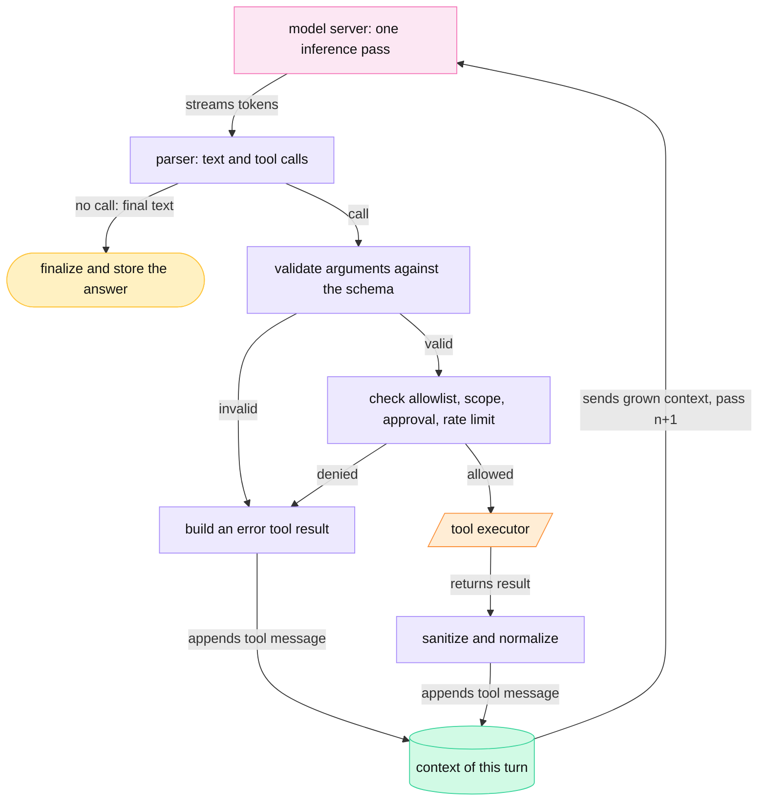
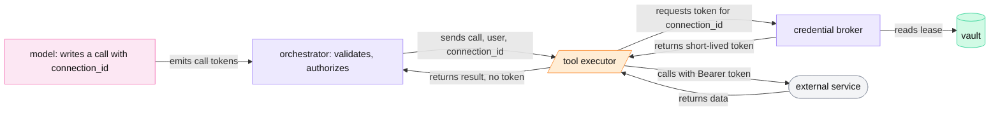
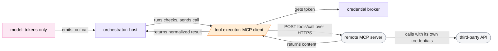

<!-- GENERATED from manuscript/src/part-06-tool-calling.md by tools/render_manuscript.py. Edit the source, not this file. -->
# Part 06: Tool calling

A tool call is text that the model writes in a fixed format. Deterministic code parses it, checks it, runs the real tool and appends the result to the context.

Your request needs two tools. Part 3.6 showed the outline. Pass 1 emits a `web_search` call with 3 queries. Pass 2 emits a code call, and pass 3 writes the answer. This part opens each step of that outline in five sections:

1. How schemas enter the context and how the model writes a call, token by token (6.1).
2. The 13 steps of the tool loop, and why one answer needs three inference passes (6.2).
3. Which tools need which permission (6.3).
4. How a tool reaches a protected service without the model ever seeing a secret (6.4).
5. Where the Model Context Protocol fits, and where it does not (6.5).

The numbers in this part come from the real tokenizers of `M-frontier` (Kimi K3) and `M-dense` (Mistral Medium 3.5). The tool schemas are the reference system's two tools, `web_search` and `run_python`. The content of the calls is hypothetical: the competitor names, queries and prices are fictional.

---

## 6.1 How a model emits a tool call

The model never runs anything. It reads tool schemas as tokens and writes a call as tokens. A parser turns those tokens into a name and arguments.

The full path of one call has four stages. Each stage is a different program:

1. **The model** samples tokens on the GPU. Some of those tokens spell a tool call.
2. **The parser** in the model server finds the call in the token text and extracts the name and arguments.
3. **The orchestrator** validates the arguments and checks permission (6.2, 6.3).
4. **The tool executor** runs the real operation (parts 7 and 8).

The model has no network access, no file system and no credentials. It only produces token IDs. In this reference system, the orchestrator is the only component that calls models and tools (RA-14).

### Schemas enter the context as text

A **tool schema** is a name, a description and a JSON Schema for the arguments. The orchestrator sends the schemas with the request, in the OpenAI-style `tools` list that vLLM accepts [SRC-190]. The chat template then writes them into the context as ordinary text. So the model reads them as one more message.

`M-frontier` puts the schemas into a system message of type `tool-declare` [Kimi-K3@f831ab6:encoding_k3.py#L557-L581]. The renderer writes compact JSON with sorted keys [Kimi-K3@f831ab6:encoding_k3.py#L123-L124] [Kimi-K3@f831ab6:encoding_k3.py#L182-L187]. This is the exact message for your request's two tools:

~~~text
<|open|>message role="system" type="tool-declare"<|sep|># Tools
Here are the available tools, described in JSONSchema.

```json
[{"function":{"description":"Search the public web. Returns ranked results with title, URL, snippet and date. The top results are fetched as clean text for reading and citation.","name":"web_search","parameters":{"additionalProperties":false,"properties":{"fetch_top":{"description":"How many top results to fetch as full text.","maximum":5,"minimum":0,"type":"integer"},"queries":{"description":"One to four search queries, each self-contained.","items":{"maxLength":200,"type":"string"},"maxItems":4,"minItems":1,"type":"array"},"recency_days":{"description":"Only return pages published within this many days.","minimum":1,"type":"integer"}},"required":["queries"],"type":"object"}},"type":"function"},{"function":{"description":"Run Python 3 code in an isolated sandbox with no network access. Files the user uploaded are mounted read-only under /mnt/data. Files written to /mnt/output are returned as downloadable artifacts. Returns stdout, stderr and the artifact list.","name":"run_python","parameters":{"additionalProperties":false,"properties":{"code":{"description":"The Python source to run.","type":"string"},"timeout_s":{"description":"Wall-clock limit for this run in seconds.","maximum":120,"minimum":1,"type":"integer"}},"required":["code"],"type":"object"}},"type":"function"}]
```<|close|>message<|sep|><|end_of_msg|>
~~~

The message is 1,294 bytes of JSON and 315 tokens in total (`data/reference_tools.json`). The renderer places it before every other message, even before the system prompt [Kimi-K3@f831ab6:encoding_k3.py#L615-L633]. Part 4.2 showed the control tokens `<|open|>`, `<|sep|>`, `<|close|>` and `<|end_of_msg|>` that frame it.

Three properties of this message matter for the rest of the system:

1. **It is paid on every pass.** The schemas are part of the context, so every inference pass reads them again. Part 5.6 counts them in the context budget.
2. **Its position makes it a shared prefix.** All requests with the same tool set start with the same 315 tokens. So the prefix cache (13.3) can reuse their KV across requests.
3. **Its bytes must be stable.** The renderer sorts keys inside each schema, but it keeps the order of the list [Kimi-K3@f831ab6:encoding_k3.py#L182-L187]. So the orchestrator must always send the tools in the same order. A changed order changes the first tokens of the context, and the prefix-cache match ends there.

The MCP specification gives tool servers the same advice. Servers should return tools in a deterministic order, which improves cache hit rates for prompts that contain them [SRC-124].

`M-dense` writes the same list as a JSON array between `[AVAILABLE_TOOLS]` and `[/AVAILABLE_TOOLS]`. Both are special tokens. It precedes the first user turn [Mistral-Medium-3.5-128B@22b2b86:chat_template.jinja#L44-L50] [Mistral-Medium-3.5-128B@22b2b86:chat_template.jinja#L199-L205]. Its template uses the Jinja `tojson` filter, which keeps the key order and puts spaces after separators. The same two schemas cost 357 tokens there, 42 more than on `M-frontier`. The tokenizer and the separators both change the count.

### The model writes a call in XTML

`M-frontier` has no special token for "tool call". Its developers call its chat format XTML: XML-like markup in which three reserved special tokens replace the angle-bracket syntax [SRC-380]. An assistant message has up to three channels, always in this order [vllm@v0.31.0:vllm/tool_parsers/kimi_k3_tool_parser.py#L8-L19]:

1. `think`: the reasoning.
2. `response`: the visible text.
3. `tools`: zero or more `call` elements, each with one `argument` element per argument.

Each argument carries its key and an XTML type. Strings stay raw; other types become JSON [Kimi-K3@f831ab6:encoding_k3.py#L131-L148] [Kimi-K3@f831ab6:encoding_k3.py#L530-L552]. The `call` element carries the tool name and a 1-based `index`, but no tool-call ID.

In pass 1, after 300 reasoning tokens (hypothetical), the model closes its `think` channel. It writes one sentence in its `response` channel: "I will check the current list prices first." Then it opens the `tools` channel and writes this call:

~~~text
<|open|>tools<|sep|><|open|>call tool="web_search" index="1"<|sep|><|open|>argument key="queries" type="array"<|sep|>["AlderSoft list price per seat 2026", "Birchline pricing plans list price per user", "Cedar Systems pricing per seat per month"]<|close|>argument<|sep|><|open|>argument key="recency_days" type="number"<|sep|>90<|close|>argument<|sep|><|open|>argument key="fetch_top" type="number"<|sep|>3<|close|>argument<|sep|><|close|>call<|sep|><|close|>tools<|sep|>
~~~

The call is 102 tokens: 20 special and 82 text tokens. Here is every token, from the real `M-frontier` tokenizer:

| # | ID | Token | # | ID | Token | # | ID | Token |
|---|---|---|---|---|---|---|---|---|
| 0 | 163587 | `<\|open\|>` | 34 | 220 | `␣` | 68 | 3226 | `ency` |
| 1 | 25385 | `tools` | 35 | 2975 | `202` | 69 | 74357 | `_days` |
| 2 | 163589 | `<\|sep\|>` | 36 | 21 | `6` | 70 | 1 | `"` |
| 3 | 163587 | `<\|open\|>` | 37 | 665 | `",` | 71 | 1798 | `␣type` |
| 4 | 10257 | `call` | 38 | 414 | `␣"` | 72 | 878 | `="` |
| 5 | 4453 | `␣tool` | 39 | 33 | `B` | 73 | 10006 | `number` |
| 6 | 878 | `="` | 40 | 446 | `ir` | 74 | 1 | `"` |
| 7 | 4821 | `web` | 41 | 409 | `ch` | 75 | 163589 | `<\|sep\|>` |
| 8 | 25592 | `_search` | 42 | 1611 | `line` | 76 | 2788 | `90` |
| 9 | 1 | `"` | 43 | 21740 | `␣pricing` | 77 | 163588 | `<\|close\|>` |
| 10 | 4002 | `␣index` | 44 | 8690 | `␣plans` | 78 | 47185 | `argument` |
| 11 | 878 | `="` | 45 | 1850 | `␣list` | 79 | 163589 | `<\|sep\|>` |
| 12 | 16 | `1` | 46 | 4828 | `␣price` | 80 | 163587 | `<\|open\|>` |
| 13 | 1 | `"` | 47 | 1122 | `␣per` | 81 | 47185 | `argument` |
| 14 | 163589 | `<\|sep\|>` | 48 | 2742 | `␣user` | 82 | 2355 | `␣key` |
| 15 | 163587 | `<\|open\|>` | 49 | 665 | `",` | 83 | 878 | `="` |
| 16 | 47185 | `argument` | 50 | 414 | `␣"` | 84 | 25601 | `fetch` |
| 17 | 2355 | `␣key` | 51 | 34 | `C` | 85 | 13033 | `_top` |
| 18 | 878 | `="` | 52 | 41898 | `edar` | 86 | 1 | `"` |
| 19 | 111093 | `queries` | 53 | 19567 | `␣Systems` | 87 | 1798 | `␣type` |
| 20 | 1 | `"` | 54 | 21740 | `␣pricing` | 88 | 878 | `="` |
| 21 | 1798 | `␣type` | 55 | 1122 | `␣per` | 89 | 10006 | `number` |
| 22 | 878 | `="` | 56 | 14924 | `␣seat` | 90 | 1 | `"` |
| 23 | 4392 | `array` | 57 | 1122 | `␣per` | 91 | 163589 | `<\|sep\|>` |
| 24 | 1 | `"` | 58 | 3335 | `␣month` | 92 | 18 | `3` |
| 25 | 163589 | `<\|sep\|>` | 59 | 3956 | `"]` | 93 | 163588 | `<\|close\|>` |
| 26 | 3530 | `["` | 60 | 163588 | `<\|close\|>` | 94 | 47185 | `argument` |
| 27 | 32 | `A` | 61 | 47185 | `argument` | 95 | 163589 | `<\|sep\|>` |
| 28 | 149709 | `lder` | 62 | 163589 | `<\|sep\|>` | 96 | 163588 | `<\|close\|>` |
| 29 | 34453 | `Soft` | 63 | 163587 | `<\|open\|>` | 97 | 10257 | `call` |
| 30 | 1850 | `␣list` | 64 | 47185 | `argument` | 98 | 163589 | `<\|sep\|>` |
| 31 | 4828 | `␣price` | 65 | 2355 | `␣key` | 99 | 163588 | `<\|close\|>` |
| 32 | 1122 | `␣per` | 66 | 878 | `="` | 100 | 25385 | `tools` |
| 33 | 14924 | `␣seat` | 67 | 3571 | `rec` | 101 | 163589 | `<\|sep\|>` |

Read the table as markup:

- Tokens 0 to 2 open the `tools` channel. Tokens 3 to 14 open the call: the tag `call`, the attribute `tool="web_search"` and the attribute `index="1"`.
- Tokens 15 to 25 open the first argument, `queries`, with type `array`. Tokens 26 to 59 are the JSON array of the queries. Tokens 60 to 62 close the argument.
- The two integer arguments follow, each with a value of 1 token. Their XTML type is `number`, because the renderer maps every JSON number to `number` [Kimi-K3@f831ab6:encoding_k3.py#L131-L142].
- The last 6 tokens close the call and the channel.

Each attribute costs several small tokens, such as `␣key`, `="` and `"`. The renderer tokenizes every text piece on its own, so BPE never merges across a piece boundary (part 4.2). The model learned this tokenization in training. It can still sample a different split of the same text, such as one token for `web_search`. The parser works on the decoded text, so both splits parse the same.

After the channel, the model writes `<|close|>message<|sep|>` and then `<|end_of_msg|>`. The token `<|end_of_msg|>` is the stop token, so the engine ends the pass there [SRC-378]. From the end of the reasoning to the stop token, pass 1 emits 124 tokens.

**Pass 2 and raw strings.** In pass 2, the model writes Python code. XTML carries it as a raw string argument, with no JSON escaping. The tech report gives the reason. Free-form text such as code becomes "a first-class citizen rather than an escaped JSON string" [SRC-380]. This is the pass-2 call (hypothetical content; the numbers come from the story values in `hypothetical.tool_call_story`):

~~~text
<|open|>tools<|sep|><|open|>call tool="run_python" index="1"<|sep|><|open|>argument key="code" type="string"<|sep|>import matplotlib
matplotlib.use("Agg")
import matplotlib.pyplot as plt

unit_cost = 17.60  # EUR per seat-month, Q3 report
prices = {"AlderSoft": 42.00, "Birchline": 55.00, "Cedar Systems": 38.00}

rows = []
for name, price in prices.items():
    margin = (price - unit_cost) / price
    rows.append((name, price, margin))
    print(f"{name}: price {price:.2f} EUR, gross margin {margin:.1%}")

plt.bar([r[0] for r in rows], [r[2] * 100 for r in rows])
plt.ylabel("Gross margin at competitor price (%)")
plt.savefig("/mnt/output/margin_by_competitor.png", dpi=150)
<|close|>argument<|sep|><|open|>argument key="timeout_s" type="number"<|sep|>30<|close|>argument<|sep|><|close|>call<|sep|><|close|>tools<|sep|>
~~~

The code alone is 176 tokens as raw text. A JSON string must escape its 16 newlines and 14 quotes. In that form, the code is 194 tokens on the same tokenizer. So the raw form saves 18 output tokens, and each saved token is one fewer decode step. The raw form also removes a failure: a model that forgets one escape produces invalid JSON.

### The same call in `M-dense`'s format

`M-dense` marks each call with two special tokens. The order is `[TOOL_CALLS]`, name, `[ARGS]`, then one JSON object [Mistral-Medium-3.5-128B@22b2b86:chat_template.jinja#L231-L243]. The pass-1 call in this format is:

~~~text
[TOOL_CALLS]web_search[ARGS]{"queries": ["AlderSoft list price per seat 2026", "Birchline pricing plans list price per user", "Cedar Systems pricing per seat per month"], "recency_days": 90, "fetch_top": 3}
~~~

It is 59 tokens on the `M-dense` tokenizer. Token 0 is `[TOOL_CALLS]` (ID 9) and token 3 is `[ARGS]` (ID 32). The two formats trade in opposite directions:

| | `M-frontier` (XTML) | `M-dense` (`[TOOL_CALLS]`) |
|---|---|---|
| call marker | text tags between 3 control tokens | 2 dedicated special tokens |
| arguments | one element per argument; strings raw | one JSON object; strings escaped |
| pass-1 `web_search` call | 102 tokens | 59 tokens |
| pass-2 `run_python` call | 227 tokens | 233 tokens |
| how a result is matched to its call | `tool` and `index` attributes | position: results follow the calls in order |

The XTML frame costs more tokens for short arguments. For long code, the raw string wins back most of that cost.

### The parser in the model server

The model server turns the token text back into structured data. vLLM selects a parser per model with the flag `--tool-call-parser`; for `M-frontier` it is `kimi_k3` [vllm@v0.31.0:vllm/entrypoints/launchers/cli_args.py#L119] [vllm@v0.31.0:vllm/tool_parsers/__init__.py#L121]. The parser runs on the CPU, in the API server process, on the detokenized text [vllm@v0.31.0:vllm/tool_parsers/kimi_k3_tool_parser.py#L311-L352].

The `kimi_k3` parser works in four steps [vllm@v0.31.0:vllm/tool_parsers/kimi_k3_tool_parser.py#L311-L352]:

1. It finds `<|open|>tools<|sep|>` with a regular expression.
2. It finds each `call` block up to its first `<|close|>call<|sep|>`.
3. It reads the `tool` attribute and each `argument` block. A `string` value stays raw; every other value goes through `json.loads` [vllm@v0.31.0:vllm/tool_parsers/kimi_k3_tool_parser.py#L209-L242].
4. It returns an OpenAI-style tool call: a name and an `arguments` string, which `json.dumps` builds.

For the regular expressions to match, the control tokens must reach the parser as literal text. So the parser switches off `skip_special_tokens` and the spaces that vLLM's detokenizer otherwise puts around special tokens [vllm@v0.31.0:vllm/tool_parsers/kimi_k3_tool_parser.py#L184-L201].

For pass 1, the parser returns `web_search` with this `arguments` string:

~~~text
{"queries": ["AlderSoft list price per seat 2026", "Birchline pricing plans list price per user", "Cedar Systems pricing per seat per month"], "recency_days": 90, "fetch_top": 3}
~~~

**The tool-call ID.** Neither model writes a tool-call ID.

vLLM creates one when it builds the response: `chatcmpl-tool-` followed by a random UUID [vllm@v0.31.0:vllm/entrypoints/chat_utils.py#L2259-L2264] [vllm@v0.31.0:vllm/entrypoints/generate/base/protocol.py#L298-L301]. The orchestrator keys the execution on this ID (6.2). The result message carries the same ID back. The K3 renderer matches each result to its call by this ID [Kimi-K3@f831ab6:encoding_k3.py#L389-L468]. It writes the call's position as `index`, so the model sees `tool="web_search" index="1"`, never the random ID.

The engine itself stops on `<|end_of_msg|>` with the reason `stop`. vLLM's chat server reports `finish_reason: "tool_calls"` when the parser found a call [vllm@v0.31.0:vllm/entrypoints/openai/chat_completion/serving.py#L1093-L1116]. A tool call is not an engine stop reason; it is an application-level reading of the output.

**A known limit.** A string argument is raw text up to the next close marker. So a value that contains the literal text `<|close|>argument<|sep|>` cannot be told apart from a real close marker. The parser's source states this limit [vllm@v0.31.0:vllm/tool_parsers/kimi_k3_tool_parser.py#L29-L31]. The vLLM day-0 post also warns that K3 sometimes emits "a tool-call format its own parser does not expect" [SRC-343]. Both are reasons to validate every call in the orchestrator (6.2, step 3).

### Incremental detection and hold-back

During streaming, the parser must decide after every token whether text is safe to send. A control token can arrive in pieces: `<|open|>`, then `tools`, then `<|sep|>`. Until the third token arrives, the parser cannot know whether `<|open|>` starts the tools channel. So it holds back any suffix that could be the start of a marker [vllm@v0.31.0:vllm/tool_parsers/kimi_k3_tool_parser.py#L64-L69] [vllm@v0.31.0:vllm/tool_parsers/kimi_k3_tool_parser.py#L271-L309].

Tool calls follow a stricter rule: the parser emits a call only after its full `<|close|>call<|sep|>` has arrived [vllm@v0.31.0:vllm/tool_parsers/kimi_k3_tool_parser.py#L354-L395]. A half-written call never leaves the model server.

The trace below feeds pass 1's output to a port of this parser, one token at a time. The trace starts at the `response` channel, because vLLM's reasoning parser has already split off the `think` channel:

| # | Token | Parser action | Sent to the client | Held characters |
|---|---|---|---|---|
| 0 | `<\|open\|>` | holds | — | 8 |
| 1 | `response` | holds | — | 16 |
| 2 | `<\|sep\|>` | holds | — | 23 |
| 3 | `I` | sends text | `I` | 0 |
| 4 | `␣will` | sends text | `␣will` | 0 |
| … | … | … | … | … |
| 11 | `.` | sends text | `.` | 0 |
| 12 | `<\|close\|>` | holds | — | 9 |
| 13 | `response` | holds | — | 17 |
| 14 | `<\|sep\|>` | holds | — | 24 |
| 15 | `<\|open\|>` | holds | — | 32 |
| 16 | `tools` | holds | — | 37 |
| 17 | `<\|sep\|>` | holds | — | 44 |
| … | … | … | … | … |
| 111 | `<\|close\|>` | holds | — | 463 |
| 112 | `call` | holds | — | 467 |
| 113 | `<\|sep\|>` | emits the `web_search` call | — | 474 |
| 114 | `<\|close\|>` | holds | — | 483 |
| 115 | `tools` | holds | — | 488 |
| 116 | `<\|sep\|>` | holds | — | 495 |
| 117 | `<\|close\|>` | holds | — | 504 |
| 118 | `message` | holds | — | 511 |
| 119 | `<\|sep\|>` | holds | — | 518 |
| 120 | `<\|end_of_msg\|>` | holds | — | 532 |

Of 121 tokens, only 9 carry text to the client: "I will check the current list prices first." The parser holds the other 112. The call leaves the parser at token 113, as one complete object. In this reference system, the orchestrator then sends the client a tool-status event, not the call's tokens (RA-50). Part 15.3 shows that event on the wire.

### Constrained decoding: the engine forbids invalid tokens

A parser can only read what the model wrote. **Constrained decoding** acts one step earlier. Before each sampling step, the engine removes every token that would break a grammar. The model can then only write valid output. Part 10.10 covers the general method; this section shows the tool case.

**How a mask works.** Take a toy vocabulary of 12 tokens (illustrative): 0=`0`, 1=`1`, 2=`3`, 3=`5`, 4=`8`, 5=`12`, 6=`-`, 7=`.`, 8=`<|close|>`, 9=`argument`, 10=`<|sep|>`, 11=`call`. The model has just written the opener `<|open|>argument key="fetch_top" type="number"<|sep|>`. The schema says `fetch_top` is an integer from 0 to 5. So the grammar accepts one integer from 0 to 5, then `<|close|>`, `argument` and `<|sep|>`.

At each step, the engine runs four operations:

1. It walks every vocabulary token through the grammar from the current state.
2. It sets one bit per token: 1 if the token keeps the output valid, 0 if not.
3. It sets the logits of all 0-bit tokens to −∞.
4. It samples from what remains, and advances the grammar state with the chosen token.

The toy run, with greedy sampling on illustrative logits:

| Step | Output so far | Allowed tokens | Bitmask (index 0 → 11) | Top token without the mask | Picked token | Its probability before → after the mask |
|---|---|---|---|---|---|---|
| 1 | (empty) | `0`, `1`, `3`, `5` | `111100000000` | `8` | `3` | 0.272 → 0.646 |
| 2 | `3` | `<\|close\|>` | `000000001000` | `.` | `<\|close\|>` | 0.238 → 1.0 |
| 3 | `3<\|close\|>` | `argument` | `000000000100` | `argument` | `argument` | 0.771 → 1.0 |
| 4 | `3<\|close\|>argument` | `<\|sep\|>` | `000000000010` | `<\|sep\|>` | `<\|sep\|>` | 0.801 → 1.0 |

At step 1, the model's top token is `8`, which the schema forbids. The mask removes it, and the engine picks `3`. At step 2, the model prefers `.`, which would start a decimal; the mask leaves only the close marker. So the mask changes what the model writes, not only what code accepts afterwards. A mask can force a valid value that the model ranked low. Validation in the orchestrator still decides whether the value makes sense.

**Where vLLM computes and applies the mask.** vLLM's structured outputs have five backends: `auto` (the default), `xgrammar`, `guidance`, `outlines` and `lm-format-enforcer`. Under `auto`, vLLM tries XGrammar first and falls back to guidance or outlines when XGrammar cannot compile the schema [vllm@v0.31.0:vllm/sampling_params.py#L1281-L1340]. The work splits across two processes:

1. **Compile, once per request, on the CPU.** The engine core compiles the grammar in a background pool [vllm@v0.31.0:vllm/v1/structured_output/__init__.py#L115-L176]. Until it finishes, the scheduler skips the request [vllm@v0.31.0:vllm/v1/core/sched/scheduler.py#L3099-L3124].
2. **Fill the bitmask, every step, on the CPU.** The engine core fills one row per constrained sequence. Above 128 such sequences, it fills rows in parallel threads, 16 sequences per task [vllm@v0.31.0:vllm/v1/structured_output/__init__.py#L59-L69] [vllm@v0.31.0:vllm/v1/structured_output/__init__.py#L313-L443].
3. **Apply the bitmask, every step, on the GPU.** The worker copies the bitmask to the GPU and sets the forbidden logits to −∞ before sampling [vllm@v0.31.0:vllm/v1/worker/gpu_model_runner.py#L4559-L4563] [vllm@v0.31.0:vllm/v1/structured_output/utils.py#L101-L193].
4. **Advance the state, every step, on the CPU.** After sampling, the grammar accepts the new token.

With speculative decoding, each draft position gets its own bitmask row [vllm@v0.31.0:vllm/v1/structured_output/__init__.py#L325-L335]. Inside the reasoning channel, no mask applies; the constraint starts where the reasoning ends [vllm@v0.31.0:vllm/v1/structured_output/__init__.py#L236-L259].

**What the mask costs.** XGrammar allocates one 32-bit word per 32 vocabulary entries per row [vllm@v0.31.0:vllm/v1/structured_output/backend_xgrammar.py#L135-L136]:

```
M-frontier: ceil(163840 / 32) = 5120 words × 4 B = 20480 B per sequence per step
M-dense:    ceil(131072 / 32) = 4096 words × 4 B = 16384 B per sequence per step
```

vLLM allocates rows for its maximum batch, 1,024 sequences on H100 and B200 by default [vllm@v0.31.0:vllm/engine/arg_utils.py#L2858-L2877]. For `M-frontier` that is 21.0 MB of bitmask per step, filled on the CPU and copied to the GPU. The memory is small. The cost that matters is time:

- **Compile latency.** A new schema waits for compilation before its first step. A stable tool set lets the backend reuse compiled grammars.
- **CPU time per step.** The engine core fills the mask between GPU steps. A slow fill delays the next step for every sequence in the batch, not only the constrained one.
- **Coverage.** Some JSON Schema features do not compile on a backend, which then falls back or rejects the request [SRC-092] [vllm@v0.31.0:vllm/sampling_params.py#L1281-L1340].

**The K3 tool grammar.** For `M-frontier`, vLLM builds an XTML grammar, because a JSON grammar conflicts with the `tools` channel [vllm@v0.31.0:vllm/tool_parsers/kimi_k3_tool_parser.py#L72-L80]. Its structure follows the format [vllm@v0.31.0:vllm/tool_parsers/structural_tag_registry.py#L642-L670]:

1. The `response` channel is free text that cannot contain a marker.
2. The `tools` channel is optional under `tool_choice: "auto"` and mandatory under `"required"`.
3. Each `call` must name a declared tool and have a numeric `index`.
4. Each non-string argument must match its property schema as JSON [vllm@v0.31.0:vllm/tool_parsers/structural_tag_registry.py#L484-L545].
5. A string argument is free text up to the close marker. An `enum` or a small `maxLength` in the schema narrows it [vllm@v0.31.0:vllm/tool_parsers/structural_tag_registry.py#L463-L483].

The grammar does not check everything. Arguments are "order-agnostic and non-unique", so the grammar does not enforce that each required key appears exactly once [vllm@v0.31.0:vllm/tool_parsers/structural_tag_registry.py#L564-L592].

Strict tool calling is on by default [vllm@v0.31.0:vllm/envs.py#L245]. Even then, vLLM does not apply this grammar to every request with tools. The server flag `--tool-strict-level` and the request's `tool_choice` decide [vllm@v0.31.0:vllm/tool_parsers/structural_tag_registry.py#L124-L146]. At the default level `auto`, a request with `tool_choice: "auto"` gets the grammar only if one of its tools sets `strict: true`. A `"required"` or named `tool_choice` always gets it.

At the level `function`, vLLM constrains the call envelope for every request with tools. The level `parameter` also pins every argument schema [vllm@v0.31.0:vllm/tool_parsers/tool_strict_level.py#L10-L23] [vllm@v0.31.0:vllm/parser/abstract_parser.py#L468-L572].

Which level a real provider uses is not public. Two realistic options are `function` (lower compile and fill cost) and `parameter` (fewer invalid arguments). Here we use `parameter` for the two reference tools (RA-65), because their schemas are small and stable. The orchestrator still validates every call (6.2, step 3).

**Meanwhile in the fleet.** At the hypothetical peak of 50,000 requests per second, about 12,500 requests per second carry tool schemas. On one decode worker, some sequences decode under a grammar while their neighbours decode free text. They share one batch. So every sequence waits while the engine core fills the bitmask rows of that step.

You can now trace a tool call from schema text through tokens and the mask to parsed arguments.

---

## 6.2 The 13-step tool loop

The orchestrator runs a loop of inference passes. After each pass, it checks and runs the tool calls, appends the results and starts the next pass.

### The 13 steps for pass 1 of your request

The data at each step is for your request's pass 1.

1. **The model produces a request.** The model server streams pass 1: 300 reasoning tokens (hypothetical), then 124 tokens of channels and call (6.1). The pass ends at `<|end_of_msg|>`.
2. **The orchestrator detects it.** The model server's parser emits one complete call at token 113 of the response trace. The final chunk reports `finish_reason: "tool_calls"`. The orchestrator reads the call: ID `chatcmpl-tool-…`, name `web_search`, the `arguments` string of 6.1.
3. **The orchestrator validates the schema.** The orchestrator parses the `arguments` string as JSON and checks it against the `web_search` schema (below). The pass-1 arguments are valid.
4. **The orchestrator checks permission.** The orchestrator checks that `web_search` is on this tenant's allowlist and that the user's plan allows it (6.3, RA-32). `web_search` is read-only, so it needs no approval.
5. **The orchestrator checks the rate limit.** The orchestrator takes one token from the user's tool-call bucket: 60 calls per minute (hypothetical). An empty bucket gives an error tool result, not a failed request.
6. **The orchestrator assigns an execution ID.** It writes an execution record. The record holds the execution ID, the tool-call ID, the conversation and the pass number. It also holds the tool, an argument hash and the state `started`. The record is the key for retries, cancellation, idempotency and audit.
7. **The orchestrator invokes the tool.** The orchestrator calls the `web_search` executor over gRPC with mTLS (RA-16). The call carries a deadline of 20 s (hypothetical), well inside the 120 s request deadline (RA-11).
8. **The orchestrator waits, or runs several tools concurrently.** Pass 1 has one call, so the orchestrator awaits it. Inside the executor, the 3 queries and 3 page fetches run in parallel (part 7).
9. **The orchestrator receives the result.** The executor returns ranked results and the extracted text of 3 pages, at most 3,000 tokens per page (hypothetical).
10. **The orchestrator sanitizes and normalizes the result.** It caps sizes and marks the content as untrusted web data. It runs the injection checks (part 7.5) and builds one JSON document with a fixed shape.
11. **The orchestrator appends the result to the context.** It adds two messages. The first is the assistant message of pass 1, with reasoning, response and call. The second is one `tool` message with the result.
12. **The orchestrator invokes the model again.** The orchestrator sends the grown context to the model router as pass 2. The router reserves tokens per minute again for this pass (RA-10).
13. **The model continues answering.** In pass 2, the model writes the `run_python` call. Steps 2 to 12 repeat. In pass 3, the model writes the answer with no call, and the loop ends.



Legend: pink = GPU; violet = orchestrator code; orange = the tool executor; green = state; amber = the end of your request's loop. The one thing to notice: every path ends in the context, including every failure. So the model sees it in the next pass. The diagram leaves out the loop limit and the deadlines on purpose; the next subsections cover them.

### Step 3 in detail: validation and errors as tool results

The orchestrator checks every argument against the tool's JSON Schema before anything runs. Three argument sets for `web_search` show the outcomes:

| Case | Arguments | Result of the check |
|---|---|---|
| the pass-1 call | `queries` = 3 strings, `recency_days` = 90, `fetch_top` = 3 | valid |
| too many pages | the same, but `fetch_top` = 8 | `$.fetch_top: 8 is above the maximum 5` |
| an invented property | `queries` = 1 string, `site` = "alder.example" | `$: unknown property 'site'` |

With the `parameter` strict level of 6.1, the second case cannot occur, because the mask forbids `8`. The third case also cannot occur. The orchestrator checks anyway. A parser bug, a format slip, another engine or a looser strict level can each pass an invalid call. The check is cheap, deterministic and testable.

An invalid call does not fail the request. The orchestrator returns the error as a tool result, so the model can correct itself in the next pass:

~~~text
{"error":"invalid_arguments","tool":"web_search","details":["$.fetch_top: 8 is above the maximum 5"],"hint":"fix the arguments and call the tool again"}
~~~

As a K3 tool message, this error costs 57 tokens of context. The MCP specification uses the same split. Protocol errors, such as an unknown tool, are JSON-RPC errors. Tool execution errors, such as an out-of-range date, are normal results with `isError: true`, "that language models can use to self-correct" [SRC-124].

### Step 11 in detail: what a result looks like in the context

`M-frontier` writes each result as a `tool` message with the tool name and index [Kimi-K3@f831ab6:encoding_k3.py#L662-L687]. With empty content, this frame is 20 tokens:

~~~text
<|open|>message role="tool" tool="web_search" index="1"<|sep|><|close|>message<|sep|><|end_of_msg|>
~~~

The pass-2 result is the output of the `run_python` call. The code executor (part 8) returns stdout, stderr, the exit code and the artifact list. The orchestrator normalizes it to one compact JSON object:

~~~text
{"exit_code":0,"stdout":"AlderSoft: price 42.00 EUR, gross margin 58.1%\nBirchline: price 55.00 EUR, gross margin 68.0%\nCedar Systems: price 38.00 EUR, gross margin 53.7%\n","stderr":"","artifacts":[{"path":"/mnt/output/margin_by_competitor.png","file_id":"file_9c41d2e07b","mime_type":"image/png"}],"truncated":false}
~~~

The stdout lines are the gross margins `(price − unit cost) / price` at each competitor's price. The unit cost is 17.6 EUR per seat per month, from the Q3 report. All values are hypothetical:

| Competitor | List price | Arithmetic | Gross margin |
|---|---|---|---|
| AlderSoft | 42.00 EUR | (42.00 − 17.60) / 42.00 = 0.5810 | 58.1% |
| Birchline | 55.00 EUR | (55.00 − 17.60) / 55.00 = 0.6800 | 68.0% |
| Cedar Systems | 38.00 EUR | (38.00 − 17.60) / 38.00 = 0.5368 | 53.7% |

This result is 109 tokens of content and 129 tokens as a K3 message. The context budget of part 5.6 uses the hypothetical size of 160 tokens for this result. The artifact is a file ID, not image bytes: the model sees `file_9c41d2e07b`, and the answer links to it. `M-dense` wraps the same content in `[TOOL_RESULTS]` and `[/TOOL_RESULTS]` [Mistral-Medium-3.5-128B@22b2b86:chat_template.jinja#L248-L251]. That is 131 tokens, and only 2 of them are frame.

The orchestrator treats the result as untrusted data. It sits in a `tool` message, below the system and user messages in the instruction hierarchy (RA-32). An instruction inside a result is still data. Part 7.5 shows the injection defenses for web results.

### Why tools mean several inference passes

The model cannot pause in the middle of a pass and wait for a tool. A pass ends at a stop token, and the engine frees the sequence [vllm@v0.31.0:vllm/v1/core/sched/scheduler.py#L2649-L2701]. So each tool round trip costs one more inference pass, and your request has three:

| Pass | New tokens at the end of the context | What the model emits | What happens next |
|---|---|---|---|
| 1 | your turn (system prompt, tool declaration, history, chunks, files) | reasoning, preamble, `web_search` call | search and fetch, about one to several seconds (part 7) |
| 2 | pass-1 assistant message + `web_search` result | reasoning, `run_python` call | sandbox run (part 8) |
| 3 | pass-2 assistant message + `run_python` result | reasoning, the visible answer | stream, store, done |

Each pass is a new request to the model server. Its context is the whole previous context plus the new messages. So each pass runs a new prefill (part 11).

The prefix cache makes that prefill short. The blocks of the previous context and the full blocks of its output are still in the cache. So only the new messages need computing (13.3, 13.4). The endpoint picker routes pass 2 to the replica that holds those blocks (RA-37). `M-frontier` adds one condition: its KDA layers can reuse a prefix only up to a saved state checkpoint (13.3). Part 5.6 gives the token totals of each pass and their cache hits.

**The re-rendered call must match the emitted tokens.** The pass-2 cache hit reaches into pass 1's output only if the re-rendered output has the same token IDs. The orchestrator does not keep the model's tokens. It keeps the parsed call, whose `arguments` string `json.dumps` wrote with spaces after commas. The K3 renderer keeps the JSON text of a non-string argument exactly as written [Kimi-K3@f831ab6:encoding_k3.py#L275-L303]. So the re-rendered array is `["…", "…", "…"]`, with spaces.

For your request, the re-render equals the emitted call: `True`. That holds only because the model wrote the array with spaces. Which spacing K3 emits is not documented. Without spaces, the two token sequences would differ from token 37 of the call. Then 65 tokens of the call, and everything after them, would miss the cache in pass 2.

The cost here is small, but the rule is general. The orchestrator must re-send the assistant message in exactly the form the template expects. The K3 model card also requires the full assistant message, with `reasoning_content` and `tool_calls`, in later passes [SRC-378].

**The KV between passes.** When pass 1 ends, the engine frees the sequence's blocks to the free queue [vllm@v0.31.0:vllm/v1/core/sched/scheduler.py#L2681-L2701]. Their hashes stay, so pass 2 can hit them. If the tool runs long and the replica is busy, other requests can take those blocks first. Then pass 2 computes the lost part again. A longer tool wait means a lower chance of a hit.

### Sequential and parallel calls

In pass 1, the model asks for three searches inside one call, as three queries. A model can also write several `call` elements in one `tools` channel. The K3 format numbers them with `index` 1, 2, 3, and the vLLM parser returns them as a list [vllm@v0.31.0:vllm/tool_parsers/kimi_k3_tool_parser.py#L332-L347]. The OpenAI API option `parallel_tool_calls: false` limits a response to at most one call [SRC-190]. vLLM enforces it after generation: it keeps only the first call in the response [vllm@v0.31.0:vllm/entrypoints/serve/utils/tool_calls_utils.py#L19-L36].

The orchestrator decides how to run the calls of one pass:

1. **Parallel** when the calls are independent and all are read-only. In this reference system, up to 4 calls per pass run at the same time (RA-14, hypothetical).
2. **Sequential** when any call has a side effect. A failure in the first call can then stop the second.
3. **Across passes** when a call needs the result of another. The model cannot write the pass-2 code before it has the pass-1 prices. That dependency costs a full pass.

The orchestrator appends the results in call order. The K3 renderer re-sorts them by tool-call ID if they arrive in another order [Kimi-K3@f831ab6:encoding_k3.py#L389-L468]. A stable order keeps the context deterministic for the same inputs.

### Deadlines, cancellation and retries

**Deadlines.** Every tool call gets a deadline that is smaller than the time the request has left (RA-11). For `run_python`, the model asks for `timeout_s` = 30. The executor deadline is 30 s timeout_s + 5 s margin = 35 s, because restoring the sandbox and uploading the artifact also take time (hypothetical). A deadline that expires gives an error tool result: "the tool timed out after N s".

The model can then answer without that data or try a smaller run. Part 17.6 follows this failure.

**Cancellation.** If the user presses Stop, the orchestrator cancels the open inference pass, which frees its KV blocks (part 17.2). It also cancels every running tool call. A gRPC cancel reaches the executor, which stops the sandbox or the fetches.

A cancel cannot undo a side effect that has already happened. So the execution record must show what completed.

**Retries.** This reference system has one retry layer: the caller closest to the failing dependency (RA-12). Here that is the tool executor, not the orchestrator and not the model. It retries a bounded number of times with full-jitter exponential backoff. A fleet-wide retry budget caps the total (RA-12; part 17.8).

A circuit breaker per tool stops calls to a failing dependency (RA-13). When the executor gives up, the orchestrator returns an error tool result. The model must never retry a transient network error, because each model retry costs a full inference pass.

### Idempotency: why a payment tool differs from a search tool

A retry is safe only if running the operation twice has the same effect as running it once. A search is safe to repeat: it reads, and two reads return the same kind of data. A payment is not: a retry after a lost response can charge the user twice.

So side-effecting tools retry only with an idempotency key (RA-12). The orchestrator derives the key from the execution record, for example the execution ID, and sends it with every attempt. The receiving service stores the key with its result. A repeated key returns the stored result instead of a second payment. The `Idempotency-Key` header is a widely copied convention; its IETF draft expired in 2026 and is not a standard [SRC-208].

The two kinds of tool differ in more than retries:

| Property | `web_search` (read-only) | `send_payment` (side effect, example) |
|---|---|---|
| repeat on retry | safe | only with an idempotency key |
| run in parallel with other calls | yes | no; one at a time |
| human approval | no | yes, every call (6.3) |
| on deadline expiry | return an error result | look up the result by key before any retry |
| on cancellation | stop and discard | finish or roll back, then record the outcome |
| audit record | the call and the result size | the call, the approval, the key and the result |

### The loop limit

The loop needs an upper bound, because a model can call tools without end. In this reference system, the orchestrator allows at most 8 tool passes per turn (RA-14). After the last allowed pass, it calls the model one more time with `tool_choice: "none"`. `M-frontier`'s renderer then adds a system message that forbids tool calls in the next message [Kimi-K3@f831ab6:encoding_k3.py#L703-L719].

The message comes after the history, so the cached prefix stays valid. The turn then ends with the status `tool_limit` (part 3.6).

The deadline is the second bound. Each pass and each tool call spends part of the 120 s request deadline. When too little time remains for another tool round trip, the orchestrator also forces the final answer.

**Meanwhile in the fleet.** While your request waits for its search, its decode slot is free. The decode worker fills it with other sequences in the next scheduler iteration. About 7,500 requests per second use web search and about 2,500 use code execution at the hypothetical peak. Each of them leaves the GPU and returns as a new prefill, often with a long prefix-cache hit.

Counters at the moment pass 1 ends:

- `vllm:num_requests_running` drops by one on the decode worker [SRC-043].
- `vllm:prefix_cache_queries` rises when pass 2 starts.
- The client's TTFT timer stopped long before, at the reasoning status for token 1. The client now shows a tool status (RA-50).

You can now list the 13 steps of the tool loop and say why each round trip costs a pass.

---

## 6.3 Tool categories and authorization

A tool's category decides what it may touch, and so who must agree before it runs.

### Four categories

| Category | Examples | What it can change | Authorization in this reference system |
|---|---|---|---|
| read-only, external | `web_search`, weather, a public API | nothing; it reads public data | the tenant allowlist; egress through the egress service (RA-29) |
| read-only, internal | search over the user's workspace, file read | nothing; it reads private data | the allowlist plus the user's own permissions on each record (part 5.4) |
| local compute | `run_python`, a calculator | only its own sandbox | the allowlist; no network, no credentials, CPU and time limits (RA-30) |
| side effect, external | send an email, change a database row, buy something | the outside world, often with no undo | the allowlist, a scope for the specific connection, and human approval of each call (RA-32) |

The categories are properties of the tool schema, which the operator writes. A tool can also declare hints, such as MCP's tool `annotations`. The MCP specification says clients "MUST" treat tool annotations from untrusted servers as untrusted [SRC-124]. So this reference system sets the category in its own tool registry, not from the tool's self-description (RA-32).

### Five checks before a call runs

The orchestrator runs five deterministic checks for each call. Each check reads a different data structure:

1. **Tenant allowlist.** The tenant's configuration lists the tools its users may use. The orchestrator puts only these tools into the context (part 3.8). It checks the name again here, because a model can write a name that is not in its context.
2. **Plan and user entitlements.** The plan may allow code execution but not connectors, for example. The orchestrator reads this from the entitlements cache (part 3.1).
3. **Scope of the connection.** A connector call names a logical connection, for example the user's mail account (6.4). The connection has scopes, such as `mail.read`. A `send` call needs `mail.send`. Missing scope gives an error tool result.
4. **Argument validation.** The JSON Schema check of 6.2, step 3. For side effects, the orchestrator also applies data-flow rules (below).
5. **Human approval for side effects.** The orchestrator shows the user the tool, the connection and the exact arguments, and waits. The MCP specification says there "SHOULD always be a human in the loop with the ability to deny tool invocations" [SRC-124].

Your request's tools pass checks 1, 2 and 4, and checks 3 and 5 do not apply. `web_search` is read-only, and `run_python` touches only its sandbox.

### Human approval

Approval is a pause in the tool loop. The orchestrator sends an approval event to the client and stores the pending call in the execution record. Then it waits up to 600 s (hypothetical). Three outcomes are possible:

1. **Approved.** The call runs, once, with its idempotency key.
2. **Denied.** The orchestrator appends a tool result "the user declined this action", and the model continues.
3. **No answer in time.** The orchestrator appends "not approved: no response", and the turn ends without the side effect.

Approval covers one call with its exact arguments, not the tool in general. If the model changes one argument, the user must approve again. This matters because a batch of calls in one pass can complete a multistep action at once. Anthropic's computer-use guidance makes the same point: check before each block runs [SRC-193].

### Data-flow rules

Prompt injection turns tool results into a path for attacks (part 7.5). A fetched web page can contain text that asks the model to email the user's report to an outside address. The instruction hierarchy lowers the chance that the model obeys, but no model ignores such text every time [SRC-185].

So this reference system adds rules that do not depend on the model (RA-32). One example: a side-effecting call whose argument contains text from a web result needs approval. This rule holds even for a tool that normally runs without approval. The orchestrator can enforce this because it built the context and knows the source of each message.

**Meanwhile in the fleet.** Approval waits last seconds to minutes, so they never hold GPU resources. A paused turn is only a row in the execution store and a timer. The inference pass that wrote the call has already ended and freed its KV blocks.

You can now classify a tool by category and list the checks it must pass before the orchestrator runs it.

---

## 6.4 Secrets stay outside the model

The model names a connection; a trusted executor gets the credential and calls the service. So no secret enters the context.

### Why the model must never see a credential

Anything in the context can come back out. The model can repeat it in an answer or write it into a tool argument. An injected instruction can ask for exactly that. The context is also stored, logged and sent to other services (part 18.4). So every one of those paths can expose a raw API key or OAuth token in the context.

### The design

In this reference system, credentials stay in a credential broker. The broker issues short-lived tokens from vault leases. The model sees only a logical connection ID (RA-31).



Legend: pink = the model; violet = trusted CPU services; orange = the tool executor; green = the vault; grey = an outside service. The one thing to notice: the token moves only between the broker, the executor and the service. The diagram leaves out mTLS between the services on purpose (RA-16).

The steps for one connector call, for example "list my unread mail":

1. The user connects a mail account once, in settings. The OAuth flow stores the refresh token in the vault under a path for this user and connection. The conversation stores only the connection ID, for example `conn_mail_01`.
2. The orchestrator puts the connection ID and its display name into the context, never the token.
3. The model writes a call with the argument `connection_id` = `conn_mail_01`.
4. The orchestrator checks that this connection belongs to this user and has the needed scope (6.3).
5. The executor asks the broker for a token for `conn_mail_01`. It authenticates with its SPIFFE identity over mTLS (RA-16), so the broker knows which service asks.
6. The broker reads the lease from the vault and returns an access token. The token lives 300 s (hypothetical) and carries only the connection's scopes.
7. The executor calls the mail service with the token in the `Authorization` header.
8. The executor returns the data without the token. It drops the token from memory when the call ends.

HashiCorp Vault's database secrets engine shows the lease model. It creates credentials on demand for a role, each with a lease. It revokes them when the lease expires [SRC-189]. Each service gets its own credentials, which makes audit easier [SRC-189].

### What each component sees

| Component | Sees the connection ID | Sees the token | Sees the refresh token |
|---|---|---|---|
| model (context) | yes | no | no |
| orchestrator | yes | no | no |
| tool executor | yes | yes, for one call | no |
| credential broker | yes | yes, it issues it | yes, through the vault |
| logs and traces | yes | no; redacted | no |

The executor is the only component in the request path that holds a usable token, and only for one call. A compromised context or log gives an attacker an ID that is useless without the broker's mTLS check. The sandbox of `run_python` has no credentials at all (RA-30). Code that the model wrote can never read a token, because none exists inside the microVM.

MCP gives a matching rule for its servers: they "MUST NOT accept or transit any other tokens" [SRC-125]. A token for the mail service is never passed on to a different service.

**Meanwhile in the fleet.** Every connector call in the fleet asks the broker for a token. So the broker is on the request path of those calls. It keeps no state, so the operator can add broker replicas in front of the vault. It can keep a token in memory for its short lifetime and reuse it for the same connection and scope.

You can now explain how a tool call reaches a protected service while the context holds only a connection ID.

---

## 6.5 The Model Context Protocol

MCP is an open protocol for discovering and calling tools on other servers. The orchestrator still makes every decision of 6.2 to 6.4.

### Where MCP fits

MCP defines three roles. The **host** is the application, here the orchestrator. The **client** is the connector inside the host. The **server** offers tools, resources and prompts [SRC-122]. Messages are JSON-RPC 2.0 [SRC-480].

This part describes MCP revision `2026-07-28`, the current one. This revision is stateless: each request carries "all the information needed to process" it [SRC-480]. Earlier revisions used sessions with an `initialize` handshake. The current revision removed them [SRC-126].

MCP is optional in this reference system (RA-31). The two reference tools are internal services, which the orchestrator calls over gRPC. MCP fits the connectors: third-party services that the operator does not build, such as a mail or calendar account. An MCP server then offers that service through one protocol.

### Discovery and calls

**Tool discovery.** The client sends `tools/list`. The server returns each tool's name, description and `inputSchema`, which is JSON Schema 2020-12 by default [SRC-124]:

```json
{"jsonrpc": "2.0", "id": 1, "method": "tools/list", "params": {}}
```

```json
{"jsonrpc": "2.0", "id": 1, "result": {"resultType": "complete",
  "tools": [{"name": "list_unread", "description": "List unread messages in the user's inbox.",
             "inputSchema": {"type": "object", "properties": {"limit": {"type": "integer", "maximum": 50}},
                             "additionalProperties": false}}],
  "ttlMs": 300000, "cacheScope": "private"}}
```

The orchestrator converts each MCP tool into an entry of its `tools` list (6.1). `ttlMs` sets how long the orchestrator may cache the list. `cacheScope` says whether other users may share that cached list [SRC-124]. A cached, stable list keeps the tool-declare message stable, so its prefix-cache blocks stay valid (6.1).

**Tool calls.** After 6.2's checks, the client sends `tools/call` with the arguments that the model wrote [SRC-124]:

```json
{"jsonrpc": "2.0", "id": 2, "method": "tools/call",
 "params": {"name": "list_unread", "arguments": {"limit": 10},
            "_meta": {"io.modelcontextprotocol/protocolVersion": "2026-07-28",
                      "io.modelcontextprotocol/clientCapabilities": {}}}}
```

```json
{"jsonrpc": "2.0", "id": 2, "result": {"resultType": "complete",
  "content": [{"type": "text", "text": "3 unread messages: ..."}], "isError": false}}
```

Every request carries its protocol version and the client's capabilities in `_meta`, because no handshake exists [SRC-480]. The result's `content` becomes the `tool` message of 6.2, step 11, after the same sanitizing as any other result. An `isError: true` result is a tool execution error, which the model sees. A JSON-RPC error is a protocol error, which the orchestrator handles [SRC-124].

**Resources.** A resource is data that a server offers by URI, such as a file or a database schema. The client reads it with `resources/read` [SRC-481]. Resources are "application-driven": the host decides what enters the context, not the model [SRC-481]. In this reference system, a resource enters the context only when the user picks it (RA-31, part 4).

### Transport and authentication

The revision has two standard transports [SRC-123] [SRC-127]:

1. **stdio**, for a **local server**. The client starts the server as a subprocess on the same machine. They exchange JSON-RPC lines on stdin and stdout. The server takes credentials from its environment [SRC-480].
2. **Streamable HTTP**, for a **remote server**: one HTTPS endpoint that accepts POST. Each request is one POST. The server answers with one JSON object, or with an SSE stream for that request only [SRC-123].

A hosted assistant reaches only remote servers. It does not start a user's local programs on its own machines. Each Streamable HTTP request carries the headers `MCP-Protocol-Version` and `Mcp-Method`. A `tools/call` also carries `Mcp-Name` with the tool name. So a proxy can route and limit calls without parsing the body. A server rejects a header that disagrees with the body, with HTTP 400 and the error `-32020` [SRC-123].

**Authentication.** For HTTP, MCP uses OAuth 2.1, which is still an IETF draft [SRC-125]. The MCP server is an OAuth resource server, and the MCP client is an OAuth client. A separate authorization server issues the tokens [SRC-125]. The flow:

1. The client sends a request with no token. The server returns `401` with a `WWW-Authenticate` header that points to its protected-resource metadata [SRC-125].
2. The client reads that metadata (RFC 9728) and finds the authorization server [SRC-125].
3. The user signs in and consents. The client gets a token through the OAuth 2.1 authorization-code flow, which includes PKCE. The `resource` parameter (RFC 8707) names this server in both the authorization and the token request [SRC-125].
4. The client sends `Authorization: Bearer <token>` on every request, never in the query string [SRC-125].
5. The server checks that it is the token's audience, and it accepts no other token [SRC-125].

In this reference system, the MCP client runs inside the tool executor, not inside the orchestrator. The credential broker of 6.4 stores the user's MCP refresh token. It hands the executor a short-lived access token (RA-31). The model sees only the connection ID, exactly as for any other connector.

### The boundary



Legend: pink = the model; violet = trusted services; orange = the executor with its MCP client; grey = outside the trust boundary. The one thing to notice: MCP is only the protocol between the executor and the remote server. The model and the orchestrator do not use MCP. The diagram leaves out the OAuth sign-in on purpose; it happens once, when the user connects the account.

MCP changes three things and leaves the rest:

| | With MCP | Without MCP |
|---|---|---|
| tool discovery | `tools/list` from each server | the operator's own tool registry |
| call format to the tool | JSON-RPC `tools/call` over Streamable HTTP | the operator's own gRPC or HTTP API |
| authentication to the tool | OAuth 2.1 per the MCP authorization spec | the operator's choice |
| what the model sees | tool schemas and results as tokens (6.1) | the same |
| validation, permission, approval, rate limits | the orchestrator (6.2, 6.3) | the same |
| secrets | the broker and the executor (6.4) | the same |

The MCP specification itself places the remaining duties on both sides. Servers "MUST" validate inputs, control access, rate limit calls and sanitize outputs. Clients "SHOULD" confirm sensitive operations, show inputs to the user, validate results, set timeouts and log calls [SRC-124].

**Meanwhile in the fleet.** Thousands of remote MCP servers that the operator does not run sit behind these calls. Each has its own latency and failure rate. So each one gets its own circuit breaker and deadline in the executor (RA-13). One slow server then cannot hold threads that other calls need.

You can now place MCP in the architecture: optional, between executor and server, never between model and tool.

---

## What Part 06 established

A tool call is model text that a parser reads and deterministic code checks, authorizes and runs. Secrets stay outside the context, and each tool round trip costs one more inference pass.
