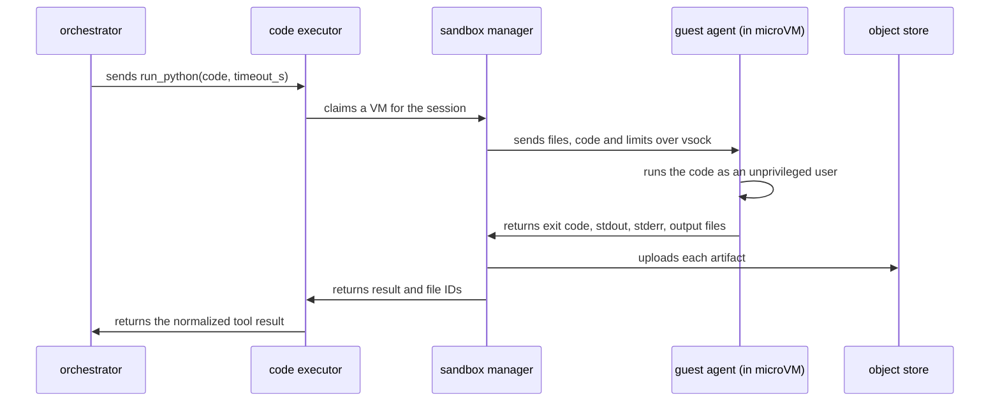
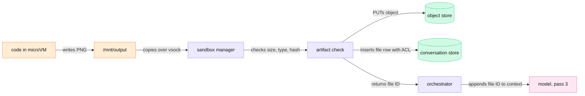
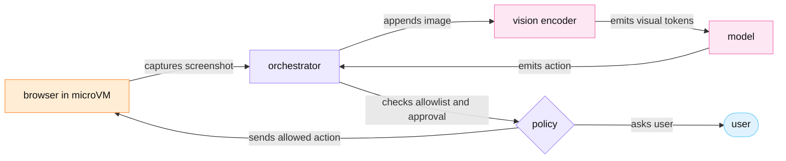

<!-- GENERATED from manuscript/src/part-08-code-and-computer-use-sandboxes.md by tools/render_manuscript.py. Edit the source, not this file. -->
# Part 08: Code and computer-use sandboxes

A sandbox runs model-written code in a fresh virtual machine with no network, no credentials and hard resource limits.

Your request reaches this part in pass 2 of its tool loop (part 6.2). The model has the competitor prices from pass 1. Now it emits a `run_python` call that computes your gross margin at each price and draws a chart. The orchestrator must run code that nobody reviewed, from a model that read untrusted web pages one pass earlier. This part follows that code in two sections:

1. The code execution tool: isolation, limits, network, files, warm pools, results and artifacts (8.1).
2. The computer-use and browser tool: the screenshot loop, its token cost, and its own isolation (8.2).

Every class C value in this part is hypothetical and belongs to this reference system. The Firecracker facts are class A and come from its repository and its NSDI 2020 paper.

---

## 8.1 The code execution tool: isolation layers, limits, warm pools, results and artifacts ▣ ◇

In this reference system, each code session runs in its own Firecracker microVM from a warm snapshot pool (RA-30). The VM has no egress and no credential.

### Your call

In pass 2, the model emits one `run_python` call. Its schema is fixed: one `code` string and one `timeout_s` integer of at most 120 s. The model asks for 30 s. The code that the model writes is this:

```python
import matplotlib
matplotlib.use("Agg")
import matplotlib.pyplot as plt

unit_cost = 17.60  # EUR per seat-month, Q3 report
prices = {"AlderSoft": 42.00, "Birchline": 55.00, "Cedar Systems": 38.00}

rows = []
for name, price in prices.items():
    margin = (price - unit_cost) / price
    rows.append((name, price, margin))
    print(f"{name}: price {price:.2f} EUR, gross margin {margin:.1%}")

plt.bar([r[0] for r in rows], [r[2] * 100 for r in rows])
plt.ylabel("Gross margin at competitor price (%)")
plt.savefig("/mnt/output/margin_by_competitor.png", dpi=150)

```

The numbers come from the context, not from a file. The unit cost of 17.6 EUR is a figure from the Q3 report chunk (part 5). The three prices come from the pass-1 search results (part 7). The script prints three lines and writes one PNG file to `/mnt/output`. The call is 227 tokens in the model's tools channel (part 6.1).

The model writes `/mnt/output` because the tool description says so. The description also states three facts. Uploaded files are read-only in `/mnt/data`. There is no network. Files in `/mnt/output` come back as artifacts.

### From tool call to virtual machine

Five components take part. Each has one task.

1. The **orchestrator** validates the arguments against the schema and checks the per-user tool rate limit (part 6.2). It owns the deadline.
2. The **code executor** is the tool executor for `run_python`. It is a stateless service. It asks the sandbox manager for the session's VM.
3. The **sandbox manager** is a daemon on each sandbox host. It keeps the host's warm pool, binds VMs to sessions and starts each Firecracker process through the jailer.
4. The **microVM** is one Firecracker process with its guest kernel. It has two vCPUs, its own memory and a few virtual devices.
5. The **guest agent** is a small program inside the VM. It talks to the host only over vsock. It writes the uploaded files, starts the code, collects the output and reports the result.

Vsock is a socket address family for host-to-guest communication. Firecracker provides it as a virtio device that maps to Unix sockets on the host [SRC-525].



Legend: each participant is one process; arrows are calls or messages. The one thing to notice: the VM talks only to the sandbox manager. Only the manager talks to the object store. The diagram leaves out retries and the deadline timers on purpose.

### Four isolation choices

The code is hostile until proven otherwise. So the first question is which kernel it can reach. Four public designs give four answers:

| Design | What the untrusted code calls | Kernel shared with the host? | Public facts |
|---|---|---|---|
| Container | the host kernel, through namespaces, cgroups and a seccomp filter | yes | namespaces separate kernel resources such as PIDs and mounts [SRC-181]; cgroups limit resources [SRC-180] |
| gVisor | the Sentry, a user-space application kernel written in Go | no direct path: "gVisor never passes through any system call to the host" [SRC-177] | default platform Systrap intercepts with seccomp-bpf [SRC-177] |
| Kata Containers | its own guest kernel in a lightweight VM per pod | no | hypervisor can be QEMU, Cloud Hypervisor, Firecracker, Dragonball or StratoVirt [SRC-366]; files shared by virtio-fs [SRC-178] |
| Firecracker microVM | its own guest kernel; the host sees only KVM exits and virtio device I/O | no | KVM-based VMM in about 50k lines of Rust, with no PCI and no legacy devices [SRC-176] |

A container is the cheapest choice, but one host kernel bug breaks every container on the host. The Firecracker paper states the cost of one shared kernel: "a fundamental tradeoff between security and code compatibility" [SRC-176]. gVisor removes most of the host kernel surface but runs every system call through the Sentry. Kata and Firecracker give each workload its own kernel behind hardware virtualization.

In this reference system, `run_python` uses Firecracker (RA-30). The code is arbitrary Python with native libraries, so it needs a full Linux kernel. The workload is many short sessions, the case that Firecracker serves in AWS Lambda [SRC-176]. gVisor is the lighter alternative for low-risk tools (RA-30).

### The isolation layers, from the outside in

An escape must cross every layer below (RA-30). Each layer stops a different attack.

| # | Layer | What it is | What it stops |
|---|---|---|---|
| 1 | Sandbox host | A host in a separate cluster with no credentials, no service-mesh identity and a firewall that drops all traffic from the VM interfaces | A full escape still lands on a host that can reach nothing of value |
| 2 | Jailer | Starts each Firecracker process in a chroot with only its own files, under its own cgroup, with resource limits. It uses a new mount namespace, an optional new PID namespace, and can join a prepared network namespace. It then drops to an unprivileged uid and gid [SRC-522] | A compromised VMM cannot see other VMs' files and runs as no one. The optional namespaces also hide other processes and networks |
| 3 | Seccomp filter on the VMM | Firecracker installs default seccomp filters on each of its threads before the guest code runs [SRC-523]; the paper reports 24 allowed system calls and 30 ioctls [SRC-176] | A compromised VMM thread cannot call most host kernel functions |
| 4 | Firecracker VMM | Emulates only virtio net, block and vsock, a serial console and a partial keyboard controller; no PCI and no legacy devices [SRC-174] [SRC-176] | Fewer device emulators, so fewer bugs that guest code can reach |
| 5 | KVM | The CPU runs guest code in a hardware virtualization mode; privileged guest instructions exit to KVM [SRC-174] [SRC-176] | Guest code never makes a host system call |
| 6 | Guest kernel | A minimal Linux kernel of its own, with a read-only root filesystem from the base image | A guest kernel exploit gains only the VM |
| 7 | Guest cgroup and rlimits | `memory.max`, `pids.max` and `cpu.max` on the code's process tree [SRC-180] | Runaway code cannot starve the guest agent, so the guest agent still reports a result |
| 8 | Unprivileged user | The code runs as uid `sandbox`, with no capabilities and `no_new_privs` set | The code cannot remount filesystems, change limits or kill the guest agent |

Linux divides root's privileges into units called capabilities [SRC-526]. Layer 8 removes all of them from the code's processes. `no_new_privs` stops a setuid binary from giving them back [SRC-179].

A user namespace maps user and group IDs, so a process can be root inside it and unprivileged outside [SRC-181] [SRC-922]. Container sandboxes depend on it. Here the jailer drops the VMM to a plain unprivileged uid instead [SRC-522]. Inside the guest, the code has no root to map.

Firecracker's design document treats all guest code as malicious from the moment the vCPUs start [SRC-174]. Containment comes from the nested layers, not from any single one. This is why layer 1 matters: the layers protect the host, but the host must also hold nothing worth stealing.

### Snapshots and unique state

The warm pool restores many VMs from one template snapshot. Firecracker's documentation calls this pattern potentially insecure [SRC-521]. Every restored VM starts with the same memory, so it also starts with the same random seeds, identifiers and tokens.

Firecracker enables a VMGenID device. On restore it changes a 16-byte generation ID and notifies the guest. Linux 5.18 and later then reseeds its kernel random number generator [SRC-521]. User-space state is not reseeded: "unique identifiers, cached random numbers, cryptographic tokens" still repeat [SRC-521].

In this reference system, three rules close that gap (RA-30):

1. The template snapshot holds no secret, no session data and no identifier.
2. After restore, the guest agent reseeds Python's `random` module from the kernel. It also gets a new VM ID from the sandbox manager.
3. No VM serves two sessions. The sandbox manager destroys a session's VM after use and never snapshots it for another user.

### Resource limits, and what happens at each one

Every limit has a defined outcome, so the model always gets a result it can read. The values are hypothetical.

| Resource | Limit | Mechanism | What happens when the code hits it |
|---|---|---|---|
| CPU | 2 vCPUs | Firecracker vCPU count; host cgroup `cpu.max` [SRC-180] [SRC-174] | The code runs slower; nothing fails. Slow code then meets the wall-clock limit |
| Memory | 2,048 MiB guest RAM | Guest cgroup `memory.max` below the guest RAM, so the guest agent keeps room [SRC-180] | The kernel OOM killer stops the code [SRC-180]; exit code 137 (128 + SIGKILL); stderr says "out of memory" |
| Processes | 256 | Guest cgroup `pids.max` [SRC-180] | `fork()` fails with `EAGAIN`; a fork bomb stops at the limit |
| Scratch disk | 4,096 MiB | Sparse per-session block device | Writes fail with `ENOSPC`; Python raises `OSError` |
| Output files | 256 MiB and 20 files | Guest agent checks before copy-out | The result lists the files that fit and marks the rest as not returned |
| Wall clock | `timeout_s` from the call (30 s here; at most 120 s) | Guest agent timer, then the executor deadline of 35 s (30 + 5 = 35 s) | The agent kills the process group and returns `timed_out: true`; if the agent itself does not answer, the sandbox manager kills the VM |
| stdout + stderr | 2,000 tokens to the model | Code executor truncates | The result keeps the head and the tail and sets `truncated: true` |
| Host I/O | Token-bucket rate limits on block and network devices | Firecracker rate limiters [SRC-174] | Disk-heavy code slows down; other VMs on the host keep their bandwidth |

Two layers enforce the wall clock on purpose. The guest agent kills only the code, so the session survives and the model sees a timeout. The executor deadline protects the orchestrator if the whole VM hangs. Part 6.2 adds a margin of 5 s for restore and upload.

### Network: denied by default

In this reference system, the `run_python` VM has no network interface at all (RA-30, RA-69). Firecracker connects a guest to the network only through a virtio-net device backed by a host TAP device [SRC-174]. The sandbox manager attaches none, so the guest has only loopback. The code cannot open a socket to anything outside the VM.

This choice is deliberate, because Firecracker "does not perform any network traffic filtering" [SRC-174]. Its design document leaves egress filtering to the host [SRC-174]. No interface means no filter to get wrong.

The cloud metadata endpoint at 169.254.169.254 is unreachable for the same reason [SRC-183]. Firecracker also has its own metadata service, MMDS. MMDS is "not reachable from the guest operating system" by default, and this reference system never enables it (RA-69) [SRC-524].

A future tool may need egress, for example a package mirror. Then the sandbox manager attaches a TAP device in the VM's network namespace. That namespace's only route leads to the egress service of RA-29, with a per-tool allowlist. The host firewall drops every packet to 169.254.0.0/16 and to private ranges [SRC-182].

### Files in: read-only `/mnt/data`

The Q3 report lives in the object store (RA-21, part 2.2). The VM has no network, so the file must come in through vsock.

1. The code executor sends the session's file IDs to the sandbox manager.
2. The sandbox manager reads the bytes from the object store with its own credential.
3. The sandbox manager streams the bytes over vsock to the guest agent.
4. The guest agent writes them to `/mnt/data`, owned by root, with mode `0444` for files.
5. The guest agent bind-mounts `/mnt/data` read-only before the code starts.

The code runs as uid `sandbox` without capabilities, so it cannot remount the directory. The base image is a read-only root filesystem. Firecracker marks such a block device with `is_read_only` [SRC-525].

### Files out: from `/mnt/output` to a link

An artifact is a file that the code writes to `/mnt/output` and the system returns. Your chart takes this path:



Legend: orange = inside the sandbox; violet = trusted CPU services; green = stored state; pink = GPU. The one thing to notice: the model gets a file ID, never the bytes or a URL. The diagram leaves out the user's download, which the next paragraphs open.

The sandbox manager treats the PNG as untrusted bytes. It checks the size against the quota and the file signature against the declared type. It computes a SHA-256 hash and writes the object under a key that holds the tenant and conversation IDs. The conversation store records the file row, `file_9c41d2e07b`, with the conversation owner as its only reader.

The user gets the chart in four steps (RA-63):

1. The pass-3 answer refers to the file ID.
2. The client renders an image whose URL is on the owned file origin (part 7.5).
3. The file service checks the user's session against the file row's ACL.
4. The file service answers with a redirect to a presigned GET URL that expires after 300 s [SRC-226].

The presigned URL never enters the conversation history. A stored URL would expire, and anyone who copied it could use it while it lived (part 2.2). The file ID stays valid, and each view gets a fresh URL.

### Warm pools: cold boot versus snapshot restore

A warm pool turns a start-up of seconds into a claim of milliseconds. The cost is a few idle VMs per host.

**Cold boot.** Firecracker's specification promises at most 125 ms from the `InstanceStart` call to the guest's `/sbin/init`, with a minimal kernel [SRC-520]. A Python sandbox needs more than `init`. Every step of a cold start, with hypothetical values except the boot bound:

| Step | Time |
|---|---|
| start the jailed Firecracker process (to API socket) | 12 ms |
| boot the guest kernel to /sbin/init | 125 ms |
| guest init and agent ready on vsock | 200 ms |
| start Python and import numpy, pandas, matplotlib | 1,500 ms |
| copy the uploaded files in over vsock | 20 ms |
| **total** | **1,857 ms** |

The imports dominate. The VM boots in a fraction of the total, but `numpy`, `pandas` and `matplotlib` take far longer to load.

**Snapshot restore.** A snapshot is a file pair: the guest memory and the VM state [SRC-521]. This reference system takes one template snapshot per base-image version, after the imports (RA-69). Firecracker restores a snapshot with a `MAP_PRIVATE` mapping of the memory file. Pages load on demand, and writes go to private copy-on-write memory [SRC-521]. So restore is fast, but the first touch of each page costs a page fault.

Firecracker publishes no restore time; it says performance "depends on the memory size, vCPU count and emulated devices count" [SRC-521]. Here we use 150 ms (hypothetical). Before a restored VM joins the pool, the agent reseeds and runs a short warm-up script. That script faults in the interpreter's pages:

| Path | Steps | Time on the critical path |
|---|---|---|
| cold boot | the five steps above | 1,857 ms |
| restore on demand, no pool | snapshot_restore + copy_in (no pool; pages fault in during the run) | 170 ms |
| claim from the warm pool | pool_claim + copy_in | 25 ms |
| pool refill (off the critical path) | snapshot_restore + pool_warmup | 500 ms |

The pool saves 1,832 ms per new session: 1857 − 25 = 1832 ms. That time sits directly before pass 3, so the user sees it as a pause before the answer. Firecracker documents high restore latency on cgroup v1 hosts and recommends cgroup v2 [SRC-521]. This reference system runs sandbox hosts on cgroup v2 only (RA-69).

**Your call through the sandbox.** Your session is new, so the manager claims a pooled VM:

```
warm claim + copy-in   25 ms
run the script         1,200 ms
upload the PNG         80 ms
total                  25 + 1200 + 80 = 1305 ms
```

A cold start would make it 1857 + 1200 + 80 = 3137 ms. Both fit easily inside the 30 s timeout.

### Sizing the pool with Little's Law

Little's Law (part 3) relates three means: items in a system = arrival rate × time in the system, or L = λ × W. The Firecracker paper applies it to Lambda's pre-booted microVMs. There, "the pool size is the product of creation rate and creation latency" [SRC-176]. We apply the same law three times, with hypothetical traffic.

**Step 1: arrivals.** At the hypothetical peak, 5% of requests run code:

```
λ_calls    = 50,000 × 0.05 = 2,500 calls/s
λ_sessions = 2,500 / 2 = 1,250 sessions/s
```

The second line uses a mean of 2 calls per session. Only a new session needs a new VM.

**Step 2: VMs that run code right now.** Each call runs for a mean of 3 s:

```
busy VMs = 2,500 calls/s × 3 s = 7,500 VMs
```

**Step 3: VMs that are alive.** A session VM stays alive across its calls and the gaps between them. After the last call it waits 120 s for one more:

```
W_session = W = calls × run + (calls − 1) × gap + idle_keep
          = 2 × 3 + 1 × 20 + 120 = 146 s
live VMs  = 1,250 sessions/s × 146 s = 182,500 VMs
```

Only 4.1% of live VMs run code at any instant. The rest wait for a next call.

**Step 4: hosts.** Each VM reserves its 2,048 MiB in full, because an out-of-memory host would kill other tenants' VMs. A host has 1,024 GiB and keeps 64 GiB for itself:

```
VMs per host     = ⌊(1024 − 64) × 1024 / 2048⌋ = 480
hosts by memory  = ⌈182,500 / 480⌉ = 381
busy vCPUs       = 7,500 × 2 = 15,000
hosts by CPU     = ⌈15,000 / 192⌉ = 79
```

Memory binds, not CPU. Live VMs need 356 TiB of RAM. Most of it belongs to idle VMs.

**Step 5: the warm pool.** The pool's arrivals are new sessions. Its "stay" is the refill time, from the moment a VM leaves the pool until its replacement is ready:

```
mean pool    = 1,250 /s × 0.5 s = 625.0 VMs
```

The mean is not enough, because arrivals are random. Treat arrivals within one refill time as Poisson, with a standard deviation of √mean. A pool of mean + 3√mean then empties rarely:

```
central pool = ⌈625.0 + 3 × √625.0⌉ = ⌈625.0 + 75.0⌉ = 700
```

**Step 6: one pool per host.** The sandbox manager runs on each host, so in practice each host keeps its own pool:

```
λ per host    = 1,250 / 381 = 3.28 /s
mean per host = 3.28 × 0.5 = 1.64 VMs
pool per host = ⌈1.64 + 3 × √1.64⌉ = ⌈5.48⌉ = 6
all hosts     = 6 × 381 = 2,286
```

Many small pools need 3.3 times the VMs of one central pool, because each small pool needs its own headroom. The cost is still small: 12 GiB per host, and 385 hosts instead of 381.

**What this math changes.**

- **Snapshot restore keeps the pool small.** If refills booted cold, the mean pool would be 1,250 /s × 1.857 s = 2,321 VMs, 3.7 times larger. The paper makes the same point: at 125 ms, one pooled microVM serves 8 creations per second [SRC-176].
- **Refill rate is not the limit.** Each host refills 3.28 VMs per second. The paper reports creation of up to 150 microVMs per second per host [SRC-176].
- **The idle window sets the fleet size.** If the window shrank to the mean gap of 20 s, live VMs would fall to 57,500. Hosts would fall to 120. The price: more second calls would find their VM gone and lose their Python variables.
- **The pool is per base image.** A new image version needs a new template snapshot, so a rollout drains old pools and fills new ones gradually.

### Results: what the model sees, and what the user sees

The guest agent returns four things: the exit code, stdout, stderr and the list of files in `/mnt/output`. The code executor turns them into one compact JSON object (part 6.2):

```json
{"exit_code":0,"stdout":"AlderSoft: price 42.00 EUR, gross margin 58.1%\nBirchline: price 55.00 EUR, gross margin 68.0%\nCedar Systems: price 38.00 EUR, gross margin 53.7%\n","stderr":"","artifacts":[{"path":"/mnt/output/margin_by_competitor.png","file_id":"file_9c41d2e07b","mime_type":"image/png"}],"truncated":false}
```

The model and the user get different parts of this result:

| Receiver | What it gets | Why |
|---|---|---|
| Model (pass 3) | exit code, stdout and stderr up to 2,000 tokens, the artifact list with file IDs, `truncated` | The model needs the numbers and must know if text is missing |
| User | the answer text and the chart image from the file service | The user needs the chart, not the JSON |
| Neither | the PNG bytes, object keys, presigned URLs, the VM ID | Bytes waste context; keys and URLs are bearer secrets |

This result is 129 tokens as a K3 message (part 6.2). Part 5.6 budgets 160 tokens for it. The cap matters for other calls: a script that prints a whole dataframe could fill the context. Truncation keeps the head and the tail, because errors appear at the end of stderr.

A failure is also a result. A traceback goes to the model as stderr with a nonzero exit code. The model can then fix its code and call again, inside the loop limit of 8 passes (part 6.2).

### Secret isolation

No credential ever enters the VM (RA-30, RA-31). The VM has no environment variable with a key, no cloud role and no metadata route. The only channel out is vsock to the sandbox manager, and the sandbox manager accepts only result messages on it.

The credentials that this flow needs stay outside:

1. The sandbox manager holds an object-store credential scoped to the sandbox file prefix.
2. The code executor holds a service identity that the sandbox manager trusts.
3. The user's own tokens never reach this path. Tools that need them use the credential broker of part 6.4.

So code that the model writes under a prompt injection can still compute and print. It cannot reach any system, and it can leak data only into its own result. Part 7.5 shows why that result is still untrusted.

### Session reuse and cleanup

A session is the sandbox state of one conversation. In this reference system, it lasts in two forms (RA-69):

1. **Live.** After each call, the VM stays running for 120 s. A next call in that window finds the same Python process, with its variables and files.
2. **Files only.** After the window, the sandbox manager copies the scratch files and `/mnt/output` to the object store and destroys the VM. A later call gets a fresh pooled VM with the files copied back in, but no Python variables. The tool description tells the model that state can reset.

After 3,600 s without a call, a cleanup task deletes the session's files. Artifacts that an answer refers to stay, because they belong to the conversation, not the session.

Destroying a VM is simple, because a microVM is one process. The sandbox manager kills the Firecracker process, deletes the chroot and the scratch device, and removes the cgroup [SRC-176] [SRC-522]. Nothing of the session remains on the host.

### Stage card: the code execution tool

| # | Question | Answer |
|---|---|---|
| 1 | Which component runs? | The code executor, the sandbox manager on one sandbox host, one Firecracker microVM, and the guest agent inside it. |
| 2 | On what hardware? | CPU and DRAM of a sandbox host with hardware virtualization; local NVMe for snapshots and scratch devices. |
| 3 | What data enters? | The `run_python` arguments (227 tokens in the model's output), the session's uploaded files, the limits. |
| 4 | In what representation? | JSON arguments over gRPC to the executor; a vsock message with the code string and the file bytes into the VM. |
| 5 | What computation happens? | CPython runs the script: three margins and one matplotlib chart. |
| 6 | What data leaves? | Exit code, stdout, stderr, the artifact list; the PNG goes to the object store, a file ID to the model. |
| 7 | Where is state stored? | Live session state in VM memory; files in the scratch device; artifacts in the object store; file rows in the conversation DB. |
| 8 | Is it synchronous? | The tool loop waits for the result, so pass 3 cannot start before it. Inside the executor the call is asynchronous with a deadline of 35 s. |
| 9 | Can different users' requests run here at the same time? | Yes: about 480 VMs per host, one per session, never shared. |
| 10 | How is that concurrency achieved? | One process per VM, one vCPU thread per guest core, host cgroups for CPU share; KVM keeps the guests apart. |
| 11 | What is cached? | The template snapshot and the base image on each host; the warm pool of restored VMs; the live session VM during its idle window. |
| 12 | What can fail? | Code errors, OOM, timeouts, a full disk, an empty pool (then a cold start), a host failure (then the executor retries on another host with the files). |
| 13 | What does it add to latency? | 1,305 ms for your call from a warm pool; 3,137 ms from a cold boot. |
| 14 | What limits capacity? | Host memory for live VMs (381 hosts at peak), then CPU for busy ones (79 hosts). |
| 15 | How does it scale horizontally? | More sandbox hosts; each runs its own sandbox manager and pool, and the executor picks a host by free memory. |
| 16 | What security boundary exists? | The eight layers above; no network, no metadata route, no credentials; read-only inputs; artifacts leave only through the sandbox manager's checks. |

**Meanwhile in the fleet.** Your script runs for about a second. In that second, about 2,500 other code calls start across the fleet. About 1,250 pooled VMs leave their pools, and the same number of restores refill them.

On the GPU side, your request holds no decode slot while it waits. The model server runs other sequences. Your conversation's KV stays in the prefix cache for pass 3 (part 13.3).

Counters at this moment (sandbox metric names are class C; vLLM names follow RA-53):

- `sandbox_pool_ready` on your host drops by one, then returns to 6 after 500 ms.
- `sandbox_live_vms` across the fleet stays near 182,500; `sandbox_busy_vms` near 7,500.
- `sandbox_cold_starts_total` does not change, because the pool had a VM.
- `vllm:num_requests_running` on the replica does not include your request until pass 3 arrives.

You can now size a warm sandbox pool with Little's Law and name the layer that stops each escape.

---

## 8.2 The computer-use and browser tool ◇

A computer-use tool lets the model drive a browser in its own VM, one screenshot and one action per pass.

Your request does not use this tool. Part 7 fetched the pricing pages as text, which is far cheaper. This section shows when a screenshot loop is still needed, and what it costs.

### The observe-act loop

The model cannot read pixels as text. It sees each screenshot as visual tokens (part 4.3) and answers with an action:

1. The browser VM captures the viewport as a PNG.
2. The orchestrator appends the screenshot to the context as a tool result.
3. The vision encoder turns the screenshot into visual tokens.
4. The model reasons and emits one action, for example a click at x, y.
5. The orchestrator validates the action against the policy.
6. The browser VM performs the action and waits for the page to settle.
7. The loop returns to step 1 until the model gives a final answer.

The action schema is small. Anthropic's public computer-use tool, as one example, defines actions such as `screenshot`, `left_click`, `type`, `key`, `scroll` and `zoom` [SRC-193]. Coordinates are "in screenshot pixels", with the origin at the top left [SRC-193]. So if the system scales a screenshot down, it must scale the model's coordinates back up.



Legend: orange = sandboxed browser; violet = trusted orchestrator logic; pink = GPU; blue = the user. The one thing to notice: every action passes the orchestrator's policy before the browser sees it. The diagram leaves out the DOM and accessibility-tree path, described below, on purpose.

### The token cost of one screenshot

Take a viewport of 1,280 × 800 pixels (hypothetical). `M-frontier` runs it through the same K3 resize rule as your photo in part 4.3:

1. Count patches before any resize: ⌊1280 / 14⌋ × ⌊800 / 14⌋ = (1280 // 14) × (800 // 14) = 91 × 57 = 5,187 patches.
2. Compare with the budget of 65,536 patches. The screenshot is far below it, so the scale is 1.0 and no resize happens.
3. Pad each side up to a multiple of 28 pixels: 1288 × 812.
4. Cut into 14 × 14 patches: 812 / 14 × 1288 / 14 = 58 × 92 = 5,336 patches.
5. Merge each 2 × 2 block into one token: 58 / 2 × 92 / 2 = 29 × 46 = 1,334 visual tokens.
6. Add the K3 wrapper `<|media_begin|>image 1280x800<|media_content|><|media_pad|><|media_end|>` [SRC-378]. Besides the pad token, it adds 9 tokens: 1,334 + 9 = 1,343 positions.

One step adds the screenshot plus a result frame of 25 tokens: 1,343 + 25 = 1,368 tokens in. It emits 120 + 40 = 160 tokens out. The vision encoder needs 7.3 ms on one GB300 at the hypothetical utilization of part 4.3.

One screenshot is about the size of one fetched page as text: 1,800 tokens on average (part 7). The difference is the count. A text fetch reads a page once. A browser task needs a screenshot after every action.

### The cost of a 20-step task

A task of 20 steps (hypothetical) starts with 1,200 + 900 + 150 = 2,250 tokens of system prompt, tool schema and task. The context then grows by each step's screenshot and output. Two context policies give very different costs:

- **Policy A, append-only.** Every screenshot stays. Each step's context starts with the whole previous context, so the prefix cache reuses all of it (part 13.3). Prefill computes only the new screenshot.
- **Policy B, keep the last 3.** Each step replaces the oldest kept screenshot with a 10-token placeholder. That changes the context in the middle, so prefill must compute every later token again.

The simulation compares the two contexts block by block. The prefix-cache hit is the length of the longest common prefix:

| Step | A: context | A: prefilled | B: context | B: prefix hit | B: prefilled |
|---|---|---|---|---|---|
| 1 | 3,618 | 3,618 | 3,618 | 0 | 3,618 |
| 2 | 5,146 | 1,368 | 5,146 | 3,778 | 1,368 |
| 4 | 8,202 | 1,368 | 6,844 | 2,250 | 4,594 |
| 20 | 32,650 | 1,368 | 9,564 | 4,970 | 4,594 |
| **task total** | | **29,610** | | | **84,452** |

At step 4, policy B first replaces screenshot 1. The hit falls back to the base context, so step 4 prefills three screenshots again. Over the task, B prefills 2.9 times the tokens of A. In exchange, B ends with a context 3.4 times smaller.

The final contexts in MLA KV bytes (`M-frontier` latent only; the fixed KDA state is left out):

| Policy | Final context | MLA KV (BF16) | Prefill time, whole task |
|---|---|---|---|
| A | 32,810 tokens | 907 MB | 617 ms |
| B | 9,724 tokens | 269 MB | 1,760 ms |

Prefill times use matmul FLOPs on one TEP8 prefill worker at the hypothetical utilization of part 4.3. Over 20 steps the vision encoder sees 20 × 1,334 = 26,680 visual tokens.

**What this math changes.** Policy A is cheap per step but grows without bound. A long task then hits the context window and holds a large KV cache. Policy B bounds the context but breaks the prefix cache every step.

A middle path removes old screenshots in batches, not one per step. Anthropic's documentation suggests this pattern: keep the last three screenshots and prune every 25 turns [SRC-193]. Between prune events, the prefix stays byte-identical. In this reference system the orchestrator uses that batch policy (RA-70). For a 20-step task it behaves as policy A.

### Why it is slow

One step takes the time of a full inference turn plus the browser's own time. With hypothetical values:

```
capture + encoder + prefill + decode + action + settle
= 100 + 7.3 + 28.5 + 7,558 + 150 + 800 = 8,644 ms
```

Decode is 87% of the step: 160 × 47.2 ms = 7,558 ms at the hypothetical decode step of part 14.2. The whole 20-step task takes about 173 s.

Compare the API path for a similar goal. Your `web_search` step, with search and page fetches, has a p50 of 1.6 s (part 7.2). It needs one inference pass to ask and one to read. A browser task needs one inference pass per click. So this reference system prefers an API tool whenever one exists (RA-70). It offers the browser tool only for pages that have no API and need interaction, such as a multi-page form.

Anthropic's documentation states the same limit: computer-use latency "might be too slow compared to regular human-directed computer actions" [SRC-193].

**Text instead of pixels.** A browser tool can also return the page's DOM or its accessibility tree. The accessibility tree is the browser's structured list of roles, names and states of the visible controls. A common design sends this tree as text. The model then picks an element by ID, not by coordinates.

This avoids the visual tokens and the coordinate errors. It fails on canvas-drawn pages and on pages whose controls lack labels. So this reference system sends the tree first and a screenshot when the tree is not enough (RA-70).

### Isolation, policy and confirmation

The browser runs in its own Firecracker microVM from a separate pool, with the layers of 8.1. Two things differ from `run_python`, and both make the browser riskier:

1. **It needs the network.** Its only route leads to the egress service of RA-29. Each task has a domain allowlist that the orchestrator sets from the user's request. The egress service blocks private ranges and metadata addresses for every hop [SRC-182].
2. **It shows untrusted content to the model.** Text on a page is instruction-shaped data. Anthropic warns that "instructions on webpages or contained in images" might override the user's instructions [SRC-193]. Part 7.5 shows the layered defense for text; a screenshot carries the same risk as pixels.

The orchestrator checks every action before the browser sees it (RA-32):

| Check | Rule | Example |
|---|---|---|
| Navigation | a URL change must match the task allowlist | a click that opens an unknown domain stops with an error result |
| Side effects | submit, buy, send, delete and accept-terms actions wait for the user's approval (part 6.3) | the model clicks "Pay"; the client shows the page and the exact action |
| Credentials | the browser profile holds no saved password or cookie of the user's other sites | the model meets a login page; the orchestrator pauses and the user types the password into a live view of the VM |
| Coordinates | the click must land inside the viewport | x outside 0 to 1,280 is rejected |
| Rate | each step counts against the per-user tool-call limit (part 6.2) | a loop of 500 clicks stops early |

The credential rule follows Anthropic's advice to avoid "giving the model access to sensitive data, such as account login information" [SRC-193]. The human-approval rule follows its advice to ask a human before "completing financial transactions, or agreeing to terms of service" [SRC-193]. The sandbox manager destroys the VM after the task, with its cookies and cache.

**Meanwhile in the fleet.** While one browser task waits for a page to settle, its model replica decodes other users' sequences. Each browser step arrives at the replica as a new short prefill with a long cached prefix. Hundreds of such loops run at once. Prefix-cache hit rates stay high, but each loop holds its growing KV across all its steps (part 13.6).

Counters for one browser task at step 20, policy A:

- `vllm:prefix_cache_hits` rises by 31,282 tokens for this step alone.
- Prompt tokens prefilled this step: 1,368.
- The task timer reads about 173 s, against a p50 of 1.6 s for a search step (part 7.2).

You can now compute the visual-token cost of a browser task and explain why an API tool wins.

---

## What Part 08 established

Model-written code and browser actions run in microVMs with no credentials and hard limits. A warm snapshot pool hides their start-up.
