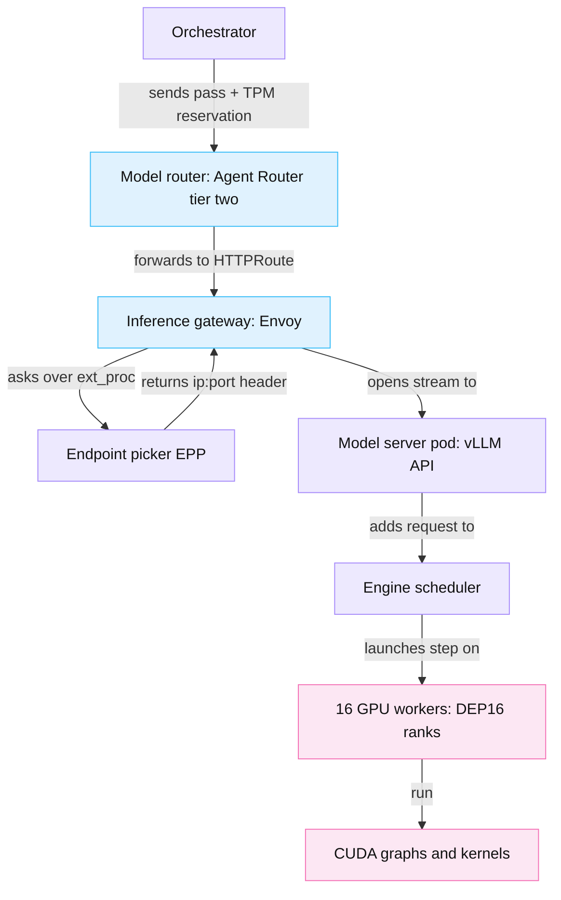

<!-- GENERATED from manuscript/src/part-09-inference-routing-admission-queueing.md by tools/render_manuscript.py. Edit the source, not this file. -->
# Part 09: Inference routing, admission and queueing

The inference gateway picks each pass's endpoint from load and cache signals, and holds passes while the pool is full.

Your request is now a prompt of 23,322 tokens for `M-frontier` (part 5.6). The model router chose the `M-frontier` deployment in `ap_south` (part 3.7). That deployment has many decode endpoints, and each one holds different sequences and different cached prefixes. Your request reaches this point three times, once per inference pass (part 6.2). This part follows those three arrivals in six steps:

1. Which component decides what, from the model router down to the GPU kernels (9.1).
2. Why simple rotation fails, and which signals replace it (9.2).
3. How the endpoint picker scores endpoints for pass 2, and what goes wrong with a hot prefix (9.3).
4. When a pass waits, and when it gets an error (9.4).
5. How many requests sit in each queue at one moment, from Little's Law (9.5).
6. How the queues stay fair between tenants (9.6).

---

## 9.1 The inference hierarchy ◇

Six levels decide where and when your pass runs, and each lower level knows more about fewer GPUs.

### The levels

The spec names the chain model router → inference gateway → replica scheduler → model server → request scheduler → GPU workers → CUDA → kernels. In this reference system, the inference gateway and the replica scheduler form one unit (RA-34). It is an Envoy proxy plus an endpoint picker. The same chain, with the real components:



Legend: blue = network proxies; violet = CPU processes that decide; pink = GPU work. The one thing to notice: Envoy never chooses the endpoint itself. It asks the endpoint picker and connects to the returned address. The diagram leaves out the prefill pool on purpose; part 13.7 opens the prefill and decode split.

| Level | Component in this reference system | What it knows | What it decides | How often |
|---|---|---|---|---|
| 1. model router | Agent Router, tier two (RA-09, RA-15) | the model name, the plan, the tenant's token quota | which deployment and region; reserve or refuse tokens | once per pass |
| 2. inference gateway | Envoy with an `HTTPRoute` to an `InferencePool` (RA-34) | the route rules; which pool backs the route | which pool; it calls the endpoint picker | once per pass |
| 3. endpoint picker | llm-d Router EPP (RA-34, RA-37) | every endpoint's queue, KV usage, cached prefixes, in-flight tokens | admit, queue or reject; which endpoint | once per pass |
| 4. model server | vLLM API server in the pod (RA-35) | its own engine only | tokenize, validate, hand the request to the engine | once per pass |
| 5. engine scheduler | vLLM V1 scheduler (RA-36) | free KV blocks, the token budget, the running and waiting lists | which sequences run in this step, and how many tokens each | every step, tens of ms |
| 6. GPU workers and kernels | 16 ranks of one DEP16 decode worker (RA-55) | tensors in HBM | nothing; they compute what the step contains | every step |

Each boundary hides detail from the level above. The model router does not see KV blocks. The endpoint picker does not see the order of sequences inside a step. The engine scheduler does not see other endpoints. So each level must decide from a summary that arrives a little late.

### The Gateway API Inference Extension

The Kubernetes Gateway API Inference Extension defines the `InferencePool` resource, version `inference.networking.k8s.io/v1` [SRC-287]. An `InferencePool` has three main fields [gateway-api-inference-extension@c0795de:api/v1/inferencepool_types.go#L70-L173]:

1. `selector`: a selector over pod labels that finds the model-server pods of the pool.
2. `targetPorts`: one to eight ports on those pods.
3. `endpointPickerRef`: the service of the endpoint picker, with `failureMode`. The default is `FailClose`, so the inference gateway sends no traffic when the picker is down.

The endpoint picker (EPP) is a separate process that selects one endpoint for each request. The gateway talks to it over Envoy's external-processing protocol, `ext_proc`, a streaming gRPC service [SRC-287]. The protocol fixes the reply [gateway-api-inference-extension@c0795de:docs/proposals/004-endpoint-picker-protocol/README.md#L52-L80]:

- The EPP writes the chosen endpoint as `ip:port` into the header `x-gateway-destination-endpoint`. A comma-separated list gives fallbacks for retries.
- The EPP returns `503` when no endpoint is ready.
- The EPP returns `429` when it drops the request, for example under overload.

Envoy then connects to exactly that address. In llm-d's standalone configuration, an `ORIGINAL_DST` cluster reads the address from the header [llm-d-router@a9f2f71:config/charts/llm-d-router-standalone/values.yaml#L172-L240]. So Envoy's own endpoint discovery plays no part in the pick.

The EPP finds endpoints itself. It watches Pods that match the pool's selector. It adds a pod only when the pod's `Ready` condition is true [llm-d-router@a9f2f71:pkg/epp/controller/pod_reconciler.go#L85-L106]. It scrapes each model server's metrics on a 50 ms tick [SRC-284]. Metrics older than 200 ms count as stale [SRC-284].

### The llm-d Router

The EPP project moved from the Gateway API Inference Extension to llm-d. Its current name is llm-d Router [SRC-284]. Inside the EPP, every request follows a fixed order [llm-d-router@a9f2f71:docs/architecture.md#L64-L93]:

1. Flow control admits the request, holds it, or rejects it (9.4).
2. The EPP lists the candidate endpoints from its pool data.
3. Data producers compute the signals: token IDs, prefix matches per endpoint, in-flight load.
4. The scheduling profile runs its filters in order, then its scorers, then a picker.
5. Hooks after the pick update the in-flight counters and the prefix index.

Each scorer returns a value from 0 to 1. The profile multiplies each value by the scorer's weight and adds them up [llm-d-router@a9f2f71:pkg/epp/scheduling/scheduler_profile.go#L242-L258]. The default picker takes the highest sum and rotates through equal sums in turn [llm-d-router@a9f2f71:pkg/epp/framework/plugins/scheduling/picker/maxscore/picker.go#L88-L128].

KServe's `LLMInferenceService` deploys the same parts from one resource [SRC-306]. It creates vLLM pods, an `InferencePool`, an `HTTPRoute` and the llm-d EPP with the default configuration.

### NVIDIA Dynamo

NVIDIA Dynamo has its own KV-aware router in the `lib/kv-router` crate [SRC-288]. Dynamo's frontend tokenizes the request and computes a cost per worker. The cost charges prefill work not covered by cached blocks, plus decode load (9.3). Dynamo keys each worker by worker ID and data-parallel rank [dynamo@2946153:lib/kv-router/src/protocols.rs#L451]. Dynamo also ships an EPP, so its KV router can run inside the Gateway API flow [SRC-288].

### What an endpoint is in this reference system

A DEP16 decode worker has 16 attention data-parallel ranks (RA-55). Each rank holds the full KV cache of its own sequences (part 13.1). So a prefix cached on rank 5 does not help rank 6.

The exact unit of routing in a real provider is not public. Two realistic options are one endpoint per decode worker, with the engine choosing the rank, or one endpoint per rank. Here we use one endpoint per rank (RA-71), because the prefix cache lives per rank. Dynamo's per-rank worker key shows the same design. One GB300 NVL72 rack then has 3 × 16 = 48 decode endpoints.

**Meanwhile in the fleet.** The model router forwards thousands of passes per second into the same `HTTPRoute`. One EPP process scores every one of them against the same pool data. The pool data changes on every 50 ms scrape. After every pick, the EPP adds the pick's tokens to that endpoint's in-flight count.

You can now name the six levels from the model router to the kernels, and say what each decides.

---

## 9.2 Why round-robin fails ⚙

Request count does not measure load, because one LLM request can cost thousands of times more GPU work than another.

### Two requests, one count

Round-robin sends request k to endpoint k mod N. It assumes that every request costs about the same. LLM requests break that assumption in three ways.

**Prompt length.** One request has 20 prompt tokens; another has 100,000. At a prefill rate of 16,000 tokens/s (hypothetical), the first prefill takes 1.25 ms. The second takes 6.25 s. Every request behind it on that endpoint waits those seconds.

**Output length.** One request emits 20 tokens, another 5,000. The second holds its KV blocks and one batch slot 250 times longer. Nobody knows the output length at routing time.

**Prefix locality.** A later turn of a conversation shares its whole earlier context with the turn before. On the endpoint that holds those blocks, the prefill covers only the new tokens. On any other endpoint, it covers the whole prompt again (part 13.3). Round-robin ignores where the blocks are.

### The signals

An endpoint picker can read these signals. Each has a vLLM metric name or an EPP-internal source:

| Signal | Source | What it measures |
|---|---|---|
| queue depth | `vllm:num_requests_waiting` [vllm@v0.31.0:vllm/v1/metrics/loggers.py#L518-L524] | requests that the engine has not started |
| running sequences | `vllm:num_requests_running` [vllm@v0.31.0:vllm/v1/metrics/loggers.py#L508-L515] | sequences in the engine's running list |
| KV usage | `vllm:kv_cache_usage_perc` [vllm@v0.31.0:vllm/v1/metrics/loggers.py#L576-L581] | used share of the KV block pool; 1 means 100% |
| prefix-cache hits | `vllm:prefix_cache_queries`, `vllm:prefix_cache_hits`, in tokens [vllm@v0.31.0:vllm/v1/metrics/loggers.py#L600-L611] | the endpoint's hit rate over time |
| cached prefix for this request | engine KV events (block stored, block removed) into the EPP's index (RA-37) | how many leading blocks of this prompt each endpoint holds |
| in-flight tokens | EPP's own counter: uncached prompt tokens dispatched and not yet prefilled [llm-d-router@a9f2f71:pkg/epp/framework/plugins/requestcontrol/dataproducer/inflightload/producer.go#L690-L730] | prefill work on its way to each endpoint |
| TTFT and TPOT | `vllm:time_to_first_token_seconds`, `vllm:inter_token_latency_seconds` [vllm@v0.31.0:vllm/v1/metrics/loggers.py#L822-L832] | latency histograms |
| LoRA adapters | `vllm:lora_requests_info` with labels `running_lora_adapters`, `waiting_lora_adapters` [vllm@v0.31.0:vllm/v1/metrics/loggers.py#L987-L999] | which adapters are loaded |
| health | pod `Ready` condition; metric age above 200 ms | whether the endpoint can take traffic |

The Gateway API Inference Extension standardizes the first three for vLLM, SGLang and TensorRT-LLM in its Model Server Protocol [gateway-api-inference-extension@c0795de:docs/proposals/003-model-server-protocol/README.md#L14-L32]. The expected output length is not a metric. llm-d can add a flat estimate per output-length bucket, capped by `max_tokens` [SRC-284].

The scraped metrics lag behind the picks. The EPP may dispatch hundreds of passes between two scrapes. So llm-d also counts its own dispatches: in-flight requests and in-flight uncached tokens. It adds prompt tokens at dispatch and removes them at the first response chunk [SRC-284].

### The policies

| Policy | Rule | Public example | Weakness with LLM requests |
|---|---|---|---|
| round-robin | next endpoint in turn | Dynamo's default for plain endpoint clients [dynamo@2946153:docs/fern/pages/developer-guide/knowledge-base/modular-components/router/routing-concepts.md#L102-L107] | blind to size and cache |
| least-loaded | fewest in-flight requests | Dynamo `least-loaded` [same source] | counts requests, not tokens |
| power-of-two choices | sample two endpoints, take the less loaded | Dynamo `power-of-two`; the analysis is Mitzenmacher's [SRC-540] | the same load measure, but cheap |
| session affinity | the same session always goes to the same endpoint | llm-d `session-affinity` scorer [SRC-284] | one long session can overload its endpoint |
| consistent hashing | hash the first N tokens onto a ring of endpoints [SRC-543] | SGLang `prefix_hash`, with an overload fallback [SRC-050] | ignores load until the fallback fires |
| prefix-aware, KV-aware | prefer endpoints that hold the prompt's leading blocks | llm-d `prefix-cache-scorer`, Dynamo KV router [SRC-284] [SRC-288] | can pile traffic onto one endpoint (9.3) |
| load and cache combined | cache benefit traded against load | llm-d default (RA-37), Dynamo cost [SRC-288], SGLang `cache_aware` | needs tuning of the trade |

SGLang's gateway shows the combined rule in its simplest form [SRC-050]. If the load gap between endpoints is above 64 requests and above 1.5 times, it picks the least-loaded endpoint. Otherwise, if the prompt matches more than 0.3 of a cached prefix, it picks the endpoint with the longest match.

Mooncake measured the effect on a replayed trace with 16 nodes [SRC-103]. Average TTFT was 19.65 s with random scheduling and 5.27 s with load balancing. Local cache-aware scheduling gave 3.58 s, and global cache-aware scheduling 3.07 s.

### A seeded comparison

The simulation runs 8 identical endpoints for 600 s. All its inputs are hypothetical (`hypothetical.routing_sim`). Each endpoint is a small engine model:

1. A request waits until a running slot and KV room for its whole prompt exist.
2. Prefill runs in arrival order at 16,000 tokens/s over the uncached tokens only.
3. Each running sequence emits one token per step. The step time grows with the number of running sequences.
4. A finished context stays in the free KV space as a cached prefix until LRU eviction needs the room.

The workload has 6,587 requests in multi-turn conversations. 63% of them are later turns that share the previous context. Prompt lengths run from 32 to 100,000 tokens, with a median of 3,322. Outputs run from 20 to 5,000 tokens. Without any cache hit, the prompts offer 67,706 tokens/s against a pool capacity of 128,000 tokens/s.

| Policy | TTFT p50 | TTFT p95 | TTFT p99 | prefix-hit share of prompt tokens | longest queue on one endpoint | mean KV usage |
|---|---|---|---|---|---|---|
| round-robin | 0.32 s | 3.94 s | 6.11 s | 11% | 16 | 86% |
| least requests | 0.39 s | 4.41 s | 6.47 s | 12% | 13 | 86% |
| token load, no prefix data | 0.20 s | 1.28 s | 3.73 s | 13% | 9 | 86% |
| prefix-aware (llm-d default) | 0.06 s | 1.00 s | 2.86 s | 66% | 8 | 80% |

Three results stand out:

1. Least requests is no better than round-robin. Both count requests, and a request count says nothing about tokens.
2. Token load cuts the p95 TTFT, because it steers new prompts away from endpoints with long prefills queued.
3. The prefix-aware policy also reuses cached prefixes. Its p99 TTFT is 2.1 times lower than round-robin's, and its median falls to 0.06 s.

This model leaves out on purpose the decode-side effects of placement, such as KV-read time per step. So it shows the prefill side of the trade only. The workload is illustrative, not a measurement.

### A matching prefix on a busy endpoint

A cache hit is not always the faster choice. Take pass 2 of your request and the three endpoints of 9.3. Now add a burst of 40,000 prefill tokens to E1's queue (hypothetical). Estimate TTFT as the tokens ahead in the queue plus the request's own uncached tokens, over the prefill rate:

| Endpoint | Estimate | TTFT |
|---|---|---|
| E1, holds your prefix | (40,000 + 6,264) / 16,000 = 2.89 | 2.89 s |
| E2, idle, almost no hit | (0 + 28,280) / 16,000 = 1.77 | 1.77 s |

The miss on the idle endpoint is 1.12 s faster. Dynamo's cost reaches the same answer: it picks E2 in this case. So an endpoint picker must weigh the cache benefit against the queue, not take the hit alone.

**Meanwhile in the fleet.** Every endpoint of the pool reports its counters on each scrape. Endpoints with long prompts in prefill show a rising `vllm:num_requests_waiting`. Endpoints with many long outputs show a high `vllm:kv_cache_usage_perc` but short queues. A request-count policy cannot tell these two states apart.

You can now explain why request count is the wrong load measure, and list the signals that replace it.

---

## 9.3 Cache-aware routing for pass 2 ▣ ⚙

The endpoint picker sends pass 2 to E1, which decoded pass 1, because E1 holds most of the pass-2 prompt.

### Pass 2 arrives

Pass 1 ended with a `web_search` call (part 6.2). The search took a few seconds. Then the orchestrator built pass 2: the whole pass-1 context, the pass-1 output and the search result. Pass 2 has 29,816 prompt tokens.

E1 decoded pass 1. When pass 1 ended, the engine freed its blocks but kept their hashes (part 6.2, part 13.3). So the blocks stay in E1's prefix cache until eviction. For `M-frontier`, reuse stops at a 512-token hash block with a saved KDA checkpoint (part 13.3). So E1 can reuse 23,552 tokens, which is 368 blocks of 64 tokens.

The EPP computes chained block hashes of the prompt under the tenant's cache salt (RA-40). Part 13.4 shows how such hashes work. The EPP looks them up in its index, which engine KV events keep current (RA-37). In this reference system, the EPP also adds each pick to the index for 2 s (RA-37). That covers the gap until the engine's event arrives. llm-d offers this as `speculativeIndexing`, off by default [SRC-284].

The state of three endpoints at that moment is hypothetical (`hypothetical.routing_endpoints_ref`):

| Endpoint | Running | Waiting | Queued prefill tokens | Decode blocks | Blocks of your prefix in HBM (G1) | Why |
|---|---|---|---|---|---|---|
| E1 | 60 | 1 | 2,048 | 5,150 | 368 | decoded pass 1 |
| E2 | 52 | 0 | 0 | 4,980 | 24 | holds your tenant's stable prefix (1,536 tokens) from a colleague's request |
| E3 | 56 | 0 | 4,096 | 5,060 | 0 | no block under your tenant's salt |

### The general shape of the score

A cache-aware score trades the benefit of a cache hit against the costs of load. One illustrative form is:

```
score = cache_benefit − α·load − β·queue − γ·kv_pressure
```

The weights α, β and γ are design choices, so no form is universal. llm-d's guide for TensorRT-LLM writes the same idea as a sum of benefits [SRC-285]:

```
S = 3·prefix_match + 2·queue_score + 2·(1 − kv_usage) + 2·no_hit_lru
```

The queue score is `(max_q − q) / (max_q − min_q)` across the candidates. The no-hit LRU scorer returns 0.5 everywhere for a request that has a hit [SRC-284]. KV usage for one `M-frontier` rank counts two parts: the KDA state of every running sequence, and the MLA blocks. The pool of one rank holds 50.67 GB (part 13.1). One block holds 64 × 27,648 B = 1,769,472 B.

| Endpoint | KV usage | S |
|---|---|---|
| E1 | (26.96 + 9.11) GB / 50.67 GB = 0.712 | 3 × 0.790 + 2 × 0.00 + 2 × 0.288 + 2 × 0.5 = 3.945 |
| E2 | (23.37 + 8.81) GB / 50.67 GB = 0.635 | 3 × 0.052 + 2 × 1.00 + 2 × 0.365 + 2 × 0.5 = 3.884 |
| E3 | (25.16 + 8.95) GB / 50.67 GB = 0.673 | 3 × 0.000 + 2 × 1.00 + 2 × 0.327 + 2 × 0.5 = 3.653 |

The highest score wins: E1. The margin is small, because E1's single waiting request costs it the whole queue term. The KDA state is the larger part of KV usage at these context lengths: 60 × 449,372,160 B = 26.96 GB against 5,150 × 1,769,472 B = 9.11 GB on E1.

### Dynamo's cost, worked by hand

Dynamo computes a cost in units of KV blocks, and the lowest cost wins [dynamo@2946153:lib/kv-router/src/scheduling/selector/reference.rs#L286-L423]:

```
raw_prefill_blocks      = (active_prefill_tokens + ISL) / block_size
overlap_credit_blocks   = 1.0 × G1 blocks + 0.75 × G2 blocks + 0.25 × G3 blocks
adjusted_prefill_blocks = max(0, raw_prefill_blocks − overlap_credit_blocks)
decode_blocks           = active_decode_blocks + request blocks
cost                    = prefill_load_scale × adjusted_prefill_blocks + decode_blocks + w × active_requests
```

ISL is the prompt length in tokens. The defaults are `prefill_load_scale` = 1.0 and `w` = 0.0 [SRC-288]. The credits for host DRAM (G2) and NVMe (G3) are 0.75 and 0.25 (RA-39). With `router_temperature` = 0.0, the pick is a plain minimum [SRC-288]. Dynamo runs this aggregated form when one worker does both prefill and decode; part 13.7 covers the split pools.

For pass 2, ISL = 29,816 tokens, and the request needs ceil(29,816 / 64) = 466 blocks. Step by step:

| Step | E1 | E2 | E3 |
|---|---|---|---|
| 1. raw prefill tokens | 2,048 + 29,816 = 31,864 | 0 + 29,816 = 29,816 | 4,096 + 29,816 = 33,912 |
| 2. raw prefill blocks | 31,864 / 64 = 497.88 | 29,816 / 64 = 465.88 | 33,912 / 64 = 529.88 |
| 3. overlap credit | 1.0 × 368 + 0.75 × 0 + 0.25 × 0 = 368 | 1.0 × 24 + 0.75 × 0 + 0.25 × 0 = 24 | 1.0 × 0 + 0.75 × 0 + 0.25 × 0 = 0 |
| 4. adjusted prefill | max(0, 497.88 − 368) = 129.88 | max(0, 465.88 − 24) = 441.88 | max(0, 529.88 − 0) = 529.88 |
| 5. decode blocks | 5,150 + 466 = 5,616 | 4,980 + 466 = 5,446 | 5,060 + 466 = 5,526 |
| 6. active-request term | 0.0 × 63 = 0 | 0.0 × 52 = 0 | 0.0 × 57 = 0 |
| 7. cost | 129.88 + 5,616 + 0 = 5745.88 | 441.88 + 5,446 + 0 = 5887.88 | 529.88 + 5,526 + 0 = 6055.88 |

E1 wins by 142 blocks. The overlap credit removes 368 blocks of prefill from E1's cost. E1 has more decode blocks than E2, so the credit must exceed that gap, and here it does.

**The memory tier matters.** Suppose a long tool call had let E1 move your blocks from HBM to host DRAM or NVMe. The same blocks then earn less credit:

| Where E1's 368 blocks sit | E1's credit | E1's cost | Winner |
|---|---|---|---|
| G1, HBM | 1.0 × 368 + 0.75 × 0 + 0.25 × 0 = 368 | 5,745.88 | E1 |
| G2, pinned DRAM | 1.0 × 0 + 0.75 × 368 + 0.25 × 0 = 276 | 5,837.88 | E1 |
| G3, NVMe | 1.0 × 0 + 0.75 × 0 + 0.25 × 368 = 92 | 6,021.88 | E2 |

The credits reflect load cost. A G2 block still needs a copy into HBM, and a G3 block needs a slower read (part 13.6). With the blocks on NVMe, the credit no longer covers E1's extra decode load.

### llm-d's default policy, the one this reference system runs

The reference system does not run Dynamo's cost. It runs llm-d's default profile: `prefix-cache-affinity-filter`, then `token-load-scorer` (RA-37) [llm-d@2f95c24:guides/optimized-baseline/router/optimized-baseline.values.yaml#L21-L30]. The llm-d guide for split pools scores decode pods by active requests only [SRC-285]. This reference system does not copy that. Its decode pool keeps the affinity filter, so decode-first selection finds the cached prefix (RA-37, RA-38). It scores with the token-load scorer and the `kv-cache-utilization-scorer`, so decode load counts (RA-71, below).

**The filter** keeps an endpoint "sticky" when its prefix match reaches a threshold [llm-d-router@a9f2f71:pkg/epp/framework/plugins/scheduling/filter/prefixcacheaffinity/plugin.go#L196-L259]:

1. Compute `match = matched blocks / total blocks` per endpoint. The EPP uses 64-token blocks.
2. Mark endpoints with `match ≥ 0.8` as sticky. If none is sticky, keep all endpoints.
3. Estimate each endpoint's TTFT as `in-flight tokens / peakPrefillThroughput × 1000` ms.
4. If the best sticky TTFT is more than 18,000 ms worse than the best other TTFT, keep all endpoints.
5. Otherwise keep only the sticky endpoints.

`peakPrefillThroughput` defaults to 15,928 tokens/s, calibrated for a different model and GPU [SRC-285]. This reference system sets it to 16,000 tokens/s for one `M-frontier` endpoint (RA-71, hypothetical).

**The scorer** prefers the endpoint with the least prefill work, including this request's own uncached part [llm-d-router@a9f2f71:pkg/epp/framework/plugins/scheduling/scorer/tokenload/token_load.go#L94-L139]:

```
uncached  = (total blocks − matched blocks) × 64
score     = 1 − min(1, (in-flight tokens + uncached) / 4,194,304)
```

For pass 2:

| Endpoint | Match | Sticky? | Uncached tokens | Token load | Score |
|---|---|---|---|---|---|
| E1 | 368 / 466 = 0.7897 | no | (466 − 368) × 64 = 6,272 | 2,048 + 6,272 = 8,320 | 1 − 8,320 / 4,194,304 = 0.998016 |
| E2 | 24 / 466 = 0.0515 | no | (466 − 24) × 64 = 28,288 | 0 + 28,288 = 28,288 | 1 − 28,288 / 4,194,304 = 0.993256 |
| E3 | 0 / 466 = 0.0000 | no | (466 − 0) × 64 = 29,824 | 4,096 + 29,824 = 33,920 | 1 − 33,920 / 4,194,304 = 0.991913 |

E1 matches 79.0% of pass 2, just under the 80% threshold. So the filter keeps all three endpoints. The scorer still picks E1, because it counts only uncached tokens, and E1 has far fewer. The block counts differ slightly from Dynamo's, because llm-d counts the last partial block as a whole block [llm-d-router@a9f2f71:pkg/epp/framework/plugins/scheduling/scorer/tokenload/token_load.go#L94-L139].

**Pass 3** adds only the `run_python` result to the context (part 6.2). It has 30,395 prompt tokens, and E1 matches 472 / 475 = 0.9937. Now E1 is sticky. Its TTFT estimate is 2,048 / 16,000 × 1000 = 128 ms, so the penalty against E2 is 128 ms, far under the gate. The filter keeps only E1, and the scorer picks E1. Pass 1 matched at most 3,072 / 23,322 = 0.132 anywhere, so token load alone placed it; this example takes E1 as that choice.

### Decode load on the decode pool

The token-load scorer sees only the uncached prompt tokens of requests in flight. The EPP drops them when the first response chunk arrives [llm-d-router@a9f2f71:pkg/epp/framework/plugins/requestcontrol/dataproducer/inflightload/producer.go#L586-L609]. On a decode endpoint that count is mostly zero. Another pool ran the prefill, so the endpoint holds only decode work. So on its own the scorer cannot tell a nearly idle decode rank from one that streams for many sequences. Part 24.6 shows the effect in the miniature.

This reference system fixes that with a second scorer on the decode pool, llm-d's `kv-cache-utilization-scorer` (RA-71). It reads one number from each endpoint's metrics: the fraction of KV-cache blocks in use. The EPP scrapes it from the model server's `vllm:kv_cache_usage_perc` gauge at each metrics tick [llm-d-router@a9f2f71:pkg/epp/framework/plugins/datalayer/extractor/metrics/factories.go#L99]. The score is one minus that fraction [llm-d-router@a9f2f71:pkg/epp/framework/plugins/scheduling/scorer/kvcacheutilization/kvcache_utilization.go#L84-L95]:

```
score = 1 − kv_cache_usage            (0 to 1; an endpoint with no metrics yet is left unscored)
```

A decode rank's KV usage grows with every live sequence and every token it has produced. So it is a direct signal of decode load. The scorer takes no parameters, so only its weight in the profile is a choice [llm-d-router@a9f2f71:pkg/epp/framework/plugins/scheduling/scorer/kvcacheutilization/README.md#L41-L51]. The docs show it with weight 1 and recommend no other value. This reference system gives the token-load scorer and the KV-cache scorer equal weights of 1 (a reference-system choice, RA-71).

The profile then works in three steps, for your request's pass 1 on the decode pool:

1. **Filter.** The affinity filter keeps the sticky endpoints if any exist. Pass 1 has almost no cached prefix, so it keeps all decode endpoints.
2. **Score.** Each endpoint gets a token-load score and a KV-cache score. Each is between 0 and 1, and the profile multiplies each by its weight and adds them [llm-d-router@a9f2f71:pkg/epp/scheduling/scheduler_profile.go#L242-L258]. The sum is between 0 and 2.
3. **Pick.** The max-score picker takes the highest sum.

What changes is the tie. With token load alone, pass 1 sees equal scores on all decode endpoints. The picker rotates among them, so its counter can send your request to the busiest rank. With the KV-cache scorer, the endpoint with the most free KV blocks adds the most, and it breaks the tie.

The KV-cache scorer does not replace the cache term. For passes 2 and 3 the filter still keeps only the sticky endpoint when the TTFT gate allows it. The scorers then choose among what is left.

The scorer has one blind spot. It reads the last scrape, so it lags the true state by up to one metrics tick. After every pick the EPP raises the in-flight token count. It does not adjust the KV usage. A burst of picks inside one tick can therefore all land on the same lightly loaded rank.

### Where the uncached part runs

The endpoint picker chooses the decode endpoint first (RA-38). Then a rule decides where the uncached suffix runs. Dynamo's rule runs it locally when the uncached part is under 2,048 tokens and under 0.7 of the prompt [dynamo@2946153:lib/kv-router/src/conditional_disagg.rs#L150-L210]:

| Pass | Uncached part on E1 | Share of the prompt | Prefill runs on |
|---|---|---|---|
| 1 | 23,322 − 3,072 = 20,250 | 86.8% | prefill worker (remote, NIXL transfer) |
| 2 | 29,816 − 23,552 = 6,264 | 21.0% | prefill worker (remote, NIXL transfer) |
| 3 | 30,395 − 30,208 = 187 | 0.6% | decode endpoint (local) |

Pass 1 counts the best hit of any endpoint, so its uncached part on E1 is at least this long. Part 13.7 follows the KV transfer of pass 2.

### The hot-prefix problem

A hot prefix is a long prefix that a large share of all requests starts with. A big tenant with one 8,000-token system prompt and tool schemas creates one. A pure prefix scorer then sends every request of that tenant to the first endpoint that cached the prefix. That endpoint overloads while the others idle.

The seeded scenario gives 60% of conversations that shared prefix (hypothetical). The pool, the engine model and the seed are the same as in 9.2:

| Policy | TTFT p50 | TTFT p99 | prefix-hit share | endpoints that serve the hot tenant |
|---|---|---|---|---|
| prefix score only, max-score picker | 0.79 s | 383 s | 45% | 0, 0, 2973, 0, 0, 0, 0, 0 |
| affinity filter, default gate 18,000 ms | 0.06 s | 2.54 s | 74% | 423, 0, 875, 0, 90, 743, 0, 842 |
| affinity filter, gate 2,000 ms | 0.05 s | 1.58 s | 80% | 247, 358, 661, 0, 338, 452, 204, 713 |
| affinity filter, prefix copied to every endpoint first | 0.05 s | 2.68 s | 84% | 358, 357, 404, 292, 364, 413, 371, 414 |
| token load only | 0.24 s | 3.23 s | 31% | 361, 345, 349, 379, 372, 387, 405, 375 |

With the prefix score alone, one endpoint takes every hot request, and its queue grows for the whole run. Three fixes remove the hot spot:

1. **A load threshold.** The affinity filter's TTFT gate breaks stickiness when the sticky endpoint falls too far behind. Each break sends a hot request to a new endpoint, which then caches the prefix too. A lower gate breaks earlier and spreads the prefix faster. llm-d's documentation names this design "sticky until saturated" [SRC-284].
2. **Replication.** Copy the hot prefix to several endpoints, so the sticky set is large from the start. Mooncake copies hot blocks to the chosen prefill node when a remote node holds a much longer match [SRC-103].
3. **Spreading.** Ignore the cache for part of the traffic. llm-d's `explorationProbability` sends a share of requests past the filter; its default is 0 [SRC-284]. Token load alone spreads everything evenly but loses most hits.

llm-d's README warns about one trap. A separate prefix scorer with a high weight after the filter can cancel the filter's load break [SRC-284]. So the default profile has no prefix scorer at all.

### Stage card: picking the endpoint for pass 2

| # | Question | Answer |
|---|---|---|
| 1 | Which component runs? | The llm-d Router EPP, called by Envoy over `ext_proc` (RA-34). |
| 2 | On what hardware? | CPU, in the EPP pod of the `M-frontier` pool in `ap_south`. |
| 3 | What data enters? | The pass-2 request headers and JSON body: model, messages, `max_tokens`, cache salt. |
| 4 | In what representation? | Text first; the token producer turns it into 29,816 token IDs (RA-62), then into chained 64-token block hashes. |
| 5 | What computation happens? | Prefix lookup per endpoint, the affinity filter, the token-load score, the max-score pick; all on in-memory maps. |
| 6 | What data leaves? | The header `x-gateway-destination-endpoint` = E1's `ip:port`; the in-flight counters of E1 grow by 6,272 tokens. |
| 7 | Where is state stored? | In the EPP's memory: the pod list, scraped metrics, the prefix index from KV events, in-flight counters. Nothing durable. |
| 8 | Is it synchronous? | Yes; Envoy holds the request until the EPP replies. |
| 9 | Can requests from different users run here at the same time? | Yes; the EPP scores many requests at once against shared pool data. |
| 10 | How is that concurrency achieved? | Each `ext_proc` stream is its own gRPC call [SRC-284]; a common design keeps shared read-mostly maps and atomic counters. |
| 11 | What is cached? | The index of which endpoint holds which block hash, and the latest metrics per endpoint. |
| 12 | What can fail? | The EPP itself (`FailClose`: no traffic); stale metrics (that endpoint is treated as saturated); a wrong guess when the cache evicted the blocks since the last event. |
| 13 | What does it add to latency? | Tokenizing and hashing about 30k tokens plus map lookups; small next to prefill. No public figure exists for llm-d. |
| 14 | What limits capacity? | CPU for tokenizing and hashing; in-flight counters are local to one EPP process unless a syncer shares them [SRC-284]. |
| 15 | How does it scale horizontally? | Leader election gives failover, not scale: standby replicas stay idle [llm-d-router@a9f2f71:docs/operations.md#L205-L209]. Scale-out needs active-active replicas with leader election off; each replica keeps its own flow-control and prefix state [llm-d-router@a9f2f71:docs/operations.md#L37-L55]. A cross-replica syncer can share in-flight load [llm-d-router@a9f2f71:docs/architecture.md#L137-L159]. |
| 16 | What security boundary exists? | The cache salt: blocks of other tenants never match your hashes (RA-40); the EPP reads prompts, so it sits inside the inference trust zone. |

**Meanwhile in the fleet.** While the EPP scores your pass 2, it scores other passes against the same pool data. Some are first turns with no hit anywhere, and token load alone places them. Some are later turns of other conversations, each drawn to its own endpoint. Every pick adds to an endpoint's in-flight tokens, and every first response chunk removes them again.

**Counters on E1:** `vllm:num_requests_running` 60, `vllm:num_requests_waiting` 1, `vllm:kv_cache_usage_perc` ≈ 0.71, in-flight uncached tokens 2,048. Pass 2 matches 79.0% of E1's blocks.

You can now compute Dynamo's cost and llm-d's filter and score by hand, and explain the hot-prefix problem.

---

## 9.4 Admission control

Admission control decides, before the endpoint pick, whether a pass enters the pool now, waits, or leaves with an error.

### Why too much admission hurts everyone

A pool can always start one more request. The cost lands on every other request:

1. Each decode step reads the KV of every running sequence. More sequences make every step longer, so every user's TPOT grows (part 11).
2. More sequences fill the KV pool. When it runs out, the engine preempts sequences and computes their KV again (part 13.8).
3. The waiting time of a queue grows without bound as utilization nears 1 (9.5).

So the p99 latency of all users rises together. A request that waits at the inference gateway costs nothing on the GPU. A request that the engine admits too early slows everyone.

### Inputs and actions

| Input | Where it comes from in this reference system |
|---|---|
| priority and objective | `InferenceObjective.spec.priority`, from the tenant's plan |
| context length, estimated KV need | the prompt tokens; KV bytes per token (part 13.1) |
| expected output length | `max_tokens`, reserved in the TPM bucket (RA-10, RA-60) |
| queue depth | `vllm:num_requests_waiting`, plus in-flight requests since the scrape |
| KV usage | `vllm:kv_cache_usage_perc` |
| user tier | the plan, through the priority band |

| Action | Who does it |
|---|---|
| admit, or queue | EPP flow control |
| route elsewhere | the model router: same model in the next-nearest healthy region (RA-57) |
| fallback model | only after the cross-region fallback (RA-57) |
| reduce the batch | the engine scheduler: fewer new admissions in a step (part 11.6) |
| reject or shed | EPP flow control: `429` on queue timeout or full queue |

### EPP flow control

In this reference system, the EPP's flow control holds passes in queues before scheduling (RA-41). It is a feature gate in llm-d and is off by default [SRC-284]. Each pass belongs to a flow, identified by a fairness ID and a priority [llm-d-router@a9f2f71:pkg/epp/requestcontrol/admission.go#L263-L265]. Dispatch has three stages [llm-d-router@a9f2f71:pkg/epp/framework/plugins/flowcontrol/fairness/README.md#L5-L9]:

1. **Priority:** take the highest-priority band that has waiting passes.
2. **Fairness:** inside that band, pick a flow (9.6).
3. **Ordering:** inside that flow, pick a pass, first come first served by default.

A priority band is the set of all flows with one priority value. Higher values are more critical, and flow control always serves a higher band first [llm-d-router@a9f2f71:apix/v1/inferenceobjective_types.go#L58-L68]. This reference system has three bands (RA-41, hypothetical, `hypothetical.admission_ref`):

| Band | Priority | Ceiling on pool saturation | Traffic |
|---|---|---|---|
| interactive | 10 | 1.0 | paid interactive chat; your request (interactive) |
| standard | 0 | 1.0 | free-plan chat |
| batch | -10 | 0.8 | evaluations and offline summaries |

### The saturation formula

Flow control gates dispatch on one number, the pool saturation. llm-d's utilization detector computes it per endpoint as the tighter of two ratios, then averages [llm-d-router@a9f2f71:pkg/epp/framework/plugins/flowcontrol/saturationdetector/utilization/README.md#L17-L23]:

```
credit         = max(0, in_flight − (waiting + running))
queue_score    = (waiting + credit) / 5
kv_score       = kv_usage / 0.8
endpoint_score = max(queue_score, kv_score)
saturation     = mean(endpoint_score over the pool)
```

The credit counts passes the EPP dispatched after the last scrape [llm-d-router@a9f2f71:pkg/epp/framework/plugins/flowcontrol/saturationdetector/utilization/README.md#L47-L50]. A band dispatches only while `saturation < ceiling` [llm-d-router@a9f2f71:pkg/epp/flowcontrol/controller/internal/processor.go#L516-L540]. Worked for E1 to E3 when pass 2 arrives (a real pool averages all its endpoints):

| Endpoint | Credit | Queue score | KV score | Endpoint score |
|---|---|---|---|---|
| E1 | max(0, 63 − (1 + 60)) = 2 | (1 + 2) / 5 = 0.60 | 0.712 / 0.8 = 0.890 | 0.890 |
| E2 | max(0, 52 − (0 + 52)) = 0 | (0 + 0) / 5 = 0.00 | 0.635 / 0.8 = 0.794 | 0.794 |
| E3 | max(0, 57 − (0 + 56)) = 1 | (0 + 1) / 5 = 0.20 | 0.673 / 0.8 = 0.842 | 0.842 |

Pool saturation = (0.890 + 0.794 + 0.842) / 3 = 0.842. This is under 1.0, so your interactive pass dispatches at once. It is above 0.8, so batch passes wait. KV usage binds on all three endpoints, not the queue.

A few seconds later a regional burst arrives (`hypothetical.routing_endpoints_burst`):

| Endpoint | Queue score | KV score | Endpoint score | Binding limit |
|---|---|---|---|---|
| E1 | (7 + 0) / 5 = 1.40 | 0.852 / 0.8 = 1.065 | 1.400 | queue |
| E2 | (5 + 0) / 5 = 1.00 | 0.827 / 0.8 = 1.034 | 1.034 | KV |
| E3 | (6 + 0) / 5 = 1.20 | 0.839 / 0.8 = 1.049 | 1.200 | queue |

Pool saturation = (1.400 + 1.034 + 1.200) / 3 = 1.211. That is above every ceiling, so no band dispatches. New passes wait in their band queues. As running sequences finish, the scores fall, and the interactive band dispatches first.

The utilization detector also acts as a scheduling filter. It drops endpoints above the queue limit or the KV limit. If every endpoint is over, it keeps them all [llm-d-router@a9f2f71:pkg/epp/framework/plugins/flowcontrol/saturationdetector/utilization/README.md#L59-L69]. Endpoints with stale metrics count as fully saturated by default [SRC-284]. So a scrape outage stops dispatch instead of admitting passes blind.

### The wait limit and the error

A pass waits in flow control for at most 60 s by default [llm-d-router@a9f2f71:pkg/epp/flowcontrol/controller/config.go#L28-L39]. Each band holds at most 5,000 passes [llm-d-router@a9f2f71:pkg/epp/flowcontrol/registry/config.go#L49-L53]. The code comment explains the pair: during a dispatch halt, the cap binds only above 5,000 / 60 s = 83 requests/s.

The EPP maps each outcome to a status code [llm-d-router@a9f2f71:pkg/epp/requestcontrol/admission.go#L272-L300]:

| Outcome | Status | Header `x-llm-d-request-dropped-reason` |
|---|---|---|
| wait limit reached, endpoints exist | `429` | `rejected-ttl-expired` |
| band queue full | `429` | `rejected-saturated` |
| no endpoint in the pool | `503` | `rejected-no-endpoints` |

The code states the rule. `429` means that capacity exists but others hold it; `503` means that no capacity exists. llm-d's `429` carries no `Retry-After` header [llm-d-router@a9f2f71:pkg/epp/requestcontrol/admission.go#L272-L300]. In this reference system, the model router first tries the same model in the next-nearest healthy region (RA-57). If that also fails, it returns `429` to the orchestrator with `Retry-After: 5` (hypothetical, RA-71).

vLLM has its own valve one level lower. `max_num_queued_reqs` and `max_num_queued_tokens` reject new requests with `503` at their limit. By default neither has a limit [vllm@v0.31.0:vllm/config/scheduler.py#L93-L133]. The docstring suggests `max_num_queued_tokens = target_TTFT × prefill_throughput`. Mooncake rejects a request with `429` when its predicted TTFT or TPOT misses the objective [SRC-103].

### The TPM reservation and admission

Two different gates protect the GPUs, and they answer different questions:

| Gate | Where | Question | Unit |
|---|---|---|---|
| TPM reservation | model router, per pass (RA-10) | Has this tenant tokens left this minute? | tokens per tenant |
| flow control | EPP, per pass (RA-41) | Has the pool room right now? | pool saturation |

The model router reserves `prompt_tokens + max_tokens` for each pass, and `max_tokens` covers reasoning tokens too (RA-60). For pass 2 that is 33,912 tokens (part 5.6). A tenant within its budget can still wait at the EPP when the pool is full. A tenant over its budget never reaches the EPP.

**Meanwhile in the fleet.** During the burst, thousands of passes wait in the EPP's band queues. Batch passes wait longest, because their band has the lowest ceiling and the lowest priority. Running sequences keep their pace, because flow control admits no new work into the engines until saturation falls.

You can now compute pool saturation, say which band dispatches, and say when a pass gets `429`.

---

## 9.5 Queueing and Little's Law ⚙

The average number of requests in any stage equals their arrival rate times their average time in that stage.

### Little's Law

For any stable system, Little's Law holds [SRC-902]:

```
L = λ × W
```

L is the mean number of items inside, λ the mean arrival rate, and W the mean time each item stays. The law needs no assumption about the arrival pattern or the service order. The spec's example: 10,000 /s × 2 s = 20,000 requests in the system.

### One pool: `M-frontier` in `ap_south`

All inputs here are hypothetical. The arrival rate of requests at the pool follows from the global peak:

```
λ_requests = 50,000 × 0.3 × 0.5 × 0.2 = 1,500 requests/s
passes     = 1 + 0.25 × 2 = 1.5 passes per request
λ_passes   = 1,500 × 1.5 = 2,250 passes/s
```

Each stage has its own W, so each has its own L:

| Stage | λ | W | L = λW |
|---|---|---|---|
| EPP flow-control queue | passes/s | 0.02 s | 2,250 /s × 0.02 s = 45 passes |
| engine waiting queues | passes/s | 0.15 s | 2,250 /s × 0.15 s = 338 passes |
| prefill | passes/s | 0.25 s | 2,250 /s × 0.25 s = 562 passes |
| decode | requests/s | 20.0 s | 1,500 /s × 20 s = 30,000 sequences |
| open SSE streams | requests/s | 22.13 s | 1,500 /s × 22.13 s = 33,195 streams |

The decode time is mean_output_tokens / decode speed = 400 / 20 = 20 s. A stream stays open for the whole request: decode + passes × (gateway + waiting + prefill) + tool_use × extra × tool time = 20 + 1.5 × (0.02 + 0.15 + 0.25) + 0.25 × 2 × 3 = 22.13 s.

**What L changes.** The decode stage holds 30,000 sequences at once. One DEP16 worker holds 1,184 sequences of 8k context in its KV pools (part 13.1). So the pool needs at least ceil(30,000 / 1,184) = 26 decode workers. At 3 decode workers per rack, that is ceil(26 / 3) = 9 racks.

This counts the KV limit only; part 14 sizes the fleet with all limits. Halve W and the same λ needs half the sequences, so faster decode directly removes GPUs.

### Eight different counts at one moment

These numbers measure different things, and they differ by orders of magnitude:

| Count | Value at the peak moment | Scope |
|---|---|---|
| registered users | 1,000,000,000 | global, all models |
| daily active users | 250,000,000 | global, all models |
| open TCP or QUIC connections | 3,750,000 | ap_south edge, all models; one per connected app session |
| in-flight HTTP streams | 33,195 | `M-frontier` requests in ap_south |
| waiting requests | 382 | passes in the EPP queue and the engine queues |
| prefilling requests | 562 | passes in prefill |
| decoding sequences | 30,000 | sequences in decode |
| output tokens per second | 600,000 | 30,000 × 20 = 600,000 |

A connection is not a stream. HTTP/2 and HTTP/3 carry many streams on one connection, and most connections sit idle (part 2). A stream is not a decoding sequence: a stream stays open while a tool runs, and no sequence exists then. A request is not a pass: your request has three passes.

The same moment on endpoint E1:

| Counter | E1 |
|---|---|
| in-flight requests the EPP tracks | 63 |
| `vllm:num_requests_waiting` | 1 |
| `vllm:num_requests_running` | 60 |
| sequences in this step | 60 |
| tokens in this step | 60 + 2,048 = 2,108 |
| KV blocks in use | 5,150 MLA blocks, plus KDA state |

### Utilization and waiting time

Little's Law gives averages. It does not say how the wait grows with utilization. A queueing model does, under assumptions. The M/M/1 model has Poisson arrivals, exponential service times and one server [SRC-903]. Real prefill times are not exponential, so the curve shows a shape, not a prediction.

Take one endpoint's prefill as the server. The mean service time is S:

```
uncached tokens = 3,000 × (1 − 0.6) = 1,200 tokens
S               = 1,200 / 16,000 = 75 ms
Wq              = ρ / (1 − ρ) × S
```

ρ is the utilization, the share of time the server is busy.

| ρ | Wq | Wq / S |
|---|---|---|
| 0.5 | 0.5 / (1 − 0.5) × 75 ms = 75 ms | 1 |
| 0.7 | 0.7 / (1 − 0.7) × 75 ms = 175 ms | 2.3 |
| 0.8 | 0.8 / (1 − 0.8) × 75 ms = 300 ms | 4 |
| 0.9 | 0.9 / (1 − 0.9) × 75 ms = 675 ms | 9 |
| 0.95 | 0.95 / (1 − 0.95) × 75 ms = 1425 ms | 19 |
| 0.99 | 0.99 / (1 − 0.99) × 75 ms = 7425 ms | 99 |

From ρ = 0.8 to 0.99, the wait grows 25 times. This is why flow control keeps headroom, and why autoscaling targets a utilization below 1.

**One shared queue against many.** The M/M/c model has c servers and one shared queue. The Erlang C formula gives the chance that an arrival must wait [SRC-903]. Compare 8 endpoints with one shared queue against 8 endpoints with a random split into separate queues:

| ρ | P(wait), shared queue | Wq, shared queue | Wq, separate queues | ratio |
|---|---|---|---|---|
| 0.7 | 0.271 | 8.5 ms | 175 ms | 21 |
| 0.9 | 0.702 | 65.8 ms | 675 ms | 10 |
| 0.99 | 0.968 | 907 ms | 7425 ms | 8 |

A shared queue never leaves one server idle while another has a queue. EPP flow control holds passes in one queue per band and dispatches to the best endpoint at that moment. So it behaves closer to the shared queue than blind rotation does.

**Meanwhile in the fleet.** At this moment, about 30,000 sequences decode in the pool. Each one emits a token every few tens of milliseconds. A few hundred passes wait in queues. Millions of connections stay open with no request on them.

You can now apply L = λW to each stage of a pool, and explain why waits grow near full utilization.

---

## 9.6 Fair scheduling and starvation

A fair scheduler shares the pool between tenants by tokens of work, and every waiting request ages toward service.

### Priority is not fairness

Priority decides which class of traffic goes first. Fairness decides how one class shares the pool among its tenants. Strict priority alone can starve a lower band: if the interactive band always has waiting passes, batch passes never run. Fairness alone cannot protect paid interactive traffic from a burst of free traffic. So this reference system uses both (RA-41, RA-71): bands for priority (9.4), and a fair policy inside each band.

### The policies

| Policy | Rule | Public example | Risk |
|---|---|---|---|
| FIFO | first come, first served | vLLM `fcfs`, the default [vllm@v0.31.0:vllm/config/scheduler.py#L159-L166]; llm-d `fcfs-ordering-policy` [SRC-284] | one long prompt delays everyone behind it |
| shortest prompt first | smallest work first | Dynamo `wspt`, weighted shortest processing time (Smith's rule) [SRC-288] | long prompts can wait forever |
| priority queues | strict order by priority value | vLLM `priority`: lower value first, then arrival time [vllm@v0.31.0:vllm/v1/request.py#L357-L367]; llm-d bands: higher value first | lower classes can starve |
| round-robin by flow | each tenant's queue gets one turn in turn | llm-d `round-robin-fairness-policy` [SRC-284] | a turn can be 20 tokens or 100,000 |
| weighted fair queueing, deficit round robin | each tenant earns a token quantum per round [SRC-541] | Dynamo's queue scheduler, cost = uncached tokens [dynamo@2946153:docs/fern/pages/developer-guide/knowledge-base/modular-components/router/deficit-round-robin.md#L8-L40] | needs a cost estimate at enqueue |
| token-based fairness | serve the tenant with the least service so far | Virtual Token Counter [SRC-542]; llm-d `program-aware-fairness` with `las` [SRC-284] | needs a decay so old usage expires |
| deadline-aware | earliest deadline first | llm-d `edf-ordering-policy`; `slo-deadline` from the header `x-llm-d-slo-ttft-ms` [SRC-284] | needs honest deadlines |
| tier priority | plans map to bands | `InferenceObjective.spec.priority` [llm-d-router@a9f2f71:apix/v1/inferenceobjective_types.go#L58-L68] | as for priority queues |

vLLM's engine offers only `fcfs` and `priority` [vllm@v0.31.0:vllm/config/scheduler.py#L159-L166]. It has no per-tenant fairness, so fairness between tenants lives in the gateway layer.

### Deficit round robin with tokens

Deficit round robin keeps a deficit counter per queue [SRC-541]. The steps for one round:

1. Visit each non-empty queue in turn, and add the quantum to its counter.
2. While the head request's cost fits in the counter, dispatch it and subtract its cost.
3. When the head does not fit, keep the counter and move on.
4. When a queue empties, reset its counter to 0.

Example with a quantum of 8,000 prompt tokens (illustrative, `hypothetical.fairness_ref`). Tenant A sends one long-document request of 60,000 tokens, then one of 2,000. Tenant B sends four chat requests of 3,000 tokens:

| Round | Tenant | Request tokens | Counter after |
|---|---|---|---|
| 1 | B | 3,000 | 5,000 |
| 1 | B | 3,000 | 2,000 |
| 2 | B | 3,000 | 7,000 |
| 2 | B | 3,000 | 4,000 |
| 8 | A | 60,000 | 4,000 |
| 8 | A | 2,000 | 2,000 |

B's chat requests all leave by round 2. A's long request leaves in round 8, when its counter has grown large enough. So the long request waits longer but never starves. Under FIFO with A first, B's requests would sit behind 60,000 tokens. That is 3.75 s of prefill at 16,000 tokens/s.

### Least attained service, the reference choice (RA-71)

In this reference system, each band uses llm-d's `program-aware-fairness` with the `las` strategy (RA-71). The fairness ID is the tenant ID (hypothetical choice, `hypothetical.fairness_ref`). The EPP reads the fairness ID from the header `x-llm-d-inference-fairness-id` [llm-d-router@a9f2f71:pkg/epp/metadata/consts.go#L39]. The model router sets that header from the verified tenant, never from the client (RA-71).

LAS keeps an attained service per tenant: input tokens plus 2 × output tokens, halved every 60 s [llm-d-router@a9f2f71:pkg/epp/framework/plugins/flowcontrol/fairness/program-aware/strategy_las.go#L34-L83]. At each dispatch it scores every tenant with a waiting pass [llm-d-router@a9f2f71:pkg/epp/framework/plugins/flowcontrol/fairness/program-aware/strategy_las.go#L120-L178]:

```
score = w_service × (1 − norm(service)) + w_wait × norm(head_wait); service = (prompt + 2 × output) × 2^(−age / half_life)
```

`norm` scales each value to the range 0 to 1 across the waiting tenants. Worked for three illustrative tenants:

| Tenant | Service | Decay | Decayed service | 1 − norm(service) | norm(wait) | Score |
|---|---|---|---|---|---|---|
| T-long | 600,000 + 2 × 10,000 | 2^(-30 / 60) = 0.707 | 438,406 | 0.000 | 0.200 | 0.8 × 0.000 + 0.2 × 0.200 = 0.040 |
| T-chat | 90,000 + 2 × 30,000 | 2^(-0 / 60) = 1.000 | 150,000 | 0.658 | 1.000 | 0.8 × 0.658 + 0.2 × 1.000 = 0.726 |
| T-new | 0 + 2 × 0 | 2^(-0 / 60) = 1.000 | 0 | 1.000 | 0.000 | 0.8 × 1.000 + 0.2 × 0.000 = 0.800 |

T-new dispatches first, because it has used nothing. The tenant with the large long-document usage scores lowest, although its usage is 30 s old. The Virtual Token Counter paper uses the same kind of token count [SRC-542]. It proves a tight upper bound on the service gap between two clients that both have requests waiting.

### Starvation and aging

Starvation means a request waits without limit while the scheduler serves others. Three mechanisms bound it here:

1. **Aging.** The head-wait term in LAS raises a waiting tenant's score over time.
2. **Decay.** Attained service halves every 60 s, so a heavy tenant's past usage stops counting soon.
3. **The wait limit.** A pass never waits more than 60 s in flow control; then it gets `429` (9.4).

Strict priority across bands has no aging in llm-d [llm-d-router@a9f2f71:pkg/epp/flowcontrol/controller/internal/processor.go#L516-L540]. So this reference system gives the batch band a lower saturation ceiling (RA-41), not a higher priority (9.4). llm-d also offers `soft-reflective-ceiling-policy`, which gates lower bands harder as saturation rises. The top band keeps a ceiling of 1.0, so it stops only when saturation reaches 1.0 [llm-d-router@a9f2f71:pkg/epp/framework/plugins/flowcontrol/usagelimits/softreflectiveceiling/README.md#L21-L25].

### Protecting interactive users from very long requests

One 100k-token prompt can block a queue for seconds (9.2). Five layers keep it away from interactive users:

1. **Token-based cost in the queue.** DRR and LAS charge the long request for its tokens, so it uses its tenant's share, not other tenants' shares.
2. **Token-load routing.** The scorer sends the long prompt to the endpoint with the least prefill queued (9.3).
3. **Disaggregation.** Long prefills run in the prefill pool, so decode steps of other users keep their pace (part 13.7).
4. **Chunked prefill.** The engine splits a long prompt across steps, so other sequences still decode in every step (part 11.7).
5. **Bands.** Batch traffic, where most very long requests live, sits in its own band with the lowest ceiling.

**Meanwhile in the fleet.** Hundreds of tenants share the `M-frontier` pool at the peak. A tenant that sends a burst of long documents sees its own passes wait longer. Your tenant's passes keep their place, because its attained service in the last minutes is small.

You can now work DRR and LAS by hand, and explain how aging and the wait limit prevent starvation.

---

## What Part 09 established

The inference gateway turns counters of queue depth, KV usage, in-flight tokens and cached prefixes into one endpoint per pass. It holds or rejects passes when the pool saturates. So your three passes land on the endpoint that holds their prefix, and tenants share the pool fairly.
