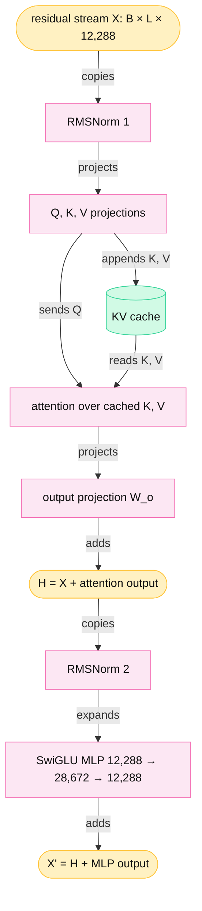
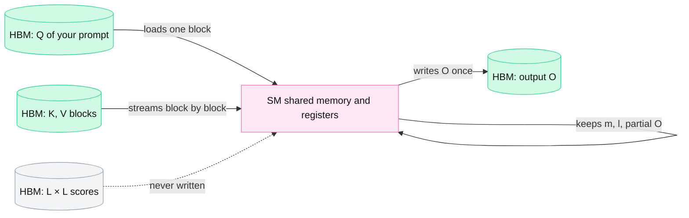
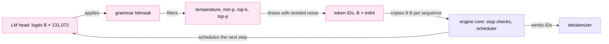

<!-- GENERATED from manuscript/src/part-10-transformer-internals.md by tools/render_manuscript.py. Edit the source, not this file. -->
# Part 10: Transformer internals, one forward pass

One forward pass turns a list of token IDs into one new token ID. The model config fixes the shape of every step.

Your request has passed admission (part 9), and its first pass sits in a prefill batch. This part follows its tokens through one model, in the order the GPU runs the operations:

1. Token IDs become vectors (10.1).
2. Each vector passes through a stack of identical decoder layers (10.2 to 10.8).
3. The last vector becomes one score per vocabulary entry, and a sampler picks a token (10.9).
4. Grammars, the detokenizer, seeds, reasoning and failure guards shape what leaves the GPU (10.10 to 10.14).

`M-dense` (Mistral Medium 3.5) carries the clean shapes. It is a plain dense model with grouped-query attention in every layer [SRC-329]. `M-frontier` (Kimi K3) is the contrast. It has latent attention, linear-attention layers, no positional encoding and a mixture of experts [SRC-380].

Your request actually runs on `M-frontier`. Its pass-1 prompt holds 23,322 tokens (part 5.6). This part uses that length L for the `M-dense` shapes too, so every shape has the size of your request.

---

## 10.1 Token IDs to tensors

The model starts with one table lookup. Each token ID selects one row of the embedding table, and the rows form a tensor `[B, L, d_model]`.

### The real config

Six numbers from `M-dense`'s `config.json` fix every shape in this part [SRC-329]:

| Config field | Symbol | `M-dense` value | `M-frontier` value |
|---|---|---|---|
| `vocab_size` | V | 131,072 | 163,840 |
| `hidden_size` | d_model | 12,288 | 7,168 |
| `num_hidden_layers` | layers | 88 | 93 (69 KDA + 24 MLA) |
| `num_attention_heads` | H | 96 | 96 |
| `num_key_value_heads` | H_kv | 8 | one shared latent (MLA, 10.4) |
| `head_dim` | d_head | 128 | 128 + 64 for keys, 128 for values |
| `intermediate_size` | d_ff | 28,672 | experts of 3,072 (10.8) |

For `M-dense`, H × d_head = 96 × 128 = 12,288, which equals d_model. The MLP widens each vector by 28,672 / 12,288 = 2.333 times.

### From IDs to the embedding tensor

The model server's tokenizer produces the token IDs (part 4.2). On the `M-dense` tokenizer, the first six IDs of your message text are 11,745, 1,395, 2,948, 2,466, 1,051 and 3,463. They spell "Here", " is", " our", " Q", "3" and " report".

Three symbols name the dimensions of every activation tensor:

- **B** is the batch: the number of sequences in this forward pass.
- **L** is the sequence length: the number of tokens of one sequence in this pass.
- **d_model** is the hidden size: the length of the vector that represents one token.

The embedding step runs in three operations:

1. The input is `input_ids` of shape [1, 23,322], one integer per token.
2. For each ID t, the GPU copies row t of the embedding table E, shape [131,072, 12,288].
3. The rows stack into X₀ of shape [1, 23,322, 12,288].

No multiplication happens here. One row holds 12,288 BF16 values, so the GPU reads 24,576 B per token. X₀ for your prompt holds 573 MB. The table itself holds 3.22 GB in BF16 (131,072 × 12,288 × 2 B (BF16)).

During prefill, B = 1 and L = 23,322 for your sequence. vLLM does not pad sequences to one length. It concatenates the tokens of all sequences into one dimension and keeps the boundaries in an array (part 11.5) [flash-attention@94e22c9:flash_attn/flash_attn_interface.py#L1391-L1460]. During decode, each sequence contributes L = 1 token per step.

**Where `M-frontier` differs.** K3 has a larger vocabulary and a smaller d_model, so its table holds 2.35 GB in BF16 (part 4.2). Your photo enters K3 as 15,552 visual embeddings from the vision encoder. They replace one placeholder row before the first layer (part 4.3).

**Meanwhile in the fleet.** The same prefill batch holds other users' prompt tokens, concatenated after yours in the same flat tensor. Each decode sequence on the same GPU adds one token per step. All of them read rows of the same embedding table, which every request shares read-only.

You can now write the embedding output shape for any batch and compute the bytes of one embedding row.

---

## 10.2 The pre-norm decoder layer

Each of the 88 layers runs two sub-blocks, attention and an MLP. Each sub-block adds its result to its input.

### The block in two lines

Let X ∈ ℝ^(B × L × d_model) be the input of one layer. A modern pre-norm decoder layer computes [SRC-063] [SRC-064] [SRC-070]:

```
H  = X + Attention( RMSNorm₁(X) )
X' = H + MLP( RMSNorm₂(H) )
```

The running X is the **residual stream**: the hidden state that flows from layer to layer. Each sub-block reads a normalized copy of the residual stream and adds a correction to it. The residual stream itself never passes through a norm until the final norm after the last layer.



Legend: amber = your request's residual stream; pink = GPU computation; green cylinder = per-request stored state. The one thing to notice: both sub-blocks write into the residual stream by addition. Only attention touches state that outlives the step. The diagram leaves out RoPE and tensor-parallel communication on purpose (10.5, part 12.1).

### What each step does, in order

1. **RMSNorm 1** rescales each token's vector to unit root mean square (10.3).
2. **Q, K, V projections** turn each normalized vector into a query, a key and a value per head (10.4).
3. **RoPE** rotates queries and keys by their position (10.5).
4. **KV append** writes the new keys and values into the KV cache (part 13.2).
5. **Attention** mixes the values of visible tokens, weighted by query-key scores (10.6, 10.7).
6. **Output projection and residual add** bring the result back to d_model and add it to X (10.8).
7. **RMSNorm 2** rescales the new residual stream.
8. **SwiGLU MLP** transforms each token on its own, through a wider hidden layer (10.8).
9. **Residual add** produces X', the input of the next layer.

Only step 5 mixes information between tokens. Every other step treats each token row on its own. So the engine can batch steps 1–4 and 6–9 across all requests as one flat tensor of tokens. Orca named this selective batching [SRC-097].

### Sizes of one layer

One `M-dense` layer holds 1,384,144,896 parameters. Attention holds 24% of them and the MLP holds 76%. The released checkpoint stores the linear weights in FP8 [SRC-329], so one layer's weights take 1.38 GB. All 88 layers plus the embedding, the final norm and the LM head add up to the published parameter count:

| Component | Parameters |
|---|---|
| embedding | 1,610,612,736 |
| attention, all layers | 28,789,702,656 |
| MLP, all layers | 93,012,885,504 |
| norms, all layers | 2,162,688 |
| final norm | 12,288 |
| LM head (not tied to the embedding) | 1,610,612,736 |
| **text model** | **125,025,988,608** |
| vision encoder and projector | 2,678,221,568 |
| **published total** | **127,704,210,176** |

The sum equals the safetensors count of the published model exactly, about 128 billion [SRC-329].

**Meanwhile in the fleet.** Every replica of `M-dense` runs these same layers. At TP=8, each GPU holds and computes one eighth of every weight matrix (part 12.1). Between the sub-blocks, the 8 GPUs exchange partial sums twice per layer.

You can now name the nine steps of one decoder layer and say which one mixes information between tokens.

---

## 10.3 RMSNorm, worked by hand

RMSNorm divides each token's vector by its root mean square and multiplies it by a learned scale. So every sub-block sees inputs of a stable size.

### The equation

For a vector x of length d [SRC-064]:

```
RMS(x) = √( (1/d) · Σᵢ xᵢ² + ε )
yᵢ     = xᵢ / RMS(x) · γᵢ
```

γ is a learned vector of length d. ε is a small constant that prevents a division by zero. `M-dense` sets ε = 1e-05 [SRC-329]. The original paper writes the equation without ε; implementations add it inside the square root [SRC-064].

### A tiny vector

Take x = (1, -2, 2, 4), so d = 4 (illustrative values):

1. Square each entry: 1, 4, 4, 16.
2. Sum the squares: 25.
3. Take the mean: 25 / 4 = 6.25.
4. Add ε and take the square root: RMS = 2.500002. Without ε it is 2.500000, so ε changes the result by 0.00008 %.
5. Divide x by the RMS: (0.4000, -0.8000, 0.8000, 1.6000). The mean of the squares is now 0.999998.
6. Multiply by γ = (1, 0.5, 2, 0.5): 0.4000 x 1 = 0.4000, -0.8000 x 0.5 = -0.4000, 0.8000 x 2 = 1.6000, 1.6000 x 0.5 = 0.8000.

The output is (0.4000, -0.4000, 1.6000, 0.8000). RMSNorm does not subtract the mean and has no bias, unlike LayerNorm. So it costs one reduction (the sum of squares) instead of two.

### The real shape

In `M-dense`, the same arithmetic runs over 12,288 values per token, twice per layer. For your prompt, each RMSNorm reads [1, 23,322, 12,288] and writes the same shape. γ holds 12,288 values per norm. The reduction over d is the step whose order can change with batch size (10.12).

### Why the norm comes first

In a pre-norm layer, the norm sits inside each residual branch: `X + f(RMSNorm(X))`. The residual stream adds up the outputs of all layers without any rescaling in between. Xiong et al. show that this placement keeps gradients well behaved at initialization [SRC-116]. So training needs no learning-rate warm-up stage. The older post-norm placement needs one.

Their analysis concerns LayerNorm. A common design in current open models is the same placement with RMSNorm, and both reference models use it [SRC-329] [SRC-378].

You can now compute an RMSNorm output by hand and explain why it sits inside the residual branch.

---

## 10.4 Q, K and V projections, and what each attention design caches

Three matrix multiplications turn each normalized token vector into queries, keys and values. The number of KV heads decides the bytes each token leaves in the KV cache.

### The projections with real shapes

Let N = RMSNorm₁(X), shape [1, 23,322, 12,288] for your prompt. Then [SRC-063] [SRC-067]:

```
Q = N · W_q    W_q: [12,288, 12,288]   Q: [1, 23,322, 12,288] → reshape [1, 96, 23,322, 128]
K = N · W_k    W_k: [12,288, 1,024]    K: [1, 23,322, 1,024]  → reshape [1, 8, 23,322, 128]
V = N · W_v    W_v: [12,288, 1,024]    V: [1, 23,322, 1,024]  → reshape [1, 8, 23,322, 128]
```

W_k and W_v are 12 times narrower than W_q, because `M-dense` has 8 KV heads for 96 query heads.

**FLOPs.** A matrix product of an `[M, K]` input and a `[K, N]` weight costs 2 × M × K × N FLOPs. For one token (M = 1):

| Projection | FLOPs per token | For your prompt (L = 23,322) |
|---|---|---|
| Q | 2 × 12,288 × 12,288 = 301,989,888 | 7.04 × 10¹² |
| K | 2 × 12,288 × 1,024 = 25,165,824 | 5.87 × 10¹¹ |
| V | same as K = 25,165,824 | 5.87 × 10¹¹ |

These numbers are per layer. At TP=8, each GPU holds a column slice of each matrix: W_q becomes [12,288, 1,536] and W_k becomes [12,288, 128]. So each GPU computes 12 query heads and exactly 1 KV head.

### MHA, GQA and MQA

The three classic designs differ only in how many KV heads serve the query heads [SRC-067] [SRC-068]:

1. **Multi-head attention (MHA)** gives each query head its own K and V head: H_kv = H.
2. **Multi-query attention (MQA)** shares one K and one V head across all query heads: H_kv = 1.
3. **Grouped-query attention (GQA)** splits the query heads into H_kv groups; each group shares one K and V head.

GQA with G groups is MQA when G = 1 and MHA when G = H. In the attention kernel, query head h reads KV head ⌊h / (H/H_kv)⌋ [flash-attention@94e22c9:csrc/flash_attn/src/flash_fwd_kernel.h#L155-L162]. The FLOPs of attention do not change with H_kv. Only the stored bytes and the bytes read per decode step change.

### Why serving cares about the number of KV heads

The KV cache stores K and V of every token in every layer (part 13.1). Its size per token is `2 × layers × H_kv × d_head × bytes`. Fewer KV heads mean fewer bytes per token, so more sequences fit in HBM and each decode step reads less. H_kv also limits tensor parallelism: 8 KV heads give exactly one KV head per GPU at TP=8. Beyond 8 GPUs, KV heads would have to repeat on several GPUs (part 12.1).

### Designs that change what the cache holds

Modern models change the cached tensor itself:

- **Multi-head latent attention (MLA).** The layer projects each token to one compressed latent vector and caches only that latent [SRC-069]. At attention time, learned up-projections rebuild per-head keys and values. At decode, engines can fold those up-projections into W_q and W_o, so attention runs directly on the latents [SRC-069].
- **Sliding-window attention.** Each token attends to at most the last W tokens. So a layer keeps at most W tokens of K and V [SRC-076] [SRC-077].
- **Sparse attention.** A small indexer scores all earlier tokens, and each query attends to only the top k of them [SRC-079]. Every token's KV stays stored, because a later query may select it.
- **Linear attention and state-space layers.** The layer keeps a fixed-size matrix per sequence, the **recurrent state**, and updates it with each token [SRC-081]. The state does not grow with context.

**`M-frontier`'s MLA layer, with real shapes.** For one token in one of K3's 24 MLA layers [SRC-380] [SRC-384]:

| Step | Weight shape | Output | Note |
|---|---|---|---|
| query down-projection | [7,168, 1,536] | [1, 1,536] | then RMSNorm → c_q |
| query up-projection | [1,536, 18,432] | [1, 96, 192] | 128 + 64 dims per head; no rotation (NoPE) |
| KV down-projection | [7,168, 576] | [1, 576] | 512 latent (RMSNorm) + 64 shared key dims: the only per-token tensor the cache stores |
| KV up-projection | [512, 24,576] | [1, 96, 256] | per-head keys and values rebuilt from the latent (or absorbed into W_q and W_o at decode) |
| output projection | [12,288, 7,168] | [1, 7,168] | after a sigmoid output gate |

The cache stores 512 + 64 = 576 values per token per MLA layer, one vector shared by all 96 heads.

**`M-frontier`'s KDA layers.** The other 69 layers use Kimi Delta Attention (KDA), a gated linear-attention layer [SRC-380]. Each keeps a recurrent state of shape [96, 128, 128] in FP32 per sequence, plus a short convolution state [SRC-384]. The update is `S_t = (I − β_t k_t k_tᵀ) Diag(α_t) S_{t−1} + β_t k_t v_tᵀ` [SRC-380]. The state does not grow, so a KDA layer adds nothing per token.

### What each design caches per token

The bytes come from Part 13's KV math (BF16 unless noted):

| Design (example) | What one token adds to the cache | Bytes per token | Fixed bytes per sequence |
|---|---|---|---|
| MHA (`M-dense` with 96 KV heads, hypothetical) | K and V of 96 heads × 88 layers | 4,325,376 | none |
| GQA (`M-dense` as built) | K and V of 8 heads × 88 layers | 360,448 | none |
| MQA (`M-dense` with 1 KV head, hypothetical) | K and V of 1 head × 88 layers | 45,056 | none |
| MLA + KDA hybrid (`M-frontier`) | one 576-value latent × 24 MLA layers; nothing in the 69 KDA layers | 27,648 | 449.4 MB of KDA state |
| MLA + sparse indexer (GLM-5.3) [SRC-315] | latent plus indexer key; queries read only the top 2,048 | 92,628 | none |
| sliding window + global (MiMo-V2.6-Pro) [SRC-344] | K and V in the global layers; sliding layers keep at most 128 tokens | depends on context (part 13.1) | the window of the sliding layers |

Each design changes the KV formula of part 13.1 in one place. MQA and GQA change H_kv. MLA replaces `2 × H_kv × d_head` by the latent width. Sliding windows replace T by `min(T, W)` in their layers. Linear layers replace a per-token term by a constant. Sparse attention changes the bytes read per step, not the bytes stored.

**Meanwhile in the fleet.** On an `M-dense` replica, each decode step of each sequence writes 45,056 B of K and V per GPU. On an `M-frontier` decode worker, the same step writes 27,648 B per sequence. It also overwrites each sequence's KDA state in place.

You can now write the Q, K and V shapes of a GQA layer and compute cached bytes per token.

---

## 10.5 RoPE and long-context scaling

Rotary position embedding (RoPE) rotates pairs of query and key dimensions by an angle that grows with position. So each attention score depends only on the distance between two tokens.

### Pairs and angles

RoPE splits each head vector of length d_head into d_head/2 pairs: dimensions (2i, 2i+1) for i = 0 … 63 [SRC-065]. Pair i turns by the angle `m · θᵢ` at position m, with:

```
θᵢ = base^(−2i / d_head)
```

`M-dense` uses base = 1,000,000 and d_head = 128 [SRC-329]. Some pairs, worked:

| Pair i | θᵢ (radians per token) | Tokens per full turn |
|---|---|---|
| 0 | 1,000,000^(0) = 1 rad/token | 6.2832 |
| 1 | 1,000,000^(-0.015625) = 0.80584 rad/token | 7.797 |
| 31 | 1,000,000^(-0.48438) = 0.0012409 rad/token | 5063.3 |
| 63 | 1,000,000^(-0.98438) = 1.2409e-06 rad/token | 5.0633e+06 |

Low pairs turn fast and distinguish nearby tokens. High pairs turn slowly and distinguish distant tokens. RoPE rotates Q and K only. V keeps no position, because attention uses V only after the scores exist.

### Why the score depends on distance only

Let R_m be the rotation for position m. Then `(R_m q)ᵀ (R_n k) = qᵀ R_mᵀ R_n k = qᵀ R_(n−m) k`, because two rotations combine into one rotation by the difference [SRC-065]. A 2-D toy shows it with q = (2, 1), k = (1, 1) and a toy step of 30° per position:

1. At (m, n) = (2, 1), rotate q by 60°: 2·0.5000 - 1·0.8660 = 0.1340 and 2·0.8660 + 1·0.5000 = 2.2321.
2. Rotate k by 30°: 1·0.8660 - 1·0.5000 = 0.3660 and 1·0.5000 + 1·0.8660 = 1.3660.
3. Take the dot product: 0.1340·0.3660 + 2.2321·1.3660 = 3.0981.
4. At (m, n) = (5, 4), the same distance gives -2.2321·-1.3660 + 0.1340·0.3660 = 3.0981.
5. At (m, n) = (5, 1), a distance of 4 gives -0.6340.

The check over all 64 pairs of an `M-dense` head gives the same result: equal distance, equal score. So a KV cache can store keys already rotated [SRC-065]. A key's rotation depends only on its own position, which never changes.

### YaRN: stretching the frequencies for long context

`M-dense` trained most of its positions within 4,096 tokens and serves up to 262,144: a factor s = 262,144 / 4,096 = 64 [SRC-329]. YaRN changes the frequencies by pair [SRC-066]:

1. Count how many full turns each pair makes within the original 4,096 tokens.
2. Pairs with more than β_fast = 4 turns keep θᵢ. They already see many positions in training.
3. Pairs with fewer than β_slow = 1 turn get θᵢ / s. Their angles at long positions then stay inside the trained range.
4. Pairs in between blend the two, along a linear ramp.

The pair index where a pair makes r turns is `dim(r) = d · ln( L / (r · 2π) ) / (2 · ln base): the pair index whose rotation count over the original context L equals r`. For `M-dense`:

- low cut-off: 128 · ln(4096 / (4 · 2π)) / (2 · ln 1,000,000) = 23.5959 -> floor = 23;
- high cut-off: 128 · ln(4096 / (1 · 2π)) / (2 · ln 1,000,000) = 30.0179 -> ceil = 31.

So pairs 0–23 keep their frequency. Pairs 24–30 blend, and pairs 31–63 turn 64 times slower. Pair 31, for example, goes from θ = 1.241e-03 to 1.939e-05 radians per token. YaRN also scales the attention logits: `0.1 · ln(64) + 1 = 0.1 · 4.15888 + 1 = 1.41589`, applied to both q and k, so every score grows by its square [SRC-066]. Mistral fixed this factor in a config commit. The commit message says the earlier rope values gave worse performance, especially for long context [SRC-330].

YaRN costs nothing at serving time. The engine computes the cos and sin tables once at startup [vllm@v0.31.0:vllm/model_executor/layers/rotary_embedding/base.py#L59-L64]. The kernel reads them in the same way as plain RoPE tables.

### `M-frontier` uses no positional encoding

K3 has no RoPE at all (NoPE) [SRC-380]. Its MLA layers carry 64 extra key dimensions with the name "rope", but nothing rotates them. The KDA layers carry order through their decay and their short convolution. Moonshot reports that this design "extrapolates directly to 1M-token contexts without any positional-encoding modification" [SRC-380]. For serving, NoPE means one rule fewer: cached latents carry no position, and no scaling table exists to configure.

You can now compute a RoPE angle for any pair and position, and say which `M-dense` pairs YaRN changes.

---

## 10.6 Attention, worked by hand

Attention compares each query with the keys it may see and turns the scores into weights. It returns the weighted sum of the values.

### The formula

For one head [SRC-063]:

```
O = softmax( Q Kᵀ / √d_head + M ) V
```

M is the **causal mask**: 0 where key j ≤ query i, and −∞ where j > i. A token cannot attend to future tokens, because during decode those tokens do not exist yet. Prefill processes all prompt positions at once, so the mask enforces the same rule there. Without it, prefill and decode would compute different values for the same prompt.

### A worked example

Four tokens, one head, d_head = 4 (illustrative values). Rows are tokens:

| Row | Q | K | V |
|---|---|---|---|
| 0 | 1, 0, 1, 0 | 1, 1, 0, 0 | 1, 0, 0, 2 |
| 1 | 1, 2, 0, 0 | 0, 1, 1, 0 | 0, 1, 0, 1 |
| 2 | 1, 1, 0, -1 | 1, 0, 0, 1 | 2, 0, 1, 0 |
| 3 | 0.5, -1, 1, 2 | -1, 0, 2, 1 | 0, 0, 2, -1 |

Follow token 3, the last one, through five steps:

1. **Dot products** of q₃ with every key:
   - q₃·k₀ = (0.5)(1) + (-1)(1) + (1)(0) + (2)(0) = -0.5
   - q₃·k₁ = (0.5)(0) + (-1)(1) + (1)(1) + (2)(0) = 0
   - q₃·k₂ = (0.5)(1) + (-1)(0) + (1)(0) + (2)(1) = 2.5
   - q₃·k₃ = (0.5)(-1) + (-1)(0) + (1)(2) + (2)(1) = 3.5
2. **Scale** by 1/√4 = 0.5: (-0.25, 0, 1.25, 1.75).
3. **Mask.** Token 3 may see keys 0 to 3, so its row keeps all four scores. Row 1, for contrast, becomes (1.5000, 1.0000, −∞, −∞).
4. **Softmax** of row 3:
   - subtract the maximum 1.7500: (-2.0000, -1.7500, -0.5000, 0.0000);
   - exponentiate: (0.1353, 0.1738, 0.6065, 1.0000);
   - divide by their sum 1.9156: weights (0.0706, 0.0907, 0.3166, 0.5220).
5. **Weighted sum of values:** 0.0706·v0 + 0.0907·v1 + 0.3166·v2 + 0.5220·v3 = (0.7039, 0.0907, 1.3607, -0.2900).

The full weight matrix, row by row:

| Query | weight on key 0 | key 1 | key 2 | key 3 |
|---|---|---|---|---|
| token 0 | 1.0000 | 0.0000 | 0.0000 | 0.0000 |
| token 1 | 0.6225 | 0.3775 | 0.0000 | 0.0000 |
| token 2 | 0.5065 | 0.3072 | 0.1863 | 0.0000 |
| token 3 | 0.0706 | 0.0907 | 0.3166 | 0.5220 |

Every weight above the diagonal is exactly 0, because e^(−∞) = 0. Every row sums to 1. The scale step matters, because dot products of length-d vectors grow with d. Without the 1/√d factor, the softmax would put almost all weight on one key [SRC-063]. In `M-dense`, d_head = 128.

### Real shapes and FLOPs for one layer

For your prompt in one `M-dense` layer:

| Tensor | Shape |
|---|---|
| Q | [1, 96, 23,322, 128] |
| K, V | [1, 8, 23,322, 128] each |
| scores Q·Kᵀ | [1, 96, 23,322, 23,322] |
| output O | [1, 23,322, 12,288] |

Causal attention computes only the visible (query, key) pairs: 1 × 23,322 × (23,322 + 1) / 2 = 271,969,503 pairs per head. Each pair costs 2 × d_head FLOPs for q·k and 2 × d_head for the weighted value. So one layer costs:

```
4 × H × d_head × pairs = 4 × 96 × 128 × 271,969,503 = 1.34 × 10¹³ FLOPs
```

The linear layers of the same layer cost 6.46 × 10¹³ FLOPs. So attention takes 17% of the layer's compute at this length. Linear FLOPs grow with L; attention FLOPs grow with L². At decode, the new token sees 23,323 keys, and attention costs 1,146,372,096 FLOPs per layer.

**Meanwhile in the fleet.** The varlen kernel computes attention for every sequence of the batch in one launch. Each block of GPU threads reads only keys inside its own sequence's boundaries [flash-attention@94e22c9:csrc/flash_attn/src/block_info.h#L1-L49]. So your queries never meet another user's keys, although both sit in the same flat tensor.

You can now compute an attention output by hand and count one layer's attention FLOPs for a prompt length.

---

## 10.7 FlashAttention: same math, less HBM traffic

FlashAttention computes exactly the same attention output but never writes the L × L score matrix to HBM. So it moves far fewer bytes.

### The math and the GPU implementation are different things

The formula of 10.6 says what to compute. It does not say where the intermediate values live. A direct implementation runs three kernels [SRC-054]:

1. Compute S = QKᵀ and write S to HBM.
2. Read S, compute P = softmax(S), and write P to HBM.
3. Read P and V, compute O = PV, and write O.

For your prompt, one GPU at TP=8 holds 12 query heads. Its S has shape [12, 23,322, 23,322]: heads × L × L × 2 B = 12 × 23,322 × 23,322 × 2 B = 13.1 GB per layer. That is 16% of one H100's HBM, for one layer of one sequence.

### Tiling and the online softmax

FlashAttention splits Q into blocks of B_r rows and K, V into blocks of B_c rows [SRC-054]. FlashAttention-3 uses B_r = 128 and B_c = 128 on Hopper for head_dim 128 with a causal mask [flash-attention@94e22c9:hopper/tile_size.h#L30-L33]. For each query block, one block of GPU threads runs this loop:

1. Load the Q block into on-chip memory once.
2. Load the next K and V block from HBM into shared memory.
3. Compute that block's scores in registers and apply the mask.
4. Update the running row maximum m and row sum l, and rescale the partial output (the online softmax).
5. Add P·V of this block to the partial output.
6. After the last visible block, divide the output by l and write it to HBM once.

The online softmax makes step 4 exact [SRC-084]. A new block can raise the row maximum from m_old to m_new. Then the earlier sum and output shrink by e^(m_old − m_new). Token 3 of the toy, in two blocks of two keys:

| Block | keys | scores | new max | rescale of old values | new sum l | partial output |
|---|---|---|---|---|---|---|
| 0 | 0, 1 | -0.2500, 0.0000 | 0.0000 | (none yet) | 1.7788 | 0.7788, 1.0000, 0.0000, 2.5576 |
| 1 | 2, 3 | 1.2500, 1.7500 | 1.7500 | 0.1738 | 1.9156 | 1.3484, 0.1738, 2.6065, -0.5556 |

Dividing the partial output by l = 1.9156 gives (0.7039, 0.0907, 1.3607, -0.2900), the same row as 10.6. The largest difference from the three-kernel result is 2.2e-16: floating-point rounding, not an approximation. FlashAttention is exact [SRC-054].

### Bytes moved for one real layer

One GPU at TP=8, your pass-1 prompt, BF16, one layer:

| Method | What crosses HBM | Bytes | Time at 3.35 TB/s |
|---|---|---|---|
| three kernels | Q, K, V, O plus S written, S read, P written, P read | 52.4 GB | 15.6 ms |
| tiled, upper bound | Q and O once; each of 183 query blocks reloads its visible K and V | 13.4 GB | 4.0 ms |
| tiled, lower bound | Q, K, V and O once each; the reloads hit the L2 cache | 155 MB | 0.05 ms |

The upper bound is the Θ(N²d²/M) term of the FlashAttention paper's analysis [SRC-054]. The lower bound is realistic here. K and V of this GPU's one KV head take 11.9 MB. They fit in the 50 MB L2 cache of an H100 [SRC-004]. One Q, K and V block together take 98,304 B. That fits in the 228 KB of shared memory of one SM [SRC-004].

The arithmetic does not shrink. The causal FLOPs of this layer are 1.67 × 10¹² per GPU, which take 1.69 ms at the dense BF16 peak. The three-kernel method would spend 9.3 times that long on memory traffic alone. So FlashAttention turns a memory-bound layer into a compute-bound one. It reduces memory traffic, not the attention arithmetic. It does skip key blocks that lie entirely in the future, which a three-kernel method computes and then masks [flash-attention@94e22c9:csrc/flash_attn/src/flash_fwd_kernel.h#L91-L95].



Legend: green = tensors in HBM; pink = on-chip memory of one SM; grey dashed = the tensor the tiled kernel never creates. The one thing to notice: scores live only in registers, one block at a time. The diagram leaves out the warp-level split between loading and computing on purpose.

### At decode

A decode step has one query per sequence. The score row is tiny: 559,752 B per GPU for your context. The kernel must still read every cached key and value: 11.9 MB per layer per GPU. At full HBM bandwidth that read takes 0.0036 ms. So decode attention is bound by the KV read, and tiling helps little there. Kernels split one sequence's keys across several SMs to use the whole GPU (10.12).

### FlashAttention-2, -3 and -4

The versions keep the algorithm and adapt it to each GPU generation:

- **FlashAttention-2** moves non-matmul work out of the inner loop and parallelizes over the sequence length [SRC-055].
- **FlashAttention-3** targets Hopper. It overlaps data movement and softmax with the matrix multiplications through warp specialization, and adds FP8 [SRC-056]. It reaches up to 740 TFLOPS in FP16 on H100, 75% of peak, 1.5–2.0 times faster than FlashAttention-2 [SRC-056].
- **FlashAttention-4** targets Blackwell. It emulates part of the exponentials with polynomials on the FMA units and skips rescaling when the maximum barely changes [SRC-057] [flash-attention@94e22c9:flash_attn/cute/softmax.py#L305-L392]. It reaches up to 1,613 TFLOPS in BF16 on B200, 71% of peak, 1.3 times faster than cuDNN [SRC-057].

vLLM selects FlashAttention-3 on compute capability 9 (Hopper) and FlashAttention-4 on compute capability 10 (Blackwell) [vllm@v0.31.0:vllm/v1/attention/backends/fa_utils.py#L99-L107]. In this reference system, `M-dense` on `H-teach` runs FlashAttention-3, and Blackwell pools run FlashAttention-4. Both use varlen boundaries and a block table (RA-43). `M-frontier`'s MLA layers use MLA kernels instead, because they attend over 576-value latents.

**Meanwhile in the fleet.** While your prefill streams K and V blocks through the SMs, the GPU's decode sequences wait for the next step. With chunked prefill, the scheduler limits how many prompt tokens join each step (part 11.7). So the long attention of your prompt cannot stall other users' token streams for long.

You can now compute one layer's HBM bytes for naive and tiled attention, and explain why the result stays exact.

---

## 10.8 Output projection, residual and the SwiGLU MLP

W_o returns the attention output to d_model, and the result adds to the residual stream. Then a gated MLP widens each token to d_ff and narrows it back.

### Output projection and the first residual add

The attention output of all heads concatenates into [1, 23,322, 12,288]. Then:

```
A = O · W_o     W_o: [12,288, 12,288]    A: [1, 23,322, 12,288]
H = X + A                                                    H: [1, 23,322, 12,288]
```

W_o costs 301,989,888 FLOPs per token. At TP=8, W_o splits by input rows: [1,536, 12,288] per GPU. Each GPU then holds a partial sum of A. An all-reduce adds the 8 partial sums before the residual add (part 12.1).

### SwiGLU

The MLP uses SwiGLU, a gated linear unit with the SiLU activation [SRC-070]. SiLU(a) = a · σ(a), with σ the logistic sigmoid. With N₂ = RMSNorm₂(H):

```
a   = N₂ · W_gate     W_gate: [12,288, 28,672]   a: [1, 23,322, 28,672]
b   = N₂ · W_up       W_up:   [12,288, 28,672]   b: [1, 23,322, 28,672]
g   = SiLU(a)                                         g: same shape as a
h   = g ⊙ b                                           h: [1, 23,322, 28,672]
out = h · W_down      W_down: [28,672, 12,288]   out: [1, 23,322, 12,288]
X'  = H + out
```

The expansion dimension d_ff = 28,672 is 2.33 times d_model. SwiGLU uses three matrices instead of two. So models choose a d_ff below the classic 4 × d_model to keep the parameter count [SRC-070]. In your prompt, a and b each hold 1.34 GB in BF16, the largest activations of the layer. Engines usually merge W_gate and W_up into one matrix. One kernel then applies SiLU and the product, so g never reaches HBM on its own.

Per token, the MLP costs 3 × 2 × 12,288 × 28,672 = 2.11 GFLOP per layer. Attention projections cost 0.65 GFLOP. So the MLP is about three quarters of the weight FLOPs of every layer.

### The full forward pass

After the last layer, a final RMSNorm runs, and the LM head projects the last position to logits (10.9). The totals for your pass-1 prompt and for the first decode step after it:

| | Prefill of 23,322 tokens | One decode token at context 23,323 |
|---|---|---|
| linear layers, all 88 | 5.68 × 10¹⁵ FLOPs | 2.44 × 10¹¹ FLOPs |
| attention, all layers | 1.18 × 10¹⁵ FLOPs | 1.01 × 10¹¹ FLOPs |
| LM head (last position only) | 3.22 × 10⁹ FLOPs | 3.22 × 10⁹ FLOPs |
| **total** | **6.86 × 10¹⁵ FLOPs** | **3.48 × 10¹¹ FLOPs** |
| attention share | 17% | 29% |

The weight FLOPs of one decode token, 2.47 × 10¹¹, match `M-dense`'s recorded 2 × parameters value [SRC-329]. Part 11 turns these FLOPs into time on `H-teach` (11.3, 11.4).

### `M-frontier`'s MoE MLP

K3 replaces the dense MLP in 92 of its 93 layers by a mixture of experts (MoE) [SRC-380]:

1. The **expert router** scores all 896 experts: sigmoid(W_r x), W_r [7,168, 896]; top-16 of 896.
2. A down-projection [7,168, 3,584] maps the token to a 3,584-value latent.
3. Each of the 16 chosen experts runs a small gated MLP on the latent: 3 × 3,584 × 3,072 = 33,030,144 parameters each.
4. The router weights add the expert outputs, and an up-projection [3,584, 7,168] returns to d_model.
5. 2 shared experts run for every token and add their outputs.

The routed experts hold 33,030,144 × 896 × 92 = 2,722,740,830,208 parameters, which matches the checkpoint [SRC-378]. Each token uses 1.8% of them. Over the whole model, a token touches 104.2 billion of 2.78 trillion parameters (3.7%). So K3 computes far fewer FLOPs per token than its size suggests. But every expert must sit in some GPU's HBM. Part 12.4 shows how expert parallelism spreads them.

**Meanwhile in the fleet.** On an `M-frontier` decode worker, each token of each sequence goes to a different set of 16 experts. The tokens of one batch scatter across the GPUs of the worker and come back, twice per MoE layer. Your token shares those all-to-all messages with every other sequence in the batch.

You can now write the SwiGLU MLP shapes and compute the total FLOPs of one `M-dense` forward pass.

---

## 10.9 Layers to logits to a token

After the last layer, the LM head turns one vector into one score per vocabulary entry. The sampler turns the scores into one token ID.

### Final norm and LM head

The last layer's output passes through the final RMSNorm. The LM head then computes `logits = h · W_vocab`, with W_vocab of shape [12,288, 131,072]. The result has 131,072 entries, one per token of the vocabulary.

Only the last position predicts the next token. So vLLM runs the LM head only on the hidden state of each sequence's last position [vllm@v0.31.0:vllm/v1/worker/gpu_model_runner.py#L2225-L2234]. For your sequence: [1, 1, 12,288] → [1, 1, 131,072]. One row of logits in FP32 takes 524,288 B. For a decode batch of B sequences, the logits tensor has shape [B, 131,072].

**Weight tying.** Some models reuse the embedding table as W_vocab (W_vocab = Eᵀ). Neither reference model does: `tie_word_embeddings` is false in both configs [SRC-329] [SRC-378]. So `M-dense` stores a second 1,610,612,736-parameter matrix.

### From logits to a token, worked

Take a toy vocabulary of 8 tokens after the illustrative text "The scheduler frees the":

| Token | ` the` | ` a` | ` KV` | ` cache` | ` GPU` | `.` | `,` | ` block` |
|---|---|---|---|---|---|---|---|---|
| logit | -1 | 1 | 3 | 2.5 | 1.5 | -2 | -1.5 | 2 |
| ÷ T = 0.7 | -1.4286 | 1.4286 | 4.2857 | 3.5714 | 2.1429 | -2.8571 | -2.1429 | 2.8571 |
| softmax | 0.0017 | 0.0301 | 0.5237 | 0.2564 | 0.0614 | 0.0004 | 0.0008 | 0.1255 |

The five methods, in the order vLLM applies them [vllm@v0.31.0:vllm/v1/sample/sampler.py]:

1. **Greedy decoding** takes the argmax of the logits: ` KV`. Temperature does not change the argmax. vLLM treats a temperature below 1e-05 as greedy.
2. **Temperature** T divides the logits before the softmax [SRC-112]. T < 1 sharpens the distribution, T > 1 flattens it. The table uses T = 0.7.
3. **Min-p** keeps tokens whose probability is at least min_p × the largest probability [SRC-113]. With min_p = 0.1, the threshold is 0.0524. It keeps ` KV,  cache,  GPU,  block`.
4. **Top-k** keeps the k most probable tokens. With k = 3, it keeps ` KV,  cache,  block`.
5. **Top-p** keeps the smallest set whose probability reaches p [SRC-112]. With p = 0.9, the ascending cumulative sums are 0.1386, 0.4217 and 1.0000. No entry is at or below 1 − p, so all three stay.

After the filters, the sampler renormalizes: ` KV` 0.5783, ` cache` 0.2831, ` block` 0.1386. Then it draws one token.

vLLM's Model Runner V2 uses the Gumbel-max rule. It adds noise g = −ln(−ln u) to each surviving scaled logit and takes the argmax [vllm@v0.31.0:vllm/v1/worker/gpu/sample/gumbel.py#L165-L205]. This picks each token with exactly its renormalized probability. With the toy seed 2, the draw for ` cache` gives u = 0.7479, -ln(-ln 0.7479) = 1.2361, and a score of 4.8075. That score is the largest, so the sampler picks ` cache`, not the greedy choice.

The order matters. Top-p before temperature would keep ` KV,  cache,  GPU,  block`; after it, the set is ` KV,  cache,  block`. Top-k keeps the same set at any temperature, because division by T keeps the ranking. Later work contests min-p's quality claims, so it appears here only as a definition that libraries adopt [SRC-120].

### The real scale

For `M-dense`, the same steps run over 131,072 logits per sequence per step. An illustrative batch of 256 decode sequences produces 134 MB of FP32 logits per step. Top-k and top-p need a sort or a selection over each row. So the sampler runs as GPU kernels next to the LM head (10.12).

**Meanwhile in the fleet.** Each sequence in a decode batch carries its own sampling settings. One user asks for greedy decoding, another for T = 1 with top-p. The sampler applies per-row temperatures, thresholds and seeds in the same kernels, so one batch serves both [vllm@v0.31.0:vllm/v1/sample/sampler.py].

You can now apply temperature, min-p, top-k and top-p to logits and say which tokens survive each filter.

---

## 10.10 Structured output and constrained decoding

Constrained decoding sets the logit of every token that would break a grammar to −∞ before sampling. So the output is valid by construction.

### Why a mask beats "please return JSON"

An instruction in the prompt changes the probabilities. It does not remove the invalid tokens. Over hundreds of tokens, a small chance per token of a stray quote or a missing brace adds up. A grammar bitmask makes the probability of an invalid token exactly 0 at every step. So the output always parses, whatever the model's probabilities [SRC-092].

Part 6.1 shows the mask step by step on a tool argument. This section covers the general case.

### JSON-schema response formats

An OpenAI-compatible API accepts a schema for the whole answer [vllm@v0.31.0:docs/features/structured_outputs.md#L88-L130]:

```json
"response_format": {
  "type": "json_schema",
  "json_schema": { "name": "margins", "schema": { "type": "object", "properties": { … } } }
}
```

vLLM also accepts five structured-output parameters: `choice`, `regex`, `json`, `grammar` and `structural_tag` [vllm@v0.31.0:docs/features/structured_outputs.md#L20-L33]. The engine compiles each into one automaton:

1. A JSON schema becomes a context-free grammar over characters.
2. The backend compiles the grammar into a pushdown automaton and precomputes masks for token classes [SRC-092].
3. At each step, the automaton state decides which vocabulary tokens may come next.
4. After sampling, the chosen token advances the state.

With a reasoning model, the grammar starts only after the reasoning ends [vllm@v0.31.0:vllm/v1/structured_output/__init__.py#L236-L259]. The reasoning stays free text; the answer obeys the schema [vllm@v0.31.0:docs/features/structured_outputs.md#L170-L180].

### Grammar backends in vLLM

vLLM ships five backends: `auto` (the default), `xgrammar`, `guidance`, `outlines` and `lm-format-enforcer` [vllm@v0.31.0:vllm/config/structured_outputs.py#L11-L23]. Under `auto`, vLLM tries XGrammar first and falls back when XGrammar cannot compile the schema [vllm@v0.31.0:vllm/sampling_params.py#L1281-L1340]. The two main engines work differently:

- **XGrammar** compiles the grammar to a pushdown automaton. At each automaton node, it splits the vocabulary in two [SRC-092]. It decides one group in advance; the other group needs the full stack. For Llama 3.1 with a JSON grammar, only 1,134 tokens of a 128k vocabulary need the check per step [SRC-092].
- **llguidance** (the `guidance` backend) runs an Earley parser over a lexer built from regular-expression derivatives. It computes the mask by walking a trie of the vocabulary [SRC-094].

### Cost per step

The mask runs on the CPU between GPU steps (part 6.1). Its published costs:

| Backend | Mask time per token | Conditions |
|---|---|---|
| XGrammar | under 40 µs for JSON Schema; under 200 µs for XML and a Python DSL | Llama-3.1-8B tokenizer, one desktop CPU [SRC-092] |
| llguidance | about 50 µs of one CPU core | a 128k-token vocabulary [SRC-094] |
| llguidance, a full mask | about 1.5 ms | a typical JSON schema, worst-case steps [SRC-094] |

Compare these with one decode step. Your request's decode step lasts 47.2 ms at the fleet design point (part 14.2). A 40 µs mask is 0.08% of that step. The bitmask for `M-dense` needs `ceil(131072 / 32) = 4096 words × 4 B = 16384 B per sequence per step` (part 6.1). The risks are elsewhere: compile time for a new schema, and a slow mask that delays the whole batch.

### What can go wrong

Constrained decoding guarantees syntax, not meaning:

1. **Valid but wrong.** The JSON parses, but a value is false. Only the application can check meaning.
2. **Forced low-probability tokens.** The mask can force a token the model ranked low. The text after it can drift, because the model never planned that token.
3. **Truncation.** If the stream reaches `max_tokens` inside the JSON, the output stops mid-object. The grammar cannot close it (10.14).
4. **Unsupported schema features.** A backend may not compile some JSON Schema keywords. vLLM then falls back to another backend or rejects the request [vllm@v0.31.0:vllm/sampling_params.py#L1281-L1340].
5. **Compile stalls.** The scheduler skips a request until its grammar compiles (part 6.1). A large, new schema adds that wait to TTFT.
6. **Whitespace loops.** Many schemas allow any whitespace between fields, so a model can emit spaces until the length limit. vLLM's `disable_any_whitespace` option forbids it on the XGrammar and guidance backends [vllm@v0.31.0:vllm/config/structured_outputs.py#L26-L30].

In this reference system, tool calls decode under vLLM's structural-tag grammar at `--tool-strict-level parameter` (RA-65). The orchestrator validates every call against its schema. The same rule applies to JSON answers: the grammar guarantees syntax, and the orchestrator checks the schema.

**Meanwhile in the fleet.** In one decode batch, some sequences carry a grammar and most carry none. The engine core fills mask rows only for the constrained ones [vllm@v0.31.0:vllm/v1/structured_output/__init__.py#L314-L348]. All of them wait for the slowest row, because the GPU step starts only after every row is ready.

You can now explain why a grammar bitmask guarantees valid syntax and list what it still cannot guarantee.

---

## 10.11 Detokenization and partial UTF-8

The detokenizer turns token IDs back into bytes and the bytes into text. It holds back bytes that do not yet form a complete character.

### From an ID to text

Detokenization runs four steps per token:

1. Look up the token's piece in the vocabulary: a byte string.
2. Append the bytes to the sequence's output bytes.
3. Decode the bytes as UTF-8.
4. Send only the new, complete characters to the stream.

A piece can be a whole word with its leading space, a prefix, a suffix, punctuation, or raw bytes. Both reference tokenizers use byte-level BPE (part 4.2), so any byte sequence has some token representation [SRC-329] [SRC-378].

### UTF-8 in one table

UTF-8 encodes one character in 1 to 4 bytes [SRC-118]. The first byte's high bits say how many bytes follow:

| First byte | Character length | Continuation bytes |
|---|---|---|
| `0xxxxxxx` | 1 byte | none |
| `110xxxxx` | 2 bytes | 1 × `10xxxxxx` |
| `1110xxxx` | 3 bytes | 2 × `10xxxxxx` |
| `11110xxx` | 4 bytes | 3 × `10xxxxxx` |

The chart emoji 📈 is U+1F4C8. Its bytes are `F0 9F 93 88`:

| Byte | Bits | Role |
|---|---|---|
| F0 | `11110000` | lead byte of a 4-byte character (11110xxx) |
| 9F | `10011111` | continuation byte (10xxxxxx) |
| 93 | `10010011` | continuation byte (10xxxxxx) |
| 88 | `10001000` | continuation byte (10xxxxxx) |

### A character split across tokens, on the real tokenizer

Suppose pass 3 of your request writes a chart caption that ends in an emoji. The illustrative text is " Margin by competitor 📈". On `M-frontier`'s real tokenizer, it becomes 5 tokens: `␣Margin·␣by·␣competitor·<20><F0><9F><93>·<88>`. 2 of them are not complete characters. On `M-dense`'s tokenizer, the same text gives `␣Margin·␣by·␣competitor·<20><F0><9F>·<93>·<88>`, with 3 partial tokens.

K3's tokenizer is a Python tiktoken class, not a Hugging Face fast tokenizer. So vLLM runs its Python incremental detokenizer, `detokenize_incrementally`, for K3 [vllm@v0.31.0:vllm/v1/engine/detokenizer.py#L50-L66] [vllm@v0.31.0:vllm/tokenizers/registry.py#L59]. It keeps two offsets into the token list per sequence [SRC-115]:

1. `prefix_offset` marks the start of a short window of earlier tokens.
2. `read_offset` marks the end of the text already sent.
3. It decodes the window up to `read_offset` (the prefix text) and the window with the new token (the new text).
4. If the new text ends in U+FFFD, the replacement character, it sends nothing and keeps both offsets.
5. Otherwise, it sends the new text minus the prefix text and moves both offsets forward.

K3's tokenizer decodes bytes with `errors="replace"`, so an incomplete sequence at the end becomes U+FFFD [SRC-378]. The replay of the five tokens, after the illustrative prompt "Chart caption:" (the first window starts 5 tokens back [vllm@v0.31.0:vllm/tokenizers/detokenizer_utils.py#L59]):

| Step | Token ID | Bytes | Piece | New text (window) | Ends in U+FFFD | Sent to the stream |
|---|---|---|---|---|---|---|
| 1 | 116,389 | `20 4D 61 72 67 69 6E` | `␣Margin` | `Chart␣caption:␣Margin` | False | `␣Margin` |
| 2 | 673 | `20 62 79` | `␣by` | `␣Margin␣by` | False | `␣by` |
| 3 | 60,896 | `20 63 6F 6D 70 65 74 69 74 6F 72` | `␣competitor` | `␣by␣competitor` | False | `␣competitor` |
| 4 | 131,100 | `20 F0 9F 93` | `<20><F0><9F><93>` | `␣competitor␣�` | True | (nothing) |
| 5 | 230 | `88` | `<88>` | `␣competitor␣📈` | False | `␣📈` |

At step 4, the token carries a space and the first three bytes of the emoji. The decoded window ends in U+FFFD, so the detokenizer holds the step. At step 5, the last byte arrives, and the space and the emoji leave together. The client never sees a broken character.

The code comment states the rule. A U+FFFD at the end is "a potential unfinished byte sequence" [SRC-115]. One in the middle "is probably a real invalid id generated by the model" [SRC-115].

The prefix window exists for a second reason. Some tokenizers add a space or not, depending on the surrounding IDs [SRC-115]. So one token decoded alone can give a different string. Hugging Face fast tokenizers take another path, the `DecodeStream` of the tokenizers library, with the same outcome [vllm@v0.31.0:vllm/v1/engine/detokenizer.py#L166-L247].

### Why streams group pieces

Three effects make the stream differ from "one token, one chunk":

1. A held step sends nothing, and the next step sends two tokens' worth of text.
2. Stop strings (part 11.9) force the server to hold text that might be the start of a stop string.
3. Tool-call parsing holds text that might belong to a call (part 6.1).

**Meanwhile in the fleet.** The detokenizer runs on the CPU in the front-end process of the model server, once per sequence per step [vllm@v0.31.0:vllm/v1/engine/detokenizer.py#L50-L66]. It never touches the GPU. Thousands of sequences per replica each keep their own offsets and pieces, and the server streams only their text deltas.

You can now explain why a streamed chunk can be empty, and trace a multi-byte character through the incremental detokenizer.

---

## 10.12 Where sampling runs, seeds, and batch-dependent nondeterminism

The sampler runs on the GPU and sends only token IDs to the CPU. A seed fixes its random draws, but the logits can still change with the batch.

### GPU, CPU or mixed sampling

Three placements are possible, and they move different amounts of data per step:

| Placement | What crosses PCIe per sequence per step | Per step for 256 `M-dense` sequences (illustrative) |
|---|---|---|
| CPU sampling | the full FP32 logit row, 524,288 B | 256 × 131,072 logits × 4 B (FP32) = 134 MB |
| mixed (GPU top-k, CPU draw) | k candidate IDs and their probabilities | 256 × 50 × (4 B ID + 4 B probability) = 102,400 B |
| GPU sampling | one token ID, 8 B | 256 × 8 B (int64 token ID) = 2,048 B |

vLLM samples on the GPU right after the LM head. In Model Runner V2, the sampled IDs are `int64` tensors [vllm@v0.31.0:vllm/v1/worker/gpu/sample/gumbel.py#L378-L381]. A non-blocking copy moves them to the CPU [vllm@v0.31.0:vllm/v1/worker/gpu/async_utils.py#L264-L265]. The older V1 sampler converts its IDs to `int32` [vllm@v0.31.0:vllm/v1/sample/sampler.py#L139-L140]. Even vLLM's older sampler avoids `torch.multinomial`, because that call forces a CPU-GPU synchronization [vllm@v0.31.0:vllm/v1/sample/ops/topk_topp_sampler.py#L544-L566]. In this reference system, sampling runs on the GPU and only token IDs reach the CPU (RA-44).



Legend: pink = GPU kernels; violet = CPU processes. The one thing to notice: the full logits never leave the GPU; only 8 bytes per sequence do. The diagram leaves out the grammar's CPU side (part 6.1) and logprob requests on purpose.

### Seeds

A seed fixes the random draws of the sampler. In Model Runner V2, every request gets a 64-bit seed: the user's `seed`, or a random one [vllm@v0.31.0:vllm/v1/worker/gpu/sample/states.py#L54-L58]. The Gumbel noise for a token comes from a counter-based hash of (seed, position, token ID) [vllm@v0.31.0:vllm/v1/worker/gpu/sample/gumbel.py#L98-L109]. So your request's noise never depends on the batch size or on your row in the batch. In this reference system, each request carries its own seed with this counter-based RNG (RA-44).

A seed fixes the noise, not the logits. If the logits change in the last bit, the same noise can pick a different token.

### Why the logits depend on the batch

Floating-point addition is not associative: (a + b) + c can differ from a + (b + c) in the last bits. Take the eight numbers 0.1, 0.7, 0.3, 0.9, 0.2, 0.6, 0.4, 0.8, whose exact sum is 4. In float32:

- one pass from left to right gives 4.0000005;
- two chunks of four, then their sum, gives 4.0000000.

The two results differ by 1 unit in the last place. In BF16 the same reordering moves the result by 0.03125.

Kernels choose their reduction order from the batch shape [SRC-085]:

1. A matrix kernel splits a long sum across cores (split-K) when the batch is too small to fill the GPU.
2. The attention kernel picks the number of KV splits from the batch size, the heads and the SM count [flash-attention@94e22c9:hopper/heuristics.h#L15-L56].
3. RMSNorm may split its reduction when the batch is small.

So your logits depend on how many other sequences share your step. A toy LM head shows the effect on a near-tie. At batch size 1, greedy decoding picks ` New`. At batch size 8, it picks ` Queens`. The other 7 rows never enter your sum. Only their number changes the kernel's plan.

The effect is real at scale. Thinking Machines Lab sampled 1,000 completions of one prompt at temperature 0 on Qwen3-235B. They got 80 different completions, which first diverged at token 103 [SRC-085]. The cause is not atomic additions: a forward pass with a fixed batch is deterministic from run to run [SRC-085].

### Batch-invariant kernels and their cost

A batch-invariant kernel uses one reduction order for every batch size. vLLM offers this with `VLLM_BATCH_INVARIANT=1`, off by default [vllm@v0.31.0:vllm/envs.py#L94] [SRC-090]. The mode replaces matmul, softmax, mean and RMSNorm with kernels of a fixed reduction order. It also passes one KV split to FlashAttention [vllm@v0.31.0:vllm/v1/attention/backends/flash_attn.py#L1785]. The docs call the feature beta and say it "may impact performance" [SRC-090].

Measured costs, with their conditions:

- Thinking Machines Lab ran 1,000 sequences of Qwen-3-8B on one GPU [SRC-085]. vLLM took 26 s by default and 55 s with unoptimized invariant kernels. With a better attention kernel it took 42 s.
- SGLang's deterministic mode: an average slowdown of 34.35% on Qwen3-8B, one H200 [SRC-091].

The cost comes from the fixed plan. At small batches it leaves cores idle that split-K would have used. SGLang reports deterministic output at tensor-parallel degrees 1 and 2; larger degrees need changes to the reduction [SRC-091]. In this reference system, batch-invariant mode stays off, so logits can depend on the batch (RA-44). Whether a real provider runs batch-invariant kernels is not public.

**Meanwhile in the fleet.** Other users' requests join and leave your decode batch at every scheduler iteration. Each change of batch size can change the kernels' reduction plans. Those users never see your data, but their presence can change your bits.

You can now explain why one prompt with one seed can give different text, and what batch invariance costs.

---

## 10.13 Reasoning models: what changes in serving

A reasoning model writes hidden tokens before its visible answer. So each request decodes more tokens, holds its KV cache longer and costs more.

### What a reasoning model emits

`M-frontier` always opens a reasoning channel: its generation prefix ends with `<|open|>think<|sep|>` (part 5.6) [SRC-378]. The model writes reasoning tokens, closes the channel, and writes the visible response or a tool call. K3 supports the effort levels low, high, max [SRC-380]. `M-dense` offers none, high [SRC-329].

For the engine, a reasoning token is an output token like any other. Each one costs one decode step, writes one token of KV in every attention layer, and needs one sampling step. vLLM's reasoning parser splits the stream into a `reasoning` field and a `content` field after detokenization [vllm@v0.31.0:docs/features/reasoning_outputs.md#L1-L12]. The GPU does not know the difference.

### Hidden or summarized

What the client sees of the reasoning varies by provider. OpenAI's API does not expose raw reasoning tokens; it offers an opt-in reasoning summary [SRC-560]. The reasoning tokens still occupy the context window, and OpenAI bills them as output tokens [SRC-560].

How a given chat product displays reasoning is not public. Two realistic options are a generated summary or a status line only. Here we use a status line (RA-72). The orchestrator sends a reasoning-status event and keeps the raw reasoning on the server.

### Your request's reasoning, pass by pass

The reasoning token counts are hypothetical. The output counts come from part 5.6:

| Pass | Reasoning tokens | All output tokens | Reasoning share | `max_tokens` left after reasoning | KV added by reasoning (`M-frontier`, BF16) | Reasoning time at 47.2 ms per token |
|---|---|---|---|---|---|---|
| 1 | 300 | 424 | 71% | 3,796 | 8.3 MB | 14.2 s |
| 2 | 200 | 440 | 45% | 3,896 | 5.5 MB | 9.4 s |
| 3 | 400 | 863 | 46% | 3,696 | 11.1 MB | 18.9 s |

Over the three passes, reasoning makes up 900 of 1,727 output tokens: 52%. At your request's decode step of 47.2 ms (part 14.2), they add 42.5 s of decode time. At the p95 TPOT target of 60 ms, they would add 54 s. The outputs of passes 1 and 2 stay in the context of later passes (part 5.6). So at the end of pass 3, reasoning holds 24.9 MB of `M-frontier` MLA cache. On `M-dense`, the same tokens would hold 324 MB.

### Output limits for reasoning

In this reference system, `max_tokens` covers reasoning tokens as well as visible tokens (RA-60). The rate limiter reserves `prompt_tokens + max_tokens` for every pass (part 3.2). OpenAI's API has the same rule: `max_output_tokens` limits "the total number of tokens the model generates, including reasoning tokens" [SRC-560]. When the limit hits, the response ends as incomplete, possibly before any visible token [SRC-560]. OpenAI recommends reserving at least 25,000 tokens for reasoning and output at first [SRC-560].

vLLM can cap the reasoning part alone. The sampling parameter `thinking_token_budget` makes the engine force the end-of-reasoning marker once the count reaches the budget [vllm@v0.31.0:docs/features/reasoning_outputs.md#L252-L262]. Without it, only `max_tokens` limits reasoning.

The worst case is a pass whose reasoning never ends. With `max_tokens` = 4,096, such a pass decodes 9.7 times the planned output of pass 1. At your decode step that takes 193 s, more than the 40 s deadline of pass 1 (part 17.1). So the deadline stops the pass first, after at most 847 tokens. Without that deadline, the pass would hold 113 MB of extra MLA cache and end with finish reason `length`. Either way, the user gets no visible answer.

### Tool calls, iteration and test-time compute

A reasoning model can call tools in the middle of its work. Your request does: pass 1 reasons and calls `web_search`, and pass 2 reasons and calls `run_python` (part 6.2). Each call ends one inference pass and starts another. Each new pass prefills only the new tokens when the prefix cache still holds the earlier ones (part 13.3).

**Test-time compute** is the general idea: spend more inference FLOPs per request to get a better answer. Reasoning tokens, several sampled answers and tool loops all spend it. K3's training caps the reasoning length with a token threshold per task [SRC-380]. For agentic tasks it counts reasoning and tool-call arguments together.

### What it changes in the system

1. **GPU occupancy and cost.** Each reasoning token holds a decode slot and KV blocks for one more step.
2. **Latency.** The first visible text waits for the whole reasoning phase. TTFT does not, because it ends at the first reasoning token. The client sees a status, not tokens, during that time.
3. **Scheduling priority.** A long reasoning request competes with short chat requests in the same decode batch. How real providers prioritize them is not public. Two realistic options are a separate pool for high-effort requests or one pool with priority bands. Here we use the priority bands of admission control (RA-41, RA-72), with no separate pool.
4. **TPM reservation.** The TPM reservation includes the reasoning (RA-60), so a high-effort request reserves more of the tenant's quota.

**Meanwhile in the fleet.** During your pass 1, the decode batch holds sequences in every phase: reasoning, visible answers, tool calls. The scheduler treats them all as decode sequences. Only the orchestrator knows which tokens the user will see.

You can now compute the tokens, KV bytes and seconds that reasoning adds, and explain why `max_tokens` covers it.

---

## 10.14 Generation failure modes and their system mitigations

Generation fails in a few known ways. Each has a mitigation outside the model: a limit, a stop rule, a check, or a retry.

### The failures

| Failure | What happens in the token stream | First system signal |
|---|---|---|
| hallucination | fluent text states a false fact or cites a missing source | citation validator, groundedness checks (part 7.7) |
| repetition loop | the same token pattern repeats until a limit | repeated n-grams in the output IDs |
| runaway length | reasoning or text never reaches a stop token | `max_tokens` reached, finish reason `length` |
| premature EOS | the model emits its stop token before the answer is complete | a very short answer, a missing required field |
| context overflow | prompt plus `max_tokens` exceeds the context window | the request fails the length check before prefill |
| truncation at `max_tokens` | the stream stops inside a sentence or a JSON object | finish reason `length` |
| malformed tool call | a call names an unknown tool or has invalid arguments | the tool-call parser or schema validation rejects it |
| sampling instability | high temperature or a wide top-p picks a rare token, and the text drifts after it | low token probabilities, if logprobs are logged |

### Mitigations, one by one

**Stop conditions.** vLLM ends a sequence on the end-of-sequence token, on a stop token ID, at `max_tokens` or at the maximum length [vllm@v0.31.0:vllm/v1/core/sched/utils.py#L98-L138]. Stop strings run on detokenized text in the front-end process (part 11.9). For `M-frontier`, `<|end_of_msg|>` ends every message (part 6.1).

**`max_tokens`.** Every pass carries `max_tokens` = 4,096 by default (RA-60, hypothetical). It bounds runaway length, the KV blocks a sequence can claim, and the tenant's reservation (part 3.2). A pass that ends with finish reason `length` is incomplete. In this reference system, the orchestrator marks such an answer as truncated (RA-72). It never runs a truncated tool call.

**Repetition guards.** Two mechanisms exist. Penalties change the logits: `presence_penalty`, `frequency_penalty` and `repetition_penalty` lower the scores of tokens already present [vllm@v0.31.0:vllm/sampling_params.py#L236-L247]. Holtzman et al. show that decoding which maximizes likelihood tends toward repetitive text [SRC-112]. Detection stops the sequence: `repetition_detection` looks for an n-gram that repeats `min_count` times at the end of the output [vllm@v0.31.0:vllm/v1/core/sched/utils.py#L10-L64].

Penalties also punish legitimate repeats, such as a key name in JSON. So this reference system leaves penalties at their defaults and uses detection (RA-72). Its settings are hypothetical: `max_pattern_size` = 64, `min_pattern_size` = 8, `min_count` = 6.

A worked loop on `M-frontier`'s real tokenizer (illustrative text): the model writes "Birchline has the highest list price." (10 tokens). Then it repeats " The margin is highest for Birchline." (8 tokens) over and over. The check runs after every token:

1. For each pattern length from 8 to 64, it compares the last pattern with the 5 patterns before it.
2. At output token 57, the last 8 tokens have appeared 6 times in a row.
3. The engine ends the sequence with finish reason `repetition` and frees its KV blocks.

The guard saves 4,039 of the 4,096 tokens the loop could have consumed. Five identical copies do not trigger it, so a table with five equal rows passes.

**Schema validation and constrained decoding.** In this reference system, the grammar bitmask removes syntax errors and unknown tool names (10.10, RA-65). The orchestrator still validates every call and every JSON answer against its schema (part 6.2). The grammar does not check meaning or required keys.

**Retries.** In this reference system, a pass that fails validation runs again, with the validation error appended as a tool result. The limit is 1 regeneration per pass (hypothetical). A second failure returns an error to the client. This regeneration is separate from transport retries (RA-12), and it counts against the tool-loop limit (part 6.2).

**Premature EOS.** vLLM's `min_tokens` forbids the end-of-sequence and stop tokens until a minimum count [vllm@v0.31.0:vllm/sampling_params.py#L278-L280]. A fixed minimum suits few answers, so this reference system relies on validation instead (RA-72). A JSON answer that stops early misses required fields, fails the schema and runs once more.

**Context checks.** The orchestrator trims or compacts the context before each pass, so `prompt_tokens + max_tokens` fits the context window (part 5.7). The model server rejects any request that still exceeds it, before prefill [vllm@v0.31.0:vllm/v1/engine/input_processor.py#L508-L543].

**Sampling settings.** Agentic and tool-calling passes use moderate settings, because a rare token inside a call can break it. Which settings real assistants use is not public. Two realistic options are the model publisher's recommended values or lower temperatures for tool passes. Here we use the publisher's values (RA-72). K3's report evaluates at temperature 1.0 with top-p 0.95 or 1.0 [SRC-380].

**Hallucination.** No decoding rule detects a false fact. The mitigations sit in the system. Retrieval supplies sources with source IDs (part 5). A citation validator rejects claims without a matching source (part 7.7). Tools compute numbers instead of the model (part 8).

**Meanwhile in the fleet.** Across a region, finish reasons form a counter: vLLM exports `finished_reason` as a dimension of `vllm:request_success` [vllm@v0.31.0:vllm/v1/engine/__init__.py#L48-L66]. A rise in `length` or `repetition` after a model or prompt change is an early alarm. The rollout system can then stop a canary (part 19).

You can now name the failure modes of generation and the system mitigation that limits each one.

---

## What Part 10 established

One forward pass is a fixed sequence of shaped matrix multiplications. The system around it decides which tokens may appear, how bytes become text, and when generation stops.
