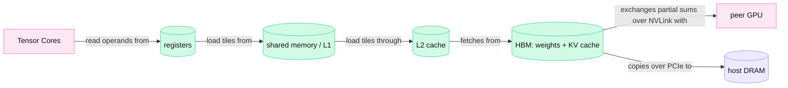
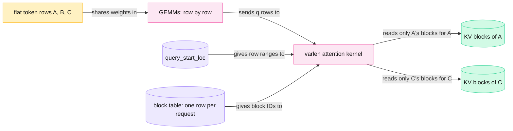
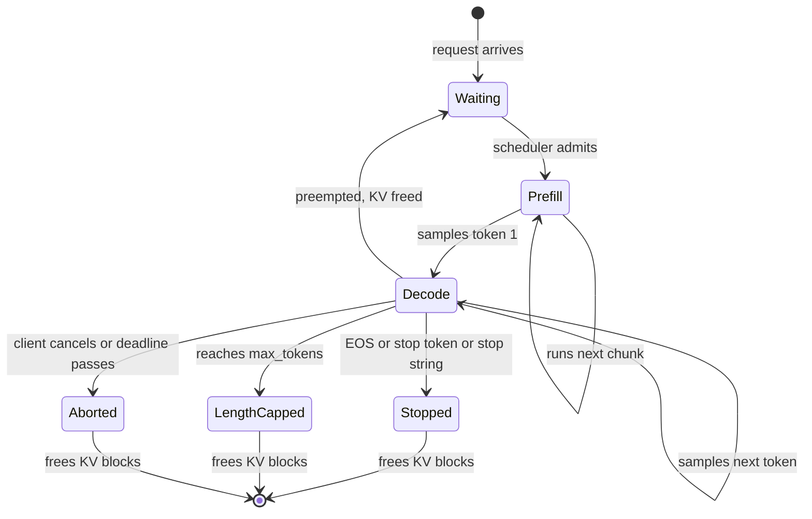

<!-- GENERATED from manuscript/src/part-11-gpu-execution-and-batching.md by tools/render_manuscript.py. Edit the source, not this file. -->
# Part 11: GPU execution and batching

A GPU runs your request fast only when many requests share each read of the weights. The scheduler builds that shared batch again at every step.

Your request has passed admission (part 9). Its prompt tokens wait in the engine's queue. Part 10 showed the math of one forward pass. This part shows how a GPU runs that math, and why batching decides almost everything. It follows twelve steps:

1. What the GPU contains, and where data lives (11.1).
2. How one matrix multiplication runs on it (11.2).
3. Why prefill and decode behave so differently (11.3).
4. How arithmetic intensity places each one on the roofline (11.4).
5. How continuous batching keeps the batch full, and keeps users apart (11.5).
6. How the token budget fills one step (11.6).
7. How chunked prefill splits a long prompt (11.7).
8. A real decode batch of 64 sequences through one layer (11.8).
9. The output token loop and its stop conditions (11.9).
10. Speculative decoding (11.10).
11. CUDA Graphs and kernel fusion (11.11).
12. Why utilization is the wrong goal (11.12).

`M-dense` on `H-teach` carries the numbers you can check by hand. `M-dense` is Mistral Medium 3.5: 88 layers, hidden size 12288. `H-teach` is one node of 8 × H100 SXM. `M-dense` runs there as one replica with tensor parallelism TP=8 (part 12). Each GPU holds one eighth of every layer.

Its released checkpoint holds the linear layers in FP8 E4M3 and the output projection (lm_head) in BF16. In this reference system the KV cache stays in BF16 (RA-36, part 13).

Every time in this part comes from a roofline model of one scheduler iteration, not from a measurement. The model and its assumptions are in 11.4.

---

## 11.1 GPU hardware and the memory hierarchy

A GPU is a set of streaming multiprocessors that compute on small on-chip memories, fed by a large, slower HBM. Every speed limit in this part comes from that hierarchy.

### The compute units

A **streaming multiprocessor (SM)** is the GPU's unit that runs thread blocks. An H100 SXM has 132 SMs [SRC-004]. Each SM has 4 **Tensor Cores**: units that perform small matrix multiply-accumulate operations in one instruction [SRC-004].

A kernel launch starts a grid of **thread blocks**. The hardware places each block on one SM. A block's threads run in groups of 32, called **warps**. All threads of a warp issue the same instruction at the same time [SRC-580].

One H100 SM holds at most 64 resident warps [SRC-580]. The SM switches between warps every cycle. So while one warp waits for memory, another warp computes.

Hopper adds three features that matrix kernels use [SRC-004]:

1. The **Tensor Memory Accelerator (TMA)** copies a whole tile between HBM and shared memory from one thread's request.
2. **Thread block clusters** group up to 8 blocks that can read each other's shared memory (portable limit) [SRC-580].
3. **Warpgroup MMA** lets four warps issue one large Tensor Core operation together.

### The memory levels

| Level | Where | `H-teach`: H100 SXM | `H-frontier`: GB300 (Blackwell Ultra) | Latency (Hopper microbenchmark) |
|---|---|---|---|---|
| Registers | inside each SM | 256 KB per SM; at most 255 per thread [SRC-004] [SRC-580] | — | — |
| Shared memory + L1 | inside each SM | 256 KB per SM, up to 228 KB as shared memory [SRC-004] | plus 256 KB of tensor memory (TMEM) per SM [SRC-011] | L1 40.7 cycles; shared 29.0 cycles |
| L2 cache | shared by all SMs | 50 MB [SRC-003] | — | 263.0 cycles |
| HBM | stacks beside the GPU die | 80 GB HBM3 at 3.35 TB/s [SRC-001] | 288 GB HBM3e at 8 TB/s [SRC-011] | 478.8 cycles |
| Peer GPU | over NVLink | 900 GB/s per GPU, both directions together [SRC-001] | 1.8 TB/s per GPU; 72 GPUs in one NVLink domain [SRC-007] | not published |
| Host memory | CPU DRAM | over PCIe Gen5 x16: 63 GB/s per direction [SRC-001] | 17 TB LPDDR5X per rack at 14 TB/s [SRC-007] | not published |

Read the table with three caveats:

1. The latencies come from a third-party microbenchmark on an H800 PCIe card with HBM2e, not an H100 SXM [SRC-013]. They show the ratios between levels, not exact H100 values.
2. The datasheets [SRC-001] [SRC-007] print no bandwidths for registers, shared memory and L2 in its datasheets. They also print no end-to-end latency for NVLink or PCIe.
3. NVIDIA prints NVLink and PCIe bandwidth as the sum of both directions [SRC-001].

Each SM's memory controllers connect HBM through the L2 cache. Every byte that a kernel reads from HBM passes through L2 first [SRC-003]. A fast kernel loads each tile from HBM once. It then reuses the tile many times from shared memory and registers. That reuse is the whole subject of 11.2 and 11.4.

The compute side of each GPU, as dense peaks (without structured sparsity):

| Precision | H100 SXM [SRC-001] | GB300 per GPU [SRC-007] [SRC-011] |
|---|---|---|
| BF16 | 989.5 TFLOP/s | 2.5 PFLOP/s |
| FP8 | 1979 TFLOP/s | 5 PFLOP/s |
| NVFP4 | no FP4 Tensor Core path on Hopper | 15 PFLOP/s |

NVIDIA's product pages print these numbers with sparsity. The dense values here are half of the printed values. A GB300 GPU has 160 SMs on the full die, each with 4 Tensor Cores [SRC-011].



Legend: pink = GPU compute; green cylinder = GPU memory level; violet = host memory. The one thing to notice: every Tensor Core operand travels up this chain. Each level is smaller and faster than the one below it. The diagram leaves out the NIC and the network on purpose (part 12.7).

**Meanwhile in the fleet.** Every GPU in every replica runs this same hierarchy at this moment. The `M-dense` replica that will take your request holds 21% of each GPU's HBM as weights. Most of the rest is the KV pool of other users' sequences (part 13).

You can now name each level of the GPU memory hierarchy, with NVIDIA's published numbers for H100 and GB300.

---

## 11.2 One real matrix multiplication on the GPU

The QKV projection of one `M-dense` layer for 64 decode tokens is a small, wide matrix multiplication. It moves 22 MB of weights for 2.8 GFLOP of work, so memory sets its time, not the Tensor Cores.

### The shapes

The QKV projection multiplies the normalized hidden states X by one weight matrix W. W holds W_Q, W_K and W_V side by side (part 10.4). Its width is:

```
N = (H + 2 × H_kv) × d_head = (96 + 2 × 8) × 128 = 14,336 columns
```

TP=8 splits the heads across the 8 GPUs. Each GPU holds 12 query heads and 1 KV head. So each GPU computes:

```
X [M, K] × W [K, N] = Y [M, N]
X: [64, 12288]       (64 sequences, 1 new token each, FP8)
W: [12288, 1792]     ((12 + 2 × 1) × 128 columns: 1536 for q, 128 for k, 128 for v)
Y: [64, 1792]         (BF16)
```

### The work and the bytes

1. Multiply-accumulates (MACs): M × K × N = 64 × 12288 × 1792 = 1,409,286,144.
2. FLOPs: 2 per MAC, so 2,818,572,288 FLOP.
3. Weight bytes: K × N × 1 B = 22,020,096 B.
4. Input bytes: M × K × 1 B = 786,432 B.
5. Output bytes: M × N × 2 B = 229,376 B.
6. Total: 23,035,904 B. The weights are 96% of it.

Now compare two lower bounds on its time:

```
at peak FP8 compute:    2,818,572,288 FLOP ÷ 1979 TFLOP/s = 1.424 µs
at peak HBM bandwidth:  23,035,904 B ÷ 3.35 TB/s = 6.876 µs
```

The memory bound is 4.8 times longer. So this GEMM is memory-bound: the Tensor Cores wait for weights.

### Tiles, warps and Tensor Cores

A GEMM kernel splits Y into output tiles. Each thread block owns one tile. Take a tile of 128 × 128 as an example; cuBLAS picks the tile size per shape [SRC-086]. For one tile the block runs this loop:

1. TMA copies a 128 × k slice of X and a k × 128 slice of W from HBM into shared memory.
2. The warps of the block issue Tensor Core instructions on those slices.
3. The Tensor Cores multiply FP8 inputs and add the products into FP32 accumulators in registers [SRC-056].
4. The block moves to the next k slice, while TMA already loads the one after it.
5. After the last slice, the block converts the FP32 tile to BF16 and writes it to HBM.

Low-precision inputs halve the bytes and double the Tensor Core rate [SRC-001]. The FP32 accumulator keeps the long sum of 12288 products accurate.

The decode GEMM has M = 64 rows, so it has only 14 output tiles. The GPU has 132 SMs. So 11% of the SMs would get work, and the rest would idle. A common remedy is to split the K dimension across more blocks and add the partial results. The name of this effect is wave quantization. The GPU runs tiles in whole waves of SMs, so a partial wave costs a full one [SRC-086].

The same weights with a prefill chunk, X of shape [8192, 12288], give 896 tiles, or 6.8 waves. Each weight byte now feeds 8,192 rows instead of 64. The compute bound (182 µs) is now larger than the memory bound (45 µs).

### Why large GEMMs use the GPU well

A large GEMM reads each weight once and uses it for many rows. Its FLOPs grow with M × K × N, but its bytes grow only with M × K + K × N + M × N. So a large M keeps every SM busy and keeps the Tensor Cores fed from on-chip memory.

**Kernel launches.** The CPU starts each GEMM as one kernel launch. One `M-dense` layer runs about a dozen kernels (11.8), and the model has 88 layers. Section 11.11 shows what these launches cost.

**Meanwhile in the fleet.** All 8 GPUs of the replica run this same GEMM at the same moment, each on its own 1792 columns. Other replicas run the same kernel on other users' batches.

You can now count the MACs, FLOPs and bytes of one real GEMM, and say what bounds its time.

---

## 11.3 Prefill versus decode ▣

Prefill computes all prompt tokens of a request at once and is compute-bound. Decode makes one token per sequence per step and is memory-bound. Prefill drives TTFT, and decode drives the time between tokens.

### Prefill

Prefill runs the forward pass over the prompt tokens `[t1 … tN]` in parallel. Every layer computes Q, K and V for all N tokens and writes K and V into the KV cache. The GEMMs have M = N rows, so they are large. Attention compares each token with all earlier tokens, so its FLOPs grow as N². The last position's logits give the first output token.

### Decode

Decode adds one token per sequence per step. Each step reads all the weights from HBM once, for the whole batch. Each sequence also reads its own growing KV cache. The GEMMs have M = the number of sequences in the batch, so they are small. The step time sets the inter-token latency of every sequence in the batch.

Splitwise names the two phases a "compute-intensive" prompt phase and a "memory-intensive" token phase [SRC-102]. DistServe states that prefill computation "increases superlinearly with the number of tokens processed in parallel" [SRC-101].

### Your request, worked on `M-dense`

Your request runs on `M-frontier` (part 9). The token counts of its first inference pass are known from part 5.6. Here the same counts run on `M-dense`, so you can check every number by hand.

| Quantity | Value | Source |
|---|---|---|
| prompt tokens of pass 1 | 23,322 | part 5.6 |
| prefix-cache hit (whole 16-token blocks) | 3,200 | part 5.6, part 13.3 |
| new tokens to prefill | 20,122 | difference |
| output tokens of pass 1 | 424 | part 5.6 |

The token budget of 8,192 tokens (11.6) splits the prefill into three chunks:

| Chunk | New tokens | Earlier tokens already in the KV cache | Step time (model) | Bound |
|---|---|---|---|---|
| 1 | 8,192 | 3,200 | 321 ms | compute |
| 2 | 8,192 | 11,392 | 395 ms | compute |
| 3 | 3,738 | 19,584 | 207 ms | compute |

The prefill takes 923 ms of GPU time when the replica has no other work. Later chunks cost more, because their tokens attend to more earlier tokens. The first chunk does 2,617 FLOP per byte it moves.

Decode then makes the other 423 tokens, one per step. Assume 63 other sequences share each step (the 64-sequence batch of 11.8). One step takes about 13.9 ms, so decode takes 5.9 s. One step does only 79 FLOP per byte. If your sequence ran alone, a step would do 2.6 FLOP per byte.

Now take `M-frontier` on one TEP8 prefill worker of GB300 GPUs. Its 20,250 new tokens need at least 452 ms of prefill. That bound uses the same method as part 13.7 and leaves out the linear-attention layers.

**What these numbers change.**

- **TTFT.** Prefill alone uses 62% of the hypothetical TTFT objective of 1,500 ms. Queueing, retrieval and the network must fit in the rest (part 22.5).
- **Hardware choice.** Prefill gains from FLOP/s. Decode gains from HBM bandwidth. This is why disaggregation puts them in separate pools (part 13.7).
- **Batching.** Decode wastes the GPU unless many sequences share each read of the weights (11.4, 11.8).

### Stage card: one scheduler iteration on the GPU (prefill and decode)

| # | Question | Answer |
|---|---|---|
| 1 | Which component runs? | The engine core's scheduler picks the tokens; the model runner on each GPU worker launches the kernels [vllm@v0.31.0:vllm/v1/engine/core.py#L630-L658]. |
| 2 | On what hardware? | The GPU's SMs and Tensor Cores, reading HBM; a CPU process runs the scheduler and launches graphs [vllm@v0.31.0:vllm/v1/engine/core.py#L630-L658]. |
| 3 | What data enters? | Token IDs of the scheduled tokens, their positions, and per-step metadata: cumulative query lengths, block tables and slot mappings (11.5). |
| 4 | In what representation? | One flat tensor of all scheduled tokens: `[num_tokens]` IDs, then `[num_tokens, 12288]` BF16 hidden states; FP8 weights; BF16 KV blocks. |
| 5 | What computation happens? | Prefill: large GEMMs over N tokens plus causal attention. Decode: small GEMMs over one token per sequence plus attention over each sequence's KV cache. |
| 6 | What data leaves? | New K and V written into KV blocks; one sampled token ID (8 bytes, `int64` in Model Runner V2, part 10.12) per finished prefill or decode, copied to the CPU (RA-44). |
| 7 | Where is state stored? | Weights and KV blocks in HBM; request state (computed tokens, output tokens, block IDs) in the scheduler's CPU memory. |
| 8 | Is it synchronous? | Each step is one synchronous forward pass across the 8 GPUs; with async scheduling the CPU prepares the next step while the GPU runs this one [SRC-046]. |
| 9 | Can different users' requests run here at the same time? | Yes. One step mixes decodes and prefill chunks of many users. |
| 10 | How is that concurrency achieved? | Continuous batching: a flat token dimension with per-sequence metadata, so the GEMMs share weights and attention stays per sequence (11.5). |
| 11 | What is cached? | Earlier tokens' K and V (part 13); prefix-cache blocks that this prefill skips. |
| 12 | What can fail? | Out of KV blocks (preemption, part 13.8); a GPU fault or NCCL timeout kills the step for every sequence in it (part 17). |
| 13 | What does it add to latency? | Prefill: 923 ms for pass 1 on `M-dense`. Decode: 13.9 ms per token at batch 64 (model). |
| 14 | What limits capacity? | Prefill: Tensor Core FLOP/s. Decode: HBM bandwidth and the KV pool size. |
| 15 | How does it scale horizontally? | More replicas behind the router (part 9); within a replica, more GPUs through tensor or expert parallelism (part 12). |
| 16 | What security boundary exists? | The process boundary of the engine. Inside one batch, block tables keep each sequence's KV apart (11.5). |

**Meanwhile in the fleet.** While your three prefill chunks run, the same steps carry decode tokens of other users. Each of those users waits one step longer for the next token. On other replicas, decodes finish and free KV blocks for the next prefills.

Counters at this moment:

- `vllm:num_requests_running` rises by one when the scheduler admits your request [vllm@v0.31.0:vllm/v1/metrics/loggers.py#L508-L515].
- `vllm:iteration_tokens_total` records about 8,192 tokens for each of your full chunks.
- `vllm:time_to_first_token_seconds` records your TTFT when the third chunk samples token 1.

You can now say why prefill is compute-bound and decode is bandwidth-bound, with the numbers for your own request.

---

## 11.4 Arithmetic intensity and the roofline

Arithmetic intensity is the FLOPs a kernel does per byte it moves. It tells whether compute or memory bounds the kernel. Decode at small batches sits far left of the H100's ridge point; prefill sits far right.

### The definitions

```
arithmetic intensity (AI) = FLOPs ÷ bytes moved to and from HBM
attainable FLOP/s         = min(peak FLOP/s, AI × HBM bandwidth)
ridge point               = peak FLOP/s ÷ HBM bandwidth
```

This bound is the roofline model [SRC-087]. A kernel with AI below the ridge point is memory-bound. A kernel above it is compute-bound.

| GPU and precision | Peak | HBM bandwidth | Ridge point |
|---|---|---|---|
| H100, BF16 | 989.5 TFLOP/s | 3.35 TB/s | 295 FLOP/byte |
| H100, FP8 | 1,979 TFLOP/s | 3.35 TB/s | 591 FLOP/byte |
| GB300, BF16 | 2,500 TFLOP/s | 8 TB/s | 312 FLOP/byte |
| GB300, FP8 | 5,000 TFLOP/s | 8 TB/s | 625 FLOP/byte |
| GB300, NVFP4 | 15,000 TFLOP/s | 8 TB/s | 1,875 FLOP/byte |

Lower precision raises the ridge point, because FLOP/s grow faster than bandwidth. So a kernel needs more reuse per byte to use FP4 well.

### Decode: AI grows with the batch

A decode GEMM with batch B multiplies `[B, K]` by `[K, N]`. With 1-byte weights:

```
AI = 2·B·K·N ÷ (K·N + B·K + 2·B·N)   ≈ 2·B FLOP/byte   when B ≪ K and N
```

The weights dominate the bytes, and every extra sequence reuses them. So AI rises almost in proportion to B. For the per-GPU QKV GEMM of 11.2, the decode GEMM reaches the FP8 ridge only at about 376 sequences.

A whole decode step also reads each sequence's KV cache. Those bytes grow with B too, so they do not add reuse. The step AI below uses a context of 3,200 tokens per sequence. That is the hypothetical mean prompt plus half the mean output (`hypothetical.traffic`).

| Point on the H100 FP8 roofline | AI (FLOP/byte) | Attainable (TFLOP/s) | Bound |
|---|---|---|---|
| decode QKV GEMM, B = 1 | 2.0 | 6.7 | memory |
| decode QKV GEMM, B = 8 | 15.9 | 53.3 | memory |
| decode QKV GEMM, B = 64 | 122.4 | 409.9 | memory |
| decode QKV GEMM, B = 256 | 432.2 | 1,448 | memory |
| whole decode step, B = 1 | 2.1 | 6.9 | memory |
| whole decode step, B = 64 | 81.5 | 273.2 | memory |
| whole decode step, B = 256 | 150.6 | 504.3 | memory |
| prefill QKV GEMM, 8,192 tokens | 2,373 | 1,979 | compute |

At B = 1, the H100 can reach at most 0.3% of its FP8 peak. At B = 256, the whole step still reaches only 25%, because the KV reads grow with the batch.

### The step-time model used in this part

The sims of this part turn FLOPs and bytes into time with one model. For each step and each of three op classes (linear layers, decode attention, prefill attention):

```
t_class = max( FLOPs ÷ (peak × compute efficiency),  bytes ÷ (HBM bandwidth × bandwidth efficiency) )
t_step  = t_linear + t_decode_attention + t_prefill_attention + 88 × per-layer overhead + per-step overhead
```

In this reference system the assumptions are (all hypothetical, class C, `hypothetical.gpu_step_model`, RA-36):

1. Compute efficiency: 0.5 of the peak, the same value as part 13.
2. Bandwidth efficiency: 0.8 of the datasheet HBM bandwidth.
3. Per-layer overhead: 40 µs for kernel gaps and the two tensor-parallel all-reduces (part 12).
4. Per-step overhead: 0.5 ms for sampling and the graph launch.

Together the fixed parts cost 4.02 ms per step. Each GPU reads 15.63 GB of weights per step. That is its FP8 eighth of the linear layers plus its BF16 eighth of the lm_head.

The model is a floor, not a forecast. A real server adds effects it leaves out. For comparison, vLLM's recipe page reports a measured mean TPOT for `M-dense` on different hardware [SRC-333]. It is 26.1 ms at 32 concurrent requests on 8 MI300X GPUs.

### Why too large a batch hurts latency

Batching raises the reuse of each weight byte. Throughput then grows almost in proportion to B, while the step time barely changes. This holds only while the step is memory-bound and the weights dominate. Two effects end it:

1. The KV bytes grow with every sequence, and they get no reuse. So the step time grows linearly with B.
2. Past the ridge point, the GEMMs become compute-bound. Then each extra sequence adds compute time.

Section 11.12 shows the resulting curve of throughput against per-token latency.

**Meanwhile in the fleet.** A replica's batch size changes at every step, as sequences finish and new ones join. So its point on the roofline moves every few milliseconds. The fleet's operators see this only through counters such as the opt-in `vllm:estimated_flops_per_gpu_total` [vllm@v0.31.0:vllm/v1/metrics/perf.py].

You can now place a GEMM on the H100 roofline from its shape, and show how batching moves decode.

---

## 11.5 Continuous batching and sequence isolation inside one batch

Continuous batching rebuilds the batch at every step: finished sequences leave and new ones join at once. One flat token tensor carries all of them, and per-sequence metadata keeps each sequence's attention apart.

### The waste in static batching

**Static batching** forms a batch, runs it until its longest sequence ends, and only then forms the next batch. Output lengths vary a lot. So short sequences finish early and their slots stay empty, while new requests wait outside. Orca named this problem: with request-level scheduling, "early-finished requests" wait and new requests queue [SRC-097].

**Continuous batching** (iteration-level scheduling) runs one step of the model on the current batch. Then the scheduler picks the batch again [SRC-097]. Finished sequences leave after the step that ends them. New requests join at the next step. TensorRT-LLM calls the same technique in-flight batching [SRC-058].

### The iteration table: requests A to D

A toy example (illustrative): three batch slots; A, B and C arrive at step 0 and D at step 1. A needs 2 output tokens, B needs 5, C needs 3 and D needs 3. Each request's first step runs its prefill and samples its token 1 (`P+t1`).

Static batching:

| Step | A | B | C | D |
|---|---|---|---|---|
| 0 | P+t1 | P+t1 | P+t1 | not arrived |
| 1 | t2 | t2 | t2 | wait |
| 2 | pad | t3 | t3 | wait |
| 3 | pad | t4 | pad | wait |
| 4 | pad | t5 | pad | wait |
| 5 | done | done | done | P+t1 |
| 6 | | | | t2 |
| 7 | | | | t3 |

Continuous batching:

| Step | A | B | C | D |
|---|---|---|---|---|
| 0 | P+t1 | P+t1 | P+t1 | not arrived |
| 1 | t2 | t2 | t2 | wait (no free slot) |
| 2 | done | t3 | t3 | P+t1 |
| 3 | | t4 | done | t2 |
| 4 | | t5 | | t3 |

Both policies produce the same 13 tokens. Static batching needs 8 steps and uses 54% of its slot-steps. Continuous batching needs 5 steps and uses 87%. D gets its first token at step 2 instead of step 5.

### A seeded simulation at scale

The simulation runs 1,200 hypothetical requests through one `M-dense` replica on `H-teach`. Prompt and output lengths follow log-normal distributions with the means of `hypothetical.traffic`. This sample has 3,074 prompt tokens and 389 output tokens on average. A prefix-cache hit covers 60% of each prompt, so 1,237 tokens per request need prefill. The static baseline uses batches of 64. The continuous policy follows vLLM V1's rules with its H100 defaults (11.6).

At a light load of 1.2 requests per second (Poisson arrivals):

| Metric | Static batching | Continuous batching |
|---|---|---|
| TTFT p50 | 10.7 s | 37 ms |
| TTFT p99 | 41.4 s | 432 ms |
| TPOT p95 | 12.6 ms | 12.0 ms |
| batch slots holding a live sequence | 21% | every slot |
| requests within both SLOs | 3.5% | 100% |

Static batching keeps up with this load, but each new request waits for the whole current batch. The batch lasts as long as its longest output, up to 4,096 tokens.

When all requests are present at once, each policy shows the most it can deliver. Continuous batching then reaches 3,453 output tokens per second. Static batching reaches 794. That is 4.3 times more on the same GPUs. Orca reported 36.9 times the throughput of FasterTransformer at the same latency, for GPT-3 175B [SRC-097].

### Sequence isolation inside one batch

The batch shares tensors, but no user's tokens ever become visible to another user's attention. Three mechanisms guarantee this.

**1. A flat token dimension.** The engine concatenates all scheduled tokens of all requests into one tensor `[num_tokens, hidden]`, with no padding [vllm@v0.31.0:vllm/v1/attention/backend.py#L389-L460]. The linear layers, norms and the MLP treat every row alone. In these ops, a row of user A never mixes with a row of user B. A GEMM computes each output row from its own input row only. Orca called this selective batching: it batches the token-wise ops and splits the batch for attention [SRC-097].

**2. Cumulative sequence lengths.** The engine passes `query_start_loc`, the start of each request's rows in the flat tensor. FlashAttention calls it `cu_seqlens_q` [vllm@v0.31.0:vllm/v1/attention/backends/flash_attn.py#L1450-L1474]. Take a toy batch: request A decodes 1 token, B decodes 1 token, C prefills 4 tokens.

```
flat rows:          [ A | B | C C C C ]
query_start_loc  =  [0, 1, 2, 6]        (batch_size + 1 entries)
seq_lens         =  [A's context, B's context, C's earlier tokens + 4]
```

The kernel launches a grid over (query tile, sequence, head). For sequence `b`, it reads rows `cu_seqlens_q[b]` to `cu_seqlens_q[b+1] − 1` only [flash-attention@94e22c9:csrc/flash_attn/src/block_info.h#L16-L36]. It loads keys only up to that sequence's own length. So tokens of different sequences never enter the same softmax.

**3. Block tables.** Each request's row of the block table lists the physical KV blocks it owns (part 13.2). The kernel computes each key's address from that row only. A query of A can never address a block of B, because B's block IDs are not in A's row. The causal mask works inside each sequence: a token sees only earlier tokens of its own sequence.

The one deliberate exception is the prefix cache. Two rows can point to the same physical block when their prefix hashes match. This is why the cache salt keeps tenants apart (part 13.5, RA-40).



Legend: amber = token rows; pink = GPU kernels; violet = per-step metadata from the CPU; green = KV blocks in HBM. The one thing to notice: isolation comes from indexing, not from separate tensors, so the batch keeps its shared-weight speed. The diagram leaves out B's blocks and the write of new K and V on purpose.

In this reference system, the attention kernels are FlashAttention-3 on Hopper and FlashAttention-4 on Blackwell (RA-43). Both use varlen `cu_seqlens` and a block table. vLLM picks FA3 on SM90 and FA4 on SM100 [vllm@v0.31.0:vllm/v1/attention/backends/fa_utils.py#L98-L103].

**Meanwhile in the fleet.** In the step where your prefill chunk runs, the same flat tensor holds decode rows of other users. Some of them leave the batch after this step, and their blocks return to the free queue.

Counters:

- `vllm:num_requests_running` changes at every step, as sequences finish and join.
- `vllm:num_requests_waiting` stays near zero at light load: 2 at most in this run.

You can now explain why continuous batching beats static batching, and why one user's tokens never reach another user's attention.

---

## 11.6 Token-budget scheduling

At every step, vLLM gives one budget of 8,192 tokens first to running requests, then to waiting ones. Decodes take one token each, and prefills take the rest in chunks.

### The limits

The scheduler of vLLM V1 has no separate prefill and decode phases [vllm@v0.31.0:vllm/v1/core/sched/scheduler.py#L564-L573]. Each request has a count of computed tokens and a count of tokens it needs. At each step the scheduler assigns tokens so that the computed count catches up. Four limits apply to every step:

| Limit | Value on `H-teach` (RA-36) | Where |
|---|---|---|
| token budget (`max_num_batched_tokens`) | 8,192 tokens per step | `vllm serve` default for GPUs with at least 70 GiB, not A100 [vllm@v0.31.0:vllm/engine/arg_utils.py#L2868-L2877] |
| sequences per step (`max_num_seqs`) | 1,024 | same lines |
| free KV blocks | 72,969 usable blocks per replica | part 13.1 |
| KV block size | 16 tokens | part 13.2 |

On GPUs with at least 160 GiB, such as B300, the budget is 16,384 tokens [vllm@v0.31.0:vllm/engine/arg_utils.py#L2858-L2867].

### The algorithm

1. Set the budget to 8,192 tokens.
2. Walk the running requests in admission order [vllm@v0.31.0:vllm/v1/core/sched/scheduler.py#L628-L682].
3. Give each one `min(tokens it still needs, budget left)`. A decode needs 1 token. A request in the middle of its prefill needs the rest of its prompt.
4. Allocate the KV blocks those tokens need. If the free queue has too few, preempt the newest running request and retry (part 13.8).
5. Subtract the tokens from the budget.
6. If no preemption happened, walk the waiting queue [vllm@v0.31.0:vllm/v1/core/sched/scheduler.py#L872-L873].
7. Admit a waiting request only if its whole prompt fits in free blocks (`scheduler_reserve_full_isl`, default true) [vllm@v0.31.0:vllm/config/scheduler.py#L191] [vllm@v0.31.0:vllm/v1/core/sched/scheduler.py#L345-L346].
8. Give it `min(prompt tokens left, budget left)` tokens. This `min` is the whole of chunked prefill [vllm@v0.31.0:vllm/v1/core/sched/scheduler.py#L1123].
9. Stop when the budget is 0, the waiting queue is empty, or 1,024 sequences run.

Running requests come first. So decodes are never starved by new prefills. Sarathi-Serve calls this stall-free batching: decodes first, then a partial prefill, then new requests, within one budget [SRC-100].

### The worked example: A, B, C and D

A and B run as decodes. C and D wait with prompts of 4,000 and 4,190 tokens.

| Request | State | Tokens this step | KV blocks it takes |
|---|---|---|---|
| A | running, decode | 1 | none (its last block has room) |
| B | running, decode | 1 | 1 (its token 3,009 starts a new block) |
| C | waiting → admitted, prefill | 4,000 | 250 = ceil(4,000 ÷ 16) |
| D | waiting → admitted, prefill | 4,190 | 262 = ceil(4,190 ÷ 16) |
| total | | 8,192 | budget left: 0 |

The step holds exactly the budget: 1 + 1 + 4,000 + 4,190 = 8,192 tokens.

Two variants show the other limits (illustrative):

- **D is longer.** D has 5,000 prompt tokens. It still gets 4,190 tokens this step. The other 810 run in the next step, as a running request that comes before any new admission.
- **Too few free blocks.** Only 350 blocks are free. C takes 250 of them. D's whole prompt needs 262, so D stays in the waiting queue. 4,190 tokens of the budget stay unused.

### What the budget changes

The budget bounds the work of one step, so it bounds the step time. A larger budget finishes prefills sooner and raises throughput. It also makes every decode in the step wait longer for its next token. Sarathi-Serve picks the budget offline, so that one step meets the time-between-tokens objective [SRC-100]. Section 11.7 measures this trade-off.

**Meanwhile in the fleet.** Every replica runs this loop many times per second, each with its own queue and free blocks. The router of part 9 reads `vllm:num_requests_waiting` and `vllm:kv_cache_usage_perc` from each replica to decide where the next request goes.

You can now fill one 8,192-token step by hand from a list of running and waiting requests.

---

## 11.7 Chunked prefill

Chunked prefill splits a long prompt into budget-sized pieces and runs each piece beside the running decodes. The decodes keep moving, but the long prompt's first token comes later.

### A 100,000-token prompt beside 64 decodes

A request with 100,000 prompt tokens arrives at a replica. 64 decode sequences already run there, each with about 3,200 tokens of context. Alone, those decodes take 13.6 ms per step in the model.

With the default budget, the decodes take 64 tokens of each step. The long prompt gets the rest:

```
chunk  = 8,192 − 64 = 8,128 tokens
chunks = ceil(100,000 ÷ 8,128) = 13
```

Each chunk's tokens attend to all earlier chunks. So each step is longer than the one before:

| Step | Chunk tokens | Earlier tokens in the KV cache | Step time (model) | of which prefill attention |
|---|---|---|---|---|
| 1 | 8,128 | 0 | 296 ms | 36 ms |
| 2 | 8,128 | 8,128 | 368 ms | 108 ms |
| 7 | 8,128 | 48,768 | 729 ms | 469 ms |
| 12 | 8,128 | 89,408 | 1,090 ms | 830 ms |
| 13 | 2,464 | 97,536 | 351 ms | 266 ms |

### The trade-off, by budget

The same scenario at several budgets. "No chunking" runs the whole prompt in one step. vLLM does this when chunked prefill is off: it raises the budget to the context window [SRC-038].

| Token budget | Chunks | TTFT of the long prompt | Longest gap between two tokens of a decode | Mean gap | Gaps above the 60 ms TPOT objective, per decode | Extra KV re-reads per GPU |
|---|---|---|---|---|---|---|
| no chunking | 1 | 8.55 s | 8.55 s | 4.28 s | 1 | none |
| 16,384 | 7 | 8.61 s | 2,113 ms | 1,078 ms | 7 | 15 GB |
| 8,192 (default) | 13 | 8.66 s | 1,090 ms | 620 ms | 13 | 29 GB |
| 4,096 | 25 | 8.78 s | 551 ms | 338 ms | 25 | 54 GB |
| 2,048 | 51 | 9.03 s | 284 ms | 174 ms | 51 | 114 GB |
| 1,024 | 105 | 9.54 s | 143 ms | 90 ms | 83 | 236 GB |
| 512 | 224 | 10.69 s | 72 ms | 48 ms | 56 | 504 GB |

Read the table from top to bottom:

1. **Without chunking, every decode stalls** for the whole prefill: 8.6 s without a token. Sarathi-Serve calls this a generation stall [SRC-100].
2. **The default budget cuts the stall** to 1,090 ms, and the long prompt's TTFT grows by only 114 ms.
3. **Smaller chunks shorten the gaps further**, but TTFT rises. Each step pays the fixed costs and re-reads the weights, for fewer prefill tokens.
4. **Chunking re-reads earlier KV.** Chunk i reads the K and V of all earlier chunks. Sarathi-Serve notes this extra memory traffic [SRC-100]. At the default budget it adds 11 ms in total, small beside the compute.

Even at 512 tokens per step, some gaps exceed the hypothetical TPOT objective of 60 ms. Late chunks attend to almost 100,000 earlier tokens, so even a small chunk is costly. No budget on one replica keeps both the long prompt's TTFT and the decodes' TPOT. This is the case for prefill-decode disaggregation (part 13.7). vLLM also offers `long_prefill_token_threshold`, which caps the tokens one long prefill takes per step (default 0, off) [SRC-038].

**Meanwhile in the fleet.** Long prompts arrive at random replicas. Each one slows the decodes of up to 1,024 other sequences on its replica for many seconds. The `vllm:inter_token_latency_seconds` histogram of that replica shows a tail at hundreds of milliseconds.

You can now split a long prompt into chunks, and predict what each budget does to TTFT and token gaps.

---

## 11.8 Batching with real shapes: 64 decode sequences through one layer

A batch of 64 decode tokens reads one layer's weights once for all 64 sequences. So it gives 47 times the throughput of one sequence, for 37% more time per token.

### Every tensor shape through one layer, on one GPU

The batch is 64 sequences, one new token each, with 3,200 tokens of context per sequence. Shapes are per GPU at TP=8: 12 query heads, 1 KV head and 3,584 FFN columns per GPU.

| # | Operation | Input shape | Output shape | Weights read (FP8) | KV bytes |
|---|---|---|---|---|---|
| 1 | input RMSNorm | [64, 12288] | [64, 12288] | — | — |
| 2 | QKV projection | [64, 12288] | [64, 1792] | 22.0 MB | — |
| 3 | split, RoPE on q and k | [64, 1792] | q `[64, 12, 128]`, k `[64, 1, 128]`, v `[64, 1, 128]` | — | — |
| 4 | write new K and V (slot mapping) | k, v `[64, 1, 128]` | 64 slots in KV blocks | — | 32.8 kB written |
| 5 | decode attention | q `[64, 12, 128]`; per sequence K, V `[3200, 1, 128]` | [64, 1536] | — | 104.9 MB read |
| 6 | output projection | [64, 1536] | [64, 12288] (partial sums) | 18.9 MB | — |
| 7 | all-reduce over 8 GPUs, residual add | [64, 12288] | [64, 12288] | — | — |
| 8 | post-attention RMSNorm | [64, 12288] | [64, 12288] | — | — |
| 9 | gate and up projections | [64, 12288] | [64, 7168] | 88.1 MB | — |
| 10 | SiLU(gate) × up | [64, 7168] | [64, 3584] | — | — |
| 11 | down projection | [64, 3584] | [64, 12288] (partial sums) | 44.0 MB | — |
| 12 | all-reduce over 8 GPUs, residual add | [64, 12288] | [64, 12288] | — | — |

The all-reduces sum the partial results of the 8 GPUs (part 12.1). Attention needs none, because each GPU owns whole heads.

### The bytes of one layer

1. Weights: 173.0 MB per GPU, read once for all 64 sequences.
2. KV per sequence: 3,200 tokens × 2 × 1 head × 128 × 2 B = 1.64 MB.
3. KV for the batch: 104.9 MB, read once per sequence, with no reuse.
4. Weights are 62% of the layer's bytes.
5. At the peak HBM bandwidth, the layer's bytes take 83 µs.

Each sequence now pays only 2.7 MB of weight reads per layer instead of 173 MB. That is the whole gain of batching.

### Time per step

Across 88 layers and the lm_head, the model gives:

| Part of the step | Time |
|---|---|
| linear layers (memory-bound: 6.1 ms of bytes against 2.0 ms of compute) | 6.1 ms |
| decode attention (KV reads) | 3.4 ms |
| fixed overheads | 4.0 ms |
| **step** | **13.6 ms** |

| Batch | Step time | Tokens/s per sequence | Tokens/s for the replica |
|---|---|---|---|
| 1 | 9.9 ms | 101 | 101 |
| 64 | 13.6 ms | 74 | 4,719 |

Throughput rises 47 times, and each token takes 37% longer.

### Why throughput rises and then latency worsens

The weight bytes are fixed per step, so the first sequences ride almost free. The KV bytes grow with every sequence, and so does the step time. Past the ridge point (about 376 sequences for these GEMMs), compute adds time too. Section 11.12 draws the full curve.

**Meanwhile in the fleet.** At this moment, your request's decode step is one of these 64 rows. The other 63 rows belong to other users, each at a different position in its answer. After this step, perhaps two of them sample an end-of-sequence token and leave.

Counters:

- `vllm:num_requests_running` = 64 on this replica.
- `vllm:iteration_tokens_total` records 64 tokens for this step.
- `vllm:kv_cache_usage_perc` is about 19% for these 64 sequences at their final length.

You can now write every tensor shape of a decode batch through one layer, with its bytes and step time.

---

## 11.9 The output token loop and stop conditions ◇

Each decode step builds a batch, runs the model and samples one token per sequence. Then it checks whether each sequence must stop. The engine checks some stop conditions on token IDs and others on text.

### Decode step n, in order

vLLM's engine core runs `schedule()`, then `execute_model()`, then `update_from_output()` in one loop [vllm@v0.31.0:vllm/v1/engine/core.py#L630-L658]:

1. **Build the batch.** The scheduler picks the tokens of this step (11.6).
2. **Embed the newest tokens.** The model runner looks up one row of the embedding table per new token: `[B]` IDs → `[B, 12288]`.
3. **Run the layers.** All 88 layers of 11.8 run in order.
4. **Read the KV cache.** Each layer's attention reads each sequence's own earlier K and V.
5. **Append the new K and V.** Each layer writes them into the slot that `slot_mapping` gives.
6. **Compute logits.** The lm_head turns the last hidden state of each sequence into `[B, 131,072]` logits.
7. **Sample.** On the GPU, the sampler applies the grammar bitmask, temperature, top-k, top-p and min-p (part 10.9). It draws one token ID per sequence (RA-44).
8. **Check the stop conditions.** The scheduler checks each sequence in `update_from_output` [vllm@v0.31.0:vllm/v1/core/sched/scheduler.py#L2447].
9. **Emit the token.** The engine sends the token to the front-end process, which detokenizes it and streams it (part 15).
10. **Start the next step.** Finished sequences free their blocks, and the loop returns to step 1.

### The stop conditions and where each one runs

| Condition | Checked on | Where | Result |
|---|---|---|---|
| EOS: the end-of-sequence token | token ID | `check_stop`, engine core [vllm@v0.31.0:vllm/v1/core/sched/utils.py#L104-L107] | `FINISHED_STOPPED` |
| stop token IDs | token ID | same function, next check [vllm@v0.31.0:vllm/v1/core/sched/utils.py#L109-L112] | `FINISHED_STOPPED` |
| `max_tokens` or the context window | token count | same function [vllm@v0.31.0:vllm/v1/core/sched/utils.py#L114-L119] | `FINISHED_LENGTH_CAPPED` |
| repetition detection (optional) | token pattern | same function, after `min_tokens` [vllm@v0.31.0:vllm/v1/core/sched/utils.py#L126-L138] | `FINISHED_REPETITION` |
| stop string | detokenized text | front-end detokenizer, which then aborts the request [vllm@v0.31.0:vllm/v1/engine/detokenizer.py#L131] | finish reason `stop` |
| tool call | parsed text | the orchestrator's tool parser (part 6); in this reference system the tool-call end token is a stop token (RA-65) | the pass ends; the tool runs |
| policy stop | text or classifier score | the safety layer outside the engine (part 18) | abort |
| client cancel | connection state | the API server aborts the request; the scheduler frees its blocks [vllm@v0.31.0:vllm/v1/core/sched/scheduler.py#L2585] | `FINISHED_ABORTED` |
| timeout | wall clock | the orchestrator's deadline (part 3, `hypothetical.slo.top_level_deadline_s`) | abort |

vLLM exports the result in the `finished_reason` field of `vllm:request_success`: `stop`, `length`, `abort`, `error` or `repetition` [vllm@v0.31.0:vllm/v1/engine/__init__.py#L48-L66]. Tool calls and policy stops are application-level decisions, not engine stop reasons.



Legend: each box is one state of a request in the engine; each arrow names the event that moves it. The one thing to notice: every exit frees the request's KV blocks [vllm@v0.31.0:vllm/v1/core/sched/scheduler.py#L2649-L2701] in the same scheduler step. The next request can use them at once. The diagram leaves out the error state and the tool-call path, which ends a pass in the orchestrator, on purpose.

**Your request.** Pass 1 of your request ends when the model emits its `web_search` tool call (part 6). The engine sees the call's end token as a stop token (RA-65). The orchestrator then runs the search and starts pass 2 with a longer prompt. Most of pass 2's prompt hits the prefix cache (part 5.6).

**Meanwhile in the fleet.** At every step, a few sequences in each batch reach EOS or `max_tokens`. Their blocks return to the free queue. Waiting requests take those blocks in the next step.

Counters:

- `vllm:request_success` rises for each finished reason [vllm@v0.31.0:vllm/v1/metrics/loggers.py#L462-L927].
- `vllm:generation_tokens` rises by the batch size at every step.

You can now list the ten actions of one decode step, and say where the engine checks each stop condition.

---

## 11.10 Speculative decoding, worked with 4 tokens ⚙

A small draft proposes several tokens, and the target model checks all of them in one forward pass. The standard acceptance rule keeps the target's output distribution exact, and the gain is largest at small batches.

### The algorithm

`M-draft` is the EAGLE head of `M-dense`: 2 full-width decoder layers plus one fusion layer of shape [12288, 24576] [SRC-331]. It takes the target's hidden state and the last token as input. It reuses the target's embedding and lm_head [SRC-331]. vLLM's recipe drafts 3 tokens per step [SRC-333] (RA-45).

For each sequence and each step:

1. The draft proposes γ tokens x₁ … x_γ, one after another, with probabilities q.
2. The target runs one forward pass over the last real token plus the γ drafts. It gives the target probabilities p at all γ + 1 positions at once.
3. For each draft position in order, draw u from U(0, 1). Accept x_i if u < min(1, p(x_i) ÷ q(x_i)) [SRC-061].
4. At the first rejection, draw a replacement from norm(max(0, p − q)) and discard all later drafts.
5. If all γ drafts pass, draw one bonus token from p at position γ + 1.

vLLM's rejection sampler "strictly follows" this algorithm [vllm@v0.31.0:vllm/v1/sample/rejection_sampler.py]. In greedy mode it accepts a draft only if it equals the target's argmax.

### The 4-token example

A toy vocabulary of five tokens (illustrative). The context is "The scheduler frees". The draft proposes γ = 4 tokens.

| Position | Draft token | q(x) | p(x) | p ÷ q | Accept probability | u | Result |
|---|---|---|---|---|---|---|---|
| 1 | ` the` | 0.7 | 0.8 | 1.1429 | 1.0000 | 0.3998 | accept |
| 2 | ` KV` | 0.8 | 0.6 | 0.7500 | 0.7500 | 0.7059 | accept |
| 3 | ` cache` | 0.6 | 0.3 | 0.5000 | 0.5000 | 0.9858 | reject |
| 4 | ` blocks` | — | — | — | — | — | discarded |

At position 3 the target gives ` cache` only probability 0.3, while the draft gave it 0.6. So the test fails. The replacement comes from the residual distribution, where only tokens with p > q keep mass. This step yields 3 tokens: "The scheduler frees the KV blocks". With another seed all four drafts pass, and the step yields 5 tokens, including the bonus token.

### Why the output distribution stays exact

For one position, the chance that the output is token x has two parts:

```
P(output = x) = q(x) · min(1, p(x)/q(x))  +  (1 − β) · norm(max(0, p − q))(x)
              = min(p(x), q(x))           +  max(0, p(x) − q(x))
              = p(x)
```

Here β = Σ min(p, q) is the chance that the position accepts, and (1 − β) equals Σ max(0, p − q). So every emitted token has exactly the target's distribution [SRC-061]. A simulation of 200,000 trials confirms it: the largest deviation from p is 0.0009. The draft alone would deviate by 0.30. vLLM's documentation says the method is "theoretically lossless up to the precision limits of hardware numerics" [SRC-106].

### Expected tokens and speed-up

If each draft passes on its own with probability α, the tokens per target pass are [SRC-061]:

```
E[tokens] = (1 − α^(γ+1)) ÷ (1 − α) = 1 + α + α² + … + α^γ
speed-up  = E[tokens] ÷ (γ·c + 1),    c = cost of one draft step ÷ cost of one target step
```

Worked: α = 0.8, γ = 3 gives 1.000 + 0.800 + 0.640 + 0.512 = 2.952 tokens per pass.

| α | E[tokens], γ = 3 | speed-up, γ = 3, c = 0.05 |
|---|---|---|
| 0.6 | 2.176 | 1.89 |
| 0.7 | 2.533 | 2.20 |
| 0.8 | 2.952 | 2.57 |
| 0.9 | 3.439 | 2.99 |

### When it helps, and what it costs

The formula above assumes that verifying γ + 1 tokens costs the same as one decode step. That holds only while the step is memory-bound. The roofline model checks this for `M-dense` with γ = 3. It assumes an acceptance α = 0.7 (class C, `hypothetical.batching_ref.spec_acceptance_rate`, RA-45), because no public source gives one for `M-draft`:

| Batch | Plain decode step | Verify step (4 tokens per sequence) | Draft step | Speed-up per sequence |
|---|---|---|---|---|
| 1 | 9.9 ms | 10.1 ms | 0.38 ms | 2.24× |
| 8 | 10.3 ms | 11.7 ms | 0.38 ms | 2.03× |
| 64 | 13.6 ms | 25.9 ms | 0.45 ms | 1.26× |
| 256 | 25.9 ms | 91.5 ms | 0.69 ms | 0.70× |

At batch 1 the verify step costs almost nothing extra, because the weights dominate the bytes. At batch 256, the verify step computes 256 × 4 rows and becomes compute-bound. Speculation then slows every sequence down. The EAGLE-3 paper measured the same trend in SGLang on H100: 1.81× at batch 2 and 1.38× at batch 64 [SRC-105].

Low acceptance costs too. At α = 0.2 and γ = 5, a pass yields 1.250 tokens, for a speed-up of 1.000. The engine gains nothing, but pays for draft work and KV slots for drafts.

### Other draft methods

| Method | Where the draft comes from | Example |
|---|---|---|
| n-gram / prompt lookup | copies the tokens that followed the same n-gram earlier in the prompt; no model | vLLM `ngram`, default n-gram size 5 [SRC-111] [SRC-106] |
| Medusa | extra heads on the target's last hidden state, verified as a tree | [SRC-107] |
| EAGLE | a small decoder on the target's features | `M-draft` [SRC-108] [SRC-105] |
| MTP heads trained with the model | extra prediction modules trained together with the model | DeepSeek-V3: one module; the second token is accepted 85–90% of the time, for 1.8× decode speed [SRC-071]; GLM-5: accept length 2.76 at 4 steps [SRC-318] |

MTP heads train together with the model. A common observation is that they agree with it more often than a separate draft does.

**Meanwhile in the fleet.** At low load, each replica runs small batches, and speculation cuts TPOT. At peak load the batches grow, and the same speculation wastes compute. A common design is to turn speculation down or off as the batch grows. vLLM reports drafts and acceptances as `vllm:spec_decode_num_draft_tokens` and `vllm:spec_decode_num_accepted_tokens` [vllm@v0.31.0:vllm/v1/spec_decode/metrics.py#L229-L255].

You can now run the acceptance test by hand, show why it is exact, and find where speculation stops paying.

---

## 11.11 CUDA Graphs and kernel optimization

A CUDA Graph records a whole step's kernel launches once and replays them with one launch. Together with fusion and tuned kernels, it decides how many tokens per second the same weights give.

### Launch overhead

The CPU starts each kernel with a launch call. The unfused layer of 11.8 has 12 operations, so one step needs about 1,056 launches. NVIDIA's CUDA Graphs blog measured a chain of short kernels on a V100 in 2019 [SRC-089]:

| Way to launch | Time per kernel |
|---|---|
| launch, then wait for each kernel | 9.6 µs |
| launches back to back (asynchronous) | 3.8 µs |
| one CUDA Graph | 3.4 µs |
| the kernel's own run time | 2.9 µs |

These are old numbers on old hardware: use them as an order of magnitude only. At 3.8 µs per launch, 1,056 launches cost 4.0 ms of CPU time. The model's whole step at batch 1 takes 9.9 ms. So without graphs the CPU could become the bottleneck of a small decode batch.

### Capture and replay

A CUDA Graph has three stages [SRC-088]:

1. **Define.** Record the kernels and copies of a stream between `cudaStreamBeginCapture` and `cudaStreamEndCapture`.
2. **Instantiate.** Turn the graph into an executable graph once. This validates it and does most of the setup. The blog measured about 400 µs for this [SRC-089].
3. **Launch.** Replay the whole graph with one call, as often as needed.

A graph [SRC-088] fixes its kernels, their grid sizes and the memory addresses they use. A replay can change only the data in those buffers. So the engine copies each step's inputs into the same static buffers before the replay.

### Stable shapes and padding

A decode batch changes size at every step. The engine therefore captures one graph per batch size and pads each batch up to the next captured size. vLLM's default capture sizes, in tokens, are [vllm@v0.31.0:vllm/config/vllm.py#L2565-L2581]:

```
[1, 2, 4] + range(8, 256, 8) + range(256, max + 1, 16),   max = min(2 × max_num_seqs × tokens per decode, 512)
```

With 1,024 sequences and no speculation, max = 512 on H100 [vllm@v0.31.0:vllm/config/vllm.py#L2450-L2460]. That gives 51 captured sizes. These counts come from the code, not from a server log. Padding examples:

| Tokens in the step | Padded to | Graph used |
|---|---|---|
| 1 | 1 | yes |
| 3 | 4 | yes |
| 64 | 64 | yes |
| 70 | 72 | yes |
| 300 | 304 | yes |
| 600 | — | no: above the largest size, the step runs eagerly |

Padded token slots get a special slot ID, so their K and V writes go nowhere (part 13.2). With speculation, vLLM pads new decode requests to 1 + γ tokens "to preserve full cudagraph for this step" [vllm@v0.31.0:vllm/v1/core/sched/scheduler.py#L1086-L1108].

### Full graphs for decode, piecewise graphs for mixed steps

Attention is the dynamic part of a step. Its work depends on each sequence's context length and on the mix of prefill and decode. vLLM's default mode `FULL_AND_PIECEWISE` therefore uses two kinds of graphs [vllm@v0.31.0:vllm/config/compilation.py#L608-L631]:

- **Full graph** for steps that hold only decodes: one replay runs the whole forward pass.
- **Piecewise graph** for prefill and mixed steps: graphs cover the pieces between attention calls, and attention runs outside them.

RA-43 adopts this split for this reference system.

### Kernel fusion and tuned kernels

Fusion merges consecutive kernels into one [vllm@v0.31.0:vllm/config/vllm.py#L325-L340]. The fused kernel keeps the intermediate result in registers or shared memory instead of HBM, and it saves a launch. vLLM's default optimization level `-O2` turns on fusion passes such as these [vllm@v0.31.0:vllm/config/vllm.py#L325-L340]:

| Pass | What it merges |
|---|---|
| `fuse_allreduce_rms` | the tensor-parallel all-reduce, the residual add and the next RMSNorm |
| `fuse_norm_quant` | RMSNorm and the FP8 quantization of its output |
| `fuse_act_quant` | SiLU(gate) × up and the FP8 quantization of its output |
| `fuse_rope_kvcache` | RoPE on q and k, and the write of K and V into the cache |

Tuned kernels matter as much. FlashAttention-3 reaches up to 740 TFLOP/s on H100 [SRC-056]. FlashAttention-4 reaches up to 1,613 TFLOP/s in BF16 on B200 [SRC-057]. Part 10.7 explains how they avoid writing the score matrix to HBM.

### Why the same weights give very different speeds

The roofline model of 11.8 already assumes graphs, fusion and tuned kernels. Take away any of them and the step grows:

1. Without graphs, the CPU spends 4.0 ms or more on launches per step, on top of the GPU work.
2. Without fusion, intermediate tensors make extra round trips to HBM, and the step needs more launches.
3. Without split-K or a decode-specific GEMM, most SMs idle on a small batch (11.2).
4. Without a paged, varlen attention kernel, the engine must pad sequences to one length and waste memory (part 13.2).

So two servers with identical weights on identical GPUs can differ by a large factor in tokens per second. The difference is software around the weights, not the weights.

**Meanwhile in the fleet.** When a replica starts, it captures all 51 graph sizes before it accepts traffic [vllm@v0.31.0:vllm/v1/worker/gpu_worker.py#L883]. Part 19.4 counts this capture time in the cold start. CUDA Graph memory pools are part of the non-KV overhead in part 13.1.

You can now explain why decode needs CUDA Graphs, how padding works, and why software decides tokens per second.

---

## 11.12 Utilization is not the goal ⚙

A GPU can show 100% utilization while it delivers bad latency and little goodput. Operators tune for goodput: requests per second that meet their latency objectives.

### Four different quantities

| Quantity | Definition | Unit |
|---|---|---|
| **utilization** | the fraction of time a resource is busy; nvidia-smi defines GPU utilization as the "percent of time over the past sample period during which one or more kernels was executing on the GPU" [SRC-581] | % |
| **throughput** | output tokens (or requests) completed per second | tokens/s |
| **latency** | TTFT and TPOT of each request, read as p50, p95 and p99 | ms |
| **goodput** | requests per second that meet both the TTFT and the TPOT objective [SRC-101] | requests/s |

Utilization counts a kernel that uses one SM the same as a kernel that uses all of them. So it says almost nothing about decode efficiency. Model FLOPs utilization (MFU), the achieved FLOP/s over the peak, is closer to the work done.

### Throughput against latency as the batch grows

The roofline model of 11.4 gives this curve for one `M-dense` replica, with 3,200 tokens of context per sequence:

| Batch | Step time = TPOT | Tokens/s per sequence | Tokens/s for the replica | MFU |
|---|---|---|---|---|
| 1 | 9.9 ms | 101 | 101 | 0.2% |
| 8 | 10.3 ms | 97 | 776 | 1.3% |
| 32 | 11.7 ms | 85 | 2,733 | 4.5% |
| 64 | 13.6 ms | 74 | 4,719 | 7.8% |
| 128 | 17.3 ms | 58 | 7,411 | 12.2% |
| 256 | 25.9 ms | 39 | 9,891 | 16.3% |
| 342 (KV pool full, BF16 KV) | 33.2 ms | 30 | 10,293 | 17.0% |
| 685 (KV pool full, FP8 KV) | 44.1 ms | 23 | 15,537 | 25.6% |

From batch 1 to batch 64, throughput rises 47 times while TPOT rises 37%. From 64 to 342, throughput rises only 2.2 times, while TPOT rises 2.5 times. In this model the KV pool, not the TPOT objective of 60 ms, stops the batch at 342 sequences. With FP8 KV the pool holds 685, and TPOT reaches 44 ms. Even at the full pool, MFU stays below 26%.

### Queues: what high utilization does to TTFT

The batch curve assumes that sequences are already there. Real requests arrive at random. The seeded simulation of 11.5 drives one replica at rising arrival rates (Poisson, 1,200 requests per run):

| Arrivals (req/s) | Utilization | MFU | Throughput (tokens/s) | Mean batch | TTFT p50 | TTFT p99 | TPOT p95 | Within both SLOs | Goodput (req/s) |
|---|---|---|---|---|---|---|---|---|---|
| 0.25 | 62% | 0.7% | 94 | 1.5 | 33 ms | 424 ms | 11 ms | 100% | 0.24 |
| 2 | 100% | 5.2% | 737 | 8.3 | 38 ms | 459 ms | 13 ms | 100% | 1.89 |
| 6 | 100% | 14.2% | 2,001 | 30.0 | 51 ms | 891 ms | 22 ms | 100% | 5.14 |
| 10 | 100% | 20.7% | 2,912 | 58.9 | 84 ms | 1,426 ms | 42 ms | 98% | 7.34 |
| 12 | 100% | 22.8% | 3,211 | 75.0 | 121 ms | 1,710 ms | 63 ms | 91% | 7.48 |
| 14 | 100% | 23.8% | 3,332 | 86.9 | 364 ms | 3,364 ms | 91 ms | 27% | 2.30 |
| 16 | 100% | 24.4% | 3,378 | 93.5 | 2,361 ms | 12,241 ms | 110 ms | 10% | 0.90 |

The simulation checks each request against the hypothetical objectives: TTFT at most 1,500 ms, TPOT at most 60 ms. Four things stand out:

1. **Utilization saturates first.** It reads 100% already at 2 req/s, while MFU is 5%. It cannot warn of the overload that follows.
2. **Throughput keeps rising** with load, to 3,378 tokens/s.
3. **Goodput peaks and then collapses.** It is highest at 12 req/s, at 7.5 req/s. At 16 req/s, only 10% of requests meet both objectives.
4. **The tail moves first.** TTFT p99 grows from 459 ms to 12.2 s. The p50 stays short much longer.

Near saturation, a request that arrives during a burst waits for running sequences to free blocks and budget. Larger batches also raise every sequence's TPOT. At the highest rate the pool runs out, and the scheduler preempts 29 sequences. Each of them recomputes its prefill later (part 13.8).

### What this changes in design

- **Admission control** must refuse or delay work (RA-41) before the replica passes its goodput peak (part 9.4).
- **Autoscaling** must use queue length, KV usage and latency, not GPU utilization (part 19.4, RA-42).
- **Capacity plans** must size the fleet (RA-42) for goodput at the target percentile, not for peak throughput (part 14).

**Meanwhile in the fleet.** Every replica shows `nvidia-smi` utilization near 100% through most of the day. The signals that move are `vllm:num_requests_waiting`, `vllm:kv_cache_usage_perc` and the TTFT histogram's tail. The autoscaler of part 19.4 watches those.

You can now explain why a GPU at 100% utilization can miss its SLOs, and find where goodput peaks.

---

## What Part 11 established

A GPU runs many users' requests at once because continuous batching shares each read of the weights across many sequences. Indexing keeps their attention apart. The token budget, chunked prefill, speculation and CUDA Graphs trade throughput against latency, and goodput measures that trade.
