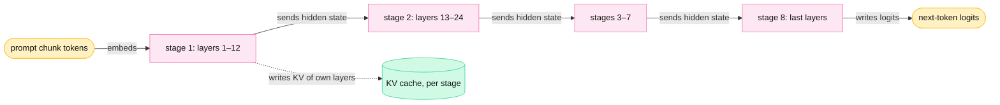
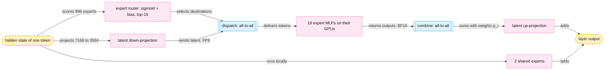
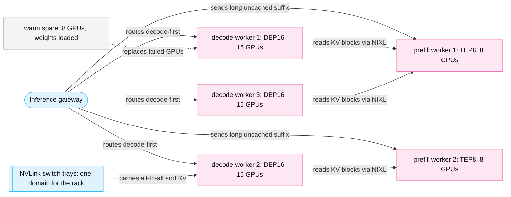
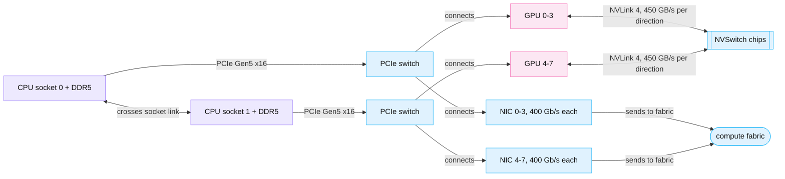

<!-- GENERATED from manuscript/src/part-12-distributed-inference.md by tools/render_manuscript.py. Edit the source, not this file. -->
# Part 12: Distributed inference

A model that does not fit one GPU runs as one replica over many GPUs. Collective communication between those GPUs then sets a floor under every token's latency.

Your request has passed admission (part 9). The model server that receives it is not one GPU. For `M-frontier`, one prefill worker spans 8 GPUs, and one decode worker spans 16 GPUs (RA-55). For `M-dense`, one replica spans the 8 GPUs of one node. Part 11 follows the work inside one GPU. This part follows the bytes that move between GPUs, in nine steps:

1. How tensor parallelism splits one layer, and the AllReduce it needs (12.1).
2. How pipeline parallelism splits the layer stack (12.2).
3. How replicas multiply throughput (12.3).
4. How expert parallelism spreads `M-frontier`'s experts, and the all-to-all it needs (12.4).
5. How context parallelism splits one long sequence (12.5).
6. What connects the GPUs inside one node (12.6), between nodes (12.7) and inside one rack (12.8).
7. Why a real fleet mixes hardware generations (12.9).

Every time in this part follows one model. A collective that runs `steps` synchronization steps and puts `bytes` on its busiest link takes:

```
t = steps × α + bytes on the busiest link / (B × η)
```

`B` is the link's rated bandwidth per direction. `α` is the fixed cost of one synchronization step, and `η` is the fraction of `B` that the transfer achieves. NVIDIA publishes no end-to-end latency for NVLink or InfiniBand. So in this reference system, `α` and `η` are hypothetical values (`hypothetical.tp_comm_ref`):

| Link | `B` per direction | `α` per step (hypothetical) | `η` (hypothetical) |
|---|---|---|---|
| NVLink 4, H100 node | 450 GB/s | 2.0 µs | 0.8 |
| NVLink 5, GB300 rack | 900 GB/s | 2.0 µs | 0.8 |
| 400 Gb/s NIC (one per H100) | 50 GB/s | 8.0 µs | 0.9 |
| 800 Gb/s NIC (one per GB300) | 100 GB/s | 8.0 µs | 0.9 |

NVIDIA prints NVLink bandwidth as the sum of both directions: 900 GB/s for H100 [SRC-001]. This part always halves that number, because one transfer uses one direction. A real deployment measures `α` and `η` with nccl-tests on its own nodes [SRC-298].

---

## 12.1 Tensor parallelism and its collectives

Tensor parallelism (TP) splits every weight matrix of a layer across GPUs. An AllReduce then sums each GPU's part.

### Four collectives, defined once

A **collective** is an operation in which every rank of a group takes part. A **rank** is a worker's index inside that group. Inference uses four collectives. The example uses two GPUs. Each GPU holds a partial result for two tokens (rows) and four hidden values (columns). The numbers come from the toy split later in this section.

GPU 0 holds `[0, 4, 2, 0]` and `[2, 8, 4, 2]`. GPU 1 holds `[5, 0, 5, 0]` and `[2, 7, 2, 7]`.

| Collective | What each rank has after it | Toy result |
|---|---|---|
| **AllReduce** | the element-wise sum of all ranks' buffers | both GPUs hold `[5, 4, 7, 0]`, `[4, 15, 6, 9]` |
| **ReduceScatter** | one slice of that sum (here: one token row per GPU) | GPU 0 holds `[5, 4, 7, 0]`; GPU 1 holds `[4, 15, 6, 9]` |
| **AllGather** | the concatenation of every rank's slice | after ReduceScatter, both GPUs again hold both rows |
| **all-to-all** | a different piece from every other rank | each GPU sends rank j the rows that rank j needs (12.4) |

An AllReduce therefore equals a ReduceScatter followed by an AllGather. The two-shot kernel later in this section runs exactly those two stages [vllm@v0.31.0:csrc/custom_all_reduce.cuh#L53-L60].

### A small numeric split

Megatron-LM split the Transformer MLP into two matrix multiplications with opposite splits [SRC-600]. The first matrix splits by columns, so each GPU computes some output features in full. The second matrix splits by rows, so each GPU computes a partial sum of every output feature. Between them, the activation function needs no communication, because each GPU holds complete features.

The toy MLP has 2 tokens, hidden size 4, MLP width 4 and a ReLU activation. All values are illustrative integers.

```
X  (2 tokens × 4)   = [1, 2, 0, 1]
                      [0, 1, 3, 1]
A  (4 × 4), split by columns: GPU 0 takes columns 0–1, GPU 1 takes columns 2–3
B  (4 × 4), split by rows:    GPU 0 takes rows 0–1,    GPU 1 takes rows 2–3
```

The steps:

1. Each GPU holds the full input X. Its shape is `[2, 4]` on both GPUs.
2. GPU 0 computes `ReLU(X · A[:, 0:2])` = `[0, 2]`, `[2, 4]`. Shape `[2, 2]`.
3. GPU 1 computes `ReLU(X · A[:, 2:4])` = `[5, 0]`, `[2, 7]`. Shape `[2, 2]`.
4. Each GPU multiplies its half by its rows of B. GPU 0 gets `[0, 4, 2, 0]`, `[2, 8, 4, 2]`. Shape `[2, 4]`.
5. GPU 1 gets `[5, 0, 5, 0]`, `[2, 7, 2, 7]`. Shape `[2, 4]`.
6. One AllReduce adds the two partial results: `[5, 4, 7, 0]`, `[4, 15, 6, 9]`.

The unsplit computation `ReLU(X · A) · B` gives the same matrix. Check column 0 of token 0 by hand: 0 + 5 = 5. The AllReduce message has the shape of the layer output, `[tokens, hidden]`, not the shape of the weights.

The split order matters. If A split by rows, each GPU would hold partial sums before the ReLU. ReLU of a partial sum is not a partial sum of ReLU. So that order would need an AllReduce before the activation as well.

### Tensor parallelism in `M-dense`

`M-dense` runs with TP=8 on the 8 H100 GPUs of one node (RA-36). vLLM implements the two splits as `ColumnParallelLinear` and `RowParallelLinear` [vllm@v0.31.0:vllm/model_executor/layers/linear.py#L433-L445] [vllm@v0.31.0:vllm/model_executor/layers/linear.py#L1626-L1632]. A row-parallel layer all-reduces its output [vllm@v0.31.0:vllm/model_executor/layers/linear.py#L1780-L1783]. Per GPU, one decoder layer holds these weight shapes (`[in, out]`):

| Matrix | Split | Full shape | Shape per GPU | Collective after it |
|---|---|---|---|---|
| `q_proj` | column | `[12288, 12288]` | `[12288, 1536]` (12 query heads) | none |
| `k_proj`, `v_proj` | column | `[12288, 1024]` | `[12288, 128]` (1 KV head) | none |
| `o_proj` | row | `[12288, 12288]` | `[1536, 12288]` | AllReduce of `[T, 12288]` |
| `gate_proj`, `up_proj` | column | `[12288, 28672]` | `[12288, 3584]` | none |
| `down_proj` | row | `[28672, 12288]` | `[3584, 12288]` | AllReduce of `[T, 12288]` |

Attention fits the split without extra traffic. Each GPU owns 12 query heads and the one KV head they share. So each GPU runs attention on its own heads, with its own slice of the KV cache (part 13.1). Only `o_proj` mixes heads, and its AllReduce restores the full hidden state.


Legend: amber = your request's activations; pink = computation on each GPU; blue box with double edges = a collective over NVLink. The one thing to notice: each layer needs exactly two AllReduces, and both carry the full hidden state. The diagram leaves out the RMSNorms on purpose, because each GPU computes them on its full copy.

Where do the other collectives appear?

- **AllGather.** A column-parallel layer can gather its output onto every GPU (`gather_output`) [vllm@v0.31.0:vllm/model_executor/layers/linear.py#L433-L445]. The last layer does this for the logits: each GPU computes `[T, 131072 / 8]` and the engine gathers them [vllm@v0.31.0:vllm/model_executor/layers/logits_processor.py#L122-L126].
- **One more AllReduce.** The embedding table splits by vocabulary rows. Each GPU looks up only its own rows, and an AllReduce combines them [vllm@v0.31.0:vllm/model_executor/layers/vocab_parallel_embedding.py#L562-L563].
- **ReduceScatter.** It appears inside the two-shot AllReduce kernel, and in the MoE layers of 12.4.

So one forward pass of `M-dense` runs 2 × 88 + 1 = 177 AllReduces.

### How big each message is

```
AllReduce message = tokens in the step × hidden size × 2 B (BF16)
```

| Step | Tokens | Message per AllReduce | Per forward pass (177 AllReduces) |
|---|---|---|---|
| decode, batch of 1 | 1 | 24,576 B (0.023 MiB) | 4.35 MB |
| decode, batch of 64 (hypothetical) | 64 | 1,572,864 B (1.5 MiB) | 278 MB |
| prefill chunk (token budget, RA-36) | 8,192 | 201,326,592 B (192 MiB) | 35.6 GB |

A decode message is small: one token's hidden state is 24,576 B. A prefill message is large. The two cases need different algorithms.

### Ring AllReduce: the bandwidth formula

In a ring AllReduce, each of n ranks sends to its neighbour. The ring first runs a ReduceScatter in n−1 steps, then an AllGather in n−1 steps. Each step moves 1/n of the buffer. So each link carries:

```
bytes per link = 2(n−1)/n × S
t_ring         = 2(n−1) × α + 2(n−1)/n × S / (B × η)
```

nccl-tests uses the same factor `2(n−1)/n` to turn algorithm bandwidth into bus bandwidth. Bus bandwidth then compares directly with the link [SRC-298] (`2(n-1)/n`).

Worked for the 8,192-token prefill chunk over NVLink 4, with n = 8:

```
bytes per link = 2 × (8 − 1) / 8 × 201,326,592 B = 352,321,536 B
bandwidth term = 352,321,536 B / (450 GB/s × 0.8) = 0.979 ms
latency term   = 14 steps × 2.0 µs = 0.028 ms
t_ring         = 1.007 ms per AllReduce
```

For one decode token, the formula gives a bandwidth term of 0.12 µs and a latency term of 28 µs. The 14 steps cost far more than the bytes. So a ring is the wrong algorithm for decode.

### Small messages: vLLM's custom all-reduce

In this reference system, tensor-parallel decode uses vLLM's custom all-reduce for small messages and NCCL for large ones (RA-46). vLLM's CUDA communicator tries several kernels in order and falls back to NCCL last [vllm@v0.31.0:vllm/distributed/device_communicators/cuda_communicator.py#L335-L409]. The custom kernel maps the other GPUs' buffers into its own address space over NVLink. It runs only for messages under 8 MiB, on at most 8 fully connected GPUs [vllm@v0.31.0:vllm/distributed/device_communicators/custom_all_reduce.py#L493-L508]. It has two variants [vllm@v0.31.0:csrc/custom_all_reduce.cuh#L299-L306]:

1. **One-shot** (one stage). Every GPU reads all n buffers and sums them. It has one synchronization step but reads (n−1) × S bytes. vLLM uses it below 256 KiB for up to 8 GPUs [vllm@v0.31.0:csrc/custom_all_reduce.cuh#L299-L306].
2. **Two-shot** (two stages). A ReduceScatter, then an AllGather. It has two synchronization steps and moves 2(n−1)/n × S bytes per link.

```
t_one-shot = α + (n−1) × S / (B × η)
t_two-shot = 2α + 2(n−1)/n × S / (B × η)
```

The time of one AllReduce on the NVLink node, by the path vLLM takes:

| Step | Message | Ring (NCCL) | One-shot | Two-shot | vLLM takes |
|---|---|---|---|---|---|
| decode, batch 1 | 24,576 B | 28.1 µs | 2.5 µs | 4.1 µs | custom one-shot |
| decode, batch 64 | 1,572,864 B | 35.6 µs | 32.6 µs | 11.6 µs | custom two-shot |
| prefill chunk | 201,326,592 B | 1.007 ms | 3.917 ms | 0.983 ms | NCCL |

With these assumed values, two-shot beats one-shot above about 134 KiB. vLLM's fixed threshold of 256 KiB sits in the same range. The engine records these collectives in its CUDA Graphs at startup. So a decode step replays them without CPU launch work (part 11).

### NCCL: ring, tree and NVLS

NCCL is NVIDIA's collective library. For each call, it picks an algorithm and a protocol from the topology and its cost model [SRC-296]. `NCCL_ALGO` can force one. Its algorithms include `Ring`, `Tree`, `NVLS` and `NVLSTree` [SRC-295]:

- **Ring** moves the fewest bytes per link but needs 2(n−1) steps. It suits large messages.
- **Tree** (a double binary tree) has a step count that grows with log2(n), not with n [SRC-297]. A simple count, 2 × log2(n), gives 6 steps for 8 GPUs against 14 for the ring. It suits small and medium messages across many nodes.
- **NVLS** (NVLink SHARP) offloads the reduction to the NVLink switches [SRC-296]. Each NVLink Switch has SHARP engines for in-network reductions [SRC-930]. The GPUs send their buffers to the switch, and the switch returns the sum.

NCCL also picks a protocol. `LL` puts 50% payload into each 16-byte line and suits tiny messages. `LL128` puts 93.75% payload into each 128-byte line. `Simple` uses large chunks for the highest bandwidth [SRC-295].

### What one forward pass spends on AllReduce

| Step | AllReduce time per layer | Per forward pass | Compared with |
|---|---|---|---|
| decode, batch 1 | 5.0 µs | 0.44 ms | weight-read floor 4.99 ms: 8% of the step |
| decode, batch 64 | 23.3 µs | 2.06 ms | 29% of the step |
| prefill chunk | 2.01 ms | 178 ms | matmul time 511 ms: ratio 0.35 |

The weight-read floor is the time to read each GPU's 16.7 GB weight share from HBM at 3.35 TB/s. Part 11.4 adds the KV reads and explains why decode is bandwidth-bound. The matmul time assumes the hypothetical prefill MFU of 0.5.

**What this changes.** Decode AllReduce cost is mostly the fixed step cost, so a larger batch adds bytes almost for free. Prefill AllReduce cost is mostly bytes. A common design overlaps it with the next chunk's computation, but that cannot remove it. TP=8 stays efficient only because NVLink is fast; 12.7 moves the same group onto NICs.

**Meanwhile in the fleet.** Every decode step of every `M-dense` replica runs the same 177 AllReduces, whatever its batch holds. No GPU of a replica starts layer i+1 before AllReduce 2 of layer i ends on all 8. So the slowest GPU sets the pace of the whole replica.

Counters at this moment:

- `batched tokens this iteration` sets every AllReduce message: tokens × 24,576 B.
- `GPU utilization` stays high during the AllReduces, because the custom kernel runs on the GPU's SMs [vllm@v0.31.0:csrc/custom_all_reduce.cuh#L299-L306].
- `HBM used` does not change, because the engine allocates its communication buffers at startup (part 1.3).

You can now compute the AllReduce message and its time for any TP group, token count and link.

---

## 12.2 Pipeline parallelism

Pipeline parallelism (PP) gives each GPU group a range of layers. Only one activation crosses each boundary, but every token still passes every stage in order.

### Stages and activation transfer

A **stage** is one group of consecutive layers on its own GPUs. SGLang runs `M-frontier` prefill with PP8: its 93 layers form 8 stages [SRC-387]. At each boundary, stage s sends one tensor to stage s+1: the hidden state `[tokens, hidden]`.



Legend: amber = your request's data; pink = one pipeline stage; green cylinder = state that stays on the stage. The one thing to notice: one boundary carries only `[tokens, hidden]`, once per chunk, instead of two AllReduces per layer. The diagram leaves out the exact layer split on purpose; stages need not hold equal layer counts.

For `M-frontier` (hidden size 7168, BF16), one token's activation is 14,336 B. One prefill chunk of 16,384 tokens (the token budget in NVIDIA's GB300 recipe [SRC-388]) sends:

```
16,384 tokens × 7168 × 2 B = 234,881,024 B ≈ 235 MB per boundary
```

That takes 0.33 ms over NVLink 5 and 2.62 ms over one 800 Gb/s NIC. Seven boundaries move this tensor once each per chunk. TP over the same NIC would move a message of that size twice per layer (12.7). This is why PP suits links between nodes.

### Microbatches and the bubble

A stage idles until the first microbatch reaches it, and it idles again after the last microbatch leaves. A **microbatch** is one slice of work that enters the pipeline on its own. In inference, it is one prefill chunk or one decode batch. The idle time is the **bubble**. With S stages and M microbatches of equal cost, GPipe gives the idle fraction [SRC-601]:

```
bubble fraction = (S − 1) / (M + S − 1)
```

For S = 8:

| Microbatches M | 1 | 2 | 4 | 8 | 16 | 32 |
|---|---|---|---|---|---|---|
| bubble fraction | 88% | 78% | 64% | 47% | 30% | 18% |

Worked for M = 2: (8 − 1) / (2 + 8 − 1) = 7/9 = 77.8%. GPipe found the overhead negligible in its training runs when M ≥ 4 × S, here 32 microbatches [SRC-601].

Your request alone would fill the pipeline badly. Pass 1 needs 20,250 prefill tokens (part 5.6). That is 1.24 chunks of 16,384 tokens, so 2 chunks and a 78% bubble. A PP prefill worker therefore needs chunks from many requests in flight at once. SGLang reports that one PP8 node has 1.45 to 1.72 times a TEP8 node's capacity for 8K prefills [SRC-387].

### Latency: PP compared with TP

PP does not shorten the time of one token. Take `M-dense` decode with a batch of 1 on one node, split two ways:

1. **TP=8.** Each GPU reads its 16.7 GB weight share at the same time: 4.99 ms, plus 0.44 ms of AllReduce.
2. **PP=8.** Each stage holds 11 layers, the same 16.7 GB. The stages run one after another: 8 × 4.99 ms + 7 hops × 2.1 µs = 39.9 ms.

So one sequence decodes about 8 times slower under PP=8. PP raises throughput only when 8 microbatches keep all stages busy. Each sequence still waits for all 8 stages.

| | Tensor parallelism | Pipeline parallelism |
|---|---|---|
| What splits | every matrix of every layer | the layer stack |
| Traffic | 2 AllReduces per layer of `[T, hidden]` | 1 send per stage boundary of `[T, hidden]` |
| Per-token latency | divides each layer's time by about n | does not fall; adds a hop per boundary |
| Link it needs | NVLink inside one domain | works over NICs between nodes |
| Main cost | collectives on the critical path | bubbles, and many requests needed in flight |

A common design combines both: TP inside each node and PP across nodes. NVIDIA's Dynamo recipe runs `M-frontier` on 32 H200 GPUs as TP8 × PP4 [SRC-388].

**Meanwhile in the fleet.** While your chunk sits in stage 3, stage 1 already runs the next request's chunk. Stage 8 finishes a chunk of a third request. Each stage holds the KV cache only for its own layers (part 13.1).

You can now compute the bubble fraction and the per-boundary transfer for a pipeline, and say when PP beats TP.

---

## 12.3 Data parallelism and replicas

Data parallelism (DP) runs independent replicas side by side, and it is the main way a fleet adds throughput.

### What a replica is

A **replica** is one complete copy of the model weights that can serve requests on its own. It is not a GPU. Its size depends on the model and the hardware:

| Replica | GPUs | How the model splits inside it |
|---|---|---|
| `M-dense` on `H-teach` (RA-36) | 8 H100 in one node | TP=8 |
| `M-frontier` decode worker (RA-55) | 16 GB300 in one rack | DEP16 (12.4) |
| `M-frontier` on H200 (Dynamo recipe) | 32 H200 in four nodes | TP8 × PP4 [SRC-388] |

Replicas share nothing at run time: no weights in common memory, no KV blocks, no collectives. Each one has its own model server and its own endpoint. The inference gateway picks a replica for each request (part 9).

### Throughput scales with the replica count

```
fleet throughput = N replicas × throughput per replica
```

vLLM's recipe for `M-dense` reports a measured 8-GPU replica [SRC-333]. It ran on 8 MI300X GPUs at TP=8, with 1k input, 1k output and 32 concurrent requests. It delivered 915 output tokens/s. So ten such replicas deliver 9,150 tokens/s, and a hundred deliver 91,500 tokens/s. The formula holds because the replicas never wait for each other.

For `M-frontier`, the hypothetical `ap_south` pool keeps about 30,000 sequences in decode at the peak (part 9.5). TensorRT-LLM measured one DEP16 worker on 16 GB300 at two concurrencies [SRC-389]:

| Concurrency per worker | Output tokens/s per worker | Tokens/s per user | Workers for the pool |
|---|---|---|---|
| 64 | 1,669.1 | 29.36 | about 469 |
| 256 | 3,823.9 | 16.07 | about 117 |

The hypothetical target is 20 tokens/s per user. Only the first row meets it. KV memory alone would allow 1,184 sequences per worker, so 26 workers (part 9.5). 

The table does not show a limit, though. TensorRT-LLM chose 64 and 256 sequences per worker, with 8K prefills mixed into the same workers. Part 14.3 models a decode-only worker. At the target speed, KV memory binds.

### Data-parallel attention

Data parallelism has a second meaning inside one MoE replica. vLLM's documentation describes it. For MoE models with MLA, attention can run data-parallel, and the expert layers run expert- or tensor-parallel [vllm@v0.31.0:docs/serving/data_parallel_deployment.md#L7-L11]. Each **attention DP rank** holds its own sequences and its own full KV cache. It also holds a full copy of the attention weights. The ranks join the MoE layers of every step together.

So DP ranks inside a DEP16 worker are not independent replicas:

1. Every rank must run every MoE layer in step with the others, even when it has no request. vLLM runs empty "dummy" forward passes on idle ranks [vllm@v0.31.0:docs/serving/data_parallel_deployment.md#L15].
2. Each rank has its own KV cache. So the router should pick a rank by its queue and KV state, which vLLM recommends [vllm@v0.31.0:docs/serving/data_parallel_deployment.md#L17].

DP attention suits `M-frontier` because MLA stores one latent per token, not one per head. TP cannot split the latent, so every TP rank would hold the full latent cache (part 13.1) [SRC-385]. DP attention gives each rank different sequences instead. The cost is a full copy of the attention weights on every rank.

**Meanwhile in the fleet.** Your request's pass 1 lands on one DEP16 rank in `ap_south`. The other 15 ranks of that worker decode other users' sequences. Other workers in the same rack, and other racks, run without any link to yours.

You can now say what one replica is for each model, and compute fleet throughput as N × throughput per replica.

---

## 12.4 Expert parallelism and MoE, including `M-frontier`'s deployment

Expert parallelism (EP) puts different experts on different GPUs. So every MoE layer sends each token to its experts' GPUs and brings the results back.

### The MoE block

`M-frontier` replaces the dense MLP with an MoE block in 92 of its 93 layers. Each MoE layer has 896 routed experts and 2 shared experts. An **expert** is one feed-forward network. The **expert router** scores the experts and picks the top-k for each token [SRC-380]:

```
y = Σ_shared E_j(x) + W_up · RMSNorm( Σ_{i ∈ top-16} p_i · E_i(W_down · x) )
```

The block flow for one token:

1. **Router logits.** `s = sigmoid(W_r · x)` over all 896 experts, on the full 7168-wide hidden state.
2. **Top-k.** The router adds a bias that training froze, and it takes the top 16 of `s + b`. The weights `p_i` are the chosen scores, normalized to sum 1.
3. **Latent down-projection.** `W_down` maps the hidden state from 7168 to 3584 values. vLLM's post calls this design LatentMoE [SRC-343].
4. **Dispatch.** The token's latent goes to the GPU of each chosen expert.
5. **Expert MLP.** Each expert runs its SiTU-GLU MLP on the tokens it received.
6. **Combine.** Each expert's output returns to the token's GPU, and the weighted sum forms the result.
7. **Latent up-projection.** `W_up` maps the sum back to 7168 values. The shared experts' output adds to it.

So each token uses 16 of 896 routed experts, a sparsity of 56.



Legend: amber = your token's data; pink = computation; blue box with double edges = an all-to-all over the NVLink domain. The one thing to notice: the router decides the network traffic, token by token, at every MoE layer. The diagram leaves out the residual connection and the norms on purpose.

### Experts per GPU

In this reference system, each `M-frontier` rack runs 2 TEP8 prefill workers and 3 DEP16 decode workers (RA-55). vLLM validated "TEP8 prefill to DEP16 decode" for this model [SRC-343]:

- **TEP8** (tensor + expert parallel over 8 GPUs). Attention runs tensor-parallel over 8 GPUs. The experts spread over the same 8 GPUs: 896 / 8 = 112 experts per GPU. TensorRT-LLM lists 213 GB of weights per rank for TEP8 [SRC-389].
- **DEP16** (attention data-parallel, experts over 16 GPUs). Each GPU runs attention for its own sequences (12.3). The experts spread over 16 GPUs: 896 / 16 = 56 experts per GPU. TensorRT-LLM lists 210 GB per rank [SRC-389].



Legend: pink = a worker of GPUs; blue = network (the gateway and the NVLink switches); grey = the warm spare. The one thing to notice: 64 of 72 GPUs serve, and all their traffic stays inside one NVLink domain. The diagram draws one NVLink arrow for all workers on purpose; every worker connects to the same switch trays.

The 2:3 ratio of prefill to decode workers is a class C choice, not a documented ratio (RA-55). DeepSeek published a different split for DeepSeek-V3 [SRC-071]. Its prefill unit had 32 GPUs with EP32. Its decode unit had 320 GPUs with EP320. Decode uses wider EP because each decode step carries few tokens per GPU. Wider EP leaves fewer experts per GPU, so each GPU reads fewer expert weights per step.

### How many bytes the all-to-all moves

The dispatch carries the 3584-wide latent in FP8 (1 byte). The combine returns it in BF16 (2 bytes). DeepSeek-V3 uses this FP8-dispatch and BF16-combine split [SRC-071]. Here we assume the same split for `M-frontier`. TensorRT-LLM can also run a low-precision combine [SRC-389]. Per token and per MoE layer:

```
dispatch = top-k × latent width × 1 B = 16 × 3584 × 1 B = 57,344 B
combine  = top-k × latent width × 2 B = 16 × 3584 × 2 B = 114,688 B
per token, all layers = 92 × (57,344 + 114,688) B = 15,826,944 B ≈ 15.8 MB
```

These sizes count one copy per chosen expert. If experts took the full 7168-wide state, the total would be 31.7 MB per token. So the latent halves these bytes. vLLM notes that LatentMoE reduces all-to-all traffic [SRC-343]. DeepSeek-V3's dispatch has the same size per token: 8 experts × 7,168 × 1 B = 57,344 B. So DeepEP's measurements below apply to the same payload.

A dispatch kernel can also send one copy per destination GPU instead of one per expert [SRC-300]. With uniform routing, the 16 experts of a token land on 10.4 distinct GPUs on average:

```
GPUs × (1 − C(experts − experts per GPU, k) / C(experts, k))
= 16 × (1 − C(896 − 56, 16) / C(896, 16)) = 10.35 GPUs
```

Your request's output tokens alone move 27.3 GB through the all-to-alls: 1,727 tokens over three passes × 15.8 MB.

### One decode step of one DEP16 rank

TensorRT-LLM's DEP16 measurement at concurrency 256 puts 16 sequences on each rank. Without speculative decoding, each sequence adds one token per step. A fraction 15/16 of each token's expert copies goes to another GPU. Per rank:

1. Dispatch per MoE layer: 16 × 57,344 B × 15/16 = 860,160 B.
2. Combine per MoE layer: 1,720,320 B.
3. Per step, over 92 layers: 237 MB sent by each GPU.
4. Bandwidth term on NVLink 5: 0.33 ms per step. Over an 800 Gb/s NIC it would be 2.64 ms.

The bytes are not the problem. The step count is: 2 × 92 all-to-alls per step, each a synchronization of all 16 GPUs. DeepEP measured its low-latency kernels on H800 GPUs with one 400 Gb/s InfiniBand NIC each [SRC-300]. At EP16, with 128 tokens per batch:

- Dispatch took 118 µs, and combine took 195 µs.
- So 92 MoE layers × (118 + 195) µs = 28.8 ms per step, with no overlap.

That hardware, network and batch differ from this reference system, so the number shows an order of magnitude only. It explains two designs. DeepEP's low-latency kernels let RDMA run in the background through a hook [SRC-300]. Meanwhile, two microbatches take turns on the GPU [SRC-071]. And rack-scale NVLink keeps the whole DEP16 worker off the NIC (12.8).

### Prefill and decode use different kernels

vLLM offers several all-to-all backends through `--all2all-backend` [vllm@v0.31.0:vllm/config/parallel.py#L202-L214]. Its documentation matches the two DeepEP modes to the two phases [vllm@v0.31.0:docs/serving/expert_parallel_deployment.md#L24-L31]:

| Backend | Phase | Why |
|---|---|---|
| `deepep_high_throughput` | prefill | many tokens per step; a continuous layout for grouped GEMMs; bandwidth-bound |
| `deepep_low_latency` | decode | few tokens per step; fixed-size buffers that CUDA Graphs can record; latency-bound |
| `flashinfer_nvlink_one_sided`, `flashinfer_nvlink_two_sided` | either | multi-node NVLink systems such as GB300 NVL72 |

A TEP8 prefill worker splits a 16,384-token chunk over 8 GPUs: 2,048 tokens each. Each GPU then dispatches 103 MB per MoE layer to the other 7. Here bytes dominate: about 0.43 ms per layer for dispatch and combine over NVLink 5. DeepEP's normal kernels reached 153 GB/s over NVLink in one H800 node (EP8) [SRC-300]. That link offers 160 GB/s [SRC-071]. Across nodes at EP16, the same kernels reached 43 GB/s per GPU over RDMA [SRC-300].

### Expert capacity, load imbalance and hot experts

An MoE layer finishes when its busiest GPU finishes. So uneven routing wastes every other GPU's time. Three mechanisms bound the damage:

- **Expert capacity.** Some designs cap the tokens each expert accepts per batch [SRC-073]. Excess tokens skip the expert through the residual connection. DeepEP's decode path uses fixed-capacity receive buffers, sized ahead of time so that CUDA Graphs can record them [SRC-299].
- **Load-balanced training.** `M-frontier` trains a bias per expert with Quantile Balancing, and it freezes the bias for inference [SRC-380]. A common design does not assume that balance in training holds for one deployment's traffic.
- **Redundant experts.** The engine keeps extra copies of hot experts and moves experts between GPUs. vLLM's Expert Parallel Load Balancer (EPLB) records expert load over a window of 1,000 steps. By default, it rearranges experts every 3,000 steps [vllm@v0.31.0:vllm/config/parallel.py#L62-L76]. DeepSeek-V3 placed 32 redundant experts in its prefill unit and re-chose them about every 10 minutes [SRC-071].

No public data shows `M-frontier`'s expert load on real traffic. This reference system assumes a skew (Zipf exponent 0.3, hypothetical, `hypothetical.moe_routing_ref`). The hottest expert gets 5.4 times the mean expert's share. The simulation routes tokens over one DEP16 worker. The redundant case adds 16 copies of the hottest experts, 57 slots per GPU, and places experts by expected load:

| Batch | Placement | Busiest GPU ÷ mean GPU | GPU efficiency (mean ÷ max) |
|---|---|---|---|
| decode step, 256 tokens | uniform popularity, experts in ID order | 1.111 | 90% |
| decode step | skewed popularity, ID order | 1.138 | 88% |
| decode step | skewed, with redundant copies | 1.110 | 90% |
| prefill chunk, 16,384 tokens | uniform popularity, ID order | 1.012 | 99% |
| prefill chunk | skewed popularity, ID order | 1.085 | 92% |
| prefill chunk | skewed, with redundant copies | 1.014 | 99% |

Read the two batch sizes separately. A prefill chunk holds enough tokens that random variation averages out, so popularity skew dominates. Redundant copies remove most of it. A decode step holds few tokens, so random variation dominates even with uniform popularity. Redundant copies cannot fix randomness. This is one more reason why decode uses wide EP with small, latency-bound kernels.

### Why MoE creates different network bottlenecks

| | Dense TP (`M-dense`) | MoE with EP (`M-frontier`) |
|---|---|---|
| Collective | AllReduce, fixed partners | all-to-all, partners change per token |
| Traffic pattern | the same bytes every step | depends on the router's choices |
| Size per token per layer | 24,576 B, twice | 57,344 B out + 114,688 B back |
| What fails first | step latency on the critical path | the busiest GPU and the busiest link |

**Meanwhile in the fleet.** Your token's latent leaves its DEP16 rank 92 times per output token. At the same moment, the other 15 ranks send their own tokens to the same experts. EPLB counts every routing decision, and every 3,000 steps it may move a hot expert to a less loaded GPU.

You can now trace one token through router, dispatch, expert and combine, and compute the all-to-all bytes per step.

---

## 12.5 Context and sequence parallelism

Context parallelism (CP) splits one long sequence along its tokens across GPUs. So a long prefill ends sooner, and a long KV cache fits.

### The idea

TP splits each layer's matrices. PP splits the layer stack. Neither splits the work along the token dimension. TP still shortens a prefill (12.1), but every layer pays for its collectives. Past the KV head count, TP duplicates the KV cache on each GPU [vllm@v0.31.0:docs/serving/context_parallel_deployment.md#L36].

CP splits the tokens instead. With N GPUs, each GPU computes Q, K and V for one chunk of T/N tokens [vllm@v0.31.0:docs/serving/context_parallel_deployment.md#L8-L15].

The linear layers need no communication under CP, because each token's projection uses only that token. Attention is the exception. A query must see the keys and values of all earlier tokens, and other GPUs hold them. vLLM's documentation names two strategies [vllm@v0.31.0:docs/serving/context_parallel_deployment.md#L14-L15]:

1. **Partial query, full key/value.** The GPUs AllGather K and V, and each GPU computes attention for its own queries. This works while one GPU can hold the full K and V.
2. **Partial query, partial key/value.** Each GPU keeps its own K and V chunk and passes it around a ring.

### Ring attention

Ring attention runs the second strategy [SRC-602]:

1. Each of N GPUs holds one chunk of queries and one chunk of K and V.
2. Each GPU computes attention between its queries and the K and V chunk it holds now.
3. Each GPU sends that K and V chunk to its ring neighbour and receives the next chunk.
4. Steps 2 and 3 repeat N times. The send of step 3 overlaps the computation of step 2.
5. Each GPU merges the N partial results with the running maximum and sum of the softmax (part 10).

The result is exact, not an approximation. A causal mask lets a GPU skip chunks that lie entirely in its future.

Meta's work on CP for inference adds a variant that passes queries instead of keys and values (pass-Q) [SRC-603]. Pass-Q suits a prefill whose new tokens are few against a long cached prefix. Pass-KV suits a full prefill. That work ran a 1M-token prefill of Llama 3 405B in 77 s. It used 128 H100 GPUs in 16 nodes, at 93% parallel efficiency. A 128K-token prefill took 3.8 s [SRC-603].

### Decode context parallelism

During decode, few query tokens read a large KV cache. Decode context parallelism (DCP) splits the stored KV cache along the token dimension instead [vllm@v0.31.0:docs/serving/context_parallel_deployment.md#L19-L40]. vLLM interleaves tokens over the DCP ranks, so new tokens spread evenly as the sequence grows. vLLM ran `M-frontier` on one B300 node with a 120k-token workload and DCP [SRC-385]. The KV capacity rose "from 1.93M to 19.75M tokens".

### Compared with tensor parallelism

| | Tensor parallelism | Context parallelism |
|---|---|---|
| What splits | heads and matrix columns or rows | tokens of one sequence |
| Upper limit | the KV head count for the KV cache (8 for `M-dense`) | the sequence length |
| Traffic | AllReduce of activations, 2 per layer | K and V chunks around a ring, inside attention |
| Overlap | partly | the ring overlaps transfer with attention |
| Best use | every request | very long prompts or very long KV caches |

### Your request does not need it

Your request's longest pass has 30,395 prompt tokens, and pass 1 prefills 20,250 of them (part 5.6). Two chunks of a TEP8 prefill worker cover that. CP pays off near the 128K and 1M points above, where one prefill takes seconds even on many GPUs. The orchestrator caps each pass at 131,072 prompt tokens, so CP matters here only near that cap (RA-68).

**Meanwhile in the fleet.** A few requests in the pool carry very long contexts, such as whole code repositories. A common design sends those prefills to workers with CP enabled. Short requests like yours take ordinary prefill workers.

You can now explain how ring attention splits one sequence, and say when a request needs context parallelism.

---

## 12.6 The multi-GPU node

An HGX H100 node joins its 8 GPUs through NVSwitch chips at NVLink speed. Slower PCIe links join each GPU to the CPUs and NICs.

### What is inside the node

A DGX H100 node, NVIDIA's reference HGX system, holds [SRC-006]:

- 8 H100 SXM GPUs, each with 80 GB of HBM.
- 4 third-generation NVSwitch chips, each with 64 NVLink 4 ports.
- 2 Intel Xeon Platinum 8480C CPUs with 112 cores in total.
- 2 TB of DDR5 system memory.
- 8 single-port ConnectX-7 NICs at 400 Gb/s for the compute fabric, one per GPU.
- 2 dual-port ConnectX-7 NICs for storage and management.



Legend: pink = GPUs; purple = CPUs with their memory; blue = switches, NICs and the fabric. The one thing to notice: GPU-to-GPU traffic never touches PCIe [SRC-006]. With GPUDirect RDMA on, GPU-to-NIC traffic never touches the CPU [SRC-028]. The diagram groups four GPUs and four NICs per box on purpose. The exact PCIe layout differs between server models.

### Bandwidth inside the node

| Path | Bandwidth per direction | Relative to NVLink |
|---|---|---|
| GPU to GPU over NVLink 4 and NVSwitch | 450 GB/s per GPU | 1 |
| GPU to CPU memory over PCIe Gen5 x16 [SRC-001] | 63 GB/s | 1 / 7.1 |
| GPU to another node through its NIC | 50 GB/s | 1 / 9 |
| All NVLink in the node | 7.2 TB/s (NVIDIA's total) [SRC-005] | |

NVSwitch connects every GPU to every other GPU at full rate [SRC-005] [SRC-006]. So any TP group inside the node has the same bandwidth, and the ring order does not matter. vLLM's custom all-reduce requires this property: it runs only when NVLink connects every pair of GPUs [vllm@v0.31.0:vllm/distributed/device_communicators/custom_all_reduce.py#L504-L508].

### Peer-to-peer transfers and GPUDirect RDMA

A **peer-to-peer transfer** moves bytes from one GPU's HBM to another's without a copy through CPU memory. The custom all-reduce and NIXL's NVLink path both use it. **GPUDirect RDMA** lets a NIC read and write GPU memory directly over PCIe [SRC-028]. NVIDIA's documentation requires that the GPU and the NIC share the same upstream PCIe root complex [SRC-028]. Performance then depends on the path between them; a shared PCIe switch is best [SRC-028]. NCCL's `NCCL_NET_GDR_LEVEL` sets the largest GPU-to-NIC distance at which NCCL still uses GPUDirect RDMA [SRC-296].

### NUMA

The two CPU sockets each own their own DIMMs [SRC-006]. A **NUMA node** is one socket with its local memory. A common rule follows: a CPU core that touches memory on the other socket crosses the slower inter-socket link. A common design pins each worker process, and its pinned host buffers, to the socket nearest its GPU.

Mooncake's transfer engine applies the same rule to NICs [SRC-292]. It prefers a NIC on the same NUMA node or PCIe switch as the memory. This matters for KV offload to CPU memory (part 13.6) and for weight loading at cold start (part 1).

**Meanwhile in the fleet.** Inside one `M-dense` node, the 8 GPUs exchange 177 AllReduces per step over NVSwitch. Meanwhile, the NICs carry KV transfers to other nodes. The CPUs run the engine's scheduler and tokenizer processes.

You can now draw an HGX node, and say which path each kind of traffic takes.

---

## 12.7 Multi-node clusters: RDMA, fabrics, and why TP over a NIC fails

Between nodes, every byte crosses a NIC at about one ninth of NVLink's bandwidth. So per-layer collectives must stay inside one NVLink domain.

### RDMA and GPUDirect RDMA

**RDMA** (remote direct memory access) lets one machine's NIC read or write another machine's registered memory without the remote CPU. With GPUDirect RDMA, that memory can be GPU HBM [SRC-028]. The path of one KV transfer or one collective between two nodes:

1. The engine registers the GPU memory region with the NIC once, at startup [SRC-290] [SRC-028].
2. The NIC reads the bytes from HBM over PCIe, with no copy through CPU memory.
3. The NIC sends them into the fabric: InfiniBand or Ethernet.
4. The receiving NIC writes them into the remote GPU's HBM over PCIe.
5. The NIC signals completion, and the receiving process polls for it.

NIXL moves KV blocks in this reference system (RA-38). It uses UCX for RDMA over InfiniBand and RoCE with GPUDirect RDMA [SRC-290].

### InfiniBand and RoCE

Two fabric families carry RDMA:

- **InfiniBand** is a fabric built for RDMA. The DGX H100 compute NICs run NDR InfiniBand at 400 Gb/s [SRC-006].
- **RoCE v2** (RDMA over Converged Ethernet) puts the RDMA transport inside Ethernet, IPv4 and UDP packets. Its UDP header lets switches spread flows over equal-cost paths [SRC-606]. RDMA expects no packet loss, so RoCE v2 uses priority-based flow control (PFC) to pause senders before switch buffers overflow [SRC-606].

Microsoft reported the failure modes of RoCE v2 at scale: PFC deadlock, RDMA transport livelock and NIC pause-frame storms [SRC-606]. **Congestion** is the general problem. When many flows meet at one switch port, they queue, and the slowest flow sets the time of the collective. An all-to-all is the worst case, because every GPU sends to every other GPU at the same moment.

### Topology: fat-tree and rail-optimized

A **fat-tree** joins leaf switches to spine switches with many links. Any half of the hosts can then reach the other half at full rate. Al-Fares and colleagues showed how to build one from commodity switches [SRC-607].

A **rail-optimized** fabric is a common design for GPU nodes. NIC i of every node connects to the same leaf switch i. So the eight NICs of a node form eight "rails". NVIDIA's DGX SuperPOD reference design groups 32 nodes per scalable unit, rail-aligned. Traffic on one rail reaches the other 31 nodes of the unit in one hop. Traffic between rails or between units crosses the spine [SRC-605].

So collectives work best when GPU i talks to GPU i of other nodes. DeepSeek-V3 used exactly this pattern for its all-to-all. A token crossed InfiniBand once to the GPU with the same in-node index on each target node. NVLink then forwarded it inside that node. Each token went to at most 4 nodes, because NVLink offered 160 GB/s against 50 GB/s for InfiniBand [SRC-071].

### Why TP over a NIC fails: the calculation

Take the same `M-dense` TP=8 group. Place its 8 GPUs in 8 different nodes, so every AllReduce crosses a 400 Gb/s NIC. vLLM's custom all-reduce cannot run there, so NCCL runs a ring. For one decode token (batch 1):

```
NVLink:  custom one-shot = 2.0 µs + (8 − 1) × 24,576 B / (450 GB/s × 0.8) = 2.48 µs
NIC:     ring = 2(8 − 1) × 8.0 µs + 2(8 − 1)/8 × 24,576 B / (50 GB/s × 0.9) = 113.0 µs
```

Per layer, per token and per prefill chunk:

| Step | Link | One AllReduce | Per layer (×2) | Per forward (×177) | Step time with the weight-read floor |
|---|---|---|---|---|---|
| decode, batch 1 | NVLink, TP=8 | 2.5 µs | 5.0 µs | 0.44 ms | 5.42 ms |
| decode, batch 1 | NIC, TP=8 | 113.0 µs | 225.9 µs | 19.99 ms | 24.98 ms |
| decode, batch 64 | NVLink, TP=8 | 11.6 µs | 23.3 µs | 2.06 ms | 7.05 ms |
| decode, batch 64 | NIC, TP=8 | 173.2 µs | 346.3 µs | 30.65 ms | 35.64 ms |
| decode, batch 64 | NIC, TP=16 over 2 nodes | 305.5 µs | 611.1 µs | 54.08 ms | 59.06 ms |
| prefill chunk | NVLink, TP=8 | 1.01 ms | 2.01 ms | 178 ms | matmul 511 ms |
| prefill chunk | NIC, TP=8 | 7.94 ms | 15.88 ms | 1,406 ms | matmul 511 ms |

The TP=16 row uses a ring of 16 GPUs over two nodes. Two of its hops cross the NIC, and the slowest hop sets the pace of every step.

**The effect on inter-token latency.** Over NICs, the AllReduces alone add 19.6 ms to every token at batch 1, and 28.6 ms at batch 64. Communication becomes 86% of the step.

The hypothetical TPOT objective is 60 ms. The TP=16 row already uses 98% of it before any KV read. For prefill, the AllReduces take 2.8 times as long as the matmuls. Overlap cannot hide communication that is longer than the computation.

**Collective latency** is the reason. Decode messages are small, so the 8.0 µs per step dominates. Those steps repeat 177 times per token, with no computation between them that could hide them. The rule that follows: keep TP inside one NVLink domain, and use PP, DP or EP across NICs. Those send once per stage, per request or per MoE layer. TP sends twice per layer, on the critical path.

In general, an EP group larger than one NVLink domain crosses NICs. In this reference system, the DEP16 all-to-alls of `M-frontier` stay inside one GB300 NVL72 rack (RA-55, 12.8).

**Meanwhile in the fleet.** Inside a worker group, KV moves over NVLink (RA-55). The compute fabric carries KV only when a request spills to a group in another rack. It also carries checkpoint pulls from peer nodes at scale-out (RA-61). In this reference system, none of the per-layer collectives of a worker crosses it (RA-55).

You can now compute an AllReduce's cost per layer and per token over NVLink and over a NIC.

---

## 12.8 Rack-scale NVLink domains, `H-frontier`

A GB300 NVL72 rack puts 72 GPUs into one NVLink domain. So collectives that had to stay inside 8 GPUs can now span the rack.

### What the rack provides

One GB300 NVL72 rack holds 72 Blackwell Ultra GPUs and their Grace CPUs [SRC-007]. NVLink switch trays connect all 72 GPUs into one **NVLink domain**, the set of GPUs that NVLink switches connect directly:

| Quantity | Value |
|---|---|
| NVLink 5 per GPU | 1.8 TB/s for both directions, 900 GB/s per direction [SRC-007] |
| NVLink in the rack | 130 TB/s [SRC-007] |
| HBM per GPU | 288 GB at 8 TB/s [SRC-011] |
| HBM in the rack | 20,736 GB |
| NIC per GPU, to other racks | 800 Gb/s (ConnectX-8) = 100 GB/s [SRC-007] |

The domain holds 9 times as many GPUs as an HGX node. NVLink per GPU is still 9 times the NIC per GPU. So the rule of 12.7 still holds. Only the boundary moves: per-layer collectives stay inside the rack instead of the node.

### What the larger domain enables

**Large replicas.** `M-frontier`'s weights are 1,560.9 GB, and one 8-GPU H100 node holds 640 GB of HBM. vLLM's recipe needs at least 32 H100 GPUs, so several nodes joined by NICs [SRC-390]. One rack holds the weights 13.3 times over, so a 16-GPU worker fits inside one NVLink domain.

**Wide EP over NVLink.** A DEP16 decode worker sends 237 MB per GPU per decode step through its all-to-alls (12.4). Inside the rack, the bandwidth term is 0.33 ms per step. Across racks over the NIC it would be 2.64 ms. vLLM lists all-to-all backends built for multi-node NVLink, such as `flashinfer_nvlink_one_sided` [vllm@v0.31.0:docs/serving/expert_parallel_deployment.md#L24-L31].

**Larger TP inside one model server.** vLLM measured batch-1 decode of `M-frontier` on GB300 NVL72 [SRC-343]. TP8 reached 111 tokens/s, and TP16 reached 118 tokens/s. TP16 runs only because all 16 GPUs share one domain. The small gain also shows that per-token latency stops falling once collective steps dominate.

**KV transfer over NVLink.** In this reference system, the prefill and decode workers of one group share a rack. NIXL moves the KV over NVLink (RA-55, part 13.7).

**Meanwhile in the fleet.** In each rack, 64 GPUs serve and 8 wait as warm spares with weights loaded (RA-55). A failed GPU in a decode worker takes its whole worker out, because every rank joins every MoE layer. The spare GPUs let the worker restart inside the same domain.

You can now explain what a rack-scale NVLink domain changes, and why wide EP and 16-GPU workers fit inside it.

---

## 12.9 Fleet heterogeneity

A real fleet mixes GPU generations and vendors. So the routing table must match each model, precision and phase to the right hardware pool.

### Hardware pools

A **hardware pool** is a set of identical nodes: the same GPU, network and software image. A replica never spans two pools, because its collectives run at the speed of its slowest link. Public accelerators differ in every dimension that matters for inference:

| Accelerator | HBM | HBM bandwidth | NVLink domain or equivalent |
|---|---|---|---|
| NVIDIA H100 SXM | 80 GB | 3.35 TB/s | 8 GPUs, NVLink 4 [SRC-001] |
| NVIDIA H200 SXM | 141 GB | 4.8 TB/s | 8 GPUs, NVLink 4 [SRC-002] |
| NVIDIA GB300 (NVL72) | 288 GB | 8 TB/s | 72 GPUs, NVLink 5 [SRC-007] |
| AMD Instinct MI355X | 288 GB | 8 TB/s | 8 GPUs, Infinity Fabric [SRC-030] |
| Google TPU7x (Ironwood) | 192 GiB | 7.38 TB/s | up to 9,216 chips per pod over ICI at 1,200 GB/s per chip [SRC-031] |
| AWS Trainium3 | 144 GiB | 4.9 TB/s | 144 chips per UltraServer over NeuronLink [SRC-348] |

Non-NVIDIA accelerators need their own kernels and their own collective libraries [SRC-390]. vLLM's `M-frontier` recipe lists MI355X among its verified hardware [SRC-390]. Its all-to-all backends include AMD's MoRI kernels [vllm@v0.31.0:vllm/config/parallel.py#L202-L214].

### Matching models and precisions to pools

Each pool holds the model variants that fit it:

1. **`M-frontier`** needs a large NVLink domain for DEP16 and in-rack KV transfer. In this reference system, it runs only on GB300 NVL72 racks (RA-55).
2. **`M-dense`** fits one 8-GPU node in FP8 or BF16, so older H100 or H200 nodes serve it (RA-36).
3. **Quantization variants** are separate deployments. `M-dense` ships as an FP8 checkpoint. A BF16 copy of the same weights needs about twice the HBM (part 1).
4. **The small retrieval models** (`M-embed`, `M-rerank`) run on a separate pool of small GPUs (RA-68).

### Accelerator-aware routing

The model router picks a deployment from the request's model, plan, modality and context length (RA-15, RA-56). Each deployment maps to one pool. So the routing table, not the GPU type, decides where a request runs. When one pool saturates, the router can fall back to another deployment of the same model. That deployment must exist on other hardware. That fallback must keep the same model weights, or the answer quality changes.

### Different GPUs for prefill and decode

Prefill is compute-bound and decode is bandwidth-bound (part 11.3). So the two phases can prefer different hardware. Splitwise proposed exactly this: prompt computation and token generation on separate machines. It stated that "token generation phases do not require the compute capability of the latest GPUs" [SRC-102]. Its cost-optimized design reached 1.4 times the throughput at 20% lower cost [SRC-102].

In this reference system, both `M-frontier` phases use GB300 (RA-38, RA-55). So the KV transfer stays on NVLink inside one rack.

### Price per performance

```
price per performance = price per GPU-hour / useful work per GPU-hour
```

The useful work depends on the limit that binds: HBM capacity, HBM bandwidth or compute. With hypothetical prices of $2.5 per H100 hour and $6.0 per GB300 hour:

| Per $ per hour | H100 SXM | GB300 | GB300 ÷ H100 |
|---|---|---|---|
| HBM capacity | 32.0 GB | 48.0 GB | 1.50 |
| HBM bandwidth | 1.34 TB/s | 1.33 TB/s | 1.00 |
| dense BF16 compute | 396 TFLOPS | 417 TFLOPS | 1.05 |

At these prices, a bandwidth-bound decode of `M-dense` costs about the same on both GPUs. A memory-bound workload with long contexts favours GB300 by 1.5 times. And on H100, no price buys a 16-GPU NVLink domain, so a DEP16 worker of `M-frontier` would cross NICs. The Mélange study mixed GPU types for a conversational workload [SRC-604]. The mix cut deployment cost by up to 77% against a single type.

### The cost of fragmentation

Every separate pool keeps its own warm floor of at least one replica (RA-42). In this reference system, the pools multiply (RA-42, RA-55): models × phases × regions. Two effects follow:

1. **Floors add up.** `M-frontier` needs at least one full rack per region, because its prefill and decode workers share one NVLink domain. Four regions (RA-05) then hold at least 288 GB300 GPUs before the first request.
2. **Rounding wastes capacity.** The `ap_south` decode pool needs 26 decode workers (part 9.5), and racks come with 3 decode workers each. So 9 racks hold 27 decode workers, and 1 of them sit idle.

Idle capacity in one pool cannot absorb a burst in another pool. A burst of `M-dense` traffic cannot use idle GB300 racks unless a deployment of `M-dense` exists there. So each pool needs its own headroom, and fewer, larger pools waste less.

**Meanwhile in the fleet.** In `ap_south`, the GB300 racks decode `M-frontier`. An H100 pool runs `M-dense`, and a small-GPU pool embeds retrieval queries. Each pool's autoscaler reads its own queue and KV metrics, and each scales on its own (RA-42).

You can now explain why a fleet keeps separate pools, and compute price per performance for the limit that binds.

---

## What Part 12 established

One replica spans many GPUs, and its per-layer collectives must stay inside one NVLink domain. PP and DP cross the slower links. A large EP group can cross them too, but here the expert traffic stays inside one rack (RA-55). The fleet multiplies replicas across pools of matched hardware.
