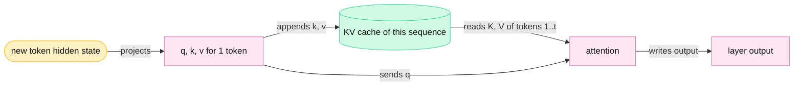
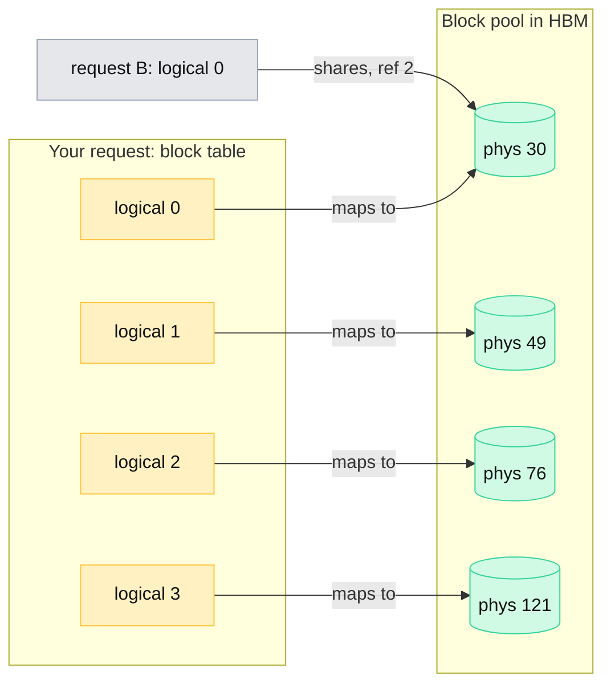
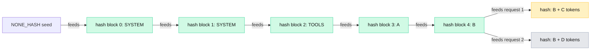
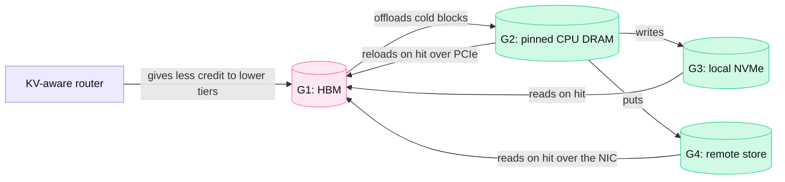
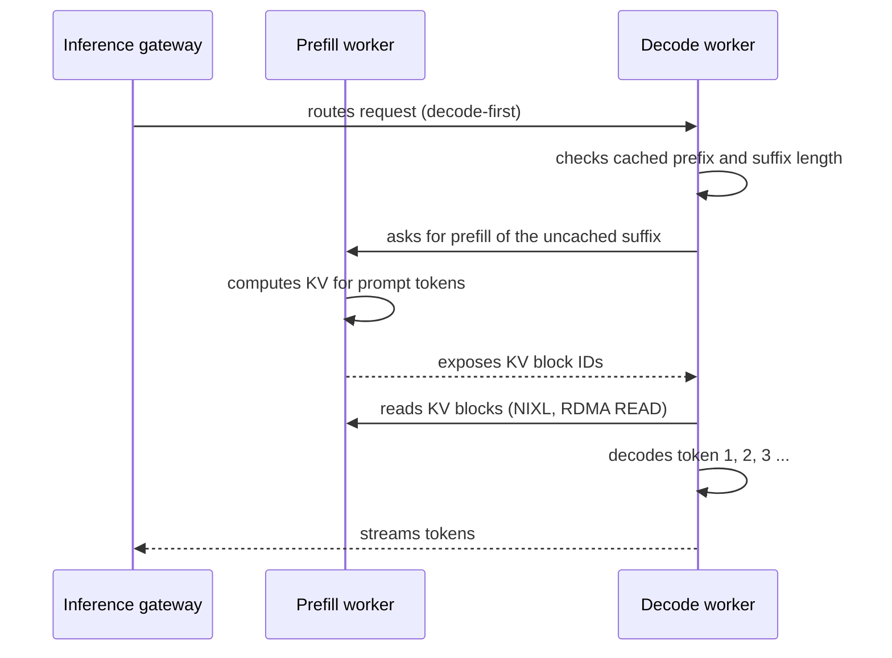
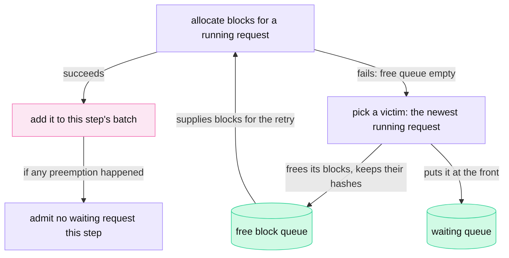

<!-- GENERATED from manuscript/src/part-13-kv-cache.md by tools/render_manuscript.py. Edit the source, not this file. -->
# Part 13: KV-cache systems

The KV cache is per-request GPU state that grows with every token. Its size, layout and movement decide how many requests one GPU serves at once.

Your request has now passed admission (part 9). Its prompt is in the prefill pool, and the first layer is about to run. Every layer writes K and V for every prompt token. Those tensors stay in HBM until your request ends. This part follows those tensors in six steps:

1. How big they are (13.1).
2. How the engine stores them in blocks (13.2).
3. How a later request reuses them, and who may reuse them (13.3 to 13.5).
4. Where they go when HBM is full (13.6).
5. How they move from a prefill GPU to a decode GPU (13.7).
6. What happens when no room is left (13.8).

Two models carry the numbers in this part. `M-dense` is Mistral Medium 3.5, a dense model with grouped-query attention in all 88 layers. `M-frontier` is Kimi K3, a mixture-of-experts model that mixes linear-attention layers with latent-attention layers. The two models store very different things, and that difference changes every capacity number.

---

## 13.1 What the KV cache is, and how big it is

The KV cache holds the K and V vectors of every earlier token at every attention layer. Decode reads them instead of computing them again.

### What is reused and what is computed

An attention layer needs three vectors per token: a query (Q), a key (K) and a value (V). The layer compares the query of a new token with the keys of all earlier tokens. The result weights the values of those tokens. Part 10 shows the full math (10.4 to 10.6).

During decode, the model produces one new token per step. At step t+1, the layer needs the keys and values of tokens 1 to t. Those keys and values do not change, because a causal model never lets an earlier token see a later one. So the engine keeps them.

At each decode step and each layer, three things happen to one sequence:

1. The layer **computes** Q, K and V for the new token only.
2. The layer **reads** the stored K and V of all earlier tokens.
3. The layer **appends** the new token's K and V to the store.

The store is the KV cache. It holds **request-specific state**. The model weights hold **shared, read-only state**. Every request in a batch reads the same weights. No request ever reads another request's KV cache, except through the deliberate prefix sharing of 13.3.

**Exact tensors for `M-dense`.** `M-dense` has 96 query heads and 8 KV heads, each with head dimension 128. The name of this design is grouped-query attention (GQA): 12 query heads share one KV head. For one new token and one layer:

| Tensor | Shape (whole model) | Shape per GPU at TP=8 |
|---|---|---|
| hidden state in | `[1, 12288]` | `[1, 12288]` (replicated) |
| q | `[96, 128]` | `[12, 128]` |
| k (new) | `[8, 128]` | `[1, 128]` |
| v (new) | `[8, 128]` | `[1, 128]` |
| cached K for T earlier tokens | `[T, 8, 128]` | `[T, 1, 128]` |
| cached V for T earlier tokens | `[T, 8, 128]` | `[T, 1, 128]` |

Tensor parallelism (TP, part 12) splits the heads across the 8 GPUs of the node. With 8 KV heads and 8 GPUs, each GPU holds exactly one KV head. Each GPU stores only its own head's K and V. So each GPU holds one eighth of the KV cache.

The engine does not store `[T, …]` as one contiguous tensor per sequence. vLLM views each layer's cache as a logical array with four dimensions [vllm@v0.31.0:vllm/v1/kv_cache_interface.py#L295-L311]:

1. physical blocks,
2. KV heads,
3. tokens per block,
4. bytes of K and V per token.

Section 13.2 explains why.



Legend: amber = your request's data; pink = GPU computation; green cylinder = stored state. The one thing to notice: the layer projects only the new token and reads everything older. The diagram leaves out the feed-forward half of the layer on purpose.

### The size formula, worked for `M-dense`

For grouped-query and multi-head attention, the KV cache costs the same number of bytes for every token:

```
KV bytes per token = 2 × layers × KV_heads × head_dim × bytes_per_element
```

The 2 counts K and V. For `M-dense` in BF16 (2 bytes per element):

```
2 × 88 layers × 8 KV heads × 128 dims × 2 B = 360,448 B per token
```

That is 352 KiB for every token of every sequence. In FP8 (1 byte per element) it is 180,224 B per token. Per amount of context (decimal units: 1 MB = 10⁶ B, 1 GB = 10⁹ B):

| Context | KV cache (BF16) | KV cache (FP8) |
|---|---|---|
| 1,000 tokens | 360.4 MB | 180.2 MB |
| 8,192 tokens | 2.95 GB | 1.48 GB |
| 32,768 tokens | 11.81 GB | 5.91 GB |
| 131,072 tokens | 47.24 GB | 23.62 GB |
| 262,144 tokens (the context window) | 94.49 GB | 47.24 GB |

One sequence at 131,072 tokens needs 47.2 GB of KV cache in BF16. One H100 has 80 GB of HBM. So one long sequence needs more than half of one GPU's memory, before any weights.

### Other attention types change the formula

The formula above holds only when every layer stores K and V for every token. Modern models change what they store, and each change has its own formula.

**Multi-head and multi-query attention.** Multi-head attention (MHA) gives every query head its own K and V. Multi-query attention (MQA) shares one K and V across all query heads. GQA sits between them. Only the `KV_heads` term changes.

**Multi-head latent attention (MLA).** MLA stores one compressed vector per token per layer, called the latent KV [SRC-069]. It replaces the separate K and V of each head. At attention time, learned matrices project the latent back into per-head keys and values.

`M-frontier` has 24 MLA layers. Each stores a latent of 512 values plus 64 extra key values that all heads share. In `M-frontier` these extra dimensions carry no rotation, because the model uses no positional encoding [SRC-380]:

```
MLA bytes per token = layers_MLA × (latent_dim + shared_key_dim) × bytes_per_element
```

```
24 layers × (512 + 64) × 2 B = 27,648 B per token (BF16)
```

MLA has one latent per token, not one per head. So tensor parallelism cannot split it by heads, and every TP rank holds the full latent cache. This is why MLA deployments use data parallelism for attention [SRC-387].

**Linear attention and state-space layers.** A linear-attention layer keeps a fixed-size **recurrent state** per sequence instead of a growing cache. `M-frontier` has 69 such layers, called Kimi Delta Attention (KDA) [SRC-380]. Each KDA layer keeps one matrix of 128 × 128 FP32 values per head, for 96 heads, per sequence. It also keeps a small short-convolution state in BF16. Neither grows with context:

```
recurrent state per layer = 96 × 128 × 128 × 4 = 6,291,456 B
conv state per layer      = 96 × 384 × 3 × 2 = 221,184 B
fixed state per sequence  = 69 × (6,291,456 + 221,184) = 449,372,160 B ≈ 449.4 MB
```

**Sliding-window attention.** A sliding-window layer keeps only the last W tokens. Its cost per layer is `min(T, W)` tokens instead of T.

**Sparse attention.** Sparse attention reads only a selected subset of earlier tokens per query. It does not shrink the cache: every token's KV is still stored, and the layer only reads fewer of them. GLM-5.3 is a public example: its indexer selects 2,048 tokens per query, but all latents stay in memory [SRC-315].

The side-by-side comparison, per request:

| Design (example) | Formula (bytes for T tokens) | 8k tokens | 32k tokens | 128k tokens |
|---|---|---|---|---|
| GQA, `M-dense`, BF16 | 2 × 88 × 8 × 128 × 2 × T | 2.95 GB | 11.81 GB | 47.24 GB |
| GQA, `M-dense`, FP8 | 2 × 88 × 8 × 128 × 1 × T | 1.48 GB | 5.91 GB | 23.62 GB |
| the same 88 layers as MHA (96 KV heads), hypothetical | 2 × 88 × 96 × 128 × 2 × T | 35.4 GB | 141.7 GB | 566.9 GB |
| the same 88 layers as MQA (1 KV head), hypothetical | 2 × 88 × 1 × 128 × 2 × T | 0.37 GB | 1.48 GB | 5.91 GB |
| hybrid KDA + MLA, `M-frontier`, BF16 latent | fixed state + 24 × 576 × 2 × T | 0.68 GB | 1.36 GB | 4.07 GB |
| MLA + sparse indexer, GLM-5.3, BF16 latent [SRC-315] [SRC-320] | 78 × 576 × 2 × T + 21 × 132 × T | 0.76 GB | 3.04 GB | 12.14 GB |
| sliding window + global, MiMo-V2.6-Pro, BF16 [SRC-344] | [10·T + 60·min(T, 128)] × 8 × (192 + 128) × 2 | 0.46 GB | 1.72 GB | 6.75 GB |

Read the `M-frontier` row against the `M-dense` row. At 8k tokens, `M-frontier` needs about 23% of the memory of `M-dense`, although it is a far larger model. Below 16,254 tokens, the fixed KDA state is larger than the latent cache. At 2,048 tokens, the fixed state is 89% of the request's memory. So short requests on `M-frontier` are limited by per-sequence state, not by per-token KV.

### KV quantization

The engine can store K and V in FP8 (1 byte) instead of BF16 (2 bytes). vLLM selects this with `--kv-cache-dtype fp8` [vllm@v0.31.0:vllm/config/cache.py#L123-L131]. It halves the bytes per token, so it doubles the tokens that fit.

NVIDIA's public Dynamo recipes for `M-frontier` on GB200 and GB300 store the MLA latent in FP8 [SRC-388]. FP8 storage rounds each stored value to fewer bits. A common practice is to check accuracy on the deployment's own evaluations before enabling it. vLLM keeps the KDA recurrent state in FP32 by default, and BF16 is a selectable option [SRC-384].

### How many sequences fit on one GPU

Capacity is what is left of HBM after the weights and the engine's working memory. On `H-teach`, `M-dense` runs as one replica over 8 GPUs with TP=8. The arithmetic per GPU:

1. HBM per GPU: 80.0 GB.
2. vLLM uses a fraction 0.92 of it: 73.60 GB.
3. Subtract the weights per GPU. TP=8 splits the released FP8 checkpoint over 8 GPUs: 16.70 GB.
4. Subtract the non-KV overhead: 4.29 GB. This 4 GiB is an assumption, explained after the list.
5. The KV pool per GPU is what remains: 52.60 GB.
6. Each GPU holds one KV head, so each token costs 45,056 B per GPU in BF16.
7. Tokens that fit: 52.60 GB ÷ 45,056 B = 1,167,531 tokens. Every GPU holds its share of the same tokens, so this is also the replica's capacity.
8. In blocks of 16 tokens: 72,970 blocks. vLLM reserves block 0 as a null block [vllm@v0.31.0:vllm/v1/core/block_pool.py#L184-L188], so 72,969 are usable.

In this reference system, the non-KV overhead per GPU is an assumption of 4.0 GiB. It covers activation peaks, CUDA Graph memory pools and communication buffers. A real engine measures this value in a profiling run at startup. It then logs the KV memory that remains.

Concurrent sequences that fit in one replica, for weights in FP8 and KV in BF16:

| Context per sequence | Blocks per sequence | Sequences that fit |
|---|---|---|
| 2,048 tokens | 128 | 570 |
| 8,192 tokens | 512 | 142 |
| 32,768 tokens | 2,048 | 35 |
| 131,072 tokens | 8,192 | 8 |

The same GPUs hold the same number of tokens in every row. Longer contexts only divide that number into fewer sequences.

For `M-frontier`, a decode worker is 16 GB300 GPUs with attention data parallelism (DEP16, 13.7). Each GPU keeps its own sequences' full latent cache and full KDA state:

1. HBM per GB300 GPU: 288 GB; × 0.92 = 264.96 GB.
2. Subtract the weights per rank. TensorRT-LLM's guide lists 210 GB per rank for DEP16 [SRC-389]. Every rank holds a full copy of the BF16 non-expert weights. The 16 ranks divide the MXFP4 routed experts between them.
3. Subtract the same assumed overhead of 4 GiB. The pool per rank is 50.67 GB.
4. Divide by the memory of one sequence: the fixed state plus its MLA latent, rounded up to 64-token blocks.

| Context per sequence | Sequences per GPU (BF16 latent) | per 16-GPU worker | per GPU without the fixed state (counterfactual) | per GPU (FP8 latent) |
|---|---|---|---|---|
| 2,048 tokens | 100 | 1,600 | 894 | 106 |
| 8,192 tokens | 74 | 1,184 | 223 | 90 |
| 32,768 tokens | 37 | 592 | 55 | 56 |
| 131,072 tokens | 12 | 192 | 13 | 22 |

At 2,048 tokens, the fixed state costs `M-frontier` most of its capacity. Without it, the same GPU would hold 8.9 times as many sequences. At 131,072 tokens the latent cache dominates, and the fixed state matters little. FP8 storage of the latent helps long contexts most, for the same reason.

### What these numbers change

These byte counts drive design decisions far beyond the attention kernel:

- **Maximum batch size.** At 8k tokens, one `M-dense` replica holds at most 142 sequences at once, whatever the token budget allows.
- **Admission policy.** The scheduler must check free KV blocks before it admits a request. A 131,072-token request needs 8,192 blocks, the space of 64 requests of 2,048 tokens (part 9.4).
- **Routing.** A router that ignores KV occupancy sends requests to replicas that cannot fit them (part 9.2).
- **GPU count.** Take 1,000 concurrent 8k-token sequences of `M-dense` (a hypothetical number). KV capacity alone needs 8 eight-GPU nodes, or 64 GPUs. With FP8 KV it needs 4 nodes.

**Meanwhile in the fleet.** Your request's prefill writes its first blocks. Meanwhile, an `M-dense` replica at 8k context runs up to 142 other sequences. Each of them appends one token's K and V per step. Finished sequences free their blocks at the end of every scheduler iteration. Those blocks go to the next waiting request.

Counters at this moment:

- `free KV blocks` falls by the number of blocks your prompt needs.
- `active sequences` rises by one.
- `HBM used` stays flat, because the engine allocated the whole pool at startup.

You can now calculate how many sequences of a given length fit in one GPU's free HBM.

---

## 13.2 Paged KV cache and PagedAttention

The engine stores the KV cache in small fixed-size blocks, and a table maps each sequence's blocks. So the engine allocates memory on demand and wastes almost none.

### The problem with contiguous allocation

An engine could reserve one contiguous region per sequence. It does not know the final length in advance. So it must reserve the maximum: the context window or the request's `max_tokens`. Orca, an early iteration-level scheduler, reserved KV slots for `max_tokens` per request [SRC-097]. This wastes memory in three ways:

1. **Over-reservation.** Most of the reserved region is never written, because most outputs end early.
2. **Internal fragmentation.** No other sequence can use the unused tail of a region.
3. **External fragmentation.** Regions of different sizes leave gaps between them that no new region fits.

The PagedAttention paper measured older systems: only 20.4% to 38.2% of KV memory held real token states. With paging, vLLM reached 96.3% [SRC-098].

A simulation shows the same effect with `M-dense`. It uses the KV pool of one `M-dense` replica on `H-teach`: 1,167,504 tokens in usable blocks (13.1). It feeds the pool with 6,000 hypothetical requests. Prompt and output lengths follow log-normal distributions with means of about 3,000 and 400 tokens. Five allocation policies then compete for the same pool:

| Allocation policy | Share of KV memory holding real token states | Sequences running at once (average) |
|---|---|---|
| contiguous, reserve the full context window per request | 1.3% | 4 |
| contiguous, reserve prompt + `max_tokens` (4,096, hypothetical) | 38.8% | 135 |
| contiguous, reserve the next power of two of the true length | 41.6% | 146 |
| contiguous, reserve exactly the true length (needs future knowledge) | 61.9% | 218 |
| paged, 16-token blocks | 99.5% | 347 |

Even an exact reservation wastes memory, because regions of different sizes leave gaps between them. Paging wastes only the unused end of each sequence's last block. The largest such end in this run was 15 tokens. Paging has a cost too: when the pool fills, running sequences need new blocks that do not exist. This run preempted sequences 228 times (13.8).

### The mechanism

vLLM divides HBM into **KV blocks** of 16 tokens each [vllm@v0.31.0:vllm/config/cache.py#L71]. A block holds the K and V of 16 consecutive tokens of one sequence, for one layer group. All blocks live in one **block pool** that the engine allocates once, at startup [vllm@v0.31.0:vllm/v1/core/block_pool.py#L136-L188].

Each sequence has a **block table**. It maps logical blocks 0, 1, 2, … to physical block IDs in the pool. The sequence's tokens are contiguous in the logical view, and the physical blocks can sit anywhere.

The engine manages blocks with five operations:

1. **Allocate.** A new sequence takes `ceil(prompt_tokens / 16)` blocks from the head of the free queue.
2. **Append.** Decode writes each new token into the last block. When that block is full, the engine allocates one more block.
3. **Free.** When the sequence ends, each block's reference count drops by one. A block with count 0 returns to the free queue.
4. **Reuse.** A freed block that holds a full, hashed prefix stays in the free queue with its contents. A later request with the same prefix can take it back (13.3).
5. **Evict.** To supply a new block, the engine takes the block at the head of the free queue. It forgets that block's hash.

**Reference counts.** Each physical block has a count of the block tables that point to it. A shared prefix block can have a count above 1. The engine never writes into a shared block. In vLLM V1, shared blocks are always full and read-only, and a request writes only into blocks it owns alone [vllm@v0.31.0:vllm/v1/core/block_pool.py#L773-L775].

**Copy-on-write.** An older design copied a shared partial block when one of its sequences wrote into it. vLLM V1 shares only full blocks. So ordinary prefix sharing needs no copy.

Parallel sampling (several answers for one prompt) runs as several child requests that share prompt blocks through the prefix cache [vllm@v0.31.0:vllm/v1/engine/parallel_sampling.py]. TensorRT-LLM takes a different path. When a cached block matches only in part, it copies the matched tokens into a new block [SRC-058].

**How the kernel finds the right slot.** For each new token at position `pos` of a request, the engine computes one flat slot index:

```
slot = block_table[request, pos // 16] × 16 + pos % 16
```

The attention kernel receives each request's row of the block table and its sequence length [vllm@v0.31.0:vllm/v1/worker/block_table.py#L432-L476]. A query of request A reads only the blocks in A's row. Request B's blocks are not in that row, so A's query cannot reach them. This is how one batch mixes many users' sequences while each user's KV stays separate (part 11.5).

### Your request's blocks

The trace below comes from an allocator simulation that follows vLLM V1's rules. Before your request arrives, other users' requests allocate and free blocks, so the free queue is no longer in order.

The simulated pool has 128 blocks of 16 tokens; block 0 is vLLM's null block. 90 requests from other users run first. Token IDs in this trace are illustrative. The hash digests use vLLM's chain structure with a different byte serialization.

1. **Your request (A) arrives.** Its prompt has 60 tokens: system prompt (32), tool schemas (16) and its own text (12). It needs 4 blocks. The free queue hands out blocks 30, 49, 76, 121. So the block table maps logical blocks [0][1][2][3] to physical blocks [30][49][76][121]. The first 3 blocks are full, so the engine hashes them. The last block holds 12 tokens and gets no hash.
2. **Decode crosses a block boundary.** At position 64, the last block is full. The engine hashes it and allocates one more block. The table becomes [30][49][76][121][85].
3. **Request B from the same tenant arrives.** Its first 48 tokens are the same system prompt and tool schemas. Its first three block hashes match, so it takes blocks 30, 49, 76 without computing them. Their reference counts become [2, 2, 2]. B gets new blocks 5, 81 for its own text.
4. **Your request finishes.** The reference counts of the shared blocks drop to [1, 1, 1], because B still uses them. Your request's other blocks return to the free queue.
5. **B finishes, and request C from the same tenant arrives later.** The three prefix blocks now sit in the free queue with their hashes. C finds them by hash and takes them back out of the queue. They sat near the tail of the free queue, at positions 98, 97, 96 of 99, counted from the head. C reuses 48 tokens of KV.
6. **Request D from a different tenant arrives.** Its first 48 token IDs are identical to A's. It reuses nothing (0 hit tokens), because its cache salt changes every hash. A's first digests are c1efba40, dff1404e, a6471c92. D's are eac86129, 2588878f, 65961635.
7. **A large request (E) arrives under memory pressure.** It needs 102 blocks. The free queue supplies them from its head and evicts 97 cached blocks, least recently used first.
8. **Request F from the first tenant arrives.** Only 32 tokens still hit, in blocks 30, 49. The tail of the prefix chain left the cache first, so its head survived.



Legend: amber = your request's logical blocks; grey = another request; green cylinders = physical blocks in HBM. The one thing to notice: logical order and physical order are unrelated, and one physical block can serve two requests. The diagram leaves out the other layers' copies on purpose; every layer group uses the same block IDs.

### Paging compared with operating-system virtual memory

The design borrows a structure from operating systems. The mechanisms differ in important ways:

| Property | OS virtual memory | Paged KV cache (vLLM) |
|---|---|---|
| Unit | page (often 4 KiB) | KV block (16 tokens × KV bytes per token per layer group) |
| Mapping structure | page table, per process | block table, per sequence |
| Who translates addresses | the CPU's MMU, in hardware, on every access | the attention kernel, in software, from the block table it receives |
| Missing entry | page fault; the OS loads the page on demand | does not happen; the scheduler allocates every block before the step runs |
| Sharing | shared pages with copy-on-write | shared full blocks, read-only, reference-counted |
| Eviction | page replacement to swap | LRU over free cached blocks; a running sequence is preempted, not paged out (13.8) |
| Size known in advance | no | the engine knows how many tokens each step adds |

The block table is a tensor that the attention kernel receives and reads [vllm@v0.31.0:vllm/v1/attention/backends/flash_attn.py#L1450-L1474]. No hardware traps a missing block. So the scheduler must allocate every block a step needs before the step starts.

### Why paging raises the batch size

Paging wastes at most 15 tokens per sequence: the unused end of the last block. So the pool holds almost only real tokens. In the simulation above, paging runs about 347 sequences at once, where a `max_tokens` reservation runs about 135. More sequences per step means more tokens per weight read. That is the main lever for decode throughput (part 11.4).

**Meanwhile in the fleet.** In one scheduler iteration on a busy replica, three things change the block pool. Finished sequences return blocks. New prefills take blocks. Decoding sequences cross block boundaries and take one block each.

You can now draw a sequence's block table and compute its slot indices. You can also explain why paging fits more sequences.

---

## 13.3 Prefix caching

A new request whose first tokens match an earlier request reuses that request's full KV blocks.

### The example

Two requests from the same tenant share a long start:

- Request 1: `SYSTEM + TOOLS + A + B + C`
- Request 2: `SYSTEM + TOOLS + A + B + D`

`SYSTEM` is the system prompt and `TOOLS` is the tool schemas. Both are the same for every request of this tenant. `A` and `B` are earlier turns of the conversation.

The segment lengths are hypothetical, and blocks hold 16 tokens:

| Segment | `SYSTEM` | `TOOLS` | `A` | `B` | `C` | `D` |
|---|---|---|---|---|---|---|
| Tokens | 1,200 | 2,400 | 300 | 280 | 150 | 170 |

The lookup for request 2:

1. The two prompts are identical up to token 4,180, where `D` starts instead of `C`.
2. Request 2 hits the first 261 blocks, which hold 4,176 tokens.
3. Block 261 holds the last 4 tokens of `B` and the first 12 tokens of `D`. Its hash covers all 16 token IDs, so it does not match request 1's block. Its digest is 0b49eb53 instead of fbb13e07. vLLM computes those 4 tokens of `B` again, although request 1 already computed them.
4. The last block of request 2 holds only 14 tokens, so it is never cached.
5. Prefill runs on 174 tokens instead of all of them: 96% of the prompt comes from the cache.

### How vLLM finds the shared blocks

vLLM gives every full block a hash [vllm@v0.31.0:vllm/v1/core/kv_cache_utils.py#L684-L714]. The hash covers three inputs: the previous block's hash, this block's token IDs and some extra keys:

```
hash(block i) = SHA-256( hash(block i−1), token IDs of block i, extra keys )
```

Block 0 has no previous block. vLLM uses a fixed value, `NONE_HASH`, as its previous hash [vllm@v0.31.0:vllm/v1/core/kv_cache_utils.py#L720-L721]. With SHA-256, `NONE_HASH` comes from a fixed default seed, so every process computes the same block hashes [vllm@v0.31.0:vllm/v1/core/kv_cache_utils.py#L132-L145].

Each hash includes the previous one. So a block's hash identifies the **entire prefix** up to the end of that block. Two blocks with equal hashes hold the KV of identical prefixes.

The lookup for a new request runs in five steps [vllm@v0.31.0:vllm/v1/core/kv_cache_manager.py#L264-L321]:

1. Compute the hash of each full block of the prompt.
2. Look up the first hash in the pool's hash table.
3. On a hit, raise that block's reference count and remove it from the free queue. Then look up the next hash.
4. Stop at the first miss. Every later block must miss too, because its hash chains through the missing one.
5. Allocate new blocks for the rest of the prompt and run prefill on those tokens only.

Some details matter:

- **Only full blocks get a hash.** The partial last block of a prompt is never shared.
- **A block enters the hash table as soon as it is full.** The scheduler registers it in the same step that fills it [vllm@v0.31.0:vllm/v1/core/kv_cache_manager.py#L603-L612]. So a new request can share the blocks of a sequence that still runs. Such a block is not in the free queue, so step 3 only raises its reference count.
- **The engine always computes the last prompt token.** The model needs that token's output to produce the first new token. So even a full match recomputes one token.
- **The extra keys** include a LoRA adapter name and the content hash of any image in the block. The first block also carries the cache salt (13.5).
- **Eviction is lazy.** A freed block keeps its hash until the free queue hands it out again. The queue puts the least recently used block first. A request frees its blocks tail first. So the end of a prefix leaves the cache before its start [vllm@v0.31.0:vllm/v1/core/kv_cache_utils.py#L255-L262].



Legend: green = shared hashed blocks; amber and grey = the first blocks that differ. The one thing to notice: the chain divides at the first different block. Nothing after that point can match. The diagram shows one block per segment for clarity; real segments span many blocks.

### Time saved

A cache hit removes prefill work for the shared tokens. For `M-dense` on `H-teach`, with a shared prefix of 8,000 tokens and a new suffix of 500 tokens (both hypothetical):

1. **Miss.** Prefill runs all 8,500 tokens: 2.25 × 10¹⁵ FLOPs. The node computes 3.96 PFLOP/s: 8 GPUs × dense BF16 peak × an assumed utilization of 0.5. So the miss takes 570 ms.
2. **Hit.** The 500 cached blocks cover the prefix exactly. Prefill runs only the 500 new tokens, which still attend to all earlier tokens: 1.41 × 10¹⁴ FLOPs, 35.7 ms.
3. **Saved:** 534 ms of TTFT, or 94% of the prefill time.

These times rest on an assumed model-FLOPs utilization of 0.5 during prefill. A real deployment measures its own value.

### The radix tree: SGLang's approach

SGLang stores cached prefixes in a radix tree [SRC-047]. Each edge holds a run of token IDs of any length. Each node points to the KV slots of its tokens. On CUDA the default page size is one token, so a match can end at any token.

Three short requests show the difference (illustrative token IDs). Each later request shares a prefix with an earlier one, as the second column shows:

| Request | Tokens shared with an earlier request | Radix tree (page size 1) reuses | 16-token hash blocks reuse | Lost to block alignment |
|---|---|---|---|---|
| second | 27 | 27 | 16 | 11 |
| third | 19 | 19 | 16 | 3 |
| third, under another cache salt | 19 | 0 | 0 | — |

On long prompts the loss to block alignment is at most 15 tokens per request, so it matters little. The radix tree pays instead with a tree walk and node splits.

The two designs trade different costs:

| | Hash chain over full blocks (vLLM) | Radix tree (SGLang) |
|---|---|---|
| Match granularity | 16 tokens | 1 token (page size 1) |
| Lookup | one hash-table probe per block | walk down the tree, compare token runs |
| Divergence inside a block | that block and all later ones miss | the node splits at the exact token |
| Protecting running requests | reference counts per block | lock counts on every node from the request's last node up to the root |
| Eviction | LRU over free hashed blocks | LRU over unlocked leaves |

TensorRT-LLM also stores filled blocks in a radix search tree, with priority-based LRU eviction [SRC-058].

### Prefix caching with a hybrid model

A KDA layer has no per-token cache. Its state after token 2,560 is one matrix that summarizes all 2,560 tokens. To reuse a prefix, the engine needs that matrix exactly at the prefix boundary. So hybrid engines save **checkpoints** of the recurrent state at selected boundaries.

Moonshot describes its own serving design for `M-frontier` in the model's technical report [SRC-380]. Prefix hashes run on 512-token hash blocks inside much larger memory pages. The engine saves KDA checkpoints only at some hash-block ends.

Moonshot's report gives an example, which the simulation reproduces. A request matches an earlier one for 2,800 tokens. It hits at ⌊2,800 ÷ 512⌋ × 512 = 5 × 512 = 2,560 tokens. The engine computes the last 240 matching tokens again, because no KDA checkpoint exists inside a hash block.

Each checkpoint is a full copy of one sequence's KDA state: 449,372,160 B. vLLM keeps checkpoints at a fixed interval, for example every 32,768 tokens [SRC-343]. A 1,048,576-token context then needs 32 checkpoints, or 14.4 GB. That is 50% of the same context's MLA cache. A checkpoint at every 512-token hash block would need 2,048 checkpoints, which is why engines save them sparsely.

**Meanwhile in the fleet.** Most requests of one tenant share the same system prompt and tool schemas. Moonshot reports a cache-hit rate above 90% for coding workloads on its own API [SRC-381]. On such a workload, the GPU reads most prompt tokens' KV from the cache instead of computing it.

You can now compute which blocks of a request hit the prefix cache, and the prefill time saved.

---

## 13.4 Six different caches

Six different mechanisms in this system carry the name "cache". Each stores a different thing in a different place.

| Cache | Key | Value | Where it lives | Lifetime |
|---|---|---|---|---|
| 1. Application result cache | request fingerprint (normalized request + tenant + settings) | a complete earlier response | a key-value store such as Redis, in the CPU tier | TTL, often seconds to minutes; only for deterministic, non-personal requests |
| 2. Semantic response cache | embedding of the request, compared by similarity | an earlier response to a similar request | a vector index in the CPU tier | TTL; risky for personal or time-sensitive content |
| 3. Tokenizer cache | text string (for example a fixed system prompt) | its token IDs | process memory of the server that tokenizes | the life of the process |
| 4. Embedding cache | hash of a chunk or a query, plus the model version | the embedding vector | a key-value store in the retrieval tier | until the source changes or the model version changes |
| 5. Prefix KV cache | chained block hash (with tenant salt) | KV blocks of a shared prefix | GPU HBM, then lower tiers (13.6) | until evicted by LRU under memory pressure |
| 6. Per-request KV cache | the sequence's block table | KV blocks of one running sequence | GPU HBM | from prefill until the sequence ends, then freed or kept as prefix cache |

Caches 5 and 6 use the same physical blocks. A block belongs to cache 6 while a running sequence points to it. It becomes part of cache 5 as soon as it is full, while the sequence still runs (13.3). After the sequence ends, the block keeps its hash at the end of the free queue until LRU eviction [vllm@v0.31.0:vllm/v1/core/block_pool.py#L777-L806].

Caches 1 and 2 skip the model entirely, and the others only skip part of the work. Part 16.3 places all six on the full cache map of the system.

You can now name, for any "cache hit", which of the six caches it was and what it saved.

---

## 13.5 Prefix-cache privacy

Sharing KV blocks across tenants leaks information through timing, so the engine scopes the prefix cache with a per-tenant salt.

### Why cross-tenant sharing is dangerous

A prefix-cache hit makes the first token arrive sooner. An attacker can measure that difference. The attacker sends a guess for the start of someone else's prompt and watches the time to first token. A fast answer means the guess matches cached blocks, so someone else sent that prefix recently.

The vLLM design document names this risk [SRC-040]. The salt "prevents timing-based attacks where an adversary could infer cached content by observing latency differences". A 2024 study used such timing measurements to detect cache hits in LLM serving systems. It recovered shared prompt prefixes token by token, including system prompts and other users' prompts [SRC-206].

Three other risks exist:

- **Accidental reuse.** A bug in key construction can give one tenant's blocks to another tenant's request. The response would then attend to text the user never sent.
- **Hash collisions.** Two different prefixes with the same hash would share blocks. vLLM uses SHA-256 by default for this reason. Its non-cryptographic xxhash option comes with a warning about collision risk in multi-tenant setups [vllm@v0.31.0:vllm/config/cache.py#L144-L160].
- **Deliberate collisions.** An attacker who can predict the hash seed can try to build colliding blocks offline. So vLLM seeds non-cryptographic hashes with a random value per process [vllm@v0.31.0:vllm/v1/core/kv_cache_utils.py#L104-L172].

How unlikely is an accidental SHA-256 collision? Suppose the cache hashes every full block of every prompt for a year of hypothetical traffic. That is 2.05 × 10¹⁴ blocks. The birthday bound gives a collision probability of about 10⁻⁴⁹. With a 128-bit non-cryptographic hash, the same count gives about 10⁻¹⁰, and an attacker can search for collisions on purpose.

### The cache salt

vLLM puts a `cache_salt` value into the extra keys of the **first** block only [vllm@v0.31.0:vllm/v1/core/kv_cache_utils.py#L614-L652]. Every later hash chains through the first one, so the salt changes every block hash of the request. Requests with different salts can never share a block. SGLang puts the salt into the radix tree's child keys, so different salts live in separate subtrees [SRC-047]. TensorRT-LLM supports the same idea [SRC-058].

The same two requests of 13.3, hashed under different salts:

| Case | First three block digests, request 1 | First three block digests, request 2 | Shared blocks |
|---|---|---|---|
| same salt (one tenant) | f4fecb2a, 23383c17, f3e9c1c2 | f4fecb2a, 23383c17, f3e9c1c2 | 261 |
| different salts (two tenants) | f4fecb2a, 23383c17, f3e9c1c2 | 0eb45532, 3b92014f, 1a546ef1 | 0 |

The token IDs are identical in both cases. Only the salt in block 0 differs, and the chain carries that difference into every later block.

### The trade-off

A salt per user gives the strongest isolation and the fewest hits. No salt gives the most hits and no isolation. In this reference system:

- Private content uses `cache_salt` = the tenant (organization) ID (RA-40). Users of one organization share prefixes. Other organizations cannot detect them.
- The salt sits in block 0, so it covers the whole request. A request with tenant content therefore shares no blocks with other tenants, not even its operator system prompt. Only requests of the same tenant reuse that prompt (RA-40).

The model weights stay shared across all tenants. Weights hold read-only parameters, and the KV cache holds request state.

You can now explain why the prefix cache needs a tenant salt, and choose the salt scope.

---

## 13.6 The multi-tier KV cache

When HBM is full, cached KV blocks move to slower tiers. A later hit loads them back when that beats computing them again.

### The tiers

| Tier | Name in Dynamo's block manager | Medium | Path to the GPU | Bandwidth per GPU |
|---|---|---|---|---|
| G1 | device | HBM | none | 3,350 GB/s (H100) |
| G2 | host | pinned CPU DRAM | PCIe Gen5 x16 (H100); NVLink-C2C on Grace-based systems | 63 GB/s per direction (PCIe) |
| G3 | disk | local NVMe SSD | PCIe, GPUDirect Storage | 14 GB/s (one Gen5 drive per GPU, a reference choice) |
| G4 | object storage | a remote store: S3-compatible objects in Dynamo; Mooncake Store or an LMCache server elsewhere | NIC | at most 50 GB/s (one 400 Gb/s NIC per GPU) |

The tier names come from NVIDIA Dynamo's KV block manager, where G4 is S3-compatible object storage [dynamo@2946153:docs/fern/pages/reference/components/kvbm-configuration.mdx#L17]. In this reference system, G4 is an object store (RA-39). Its reads cross the NIC, so the NIC line rate is an upper bound for a G4 hit. LMCache offers the same tiers for vLLM through a KV connector, in chunks of 256 tokens [SRC-293].



Legend: pink = GPU memory; green = storage tiers; violet = a CPU service. The one thing to notice: every hit, from any tier, must land in HBM before attention can read it. The diagram leaves out the exact copy path from SSD (direct with GPUDirect Storage, or through host memory) on purpose.

No vendor publishes an end-to-end latency for these paths, so no latency appears here for G2 to G4. For transfers of hundreds of megabytes, bandwidth decides the time, so latency matters little here.

### Four outcomes for one prefix

Take a prefix of 32,768 tokens of `M-dense` on `H-teach`. Its cached KV is 11.81 GB for the node, or 1.48 GB per GPU. Each GPU loads its own share over its own link, in parallel. The four outcomes:

| Outcome | Bytes moved per GPU | Time to have the KV ready |
|---|---|---|
| GPU hit (G1) | 0 | 0 ms |
| CPU hit (G2, PCIe) | 1.48 GB | 23.4 ms |
| remote hit (G4, NIC line rate) | 1.48 GB | 29.5 ms |
| SSD hit (G3) | 1.48 GB | 105.5 ms |
| recompute (prefill again) | 0 | 2,630 ms |

A real remote store runs below line rate. Mooncake measured 190 GB/s over eight 400 Gb/s NICs [SRC-103]. At that rate per NIC, the remote hit takes 62 ms. Even the slowest hit is about 25 times faster than recompute. Each time excludes a fixed setup cost; the reference system assumes 2.0 ms per transfer.

### When recompute is cheaper than transfer

Loading a prefix costs time proportional to its bytes. Recomputing it costs prefill FLOPs, which grow faster than linearly with length because of attention. In general, short prefixes on slow links favor recompute, and long prefixes favor transfer. The numbers for this model and hardware show how far the balance tips.

Transfer time per token is a constant: bytes per token divided by bandwidth. Recompute time per token is smallest for the shortest prefix. It grows with length, because each token attends to all earlier ones. So the hardest case for transfer is a very short prefix.

For `M-dense` on `H-teach`, the break-even bandwidth is 0.72 GB/s per GPU. Every tier above is faster than that, so reuse beats recompute for every prefix length, on bandwidth alone. Only the fixed setup cost changes the answer: with 2.0 ms per transfer, recompute wins only below about 32 tokens.

Mooncake's paper states the same comparison as an inequality (its Eq. 2): reuse wins when the bandwidth-to-compute ratio B/G exceeds 2·d·s / (gqa·(a·p·d + b·d²)) [SRC-103]. The paper's own example is LLaMA3-70B on 8 A800 GPUs with an 8,192-token prefix. The simulation reproduces a minimum of 5.86 GB/s, and the paper prints "≈ 6 GB/s". That figure covers a whole 8-GPU node. Divided by 8 GPUs, it is close to the per-GPU value above.

Dynamo's router gives a cached block less credit when it sits in a lower tier [SRC-288]. A hit counts 1.0 in HBM, 0.75 in host memory and 0.25 on disk. The weights encode the same idea as the calculation above: a hit lower in the hierarchy saves less time.

You can now decide, for a given prefix length and tier, whether loading cached KV beats computing it again.

---

## 13.7 Disaggregated prefill and decode ▣

Disaggregation runs prefill and decode on different GPUs and moves the KV blocks between them.

### The design



Legend: solid arrows = requests and data reads; dashed arrows = replies. The one thing to notice: the decode worker pulls the KV blocks, and decode starts only after they arrive. The diagram leaves out the short-suffix case, where the decode worker runs prefill itself (below).

In this reference system the flow follows vLLM's NIXL connector in its default pull mode [SRC-042] [SRC-291]:

1. The gateway sends the request to a decode worker first.
2. If the uncached part of the prompt is short, the decode worker runs prefill itself. Dynamo offers such a rule, off by default [SRC-288]. It prefills locally when the uncached length is under 2,048 tokens and under 0.7 of the prompt. Local prefill skips the trip to the prefill pool and its queue. The cost is compute on the decode worker. At 2,048 tokens, an `M-dense` prefill takes 130 ms there, beside other sequences' decode steps. The KV transfer it avoids would take only 3.8 ms.
3. Otherwise a prefill worker computes the KV and keeps the blocks.
4. The decode worker allocates blocks and reads the prefill worker's blocks with NIXL over RDMA.
5. The decode worker starts decode, and the prefill worker frees its copy.

### Why it helps

- **Operators tune TTFT and TPOT separately.** A long prefill no longer stalls the decode steps of other sequences on the same GPU.
- **Each phase gets its own hardware and batching.** Prefill is compute-bound and decode is memory-bound (part 11.3), so each pool can use the layout that suits it.
- **Each pool scales on its own.** The autoscaler adds prefill workers for long prompts and decode workers for long outputs.

Public designs include:

- the research systems DistServe [SRC-101], Splitwise [SRC-102] and Mooncake [SRC-103];
- NVIDIA Dynamo with NIXL [SRC-288] [SRC-290] and llm-d [SRC-285];
- the KV connectors in vLLM [SRC-042] and TensorRT-LLM [SRC-058]. vLLM's documentation states a limit plainly: "Disaggregated prefill DOES NOT improve throughput". Its stated benefits are separate tuning of TTFT and inter-token latency, and control of tail inter-token latency [SRC-042].

### The cost: moving the KV

```
transfer time ≈ KV bytes ÷ effective bandwidth + software overhead
```

For a context of 32,768 tokens:

| What moves | Bytes on the busiest link | NVLink 4 (H100 node, 450 GB/s per direction) | NVLink 5 (GB300 rack, 900 GB/s) | InfiniBand NDR (400 Gb/s) | RoCE (200 Gb/s) | TCP 25 Gb/s (hypothetical slow path) |
|---|---|---|---|---|---|---|
| `M-dense`, BF16 KV (11.81 GB in 8 parallel flows) | 1.48 GB per GPU | 5.3 ms | 3.6 ms | 31.5 ms | 61.1 ms | 3,782 ms |
| `M-dense`, FP8 KV | 0.74 GB per GPU | 3.6 ms | 2.8 ms | 16.8 ms | 31.5 ms | 1,892 ms |
| `M-frontier`, BF16 latent + KDA state | 1.36 GB into one decode GPU | 5.0 ms | 3.5 ms | 29.1 ms | 56.2 ms | 436 ms |

Each time includes the assumed setup cost of 2.0 ms. `M-dense` splits its KV over 8 GPUs under TP=8 on both sides, so 8 flows run in parallel. For `M-frontier`, one decode rank of a DEP16 worker owns the whole sequence (13.1). So all 1.36 GB arrive at one GPU. 0.45 GB of that is the fixed KDA state.

**Layer-wise streaming.** The prefill worker does not need to finish all layers before it sends anything. It can send layer i's blocks while it computes layer i+1. Then only the last layer's transfer adds to the time. Splitwise measured a non-overlapped part of about 5 ms on H100 with this design [SRC-102].

For `M-dense` at 32,768 tokens, one layer of prefill takes 29.6 ms on the node. One layer's KV crosses one 400 Gb/s link in 0.34 ms. The transfer of every layer except the last therefore hides behind the next layer's compute. The exposed time drops from 31.5 ms to 2.3 ms, and most of what remains is the assumed setup cost. On the hypothetical 25 Gb/s path, one layer's transfer takes 43 ms, longer than its compute. Streaming cannot hide it, and 1,208 ms stay exposed.

**Locality and GPUDirect.** With GPUDirect RDMA, the NIC reads GPU memory directly, with no copy through CPU memory [SRC-028]. Inside one GB300 NVL72 rack, all 72 GPUs share one NVLink domain. So in this reference system, the prefill and decode workers of one group sit in the same rack (RA-55). KV moves over NVLink.

### When disaggregation helps, and when it does not

Compare the exposed transfer with two references: one decode step, and the prefill it replaces.

- **It helps** when the exposed transfer is shorter than one decode step. Then a new request's TTFT grows by less than one token interval, and running sequences stop waiting behind long prefills. Take `M-dense` at 32,768 tokens over 400 Gb/s RDMA. The exposed part is 2.3 ms. The hypothetical TPOT objective is 60 ms.
- **It erases the gain** when moving the KV takes about as long as computing it. On the hypothetical 25 Gb/s path, the full transfer takes 3,782 ms. That is 1.44 times the 2,630 ms prefill.
- **Short prompts** gain little: their prefill is short anyway, so the decode worker can run it locally (step 2 above).

So disaggregation needs RDMA or NVLink between the pools. For this reason, this reference system keeps each prefill and decode group inside one rack.

### Stage card: KV transfer between prefill and decode

| # | Question | Answer |
|---|---|---|
| 1 | Which component runs? | The NIXL agents inside the prefill and decode workers' KV connectors [SRC-290] [SRC-291]. |
| 2 | On what hardware? | GPU HBM on both sides; the NVLink switch inside a rack, or the RDMA NIC between racks. |
| 3 | What data enters? | The prefill worker's KV block IDs and memory descriptors, sent with the request's transfer parameters. |
| 4 | In what representation? | Raw KV blocks in the engine's layout (for `M-frontier`: MLA latent pages and KDA state pages in one pool [SRC-380]). |
| 5 | What computation happens? | None on the data; the decode side issues RDMA READs into its own pre-allocated blocks. |
| 6 | What data leaves? | The same blocks, now in the decode worker's HBM; a notification tells the scheduler they arrived. |
| 7 | Where is state stored? | Prefill side: the blocks, held under a lease of 30 s by default until the decode side reads them [SRC-042]; decode side: the request's block table. |
| 8 | Is it synchronous? | Asynchronous: the decode scheduler marks the request as waiting for remote KV and runs other sequences meanwhile [SRC-291]. |
| 9 | Can different users' requests run here at the same time? | Yes; many transfers for many requests share the links. |
| 10 | How is that concurrency achieved? | Each transfer is independent RDMA work on its own descriptors; the NIC and the NVLink switch interleave them. |
| 11 | What is cached? | Nothing new; the blocks may also enter the prefix cache on the decode side. |
| 12 | What can fail? | A link or NIC fault, or a lease that expires before the read; the request then fails and the orchestrator retries it (part 17.3). |
| 13 | What does it add to latency? | About 2.3 ms of TTFT for 32,768 tokens of `M-dense` over 400 Gb/s RDMA with layer-wise streaming; 31.5 ms without it. |
| 14 | What limits capacity? | Link bandwidth per GPU, and decode-side free blocks to receive into. |
| 15 | How does it scale horizontally? | More prefill and decode workers, each with its own links; transfers stay inside a rack where possible. |
| 16 | What security boundary exists? | KV blocks hold user content, so transfers run only on the private fabric between workers of one deployment, never across tenants' trust boundaries. |

**Meanwhile in the fleet.** While your request's KV moves, the decode worker keeps decoding its other sequences. Each other sequence emits one token per step. The prefill worker has already started the next request's prefill.

You can now calculate the cost of a KV transfer, and say when disaggregation is worth it.

---

## 13.8 Preemption under KV pressure

When the block pool runs out, the scheduler must free blocks. Each way to free them costs time, bandwidth or a failed request.

During decode, every running sequence grows. Every 16 tokens, each sequence needs one more block. Many sequences can cross a block boundary at once. If the free queue is empty, the scheduler cannot run the step. It has five options:

1. **Delay new requests.** Admit no new request until blocks free up. Running sequences continue. The cost is queue time for new requests.
2. **Preempt and recompute later.** Remove a running sequence, free all its blocks, and put it at the front of the waiting queue. When it runs again, prefill recomputes its KV. vLLM V1 does this [vllm@v0.31.0:vllm/v1/core/sched/scheduler.py#L1538-L1581]. Its full, hashed blocks stay in the prefix cache as free blocks. On resume, the normal prefix lookup can hit them. Prefill then recomputes only the evicted part.
3. **Swap KV to CPU memory.** Copy the sequence's blocks to host memory and back later. vLLM V1's preemption has no swap path. vLLM offers CPU offload as a separate KV-connector feature [SRC-291]. LMCache and TensorRT-LLM's host offload move cached blocks in a similar way [SRC-293] [SRC-058].
4. **Offload to a lower tier.** Write the blocks to SSD or a remote store (13.6).
5. **Reject.** Return an error such as 429 or 503 (part 17.7).

The cost of each, for one `M-dense` sequence at 8,192 tokens:

| Response | GPU time spent | Time until the sequence runs again | Other cost |
|---|---|---|---|
| 1. delay new requests | none | not preempted | new requests wait in the queue |
| 2. preempt and recompute | 4.4 GPU-seconds (the whole node for 548 ms) | 548 ms of prefill | the node does no other work in that time |
| 3. swap to CPU and back | none | 11.7 ms (PCIe, both ways) | 2.95 GB of host memory |
| 4. offload to SSD and back | none | at least 52.7 ms | SSD space and write wear |
| 5. reject | none | never | the user gets an error |

The sequence holds 2.95 GB of KV in 512 blocks. Recompute takes 47 times longer than a swap round trip. vLLM V1 still uses recompute. Recompute needs no host memory and no copy path. Also, the prefix cache can still hold some of the preempted sequence's blocks (option 2 above).



Legend: violet = scheduler decisions; pink = GPU work; green = queues. The one thing to notice: preemption frees blocks for running sequences and pauses admission for that step. The diagram follows vLLM V1 under first-come-first-served scheduling [vllm@v0.31.0:vllm/v1/core/sched/scheduler.py#L757-L813]; it leaves out priority scheduling on purpose.

The scheduler picks the sequence to preempt by policy. Under first-come-first-served scheduling, vLLM preempts the most recently admitted running request; under priority scheduling, it preempts the lowest-priority request [vllm@v0.31.0:vllm/v1/core/sched/scheduler.py#L757-L813]. Older requests keep their progress. In a step that preempts, vLLM admits no waiting request (part 11.6). Preemption is why admission control (part 9.4) checks KV capacity first. A request that cannot finish within the pool wastes the work done on it.

**Meanwhile in the fleet.** A burst of long prompts can push many replicas to KV pressure at the same time. The counters show it first: `free KV blocks` near zero, `preemptions` rising, and p99 TTFT climbing (part 22.8).

You can now compare the five responses to KV pressure and explain why admission control must account for KV blocks.

---

## What Part 13 established

The KV cache is the per-request state that limits concurrency on a GPU. Engines manage it as paged, hashed, tiered and movable blocks. So many users share one GPU without sharing their data.
