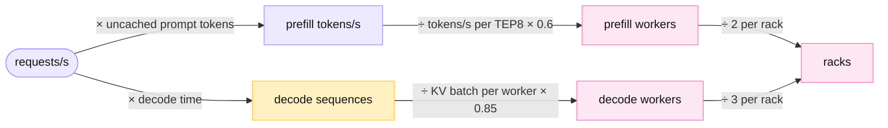
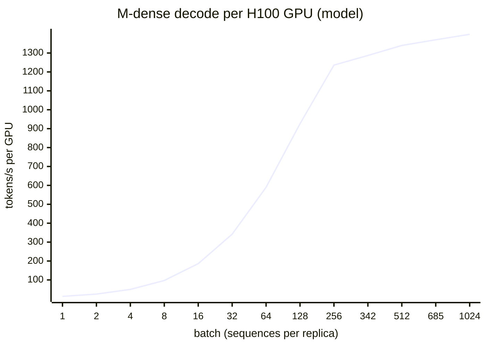
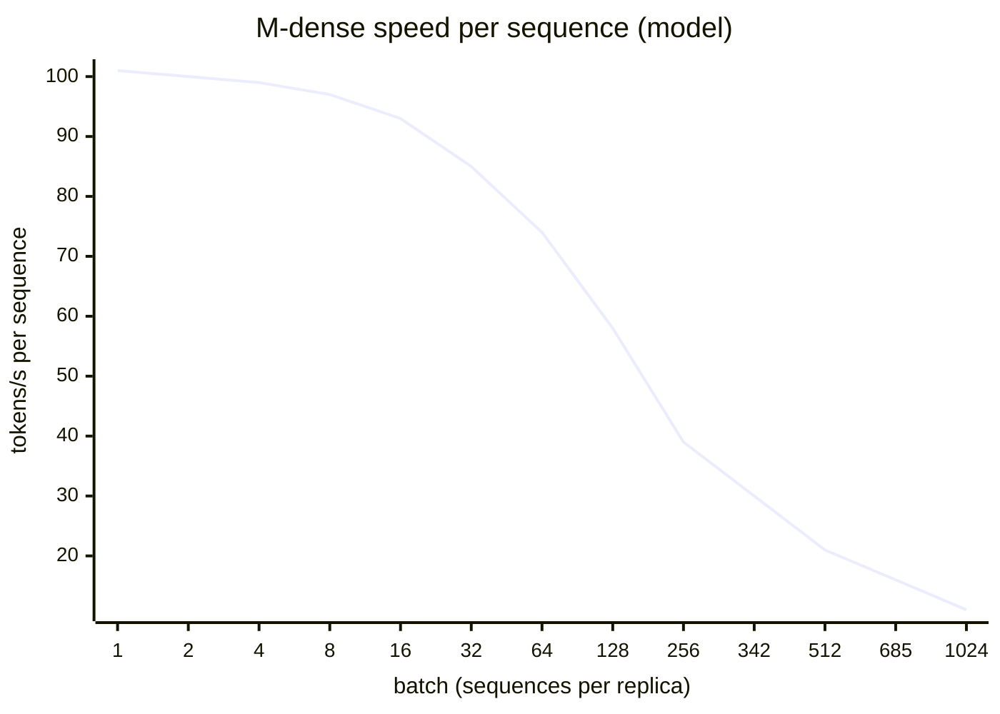
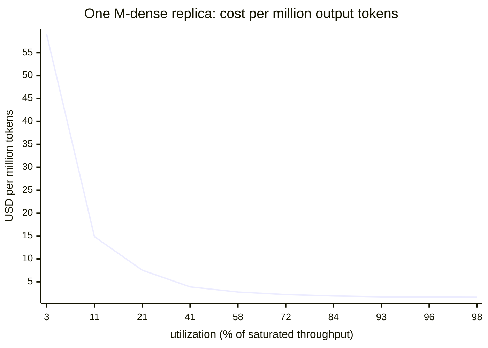
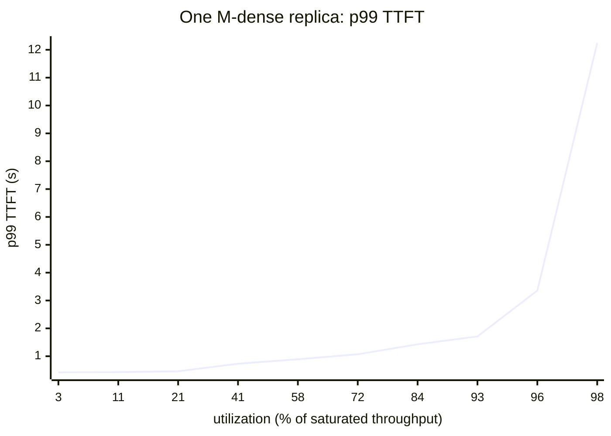
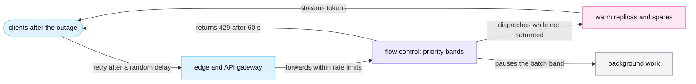
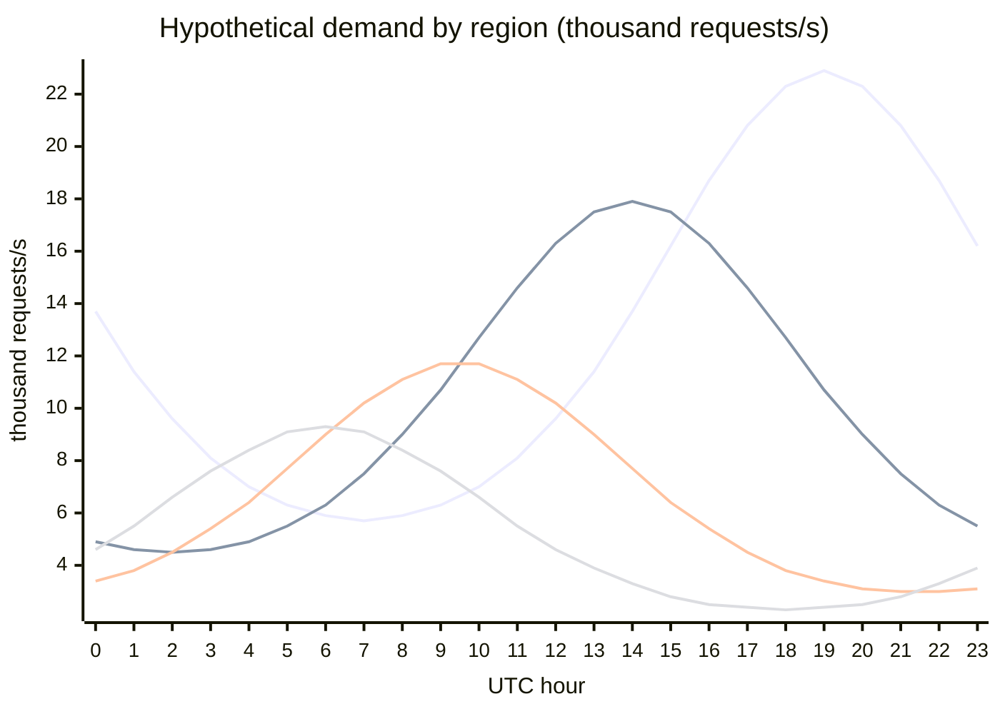
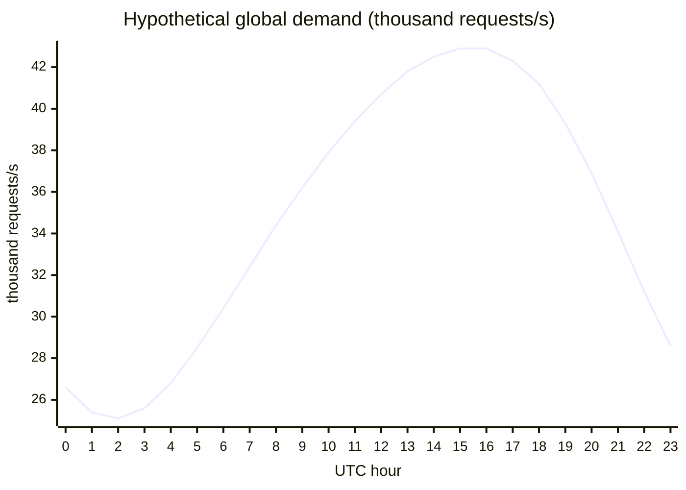
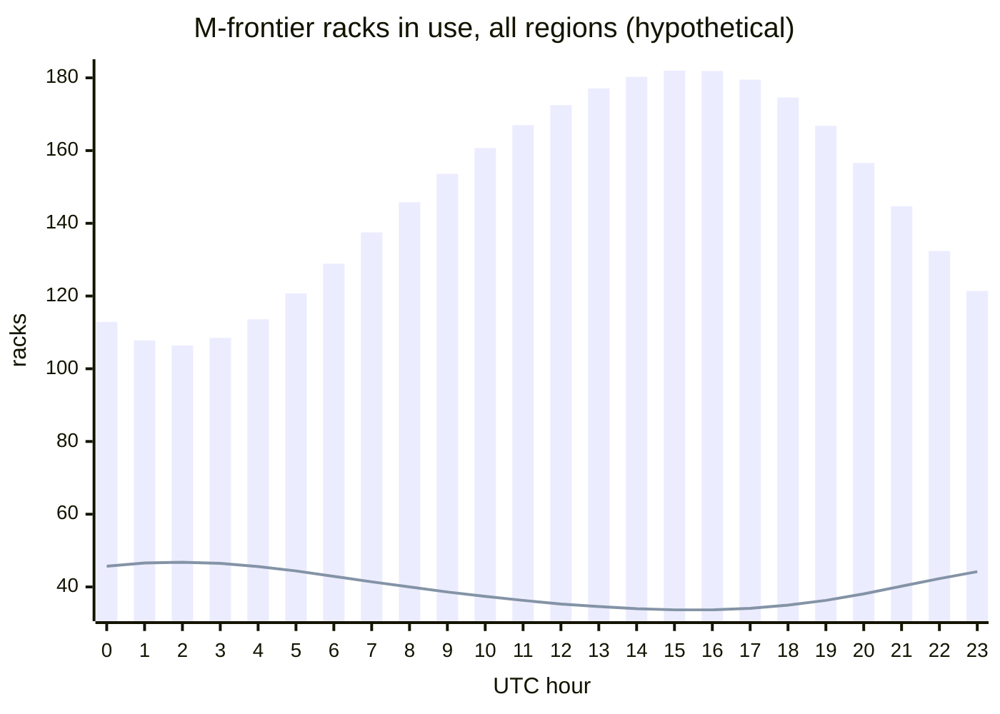

<!-- GENERATED from manuscript/src/part-14-concurrency-and-capacity.md by tools/render_manuscript.py. Edit the source, not this file. -->
# Part 14: Concurrency and capacity at huge scale

A few thousand model replicas serve hundreds of millions of users. Each replica decodes hundreds of sequences in one batch, and most users generate nothing at a given moment.

Your request is one of 1,000,000 generations that run at the hypothetical global peak. Parts 9 to 13 followed it through one pool, one GPU and one KV cache. This part steps back and counts the whole fleet in eight steps:

1. How many generations run at once, and how many processes they need (14.1).
2. What one million generations cost in memory, GPUs, racks and power (14.2).
3. How arrival rate and tokens per request set the size of each pool (14.3).
4. Why four requests can differ in cost by a factor of a thousand (14.4).
5. The two curves that every capacity decision trades along (14.5).
6. How to plan three different workloads with headroom and a failure reserve (14.6).
7. What happens when millions of clients act at the same second (14.7).
8. How demand moves around the planet each day, and what fills the gaps (14.8).

Every traffic number in this part is hypothetical (`hypothetical.traffic`). Every step time is a model. `M-dense` uses the roofline step model of part 11, and `M-frontier` uses the same method in this part. The goal is to teach capacity math, not to estimate any real fleet.

---

## 14.1 Why billions of users do not need billions of model copies ⚙

A replica holds one shared, read-only copy of the weights and decodes many users' sequences in each step. So the replica count follows the concurrent generations, not the users.

### The population funnel

Each level of the funnel counts a different thing. All values are hypothetical:

| Level | Value | How it follows |
|---|---|---|
| registered users | 1,000,000,000 | accounts that exist |
| daily active users (DAU) | 250,000,000 | users who send at least one request in a day |
| requests per day | 3,000,000,000 | 250,000,000 × 12 = 3,000,000,000 |
| mean requests/s | 34,722 | 3,000,000,000 / 86,400 = 34,722 |
| peak requests/s | 50,347 | 34,722 × 1.45 = 50,347 (peak-to-average ratio) |
| concurrently connected users at the peak | 25,000,000 | users with an open app session |
| mean decode time per request | 20.0 s | 400 / 20 = 20 s |
| in-flight generations | 1,000,000 | 50,000 /s × 20 s = 1,000,000 |
| output tokens/s | 20,000,000 | 1,000,000 × 20 = 20,000,000 |

The rest of this part uses the rounded peak of 50,000 requests/s from `hypothetical.traffic`. The last two rows use Little's Law (part 9.5). The mean count of generations in flight equals the arrival rate times the mean decode time.

### Duty cycle and think time

A connected user spends most of the time reading, typing or doing nothing. The **think time** is the time between the end of one response and the next request of the same user. The **duty cycle** is the fraction of time that a user has a generation in flight.

At the peak, 25,000,000 connected users send 50,000 requests/s. So each connected user sends one request every 25,000,000 / 50,000 = 500 s on average. Each request decodes for 20.0 s. So the duty cycle is 20 / 500 = 4%.

The same number comes from the funnel: 1,000,000 / 25,000,000 = 4% of connected users generate at any instant. The other 96% hold an idle connection. An idle connection costs a few kilobytes of state at the edge (part 2), and no GPU memory.

### One process does not serve one user

A model server does not start a process per user. In this reference system, one `M-dense` replica is one 8-GPU H100 node at TP=8 (RA-36). Its engine runs one worker process per GPU. Five mechanisms let that one replica serve hundreds of users at once:

1. **Shared weights.** Every sequence in the batch reads the same read-only weights. A decode step reads them once from HBM for the whole batch (part 11.8).
2. **One sequence per request.** The scheduler turns each request into a sequence. The sequence has its own token IDs, sampling state and block table (part 11.5).
3. **One batch per step.** At each scheduler iteration, the scheduler picks the running sequences and some waiting prefill chunks (part 11.6). The GPU runs them all in one forward pass.
4. **Private state.** Each sequence owns its KV blocks. No sequence reads another sequence's blocks, except through the salted prefix sharing of part 13.3.
5. **Fast release.** When a sequence finishes, the scheduler returns its blocks to the free queue in the same iteration [vllm@v0.31.0:vllm/v1/core/sched/scheduler.py#L2649-L2701]. A waiting request takes them in the next step.

So the replica count follows from concurrency: replicas = in-flight generations ÷ sequences per replica. Section 14.2 shows that one `M-dense` replica with an FP8 KV cache holds 685 sequences of the mean length. If every generation ran on `M-dense`, the fleet would need ceil(1,000,000 / 685) = 1,460 replicas.

| Count | Value |
|---|---|
| registered users | 1,000,000,000 |
| in-flight generations (logical requests in decode) | 1,000,000 |
| replicas (one weight copy each) | 1,460 |
| GPU worker processes | 11,680 |
| daily active users per replica | 171,233 |

The process count is about 86 times smaller than the count of logical requests in decode. It is about 684,932 times smaller than the count of registered users.


Legend: blue = people; violet = a rate; amber = the concurrency that your request is part of; pink = GPU resources. The one thing to notice: only the in-flight generations reach the GPUs, and users never do. The diagram leaves out tool time on purpose, because a request that waits for a tool holds no batch slot.

### Scale scenarios

The same ratios at four sizes of product (hypothetical; `hypothetical.fleet_scenarios`):

| DAU | Peak requests/s | In-flight generations | Output tokens/s | `M-dense` replicas (FP8 KV) | GPUs |
|---|---|---|---|---|---|
| 1,000,000 | 201 | 4,028 | 80,556 | 6 | 48 |
| 10,000,000 | 2,014 | 40,278 | 805,556 | 59 | 472 |
| 250,000,000 (reference) | 50,347 | 1,006,944 | 20,138,889 | 1,470 | 11,760 |
| 1,000,000,000 | 201,389 | 4,027,778 | 80,555,556 | 5,880 | 47,040 |

The replica count grows linearly with DAU. Every row keeps the same requests per user and the same decode time. Two things break that line in a real fleet. Small products cannot fill a batch, so their replicas run at low utilization (14.5). Large products split traffic over several models and regions, and each split rounds up on its own (14.6).

**Meanwhile in the fleet.** In each peak second, about 50,000 generations finish and the same number start. Each finish frees KV blocks in some replica. Each start takes blocks in another. The total in flight stays near 1,000,000.

You can now turn a daily-user count into a count of concurrent generations, and that count into a replica count.

---

## 14.2 One million simultaneous generations ⚙

One million generations need half a petabyte to a petabyte of KV state. That memory, not compute, sets the GPU count. With every generation on one model, `M-dense` needs about 12 to 23 thousand H100 GPUs. `M-frontier` needs about 16 thousand GB300 GPUs.

Each count in this section is a hypothetical bound for one model, not the planned fleet. Step 3 puts every generation on `M-dense`. Step 4 is the "every generation on `M-frontier`" case. Section 14.3 sizes the real model mix, where only 20% of requests reach `M-frontier`.

### Step 1: the token rate

The spec's example has N = 1,000,000 active generations, each streamed at 20 tokens/s:

```
1,000,000 × 20 = 20,000,000 tokens/s
```

A speed of 20 tokens/s means one token every 50 ms. So every decode step that serves these sequences must finish in 50 ms or less. That target is the TPOT (time per output token) of each sequence.

### Step 2: the KV memory

A sequence's KV state grows while it decodes. At a random moment, the mean sequence holds its prompt and half of its output:

```
mean context = 3,000 + 400 / 2 = 3,200 tokens
```

For `M-dense`, part 13.1 gives 360,448 B per token in BF16:

```
per sequence = 3,200 × 360,448 B = 1,153 MB
all N        = 1,000,000 × 1,153.4 MB = 1,153 TB
```

An FP8 KV cache halves that to 577 TB. For `M-frontier`, each sequence holds the fixed KDA state plus the MLA latent per token (part 13.1):

```
per sequence = 449,372,160 + 3,200 × 27,648 = 537,845,760 B ≈ 538 MB
all N        = 1,000,000 × 537.8 MB = 538 TB
```

At this short mean context, the fixed KDA state is 84% of each `M-frontier` sequence. So FP8 MLA saves little here: the total drops only to 494 TB.

### Step 3: `M-dense` on `H-teach`

The decode step model of part 11 gives the step time of one `M-dense` replica for each batch size. Its sequences hold 3,200 to 3,400 tokens (`roofline:batch_sweep`). The batch has two limits:

1. **KV memory.** The free HBM of the node holds 342 such sequences with a BF16 KV cache and 685 with FP8.
2. **TPOT.** The step must stay at or under 50 ms.

| KV dtype | Batch per replica | Step | Speed per sequence | Throughput per replica |
|---|---|---|---|---|
| BF16 | 342 (KV limit) | 33.2 ms | 30.1 tokens/s | 10,293 tokens/s |
| FP8 | 685 (KV limit) | 44.1 ms | 22.7 tokens/s | 15,537 tokens/s |

Both rows meet the TPOT target at the KV limit. So memory, not the step time, caps the batch. Now count replicas two ways:

```
by concurrency (BF16 KV): ceil(1,000,000 / 342) = 2,924 replicas
by token rate  (BF16 KV): ceil(20,000,000 / 10,293) = 1,944 replicas
```

The token-rate count is smaller, because it assumes each sequence streams at 30.1 tokens/s. But the spec fixes N, so the fleet must hold one million sequences at once. The larger count binds: 2,924 replicas. A token-rate division alone undercounts whenever the KV pool is full before the step time reaches the TPOT target.

| `M-dense`, `H-teach` | BF16 KV | FP8 KV |
|---|---|---|
| replicas (8-GPU nodes) | 2,924 | 1,460 |
| H100 GPUs | 2,924 × 8 = 23,392 | 1,460 × 8 = 11,680 |
| racks (4 nodes each, hypothetical) | 731 | 365 |
| power at the DGX maximum | 2,924 × 10.2 kW = 29.8 MW | 1,460 × 10.2 kW = 14.9 MW |

NVIDIA lists the maximum system power of a DGX H100 as 10.2 kW [SRC-620]. Real draw is lower on average, but a facility provisions for the maximum. Network switches, storage and cooling come on top.

### Step 4: `M-frontier` on `H-frontier`

This step sizes the "every generation on `M-frontier`" case: all N sequences decode on `M-frontier`. In this reference system, each GB300 NVL72 rack holds 2 TEP8 prefill workers and 3 DEP16 decode workers (RA-55). It also keeps 8 warm-spare GPUs. Each of the 16 ranks of a decode worker keeps its own sequences. The rank holds their full KDA state and MLA latent (part 13.1).

**The KV limit per rank.** Part 13 gives the KV pool of one rank: 50,665,032,704 B after weights and overhead. The 64-token blocks of the mean sequence need:

```
449,372,160 + 3,200 × 27,648 = 537,845,760 B
batch limit per rank = floor(50,665,032,704 / 537,845,760) = 94 sequences
```

**The step time per rank.** No public measurement of a disaggregated K3 decode worker exists at this batch. So this part applies the part 11 roofline method to one DEP16 rank. The model has four terms:

```
t_memory  = (weights per rank + B × state per sequence) / (HBM bandwidth × 0.8)
t_compute = B × 2 × active params / (BF16 peak × 0.5)
t_fixed   = 93 layers × 40 µs + 0.5 ms
t_a2a     = 92 MoE layers × 2α + B × 15.8 MB × 15/16 / (NVLink 5 × 0.8)
t_step    = max(t_memory, t_compute) + t_fixed + t_a2a
```

The efficiencies and overheads are the class C values of parts 11 and 12 (`hypothetical.gpu_step_model`, `hypothetical.tp_comm_ref`). The weights per rank are 210 GB, from TensorRT-LLM's DEP16 guide [SRC-389]. Each step reads all local experts (part 12.4). Take B = 94 sequences on each of 16 ranks, with 16 of 896 experts per token. Under uniform routing, a local expert gets no token with probability 1.70 × 10⁻¹².

At B = 94:

| Term | Time |
|---|---|
| t_memory (weights + 50.6 GB of state) | 40.7 ms |
| t_compute | 15.7 ms (hidden under t_memory) |
| t_fixed | 4.22 ms |
| t_a2a | 2.3 ms |
| step | 47.2 ms → 21.2 tokens/s per sequence |

The step stays under 50 ms at the KV limit, so memory binds again. Now compare with a measurement. TensorRT-LLM reports a TPOT of 34.06 ms at concurrency 64 on 16 GB300 [SRC-389]. That run has 4 sequences per rank at 8K/1K. The model gives 37.91 ms for the same batch and context, 11% slower than the measurement.

```
sequences per worker = 94 × 16 = 1,504
decode workers       = ceil(1,000,000 / 1,504) = 665
racks                = ceil(665 / 3) = 222
GPUs in those racks  = 222 × 72 = 15,984
power                = 222 × 140 kW = 31.1 MW
```

The rack GPUs include the prefill workers and the warm spares of each rack. NVIDIA's GB300 NVL72 page [SRC-007] gives no rack power. So this part plans with a hypothetical 140 kW per rack.

**A count from a measured throughput.** A second method divides the token rate by a published throughput. TensorRT-LLM's DEP16 run at concurrency 64 delivers 1,669.1 output tokens/s per 16 GPUs at 29.36 tokens/s per user [SRC-389]:

```
ceil(20,000,000 / 1,669.1) = 11,983 workers = 191,728 GPUs
```

That is 18 times the model's count. The two numbers answer different questions. The measured run uses aggregated serving: the same 16 GPUs also prefill one 8K prompt per request. It also holds only 4 sequences per rank.

The model counts disaggregated decode workers at the KV limit. Section 14.3 adds the prefill pool and shows which estimate binds for one real pool.

### What the result depends on

| Change | Effect on the GPU count |
|---|---|
| model size | weights per GPU set the floor of every step; a larger model reads more bytes per token |
| hardware | HBM capacity sets the KV limit; HBM bandwidth sets the step time |
| batching | continuous batching fills the KV pool; static batching leaves slots idle (part 11.5) |
| prompt and output lengths | longer contexts shrink the batch per replica in direct proportion (part 13.1) |
| quantization | FP8 KV halved the `M-dense` replica count above |
| SLO | a tighter TPOT target caps the batch below the KV limit |
| parallelism | DEP16 replicates attention weights on every rank; TP shards them (part 12) |

**Meanwhile in the fleet.** Each of the 665 decode workers in the "every generation on `M-frontier`" case runs its own step loop. No step waits for another worker. A failed rank stops only the sequences of its own worker, and their requests retry on another worker.

You can now size a decode fleet from its KV limit, check its TPOT, and convert it to racks.

---

## 14.3 The arrival-rate capacity model ⚙

Capacity has two terms that scale differently, so a disaggregated design sizes two pools. Prefill work grows with requests/s times uncached prompt tokens; decode work grows with concurrent sequences.

### The two terms

```
prefill tokens/s = requests/s × uncached prompt tokens per request
decode sequences = requests/s × decode time            (Little's Law)
decode tokens/s  = decode sequences × tokens/s each    = requests/s × output tokens
```

With the hypothetical reference traffic:

| Quantity | Value |
|---|---|
| uncached prompt tokens | 3,000 × (1 − 0.6) = 1,200 |
| prefill tokens/s | 50,000 × 1,200 = 60,000,000 |
| decode sequences | 50,000 × 20 s = 1,000,000 |
| decode tokens/s | 50,000 × 400 = 20,000,000 |
| check | 1,000,000 × 20 = 20,000,000 |

The fleet prefills 3 times more tokens than it decodes. But a prefill token costs far less GPU time than a decode token. Prefill runs many tokens through each weight read (part 11.4). So the two pools need different sizing rules. Tool passes add more prefill, but most of their prompt hits the prefix cache (part 13.3). So this model counts one prefill per request.

### The `M-frontier` prefill pool

The model router sends 20% of requests to `M-frontier` (hypothetical, RA-15, part 9.5): 50,000 × 0.2 = 10,000 requests/s. Prefill is compute-bound (part 11.3). The prefill cost per request is:

```
FLOPs = 2 × active params × n + per_pair × 24 MLA layers × (n × p + n(n + 1)/2)
      = 2.54 × 10¹⁴ FLOP   (n = 1,200 new tokens, p = 1,800 cached)
time  = FLOPs / (8 GPUs × 2.5 PFLOP/s BF16 × 0.5)
      = 25.4 ms on one TEP8 worker
```

That is 2.12 × 10¹¹ FLOP per token and 47,188 tokens/s per TEP8 worker. Part 11 uses the same lower-bound method for your request's pass 1. A smaller MoE gives a public cross-check. SGLang reports 54,543 input tokens/s per 8-GPU H100 node for DeepSeek-V3 at 2K input [SRC-051].

Prefill time adds directly to TTFT. The queue wait in front of it grows as 1/(1 − ρ) (part 9.5). So this reference system plans the prefill pool at 60% utilization (hypothetical, RA-42):

```
prefill tokens/s = 10,000 × 1,200 = 12,000,000
TEP8 workers     = ceil(12,000,000 / (47,188 × 0.6)) = 424  (3,392 GPUs)
```

### The `M-frontier` decode pool

The decode pool must hold every sequence that decodes at once:

```
sequences   = 10,000 × 20 s = 200,000
per worker  = 94 × 16 × 0.85 = 1,278.4
DEP16 workers = ceil(200,000 / 1,278.4) = 157  (2,512 GPUs)
```

The fill target of 85% (hypothetical, RA-42) keeps free blocks for sequences that grow longer than the mean. Without it, a burst of long outputs forces preemption (part 13.8).

### Two pools in fixed racks

The pools need 2.7 prefill workers per decode worker. The RA-55 rack holds 2 prefill and 3 decode workers, a ratio of 0.67. So with this traffic mix, prefill binds the rack count:

```
racks = max(ceil(424 / 2), ceil(157 / 3)) = 212
```

Those racks leave 479 decode-worker slots empty. With a free split inside each rack, the two pools would need 3,392 + 2,512 = 5,904 GPUs. That is 93 racks of 64 active GPUs. This is the main point of R-XIV.3: disaggregation lets each pool scale with its own term. The per-rack 2 : 3 split of RA-55 fits a workload with longer outputs or more prefix-cache hits than this one.

### `M-dense`: one pool for both terms

`M-dense` has no prefill pool in this reference system (RA-38 disaggregates only `M-frontier`). Prefill chunks share steps with decode under the 8,192-token budget (RA-36). One step of 8,192 prefill tokens from such requests takes 278 ms (part 11 step model). So one replica prefills 29,521 tokens/s. Adding the two GPU-time demands gives an approximation:

```
requests/s         = 50,000 × (1 − 0.2) = 40,000
decode equivalents = 800,000 / (342 × 0.85) = 2,752 replicas
prefill equivalents = 48,000,000 / (29,521 × 0.6) = 2,710 replicas
replicas           = ceil(2,752 + 2,710) = 5,462  (43,696 H100 GPUs)
```

The approximation adds prefill time to decode time. In a real step, prefill chunks also slow the decode tokens that share the step (part 11.7). So a combined pool needs more than this, which is one reason to disaggregate.



Legend: violet = rates; amber = the concurrency your request is part of; pink = GPU resources. The one thing to notice: one arrival rate feeds two separate formulas, and the larger rack count wins. The diagram leaves out the warm spares on purpose.

### One pool, three earlier estimates: `ap_south`

Part 9.5 and part 12.3 sized the same `ap_south` decode pool and got very different worker counts. The pool holds 30,000 decoding sequences at the peak (15% of the global `M-frontier` pool above). Here are the estimates side by side:

| Estimate | Sequences per worker | Limit it uses | Workers |
|---|---|---|---|
| part 9.5: KV only, every sequence at 8,192 tokens | 1,184 | KV memory | 26 |
| part 12.3: the measured concurrency of TensorRT-LLM | 64 | the benchmark's chosen load | 469 |
| this part, model at 8,192 tokens | 1,184 | KV memory; step 46.74 ms | 26 (at 100% fill) |
| this part, model at the mean 3,200 tokens | 1,504 | KV memory; step 47.24 ms | 24 (at 85% fill) |

KV memory binds. At the KV limit of 94 sequences per rank, the model step is 47.24 ms, under the 50 ms target. So the decode throughput per worker allows the full KV batch, and the pool needs:

```
ceil(30,000 / (1,504 × 0.85)) = 24 DEP16 decode workers
```

The part 12.3 count of 469 is not the binding limit, for three reasons:

1. **Concurrency 64 is a measured load, not a maximum.** TensorRT-LLM measured 64 and 256 only. It reports no point between them [SRC-389]. So 64 is not the largest batch that meets 20 tokens/s.
2. **The measured GPUs also prefill.** Each request brings an 8K prompt to the same GPUs. At concurrency 256, the measured TPOT is 62.24 ms [SRC-389], but the decode-only model gives 39.46 ms. The difference of about 23 ms per step is prefill work that a disaggregated decode worker does not do (RA-38).
3. **The model is not optimistic at low batch.** At 4 sequences per rank, it gives 37.91 ms against 34.06 ms measured.

The part 9.5 count is close. It assumes 8,192 tokens in every sequence and plans at 100% fill. The mean `ap_south` sequence is shorter, and the fill target adds back the margin. The pool also needs its prefill side:

```
TEP8 prefill workers = ceil(1,500 × 1,200 / (47,188 × 0.6)) = 64
racks (RA-55)        = max(ceil(64 / 2), ceil(24 / 3)) = 32
```

The weakest input is the decode step model itself. So the first test on GB300 racks is a disaggregated DEP16 decode run at 64 to 94 sequences per rank. That one number either confirms the KV-bound count or moves it.

**Meanwhile in the fleet.** While your pass 1 prefills in `ap_south`, about 1,250 other sequences decode on each of the region's `M-frontier` decode workers. The prefill pool works on about 1,500 new requests every second.

You can now size the prefill and decode pools from one arrival rate, and say which limit binds.

---

## 14.4 Four requests, four very different costs ⚙

Two requests can differ in GPU cost by more than a thousand times. Prefill cost grows with uncached prompt tokens and decode cost with output tokens. Long contexts also hold KV memory for the whole decode.

### The four requests

All four run on `M-frontier` at the design point of 14.2. That point has 94 sequences per DEP16 rank and a step of 47.2 ms. Requests 1 to 3 have no prefix-cache hit. Request 4 is your request, with the three passes of part 5.6.

1. A short chat: 20 input tokens, 30 output tokens.
2. A long document: 100,000 input tokens, 30 output tokens.
3. A long generation: 1,000 input tokens, 5,000 output tokens.
4. Your request: image + PDF chunks + web search + Python; 83,533 prompt tokens over three passes (only 26,701 uncached), 1,727 output tokens.

### How each cost is computed

For each pass with n new tokens, p cached tokens and o output tokens:

```
prefill GPU-s = prefill time on one TEP8 worker × 8 GPUs
decode steps  = o after a remote prefill; o − 1 after a local prefill
decode time   = decode steps × step time
decode share  = max(1 / B, mean state bytes / KV pool per rank)
decode GPU-s  = decode time × decode share
KV GB·s       = mean state bytes × decode time + prompt state bytes × prefill time
cost          = GPU-s × 6.0 USD per GPU-hour / 3,600  (+ search provider cost)
```

The step count depends on which worker runs the prefill. After a remote prefill, the decode worker recomputes the last prompt token and samples token 1 itself (RA-38). So every output token costs one step. After a local prefill, the prefill step samples token 1.

The decode share is the important line. A sequence occupies one batch slot of a rank. It also occupies part of that rank's KV pool. The engine cannot use either for another sequence. So a sequence pays for whichever share is larger. A short sequence pays for its slot; a long one pays for its memory.

### The results

| | 1: short chat | 2: long document | 3: long generation | 4: your request |
|---|---|---|---|---|
| FLOPs | 1.04 × 10¹³ | 2.82 × 10¹⁶ | 1.28 × 10¹⁵ | 7.34 × 10¹⁵ |
| peak KV state | 0.45 GB | 3.22 GB | 0.62 GB | 1.31 GB |
| KV GB·s | 0.6 | 13.6 | 129 | 102 |
| prefill GPU-s | 0.0033 | 22.6 | 0.17 | 4.97 |
| decode GPU-s | 0.015 | 0.090 | 2.55 | 2.01 |
| vision GPU-s | – | – | – | 0.55 |
| total GPU-s | 0.018 | 22.7 | 2.71 | 7.53 |
| × request 1 | 1 | 1,231 | 147 | 409 |
| non-GPU time | – | – | – | 2.91 s |
| wall time (no queueing) | 1.4 s | 4.2 s | 236 s | 85 s |
| cost (USD) | 0.00003 | 0.0378 | 0.0045 | 0.0276 |

Decode FLOPs here use the prefill form of MLA attention per key, an approximation. The decode kernels work on the compressed latent and do less work per key [SRC-069].

**Request 1** costs almost nothing in compute. It still holds the full 449 MB KDA state for its 1.4 s of decode. So its decode GPU-s are its batch slot, 82% of its cost.

**Request 2** spends 99.6% of its GPU time in prefill. Its prefill takes 2.82 s on one TEP8 worker, so its TTFT is long even with no queue. Its state of 3.2 GB fills 6.3% of a rank's KV pool. So its decode share follows memory, not its batch slot.

**Request 3** spends 94% of its GPU time in decode. It holds a batch slot for 236 s, so it has the largest KV GB·s of the four. A fleet full of such requests runs out of batch slots long before it runs out of prefill capacity.

**Request 4**, your request, prefills 20,250 new tokens in pass 1, most of them the image. Pass 2 prefills 6,264 and pass 3 only 187. The prefix cache saves the rest (part 13.3). The vision encoder adds 0.069 s. The web search step adds 1.61 s at p50 (part 7), and the sandbox adds 1.30 s (part 8). Neither step holds a GPU.

The search provider cost of 0.015 USD is 54% of the total.

### What these numbers change

1. **Admission.** A requests-per-minute limit treats request 1 and request 2 as equal. A tokens-per-minute limit (part 3.2) and a KV-aware admission check (part 9.4) do not.
2. **Pricing.** A common pricing design charges input and output tokens separately, and cached input tokens less. The GPU-s split above shows why.
3. **Routing.** Request 2 belongs on an endpoint with free KV blocks and an idle prefill queue (part 9.3).
4. **Pools.** A fleet with many long documents needs a larger prefill pool. A fleet with long outputs needs a larger decode pool (14.3).

**Meanwhile in the fleet.** Request 2 prefills for 2.8 s on one TEP8 worker. In that time, the rack's other prefill worker prefills about 6,769 prompts of the size of request 1.

You can now compute the GPU-seconds, KV GB·s and cost of a request from its token counts.

---

## 14.5 The two central curves ⚙

Throughput per GPU rises with batch size and then saturates, while latency rises sharply as utilization approaches 1. So every pool runs below saturation.

### Curve 1: throughput against batch size

The part 11 step model gives the decode throughput of one `M-dense` replica for each batch size. The sequences hold 3,200 tokens in a BF16 KV cache (`roofline:batch_sweep`). Per GPU:





The two charts share one x-axis. The one thing to notice: up to the KV limit of 342, throughput per GPU grows 102 times. Over the same range, speed per sequence drops only 3.4 times. The x-axis is not linear, and batches above 342 do not fit a BF16 KV pool.

The curve rises because each step reads the weights once for the whole batch (part 11.4). It saturates because the KV reads and the compute grow with the batch, while the weight read does not. Beyond the KV limit, throughput grows only 9% more by batch 1,024. The speed per sequence falls to 10.9 tokens/s, far below the TPOT target.

### Curve 2: latency and cost against utilization

The M/M/1 queue gives the intuition. With arrival rate λ and service rate μ, the mean time in the system is:

```
W = 1 / (μ − λ) = S / (1 − ρ),   S = 1 / μ,   ρ = λ / μ
```

At ρ = 0.5, W is 2 S. At ρ = 0.9 it is 10 S, and at ρ = 0.99 it is 100 S. Part 9.5 works this curve for the `ap_south` prefill service time (`capacity_math:queueing_models.mm1`).

The model has three limits for LLM serving:

1. **Service time is not exponential.** Prefill time grows with prompt length; decode time grows with output length. Both distributions have long tails.
2. **The server is not one server.** A continuous-batching engine serves many sequences at once, and its step time grows with the batch. Higher load makes every sequence slower before any queue forms.
3. **The capacity is not fixed.** KV pressure causes preemption (part 13.8). Preempted sequences recompute their prefill, so the work per request grows under load.

The part 11 simulation of one `M-dense` replica under Poisson load shows the real shape (`continuous_batching:load_sweep`). Utilization here is throughput over the saturated throughput of 3,453 tokens/s. Cost uses 2.5 USD per H100-hour (hypothetical):





The one thing to notice: cost falls and then flattens, while p99 TTFT stays flat and then climbs. The charts leave out the TPOT curve on purpose; it climbs at the same points.

| Arrival rate | Utilization | USD per million tokens | p99 TTFT | Requests within SLO |
|---|---|---|---|---|
| 0.25 req/s | 3% | 58.98 | 424 ms | 100% |
| 8 req/s | 72% | 2.22 | 1,067 ms | 99.7% |
| 12 req/s | 93% | 1.73 | 1,710 ms | 90.7% |
| 16 req/s | 98% | 1.64 | 12,241 ms | 10.4% |

At the lightest load, a token costs 34 times more than at the best-goodput load (12 req/s). Above that load, the cost per token falls by only a few percent. Meanwhile the share of requests within the SLO collapses. So the useful operating point sits just below the knee of curve 2, not at the end of curve 1.

**What the curves change.** The prefill utilization target of 60% and the decode fill target of 85% in 14.3 come from these curves. The autoscaler adds replicas before the knee (RA-42, part 19.4). So each pool stays on the flat part of curve 2.

**Meanwhile in the fleet.** At any moment, some replicas run near the knee and some run far below it. The endpoint picker sends the next request to a replica with a low queue and free KV blocks (RA-71). That choice keeps the hot replicas from crossing the knee.

You can now read an operating point off the two curves and explain why no pool runs at 100% utilization.

---

## 14.6 Capacity planning for three workloads ⚙

Three workloads at the same requests/s can need GPU counts that differ by a factor of fifty. So a capacity plan starts from tokens, tool time and KV memory per request. It then adds headroom, a failure reserve and each region's daily peak.

### Three workloads

All values are hypothetical (`hypothetical.workload_profiles`), on `M-frontier`:

- **A: a short support chat.** 1,800 prompt tokens, 67% from the tenant's cached system prompt; 150 output tokens.
- **B: long PDF reasoning.** 60,000 prompt tokens, half of them cached on average across a session; 1,000 output tokens.
- **C: an agent that runs several web searches.** 6 passes; the prompt grows from 4,000 tokens by 2,500 tokens per pass; 5 tool steps.

| | A: support chat | B: long PDF | C: search agent |
|---|---|---|---|
| prompt tokens (all passes) | 1,800 | 60,000 | 61,500 |
| uncached prompt tokens | 594 | 30,000 | 13,800 |
| output tokens | 150 | 1,000 | 2,400 |
| tool time | – | – | 8.0 s |
| GPU service time (GPU-s) | 0.17 | 8.57 | 4.20 |
| first-pass TTFT floor, no queue: prefill, plus the KV pull and one decode step after a remote prefill (RA-38) | 0.013 s | 0.88 s | 0.109 s |
| TTFT target (sensitivity) | 1.0 s (high) | 6.0 s (low) | 2.0 s per pass (medium) |
| peak KV state | 0.50 GB | 2.14 GB | 0.93 GB |
| KV GB·s | 3.5 | 102 | 89 |
| wall time | 7 s | 48 s | 122 s |

TTFT sensitivity is a product choice. A support user waits for the first word, so A gets the tightest target. A document user accepts a progress event during a long prefill, so B gets the loosest. An agent's TTFT repeats once per pass, so every pass of C counts.

### Why one requests/s number is not enough

Plan each workload at 1,000 requests/s, with the targets of 14.3 (prefill 0.6, decode 0.85):

```
GPUs = requests/s × GPU-s per request / utilization target   (for prefill and decode separately)
```

| At 1,000 requests/s | A | B | C |
|---|---|---|---|
| prefill GPUs | 167 | 10,989 | 4,073 |
| decode GPUs | 88 | 2,328 | 2,062 |
| total GPUs | 255 | 13,317 | 6,135 |
| × workload A | 1 | 52 | 24 |
| open requests (λ × wall time) | 7,051 | 48,062 | 121,703 |

The same 1,000 requests/s needs 255 GPUs for A and 13,317 for B. B is prefill-heavy, so its plan needs a large prefill pool. C holds open requests for a long time, mostly in tools. Those requests hold SSE streams, orchestrator state and sandbox sessions, but no batch slot while a tool runs. So a plan states three numbers per workload. They are prefill tokens/s, concurrent decode sequences with their lengths, and open requests.

### Headroom, failure reserve and the daily peak

A plan for one region adds three margins on top of the busy GPUs. This example uses the `M-frontier` pool in RA-55 racks: 21.2 racks per 1,000 `M-frontier` requests/s (14.3). The regional curves come from 14.8.

1. **The daily peak.** Each region sizes for its own peak, not the global mean.
2. **Headroom.** 15% above the forecast peak (hypothetical, RA-42) covers forecast error and bursts shorter than the autoscaler's reaction time.
3. **N+1 inside the region.** One extra rack per region (RA-55) covers the loss of one rack, the failure domain of one NVLink domain. The 8 warm spares per rack (RA-55) cover single GPUs.
4. **Region failover.** In this reference system, a region without a working `M-frontier` deployment sends that traffic to the next-nearest healthy region (RA-57). So each region also needs room for its partner's load at the worst 15 minutes of the day.

| Region | Own peak | + headroom, N+1 | Partner | Own + partner, worst 15 min | Racks with failover |
|---|---|---|---|---|---|
| us_east | 97 | 113 | eu_west | 150 | 151 |
| eu_west | 76 | 89 | us_east | 150 | 151 |
| ap_south | 50 | 59 | ap_northeast | 83 | 84 |
| ap_northeast | 39 | 47 | ap_south | 83 | 84 |
| total | 262 | 308 | | | 470 |

The partners peak at different hours: us_east and eu_west 5 hours apart, ap_south and ap_northeast 3.5 hours apart. So the worst 15 minutes of "own plus partner" is less than the sum of the two peaks. Even so, full failover raises the plan from 308 to 470 racks.

For comparison, one global pool would need only 210 racks. The fleet's mean busy load is 147 racks. But regions cannot pool freely. Distance adds round-trip time (part 2), and data residency limits where some tenants run (part 18.5). The conversation's home region also holds its state (RA-17). The gap between the regional plan and the busy mean is the capacity that 14.8 fills with background work.

**Meanwhile in the fleet.** At the hour when us_east peaks, ap_northeast runs near its daily low. Its decode workers hold batch-band work and few interactive sequences. If us_east then lost its deployment, eu_west, not ap_northeast, would take its traffic (RA-57).

You can now plan a regional pool and add headroom, an N+1 rack and a failure reserve.

---

## 14.7 The thundering herd

A thundering herd is a crowd of clients that act in the same second, for example after an outage. Jittered retries, admission control, caches and warm floors spread that spike.

### After an outage: synchronized retries and reconnects

Take a one-minute outage of the `ap_south` API at its daily peak (hypothetical, `hypothetical.herd_ref`). Clients arrive at 11,741 requests/s, and every one of them fails. When the region recovers, 704,475 clients want to retry. The region admits 15,264 requests/s (1.3 times the arrival rate: headroom plus warm spares).

| Client policy | Peak arrivals/s | × capacity | Largest queue depth | Worst wait | Queue clear after |
|---|---|---|---|---|---|
| retry at once on recovery | 716,216 | 47 | 700,952 | 46 s | 199 s |
| full jitter over 30 s | 35,664 | 2.3 | 598,803 | 39 s | 199 s |

Jitter does not remove work. The same 704,475 retries still arrive, so the queue clears after the same time. That time is the extra work over the spare capacity: 704,475 / (15,264 − 11,741) ≈ 200 s. 

What jitter removes is the spike. Without it, 47 times the capacity arrives in one second. Each of those requests opens a TLS connection at the edge, passes authentication and rate limits, and joins a queue. Those CPU tiers then fail first.

**Full jitter.** The AWS Architecture Blog compares backoff policies [SRC-166]. With full jitter, a client sleeps a random time between 0 and the capped exponential backoff, `sleep = random(0, min(cap, base × 2^attempt))`. In this reference system, only one layer retries (RA-12). It makes at most 3 attempts with full-jitter exponential backoff, within a retry budget of 10% of requests. 

Retries at every layer multiply load. AWS shows that 3 retries at each of 5 layers give 243 times the load at the bottom [SRC-165]. Google's SRE book adds a per-client budget: stop retrying when retries exceed 10% of requests [SRC-167].

**Reconnects.** The browser reads the stream with `fetch()` (RA-07), so the browser does not reconnect on its own. The client code decides when to fetch the finished message or resend (RA-48). That code applies the same jittered backoff. The `EventSource` API would reconnect by itself, after a delay that the server can set with the `retry` field [SRC-146].

**Admission (RA-41).** The inference gateway's flow control holds requests in priority bands and lets each wait at most 60 s. When the pool saturates, it returns 429, and the model router adds `Retry-After` (RA-71). The queue model above assumes an unbounded queue, with a worst wait of about 46 s.

Real flow control bounds each band. The llm-d default is 5,000 requests per band [SRC-284]. So most of the queued requests get a fast 429 with `Retry-After` instead of a slow timeout. The client then retries later, so the server itself spreads the herd over time. The batch band stops dispatching while saturation is above 0.8 (RA-41, part 9.4), so background work yields first.

**Warm floors (RA-42).** Each pool keeps at least one ready replica, and each rack keeps 8 warm-spare GPUs with weights loaded (RA-55). A new replica that must load weights takes tens of seconds to minutes (part 1.7). So only capacity that is already warm can absorb the herd. Autoscaling adds replicas for the next herd, not for this one.

### A breaking event

When millions of users ask about the same news event, six effects arrive together:

1. **Similar prompts.** Many users send near-identical questions. Their prompts share the operator system prompt and the tool schemas. But the prefix cache shares blocks only inside one tenant (RA-40). So the KV reuse across users stays at the system-prompt level.
2. **A search surge.** The share of requests that search rises from 15% to 50% (hypothetical).
3. **Hot URLs.** The fetch tool asks for the same few news pages. The web cache serves them within their TTL (part 7). So each origin server sees one fetch per TTL, not one per user.
4. **Prefix-cache opportunities.** Within one tenant, the fetched article text becomes a shared prefix. The endpoint picker scores that prefix and picks the endpoint that holds it for the tenant's next request (RA-37).
5. **Provider rate limits.** The search provider limits queries per second per contract.
6. **Regional hot spots.** The event's home time zone sees the surge first. A saturated region overflows to the next healthy region (RA-06).

The search provider numbers (with the provider values of part 7):

| Case | Provider queries/s | × contracted 16,000 QPS |
|---|---|---|
| normal peak, 30% query-cache hits | 10,500 | 0.66 |
| breaking event, same hit rate | 35,000 | 2.19 |
| breaking event, 80% hits (queries repeat) | 10,000 | 0.62 |

The search-result cache (RA-19) decides the outcome. Repeated queries for one event hit the cache, so the provider load stays inside the contract. Without the cache, the provider returns 429 and the circuit breaker for the search provider opens (RA-13). The model then answers without fresh results and says so.



Legend: blue = clients and the edge; violet = admission; pink = GPU capacity; grey = background work. The one thing to notice: jitter shapes the arrivals before the edge, and flow control decides what the GPUs see. The diagram leaves out the search cache on purpose; the table above covers it.

**Meanwhile in the fleet.** While `ap_south` drains its queue, the other three regions run normally. The global traffic manager sees `ap_south` saturated and sends new users from nearby countries to the next healthy region (RA-06).

You can now compute the spike of synchronized retries and name the mechanism that absorbs each part of a herd.

---

## 14.8 The daily demand curve and background work ⚙

Demand peaks at a different UTC hour in each region, so each region's capacity idles for much of the day. Preemptible background work fills those troughs and pays for the warm headroom.

### The daily curve per region

Each region's users follow a local daily shape. This part uses a hypothetical one-parameter shape with its peak at 15:00 local time (`hypothetical.region_demand`):

```
rate_r(t) = share_r × global mean × exp(κ cos(2π (t_utc + offset_r − 15) / 24)) / I0(κ)
```

I0 is the modified Bessel function of order 0. It makes the daily mean of each shape equal 1. The reference system sets each region's peak-to-trough ratio to 4, so κ = 0.69. The global ratio is not fitted. It follows from the four shifted curves. The regional shares follow the continent split, and rest-of-world traffic goes to the nearest region:

| Region | Share | UTC offset | Mean req/s | Peak req/s | Peak (UTC) | Trough req/s |
|---|---|---|---|---|---|---|
| us_east | 37% | -4 h | 12,847 | 22,865 | 19.0 | 5,716 |
| eu_west | 29% | +1 h | 10,069 | 17,921 | 14.0 | 4,480 |
| ap_south | 19% | +5.5 h | 6,597 | 11,741 | 9.5 | 2,935 |
| ap_northeast | 15% | +9 h | 5,208 | 9,269 | 6.0 | 2,317 |
| global | 100% | | 34,722 | 42,978 | 15.50 | 25,091 |





The first chart's lines peak in this order: `ap_northeast` (06:00), `ap_south` (09:30), `eu_west` (14:00), `us_east` (19:00). The one thing to notice: each region peaks at 4.0 times its trough, and the global sum is flatter. The global trough is 58% of the global peak. The model leaves out weekdays, holidays and events on purpose.

The global curve peaks at 42,978 requests/s. That is 1.24 times its mean. The planning peak of 14.1 is 50,000 requests/s, 1.45 times the mean. So the plan keeps headroom above the curve's peak for busy weekdays and event surges.

The sum of the four regional peaks is 61,796 requests/s, 1.4 times the global peak. That ratio is the cost of serving each user in a nearby region. Each region's peak is 1.8 times its own mean.

### Follow the sun

**Follow-the-sun** placement sends work that can move to the regions where it is night. Interactive chat cannot move far. Round-trip time, data residency and the conversation's home region tie it to one region (RA-05, RA-17). Three kinds of work can move:

1. Batch requests with a completion window of hours.
2. Overflow from a saturated region, when the next region has room (RA-06).
3. Background jobs that the operator schedules, such as evaluations.

### Background work in the troughs

Public APIs show what background demand looks like. OpenAI's Batch API gives a 50% discount and completes each batch within 24 hours [SRC-621]. It uses a separate pool of rate limits.

OpenAI's flex processing tier charges Batch API prices, responds more slowly, and returns "429 Resource Unavailable" when capacity is short [SRC-622]. Anthropic's Message Batches API also costs 50% less [SRC-623]. Most batches finish in under an hour, and a batch expires after 24 hours. A common design follows: the provider trades a latency guarantee for a lower price. The work then fills idle capacity.

This reference system has three kinds of background work (RA-41; hypothetical shares of the same day's interactive GPU-hours, `hypothetical.background_work`):

| Work | Share of interactive rack-hours |
|---|---|
| batch API and flex-tier requests | 18% |
| embedding backfills and ingestion backlogs | 4% |
| offline evaluations | 5% |

Embedding work runs on smaller GPUs in practice. Here it counts in `M-frontier` rack-hours to keep one unit.

**The rule.** Background requests run in the `batch` priority band (RA-41, part 9.4). Flow control dispatches them only while pool saturation is below 0.8. So background work can use, at each 15-minute point, up to 0.8 × provisioned racks − interactive racks:

| Daily total (`M-frontier`, all regions) | Rack-hours |
|---|---|
| provisioned (the failover plan of 14.6) | 11,280 |
| interactive work | 3,533 |
| room for background under the ceiling | 5,491 |
| background demand | 954 |

Utilization of the provisioned racks rises from 31% to 40%. The room left is large, so this fleet could sell much more batch capacity. In ap_south, background work gets 9.5 racks at the region's trough and 3.0 racks at its peak.



Bars: interactive racks; line: background racks. The one thing to notice: background work rises when interactive load falls. The chart leaves out the provisioned total on purpose; it stays at 470 racks all day.

### Why preemptible work makes headroom affordable

Headroom and the failure reserve exist for minutes of each day. Without background work, the operator pays for them all day and uses them rarely. With background work, the same GPUs earn batch revenue and run evaluations most of the day. Three mechanisms protect the interactive SLOs:

1. **Admission.** The batch band dispatches nothing while saturation is above the ceiling (RA-41).
2. **Preemption.** Under priority scheduling, vLLM preempts the lowest-priority running request first [vllm@v0.31.0:vllm/v1/core/sched/scheduler.py#L757-L813]. So a burst of interactive requests takes the KV blocks of batch requests within one scheduler iteration. The preempted batch requests recompute later (RA-36).
3. **Deadlines in hours.** A batch request has hours to finish, so a preemption costs it only recompute time.

Batch work also keeps the replicas warm. The weights stay in HBM, the CUDA graphs stay captured, and the replicas pass readiness checks. When a herd or a failover arrives, the replicas switch to interactive work at once, with no cold start (RA-42).

**Meanwhile in the fleet.** At 21:30 UTC, ap_south users sleep. Its decode workers run batch requests and evaluation prompts. At the same moment, us_east is near its peak and runs almost no batch work. Four hours later, the roles shift east by one region.

You can now draw a region's daily curve and compute the racks that background work can safely use.

---

## What Part 14 established

A fleet sizes for concurrent sequences and their KV memory, not for users. Prefill and decode scale with different terms, so each pool and region gets its own plan. Preemptible background work pays for the margins.
