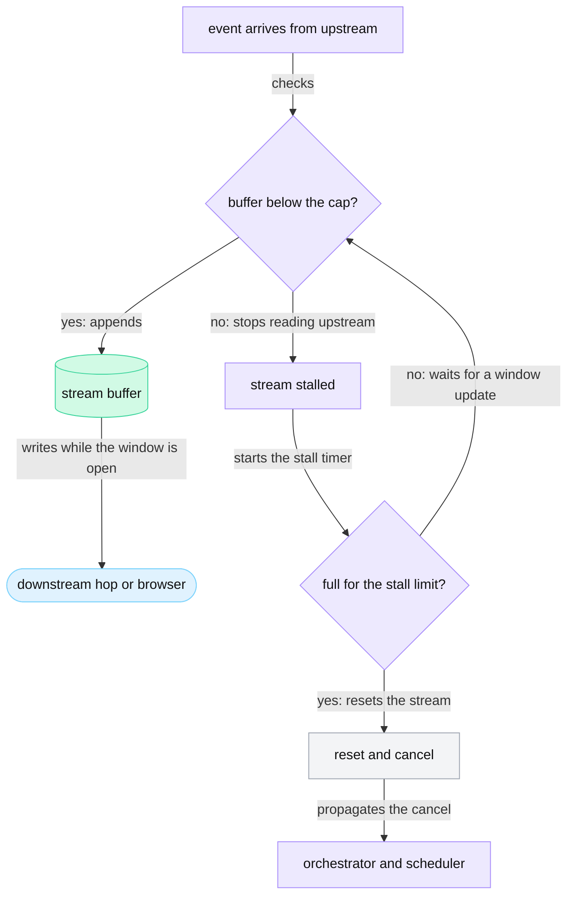

<!-- GENERATED from manuscript/src/part-15-streaming-back-to-pixels.md by tools/render_manuscript.py. Edit the source, not this file. -->
# Part 15: Streaming back to pixels

Each sampled token travels from the GPU to your screen through about ten hops. Each hop has its own framing, buffers and limits. The stream is fast because no hop waits for more than one token. It is safe because every hop holds only a bounded amount.

Your request is now in pass 3. The decode worker samples one token of the visible answer at every step. This part follows those tokens back to you in six steps:

1. The path and the transport on each hop (15.1).
2. The exact bytes of the events, and why packets do not map to tokens (15.2).
3. What the client sees while the model writes a tool call (15.3).
4. What happens when the client reads more slowly than the model writes (15.4).
5. How the browser turns bytes into pixels (15.5).
6. How streams break, and what the client does then (15.6).

Three rates carry the numbers in this part. Your request streams at the decode speed of part 14.2. One decode step takes 47.2 ms, so your stream brings 21.2 tokens per second. Each token becomes one SSE event. The capacity plan of part 14 sizes the fleet for a per-user target of 20 tokens per second (hypothetical). Two framing examples use a faster rate of 100 tokens per second (illustrative), and they say so.

---

## 15.1 The stream path and its transports ◇

The token stream returns on the connections that carried the request, so no hop opens a new connection. Each hop changes the framing of the token and adds a few bytes and a fraction of a millisecond.

### The hops, from the sampler to the browser

Part 11 ended with step 9 of the engine loop: the engine emits the token (part 11.9). From there, ten components touch it:

1. **The GPU sampler** writes the token ID into a small output tensor. Only token IDs leave the GPU, 8 bytes each in Model Runner V2 (RA-44, part 10.12).
2. **The engine core** is the scheduler process. It sends the new token IDs of all sequences in one message per step to the API server process. vLLM uses a ZeroMQ socket for this and encodes the message with msgpack [vllm@v0.31.0:vllm/v1/engine/core_client.py#L647-L665] [vllm@v0.31.0:vllm/v1/engine/core_client.py#L706].
3. **The API server process** of the model server runs an output handler loop. It pulls each batch of outputs, runs the output processor, and puts each request's output into that request's queue [vllm@v0.31.0:vllm/v1/engine/async_llm.py#L793-L874]. The output processor detokenizes (part 10.11). The reasoning parser and the tool-call parser then split the text (part 6.1, part 10.13).
4. **The chat server** in the same process turns each output into one `chat.completion.chunk` object. It writes the object as one SSE `data:` line [vllm@v0.31.0:vllm/entrypoints/openai/chat_completion/serving.py#L793-L828]. vLLM sends each token at once by default: `stream_interval` is 1 [vllm@v0.31.0:vllm/config/scheduler.py#L214-L218].
5. **The inference gateway** (Envoy with the endpoint picker, part 9) forwards the response bytes. The endpoint's in-flight count drops when the stream ends.
6. **The model router** forwards the bytes and reads the token usage from the last chunk. It refunds the unused part of the TPM reservation (RA-10).
7. **The orchestrator** parses each chunk. It drops the raw reasoning, holds back citation markers and tool-call text, and builds the client events (15.3).
8. **The API gateway** turns each orchestrator message into one client SSE event.
9. **The regional ingress** forwards the event over the backbone to the PoP.
10. **The edge proxy** writes the event into your HTTP/3 stream.

### The transport on each hop

In this reference system, the hops use four kinds of transport (RA-02, RA-11, RA-74):

| Hop | Transport | What one token becomes | Why this transport |
|---|---|---|---|
| sampler → engine core | device-to-host copy | a 4-byte token ID | the GPU keeps logits; the CPU needs only IDs (RA-44) |
| engine core → API server | ZeroMQ over a local socket, msgpack | one entry in a per-step message for all sequences | one message per step serves thousands of sequences |
| model server → inference gateway | HTTP/1.1 with chunked transfer coding | one chunk that holds one `data:` line | the engine's HTTP server answers with a streamed body |
| inference gateway → model router → orchestrator | HTTP/2 over mTLS | one HTTP/2 `DATA` frame per chunk | the OpenAI-compatible schema that the AI gateway reads (RA-9) |
| orchestrator → API gateway | gRPC server stream over HTTP/2 and mTLS | one Protobuf message | internal calls use gRPC with deadlines (RA-11) |
| API gateway → ingress → edge | HTTP/2 over TLS | one `DATA` frame with one client SSE event | warm, multiplexed connections (part 3.3) |
| edge → browser | HTTP/3 over QUIC (RA-02) | one HTTP/3 `DATA` frame in one QUIC packet | no TCP head-of-line blocking on lossy links (part 2.5) |

Chunked transfer coding is the HTTP/1.1 way to send a body of unknown length. Each chunk is its size in hexadecimal, a line end, the data and a line end [SRC-640]. HTTP/2 and HTTP/3 do not use it, because their `DATA` frames carry their own lengths [SRC-138] [SRC-139].

gRPC server streaming sends one request and a stream of response messages. "gRPC guarantees message ordering within an individual RPC call" [SRC-149]. Each message has a 5-byte prefix: a 1-byte compression flag and a 4-byte length [SRC-647]. The gateway's conversion has a public example. Envoy's gRPC-JSON transcoder can frame a gRPC server stream as SSE with the option `stream_sse_style_delimited` [SRC-646]. In this reference system, the API gateway also writes the explicit `event:` line of RA-47.

### Why SSE, and how it sits on HTTP/2 and HTTP/3

Server-Sent Events (SSE) is a text format for a one-way stream of events over one HTTP response [SRC-146]. It fits a token stream for four reasons:

1. **The data flows one way.** After Send, only the server has data. The Stop button needs no channel inside the stream, because the client cancels the whole request (15.6).
2. **It is plain HTTP.** Each answer is one request with normal authentication, quotas, logs and status codes (RA-07).
3. **It is text.** Proxies and debuggers can read it, and the browser parses it in a few lines of code (15.5).
4. **Over HTTP/2 and HTTP/3, a stream costs no connection.** Each SSE response is one stream on a shared connection. Over HTTP/1.1, a browser opens only about 6 connections per origin. Over HTTP/2, the two sides negotiate the stream limit [SRC-154].

WebSocket is the other common choice. It upgrades one HTTP/1.1 connection to a full-duplex channel of frames [SRC-147]. It suits two-way traffic such as voice or live interrupts. But it needs its own reconnection, authentication and resume logic, and each socket bypasses the per-request HTTP machinery. Which one a given product uses is not public unless the product documents it.

On HTTP/3, your answer is one bidirectional QUIC stream. The request went up on it, and the events come down on it [SRC-139]. A lost packet of another stream, for example an image on the same page, does not delay your tokens [SRC-140]. On the HTTP/2 fallback, all streams share one TCP byte stream. So one lost segment delays all of them (part 2.5).

```mermaid
flowchart LR
  S[GPU sampler]:::gpu -->|copies token IDs| EC[engine core]:::cpu
  EC -->|sends per-step message over ZeroMQ| API[API server: detokenizer and parsers]:::cpu
  API -->|writes chunked SSE| IG[inference gateway]:::cpu
  IG -->|forwards over HTTP/2| MR[model router]:::cpu
  MR -->|forwards over HTTP/2| OR[orchestrator]:::cpu
  OR -->|streams gRPC messages| GW[API gateway]:::cpu
  GW -->|writes SSE events| ING[regional ingress]:::edge
  ING -->|sends over the backbone| EP[edge proxy]:::edge
  EP -->|sends HTTP/3 over QUIC| BR([browser]):::client
  classDef gpu fill:#fce7f3,stroke:#F472B6,color:#111
  classDef cpu fill:#ede9fe,stroke:#A78BFA,color:#111
  classDef edge fill:#dbeafe,stroke:#38BDF8,color:#111
  classDef client fill:#e0f2fe,stroke:#7DD3FC,color:#111
```



Legend: pink = GPU; violet = regional CPU services; blue = network and edge; light blue = the client. The one thing to notice: the framing changes four times, but no hop waits for more than one token. The diagram leaves out the TLS, TCP and QUIC layers on purpose; 15.2 opens them.

### What each hop adds per token

The table below gives the bytes on the wire for one typical delta event, the token " the". Each row counts the payload and every header down to IPv4. It assumes one event per packet, which holds at your 21.2 tokens per second (15.2):

| Hop | Payload | Payload bytes | Bytes on the wire | Overhead |
|---|---|---|---|---|
| sampler → engine core | token ID | 4 | none (a memory copy) | none |
| model server → inference gateway | model-server chunk | 246 | 314 | 68 |
| inference gateway → model router | model-server chunk | 246 | 317 | 71 |
| model router → orchestrator | model-server chunk | 246 | 317 | 71 |
| orchestrator → API gateway | Protobuf event (JSON part) | 16 | 113 | 97 |
| API gateway → ingress | client SSE event | 49 | 120 | 71 |
| ingress → edge (backbone) | client SSE event | 49 | 120 | 71 |
| edge → browser, HTTP/3 | client SSE event | 49 | 111 | 62 |
| edge → browser, HTTP/2 fallback | client SSE event | 49 | 120 | 71 |

The model-server chunk is the largest. vLLM repeats the request ID, the model name and the timestamp in every chunk. The orchestrator drops all of that. So the client event is about 20% of the chunk's size.

Time matters more than bytes. In this reference system, each in-region forwarding step adds about 0.25 ms (hypothetical; traces measure it, RA-52). The budget for one token from the model server to your screen:

| Term | Formula | Value |
|---|---|---|
| forwarding | 6 forwarders × 0.25 ms | 1.50 ms |
| backbone, one way | 44.5 ms RTT ÷ 2 | 22.2 ms |
| access network, one way | 20 ms RTT ÷ 2 | 10.0 ms |
| wait for the next frame | mean half a frame, at most one frame (15.5) | 8.3 ms to 16.7 ms |
| **total** | | **42 ms mean, 50 ms at most** |

The network terms sum to 33.7 ms. That is 0.71 of one decode step of 47.2 ms. So at most one of your tokens is on the way at any instant. This delay does not slow the stream. It shifts the whole stream later by a constant amount, and it adds once to TTFT.

**Meanwhile in the fleet.** At the hypothetical peak, about 1,000,000 streams are open at once (part 3.3). Together they carry about 20 million events per second. Every hop of the table above sees its share of them as separate small frames on long-lived connections.

Counters at this moment:

- `vllm:num_requests_running` on your decode endpoint includes your sequence [vllm@v0.31.0:vllm/v1/metrics/loggers.py#L462-L927].
- The edge proxy's `downstream_rq_active` gauge counts your stream; `downstream_cx_active` counts your connection once, whatever the number of streams [SRC-655].
- The client's TTFT timer stopped at the first event of pass 1: the reasoning status for token 1.
- `vllm:inter_token_latency_seconds` now records each step.

You can now name every hop from the sampler to the browser, its transport, and its cost per token.

---

## 15.2 Stream buffering and SSE framing

One token becomes one small SSE event, and one event becomes one packet. Packets still do not map to tokens, because buffers on the way can split, merge or hold the bytes.

### The SSE format

The WHATWG HTML standard defines the format [SRC-146]:

1. The response has the type `text/event-stream`, and the body must be UTF-8.
2. Each line is one field. `event:` sets the event type, and `data:` adds a data line. `id:` sets the last event ID, and `retry:` sets the reconnection time.
3. A line that starts with `:` is a comment. The parser ignores it.
4. A blank line dispatches the event.
5. If the stream ends before the blank line, the parser discards the pending event.

In this reference system, the events follow RA-47: an explicit `event:` type and one JSON object per `data:` line. The server sends a comment line as a keep-alive after 15 s without an event. The standard itself suggests a comment "every 15 seconds or so" for legacy proxies [SRC-146]. The format below is this reference system's design and is illustrative. It is not the format of any real provider.

### The first bytes of your answer

These are the exact first events your browser receives, before any tool runs:

~~~text
event: message.start
data: {"message_id":"msg_01JA4Q7Z9M3P5R7T9V1X3Z5B7D","parent_message_id":"msg_01JA4Q7Z3K9W2T6R8Y5U0P1M4N"}

event: reasoning.status
data: {"state":"started","pass":1}

event: reasoning.status
data: {"state":"done","pass":1}

event: output_text.delta
data: {"delta":"I"}

event: output_text.delta
data: {"delta":" will"}

event: output_text.delta
data: {"delta":" check"}


~~~

Their sizes are 129, 60, 57, 46, 50 and 51 bytes. The vocabulary has eight event types: message.start, reasoning.status, output_text.delta, tool.status, citation, artifact, message.done, error (hypothetical). A keep-alive is the comment line `: keep-alive` and a blank line, 14 bytes.

Five choices in these bytes have reasons:

1. **One JSON object per `data:` line.** JSON escapes a newline inside a string [SRC-908] as `\n`. So a delta with a line break never puts a raw line end into the `data:` line. The SSE framing cannot break.
2. **An explicit `event:` type.** The client dispatches on the type without parsing the JSON first. A client that does not know a type ignores the event, so new types do not break old clients.
3. **No `id:` field.** The stream is not resumable (RA-48, 15.6), so an event ID would promise a replay that does not exist.
4. **A keep-alive comment.** Proxies close a response that stays quiet too long. nginx's `proxy_read_timeout` is 60 s between two reads by default [SRC-150].
5. **Two response header fields.** The server sets `X-Accel-Buffering: no`, which tells an nginx-style proxy to pass the response on as it arrives [SRC-150]. A common practice also sets `Cache-Control: no-cache`, so no cache stores the stream.

### Bytes per token

The visible answer of pass 3 starts with the sentences that Part 07 validates (illustrative text, part 7.6). On `M-frontier`'s real tokenizer they become 74 tokens with 295 bytes of text, 4.0 bytes per token. The first four events of the answer:

~~~text
event: output_text.delta
data: {"delta":"A"}

event: output_text.delta
data: {"delta":"lder"}

event: output_text.delta
data: {"delta":"Soft"}

event: output_text.delta
data: {"delta":" lists"}


~~~

For the same 74 tokens, the stream carries:

| Layer | Bytes | Bytes per text byte |
|---|---|---|
| token text | 295 | 1 |
| client SSE events (74 events) | 4,018 | 13.6 |
| model-server chunks (74 chunks) | 18,203 | 61.7 |

A mean delta event has 49.0 bytes. The model server's chunk for the first token is 243 bytes (request ID and timestamp illustrative):

~~~text
data: {"id":"chatcmpl-3f9a1c7e2b6d4e80a5c1f7b29d03e6a4","object":"chat.completion.chunk","created":1791547200,"model":"moonshotai/Kimi-K3","choices":[{"index":0,"delta":{"content":"A"},"logprobs":null,"finish_reason":null,"token_ids":null}]}


~~~

vLLM builds this chunk from the request ID, the object type, the creation time, the model name and one choice [vllm@v0.31.0:vllm/entrypoints/openai/chat_completion/serving.py#L746-L755] [vllm@v0.31.0:vllm/entrypoints/openai/chat_completion/serving.py#L793-L798]. The repeated fields cost bytes only inside the region, where links are fast. The orchestrator sends the client only the delta.

### From one event to one packet

One delta event of 49 bytes becomes one QUIC packet on the last hop. Each layer adds its own header:

| Layer | Adds | Size after this layer |
|---|---|---|
| client SSE event | — | 49 B |
| HTTP/3 `DATA` frame: type and length [SRC-139] | 2 B | 51 B |
| QUIC `STREAM` frame: type, stream ID, offset, length [SRC-140] | 5 B | 56 B |
| QUIC short header (8-byte connection ID, 2-byte packet number, hypothetical) and 16-byte AEAD tag [SRC-140] [SRC-141] | 27 B | 83 B |
| UDP header [SRC-641] | 8 B | 91 B |
| IPv4 header [SRC-642] | 20 B | 111 B |

QUIC writes its integers in a variable-length encoding of 1, 2, 4 or 8 bytes [SRC-140]. The stream ID 44 (hypothetical) fits in 1 byte. The offset mid-stream needs 2. The token " the" has 4 bytes of text. So the packet has 28 times the bytes of its text. The browser also sends QUIC ACK frames back, which the table leaves out.

### One token per event, or several

The server could put several tokens into one event. The trade-off, for the answer sentences above on the HTTP/3 hop:

| Tokens per event | Events | Wire bytes per token | Packets per second at your 21.2 tokens/s | Mean added delay | Largest added delay |
|---|---|---|---|---|---|
| 1 | 69 | 111 | 21.2 | 0 ms | 0 ms |
| 2 | 35 | 58 | 10.6 | 24 ms | 47 ms |
| 4 | 18 | 32 | 5.3 | 71 ms | 142 ms |
| 8 | 9 | 18 | 2.6 | 165 ms | 331 ms |

The delay comes from the wait for the later tokens of a group. With N tokens per event, the first token waits `(N − 1) × step`, with one step of 47.2 ms. At one token per event, your stream needs 2.4 kB/s. That is small for every link on the path. In this reference system, the server sends one token per event (RA-47). The browser already groups tokens per frame (15.5), so a coarser server grouping would only add delay.

The fleet pays for this choice in packets, not bandwidth. At 20 million tokens per second, the edges send about 18 Gb/s of stream packets in total. A large provider's edge carries far more than that in page and image traffic.

### Why packets do not map to tokens

Four effects break the one-to-one mapping on the way:

1. **Held tokens send nothing.** The detokenizer holds a partial UTF-8 character (part 10.11). The orchestrator holds a citation marker (15.3). In the answer sentences, 5 of 74 tokens produce no event at the time they arrive.
2. **A slow reader merges tokens.** Sometimes the chat server reads a request's queue after the engine has written to it twice. vLLM then merges the waiting outputs into one [vllm@v0.31.0:vllm/v1/engine/output_processor.py#L51-L79]. The next chunk then carries several tokens.
3. **Proxies can buffer.** A proxy with response buffering on collects bytes before it forwards them. nginx buffers by default (`proxy_buffering on`) [SRC-150]. A common design is a compression filter that also waits for enough bytes to compress. A common practice is to leave SSE responses uncompressed.
4. **TCP can merge writes.** On the TCP hops, Nagle's algorithm holds small writes (next section).

The reverse also happens. A ReadableStream chunk in the browser can end inside an event, or even inside a character (15.5). So the client parser must keep state across chunks.

### Nagle's algorithm and the flush

Nagle's algorithm makes TCP hold small writes while earlier data is not yet acknowledged [SRC-137]. The sender then sends all held data at once, when the ACK arrives or when a full segment is ready. RFC 9293 requires a way to turn it off per connection [SRC-137]. On Linux, the socket option `TCP_NODELAY` disables it: "segments are always sent as soon as possible" [SRC-648].

The replay below uses the faster example rate of 100 tokens per second (illustrative). At that rate, the effect is easy to see. It writes 60 events, one every 10 ms, on the backbone hop with an RTT of 44.5 ms:

| Socket setting | Segments sent | Tokens per segment | Mean wait per token | Longest wait |
|---|---|---|---|---|
| `TCP_NODELAY` | 60 | 1 | 0 ms | 0 ms |
| Nagle, receiver ACKs at once | 15 | 4.0 | 22 ms | 44 ms |
| Nagle, receiver delays its ACK by 40 ms (illustrative) | 8 | 7.5 | 42 ms | 83 ms |

With Nagle on, tokens leave in bursts once per round trip. A delayed ACK makes it worse. At your step of 47.2 ms, each ACK returns before the next event, so Nagle with immediate ACKs holds nothing. A delayed ACK still holds your tokens: 34 segments for 60 events, with waits of up to 83 ms. RFC 9293 allows a receiver to delay an ACK, but by less than 0.5 s [SRC-137]. It also warns about the "problematic interactions" between the two [SRC-137].

So in this reference system, every service socket on the stream path sets `TCP_NODELAY`. Every hop writes each event at once (RA-47). The edge's QUIC stack also sends each event as soon as the proxy writes it.

### Congestion control and loss

Your stream needs about 2.4 kB/s. A new QUIC connection already starts with a congestion window of 12,000 bytes (part 2.5). So congestion control never limits a token stream by rate.

Loss still matters. The sender must detect a lost packet and send it again. The tokens behind it wait for at least one extra round trip [SRC-142]. On HTTP/3, only your stream waits; on the HTTP/2 fallback, every stream waits (part 2.5).

You can now write the bytes of an SSE delta event, count its overhead down to IPv4, and explain `TCP_NODELAY`.

---

## 15.3 Tool calls detected mid-stream

During a tool call, the client sees status events, not tokens. The visible text stops when the model starts a call. It resumes on the same HTTP stream in the next pass.

### Three layers of hold-back

The text of a call must never reach the client half-written. Three components hold text back, each for its own reason:

1. **The model server's reasoning parser** splits the reasoning tokens into a separate `reasoning` field (part 10.13).
2. **The model server's tool-call parser** holds any text that could start a call marker. It releases a call only when the call is complete (part 6.1) [vllm@v0.31.0:vllm/tool_parsers/kimi_k3_tool_parser.py#L354-L395].
3. **The orchestrator** drops the raw reasoning (RA-72). It sends a tool-status event instead of the call (RA-50). It holds each citation marker until the citation validator has checked it (part 7.6).

So the model server already turns a call into one structured `tool_calls` delta. The orchestrator sees no partial call text. It still validates every call against its schema before it runs it (part 6.2).

### The whole stream of your request

Your request keeps one HTTP stream open across all three passes. The tool times come from parts 7 and 8. Each token takes one decode step of 47.2 ms (part 14.2). Each pass also adds its queue and prefill time. The events in order:

| Step | What the server does | What the client receives | How long |
|---|---|---|---|
| 1 | the orchestrator accepts the request | `message.start` | once |
| 2 | pass 1 writes 300 reasoning tokens | `reasoning.status` started, then done | 14 s of status only |
| 3 | pass 1 writes the preamble | 9 delta events: "I will check the current list prices first." | 9 tokens |
| 4 | pass 1 writes the `web_search` call; the parser holds 99 tokens | nothing | until the call completes |
| 5 | the orchestrator runs the search and fetches 3 pages | `tool.status` running, then done | about 1.6 s at p50 (part 7.2) |
| 6 | pass 2 writes 200 reasoning tokens | `reasoning.status` started, then done | 9 s |
| 7 | pass 2 writes the `run_python` call | nothing | until the call completes |
| 8 | the sandbox runs the code | `tool.status` running, then done; then `artifact` for the chart | about 1.3 s (part 8) |
| 9 | pass 3 writes 400 reasoning tokens | `reasoning.status` started, then done | 19 s |
| 10 | pass 3 writes the visible answer | 450 delta events and 5 `citation` events | 21.3 s |
| 11 | the orchestrator writes the finalized message (RA-18) | `message.done` | once |

The tool-status event of step 5, as bytes:

~~~text
event: tool.status
data: {"tool":"web_search","state":"running","label":"Searching the web"}


~~~

The whole stream has about 477 events and about 24 kB of event bytes. The engine produces 1,727 output tokens over the three passes (part 5.6). Only 459 of them, 27%, become delta events.

The longest quiet gap is 19 s, while pass 3 writes its reasoning. That is longer than the 15 s keep-alive interval. So the server sends 1 keep-alive comment in that gap. The other gaps are shorter than the interval. A code run near its 30 s timeout would also need keep-alive comments.

### Citations: held, checked, then sent

The model cites by source ID (RA-67). The orchestrator holds each marker until it can check it. The trace for the first citation of the answer, on the real tokenizer:

| Token | Piece | Events sent | Characters held |
|---|---|---|---|
| 15 | ` [` | output_text.delta (the space) | 1 |
| 16 | `7` | none | 2 |
| 17 | `].` | citation, output_text.delta | 0 |

When the closing bracket arrives, the validator checks source 7 (part 7.6). The orchestrator then sends the citation as its own event. It builds the event from the stored record, not from model text:

~~~text
event: citation
data: {"source_id":7,"title":"AlderSoft pricing","url":"https://aldersoft.example/pricing"}


~~~

The client draws a citation chip at the current text position. The marker text "[7]" never reaches the screen. A marker that fails the check reaches the client as plain text with no link (part 7.6).

### How the visible stream resumes

The client runs a small state machine per assistant message:

1. `message.start` creates an empty message in the conversation view.
2. `reasoning.status` and `tool.status` set a status line, for example "Searching the web".
3. `output_text.delta` appends text and clears the status line.
4. `citation` and `artifact` insert a chip or an image placeholder at the current position.
5. `message.done` marks the message final and removes the cursor.

Pass 3 needs no new request from the client. The orchestrator writes its next events into the same stream. The client only sees the status line change back to text. In this reference system, the client never sees the call's arguments or the tool results (RA-50). A product can choose to show them, for example as an expandable "Searched for …" line. That choice changes only the event vocabulary, not the transport.

Safety checks on the visible text during the stream are the topic of part 18.3.

**Meanwhile in the fleet.** About 25% of requests use tools (hypothetical). During each tool step, their HTTP streams stay open with no tokens. The decode worker has freed the sequence slot. The KV blocks stay in the prefix cache for the next pass (part 13.3).

Counters at this moment:

- `vllm:num_requests_running` drops by one when pass 1 ends; the edge's `downstream_rq_active` does not change.
- The tool executor's in-flight count rises by one.

You can now trace a tool call from its first held token to the tool-status event, and explain each hold-back.

---

## 15.4 Backpressure, for one stream and for the whole system ◇

Backpressure means that a slow receiver makes the sender stop instead of making buffers grow. In this reference system, every buffer has a bound (RA-49, RA-74). So a slow client costs a fixed amount of memory and then loses its stream.

### The buffers of one stream

Between the orchestrator and your screen, the stream's bytes can wait in four kinds of buffer:

1. **Application buffers** in each proxy and service. In this reference system, each hop keeps at most 16,384 bytes per stream (hypothetical, RA-49).
2. **Transport flow-control windows.** HTTP/2 gives each stream and each connection a window that the receiver grows with `WINDOW_UPDATE` frames [SRC-138]. QUIC has the same two levels, with `MAX_STREAM_DATA` and `MAX_DATA` frames [SRC-140]. A sender "MUST NOT send data in excess of either limit" [SRC-140].
3. **Kernel socket send buffers** on the TCP hops. Linux starts each one at 16,384 bytes and grows it to at most 4 MB [SRC-648]. One socket serves all the HTTP/2 streams of its connection.
4. **The browser's stream queue.** If the page does not read from the `ReadableStream`, its queue fills and the browser stops reading from the network [SRC-153].

Transport flow control works per hop (part 2.5) [SRC-138]. A proxy passes backpressure on only if it stops reading from upstream while its downstream buffer is full. Envoy disables reads on a connection under flow control. Its statistics count each pause in `downstream_flow_control_paused_reading_total` [SRC-655].

### What a slow client changes

Your stream sends about 1.0 kB/s of events (49.0 B × 21.2 /s). A healthy stream holds almost nothing in buffers. About 23 bytes are inside the network at any instant. One full hop buffer holds 15.8 s of your stream, about 334 tokens.

Suppose the browser stops reading, for example because the laptop lid closes. The stall moves upstream in eight steps:

1. The browser stops sending QUIC `MAX_STREAM_DATA` frames, so the edge's send window reaches zero.
2. The edge proxy's buffer for the stream fills to the cap. The edge stops reading the stream from the regional ingress.
3. The ingress buffer fills; it stops reading from the API gateway. The HTTP/2 window of that stream closes hop by hop.
4. The API gateway's buffer fills; it stops reading the gRPC stream from the orchestrator.
5. The orchestrator's send buffer fills, and it stops reading from the model router. It keeps the full message text in memory, because it writes the finalized message at the end (RA-18).
6. The model router and the inference gateway fill and stop reading.
7. The model server's HTTP write blocks. vLLM's per-request output queue then merges new outputs into one waiting object instead of a list [vllm@v0.31.0:vllm/v1/engine/output_processor.py#L51-L79].
8. The GPU does not slow down. The decode worker keeps your sequence in every step until `max_tokens` or the end of the answer (part 11.9).

So backpressure stops at the model server. In this reference system, one decode step serves 94 sequences on each `M-frontier` rank (RA-55, part 14.2). So the step cannot wait for one slow reader. A stalled stream holds the hop buffers. It also holds the text that the model server and the orchestrator accumulate, at most `max_tokens` of it.

In this reference system, the edge resets a stream whose buffer stays full for 30 s (hypothetical). That reset cancels the work down to the scheduler (RA-49, part 17.2). The orchestrator stores the partial message as `interrupted` (RA-59). In 30 s, the model produces up to 635 tokens at your rate. So a short answer finishes before the limit, and the client fetches it by ID (15.6).



Legend: violet = proxy decisions; green = the bounded buffer; light blue = the receiver; grey = the end of the stream. The one thing to notice: a full buffer stops reading upstream instead of growing. The diagram leaves out the window-update messages on purpose; they are the "window open" condition.

### Why unlimited buffering is dangerous

An unbounded hop would hold everything a stalled stream receives. The worst case per stream is a whole `max_tokens` answer in model-server chunks: 4,096 × 246.0 B = 1.0 MB. Defaults do not prevent it. Envoy's default HTTP/2 stream window is 16 MiB [SRC-644]. A sender may push that much into one stream before it must stop.

The three cases, per stream and at the fleet peak of 1,000,000 streams:

| Case | Per stream | All streams at once |
|---|---|---|
| bounded: 6 × 16,384 bytes, every buffer full | 96 KiB | 98 GB |
| unbounded: every stream stalled until `max_tokens` | 1.0 MB | 1,008 GB |
| what the default stream windows allow a sender to push | 16 MiB | 16.8 TB |

The bounded case is a ceiling that no real moment reaches, because healthy streams hold almost nothing. 

The danger is a correlated stall. A mobile network fault, or many laptops that sleep at the same hour, stalls many streams at once. One API gateway pod in `ap_south` holds 33,195 / 8 = 4,149 `M-frontier` streams (part 9.5). With the cap, all of them stalled cost 68 MB. Without it, they cost up to 4.2 GB. The pod then runs out of memory and drops every stream, healthy or not.

Envoy also limits its connection buffers: the listener's default per-connection buffer limit is 1 MiB [SRC-645]. When a response that it must buffer exceeds the limit, Envoy increments `rs_too_large` and resets or fails the response [SRC-654].

### System-wide propagation

A slow GPU tier builds up load in every tier above it. The cascade has five steps:

1. Decode slows, for example after a replica fails and the others carry its sequences.
2. Each stream lasts longer, and the inference queue grows (part 9.4).
3. The orchestrator holds each request longer, with its context, its deadline timer and its connections.
4. The API gateway and the edge hold more open streams.
5. Users who see no tokens press Stop and Send again, which adds requests.

Little's Law gives the size: open streams = arrival rate × stream lifetime (part 9.5). For the `ap_south` `M-frontier` pool:

| Decode speed | Stream lifetime | Open streams | Per API gateway pod |
|---|---|---|---|
| normal | 22.13 s | 1,500 /s × 22.13 s = 33,195 | 4,149 |
| half speed | 42.13 s | 1,500 /s × 42.13 s = 63,195 | 7,899 |

At half speed, the decode part of the lifetime doubles, so the open streams almost double. The arrival rate did not change. Four controls stop the cascade, each at its own tier:

1. **Bounded queues.** The endpoint picker's flow control holds a pass for at most 60 s and then returns 429 (part 9.4).
2. **Deadlines.** Every call carries the time that remains of the 120 s top-level deadline (RA-11). Work past it stops instead of piling up.
3. **Load shedding.** A saturated gateway rejects new requests with 429 and `Retry-After`, before they take a GPU slot (RA-10, part 17.7).
4. **Bounded stream buffers and the stall limit.** Each stalled stream costs a fixed amount and then ends (above).

**Meanwhile in the fleet.** Most clients read faster than any model writes, so most buffers stay empty. At any moment, a few streams stall: tabs that go to sleep, phones that enter a tunnel. Their buffers fill to the cap and wait. Each one either drains when its client comes back or ends at the stall limit.

Counters at this moment:

- `downstream_flow_control_paused_reading_total` rises on the edge proxies when a client stalls [SRC-655].
- `downstream_rq_active` on the API gateway rises with the stream lifetime, at the same arrival rate.
- `vllm:num_requests_waiting` rises first when the GPU tier slows; the counts above it follow.

You can now compute the buffer memory of stalled streams, and explain where backpressure stops and why.

---

## 15.5 The browser: from NIC to pixels ▣ ◇

The browser decrypts packets, decodes text, parses events, and repaints the message at most once per display frame. Every step keeps state across chunks, because no chunk boundary matches an event, a character or a Markdown block.

### The path, step by step

1. **The NIC** receives the UDP datagram and writes it into memory. In a common design, it then raises an interrupt.
2. **The kernel** runs the IP and UDP code and queues the datagram on the browser's UDP socket (a common design).
3. **The browser's network code** reads the datagram. QUIC removes the header protection and decrypts the packet with the connection's keys [SRC-141]. It sends ACKs and window updates.
4. **The HTTP/3 layer** puts the `STREAM` frame data in order by offset and extracts the `DATA` frame payload [SRC-139].
5. **The `fetch()` response body** is a `ReadableStream`. The page reads it with `reader.read()`, which returns `{done, value}` with `value` a `Uint8Array` [SRC-153].
6. **A `TextDecoder`** turns the bytes into a string. It keeps a partial UTF-8 character for the next call [SRC-649].
7. **The SSE parser** splits the text into lines and dispatches an event at each blank line [SRC-146].
8. **The app state** appends the delta to the message's text and marks the message changed.
9. **A `requestAnimationFrame` callback** runs before the next frame. It parses the changed Markdown, sanitizes it, and updates the DOM [SRC-152].
10. **Style, layout and paint** run on the main thread. The compositor and the GPU process then draw the frame [SRC-151].
11. **The display** shows the frame at its next refresh.

A common browser design runs the network code outside the page's renderer process. The bytes then reach the page through inter-process messages. This design does not change the steps above.


Legend: blue = network; light blue = browser code; green = page state; pink = the GPU of the user's device. The one thing to notice: events update the state at network speed, but the DOM changes only once per frame. The diagram leaves out the process boundaries inside the browser on purpose.

### The client loop

The page code is short. This sketch follows RA-07. It uses `fetch()` with a POST body and an `Authorization` header, an `AbortController` for Stop, and its own SSE parser:

```javascript
const ctrl = new AbortController();           // Stop button calls ctrl.abort()
const res = await fetch("/api/conversation", {
  method: "POST", body, signal: ctrl.signal,
  headers: { "content-type": "application/json", accept: "text/event-stream",
             authorization: `Bearer ${token}` },
});
const reader = res.body.getReader();
const dec = new TextDecoder();                 // UTF-8
let text = "";                                 // decoded, not yet parsed
for (;;) {
  const { done, value } = await reader.read(); // value: Uint8Array, any size
  if (done) break;
  text += dec.decode(value, { stream: true }); // keeps a split character
  let end;
  while ((end = text.indexOf("\n\n")) >= 0) {  // one event per blank line
    const block = text.slice(0, end); text = text.slice(end + 2);
    let type = "message", data = "";
    for (const line of block.split("\n")) {
      if (line.startsWith(":")) continue;      // keep-alive comment
      if (line.startsWith("event: ")) type = line.slice(7);
      else if (line.startsWith("data: ")) data += line.slice(6);
    }
    if (data) onEvent(type, JSON.parse(data)); // updates state only
  }
}
```

The browser's `EventSource` API would parse SSE by itself. It sends only GET requests without custom header fields, so this reference system does not use it (part 2.1) [SRC-146]. The sketch splits the stream only at LF line ends. A complete parser also accepts CRLF and a lone CR, as the standard requires [SRC-146]. If the loop ends without `message.done`, the stream broke (15.6).

### Partial UTF-8 at a chunk boundary

The detokenizer sends only whole characters (part 10.11). But QUIC packets and `read()` chunks know nothing about characters. Take the chart caption of part 10.11: the emoji has the 4 bytes `F0 9F 93 88`. If one chunk ends after the first two bytes, the decoder must wait for the other two.

With `{stream: true}`, the `TextDecoder` keeps the partial sequence and returns only complete characters [SRC-649]. Without it, the decoder treats the chunk end as the input end and emits U+FFFD for the partial sequence [SRC-649]. The user would then see "�" and a second broken character. `TextDecoderStream` gives the same stream mode as a transform for `pipeThrough()` [SRC-649].

### Render once per frame

At 60 Hz (hypothetical), one frame lasts 1,000 ms ÷ 60 = 16.7 ms. Your stream brings 21.2 ÷ 60 = 0.35 tokens per frame. So a frame of your steady stream holds at most one event. When tokens arrive faster than frames, a render per event would do work that no frame ever shows.

So the event handler only appends to the state and requests one animation frame. The browser runs animation-frame callbacks inside "update the rendering", before style, layout and paint of that frame [SRC-375] [SRC-152]. All events that arrived since the last frame enter one render. The table counts the 450 visible tokens of your answer. It compares your rate with the example rate of 100 tokens per second (illustrative):

| Strategy | Renders, your rate | Characters parsed, your rate | Renders, example rate | Characters parsed, example rate |
|---|---|---|---|---|
| full re-parse after every event | 450 | 404,529 | 450 | 404,529 |
| full re-parse once per frame | 450 | 404,529 | 270 | 243,578 |
| incremental: parse only the open block | 450 | about 1,794 | 270 | about 1,794 |

A full re-parse costs work that grows with the square of the message length. At your rate, per-frame rendering saves no render, so the incremental parser saves the work. It keeps a list of closed blocks and parses only the last, open block again. A block ends when a later block starts, so its DOM never changes again.

At the design point of part 14.2, every stream runs at your rate. So a steady frame carries 0.35 tokens. So per-frame batching matters most in bursts. Bursts come after a status step, after a tab wakes up, and after a fetch by ID (15.6).

### The hard cases of incremental Markdown

| Case | What arrives | What the renderer does |
|---|---|---|
| incomplete inline markup | `**Birch` with no closing `**` yet | shows the text plain, or styles it as if closed; it fixes the style when the closing marker arrives |
| unclosed code fence | ```` ```python ```` and three lines, no closing fence | renders the block as code at once; CommonMark runs an unclosed fence to the end of the document [SRC-651], so the result is already correct |
| a table in progress | the header row and the delimiter row, then one row at a time | renders each row when its line ends, so cells do not jump |
| LaTeX blocks | `$$` and the start of a formula | shows the raw text until the closing `$$`, then typesets the block once |
| citations | `citation` events, not text (15.3) | inserts a chip with the title and URL from the event; the link opens only origins the orchestrator fetched (part 7.6) |
| syntax highlighting | tokens inside an open code block | highlights closed blocks once; re-highlights only the open block, at most once per frame |
| raw HTML | `` or `<script>` in the model text | never renders it: model output is untrusted (RA-33) |

### Sanitized rendering

The renderer treats the model's text as untrusted input. A prompt injection in a fetched page can make the model write Markdown that leaks data. An example is an image URL with the user's data in its query string (part 18.1). In this reference system, the renderer follows RA-33:

1. The Markdown parser runs with raw HTML disabled.
2. A sanitizer cleans the parser's output. DOMPurify is a public example: "a DOM-only, super-fast, uber-tolerant XSS sanitizer for HTML, MathML and SVG" [SRC-652].
3. The page's Content Security Policy limits `img-src` to owned origins or a signing image proxy [SRC-504]. The browser blocks any other image URL, even if the sanitizer misses it.
4. Links come only from `citation` and `artifact` events, which carry records that the orchestrator owns (RA-67).

### Stage card: the browser receives the stream

| # | Question | Answer |
|---|---|---|
| 1 | Which component runs? | The browser's network code (QUIC, HTTP/3), the page's JavaScript (stream reader, decoder, SSE parser, state, renderer), then the browser's style, layout, paint and compositor stages [SRC-151]. |
| 2 | On what hardware? | The NIC and the device's CPU cores for the network and the page; the device's GPU for raster and compositing; the display. |
| 3 | What data enters? | QUIC packets of about 111 bytes, one per token, on the stream of your request. |
| 4 | In what representation? | Encrypted QUIC packets; after decryption, HTTP/3 `DATA` frames with UTF-8 SSE text. |
| 5 | What computation happens? | Decryption, reordering, UTF-8 decoding with state, SSE parsing, JSON parsing, Markdown parsing of the open block, sanitizing, style, layout, paint and compositing. |
| 6 | What data leaves? | Pixels in the next frame; ACK and window-update frames back to the edge. |
| 7 | Where is state stored? | In page memory: the decoder's partial character, the parser's partial event, the message text and its closed blocks; the DOM. |
| 8 | Is it synchronous? | No. Reads and event handling run as tasks on the page's event loop; rendering runs once per frame (part 2.1). |
| 9 | Can different users' requests run here at the same time? | No. One browser serves one user; it can run several of that user's streams in different tabs. |
| 10 | How is that concurrency achieved? | The event loop interleaves the tasks of each stream; HTTP/3 multiplexes the streams on one connection. |
| 11 | What is cached? | Nothing of the stream; the closed blocks' DOM is kept, so only the open block renders again. |
| 12 | What can fail? | A broken or stalled stream, a frozen tab, a parser bug on malformed Markdown, a page that cannot keep up with bursts (15.6). |
| 13 | What does it add to latency? | A small parsing cost per token, plus a wait for the next frame: 8.3 ms on average and 16.7 ms at most at 60 Hz. |
| 14 | What limits capacity? | Main-thread time per frame: parsing, layout and highlighting of a long message must fit in one frame of 16.7 ms. |
| 15 | How does it scale horizontally? | It does not need to: every user brings their own browser. The fleet's cost is the edge connections, not the rendering. |
| 16 | What security boundary exists? | Model output is untrusted: no raw HTML, sanitized DOM, strict CSP for images (RA-33); the access token stays in page memory and goes only to the chat origin (RA-07). |

**Meanwhile in the fleet.** Your browser renders one message. At the same instant, about 1,000,000 other browsers render theirs, each on its own device. The fleet does none of this work. It only keeps their streams open and their events moving.

Counters at this moment:

- The client's TTFT timer stopped when the first event arrived: the reasoning status for token 1. The browser painted it one frame later.
- Tokens per second on the client equal the server rate, shifted by the constant path delay of 15.1.

You can now follow one token from the NIC to the screen, and explain per-frame rendering and stream-mode decoding.

---

## 15.6 Streaming failure modes and resumable streams

Streams break in a few ways that repeat: buffers hold them, timeouts cut them, and networks drop them. In this reference system, a broken stream is not resumed; the client fetches the stored message by ID (RA-48).

### The failure modes

| Failure | What the user sees | Cause | Detection | Response in this reference system |
|---|---|---|---|---|
| accidental proxy buffering | nothing for seconds, then the whole answer at once | a proxy with buffering on, for example nginx's default `proxy_buffering on` [SRC-150]; a compression filter | TTFT at the client far above the server's TTFT | `X-Accel-Buffering: no` on every response; buffering off on the stream routes (RA-47) |
| route timeout | the stream ends mid-answer after a fixed time | Envoy's route timeout defaults to 15 s and is "typically a problem for streaming responses" [SRC-643] | resets at the same age | route timeout off on stream routes; the deadline (RA-11) bounds the request instead |
| idle timeout | the stream ends during a long tool step | nginx closes after 60 s without a read [SRC-150]; Envoy's stream idle timeout is 5 minutes [SRC-643] | `downstream_rq_idle_timeout` rises [SRC-655] | a keep-alive comment after 15 s of silence (RA-47) |
| first-byte timeout | an error page before any text | a CDN waits a fixed time for the response to start; Cloudflare, as a public example, returns 524 after its default 125 s [SRC-653] | the edge's error counter | the server sends the response headers and `message.start` at once, before the context is built |
| broken SSE | the last words are missing | the stream ends before the blank line; the parser discards the pending event [SRC-146] | no `message.done` | fetch the message by ID |
| TCP reset | all streams of the connection stop | a middlebox or a crashed proxy sends RST on the HTTP/2 fallback | read error on every open stream | reconnect, then fetch by ID |
| browser sleep | the answer stops while the tab is in the background | in the frozen state, "JavaScript timers and fetch callbacks don't run" [SRC-650] | the server's buffer stays full | the stall limit ends the stream after 30 s (15.4); the page fetches by ID when it wakes |
| mobile network handoff | a short pause, or a broken stream on TCP | the device's IP address changes | QUIC sees packets from a new address | QUIC keeps the connection through connection migration [SRC-140]; HTTP/2 over TCP breaks and the client reconnects |
| client disconnect | (the user pressed Stop or closed the tab) | `abort()`, or the page went away | the edge receives a stream reset | the cancel travels down and frees the KV blocks (RA-49, part 17.2) |

Stop cancels the request at the protocol level. HTTP/3 uses the error code `H3_REQUEST_CANCELLED` [SRC-139]; HTTP/2 uses `RST_STREAM` with `CANCEL` [SRC-138]. In the model server, vLLM races the handler against a task that waits for the HTTP disconnect message [vllm@v0.31.0:vllm/entrypoints/serve/utils/api_utils.py#L36-L85]. The cancelled generator aborts the request in the engine [vllm@v0.31.0:vllm/v1/engine/async_llm.py#L747-L752]. The scheduler then finishes it as aborted and frees its KV blocks [vllm@v0.31.0:vllm/v1/core/sched/scheduler.py#L2585]. Part 17.2 times each step.

### Reconnects

When a stream breaks, the client cannot tell from the error alone whether the answer finished. It runs three steps:

1. Reconnect with full-jitter backoff (RA-12). On a warm QUIC connection this costs no handshake.
2. Fetch the assistant message by its ID from `message.start`.
3. Act on its status. `completed` shows the full text. `interrupted` or `stopped` shows the partial text with a Regenerate control (RA-59). `in_progress` waits and fetches again.

The fetch returns the whole text at once. The renderer treats it as one large burst and renders it in one frame (15.5).

### Resumable and non-resumable streams

SSE has a built-in resume mechanism. The server sends an `id:` with each event. On reconnect, `EventSource` sends the last ID in a `Last-Event-ID` header [SRC-146]. The server then replays the events after that ID. This works only if a server keeps a replay buffer per stream.

| | Resumable: event IDs + replay buffer | Not resumable (RA-48) |
|---|---|---|
| what the client does after a break | reconnects with `Last-Event-ID` and receives the missing events | fetches the stored message by ID, or regenerates |
| server state | a replay buffer per stream, readable from any edge or gateway pod | none beyond the stored message (RA-18) |
| where the buffer lives | not in the edge's memory, because the reconnect can land on another PoP; so in a shared store | — |
| memory at the fleet peak | 400 × 49.0 B = 19.6 kB per stream; 20 GB for 1,000,000 streams | — |
| writes | one append per event: about 20 million per second fleet-wide | one message write per answer |
| what the client loses | nothing, while the buffer lives | the live typing effect after a break; the text itself is not lost |
| fit with `fetch()` | the client must send `Last-Event-ID` itself; `EventSource` cannot send a POST | natural |

The memory is not the problem: 20 GB fits in a small cluster. The cost is the state on the stream path. Every event would become a write to a shared store, and every edge would depend on that store to resume. RA-48 avoids both. The Model Context Protocol made the same choice in its 2026-07-28 revision. It removed SSE resumability, and a broken response stream now "loses the in-flight request" [SRC-126].

One more choice follows from RA-49. A broken stream cancels the generation. So a fetch after a long outage returns an `interrupted` message, not a finished one. A realistic alternative keeps the generation alive for a grace period, so a quick reconnect finds a `completed` message. This reference system cancels at once (RA-74). A client that never comes back would otherwise hold a GPU slot for the whole grace period.

**Meanwhile in the fleet.** At any moment, some streams break: phones lose signal, laptops sleep, users close tabs. Each break produces a reset at the edge and a cancel down to a scheduler. The scheduler frees that sequence's KV blocks for the next waiting request. A moment later, many of those clients reconnect and fetch their messages.

Counters at this moment:

- `downstream_rq_rx_reset` on the edge counts resets from clients; `downstream_rq_tx_reset` counts resets that the edge sends [SRC-655].
- `vllm:request_success` with `finished_reason="abort"` counts the cancelled sequences [vllm@v0.31.0:vllm/v1/engine/__init__.py#L48-L70].
- The message store's read rate rises after a network event, from fetch-by-ID calls.

You can now list how streams break and how the system detects each case, and compare resumable streams with fetch-by-ID.

---

## What Part 15 established

A token reaches the screen through about ten hops. Each hop uses small frames and a bounded buffer, and none waits for later tokens. So the stream stays fast for one user and cheap for a million.
