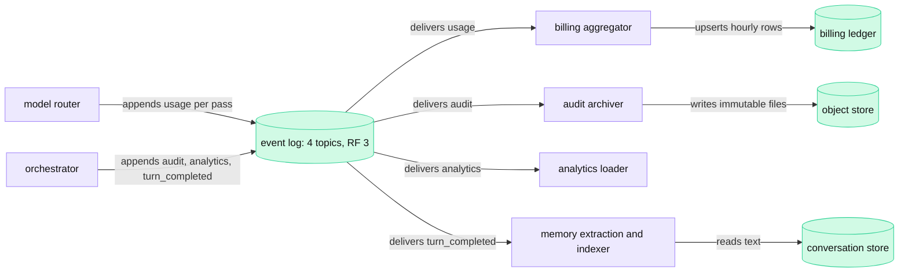

<!-- GENERATED from manuscript/src/part-16-storage-caches-events.md by tools/render_manuscript.py. Edit the source, not this file. -->
# Part 16: Storage, caches and events

Your request leaves rows in a strongly consistent store and events in a replicated log. It also leaves entries in more than ten caches. Each of them has a key, a lifetime and an owner.

Your answer has streamed to the browser (part 15). The tokens are on the screen, but the work of the request is not finished. The system must keep the conversation and count what you used. It must tell other services that the turn ended. It also keeps the caches that made the request fast. This part follows that state in four steps:

1. Which rows the conversation store keeps, and how it places and sizes them (16.1).
2. Which events go to the event log, and who reads them (16.2).
3. Every cache that your request touched, and what a hit in each one saved (16.3).
4. How the system counts your tokens, tools and files, and turns them into an invoice (16.4).

Part 3.4 showed the stores and their consistency, and part 3.5 showed when each message write happens. This part does not repeat them. It adds the global view: keys, placement, volume, events, caches and money. All traffic, sizes and prices here are hypothetical.

---

## 16.1 Databases at global scale

The conversation store keys every entity by tenant, user or conversation. It keeps the rows in the user's home region, with a quorum of three replicas. That layout keeps the common read and the common write inside one region and spreads the load over many ranges.

### The entities and their keys

A **primary key** identifies one row. In a distributed SQL store, the primary key also decides where the row lives. The store sorts rows by primary key and splits the key space into contiguous **ranges** [SRC-931]. Each range has its own replica group [SRC-218]. So the first columns of the key act as the **shard key**. They decide which range holds the row, and so which servers.

In this reference system, each entity lives in the store that its consistency needs (RA-17, RA-20, RA-21):

| Entity | Primary key | Store | Placement | Consistency |
|---|---|---|---|---|
| user | `(user_id)` | conversation store | home region of the user | strong |
| tenant, plan, settings | `(tenant_id)` | conversation store; cached for 60 s (16.3) | home region of the tenant | strong at the source |
| conversation | `(user_id, conversation_id)` | conversation store | home region of the user | strong |
| message | `(conversation_id, seq)` | conversation store | interleaved with its conversation | strong, one writer per conversation |
| file metadata | `(tenant_id, file_id)` | conversation store; bytes in the object store (RA-21) | home region | strong for the row; object bytes have read-after-write consistency [SRC-224] |
| tool execution record | `(conversation_id, message_id, tool_call_id)` | conversation store | next to its message | strong |
| hard quota counter | `(tenant_id, period, shard)` | conversation store | home region of the tenant | strong |
| usage event | `event_id` | event log (16.2) | the serving region | durable, read later |
| usage ledger row and invoice | `(tenant_id, hour, model, kind, partition)` | billing database (16.4) | billing home region | strong, written by consumers |

The IDs are random version 4 UUIDs, not counters. A key that grows with time, such as a timestamp, sends every new row to one range [SRC-662]. CockroachDB documents the result: a hotspot on a single range that load-based splitting cannot divide [SRC-663]. Random IDs spread new conversations over all ranges. The message key `(conversation_id, seq)` still grows inside one conversation, but one conversation receives only a few writes per minute.

The key order also serves the main read. "The last messages of conversation X" is one range scan over `(conversation_id, seq)`, and those rows sit together in one range. Spanner calls this placement of child rows under their parent row **interleaving** [SRC-662].

### The writes of your request

Your request writes these rows to the conversation store, in this order:

1. **User message.** The orchestrator inserts your text with the next `seq` and the idempotency key, before inference (part 3.5).
2. **Tool execution records.** After each tool call, the orchestrator writes one record. It holds the tool name, arguments, status, duration and a result reference. Your request writes two: `web_search` and `run_python`.
3. **Assistant message.** At the end, the orchestrator inserts the full answer once, with status `complete` (RA-18). The row also holds the model ID, token counts and citations.
4. **Hard quota counter.** The model router reserves and settles your tokens against the tenant's period counter, once per inference pass (16.4).

Your files already have metadata rows. The upload wrote them before Send (RA-08). Usage, audit and analytics data do not go to this store at all. They go to the event log (16.2).

### Home region and quorum replication

In this reference system, every user has a home region (RA-17). The store replicates each range synchronously across the zones of that region. Your home region is `ap_south`, which is also the region that serves your request.

Each range has 3 voting replicas, one per availability zone. A write commits when a majority has it [SRC-218]. So a commit needs 2 of 3 acknowledgements and survives the loss of one zone. CockroachDB lets a table have one home region, or a home region per row [SRC-219]. This reference system uses the row-level form (RA-17), so each user's rows live in that user's home region.

The cost of a commit is one round trip between zones plus a log flush. This reference system assumes 2 ms per quorum commit (RA-17, hypothetical). A region-surviving design would wait for a quorum across regions on every write. That costs at least one inter-region round trip, as part 3.4 computed.

**Failover.** One range replica fails: the remaining two still form a quorum, and the leaseholder moves if needed [SRC-218]. A whole region fails: the in-region quorum is gone, and the data waits for the region or for a restore. Part 17.4 computes the recovery time and the data at risk.

### Read paths

Each read goes to the cheapest replica that is fresh enough:

| Read | Freshness it needs | Where it goes |
|---|---|---|
| conversation history for context construction | must see your last write | the leaseholder of the range [SRC-218] |
| idempotency check on Send | must see a concurrent insert | the unique index, at the leaseholder (part 3.5) |
| hard quota counter | must see every other reservation | the leaseholder, in a transaction |
| conversation list in the sidebar | a few seconds old is fine | a nearby replica (a follower read) |
| plan and entitlements | up to the cache TTL old | the entitlement cache (16.3) |

CockroachDB's non-voting replicas follow the log and serve follower reads, but they do not count for the quorum [SRC-218]. So a store can place read-only replicas in other regions for the sidebar. Those replicas never slow down a commit.

### Sizing arithmetic

The hypothetical traffic gives the volume. Every request writes 2 message rows (RA-18):

```
requests per day   = 250,000,000 × 12 = 3,000,000,000 requests
mean request rate  = 3,000,000,000 / 86,400 = 34,722.2 requests/s
peak request rate  = 34,722.2 × 1.45 = 50,347 requests/s
message rows/day   = 3,000,000,000 × 2 = 6,000,000,000 rows
message writes/s   = 50,000 × 2 = 100,000 rows/s at the peak
```

The peak from the daily curve agrees with the hypothetical peak arrival rate of 50,000 requests/s.

Row sizes follow from the token counts. The hypothetical inputs are means. A user message has 60 tokens, and an answer has 400 tokens. Each token takes 4 B of UTF-8. Each row adds 300 B of IDs and metadata:

```
user message row       = 60 × 4 + 300 = 540 B
assistant message row  = 400 × 4 + 300 = 1,900 B
per request            = 540 + 1,900 = 2,440 B
logical bytes per day  = 3,000,000,000 × 2,440 = 7,320,000,000,000 B = 7.32 TB
with 3 replicas        = 7.32 TB × 3 = 21.96 TB per day
per year               = 21.96 TB × 365 = 8.0154 PB
```

These figures cover message rows only. Indexes, old MVCC row versions and the store's own overhead add more.

What these numbers change:

- **Range count.** Petabytes of messages mean many thousands of ranges. Random conversation IDs spread them evenly, so each range takes a small share of the 100,000 writes per second.
- **Retention.** The yearly total grows without limit unless old conversations move to cheaper storage or the user deletes them. Retention policy is a storage decision as much as a privacy decision (part 18.4).
- **The streaming design.** One row per token would multiply the write rate by the answer length (part 3.5). The finalized write keeps this table at the request rate.

### Hot rows: one tenant's quota counter

Random keys protect the message tables. A single row that many requests update is different. Take the hard quota counter of one large tenant at a hypothetical 2,000 requests/s. Each inference pass reserves and then settles, so the reference request's three passes write the counter six times:

```
counter writes/s   = 2,000 × 3 × 2 = 12,000 writes/s
one row, at most   = 1,000 / 2 = 500 writes/s
overload           = 12,000 / 500 = 24
```

The limit comes from the row lock. Only one transaction at a time can hold an exclusive lock on a row; other writers wait in a queue [SRC-932]. Each update holds the lock until its quorum commit returns. So updates of one row run one after another, at most one per commit time. One row cannot absorb this tenant.

The common fix is a **sharded counter**. The store keeps 32 rows per tenant and period. Each reservation updates one row at random, and a quota check sums all of them:

```
limit with shards  = 500 × 32 = 16,000 writes/s
utilization        = 12,000 / 16,000 = 0.75
```

The check now reads 32 rows instead of one. The rows sit in one range, so the read is one scan. Small tenants keep one shard. The tokens-per-minute buckets avoid the problem in another way. They live in Redis and change by atomic scripts (RA-10). The price is an approximate count (part 3.2).

### Consistency, entity by entity

Part 3.4 lists the consistency of each kind of data. Four entities of R-XVI.1 decide the design of this store:

| Operation | What goes wrong without strong consistency | Mechanism in this reference system |
|---|---|---|
| conversation append | two devices write the same `seq`, or a message disappears from the next context | one transaction per insert, unique `(conversation_id, seq)` and idempotency index, leaseholder reads (RA-17) |
| hard quota | concurrent requests each read "budget left" and all pass, so the tenant overspends | reserve and settle in transactions on the counter rows (RA-17, RA-10) |
| usage accounting | a lost or doubled event bills the wrong amount | durable log with `acks=all`, deduplicating consumers and an exact ledger (16.2, 16.4) |
| settings | a model or memory switch flips back and forth between requests | strong at the source; caches lag by at most their TTL (16.3) |

Usage accounting needs exactness, not speed. The event can reach the billing ledger minutes later. It must only count exactly once. The quota needs speed and exactness together, because it must decide before the GPU runs. So the two use different mechanisms (16.4).

**Meanwhile in the fleet.** About 100,000 message rows commit per second at the peak, each in its own range group. Leaseholders in four regions answer history reads for requests that start now. A large tenant's counter shards take thousands of small updates per second. Range splits and lease moves happen in the background without any request waiting for them.

You can now choose a primary key that avoids a hot range, and size the store from the request rate.

---

## 16.2 The event log ◇

Your request appends 9 small events to a replicated, partitioned log and never waits for anyone to read them. Billing, audit, analytics and indexing consumers read the log later, each at its own position.

### The log in six terms

Kafka is the public example of this design. In this reference system, the event log is Kafka-class (RA-20).

- A **topic** is a named, durable log of events [SRC-222]. This reference system has one topic per kind: `usage`, `audit`, `analytics` and `turn_completed`.
- A topic splits into **partitions**. Events with the same key go to the same partition, and order holds only inside one partition [SRC-222].
- An **offset** is the position of an event in its partition. A consumer's position is "just a single integer", the offset of the next event to read [SRC-223].
- A **producer** appends events to the end of a partition. A **consumer** reads them from its own offset.
- A **consumer group** is a set of consumer processes that share the work of one topic. Each partition goes to exactly one consumer of the group at a time [SRC-223]. Each group keeps its own offsets.
- **Replication**: each partition has a leader and followers. The leader tracks the in-sync replicas (ISR), and an event commits when all in-sync replicas have it [SRC-223].

Consumers pull from the log, and producers never wait for them [SRC-222]. A consumer that stops only falls behind. Its **lag** is the distance between the last offset written and its own offset. It can catch up later, or rewind to an old offset and read again [SRC-223].

### The events of your request

Your request emits four kinds of events:

| Kind | Count for your request | Producer | Key | Size each (hypothetical) | Consumers |
|---|---|---|---|---|---|
| usage | 5: one per inference pass (3), one per tool call (2) | model router (passes), orchestrator (tools) | `request_id` | 400 B | billing aggregator, quota reconciler |
| audit | 2: one per tool call | orchestrator | `tenant_id` | 600 B | audit archiver |
| analytics | 1: the request summary | orchestrator | `request_id` | 1000 B | analytics loader, dashboards |
| turn_completed | 1 | orchestrator, after the assistant message commits | `conversation_id` | 300 B | memory extraction, conversation-search indexer |

In total that is 9 events and `2,000 + 1,200 + 1,000 + 300 = 4,500` B. No event carries your text. The `turn_completed` event carries only IDs. Memory extraction (part 5.5) and the conversation-search indexer read the text from the conversation store, under its access checks.

The key decides order and spread:

- **`turn_completed` by conversation.** Memory extraction must see turn 3 before turn 4, so all turns of one conversation go to one partition.
- **`audit` by tenant.** An auditor reads one tenant's actions in order, and audit volume is small.
- **`usage` by request.** Billing needs no order between requests. Each usage event is a complete delta. So the key only has to spread the load.

The usage key shows why the choice matters. A large tenant at 2,000 requests/s emits `2,000 × 2 = 4,000` usage events/s. One aggregator process handles a hypothetical 5,000 events/s. With `tenant_id` as the key, this one tenant would fill `4,000 / 5,000 = 0.8` of one consumer, on one partition. A burst from that tenant would delay billing for every other tenant on that partition. With `request_id` as the key, its events spread over all partitions.

### Replication: RF 3 and min.insync.replicas

In this reference system, every topic has replication factor 3, `min.insync.replicas` 2, and producers send with `acks=all` (RA-20). "A common production setting is a replication factor of 3" [SRC-222]. The mechanism has three parts:

1. With `acks=all`, the leader acknowledges a write only after the full in-sync set has it [SRC-223]. In Kafka 4.3, `acks=all` is the producer default [SRC-223].
2. `min.insync.replicas` is the smallest in-sync set, including the leader, for which a write with `acks=all` can succeed [SRC-661]. Its default is 1 [SRC-661]. This reference system raises it to 2.
3. Only an in-sync replica can become leader [SRC-223]. So a committed event survives the loss of its leader.

The failure arithmetic:

| Broker failures in one partition's replica set | Writes | Committed events |
|---|---|---|
| 0 | succeed | safe |
| 1 | succeed, because 2 replicas stay in sync | safe |
| 2 | fail with "not enough replicas"; the producer retries and buffers | safe on the last replica |

With the default of 1, the third row would still accept writes onto a single disk. One more failure would then lose acknowledged usage events. That is why billing data needs 2.

### The producer path, and why the token path never waits

The model router does not send a usage event over the network inside the token path. It appends the event to the producer's in-memory buffer and returns. The producer client batches events per partition. It waits up to `linger.ms` = 5 ms or until a batch reaches `batch.size` = 16,384 B, then sends the batch [SRC-223]. The idempotent producer is on by default, so a resend adds no duplicate to the log [SRC-223].

Three reasons keep the token path independent of the log:

1. **Consumers never gate producers.** A billing consumer that stops for an hour only grows its lag [SRC-222]. Your stream does not notice.
2. **The append is asynchronous.** The last token reaches you before the batch leaves the producer. The model router creates the usage event of pass 3 after the stream ends.
3. **A slow broker affects only the buffer.** The buffer has a fixed size. A common design spools usage and audit events to local disk when the buffer fills and drops analytics events first.

If the token path waited for analytics, an analytics outage would stop every answer in the fleet. A dashboard is not worth that risk. Only the hard quota check sits in the request path. It reads the strongly consistent store, not the log (16.4).



Legend: violet = CPU services; green cylinders = durable stores. The one thing to notice: no arrow returns from a consumer to a producer. So no consumer can slow the request. The diagram leaves out the telemetry pipeline on purpose; metrics and traces use their own path (part 19.1).

### Delivery semantics: at least once, made exact

Kafka names three delivery guarantees [SRC-223]:

- **At most once:** the system can lose an event, but never delivers it twice.
- **At least once:** the system never loses an event, but can deliver it twice. This is Kafka's default [SRC-223].
- **Exactly once:** the consumer processes each event once and only once.

Duplicates come from two places. A consumer can crash after it processes a batch but before it commits its offset. Its replacement then reads the batch again. A producer can also send the same fact twice, for example after the orchestrator restarts a failed step.

Kafka offers transactions for the first case. A producer writes to several partitions atomically [SRC-223]. A consumer with `isolation.level=read_committed` sees only committed transactions [SRC-223]. That covers pipelines that stay inside Kafka. The billing ledger is a database outside Kafka, so this reference system uses two simpler rules instead (RA-20, RA-73):

1. **Deterministic event IDs.** The ID of a usage event is a hash of `(request_id, pass number, kind)`. A resent fact therefore carries the same ID.
2. **Offsets stored with the results.** The aggregator writes its hourly sums and its partition offsets in one database transaction. After a crash, it restarts from the stored offset. So a batch counts once or not at all.

The aggregator also keeps the event IDs it has seen for 24 h and drops a repeat. The ID always hashes to the same partition, because the key is the request ID. So each consumer deduplicates only its own partitions, and no shared lookup is needed. The size of that state, for the whole fleet:

```
usage events per day = 3,000,000,000 × 2 = 6,000,000,000
event IDs held       = 6,000,000,000 (one day)
bytes                = 6,000,000,000 × 64 = 384,000,000,000 B = 384 GB, spread over every partition of four regions
```

At-least-once delivery plus an idempotent consumer gives the effect of exactly once. The same idea protects the message insert with its idempotency key (part 3.5).

### Throughput arithmetic

A request that uses tools makes 2 tool calls on average (hypothetical), and each call adds one inference pass. With the tool-use fraction of 0.25:

```
mean tool calls per request = 0.25 × 2 = 0.5
mean passes per request     = 1 + 0.5 = 1.5
events per request          = usage + audit + analytics + turn_completed = 2 + 0.5 + 1 + 1 = 4.5
bytes per request           = 2 × 400 + 0.5 × 600 + 1 × 1000 + 1 × 300 = 2,400 B
```

For the whole fleet:

| Quantity | Arithmetic | Result |
|---|---|---|
| events per second at the peak | `50,000 × 4.5 = 225,000` | 225,000 events/s |
| bytes per second at the peak | `50,000 × 2,400 = 120,000,000` | 120 MB/s |
| broker disk writes with 3 replicas | `120 MB/s × 3 = 360 MB/s` | 360 MB/s |
| events per day | `3,000,000,000 × 4.5 = 13,500,000,000` | 13,500,000,000 |
| bytes per day | `3,000,000,000 × 2,400 = 7,200,000,000,000` | 7.2 TB |
| stored at the default 7-day retention [SRC-661] | `7.2 TB × 7 × 3 = 151.2 TB` | 151 TB |

The usage topic alone carries `50,000 × 2 = 100,000` events/s at the peak. The billing aggregator group then needs at least `ceil(100,000 / 5,000) = 20` consumers. Each partition goes to one consumer of the group [SRC-223]. So extra consumers beyond the partition count stay idle. So this reference system gives the usage topic 64 partitions per region (RA-20, hypothetical), well above that minimum. If all the peak landed in one region, each partition would carry:

```
events per partition = 100,000 / 64 = 1,562.5 events/s
bytes per partition  = 1,562.5 × 400 = 625,000 B/s = 625 kB/s
events per linger    = 1,562.5 × 5 / 1,000 = 7.8125 events per partition, across all producers
```

What these numbers change:

- **The log is not the bottleneck.** 360 MB/s of sequential disk writes spread over a few dozen brokers per region. The volume is smaller than the message tables of 16.1.
- **Batches stay small.** Each producer sends a few events per batch, far below `batch.size`. So `linger.ms`, not the batch size, closes each batch. It delays an event by at most 5 ms, and nobody waits for that event.
- **Retention is a recovery window.** Seven days of usage events let the aggregator rebuild a week of ledger rows after a bug. The audit archiver copies audit events to the object store for longer retention, because the log deletes old segments [SRC-661].

**Meanwhile in the fleet.** About 225,000 events per second enter the logs of four regions at the peak. Twenty or more billing consumers each read their own partitions. An analytics loader may be minutes behind after a deploy, and its lag shrinks again. No stream in the fleet waits for any of them.

You can now pick a partition key for a topic, and explain why the token path never waits for consumers.

---

## 16.3 The complete cache map; CDN caching is not LLM caching

Your request touched more than ten caches, from the browser to the GPU's HBM. Each one has its own key, lifetime, sharing scope and security boundary. Only the public, static caches serve more than one user.

### TTL, LRU, LFU and memory pressure

Every cache answers two questions: when does an entry stop being valid, and which entry goes when memory is full.

- **TTL (time to live).** The entry stays valid for a fixed time after the write. A TTL bounds staleness. It does not depend on memory.
- **Invalidation.** The owner of the data deletes or replaces the entry when the source changes. It gives fresh data, but every writer must know every cache.
- **Content-addressed keys.** The key contains a hash of the content or a version. A change creates a new key, so no old entry ever needs invalidation. Hashed asset files, the embedding cache and the prefix cache all work this way.
- **LRU (least recently used).** Under memory pressure, evict the entry that has been idle longest. Redis approximates LRU: it samples a few keys and evicts the one idle longest [SRC-220]. Its documentation shows 5 samples; exact LRU would cost more memory [SRC-220].
- **LFU (least frequently used).** Evict the entry with the fewest recent hits. Redis keeps a probabilistic counter per key with decay, set by `lfu-log-factor` 10 and `lfu-decay-time` 1 minute by default [SRC-220].
- **Memory pressure.** A cache that reaches its memory limit must evict before it can write. Redis applies its `maxmemory-policy` at that moment; `noeviction` makes writes fail instead [SRC-220].

LRU fits caches whose recent use predicts the next use, such as search results and the prefix cache. LFU fits caches where a few keys stay popular for a long time. A burst of one-time keys must not push them out. In this reference system, the derived caches use `allkeys-lru` with TTLs (RA-19).

### The map

Each row is one cache that your request touched. "Isolation" is the scope inside which one entry can answer another request.

| Layer | Cache | Key → value | Lifetime | Invalidation and eviction | Isolation | A hit saves |
|---|---|---|---|---|---|---|
| client | browser HTTP cache, static assets | URL with a content hash → JS, CSS, fonts | `max-age` 31,536,000 s with `immutable` [SRC-660] | new release = new file names; browser LRU | one browser profile | the download, so the app starts from disk |
| client | app shell | URL of the HTML page → the page | `no-cache`: revalidated on every load | `ETag` check | one browser profile | the body, when the `ETag` still matches |
| client | DNS, TLS tickets, connection | name → address; ticket; open QUIC connection | record TTL; ticket lifetime; idle timeout (part 2.3) | expiry | one device | round trips before Send |
| CDN | edge HTTP cache in the PoP | method + URL (+ `Vary` headers) → static asset [SRC-270] | the asset's `max-age` | same as above; edge LRU | all users | the trip to the origin region |
| application | signing keys | key ID → public key | 3,600 s, in gateway process memory | refetch on an unknown key ID | one gateway process | a call to the identity service per request |
| application | entitlements | `tenant_id` → plan, limits, allowed models and tools | 60 s in Redis (part 3.1) | TTL; deleted on a plan change | one tenant (RA-19) | a store read per request |
| application | sessions | opaque token → user, expiry | the session's lifetime | deleted on logout or revocation | one user | a database lookup per request (part 3.4) |
| application | rate-limit buckets | `tenant_id` + limit → tokens left, last refill | refilled by time; key dropped when idle | not a cache: losing it resets the bucket | one tenant (RA-10) | not a saving: it is the limit itself |
| data | store buffer cache | range data blocks in server memory | until evicted | the store's LRU | the store | a disk read per row |
| retrieval | embedding cache | tenant + model ID + dims + text hash → embedding (part 5.1) | until the model version changes; query embeddings 3,600 s | content-addressed; `allkeys-lru` (RA-19) | one tenant | one `M-embed` call on the retrieval pool |
| retrieval | query-result cache | tenant + ACL scope + index version + query text → ranked chunk IDs | 300 s | a document change bumps the index version; LRU | one tenant and one ACL scope | BM25, HNSW and the reranker |
| tooling | search results and page text | tenant + normalized query or URL → results, page text (part 7.8) | per query class: 1 h for your pricing queries | TTL capped by `Cache-Control`; LRU | one tenant | about 1.6 s of search and fetch, and provider fees |
| inference | tokenizer cache | fixed text, such as a system prompt → token IDs | the life of the process | none needed: the text is the key | one process | CPU time for tokenization |
| inference | prefix KV cache, G1 to G4 | chained block hash with tenant salt → KV blocks (part 13.3, 13.6) | until evicted under memory pressure | LRU per tier (RA-39) | one tenant, by `cache_salt` (RA-40) | prefill of the cached tokens |
| inference | per-request KV cache | block table of one sequence → its KV blocks | from prefill until the sequence ends | freed at the end; kept blocks join the prefix cache | one sequence | everything: decode cannot run without it |
| inference | weights in HBM | the model itself | the life of the replica | replaced only by a new deployment | all tenants, read-only | loading the weights at all |
| inference | model checkpoints on node NVMe | checkpoint version → weight files (RA-61) | until the node needs the space | LRU over checkpoint versions | all tenants, read-only | a pull from the object store at cold start |

Two rows of this table have no lifetime problem at all. The hashed static assets and the prefix cache use content-addressed keys. A stale hit is impossible, because different content has a different key. Every TTL in the table guards data whose key does not change when the data changes.

The data layer has no result cache in front of the conversation store. A stale history would put the wrong turns into the context. So history reads go to the leaseholder (16.1), and only the store's own buffer cache speeds them up.

### What a hit saves for your request

The savings span six orders of magnitude:

| Hit | What your request skipped | Size of the saving |
|---|---|---|
| static assets from the browser cache | the app download | the whole bundle, before Send |
| signing key in process memory | a call to the identity service | one network round trip |
| entitlements in Redis | a store read | one in-region round trip |
| query embedding | an `M-embed` pass | one GPU batch slot on the retrieval pool |
| search results for a query seen within 1 h | the provider call and three page fetches | about 1.6 s |
| prefix KV in pass 3 | prefill of 30,208 of 30,395 prompt tokens | only 187 tokens left to prefill |
| prefix KV in G2 instead of a recompute (32k tokens, `M-dense`) | 2,630 ms of prefill | 23.4 ms of PCIe transfer instead (part 13.6) |
| checkpoint on local NVMe | a pull from the object store | the `M-frontier` share loads in about 15 s per rank from NVMe (part 1.7) |

The GPU-side caches save the most, because GPU time is the scarce resource. The CPU-side caches save round trips. A round trip matters for TTFT because these steps run before the first token, one after another.

**Memory pressure in each tier.** Each cache reacts differently when it fills. The browser and the CDN evict cold assets, and a miss costs one download. Redis evicts by sampled LRU (RA-19), and a miss costs one recompute. The prefix cache evicts free blocks in LRU order and offloads them to G2 and lower tiers (part 13.6).

The per-request KV cache cannot evict anything that a running sequence needs. Under pressure, the scheduler preempts a sequence instead (part 13.8). So "the cache is full" means a slower request in most tiers, and a paused request only on the GPU.

### CDN caching is not LLM caching

A CDN can cache `logo.png` for every user. It cannot cache your answer, because your answer is private, unique and produced by a POST.

An HTTP cache stores a response under a key made of at least the request method and the target URI [SRC-270]. The `Vary` header adds named request headers to that key [SRC-270]. That model works for `logo.png`:

1. The browser sends `GET /static/logo.3f9a1c.png`.
2. The PoP looks up the key `GET` + that URL.
3. On a hit, the PoP returns the stored bytes. Every user gets the same bytes, and that is correct.

Your request fails every condition of that model:

- **It is a POST.** The body carries your text, file IDs and settings. The URL `/v1/conversations/{id}/messages` says nothing about the content.
- **It carries an `Authorization` header.** A shared cache must not use a stored response for such a request, unless the response explicitly allows it [SRC-270].
- **It is private.** The answer depends on your history, your memory records, your tenant's documents and your files. A response marked `private` must never enter a shared cache [SRC-270]. The chat API also sends `no-store`, so no cache keeps any part of it [SRC-270].
- **It is unique.** With sampling at temperature 1.0 (RA-72), the same prompt gives a different answer next time. The prompt itself is unique too, because it holds your history and a fresh web result.
- **It is a stream.** The answer does not exist when the request arrives. Before the last token, no complete response exists to store.

So the edge passes the chat request through to the region without a cache lookup (part 1.1). The caches that do speed up your answer work deeper in the system:

| Cache | What is reused | Key | Who may share an entry | Is the result a stored answer? |
|---|---|---|---|---|
| CDN, `logo.png` | the whole response | method + URL | everyone | yes, the same bytes for all |
| CDN, a public immutable file (a model card, a public PDF) | the whole response | method + URL with content hash | everyone | yes; `immutable` stops revalidation while fresh [SRC-660] |
| prefix KV cache | the K and V tensors of a shared prompt prefix | chained hash of token IDs + tenant salt | one tenant (RA-40) | no: the model still decodes every new token |
| semantic response cache | an earlier answer to a similar question | embedding similarity | only requests that may see the same answer | yes, an earlier answer (part 13.4) |

The prefix cache is the main LLM cache, and it never returns an answer. It skips only the prefill of tokens that the model has already seen. Decode, sampling and tool calls still run for your request, so the answer is still yours.

A semantic cache returns a stored answer for a question that is only similar. That is safe only for public, non-personal and time-insensitive questions. A common design limits it to such requests, scoped by tenant. Your request reads private files and current prices, so it fails all three tests.

**Meanwhile in the fleet.** PoPs answer most requests for static files from their caches, and the regions see only the misses. Redis clusters in every region evict cold search results as new pricing queries arrive. In thousands of engines, the prefix cache keeps the system prompts and tool schemas of the busiest tenants in HBM. Each engine evicts other blocks in LRU order every scheduler iteration.

You can now state the key, lifetime and isolation of every cache on the path. You can also explain why a CDN cannot cache a chat answer.

---

## 16.4 Usage accounting and billing

The model server counts your tokens, and the model router turns each pass into a usage event. An aggregator sums the events into an exact ledger. The hard quota check, in contrast, runs synchronously against the strongly consistent store before each pass.

### What is counted

Seven quantities make up the usage of your request:

| Quantity | Who counts it | Unit |
|---|---|---|
| input tokens | the model server, per pass | tokens |
| cached input tokens | the model server: prompt tokens served from the prefix cache | tokens |
| output tokens | the model server, per pass, including reasoning tokens | tokens |
| reasoning tokens | the model server: the part of the output inside the reasoning section | tokens |
| tool calls | the orchestrator: one per executed call; search is counted per query | calls, queries |
| storage | the file service: bytes of uploaded files per day | GB-days |
| code execution time | the code executor: run time of each `run_python` call | seconds |

Only the model server's tokenization counts (RA-62). The orchestrator and the endpoint picker tokenize too, but only for budgets and routing.

vLLM reports these counts in its usage object. `prompt_tokens_details.cached_tokens` holds the cached input tokens, and `completion_tokens_details.reasoning_tokens` holds the reasoning tokens [vllm@v0.31.0:vllm/entrypoints/serve/engine/protocol.py#L120-L140]. The server fills `cached_tokens` only when it runs with `enable_prompt_tokens_details` [vllm@v0.31.0:vllm/entrypoints/openai/chat_completion/serving.py#L90-L115].

### Your request, pass by pass

The token counts come from part 5.6. The cached count uses the hash-block rule, the same split that part 14.4 uses for the GPU cost. The prices per million tokens are hypothetical:

- uncached input tokens: 2.00 USD;
- cached input tokens: 0.20 USD, a 90% discount;
- output tokens, reasoning included: 8.00 USD.

| Pass | Prompt | Cached | Uncached | Output | of which reasoning | Uncached USD | Cached USD | Output USD |
|---|---|---|---|---|---|---|---|---|
| 1 | 23,322 | 3,072 | 20,250 | 424 | 300 | 0.04050 | 0.00061 | 0.00339 |
| 2 | 29,816 | 23,552 | 6,264 | 440 | 200 | 0.01253 | 0.00471 | 0.00352 |
| 3 | 30,395 | 30,208 | 187 | 863 | 400 | 0.00037 | 0.00604 | 0.00690 |
| **total** | **83,533** | **56,832** | **26,701** | **1,727** | **900** | **0.05340** | **0.01137** | **0.01382** |

Pass 1 pays for most of the uncached tokens, because the image and the retrieved chunks enter there. Passes 2 and 3 extend the previous prompt, so the prefix cache serves almost all of it (part 5.6). Each pass sends the whole prompt again, so the prompt column counts the shared prefix three times. The cached price makes that repetition cheap.

The token charge:

```
tokens       = 0.053402 + 0.011366 + 0.013816 = 0.078584 USD
no discount  = 83,533 × 2.0 / 1e6 + 0.013816 = 0.180882 USD
```

The cache discount lowers the token charge of your request by 57%. The 900 reasoning tokens cost 0.0072 USD, at the output price. You never see them, but they ran on the GPU like visible tokens (RA-60, RA-72).

The other charges of your request (all prices hypothetical):

```
web search    = 3 × 10.0 / 1,000 = 0.0300 USD   (10 USD per 1,000 queries, the hypothetical price to the tenant; part 7.2 gives the provider's cost)
code run      = 1.2 s × 0.0001 = 0.000120 USD
request total = 0.078584 + 0.0300 + 0.000120 = 0.108704 USD
storage       = 0.005 GB × 0.1 = 0.000500 USD per month for your PDF and photo, accrued per day
```

The web search costs more than all the cached and output tokens together. Part 14.4 estimates the provider's own cost for the same request at 0.028 USD. That figure includes GPU time and search fees. Price and cost come from different models, so their ratio here is an illustration, not a margin.

### The TPM reservation and the refund

Before each pass, the model router reserves `prompt_tokens + max_tokens` in the tenant's tokens-per-minute bucket (RA-10). `max_tokens` covers reasoning tokens too, so the reservation includes them (RA-60). At the end of the pass, the router charges what the pass used and refunds the rest:

| Pass | Reserved | Charged (prompt + output) | Refunded |
|---|---|---|---|
| 1 | `23,322 + 4,096 = 27,418` | `23,322 + 424 = 23,746` | `27,418 − 23,746 = 3,672` |
| 2 | `29,816 + 4,096 = 33,912` | `29,816 + 440 = 30,256` | `33,912 − 30,256 = 3,656` |
| 3 | `30,395 + 4,096 = 34,491` | `30,395 + 863 = 31,258` | `34,491 − 31,258 = 3,233` |
| total | 95,821 | 85,260 | 10,561 |

The TPM bucket charges cached tokens in full. It protects GPU capacity over one minute, and a cached prompt still occupies KV blocks and attention reads. The invoice discounts cached tokens because the provider skipped their prefill. So the two counters measure different things on purpose.

### Synchronous quota, asynchronous usage

Hard quota enforcement must be synchronous, because it decides before the GPU runs. Take a tenant with a budget of B tokens left and N concurrent requests. Each one reads the counter, sees B, and proceeds. If the counter lags, all N pass, and the tenant overspends by up to N − 1 requests. Only a transaction on the strongly consistent counter rows prevents that (RA-17, 16.1).

Usage events can flow asynchronously, because nothing waits for the invoice. The invoice needs completeness and exactness, not speed. An event that reaches the ledger ten minutes late changes nothing, as long as it arrives and counts once. So this reference system splits the two (RA-20):

| Need | Mechanism | In the request path? |
|---|---|---|
| requests per minute | Redis token bucket at the API gateway (RA-10) | yes, approximate |
| tokens per minute | Redis reservation and refund at the model router (RA-10) | yes, approximate |
| hard spend or token quota | reserve and settle on sharded counter rows in the conversation store (RA-17) | yes, exact |
| what the tenant pays | usage events → aggregator → ledger (RA-20) | no |

### The usage event

The model router emits one usage event when a pass ends, whether it completed, stopped or failed. The engine reports the tokens produced so far, so a stopped pass bills only those (part 3.5). The usage event of pass 3, as JSON for reading (the log stores Protobuf):

```json
{
  "event_id": "sha256(request_id, pass=3, kind=tokens)[:16]",
  "kind": "tokens",
  "tenant_id": "t_...", "user_id": "u_...", "request_id": "r_...", "pass": 3,
  "model": "M-frontier", "deployment": "ap_south/k3-prod", "region": "ap_south",
  "prompt_tokens": 30395,
  "cached_tokens": 30208,
  "output_tokens": 863,
  "reasoning_tokens": 400,
  "status": "complete",
  "started_at": "...", "ended_at": "...", "price_version": "2026-10"
}
```

The event carries counts, never prices. The aggregator applies the price list later, so a price change never requires the producers to change.

### Aggregation into the ledger

The billing aggregator turns events into ledger rows in five steps:

1. **Read.** Each consumer reads its partitions of the `usage` topic from its stored offsets.
2. **Deduplicate.** It drops an event whose ID it has seen in the last 24 h (16.2).
3. **Sum.** It adds the counts in memory per tenant, hour, model and kind.
4. **Write.** It upserts the sums into the ledger and stores its offsets in the same transaction.
5. **Close.** After the hour ends and a grace period passes, it marks the hour's rows final.

The ledger row key includes the partition, so two consumers never update the same row. A query sums the partitions. The reduction for the fleet, with a hypothetical 3 active hours per tenant per day:

```
usage events per request = 1 + 2 × 0.25 × 2 = 2
usage events per day     = 3,000,000,000 × 2 = 6,000,000,000
ledger rows per day      = 250,000,000 × 3 = 750,000,000 (upper bound)
reduction                = 6,000,000,000 / 750,000,000 = 8
```

Aggregation also decides whether an external billing service can take the data. Stripe's meter-event endpoint is a public example. It accepts 1,000 calls per second per account in live mode, and it recommends pre-aggregation above that [SRC-664]. The raw usage stream averages `69,444 / 1,000 = 69.4444` times that limit. Only aggregated rows can go to such a service. Stripe also deduplicates meter events by an identifier and processes them asynchronously [SRC-664], the same two rules as above.

### Invoices

At the end of a billing period, the invoice process runs these steps:

1. It sums the final ledger rows of the tenant for the period, per model and kind.
2. It applies the price list that each row's `price_version` names.
3. It adds storage: GB-days of files times the daily price.
4. It writes the invoice lines and the total in one transaction, and marks the invoice final.

A final invoice never changes. A common design turns a late event or a correction into an adjustment row on the next invoice. Stripe's meters accept an event dated up to 35 days back [SRC-664]. Stripe does not change a finalized invoice, and it does not move the late usage to the next invoice either [SRC-664].

### Reconciliation

Three independent counts describe the same usage. A nightly reconciliation process compares them per tenant and day:

| Count | Source | Expected relation |
|---|---|---|
| engine usage | usage events, archived to the object store | the reference |
| TPM charges | the model router's settle log | equal for prompt + output tokens |
| ledger | the aggregator's hourly rows | equal to the deduplicated sum of the archive |

A difference points to a specific fault. Archive above ledger means lost or rejected batches in the aggregator. Ledger above archive means a dedupe failure. TPM above engine means a pass that reserved and never settled, for example after a crash. The bucket refills with time, so the tenant loses only one minute of headroom. The process writes every difference as an adjustment row, never as an edit to an old row.

**Meanwhile in the fleet.** Every second at the peak, about 100,000 usage events enter the logs. Aggregators in four regions fold them into hourly rows. Counter shards of large tenants take reservations and settlements in the conversation store. Tonight, the reconciliation process compares a day of archived events with the ledger.

You can now compute the billed price of a multi-pass request. You can also explain why quota needs synchronous state and billing does not.

---

## What Part 16 established

Your request leaves consistent rows, asynchronous events and many cache entries, each with a key, a lifetime and a scope. So the conversation stays exact and usage counts once. The caches keep the system fast, and no user's data answers another user's request.
