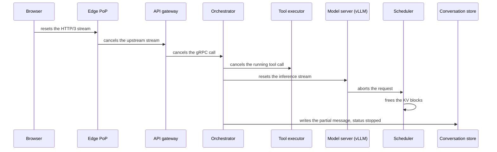
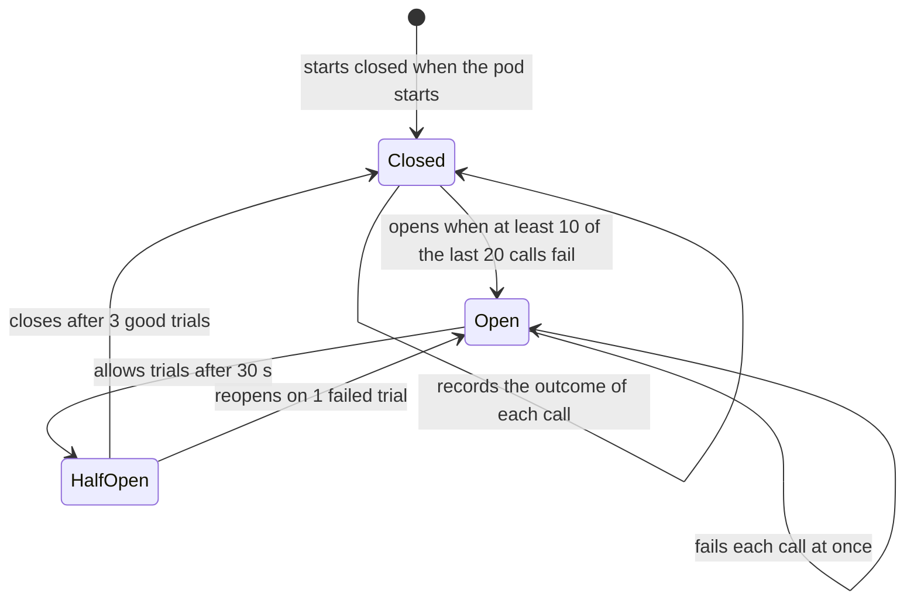

<!-- GENERATED from manuscript/src/part-17-reliability.md by tools/render_manuscript.py. Edit the source, not this file. -->
# Part 17: Reliability

A reliable chat service bounds every wait, stops dead work at once, and makes each failure a small, known loss.

Your request crosses about ten components and three inference passes. Any of them can be slow, crash or vanish. This part follows what happens to your request, and to the fleet, in eleven failure cases:

1. A deadline for every hop (17.1).
2. A cancel that travels down to the GPU (17.2).
3. A GPU worker that crashes in the middle of your answer (17.3).
4. A whole region that fails (17.4).
5. A slow conversation store (17.5).
6. A tool that times out (17.6).
7. A load spike that would collapse an unbounded queue (17.7).
8. Retries that must not multiply load or charge twice (17.8).
9. A circuit breaker on the search provider (17.9).
10. A new release that must not break open streams (17.10).
11. Broken hardware: GPUs, NVLink, NICs, nodes and racks (17.11).

All traffic numbers, deadlines and failure rates in this part are hypothetical unless a citation follows them. They belong to this reference system, not to any real provider.

---

## 17.1 Deadlines and timeout budgets

Every call carries the time its caller still has, minus a reserve, so no child outlives its parent (RA-11).

### The rule

A **deadline** is the absolute time by which a request or call must finish. A **timeout** is the duration of one call. A **timeout budget** is the split of one deadline into the timeouts of the calls inside it.

gRPC sets no deadline by default, so a call without one can wait forever [SRC-148]. gRPC "converts the deadline to a timeout from which the already elapsed time is already deducted" [SRC-148]. So each hop passes a duration, not a clock time. Clock skew between machines then does not matter. When the time runs out, the client fails the call with `DEADLINE_EXCEEDED` [SRC-148].

The Google SRE book gives the reason. Without deadlines, "servers spend resources handling requests that will exceed their deadlines" [SRC-685]. The fix: "check the deadline left at each stage" before more work [SRC-685].

In this reference system, each hop computes its child deadline with one rule (RA-11):

```
child deadline = min(child cap, time left in the parent − reserve the parent keeps for itself)
```

The **cap** is the largest timeout the child ever gets. The **reserve** is the time the parent needs after the child returns, for example to write the partial answer.

### The chain for your request

The top-level deadline is 120 s (hypothetical). The edge PoP starts the clock when your request arrives. Each outer hop keeps a small reserve:

| Hop | Time it gets | Arithmetic |
|---|---|---|
| edge PoP | 120 s | the top-level deadline |
| API gateway | 119.5 s | 120 − 0.5 = 119.5 s |
| orchestrator | 119 s | 119.5 − 0.5 = 119.0 s |
| orchestrator, usable for child calls | 117 s | 119.0 − 2.0 = 117.0 s |

The edge reserve of 0.5 s lets the edge send an `error` event and close the stream cleanly. The gateway reserve of 0.5 s lets it map the error to a status and log it. The orchestrator never lends out its final reserve of 2.0 s. It needs that time to write the finished or partial message (RA-18, RA-59) and the usage events.

Inside the orchestrator, the first three steps run in parallel (part 3.8). The other steps run in order. Each step gets the rule above. The caps come from earlier parts and from `hypothetical.timeout_budget_ref`:

| Step | Cap | Starts at | Time left in the parent | Child deadline | Normal time used |
|---|---|---|---|---|---|
| read history (conversation store) | 1 s | 0.00 s | 119.00 s | 1 s | 0.01 s |
| read memory records | 0.5 s | 0.00 s | 119.00 s | 0.5 s | 0.02 s |
| hybrid retrieval and rerank | 3 s | 0.00 s | 119.00 s | 3 s | 0.18 s |
| inference pass 1 | 40 s | 0.18 s | 118.82 s | 40 s | 20.73 s |
| `web_search` call | 20 s | 20.91 s | 98.09 s | 20 s | 1.61 s |
| inference pass 2 | 40 s | 22.52 s | 96.48 s | 40 s | 21.11 s |
| `run_python` call | 35 s | 43.63 s | 75.37 s | 35 s | 1.30 s |
| inference pass 3 (the answer) | 60 s | 44.93 s | 74.07 s | 60 s | 40.89 s |

The normal times are the spans of your request's trace (part 19.1). Each inference pass is queue, prefill and decode, with a decode step of 47.2 ms (part 14.2). For pass 3 that is 0.17 + 0.005 + 40.72 = 40.89 s. The `web_search` time is the p50 of the Monte Carlo tool step of part 7.2. The `run_python` time is a warm claim, the run and the upload of part 8.1: 25 + 1200 + 80 = 1305 ms. Only the memory read has no span in the trace, so its time is hypothetical.

The orchestrator's steps end after 85.8 s, 33.2 s before its own deadline. No cap binds. From the key press to the last pixel, your request takes 85.9 s (part 21). That is 34 s inside the top-level deadline.

### The calls inside the tools

The rule repeats one level down. The `web_search` call has 20 s (part 6.2). Inside it, each provider attempt has 2,500 ms, and each page fetch has 6,000 ms (part 7.2, 7.4). Both are far smaller than the tool's time, so one retry still fits (RA-12).

The `run_python` executor has 35 s. That is the model's `timeout_s` of 30 s plus 5 s (part 6.2). The margin covers the sandbox claim and the artifact upload. So the code always stops before the executor gives up.

### When every step is slow

Now assume the worst case: every step uses its whole child deadline. The caps on the path add up to 198 s. The three parallel steps count once, with the largest cap. That is 1.69 times the usable 117 s. Fixed caps alone therefore cannot keep a request inside its deadline. Propagation of the time left does:

| Step | Starts at | Time left in the parent | Child deadline | Result |
|---|---|---|---|---|
| retrieval | 0 s | 119 s | 3 s | ok |
| pass 1 | 3 s | 116 s | 40 s | ok |
| `web_search` | 43 s | 76 s | 20 s | ok |
| pass 2 | 63 s | 56 s | 40 s | ok |
| `run_python` | 103 s | 16 s | 14 s, not 35 s | clipped, then expired |
| pass 3 | 117 s | 2 s | 0 s | skipped: no time left |

The `run_python` call gets only 14 s. Its executor clips the sandbox limit to the same rule: 9 s instead of 30 s. No time is left for pass 3, so the orchestrator skips it. It uses its reserve to write the partial message with status `interrupted` and to send an `error` event (RA-59).

The sim checks every row of both scenarios. Every child deadline is smaller than the time left in its parent: True.

### Three traps

1. **A proxy default shorter than the stream.** Envoy's route timeout "defaults to 15 seconds" and is "typically a problem for streaming responses" [SRC-643]. Your pass 3 alone streams for about 41 s. In this reference system, every proxy on the stream path sets its route timeout from the propagated deadline (RA-11). The stream idle timeout of 300 s [SRC-643] stays as a backstop.
2. **A deadline that ends in a retry.** A retry after the parent's time has run out does only dead work. So the one retry layer (RA-12) checks the time left before each attempt (17.8).
3. **A client that waits longer than the server.** The browser has no deadline of its own. The edge enforces one, and it resets a stream whose client reads nothing for 30 s (part 15.6).

**Meanwhile in the fleet.** Every orchestrator pod runs thousands of these budgets at once. Each budget is a few numbers in the request context, not a timer thread. Two counters show a budget problem: `DEADLINE_EXCEEDED` per step, and the share of `interrupted` messages.

You can now split a top-level deadline into child deadlines and show that none of them can outlive its parent.

---

## 17.2 Cancellation, end to end

A cancel must reach the GPU scheduler in tens of milliseconds, because each second of delay wastes GPU time.

### The chain

When you press Stop, or close the tab, eight things happen in order. In this reference system, the cancel reaches the scheduler, which frees the KV blocks (RA-49):

1. **The browser aborts the fetch.** The client calls `AbortController.abort()`. It can abort "fetch requests, the consumption of any response bodies, or streams" [SRC-690]. On HTTP/2 or HTTP/3, the browser resets the request stream (part 15.6).
2. **The edge PoP sees the reset.** It cancels its upstream stream to the regional ingress over its warm connection.
3. **The API gateway cancels the gRPC call** to the orchestrator.
4. **The orchestrator cancels its children.** It cancels the open inference call and every running tool call. gRPC says a cancelled server "should stop any ongoing computation" [SRC-684]. The cancel "should ideally propagate to all ongoing computation in the system" [SRC-684]. Go, Java and C++ cancel outgoing RPCs automatically; in other languages the handler must do it [SRC-684].
5. **The model router and the inference gateway forward the reset** to the chosen model server.
6. **vLLM's API server sees `http.disconnect`.** Its `with_cancellation` wrapper waits on two tasks, the handler and a disconnect listener. When the disconnect arrives first, it cancels the handler [vllm@v0.31.0:vllm/entrypoints/serve/utils/api_utils.py#L36-L90].
7. **The engine aborts the request.** The cancelled generator calls `abort()`, which removes the request from the output processor and the engine core [vllm@v0.31.0:vllm/v1/engine/async_llm.py#L744-L752] [vllm@v0.31.0:vllm/v1/engine/async_llm.py#L876-L887].
8. **The scheduler frees the KV blocks.** `finish_requests` removes the request from the running or waiting queue and sets the status `FINISHED_ABORTED` [vllm@v0.31.0:vllm/v1/core/sched/scheduler.py#L2585-L2711]. A GPU step in flight may still write those blocks. Then vLLM returns them to the pool after that step [vllm@v0.31.0:vllm/v1/core/sched/scheduler.py#L2701-L2710].

The engine reports the finish reason `ABORT`, described as "aborted by client" [vllm@v0.31.0:vllm/v1/engine/__init__.py#L48-L66]. That value becomes the `finished_reason` label of `vllm:request_success`.



Legend: each arrow is one cancel signal or one write. The one thing to notice: the cancel follows the request's path, and GPU work ends only at the scheduler. The diagram leaves out the model router and the inference gateway, which only forward the reset.

### What the orchestrator does with the stop

After the cancels, the orchestrator writes the partial answer once. Its status is `stopped` after the Stop button and `interrupted` after a disconnect (RA-59). The text is the visible tokens that the client had received. A tool call that has already caused a side effect cannot be undone by a cancel. So the execution record shows what completed (part 6.2). The limiter refunds the unused part of the TPM reservation (part 3.2).

When the user comes back, the client fetches the conversation by ID. It shows the partial answer and offers to regenerate (RA-48). This reference system stops generation after a disconnect, because nobody may read the rest (RA-18, part 3.5).

### How long propagation takes

Take a Stop press at the 120th visible token of pass 3. Your request runs on an `M-frontier` DEP16 decode worker of 16 GB300 GPUs. With every hop forwarding the cancel, the delay until the blocks are free is:

| Part of the path | Time |
|---|---|
| browser to the PoP, one way | 10.0 ms (20 / 2 = 10.0 ms) |
| PoP to `ap_south`, one way over fiber | 22.2 ms (part 2.8) |
| 4 in-region hops | 1.0 ms (4 × 0.25 ms, hypothetical) |
| until the scheduler's next step | at most 47.2 ms (one decode step) |
| total | 80.4 ms |

The step time comes from the fleet design point of part 14.2. In this reference system, each DEP16 rank holds 94 sequences, so a worker holds 94 × 16 = 1,504 sequences (RA-55). At that batch, one step takes 47.2 ms, and each sequence decodes at 21.17 tokens/s.

### What one second of delay costs

A cancelled sequence keeps its batch slot until the scheduler frees it. It still decodes, and it still holds its KV. Per second of delay, for one sequence:

1. **GPU share.** 16 / 1,504 = 0.0106 GPUs. So each second of delay wastes 0.0106 GPU-seconds.
2. **Tokens.** 21.17 tokens that nobody reads.
3. **Money.** 0.0106 × 6.0 / 3600 = 0.000018 USD at the hypothetical GB300 price of 6.0 USD per GPU-hour.
4. **Memory.** The sequence holds 1.30 GB of KDA state and MLA latent for 30,915 tokens of context (part 13.1). Another request cannot use those blocks until they are free.

Three cases for your request show the range:

| Case | What runs after Stop | Wasted tokens | Time | GPU-seconds |
|---|---|---|---|---|
| propagated end to end | at most one decode step | 1.7 | 80 ms | 0.0009 |
| the engine never hears it | the rest of pass 3 | 343 | 16.2 s | 0.17 |
| the orchestrator never hears it (Stop during the search) | passes 2 and 3, and the `run_python` call | 1,303 decoded + 6,451 prefilled | 62.0 s | 0.65 (decode only) |

The third case costs the most. It also runs a side effect: the sandbox renders the chart for 1.2 s. The time in that row is 1303 / 21.17 + 6451 / 16000 = 62.0 s. The prefill part uses the hypothetical endpoint prefill rate of part 9.

### At fleet scale

Assume that 5% of requests end in Stop or a disconnect, with half of the answer still to come (hypothetical). At the global peak of 50,000 requests/s:

1. Cancels per second: 50,000 × 0.05 = 2,500.
2. Tokens still to come per cancel: 400 × 0.5 = 200 tokens.
3. Without propagation, each cancelled sequence runs on for 200 / 21.17 = 9.45 s.
4. GPUs busy with dead work at any moment: 2,500 × 9.45 × 0.0106 = 251 GPUs, about 1,508 USD per hour.
5. With propagation, the same cancels keep only about 2.1 GPUs busy.

The share of all decode work that no one reads, without propagation, is 0.05 × 0.5 = 0.025, or 2.5%. Every millisecond of propagation delay keeps 0.027 GPUs busy on average. So cancellation is a capacity feature. Without it, dead work holds 117 times the GPUs of the 80 ms path.

**Meanwhile in the fleet.** At the same peak, about 2,500 sequences per second leave decode batches through `finish_requests`. Their blocks go back to the free queue in the same step. The counters move together (illustrative): `vllm:num_requests_running` drops, `vllm:kv_cache_usage_perc` falls, and `vllm:request_success` with `finished_reason="abort"` rises [vllm@v0.31.0:vllm/v1/metrics/loggers.py#L462-L927].

You can now trace a Stop press to the scheduler and calculate the GPU time that delay wastes.

---

## 17.3 GPU worker crash

When a decode worker dies, its sequences lose their KV state, so the system recomputes and never resumes.

### What the crash takes with it

Your DEP16 decode worker dies after the client shows 200 visible tokens of pass 3 (illustrative). The worker held:

- the KV state of your sequence: 30,395 + 400 + 200 = 30,995 tokens of context.
- the KV state of the other sequences: 1,504 sequences in all, at the part 14.2 design batch.
- all 16 GPUs of the worker. In this reference system, DEP16 spreads each layer's experts over all 16 ranks (RA-55). So no rank can continue alone (part 12.4, 17.11).

The weights are not lost. They are on the node-local NVMe cache and on other replicas (RA-61). The prompt is not lost either. The orchestrator holds the full context in memory, and the conversation store holds the user message.

### Detection and rerouting

The system detects the crash at two speeds. Each speed serves a different purpose:

1. **In-flight requests fail at once.** The engine process dies, so its streams break. vLLM raises `EngineDeadError` for an engine core that "encountered an issue" [vllm@v0.31.0:vllm/v1/engine/exceptions.py#L12-L18]. The generator does not abort in that case, "since we shut down" [vllm@v0.31.0:vllm/v1/engine/async_llm.py#L754-L758].
2. **The health check fails.** vLLM's `/health` endpoint returns 503 when the engine is dead [vllm@v0.31.0:vllm/entrypoints/serve/instrumentator/health.py#L22-L33].
3. **The endpoint leaves routing.** The endpoint picker admits only pods whose `Ready` condition is true (RA-51). With the Kubernetes defaults, a dead pod needs about 30 s of failed probes [SRC-200] (part 2.7). In this reference system, model-server pods probe every 5 s with a threshold of 2 (hypothetical, RA-51): 5 × 2 = 10 s.
4. **Outlier detection covers the gap.** Between probes, Envoy ejects an endpoint after 5 consecutive 5xx responses by default [SRC-688] [SRC-175]. The base ejection time is 30 s [SRC-688]. It ejects at most 10% of the hosts by default [SRC-688], so one bad signal cannot empty a pool (RA-13).
5. **The orchestrator sees the error.** The inference call returns an error instead of more tokens.
6. **A retry may happen.** The orchestrator decides by the state of the stream (below).

The endpoint picker scores only ready endpoints. Outlier detection removes a failing endpoint even before its probes fail.

### Why retrying a stream is hard

Before the first visible token, a retry is invisible: the orchestrator sends the pass again to another endpoint. After tokens have appeared, three facts make a transparent retry impossible:

1. **The user has seen output.** 200 tokens are on the screen.
2. **Sampling diverges.** Pass 3 samples at temperature 1.0 (RA-72). A second run produces different tokens from the first divergent step on.
3. **The KV state died with the worker.** No other worker holds the KV of this context. The prefix cache of the new worker may hold the shared system prompt, but not your conversation.

### Three strategies, worked

| Strategy | Prefill on the new worker | Decode after prefill | What the user sees |
|---|---|---|---|
| regenerate with a notice | 30,395 tokens, 1.90 s | all 450 or so visible tokens again, 40.8 s for the whole pass | the answer restarts; the 200 shown tokens are replaced |
| continue from the shown text as a prefix | 30,995 tokens, 1.94 s | the 263 missing tokens, 12.4 s | a pause, then the answer goes on |
| checkpoint the stream state | none if the checkpoint is current | the rest | a pause |

The prefill times use the hypothetical prefill rate of one `M-frontier` endpoint, 16,000 tokens/s (part 9). The "continue" option prefills the prompt, the reasoning and the shown text: 30,995 / 16,000 = 1.94 s. The orchestrator can do that because it keeps the raw reasoning on the server (RA-72). The continuation is not the text that the first run would have produced. It is a new sample conditioned on the shown text.

A checkpoint copies the sequence's KV to another tier during decode, for example host memory (part 13.6). It costs bandwidth for every sequence all the time, to save a few seconds of prefill in a rare event. vLLM makes the same choice for preemption. It frees a preempted sequence's blocks and later recomputes its KV, with no copy to CPU memory [vllm@v0.31.0:vllm/v1/core/sched/scheduler.py#L1538-L1581] (part 13.8).

In this reference system, the orchestrator retries transparently only before the first visible token, once, on another endpoint (RA-12). After visible tokens, it ends the stream with an `error` event and writes the partial text with status `interrupted` (RA-59). The client offers "regenerate" (RA-48). The client cannot resume the stream, because streams in this reference system are not resumable (RA-48).

### The cost to the fleet

The crash also ends 1,503 other sequences. If each of them regenerates, the pool must prefill again about 1,503 × 3,200 = 4,809,600 tokens. On one endpoint that is 300.6 s of prefill. The endpoint picker spreads the work over many endpoints, so each user sees a pause of a few seconds.

The worker itself returns later. In this reference system, the rack re-forms the DEP16 worker with one of its 8 warm-spare GPUs (RA-55). The spare pulls the rank's weights from a running replica: 2.1 s at 800 Gb/s (part 1.7). The engine then needs a hypothetical 90 s for communicator setup, memory profiling and CUDA Graph capture. The worker is back after about 2.1 + 90 = 92.1 s.

**Meanwhile in the fleet.** The other decode workers in the rack keep decoding; a crash is local to its 16 GPUs. On the neighbours, `vllm:num_requests_waiting` rises for a few seconds as the lost sequences return [vllm@v0.31.0:vllm/v1/metrics/loggers.py#L462-L927]. `vllm:time_to_first_token_seconds` also shows a short tail (both illustrative).

You can now list what a worker crash destroys, estimate the recompute, and choose between regenerate, continue and checkpoint.

---

## 17.4 Region failure, RTO and RPO

When `ap_south` fails, global traffic management moves new requests to healthy regions within tens of seconds. Conversation history returns only when the store's standby takes over, and the last seconds of writes may be lost.

### Two numbers

The **recovery time objective (RTO)** is the longest time a service may stay unavailable after a failure. The **recovery point objective (RPO)** is the largest window of committed data that a failure may lose, measured in time. RTO is about availability. RPO is about data loss. One design can have a short RTO for new chats and a longer RTO for old conversations.

### What fails, and what reacts

1. **Global health detection.** The PoPs and the global traffic manager check each region's ingress every 5 s. After 3 failed checks, they mark it down: 5 × 3 = 15 s (hypothetical).
2. **Drain at the edge, not in DNS.** Global traffic management sets the region's weight to zero. The push to every PoP takes a hypothetical 5 s. Anycast and DNS do not change, because the PoP stays the same (part 2.8). DNS changes only when a whole PoP fails. Then BGP withdraws that PoP's anycast route. Resolvers with a cached unicast answer wait for its TTL (part 2.3, 2.4).
3. **Failover to another region.** In this reference system, global traffic management sends the new requests to the next-nearest healthy region (RA-06, RA-79). For the Nairobi PoP, that region is `eu_west` (part 2.8). The same model serves there, because the router's fallback tries a smaller model only last (RA-57).
4. **Open streams break.** Streams in the failed region end. The client fetches the message by ID or regenerates (RA-48). Its next request goes to the new region.

New chats work again after detection plus the weight push: 15 + 5 = 20 s. That is the traffic RTO in this example.

### The conversation store: which replication gives which RPO

In this reference system, each user's data has a home region with synchronous quorum replication across its zones (RA-17). Your home region is `ap_south`. A zone failure loses nothing, because each commit waits for a quorum (part 3.4). A region failure is different: all voting replicas of your data are in the failed region.

Three designs cover the region case:

| Design | RPO | Write cost every day | Region RTO for history |
|---|---|---|---|
| no cross-region copy | everything since the last backup | none | until the region returns |
| asynchronous standby in another region | the replication lag | none on the write path | promotion of the standby |
| quorum across regions (region survival) | zero | at least one inter-region round trip per write | the next quorum election |

CockroachDB documents the third design as a survival goal. With it, "the database will remain fully available for reads and writes, even if an entire region becomes unavailable" [SRC-686]. It needs at least 3 database regions [SRC-686]. The price is on every write. The write latency grows by "at least as much as the round-trip time to the nearest region" [SRC-686]. From `ap_south`, the nearest other region is `ap_northeast`, 65.8 ms away by fiber (part 2.8).

CockroachDB documents the second design as physical cluster replication. Changes "replicate asynchronously to the passive standby cluster" [SRC-687]. Its replication lag is "generally in the tens-of-seconds range", and a failover "should typically happen within five minutes" [SRC-687].

This part is not public for real chat assistants. Two realistic options are an asynchronous standby and a quorum across regions. Here we use (RA-79) the asynchronous standby in `ap_northeast`, with a hypothetical lag of 10 s. The reason: a rare loss of a few seconds of chat costs less than 66 ms on every write. Hard quota counters can still use the region-survival design, because they are small and few (RA-17, RA-20).

### The RPO in messages

The RPO is a time. Multiply it by the write rate to see what it means:

1. `ap_south` carries 19% of the traffic and serves 11,741 requests/s at its own daily peak (hypothetical, part 14.8).
2. Each request writes 2 message rows (part 16.1).
3. Rows that the standby may not have yet: 11,741 × 2 × 10 = 234,825 rows.

Those rows are the last 10 s of turns. A user whose last answer falls in that window sees the conversation end one turn earlier after failover. The client still has the text on screen and can send the message again.

The history RTO is detection, the weight push and the promotion: 15 + 5 + 300 = 320 s, about 5 minutes. Until then, the new region runs in a degraded mode. It accepts new chats. It tells `ap_south` users that older conversations are temporarily unavailable.

### Cache loss and latency in the new region

Everything derived in `ap_south` is gone for the moved traffic:

- **Prefix caches.** The KV blocks of your conversation lived on `ap_south` GPUs. The new region holds none of them. The fleet's hypothetical prefix-hit fraction is 60%. With no hits, each moved request prefills 1 / (1 − 0.6) = 2.5 times as many tokens.
- **Derived caches.** Embedding, search-result and query caches live per region (RA-19). They refill from their sources. Search-result hits drop, so provider calls rise (part 7.2).
- **Network.** The TTFT network floor for the Nairobi user rises by 26.6 ms in `eu_west` (part 2.8). After promotion, each synchronous history call from there to the standby in `ap_northeast` adds 93.9 ms of fiber RTT.

### Capacity in the surviving regions

A region can take its partner's load only if the capacity already exists. Part 14.6 plans a failover reserve for every region. `ap_south` with its partner `ap_northeast` needs 84 racks, not 59. Autoscaling cannot create that capacity in time, because a new replica needs minutes to load weights (part 1.7, RA-42). The cold prefix caches above make the moved load heavier than its request count suggests.

So the admission control of the receiving region (RA-41, 17.7) protects its own users first. It sheds the batch band before any interactive request.

**Meanwhile in the fleet.** The other three regions see their arrival rates jump within seconds of the weight push. Their counters move in this order (illustrative): TLS handshakes, then `vllm:num_requests_waiting` [vllm@v0.31.0:vllm/v1/metrics/loggers.py#L462-L927], then prefill tokens per second. Prefill rises because every moved prompt meets a cold prefix cache.

You can now compute RTO and RPO for a regional failover and say how replication sets the RPO.

---

## 17.5 Slow database

A slow conversation store holds connections longer, so fewer requests reach the GPUs, and they sit idle.

### Why a slow store idles GPUs

Before pass 1, the orchestrator reads history and writes the user message (part 3.5). Each orchestrator pod has a small connection pool to the store. Part 3.3 sized it at 4 connections per pod. Each request runs 4 transactions of 5 ms. Each pod gets 100 requests/s.

The most requests per second that one pod can push through the pool is:

```
pod capacity = pool size / (transactions per request × transaction time)
```

| Slowdown | Transaction time | Pod capacity | Share of requests that reach the GPUs | GPU time idle for lack of work |
|---|---|---|---|---|
| ×1 | 5 ms | 4 / (4 × 5 ms) = 200 requests/s | 100% | 0% |
| ×2 | 10 ms | 4 / (4 × 10 ms) = 100 requests/s | 100% | 0% |
| ×5 | 25 ms | 4 / (4 × 25 ms) = 40 requests/s | 40% | 60% |
| ×10 | 50 ms | 4 / (4 × 50 ms) = 20 requests/s | 20% | 80% |
| ×40 | 200 ms | 4 / (4 × 200 ms) = 5 requests/s | 5% | 95% |

At ×2, the pool runs at exactly its capacity, so its queue has no stable length (part 3.3). At ×10, only 20% of the requests reach inference. The decode workers then run small batches. Their cost per token rises, because a GPU-hour costs the same at any batch size (part 14.5). The excess requests wait in the orchestrator, 80 more per pod every second.

### The response

1. **A timeout per transaction.** In this reference system, each store transaction has a timeout of 200 ms (hypothetical, RA-11). That is 40 times its normal time. The history read as a whole still has its cap of 1.0 s (17.1). A fast failure frees the connection for the next request.
2. **A circuit breaker on the store.** When most transactions in a window time out, the circuit breaker opens (RA-13, 17.9). Calls then fail at once, and the queue in the orchestrator stops growing.
3. **A degraded mode for reads.** A common design reads recent history from a replica or a cache when the leaseholder is slow. The answer may then miss the newest turn of another device, a cost that the user can usually accept.
4. **No degraded mode for writes that need strong consistency.** The user message, the idempotency record and the hard quota need the strongly consistent store (part 3.4). When the store cannot commit, the orchestrator returns 503 with `Retry-After` before any GPU work.
5. **Bounded queues in front of the pool.** The pool's wait queue has a bound and a wait limit. So a slow store gives fast errors, not a backlog (17.7).

The order matters. Without these defences, each waiting request holds its task, its connection slot and its TPM reservation (part 3.2). Then the slow store also blocks the rate limiter and the memory of the orchestrator pods.

**Meanwhile in the fleet.** During a store slowdown, the GPU counters look healthy but quiet (illustrative): `vllm:num_requests_waiting` near zero, small batches, and low `vllm:kv_cache_usage_perc` [vllm@v0.31.0:vllm/v1/metrics/loggers.py#L462-L927]. The orchestrator's counters show the problem: pool wait time, transaction timeouts and the oldest waiting request.

You can now explain how a slow store starves the GPUs, and order the defences to fail fast.

---

## 17.6 Tool timeout

A tool that runs out of time returns an error result, so the model answers with what it has.

### Deadlines and cancellation for tools

Each tool call has a child deadline from the request's budget (17.1). For your request, `web_search` has 20 s and `run_python` has 35 s. When the time runs out, the orchestrator cancels the call. A gRPC cancel reaches the executor, which stops the fetches or the sandbox (part 6.2, 8.1).

The sandbox has its own limit inside the executor's time: the model's `timeout_s` of 30 s. So the code stops first, and the executor still has time to report the timeout and clean up.

### Retry policy

The one retry layer is the caller closest to the failing dependency (RA-12). For `web_search`, that is the orchestrator's search client. It retries a failed provider query at most once more inside the tool's time, with full-jitter backoff (part 7.2). It does not retry when the time left is smaller than one attempt's timeout of 2,500 ms. For `run_python`, a retry runs the code again. That is safe, because the sandbox has no network and writes only to its output directory (part 8.1).

The model never retries a transient error itself. Each model retry costs a full inference pass (part 6.2).

### Partial answers

A tool with several parts returns what it has at its deadline. The `web_search` call sends 3 queries and fetches 3 pages in parallel (part 7.2). If one page is slow, the tool returns two fetched pages at its deadline. The third stays a snippet. The result marks the gap (part 7.7).

### Telling the model

The orchestrator returns every failure as a normal tool result, with a short error message (part 6.2). The model reads it in the next pass. Examples:

| Failure | Tool result text (illustrative) | What the model can do |
|---|---|---|
| search provider down, circuit breaker open | `search_unavailable: web search failed; no results` | answer from the workspace documents, and say that prices are not verified |
| one query timed out | `timed_out: query 2 of 3; results for queries 1 and 3 follow` | answer for two competitors, and name the gap |
| sandbox timeout | `the tool timed out after 30 s` | try a smaller computation, or explain the calculation in text |
| page not fetched | `snippet_only: https://…` | cite the snippet with care, or say the page was not readable |

The model also learns about a failure through the tool loop limit. A model that keeps calling a failing tool hits the limit of 8 tool passes (part 6.2). Then it must answer.

### Alternative tools

The orchestrator does not pick another tool on its own. It returns the error, and the model may call another tool in the next pass. In your request, workspace retrieval already ran. So the model has the pricing policy and the Q3 report (part 5). It can still compute margins at the old list prices and say so. In this reference system, the model decides when to search (RA-66), so it also decides what to do without search.

**Meanwhile in the fleet.** When a search provider slows down, thousands of requests reach their search deadlines at the same time. Their next inference passes start with error results, which are short. So the fleet's prefill tokens per second drop, while the number of passes stays the same.

You can now set a tool call's deadline, decide on a retry, and write the error result.

---

## 17.7 Load shedding and queue collapse

Under overload, an unbounded queue makes every request late, while a bounded queue with fast 429s keeps requests on time.

### The arithmetic of collapse

Take a toy service with a capacity of 100 requests/s and arrivals of 110 requests/s. Clients give up after 10 s. The server does not learn that a client left (all hypothetical).

1. The backlog grows by 110 − 100 = 10 requests/s.
2. Each second adds 10 / 100 = 0.1 s of wait for the next arrival.
3. After 10 / 0.1 = 100 s, a new request waits longer than its client.
4. From then on, every request that the server completes is one whose client has already left. The server stays 100% busy, and its goodput falls toward zero.

**Goodput** is the rate of requests completed within their objective, here within the client's timeout. Throughput counts every completion, late or not.

With a bounded queue of 200 requests, Little's law caps the wait: 200 / 100 = 2.0 s [SRC-902]. The excess 10 requests/s get an immediate 429. Those clients learn at once and can retry later.

### The simulation

The sim `queue_burst_sim` models 10 servers with exponential service times and Poisson arrivals. It runs 300 s with seed 17. It compares three policies on the same random draws:

1. **Unbounded:** first in, first out, no limit.
2. **Unbounded with a deadline check:** at dequeue, the server drops a request whose client has left [SRC-685].
3. **Bounded with 429:** at most 200 waiting requests.

Goodput per second over time (10-second windows):

| Window ending at | Unbounded | Unbounded + deadline check | Bounded + 429 |
|---|---|---|---|
| 50 s | 102 | 102 | 103 |
| 100 s | 95 | 95 | 96 |
| 150 s | 0 | 54 | 99 |
| 200 s | 0 | 46 | 103 |
| 300 s | 0 | 30 | 102 |

Over the last 100 s:

| Policy | Served/s | Goodput/s | Served after the client left/s | 429/s | Mean wait | Queue at the end |
|---|---|---|---|---|---|---|
| unbounded | 102 | 0 | 102 | 0 | 21.7 s | 2,701 |
| unbounded + deadline check | 101 | 55 | 45 | 0 | 9.9 s | 1,060 |
| bounded + 429 | 101 | 101 | 0 | 8.7 | 1.9 s | 200 |

All three servers do the same amount of work. Only the bounded queue turns that work into goodput. The unbounded goodput falls below 10% of capacity by 140 s. The fluid estimate said 100 s.

The deadline check helps only partly. Its queue still holds requests near the client's timeout, so many of them finish just too late. With the bound, the longest wait in the whole run is 2.4 s.

### The mechanisms in this reference system

1. **Admission limits and bounded queues.** The inference gateway's flow control holds requests in priority bands and lets each wait at most 60 s (RA-41). The llm-d default bound is 5,000 requests per band [SRC-284]. When the pool saturates, flow control returns 429 (RA-41).
2. **429 with `Retry-After`.** The model router adds `Retry-After: 5` to a 429 from the inference gateway (RA-71). Clients back off with full jitter (part 14.7).
3. **Priority.** The bands are interactive, standard and batch (part 9.4). The batch band dispatches only while pool saturation is below 0.8. So background work yields first, and paid interactive requests last.
4. **Fallback models.** When a deployment fails, this reference system first tries the same model in the next-nearest region (RA-57). A smaller model is a last resort, and the response metadata names the model that answered.
5. **Output limits.** Under pressure, a lower `max_tokens` shortens the longest decodes and the TPM reservation (RA-60). A shorter cap frees KV blocks sooner, because each sequence ends earlier.
6. **Cheap rejection first.** The rate limiter at the API gateway rejects before any queue or KV block is used (part 3.2). The Google SRE book states the rule: "fail early and cheaply" [SRC-685].

A server that is already overloaded must not spend work on a request it will reject. The SRE book says: "if the queue is full, the server will reject new requests" [SRC-685]. It recommends short queues relative to the thread pool [SRC-685]. KV blocks follow the same rule. When the KV pool has no free block, vLLM preempts a running request [vllm@v0.31.0:vllm/v1/core/sched/scheduler.py#L757-L813]. It frees that request's blocks and resets its computed tokens to zero, so the work runs again [vllm@v0.31.0:vllm/v1/core/sched/scheduler.py#L1538-L1581] (part 13.8).

**Meanwhile in the fleet.** During an overload, the gateway's 429 rate rises within one second, while `vllm:num_requests_running` stays at its normal ceiling (illustrative) [vllm@v0.31.0:vllm/v1/metrics/loggers.py#L462-L927]. That is the healthy signature. The GPUs stay full of wanted work, and the excess learns at once.

You can now compute when an unbounded queue collapses, and show why a bound keeps goodput at capacity.

---

## 17.8 Retries and idempotency

Retries help at one layer, within a budget, for operations that are safe to repeat or carry an idempotency key.

### One layer, three attempts

Retries at every layer multiply. AWS uses 3 retries at each of 5 layers: a failing database then sees 3^5 = 243 times the load [SRC-165]. The Google SRE book agrees. One top-level request "may produce a number of attempts as large as the product" [SRC-685].

In this reference system, only the caller closest to the failing dependency retries (RA-12). It makes at most 3 attempts, with full-jitter exponential backoff. A retry budget caps retries at 10% of requests [SRC-167]. With the budget, the worst-case load on a failing dependency is 1.1 times normal instead of 3 times.

Full jitter sleeps a random time between 0 and the capped exponential value [SRC-166]:

```
sleep = random(0, min(cap, base × 2^attempt))
```

Take a base of 0.2 s and a cap of 5 s (hypothetical). The ceilings before attempts 2 and 3 are 0.2, 0.4 s. One seeded sample of the two sleeps is 0.10 s and 0.32 s. The worst total sleep is 0.6 s, small against any tool's time. Before each attempt, the retrying layer checks the time left in its parent (17.1).

### Safe and unsafe retries

A **read-only** operation is safe to repeat: a search, a history read or a page fetch. An operation with a **side effect** changes state, so a repeat may duplicate it:

| Operation | Duplicate after a lost response | Defence in this reference system |
|---|---|---|
| send a chat message | two user messages, two answers | `Idempotency-Key` from the client, unique index on `(conversation_id, idempotency_key)` (part 3.5) |
| a payment through a tool | a second charge | human approval and an idempotency key derived from the execution record (part 6.2, 6.3) |
| a file write in the sandbox | an overwritten or doubled artifact | outputs keyed by the tool-call ID; a retry replaces, never appends (part 8.1) |
| a usage event | a double charge on the bill | an event ID per event; the aggregator drops repeats (part 16.4) |

With an idempotency key, "the side effects happen only once no matter how often you retry" [SRC-165]. The `Idempotency-Key` header is a widely copied convention; its IETF draft expired and is not a standard [SRC-208]. Your request carries one: the client created it at the click, with the message ID (part 2.1).

### Why a retried inference pass is not idempotent for billing

An inference pass reads the same input every time. It still is not a safe repeat, for two reasons:

1. **Output differs.** Sampling at temperature 1.0 gives different tokens on each attempt (RA-72). The first attempt's tokens may already be on the screen (17.3).
2. **Work is spent.** The failed attempt consumed prefill and decode on real GPUs. That cost is real whether or not the user gets the tokens.

So in this reference system, every usage event carries the request ID, the pass number and an attempt number (RA-73). The billing aggregator charges the tenant only for the attempt whose output the user received. It records the failed attempt as internal cost. The TPM reservation of the failed attempt goes back to the limiter (RA-10). A retry therefore never charges the user twice, and the fleet's cost reports still show the waste.

### Retry budgets

A retry budget is a counter per client or per dependency. The retrying layer allows a retry only while retries stay below 10% of recent requests (RA-12). When a dependency fails completely, the budget stops retries at 10%. The dependency then sees about 1.1 times its normal load. The Google SRE book adds that a backend can return an "overloaded; don't retry" error, which the caller must respect [SRC-167].

The client follows the same rules. It retries a failed Send with the same idempotency key, after a full-jitter backoff, and respects `Retry-After` (part 14.7).

**Meanwhile in the fleet.** In a partial outage, the retry budget counters of the orchestrator pods fill within seconds. From then on, the failing dependency sees almost only first attempts. The retry rate stays flat at its budget while errors rise. That shows that the budget works.

You can now decide which operations may retry, compute retry amplification, and explain single billing of a retried pass.

---

## 17.9 Circuit breakers

A circuit breaker fails calls to a broken dependency at once and sends a few trial calls to detect recovery.

### Three states

A circuit breaker is a state machine per dependency in each caller (RA-13). Azure's pattern description defines the states [SRC-169]:

1. **Closed.** Calls pass. The circuit breaker counts failures in a window.
2. **Open.** Calls fail at once. A timer runs.
3. **Half-open.** A limited number of trial calls pass. Enough successes close the circuit breaker; any failure opens it again.

For the search provider, Part 7 fixes the values in this reference system (hypothetical, RA-13). Each orchestrator pod keeps one circuit breaker per dependency:

| Parameter | Value |
|---|---|
| window | the last 20 calls |
| minimum calls before it may open | 10 |
| failure fraction that opens it | 0.5 |
| time in the open state | 30 s |
| trial calls in half-open | 3, all must succeed |



Legend: each box is one state on one orchestrator pod; each arrow is a transition with its condition. The one thing to notice: only real trial calls lead back to closed, never a timer alone. The diagram leaves out the per-pod independence on purpose: each pod's circuit breaker decides alone.

### The search-provider outage, replayed

Part 7.2 scripts an outage on one pod from t = 20 s to t = 70 s (illustrative). The pod sends one call per second:

| Time | Event |
|---|---|
| 29 s | open: 10 of 20 calls failed |
| 59 s | half-open: allow trial calls |
| 59 s | trial failed: open again |
| 89 s | half-open: allow trial calls |
| 91 s | closed after 3 good trials |

Over 120 s, the pod sends 62 calls and fails 58 at once. Only 11 calls reach the failing provider. Without the circuit breaker, every call in the outage would wait for the provider's 2,500 ms timeout, then retry once. Each request with search would then lose seconds of its budget before it got the same error (17.1).

The first trial after 30 s fails, because the outage lasts 50 s. The second trial set succeeds, and the circuit breaker closes 21 s after the provider recovered. That delay is the price of the open time. A shorter open time detects recovery sooner but sends more trial calls to a provider that may still be down.

### Design choices

- **Count by calls or by time.** This reference system counts the last 20 calls and needs at least 10 (RA-13). A pod with little search traffic then does not open on two unlucky failures. Azure describes a time-based failure counter instead [SRC-169]. Both are valid; a count suits a dependency with steady traffic per pod.
- **Per dependency, per pod.** One circuit breaker per dependency and pod needs no coordination. The cost is that each pod discovers an outage on its own. With hundreds of pods, the provider still sees some trial calls, which is useful.
- **Per endpoint for replicas.** For model-server endpoints, this reference system uses Envoy outlier detection instead (RA-13). It ejects one bad endpoint while the pool keeps serving (17.3).
- **The counter-view.** The AWS Builders' Library warns that circuit breakers "introduce modal behavior into systems that can be difficult to test" [SRC-165]. It prefers a token bucket that limits retries [SRC-165]. This reference system uses both (RA-12, RA-13). The retry budget limits load (17.8), and the circuit breaker limits wasted waiting.

**Meanwhile in the fleet.** Each orchestrator pod in `ap_south` opens its own search circuit breaker. It needs only 10 to 20 calls of the outage. The fleet's tool-status counters switch from "Searching the web" to "Web search is unavailable" in a few seconds. Calls that would fail no longer use the provider's quota.

You can now draw the three states of a circuit breaker, set its parameters, and predict an outage.

---

## 17.10 Zero-downtime deployment and draining

A release reaches users in weighted steps, and each worker leaves routing before it stops, because a kill loses KV.

### Deployment patterns

| Pattern | What changes | When it suits |
|---|---|---|
| rolling | pods of one deployment are replaced a few at a time | stateless services: gateway, orchestrator |
| blue/green | a full second deployment starts; traffic switches at once | a change that must not mix with the old version, for example a new tokenizer |
| canary | a new deployment gets a small traffic weight, then more | model versions and engine upgrades |

A **traffic weight** is a proportional share of requests. In the Gateway API, "weight indicates a proportional split of traffic (rather than percentage)" [SRC-689]. Weights 90, 10 send 90% and 10% to two backends [SRC-689].

In this reference system, deployments roll out by canary with traffic weights (RA-54). The weights are 1, 5, 25, 50, 100% of the traffic, held at least 900 s per stage (hypothetical). The minimum time to 100% is 60 minutes. At each stage, the release checks error rates, TTFT, TPOT, refusals and evaluation scores against the old deployment.

### Model versions

A new model version is a new deployment, not a rolling change of the old one. The model router's rule table maps a model name to deployments with weights (RA-56). The reasons are mechanical:

1. **KV state does not transfer between versions.** KV blocks belong to one set of weights. Each key and value is a product with that version's projection matrices (part 10). So a common design lets each sequence finish on the version where it started.
2. **Prefix caches start empty.** The new deployment has no cached prefixes, so its first requests prefill more (17.4).
3. **Weights must arrive first.** In this reference system, the new checkpoint goes into the model registry on the regional object store (RA-61). Each node pre-pulls it into its NVMe cache before its wave. Scale-out pulls from a peer node first (RA-61).

A conversation that started on version A may continue on version B in its next turn. The history is text, so the new version prefills it from scratch.

### Draining a decode worker

Draining has three steps (RA-54):

1. **Remove the worker from new routing.** Kubernetes marks the pod terminating. Terminating endpoints have `ready` set to false, "so load balancers will not use it for regular traffic" [SRC-683]. The endpoint picker stops choosing its ranks.
2. **Let active decodes finish within a bounded drain time.** vLLM's `--shutdown-timeout` sets this bound; the default of 0 means abort [vllm@v0.31.0:vllm/engine/arg_utils.py#L1866-L1871]. With a positive value, the engine core drains: it waits for in-flight requests and aborts the rest at the bound [vllm@v0.31.0:vllm/config/vllm.py#L458-L462] [vllm@v0.31.0:vllm/v1/engine/core.py#L1548-L1595]. It rejects new requests while it shuts down [vllm@v0.31.0:vllm/v1/engine/core.py#L1631-L1640].
3. **Terminate.** Kubernetes sends TERM to the container and, when the grace period expires, SIGKILL to anything still running [SRC-683].

### Why long streams make draining important

The default grace period is 30 s [SRC-683]. At 29.36 tokens/s, a stream with more than 30 s × 29.36 tokens/s = 881 tokens left dies at the default. A killed worker loses the KV of all its sequences. Each then needs the crash recovery of 17.3.

The longest stream is a full `max_tokens` of 4,096:

| Batch on the worker | Per-user speed | Longest stream |
|---|---|---|
| 64 concurrent requests | 29.36 tokens/s | 4,096 / 29.36 = 140 s |
| 256 concurrent requests | 16.07 tokens/s | 4,096 / 16.07 = 255 s |

In this reference system, the drain bound is 300 s, longer than both (hypothetical, RA-54). The pod's grace period is 300 + 30 = 330 s, so Kubernetes never kills a draining engine (hypothetical). A stream that is still running at the bound ends with status `interrupted` (RA-59).

### How long a pool rollout takes

Take the `ap_south` `M-frontier` decode pool of 26 DEP16 workers (part 9.5). The rollout drains 2 workers at a time (hypothetical):

1. Waves: ceil(26 / 2) = 13.
2. Worst time per wave: drain bound, weights from a peer, and engine warm-up: 300 + 2.1 + 90 = 392.1 s.
3. Worst time for the pool: 13 × 392.1 s, about 85 minutes.
4. Capacity during a wave: (26 − 2) / 26 = 92%.

Most waves end sooner, because a drain ends when the last stream ends, not at the bound. The rollout runs in the regional trough, where the pool has spare capacity (part 14.8). The 8 warm spares per rack cover single GPUs, not a whole 16-GPU worker (RA-55). So each wave drains before it restarts.

**Meanwhile in the fleet.** During a wave, the endpoint picker sees two fewer workers. The rest absorb their new requests, so `vllm:num_requests_running` rises a little on each of them [vllm@v0.31.0:vllm/v1/metrics/loggers.py#L462-L927]. The two draining workers show `vllm:num_requests_running` falling toward zero and no waiting requests (illustrative).

You can now plan a weighted canary, set a drain bound, and estimate a pool rollout's time.

---

## 17.11 Hardware failures

Hardware fails daily at fleet scale, and one bad GPU stops its parallel group, so the scheduler swaps groups fast.

### How often

The public data comes from training, not serving. Meta's Llama 3 report gives one 16K-GPU run [SRC-253]:

| Fact | Value |
|---|---|
| period | 54 days |
| GPUs | up to 16,384 H100 |
| unexpected interruptions | 419 |
| share from confirmed or suspected hardware issues | about 78% |
| faulty GPU | 148 interruptions |
| GPU HBM3 memory | 72 interruptions |
| network switch or cable | 35 interruptions |
| NIC | 7 interruptions |

From these numbers:

1. GPU-days: 54 × 16,384 = 884,736.
2. Interruptions per day for the whole run: 419 / 54 = 7.8.
3. Rate: 0.47 interruptions per 1,000 GPU-days.
4. GPU and HBM faults together: 148 + 72 = 220, 53% of the unexpected interruptions.
5. For one GB300 NVL72 rack of 72 GPUs: 0.000474 × 72 × 30 = 1.02 interruptions per 30 days, or one about every 29 days.

This rate is only an order of magnitude for serving. The run was synchronous, so one fault stopped all GPUs. A serving fleet restarts only the failed unit, and its load differs. A fleet of a thousand racks still sees dozens of hardware faults every day.

### What fails, and how it shows

NVIDIA's driver reports GPU faults as Xid messages in the kernel log. Each message has "a single code, following a colon after the GPU identifier" [SRC-680]. The catalog gives an immediate action for each code [SRC-680]:

| Fault | Signal | Catalog action | What this reference system does |
|---|---|---|---|
| correctable ECC error | counter only; Xid 63, "GPU memory remapping event" | ignore | log it; a rising count marks the GPU for maintenance |
| high single-bit error rate | Xid 92 | ignore | the same |
| row remapping failure | Xid 64 | reset the GPU | drain the worker, reset the GPU |
| uncorrectable, contained | Xid 94, "Contained memory error" | restart the application | the engine dies; restart the worker (17.3) |
| uncorrectable, uncontained | Xid 95, "Uncontained memory error" | reset the GPU | drain the node, reset the GPU |
| double-bit ECC error | Xid 48 | its own workflow | treat it as uncorrectable |
| NVLink error | Xid 74, "NVLINK Error" | its own workflow | remove the worker; check the NVLink domain |
| GPU fallen off the bus | Xid 79 | restart the bare-metal node | cordon the node, restart it |
| GSP timeout or error | Xid 119, Xid 120 | reset the GPU | drain the worker, reset the GPU |

A **correctable** error is one that ECC fixed; the data is right. An **uncorrectable** error corrupts data. On Ampere and later data-center GPUs, containment limits an uncorrectable error to "the applications that encounter the error" [SRC-682]. "All other workloads will continue running unaffected" [SRC-682]. Row remapping replaces a failing memory row with a spare row, but it "requires a GPU reset to take effect" [SRC-681].

**GPU out of memory.** vLLM sizes its KV pool at startup from a memory profile [vllm@v0.31.0:vllm/v1/worker/gpu_worker.py#L612-L627] [vllm@v0.31.0:vllm/v1/worker/gpu_worker.py#L673-L695] (part 13.1). A common cause of an out-of-memory error during serving is an activation peak or a configuration error, not normal load. The engine fails, and the worker restarts as after a crash.

**NIC failure.** In this reference system, KV transfer and expert all-to-all stay inside the rack's NVLink domain (RA-55). A NIC fault therefore cuts the node from the regional network: ingress from the inference gateway, weight pulls and metrics. The ranks on that node stop getting requests, so their worker leaves routing.

**Node failure.** A node that dies takes every GPU process on it. A DEP16 or TEP8 worker with any rank on that node fails as a whole.

**Rack or network failure.** A fault in the NVLink switch fabric or the rack's power hits every worker in the rack. All 72 GPUs share one NVLink domain. The rack is the failure domain for `M-frontier`. Part 14.6 plans one extra rack per region for this case.

### Why one bad GPU takes down a whole group

Tensor parallelism splits every layer across the GPUs of a replica (part 12.1). In vLLM, each decoder layer runs two AllReduce collectives, and each one needs every rank [vllm@v0.31.0:vllm/model_executor/layers/linear.py#L1780-L1781]. Expert parallelism places each expert on one rank. So each token's all-to-all needs every rank (part 12.4). If one rank stops, the collective therefore cannot finish. In a common setup, the other ranks wait until the communicator times out, and then the engine fails.

The blast radius of one bad GPU is therefore its whole group:

| Unit | GPUs lost by one GPU fault |
|---|---|
| `M-dense` replica, TP=8 | 8 |
| `M-frontier` prefill worker, TEP8 | 8 |
| `M-frontier` decode worker, DEP16 | 16 |
| one NVLink domain (switch or rack fault) | 72 |

### How health checks and scheduling react

In this reference system, a node agent reads Xid messages and GPU health counters on every node (RA-51, RA-55). The reaction follows the table above:

1. **Mark the GPU bad.** The agent taints the GPU so the scheduler places no new worker on it.
2. **Fail the worker's readiness.** The model server's health check fails, and the endpoint picker stops routing to its ranks (RA-51, 17.3).
3. **Re-form the group with a spare.** Each rack keeps 8 warm-spare GPUs with weights loaded (RA-55). The scheduler re-forms the DEP16 worker on the healthy ranks plus one spare. Weights arrive from a running replica in 2.1 s (RA-61).
4. **Drain, then repair.** For a fault that needs a reset or a reboot, the scheduler cordons and drains the node (17.10). A technician or an automatic reset then repairs it.
5. **Shift the rack.** For a rack fault, the endpoint picker loses all its endpoints at once. The region's N+1 rack and its headroom absorb the load (part 14.6).

Without the spare, a single GPU fault would idle 15 healthy GPUs until the repair. With it, the worker returns in about 92 s.

**Meanwhile in the fleet.** At any moment, some racks in the fleet run with one or two spares in use. Their `vllm:num_requests_running` matches their neighbours (illustrative) [vllm@v0.31.0:vllm/v1/metrics/loggers.py#L462-L927]. The only trace is a tainted GPU and a re-formed worker in the scheduler's events.

You can now name common hardware faults, estimate their rate per rack, and explain group blast radius and spares.

---

## What Part 17 established

Reliability needs deadlines, propagated cancels, bounded queues, one retry layer with idempotency keys, and failure domains that match parallel groups. So every failure in this reference system costs a known, small amount of work and data.
