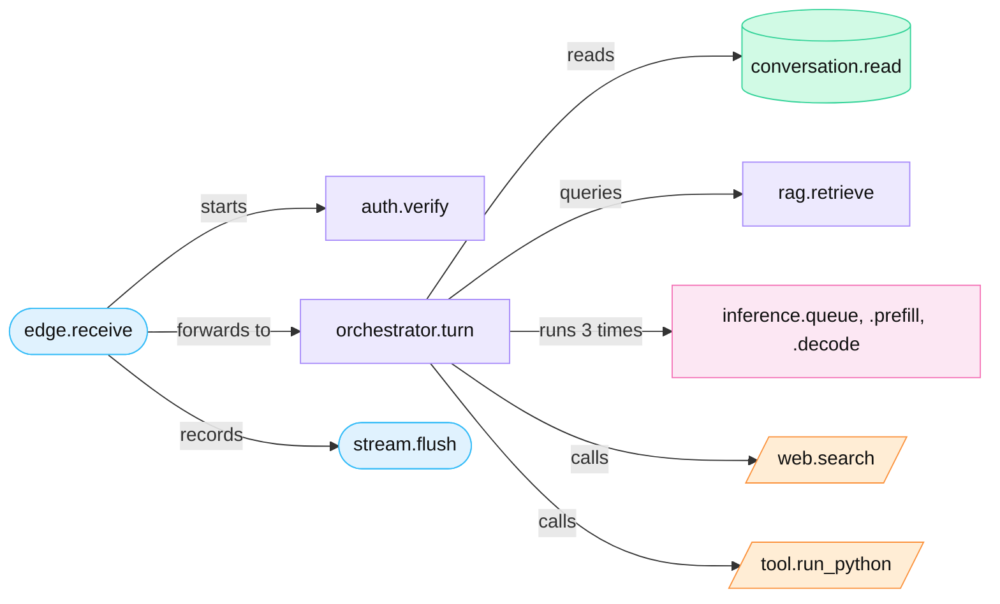
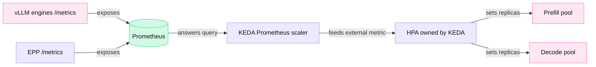
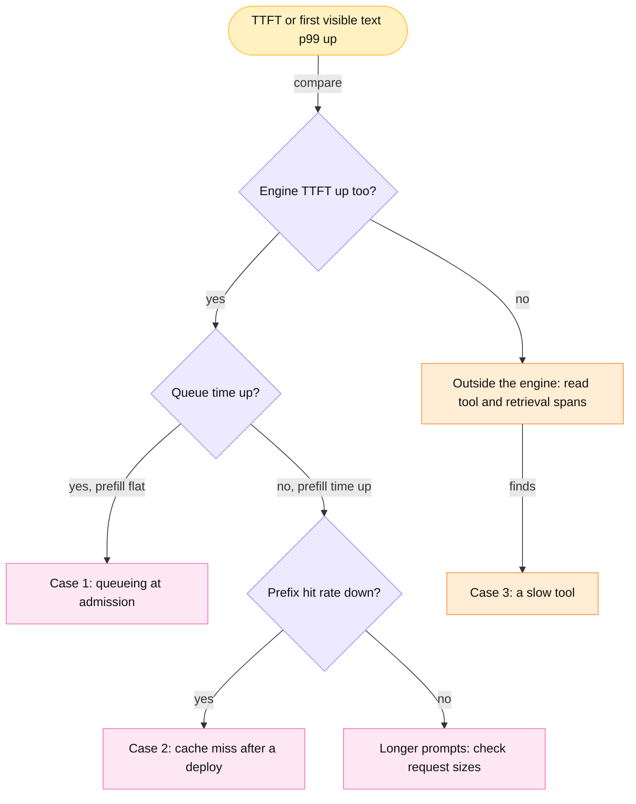

<!-- GENERATED from manuscript/src/part-19-observability-slos-autoscaling.md by tools/render_manuscript.py. Edit the source, not this file. -->
# Part 19: Observability, SLOs, autoscaling and quality

The fleet measures every request with traces, metrics and logs, and the same numbers drive alerts, autoscalers and rollout gates.

Your request has finished. Every service on its path left a record of what it did and how long it took. This part reads those records and shows what operators build on them, in six steps:

1. The trace of your request, span by span (19.1).
2. The engine metrics, and why a percentile is not an average (19.2).
3. Service level objectives, error budgets and goodput (19.3).
4. Autoscaling, and the minutes that one new replica needs (19.4).
5. Answer quality, which no latency metric shows (19.5).
6. A walk from a symptom to its cause (19.6).

All fleet values in this part are hypothetical. The model of your request's passes comes from part 14.4. The full decomposition of the time to first token belongs to part 22.5.

---

## 19.1 Distributed tracing of the reference request ◇

A trace is a tree of timed spans that share one trace ID, which links all work for your request.

### Three signals

Operators observe the fleet through three kinds of records. OpenTelemetry defines all three and a common wire format for them [SRC-196].

1. A **span** records one operation: a name, a start time, an end time, attributes, events and a status. Its **span ID** is unique. Its **parent span ID** names the span that caused it [SRC-196].
2. A **trace** is the set of spans that share one **trace ID**. The parent links make it a tree with one root.
3. A **metric** is a number that a process updates and exports over time, for example a counter of finished requests.
4. A **log** is one timestamped record of one event, written by one process.

A common design uses each kind of record for one question. Spans answer "where did this one request spend its time". Metrics answer "how does the whole fleet behave". Logs answer "what exactly happened at this moment in this process". The three join through the trace ID, as this section shows.

### The trace context on the wire

The trace ID travels in an HTTP header between services. The W3C Trace Context standard defines the header `traceparent` [SRC-197]:

```
traceparent: {version}-{trace-id}-{parent-id}-{trace-flags}
```

The four fields have 2, 32, 16, 2 lowercase hex characters. In this reference system, the edge PoP creates the `traceparent` when your request arrives (RA-52). Your request's header, with illustrative IDs:

```
traceparent: 00-4dca626b27c05b19c53fef0a9e2ce74b-0faccebd8b22948c-01
```

| Field | Value | Meaning |
|---|---|---|
| version | `00` | the only version of Level 1; `ff` is forbidden [SRC-197] |
| trace-id | `4dca626b27c05b19c53fef0a9e2ce74b` | the ID of the whole trace; all zeros is invalid |
| parent-id | `0faccebd8b22948c` | the span ID of the caller's span, here the edge span |
| trace-flags | `01` | bit 0 set: the caller may have recorded this trace (`00` = not sampled) |

Each service on the path runs the same four steps [SRC-197]:

1. The service reads `traceparent` from the incoming request.
2. It creates a new span with a new span ID. The incoming parent-id becomes the new span's parent span ID.
3. It writes a new `traceparent` with the same trace ID and its own span ID as parent-id.
4. It sends that header on every outgoing call.

So the trace ID stays fixed and only the parent-id changes at each hop. A second header, `tracestate`, carries vendor-specific values, at most 32 list members [SRC-197]. A trace can also continue through an MCP tool call. The MCP revision of 2026-07-28 carries `traceparent`, `tracestate` and `baggage` in `_meta` keys [SRC-126].

### The span tree of your request

In this reference system, the nine named stages each emit a span (RA-52). Two more spans group the work: `orchestrator.turn` and `tool.run_python`.



Legend: blue = edge spans; violet = CPU services; green = database; pink = GPU work; orange = tool calls. The one thing to notice: one root span holds the whole request, and the orchestrator holds all three passes. The diagram leaves out the KV transfer from prefill to decode on purpose. It adds a child span of a few milliseconds (part 13.7).

The spans in time order. Time 0 is the moment your request's first byte reaches the edge PoP:

| # | Span | Service | Kind | Start | Duration | Where the number comes from |
|---|---|---|---|---|---|---|
| 0 | `edge.receive` | edge proxy | server | 0 ms | 85,873 ms | the whole request, as the edge sees it |
| 1 | `auth.verify` | API gateway | internal | 23.2 ms | 2 ms | hypothetical, after 22.2 ms one-way backbone (part 2) |
| 2 | `orchestrator.turn` | orchestrator | server | 25.2 ms | 85,824 ms | the turn, until the last token |
| 3 | `conversation.read` | orchestrator → conversation store | client | 25.2 ms | 6 ms | hypothetical, three earlier turns; runs in parallel with #4 (part 3.8) |
| 4 | `rag.retrieve` | orchestrator → retrieval service | client | 25.2 ms | 180.8 ms | embed 4.52 + search 25 + fetch 5 + rerank 146.3 ms (part 5.3) |
| 5 | `inference.queue` (pass 1) | inference gateway + engine | internal | 206 ms | 170 ms | mean gateway and engine wait at the ap_south peak (part 9.5) |
| 6 | `inference.prefill` (pass 1) | prefill worker | internal | 376 ms | 531 ms | prefill + vision encoder (part 14.4) |
| 7 | `inference.decode` (pass 1) | decode worker | internal | 0.91 s | 20.03 s | 300 reasoning tokens + tool call (part 14.4) |
| 8 | `web.search` | orchestrator → web search tool | client | 20.94 s | 1,605 ms | p50 of the Monte Carlo tool step (part 7.2) |
| 9–11 | pass 2: queue, prefill, decode | inference | internal | 22.54 s | 170 ms, 155 ms, 20.78 s | part 14.4 |
| 12 | `tool.run_python` | orchestrator → code executor | client | 43.65 s | 1,305 ms | warm sandbox (part 8.1) |
| 13–15 | pass 3: queue, prefill, decode | inference | internal | 44.96 s | 170 ms, 4.7 ms, 40.72 s | part 14.4 |
| 16 | `stream.flush` | edge proxy | internal | 49 ms | 85.82 s | `message.start` to `message.done` at the edge (part 15) |

The orchestrator span (#2) holds the whole turn. Spans #3 and #4 start together, because the orchestrator reads the history and calls retrieval in parallel (part 3.8). So the turn waits only for the slower one, `rag.retrieve`. Three facts stand out in the tree.

**Decode dominates.** The three decode spans hold 95% of the trace. Each decode step of your sequence takes 47.2 ms. The decode worker shares every step with many other sequences (part 14.3). Everything before the first pass takes only 206 ms on this trace's clock.

**The engine sees three short requests.** For the engine, each pass is a separate request with its own time to first token. Its TTFT runs from the request's arrival to the first generated token, also when it is a reasoning token [vllm@v0.31.0:vllm/v1/metrics/stats.py#L468-L475]. An engine that prefills the whole prompt samples token 1 in the step that completes it [vllm@v0.31.0:vllm/v1/worker/gpu_model_runner.py#L2087-L2092]. In a disaggregated pass, the prefill stops one token short [vllm@v0.31.0:vllm/distributed/kv_transfer/kv_connector/v1/nixl/base_scheduler.py#L384-L408]. In this reference system, the decode worker pulls the KV, recomputes that last token and samples token 1 (RA-38).

So pass 1 reaches its first token 751 ms after it enters the queue. The queue, the prefill, the KV transfer and one decode step add up: 170 + 531 + 3.2 + 47.2 = 751 ms. Pass 2 takes the same path in 375 ms, because the prefix cache holds most of its prompt. Pass 3 prefills its 187 new tokens on the decode worker. It takes 175 ms: the queue and the prefill.

**Your first visible text comes much later.** Pass 1 first writes 300 reasoning tokens. The client receives only a reasoning-status event for them (RA-72). So the first preamble token reaches the edge at 15.1 s on this trace's clock. It is not yet visible, because the hold-back check of part 18.3 waits for the rest of the preamble. Part 21 measures the first visible text on your screen: 15.6 s after the key press.

The p95 TTFT objective of 1,500 ms covers text-only requests without tools. Your request is not in that class, and the trace shows exactly why.

**Two clocks.** This trace starts when your request reaches the edge. Part 21 starts at the key press, 13 ms earlier. Part 21 also times three short steps without a span here: context assembly, the model router and the KV transfer.

So each moment appears a few milliseconds later in part 21. The root span here lasts 85.87 s, and part 21's key press to last pixel takes 85.94 s. Likewise, the pass-1 prefill ends at 0.907 s here and at 0.923 s there.

The `stream.flush` span carries **span events**: timestamped points inside one span [SRC-196]. Each SSE event type of part 15 becomes one event name: `message.start`, `reasoning.status`, `output_text.delta`, `tool.status`, `citation`, `artifact` and `message.done`. A delta event per token would make the span huge. So a common design records the first delta of each pass and the count of the rest.

### Baggage, and where this reference system drops it

**Baggage** is a second header that carries application key-value pairs to every downstream service [SRC-198]. A service can read a value without a call to the service that set it. Your request inside the region carries:

```
baggage: tenant.tier=enterprise,request.priority=interactive
```

The W3C Baggage text is a Candidate Recommendation Snapshot of 2024, not a final Recommendation. It requires support for at least 64 list members and 8,192 bytes [SRC-198]. It warns that other systems can receive baggage values. Applications should keep confidential data out of baggage. Otherwise they must keep baggage out of requests that cross trust boundaries [SRC-198].

The risk is concrete. A common setup copies baggage onto every outgoing call. So a user ID in baggage would reach the search provider and every fetched web server. In this reference system, two rules apply (RA-52):

1. Baggage never holds a user ID, a tenant name or any request content.
2. The web search tool, the egress service (RA-29) and the code executor remove the `baggage` header. They do this before any call that leaves the reference system.

So spans #8 and #12 record `baggage: dropped` as an attribute. The trace ID still links their spans to your trace. The tool services start their spans from the orchestrator's `traceparent`.

### Metrics, logs, and exemplars that join them to traces

Prometheus has four metric types [SRC-199]:

| Type | What it holds | Example |
|---|---|---|
| counter | a cumulative count that only rises, and resets when the process restarts | `vllm:generation_tokens_total` |
| gauge | a value that rises and falls | `vllm:num_requests_waiting` |
| histogram | cumulative counts per bucket (`_bucket{le="…"}`), plus `_sum` and `_count` | `vllm:time_to_first_token_seconds` |
| summary | quantiles over a sliding window, computed in the process | (not used by vLLM's TTFT) |

A histogram tells an operator that some requests were slow. It cannot tell which ones. An **exemplar** closes that gap. OpenMetrics defines exemplars as "references to data outside of the MetricSet". Its named use case is the ID of a trace [SRC-201]. The rules [SRC-201]:

1. An exemplar may sit on a histogram `_bucket` sample or a counter `_total` sample.
2. A bucket holds at most one exemplar.
3. The exemplar's label names and values together hold at most 128 UTF-8 code points.
4. An ingestor may discard exemplars.

In this reference system, the model router records each pass's server-side TTFT in a histogram with exemplars (RA-52). It uses vLLM's TTFT bucket bounds. Your pass 1 took 0.751 s, so it falls in the bucket `le="1.0"`. If it was the last request in that bucket during the scrape interval, the line reads:

```
router_ttft_seconds_bucket{le="1.0"} <count> # {trace_id="4dca626b27c05b19c53fef0a9e2ce74b"} 0.751
```

The label `trace_id` plus its value holds 40 code points, inside the limit. The name `router_ttft_seconds` is this reference system's name, not a standard one. An operator looks at a TTFT graph, sees a slow bucket and opens its exemplar. The exemplar opens the trace of one real request from that bucket.

Logs join the same way. A common design writes structured log lines with `trace_id` and `span_id` fields. A log search for one trace ID then returns every log line of every service that touched your request.

### Sampling and the cost of tracing

**Meanwhile in the fleet.** Your trace has 17 spans. At the ap_south peak of 11,741 requests per second, the services create 11,741 requests/s × 17 spans ≈ 199,600 spans/s. At a hypothetical 400 B per span, that is 80 MB/s of span data in one region. So the collector keeps only some traces.

In this reference system, the collector keeps every trace with an error or an SLO miss (RA-52, RA-80). It keeps a hypothetical 1% of the rest: 117 traces per second (RA-80). The collector decides only after the trace ends, so the name of this design is **tail-based sampling** (RA-80). Metrics, by contrast, cost the same at any request rate, because a histogram only increments its bucket counters [SRC-199].

You can now read a trace tree, follow the `traceparent` across hops, and say where your request spent its time.

---

## 19.2 LLM-specific metrics and percentiles ⚙

The engine exports counters, gauges and histograms with exact names, and their tails show what users feel.

### The metrics, by question

vLLM exports its metrics at `/metrics` in the Prometheus text format [vllm@v0.31.0:vllm/v1/metrics/loggers.py#L462-L927]. Every metric carries the labels `model_name` and `engine`. Counters appear with a `_total` suffix. In this reference system, the counter display uses exactly these names (RA-53):

| Question | vLLM metric | Type | Read it as |
|---|---|---|---|
| requests per second | `vllm:request_success_total{finished_reason=…}` | counter | `rate(...[1m])`; the label also counts stops, length limits and aborts |
| prompt tokens per second | `vllm:prompt_tokens_total` | counter | `rate(...)`; `vllm:prompt_tokens_cached_total` counts the share from the cache |
| output tokens per second | `vllm:generation_tokens_total` | counter | `rate(...)` |
| time to first token | `vllm:time_to_first_token_seconds` | histogram | from arrival at the engine to the first generated token, reasoning tokens included |
| inter-token latency | `vllm:inter_token_latency_seconds` | histogram | one observation per gap between two tokens of one request |
| time per output token | `vllm:request_time_per_output_token_seconds` | histogram | per request: (time of last token − time of first token) / (output tokens − 1) |
| queue time | `vllm:request_queue_time_seconds` | histogram | time in the engine's waiting queue |
| prefill and decode time | `vllm:request_prefill_time_seconds`, `vllm:request_decode_time_seconds` | histogram | per request |
| active sequences | `vllm:num_requests_running` | gauge | sequences in the running batch |
| waiting sequences | `vllm:num_requests_waiting` | gauge | sequences admitted to the engine but not yet scheduled |
| batch tokens | `vllm:iteration_tokens_total` | histogram | tokens per scheduler iteration |
| KV usage | `vllm:kv_cache_usage_perc` | gauge | 1 means 100 percent of KV blocks in use |
| prefix-cache hit rate | `vllm:prefix_cache_hits_total`, `vllm:prefix_cache_queries_total` | counters, in tokens | `rate(hits) / rate(queries)` |
| preemptions | `vllm:num_preemptions_total` | counter | sequences pushed out under KV pressure (part 13.8) |

Two older names appear in many dashboards: `vllm:gpu_cache_usage_perc` and `vllm:time_per_output_token_seconds`. Neither name exists in the current vLLM code at the pinned commit [vllm@v0.31.0:vllm/v1/metrics/loggers.py#L462-L927]. A dashboard that queries them shows an empty graph, not an error.

**Tokens per second per user** has no vLLM metric of its own [vllm@v0.31.0:vllm/v1/metrics/loggers.py#L462-L927]. It is the inverse of the time per output token. Your decode steps take 47.2 ms, so your stream runs at 1 / 0.0472 s = 21.2 tokens/s.

**HBM use** says little on its own. vLLM reserves a fixed share of HBM at start: 92% by default [vllm@v0.31.0:vllm/config/cache.py#L103-L112]. It fills that share with weights and the KV block pool. So the driver reports a nearly constant HBM use from the first second. The useful memory signal is `vllm:kv_cache_usage_perc`: the share of that pool that live sequences hold.

**GPU utilization** is a weak signal. `nvidia-smi` defines it as the share of the last sample period with at least one running kernel [SRC-723]. One small kernel on one SM gives 100%. DCGM exports finer profiling metrics [SRC-722]:

| DCGM field | Definition [SRC-722] |
|---|---|
| `PROF_GR_ENGINE_ACTIVE` | "The fraction of time any portion of the graphics or compute engines were active." |
| `PROF_SM_ACTIVE` | "The fraction of time at least one warp was active on a multiprocessor, averaged over all multiprocessors." |
| `PROF_PIPE_TENSOR_ACTIVE` | "The fraction of cycles the tensor (HMMA / IMMA) pipe was active." |
| `PROF_DRAM_ACTIVE` | "The fraction of cycles where data was sent to or received from device memory." |

A decode-heavy worker shows high DRAM activity and low tensor activity, because decode is bound by HBM bandwidth (19.6) [SRC-722].

**Health beyond the engine.** In this reference system, tool and retrieval latency come from the `web.search`, `tool.run_python` and `rag.retrieve` spans of 19.1 (RA-52). OpenTelemetry defines draft GenAI metric names for these, for example `gen_ai.server.time_to_first_token`, `gen_ai.server.time_per_output_token` and `gen_ai.execute_tool.duration` [SRC-195]. Their status is Development, not Stable. Model errors appear in `vllm:request_success_total` by `finished_reason`, and at the router as error responses.

### Why averages hide tails

In this part, a **percentile** pX is the value below which X percent of the observations lie. This part uses the nearest-rank rule: sort the n values, then take the value at rank ⌈X/100 × n⌉. A toy with 100 requests shows the gap between a mean and a tail:

| Sample | Mean | p50 | p99 | Max |
|---|---|---|---|---|
| 99 requests at 100 ms, 1 at 5,000 ms | (99 × 100 + 1 × 5,000) / 100 = 149 ms | 100 ms | 100 ms | 5,000 ms |
| 98 requests at 100 ms, 2 at 5,000 ms | (98 × 100 + 2 × 5,000) / 100 = 198 ms | 100 ms | 5,000 ms | 5,000 ms |

The mean moves by a few tens of milliseconds. The p99 jumps from 100 ms to 5,000 ms when the second slow request appears. The Google SRE book makes the same point. At a mean of 100 ms, "1% of requests might easily take 5 seconds" [SRC-204]. A user who sends 100 requests a day meets the p99 about once a day.

### A sample distribution

The script `sim/percentiles_demo.py` draws a seeded sample of 10,000 TTFT values for one hypothetical pool hour. Most requests see a short queue. A hypothetical 3% wait behind long uncached prefills. The exact values:

| Statistic | Value |
|---|---|
| mean | 0.759 s |
| p50 | 0.613 s |
| p95 | 1.508 s |
| p99 | 3.849 s |
| p99.9 | 8.733 s |
| max | 12.62 s |

The p99 is 6.3 times the p50. The mean is only 1.24 times the p50. So a dashboard of means would show a healthy pool while one request in a hundred waits several seconds.

### The same sample in histogram buckets

A server cannot keep every observation. A Prometheus histogram keeps only a count per bucket. vLLM's TTFT histogram uses these upper bounds, in seconds [vllm@v0.31.0:vllm/v1/metrics/buckets.py#L56-L79]:

```
0.001, 0.005, 0.01, 0.02, 0.04, 0.06, 0.08, 0.1, 0.25, 0.5, 0.75, 1.0, 2.5, 5.0, 7.5, 10.0, 20.0, 40.0, 80.0, 160.0, 640.0, 2560.0
```

The cumulative counts of the sample near the middle of the range:

| `le` (s) | 0.25 | 0.5 | 0.75 | 1.0 | 2.5 | 5.0 | 7.5 | 10.0 | +Inf |
|---|---|---|---|---|---|---|---|---|---|
| count | 234 | 3,343 | 6,636 | 8,441 | 9,759 | 9,951 | 9,985 | 9,996 | 10,000 |

Prometheus estimates a quantile with `histogram_quantile()`. For a classic histogram, it finds the bucket that holds the quantile's rank. It then "assumes a uniform distribution of observations within the bucket" and interpolates linearly [SRC-721]. The steps for p95:

1. The rank is 0.95 × 10,000 = 9,500.
2. The first bucket whose count reaches that rank is `le="2.5"`. Its lower bound is 1.0 s.
3. The estimate is 1.0 + (2.5 − 1.0) × (9,500.0 − 8,441) / 1,318 = 2.205 s.

The estimates against the exact values:

| Quantile | Exact | Estimate from vLLM buckets | Error | Estimate with a bound at 1.5 s | Error |
|---|---|---|---|---|---|
| p50 | 0.613 s | 0.626 s | +2% | 0.626 s | +2% |
| p95 | 1.508 s | 2.205 s | +46% | 1.530 s | +1.5% |
| p99 | 3.849 s | 4.336 s | +13% | 4.336 s | +13% |
| p99.9 | 8.733 s | 8.636 s | -1% | 8.636 s | -1% |

The p95 estimate is wrong by almost half. The bucket from 1.0 s to 2.5 s is wide, and its observations crowd near the lower end. The objective sits at exactly 1.5 s, in the middle of that bucket. So the dashboard would report a clear SLO miss for a pool that only just misses.

The fix is a bucket bound at the objective. The question "what share of requests met 1.5 s?" then needs no interpolation:

| Buckets | Share at or below 1.5 s, estimated | Exact |
|---|---|---|
| vLLM's bounds | 88.80% | 94.92% |
| vLLM's bounds plus 1.5 s | 94.92% | 94.92% |

A common design therefore puts one bucket bound at every SLO threshold. A second rule follows from the same arithmetic. A fleet-wide p99 is never the mean of per-replica p99 values. The correct query sums the bucket counts of all replicas and then computes the quantile. Prometheus can aggregate classic histograms only when they share the same bucket bounds [SRC-199].

**Meanwhile in the fleet.** Every engine process updates these counters at every scheduler iteration. Prometheus reads each `/metrics` endpoint every 15 s (hypothetical). Between two scrapes, a busy decode worker runs hundreds of iterations. Each finished request adds one observation to each request histogram.

You can now name the vLLM metric for each serving question, and estimate a percentile and its error from buckets.

---

## 19.3 SLOs and goodput ⚙

An SLO turns a percentile into a budget of allowed failures, and alerts fire when that budget burns too fast.

### Example SLOs

A **service level indicator** (SLI) is a measured ratio: good events divided by valid events. The SRE Workbook recommends SLIs of this form [SRC-720]. A **service level objective** (SLO) is a target for one SLI over one window [SRC-720]. In this reference system, three hypothetical SLOs apply (`hypothetical.slo`):

| SLO | Target | Good event |
|---|---|---|
| availability | 99.9% per 30 days | the request completes without a server error |
| p95 TTFT | ≤ 1,500 ms | a text-only request without tools gets its first generated token within the target, as `vllm:time_to_first_token_seconds` measures it |
| p95 TPOT | ≤ 60 ms | the request's mean time per output token is within the target |

A 429 response from admission control (part 9.4) is not a server error in this table. The client receives a `Retry-After` and can retry. The reference request has tools, so it counts toward availability and TPOT but not toward the TTFT objective (19.1).

### The error budget

The **error budget** is the share of events that may fail: 1 − SLO [SRC-720]. For availability:

```
budget = 1 − 0.999 = 0.001
in time:     0.001 × 30 × 24 × 60 = 43.2 min of full outage per 30 days
in requests: 6,597 requests/s × 30 days × 0.001 = 17,100,000 failed requests in ap_south
```

The request rate is the ap_south mean of part 14.8. A common practice is that a team that spends the budget early stops risky rollouts until the window recovers. The budget therefore decides how fast the fleet may change.

### Burn rate and multiwindow alerts

The **burn rate** is how fast the fleet spends its budget, relative to the SLO [SRC-720]:

```
burn rate       = error fraction / budget fraction
budget consumed = burn rate × alert window / SLO window
```

A burn rate of 1 spends exactly the whole budget in the 30-day window. The Google SRE Workbook recommends three alerts for a 99.9% SLO [SRC-720]. An alert fires only when both its long window and its short window exceed the burn rate. The short window is 1/12 of the long one. It makes the alert stop soon after the errors stop.

| Severity | Long window | Short window | Burn rate | Error fraction that fires it | Budget consumed in the long window | Budget gone after |
|---|---|---|---|---|---|---|
| page | 1 h | 5 min | 14.4 | 14.4 × 0.001 = 1.44% | 14.4 × 1 h / 720 h = 2% | 50 h |
| page | 6 h | 30 min | 6 | 6 × 0.001 = 0.60% | 6 × 6 h / 720 h = 5% | 120 h |
| ticket | 3 days | 6 h | 1 | 1 × 0.001 = 0.10% | 1 × 72 h / 720 h = 10% | 720 h |

Two hypothetical incidents test the table:

1. **A bad deploy fails 2.0% of requests.** The burn rate is 2.0% / 0.1% = 20.0. The budget would last 36 h. After 5 minutes the short window already exceeds 14.4. The 1-hour mean crosses it after 43 minutes, so the first page fires then. One hour of this incident spends 2.8% of the month's budget.
2. **A slow leak fails 0.3% of requests.** The burn rate is 0.3% / 0.1% = 3.0. It stays below both page thresholds. Only the ticket alert fires. The budget would still last 240 h, so a human can fix it during working hours.

### The latency SLO as a budget

A percentile objective is also a budget. "p95 TTFT ≤ 1.5 s" means that at most 5% of requests may take longer. In the sample of 19.2, 5.08% of requests took longer. So the latency burn rate is 5.08% / 5% = 1.02.

The pool just misses its objective, which matches the exact p95 of 1.508 s. The same multiwindow alerts apply to this ratio. The histogram needs a bucket bound at 1.5 s, or the ratio carries the interpolation error of 19.2.

### Goodput versus throughput

**Goodput** is the rate of requests that meet all their SLOs (part 11.12). **Throughput** counts every token or request, met or missed. Part 11.12 ran one `M-dense` replica under rising load. Four of its rows show the gap:

| Arrival rate | Output tokens/s | TTFT p99 | TPOT p95 | Requests within both SLOs | Goodput |
|---|---|---|---|---|---|
| 10 req/s | 2,912 | 1,426 ms | 42 ms | 98% | 7.34 req/s |
| 12 req/s | 3,211 | 1,710 ms | 63 ms | 91% | 7.48 req/s |
| 14 req/s | 3,332 | 3,364 ms | 91 ms | 27% | 2.30 req/s |
| 16 req/s | 3,378 | 12,241 ms | 110 ms | 10% | 0.90 req/s |

From the second row to the last, throughput rises by 5%. Goodput falls by 88%. The mechanism has two parts.

A larger batch makes every decode step longer, so TPOT rises past its objective (part 11.8, 11.12). A longer queue makes prompts wait, so TTFT rises past its objective. An operator who tunes for tokens per second picks the last row. An operator who tunes for goodput picks the second.

This choice changes the design. Admission control (part 9.4) rejects work that would only push other requests out of their SLOs. The autoscaler (19.4) adds replicas before the knee, not after it.

llm-d published one measurement of an SLO-driven autoscaler. It reached 95.8% SLO attainment at 5.93 replicas on average. A static 8 replicas reached 100% [llm-d@2f95c24:guides/workload-autoscaling/slo-aware/README.md#L198-L201]. That run used Qwen3-32B on H100 GPUs, not this reference system's models.

**Meanwhile in the fleet.** In this reference system, the burn-rate rules run in Prometheus every few seconds, for every region and every pool (RA-80). A fast burn in one region must not page for a healthy region. So each alert carries the region and pool labels, and each region has its own budget.

You can now compute an SLO's error budget and burn-rate thresholds, and explain why peak throughput is not peak goodput.

---

## 19.4 Autoscaling, and the cold-start trace ⚙ ◇

A GPU replica needs minutes to start, so the fleet keeps warm capacity ahead of demand.

### CPU services: the Horizontal Pod Autoscaler

The API gateways, orchestrators and tool services are CPU services. Kubernetes scales them with the **Horizontal Pod Autoscaler** (HPA). Its control loop runs every 15 s by default [SRC-305]. At each run it computes [SRC-202]:

```
desiredReplicas = ceil[ currentReplicas × ( currentMetricValue / desiredMetricValue ) ]
```

The HPA changes nothing while the ratio stays within a tolerance of 10% of 1.0 [SRC-305]. It waits 300 s before it scales down. It scales up at once, by at most 4 pods or 100% of the current count per 15 s [SRC-202]. With several metrics, it takes the largest proposed count [SRC-305].

Common signals for a CPU service are CPU use, memory, requests per second, queue depth and latency. Requests in flight per replica often work best for the gateway, because one slow upstream raises it before CPU rises. A new CPU replica starts in seconds. So the scaling delay is the control loop plus the pod start. A small warm margin covers it.

### GPU inference: why CPU use is the wrong signal

A common view is that CPU use says almost nothing about an inference replica. In a common engine design, the CPU threads schedule batches and launch kernels at a steady rate under any load. GPU utilization saturates at 100% long before the replica is full (19.2, part 11.12). The signals that track inference load are:

| Signal | Source | What it measures |
|---|---|---|
| waiting requests | `vllm:num_requests_waiting`, EPP flow-control queue size [llm-d@2f95c24:guides/workload-autoscaling/keda-epp/README.md#L122-L138] | demand the replicas cannot start yet |
| active sequences | `vllm:num_requests_running`, `llm_d_epp_request_running` [llm-d@2f95c24:guides/workload-autoscaling/README.md#L110-L114] | concurrent work in the batch |
| batched tokens | `vllm:iteration_tokens_total`; EPP in-flight prefill tokens [llm-d@2f95c24:guides/workload-autoscaling/keda-epp-token-aware/pd-disaggregation/base/prefill-scaledobject.yaml#L72-L87] | work per iteration; prefill backlog |
| KV usage | `vllm:kv_cache_usage_perc` | how close decode is to preemption |
| TTFT and TPOT | the histograms of 19.2 | the SLO itself |
| tokens per second | `vllm:generation_tokens_total` rate | delivered work |
| HBM use | the GPU driver | flat after start, so a poor signal (19.2) |

### KEDA on EPP and engine metrics

**KEDA** is a Kubernetes autoscaler that reads external metrics, for example a Prometheus query. It creates and owns an HPA for each `ScaledObject` [SRC-304]. KEDA itself moves a workload between 0 and 1 replica. The HPA moves it between 1 and N [SRC-304]. llm-d recommends KEDA on EPP metrics and has deprecated its earlier Workload Variant Autoscaler [SRC-285].



Legend: pink = GPU pools and engines; violet = control components; green = Prometheus. The one thing to notice: the pools scale from the same metrics that the router reads, not from CPU use. The diagram leaves out the second ScaledObject on purpose: each pool has its own.

llm-d ships a token-aware example for disaggregated pools. It gives prefill and decode separate ScaledObjects. The reason in its comment: "prefill is compute-bound on the prompt pass, decode is memory-bound for the request's whole lifetime" [llm-d@2f95c24:guides/workload-autoscaling/keda-epp-token-aware/pd-disaggregation/base/prefill-scaledobject.yaml#L1-L7]:

1. **Prefill trigger.** The query divides the EPP's in-flight uncached prompt tokens by the pool's peak prefill rate. The result is seconds of prefill backlog. The threshold is 1.5 s per replica [llm-d@2f95c24:guides/workload-autoscaling/keda-epp-token-aware/pd-disaggregation/base/prefill-scaledobject.yaml#L72-L87].
2. **Decode trigger.** The query sums `vllm:kv_cache_usage_perc` over decode pods. The threshold is 0.8 per replica [llm-d@2f95c24:guides/workload-autoscaling/keda-epp-token-aware/pd-disaggregation/base/decode-scaledobject.yaml#L67-L71].
3. **Behavior.** Each pool adds at most one pod per 180 s. It removes at most one pod per 300 s, after a 300 s stabilization window. The comment gives the reason: "Model weights take minutes to load" [llm-d@2f95c24:guides/workload-autoscaling/keda-epp-token-aware/pd-disaggregation/base/prefill-scaledobject.yaml#L95-L109].

The query result is an `AverageValue` metric, so the HPA formula becomes `ceil(sum / threshold)`. Illustrative example: decode replicas whose KV usage sums to 4.0 ask for ⌈4.0 / 0.8⌉ = 5 replicas. With `minReplicaCount: 1`, the HPA sync period, not KEDA's polling interval, sets how often the triggers run [llm-d@2f95c24:guides/workload-autoscaling/keda-epp-token-aware/pd-disaggregation/base/prefill-scaledobject.yaml#L45-L51].

In this reference system, autoscaling follows this pattern (RA-42):

1. KEDA reads EPP and engine metrics: queue, running requests, token backlog and latency.
2. The prefill pool scales on seconds of prefill backlog. It divides by the EPP calibration of 16,000 tokens/s per `M-frontier` endpoint (RA-71).
3. The decode pool scales on KV usage.
4. Each pool keeps a **warm floor** of at least one ready replica.
5. The scale unit of `M-frontier` decode is one DEP16 worker of 16 GPUs. The gateway registers one endpoint per rank, but a rank cannot serve alone (RA-71).
6. Each rack also keeps 8 GPUs as warm spares, with weights loaded (RA-55).

### The cold-start trace

A cold start is the work that turns idle GPUs into a ready replica (part 1.2). The script `sim/cold_start.py` estimates each step for one `M-frontier` DEP16 decode worker. Each rank needs 210 GB of weights. Every step has a low and a high time:

```mermaid
flowchart LR
  S[Scaler decision]:::cpu -->|binds pods| N[Node allocation]:::cpu
  N -->|pulls| IM[(Image and weights to node)]:::store
  IM -->|starts| PS[Process start and CUDA init]:::gpu
  PS -->|copies| WH[Weights into HBM]:::gpu
  WH -->|connects ranks| NC[NCCL and NIXL setup]:::gpu
  NC -->|compiles and records| CG[Compile, CUDA Graphs, warm-up]:::gpu
  CG -->|passes probe| RD[Ready]:::cpu
  RD -->|receives| TR([First traffic]):::other
  classDef cpu fill:#ede9fe,stroke:#A78BFA,color:#111
  classDef store fill:#d1fae5,stroke:#34D399,color:#111
  classDef gpu fill:#fce7f3,stroke:#F472B6,color:#111
  classDef other fill:#e5e7eb,stroke:#9AA4B8,color:#111
```



Legend: violet = control steps; green = storage; pink = GPU work; grey = user traffic. The one thing to notice: four of the nine boxes run on the GPU and hold most of the time. The diagram leaves out failed starts on purpose; part 17.3 covers them.

| # | Step | Low | High | Low case | High case |
|---|---|---|---|---|---|
| 1 | scaler decision | 0 s | 30 s | the metric crosses just before a sync | one scrape (15 s) + one HPA sync (15 s) |
| 2 | node allocation | 1 s | 300 s | free reserved trays in the rack | a powered-down tray must boot and join (hypothetical) |
| 3 | container image | 0 s | 24 s | image already on the node | 12 GB at 0.5 GB/s (hypothetical) |
| 4 | weights to the node | 0 s | 67.2 s | peer pull or NVMe cache hit: no download | 4 ranks × 210 GB from the object store at 12.5 GB/s per tray (RA-61) |
| 5 | process start | 10 s | 30 s | warm page cache | cold page cache (hypothetical) |
| 6 | CUDA init | 3 s | 10 s | context creation | plus GPU health checks (hypothetical) |
| 7 | weights into HBM | 2.1 s | 191 s | peer HBM to HBM over 800 Gb/s (link bound) (part 1.7) | 210 GB at the measured default-loader rate 1.1 GB/s [SRC-285] |
| 8 | NCCL and NIXL setup | 5 s | 20 s | 16 ranks in one NVLink domain | ranks wait for the slowest loader (hypothetical) |
| 9 | torch.compile | 3.4 s | 20.1 s | compile cache installed | cold compile |
| 10 | profile, KV pool, CUDA Graphs, warm-up | 77.8 s | 94.6 s | with compile artifacts | cold receiver |
| 11 | readiness probe | 0 s | 10 s | probe runs right after warm-up | one probe period (10 s) |
| 12 | first traffic | 50 ms | 50 ms | one EPP metrics tick [SRC-284] | one EPP metrics tick [SRC-284] |
| | **total** | **102 s** | **797 s** | | |

Steps 9 and 10 use llm-d's measurements for gpt-oss-120b at TP2 on H200 GPUs [llm-d@2f95c24:guides/modelexpress-p2p/benchmark-results/h200-ib-gpt-oss-120b.md#L21-L29]. `M-frontier` is a larger model on other GPUs, so these are examples of the order of magnitude, not predictions. The same report notes that CUDA Graph capture "runs per pod on every path and dominates the remaining Ready time". vLLM records CUDA Graphs for a fixed list of batch sizes at every start (part 11.11) [vllm@v0.31.0:vllm/config/vllm.py#L2565-L2581] [vllm@v0.31.0:vllm/v1/worker/gpu_worker.py#L883]. No cache removes this step.

The sum assumes that each step waits for the one before it. A real start pulls the image and the weights at the same time. That brings the high case to 773 s. The two published llm-d runs reached Ready after 156 s and 181 s, inside this range [llm-d@2f95c24:guides/modelexpress-p2p/benchmark-results/h200-ib-gpt-oss-120b.md#L21-L29].

**What the total means.** The best case is 1.7 minutes and the high case is 13 minutes. The TTFT objective is 1.5 s. So a cold start lasts 68 to 531 times the whole TTFT budget. The GPU steps alone (6 to 10) take 91 s even on the best path, 89% of the low total. Faster storage shortens only step 4 and step 7.

### Why warm floors exist

No request can wait for a cold start. The EPP's flow-control queue drops a request after 60 s (RA-41). Even the best cold start is longer than that wait. So a pool that scaled to zero would answer its next request with an error, not a slow token. The fleet uses five techniques instead:

1. **Warm floor.** Every pool keeps its warm floor (RA-42).
2. **Warm spares.** Each `M-frontier` rack keeps 8 GPUs as warm spares, with weights in HBM (RA-55). A spare skips steps 2 to 7.
3. **Pre-warmed nodes.** A common design boots spare nodes in advance, with the image pulled and the weights on local NVMe. A start on such a node skips steps 2 to 4. It reads weights from a peer or the local drive (RA-61).
4. **Reservations.** A common design reserves GPU capacity from the cloud provider, or owns the racks. Step 2 then never waits for a provider to find hardware.
5. **Predictive and scheduled scaling.** In this reference system, the autoscaler adds capacity before the load arrives, from the known daily curve (RA-42).

llm-d also documents vLLM's sleep and wake mode. An idle process moves its weights to CPU memory and wakes "in seconds" over PCIe [SRC-285]. That turns a cold start into a warm start, but the process still holds CPU memory.

### Scaling against the daily curve

Part 14.8 drew the hypothetical daily demand of each region. The ap_south curve rises fastest at 5.5 UTC:

```
ramp of demand = 1,304 requests/s per hour
ramp of racks  = 1,304 rps/h × 0.2 × 0.0212 racks per rps = 5.53 racks/h
ramp of workers = 5.53 racks/h × (2 + 3) workers = 27.6 workers/h
```

Three consequences follow for the design:

1. **The policy rate is slower than the ramp.** llm-d's example policy adds one pod per 180 s: 20 per hour per pool. The ap_south ramp needs 28 workers per hour. So a reactive autoscaler with that policy lags the ramp every morning, but only by a small margin. In this reference system, the fleet scales whole racks on a schedule (RA-42, RA-55). The reactive autoscaler covers only the remainder.
2. **Demand keeps rising during each start.** During one cold start, demand grows by 0.16 to 1.2 racks. The 15% headroom of part 14.6 is 7.5 racks at the ap_south peak. So the headroom covers the start delay, if the scheduled scaling begins at least 13 minutes before the ramp.
3. **The trough is a fraction of the peak.** The ap_south peak needs 50 racks and the trough 12.4, which is 1/4 of the peak. In this reference system, the racks stay powered at night and run background work (RA-41, part 14.8). So a morning ramp changes the work class and needs no cold start.

**Meanwhile in the fleet.** During the morning ramp in ap_south, the scheduler moves racks from the batch band to interactive serving. Each rack drains its batch sequences first (part 17.10, RA-41, RA-54). Its weights stay in HBM, so it accepts interactive traffic within seconds. Elsewhere, us_east is near its trough and does the reverse.

You can now choose autoscaling signals, time each cold-start step, and explain why the fleet scales ahead of demand.

---

## 19.5 Production quality monitoring

Quality failures return HTTP 200, so the fleet scores sampled answers and gates every model rollout on those scores.

### Failures that no latency metric shows

A common failure is an answer that comes fast and is still wrong. Common causes are a new model version, system prompt, tokenizer file or sampling default. No error and no latency change appears. Five kinds of quality failure matter here:

1. **Wrong answers:** a wrong price, a wrong calculation, a wrong summary of the user's PDF.
2. **Ungrounded citations:** a citation that points to a source that does not hold the claim.
3. **Safety regressions:** more harmful completions, or more refusals of safe requests.
4. **Format errors:** invalid tool-call JSON, broken tables, repeated text.
5. **Instruction failures:** the answer ignores the request, for example your memory records' EUR and table preferences.

### Online evals on sampled traffic

In this reference system, an **online eval** scores a sample of production answers after they reach the user (RA-80). It never delays the answer. The exact sampling and scoring of real providers is not public. Two realistic designs exist. A small classifier scores answers in the request path, or a pipeline scores a sampled log offline.

Here we use offline scoring, because it adds no latency to any answer (RA-80). The loop has five steps:

1. **Sample.** A sampler selects a small share of finished turns from tenants whose terms permit review (RA-80). It removes personal data before storage (RA-77).
2. **Score with deterministic checks.** Code checks tool-call JSON against its schema, counts repetition-guard stops (RA-72), and counts truncated outputs (`finished_reason="length"`).
3. **Score groundedness.** The citation validator already checks every citation (RA-67). Its counters give a groundedness rate per model version.
4. **Score with a grader model.** A grader model rates a smaller sample against a written rubric: correctness, instruction following, tone and safety (RA-80).
5. **Review by humans.** Trained reviewers rate a still smaller sample. Their labels calibrate the grader model and catch its blind spots.

**Groundedness of citations.** In this reference system, the orchestrator resolves each cited source ID to a document span (RA-67). It checks that the span exists in the fetched text. It drops or flags a citation that does not resolve. Your answer carried 5 citations. Each check adds one count to one of three counters: resolved, dropped and flagged.

The groundedness rate is the resolved count divided by the sum of all three counts. A drop in that rate after a rollout points to the new model, because the validator code did not change.

A resolved citation proves only that the span exists. It does not prove that the span supports the sentence. So step 4 also asks the grader model whether each cited span supports its claim.

### User feedback signals

Users also send quality signals on their own. Each is noisy, but together they track quality:

| Signal | What it suggests | Bias |
|---|---|---|
| thumbs up or down | direct rating | few users click; unhappy users click more |
| regenerate | the answer did not satisfy | some users explore variants |
| edit the prompt and resend | the model misread the request | also normal refinement |
| copy the answer | the answer was useful | copying also happens for complaints |
| stop or disconnect mid-stream | the answer went wrong early (part 15) | also network loss |
| a follow-up such as "that is wrong" | an error the user noticed | language-dependent |

A common design compares these rates per model version and per tenant. An absolute rate means little. A change between two versions under the same traffic means much more.

### Shadow traffic before a rollout

**Shadow traffic** sends a copy of real requests to a new version and discards its answers. Envoy implements this as request mirroring. It is "fire and forget": Envoy does not wait for the shadow cluster before it returns the primary response [SRC-725]. It appends `-shadow` to the host header. A configured fraction sets the mirrored share [SRC-725].

Shadow traffic for an LLM has three costs. First, every mirrored request costs the same GPU time as a real one. Second, a mirrored turn must not run tools for real.

A shadow copy of your `run_python` call would run the code twice. A shadow web search would query the provider twice. So a common design mirrors only the inference pass and replays the recorded tool results. Third, the shadow answers go to the online eval pipeline of the last subsection, never to a user.

### Canary analysis and regression detection

In this reference system, every model rollout is a canary with traffic weights (RA-54). The hypothetical stages are 1, 5, 25, 50, 100 percent of traffic, each held for 15 minutes (part 17.10). At each stage, an analysis task compares the canary with the baseline under the same traffic:

1. Error rate and the burn rate of 19.3.
2. p95 TTFT and p95 TPOT, from histograms with the same bucket bounds.
3. Prefix-cache hit rate (19.6, case 2).
4. Groundedness rate, grader scores and safety flags from the online eval.
5. User feedback rates.

The analysis task promotes the canary only when every metric stays within its allowed margin of the baseline (RA-54, RA-80). Argo Rollouts is a public example of this pattern [SRC-724]. An `AnalysisTemplate` defines the metrics, their interval and a `successCondition`. A `failureLimit` sets how many failed measurements are allowed. A failed analysis aborts the rollout and sets the canary weight back to zero [SRC-724].

Quality metrics usually need more data than latency metrics. A latency histogram fills in minutes. A grader score on a small canary sample needs hours (hypothetical) to separate a real regression from noise. So a common design holds the early stages longer for quality. It also runs offline eval sets before the first stage (part 1.4).

**Meanwhile in the fleet.** While your answer streams, the sampler skips it, because the reference tenant's terms do not permit review (RA-80). Thousands of other answers per hour enter the eval queue. A grader pool on spare GPUs scores them in batches, with no deadline. A common design runs the grader pool on the background capacity of part 14.8.

You can now design an online quality loop, name user signals and their biases, and list the canary gates.

---

## 19.6 Finding the bottleneck

Every stage has one resource that runs out first, and utilization compared with saturation shows which one.

### The limiting resource of each stage

| Stage | Limiting resource | Saturation signal |
|---|---|---|
| edge PoP | CPU for TLS and QUIC; network bandwidth; RTT to the user | CPU per core near 100%; packet loss |
| API gateway, orchestrator | CPU; memory for open streams (part 15) | requests in flight per replica; memory per replica |
| conversation store | database locks on hot rows; disk IOPS; in-region RTT | lock wait time; commit latency (part 16) |
| retrieval | GPU FLOPS of the reranker; RAM of the vector index | rerank queue; `rag.retrieve` span p99 |
| web search, page fetch | network RTT; the provider's rate limit | `web.search` span p99; 429s from the provider (part 7) |
| code sandbox | RAM per host (part 8) | free warm sandboxes in the pool |
| admission and routing | queueing | EPP queue size; `vllm:num_requests_waiting` |
| prefill | GPU FLOPS | `vllm:request_prefill_time_seconds`; tensor activity |
| decode | HBM bandwidth; HBM capacity, so KV capacity | TPOT; `vllm:kv_cache_usage_perc`; `vllm:num_preemptions_total` |
| KV transfer, expert all-to-all | inter-GPU bandwidth | NIXL transfer time; NVLink throughput |
| streaming | per-hop buffers; the client's network | stalled-client resets (part 15.4) |
| replica start | disk and network bandwidth for weights | pod-ready time (19.4) |

### Utilization versus saturation

**Utilization** is the share of time a resource is busy (part 0.4). **Saturation** says how full a resource is [SRC-204]. In this part, it means the amount of work that waits for the resource. A resource at 100% utilization with no waiting work is fine. A resource at 70% with a growing queue is the bottleneck, because bursts already exceed it. Saturation is the fourth of Google's "four golden signals: latency, traffic, errors, and saturation" [SRC-204].

GPU counters need this distinction most. A decode worker can show 100% in `nvidia-smi` [SRC-723] while its tensor pipe is mostly idle [SRC-722]. The saturation signals of an inference replica are the waiting queue, KV usage near 1 and preemptions.

### Roofline position

The roofline model of part 11.4 tells which hardware limit applies to a kernel. One decode matmul of `M-dense` at a batch of 64 has an arithmetic intensity of 122 FLOP/byte. The H100's FP8 ridge point is 591 FLOP/byte. So the kernel is memory-bound, and a GPU with more FLOPS would not make it faster. The same matmul in a prefill chunk reaches 2,373 FLOP/byte, above the ridge, so it is compute-bound. The DCGM counters confirm the position in production: a memory-bound worker shows high DRAM activity and low tensor activity [SRC-722].

### Profilers

Metrics point to a stage. A profiler shows what happens inside it. NVIDIA Nsight Systems records a timeline of CPU threads, CUDA API calls, GPU kernels, NVTX ranges and NCCL operations [SRC-726]. An engineer runs `nsys profile` on one replica for a few seconds and reads three things:

1. Gaps between kernels, which show CPU launch overhead (part 11.11 explains how CUDA Graphs remove it).
2. The longest kernels, which show where the step time goes.
3. NCCL kernels, which show collective time against compute time.

A profile usually slows the process it observes. So an engineer profiles one replica, often one taken out of the endpoint set, never the whole pool.

### The diagnostic walk

The alert of this section reads: "TTFT p99 is up in ap_south". The same walk serves an alert on first visible text, the clock that ends when answer text appears. An engineer follows seven steps:

1. **Confirm the symptom.** Read the TTFT histogram by region, pool and model version. Note which percentile moved and since when.
2. **Split inside from outside the engine.** Compare the client-side TTFT with `vllm:time_to_first_token_seconds`. If only the client side moved, the delay sits outside the engine.
3. **Inside the engine, split queue from work.** Compare `vllm:request_queue_time_seconds` with `vllm:request_prefill_time_seconds`.
4. **Read the load gauges.** Check `vllm:num_requests_waiting`, `vllm:num_requests_running`, `vllm:kv_cache_usage_perc` and `vllm:num_preemptions_total`.
5. **Read the cache.** Compute the prefix-cache hit rate per replica.
6. **Check what changed.** Compare the start of the symptom with deploys, config changes and the daily curve.
7. **Open an exemplar.** Open a trace from the slow bucket and read its longest span.



Legend: amber = the symptom; violet = questions to the metrics; pink = causes inside the inference pools; orange = causes in tools. The one thing to notice: the first question splits the search space in half. The diagram leaves out the network causes on purpose; part 22 decomposes the network share of TTFT.

### Case 1: queueing at admission

Demand in the ap_south prefill pool rises from 80% to 95% of its capacity. Part 9.5 modelled this pool as 8 servers with one queue (an M/M/c model). The mean wait in the queue grows from 21 ms to 158 ms. The load grew by a factor of 1.19, but the wait grew by a factor of 7.4. The tail grows faster still.

What the metrics show:

1. `vllm:request_queue_time_seconds` and the EPP queue size rise.
2. `vllm:request_prefill_time_seconds` stays flat, because each prompt costs the same as before.
3. `vllm:num_requests_waiting` rises on every prefill replica at once, not on one.

The cause is too little prefill capacity for the load. The remedy has two parts. The KEDA backlog trigger of 19.4 adds prefill workers. The operator lowers its threshold if it fired too late. Until the workers are ready, admission control holds the batch band back so that interactive requests keep their place (RA-41).

### Case 2: a prefix-cache miss after a deploy

A new model version reaches the 25% canary stage. The new replicas start with an empty prefix cache. On those replicas, every prompt misses:

```
prefill tokens per request, warm replica = 3,000 × (1 − 0.6) = 1,200 tokens
prefill tokens per request, new replica  = 3,000 tokens
increase                                 = 3,000 / 1,200 = 2.5
prefill utilization on a new replica     = 0.6 × 2.5 = 1.50
```

The mean prompt and hit share are the hypothetical traffic values. The 60% target is part 14.3's prefill utilization. A utilization above 1 means the queue grows without bound. Each new endpoint's backlog grows by 8,000 tokens per second. After one minute a new request waits 30 s for prefill.

The pool as a whole carries only 0.75 × 1 + 0.25 × 2.5 = 1.375 times its old prefill load. So the p50 barely moves while the p99 rises sharply, because 25% of requests land on overloaded replicas. The hit-rate query `rate(vllm:prefix_cache_hits_total[5m]) / rate(vllm:prefix_cache_queries_total[5m])` drops from 60% toward zero on the new replicas only. The router's prefix-cache affinity filter (RA-71) sends repeat prefixes to the old replicas. That hides some of the miss. But it moves extra load to the replicas that the rollout drains next.

The remedy has three parts. In this reference system, the rollout warms each new replica's cache with the hot system prompts before traffic (RA-54). The canary analysis of 19.5 gates on the hit rate. The prefill pool scales up before each canary stage (RA-42, RA-54). A deploy that changes the chat template, the tokenizer or the cache salt changes every block hash (part 13.3) [vllm@v0.31.0:vllm/v1/core/kv_cache_utils.py#L684-L714] [vllm@v0.31.0:vllm/v1/core/kv_cache_utils.py#L614-L652]. Its miss does not recover as the cache fills, so it needs a capacity plan, not only a warm-up.

**Longer prompts.** If prefill time rose and the hit rate did not fall, prompts grew. Check the mean uncached prompt tokens per request (part 14.3).

### Case 3: a slow tool

The external search provider becomes 3 times slower (hypothetical). The p50 of the `web.search` step grows from 1,605 ms to 4,816 ms. The engine metrics do not move: `vllm:num_requests_waiting`, `vllm:time_to_first_token_seconds` and `vllm:kv_cache_usage_perc` stay flat. The client-side TTFT stays flat too, because pass 1's reasoning status reaches the client before the tool call. Only first visible text comes later, because the first answer token now waits longer for the tool. So this case fires the first-visible-text alert, not the TTFT alert.

An exemplar from the slow bucket opens a trace in which the `web.search` span is the longest one. The tool's own span histogram confirms it across the fleet. One query's median now takes 1,350 ms, 54% of the 2,500 ms query timeout. So the tail now reaches the timeout, and some answers lose their search results.

The slow tool also costs memory far from the tool. Every waiting request keeps its stream open. By Little's Law with the part 9.5 formula:

```
time a stream stays open = 20 + 1.5 × 0.42 + 0.25 × 2 × 9 = 25.13 s
extra open streams       = 1,500 /s × (25.13 − 22.13) s = 4,500 streams
```

Those streams hold memory in every API gateway and orchestrator replica of the region (part 15.4). The remedy is in the tool path, not the GPUs. It has three parts: a circuit breaker (part 17.9), a second provider and the result cache (part 7.8).

**Meanwhile in the fleet.** While the engineer reads the trace, the burn-rate alert of 19.3 keeps its own count. The other regions' pools run at their usual load. The autoscaler of 19.4 adds nothing in case 3, because no GPU signal moved. That is the correct decision.

You can now trace a TTFT alert to its cause through the metrics, and name each stage's limiting resource.

---

## What Part 19 established

Traces measure one request, histograms measure the fleet, and SLO budgets, autoscalers and quality gates act on both.
