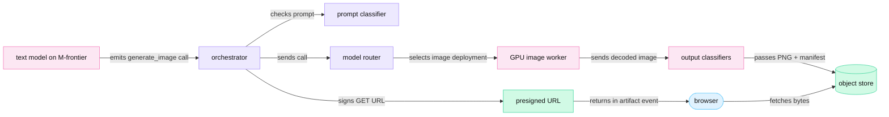
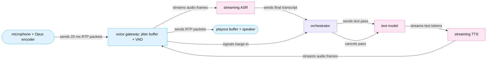
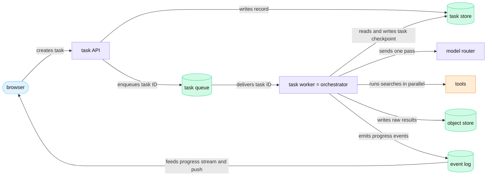

<!-- GENERATED from manuscript/src/part-20-other-branches.md by tools/render_manuscript.py. Edit the source, not this file. -->
# Part 20: Other branches

Image generation, voice and long-running agents reuse the same API gateway, orchestrator and model router. Each one changes what the GPU computes, how long the work lives, or how the result reaches the user.

Your request follows one path: text in, three inference passes, text out in about 86 s (part 21). Three other kinds of work share the same platform and break some of its assumptions:

1. An image request needs another model and another kind of GPU work. Its result is a file, not a token stream (20.1).
2. A spoken turn needs audio in and audio out, with a latency budget measured in hundreds of milliseconds (20.2).
3. A research task runs for many minutes and dozens of passes. So it cannot live inside one HTTP request (20.3).

Each section names what stays the same as your request and what changes.

---

## 20.1 Image generation

An image request becomes a tool call to a separate image deployment. There a compute-bound GPU worker runs a fixed number of denoising steps. Safety checks run before and after the GPU work. The client gets a short-lived presigned URL, not a token stream.

### Where the request branches

The text model decides that the user wants an image. It does not draw the image itself. It emits a tool call, for example `generate_image` with a prompt, a size and a style. In this reference system, the orchestrator is the only component that calls models and tools (RA-14). So the orchestrator validates the call's arguments against the tool schema, checks the tenant's quota, and sends the call on.

The model router then selects a deployment by rule (RA-15). In this reference system, the rule table reads the modality of the call (RA-56, RA-81). An image-output call goes to the image deployment, not to `M-frontier`. The image deployment is a separate pool of GPU workers with its own queue, autoscaler and model files.

OpenAI's public description of its own system has the same shape. Its system card speaks of "a call to the 4o image generation tool", made by the text model [SRC-745]. The rest of OpenAI's internal path is not public.

The full branch has these steps:

1. The text model emits the `generate_image` tool call, and the pass ends (RA-65).
2. The orchestrator validates the arguments and reserves quota.
3. A text classifier checks the image prompt (prompt blocking).
4. The model router selects the image deployment (RA-56).
5. A GPU image worker runs the denoising steps and decodes the latent to pixels.
6. Image classifiers check the decoded image (output blocking).
7. The worker encodes a PNG, attaches a provenance manifest, and writes it to the object store.
8. The orchestrator gives the model a tool result with the file ID. It gives the client an `artifact` event with a presigned URL (RA-63).
9. The browser fetches the image bytes from that URL.



Legend: pink = GPU work; violet = CPU services; green = stored data; light blue = the browser. The one thing to notice: the image bytes never travel through the token stream; only a URL does. The diagram leaves out the quota reservation and the tool result that goes back to the text model.

### Three ways to produce an image

Three families of image models exist in public work. They differ in what one GPU step computes.

**Diffusion.** A diffusion model starts from random noise and removes a little noise per step [SRC-744]. A neural network predicts the noise (or the direction to the clean image) at each step [SRC-742]. After a fixed number of steps, the result is the image. Modern models run this loop on a **latent**: a small grid of vectors. At the end, a variational autoencoder (VAE) decodes the latent to pixels [SRC-742].

**Flow matching.** A flow-matching model learns a velocity field that moves a sample from noise to data. **Rectified flow** is the variant in which the path "connects data and noise in a straight line" [SRC-744]. A straight path needs fewer integration steps. At serving time, flow matching looks the same as diffusion. It runs a fixed number of steps over a latent, and each step is one full transformer pass.

**Autoregressive image tokens.** An image tokenizer turns an image into discrete codes, one per patch. A decoder model then predicts these codes one by one, as it predicts text tokens. Chameleon's tokenizer "encodes a 512×512 image into 1024 discrete tokens from a codebook of size 8192" [SRC-254]. OpenAI writes that "unlike DALL·E, which operates as a diffusion model, 4o image generation is an autoregressive model" [SRC-745]. OpenAI does not publish the tokenizer, the size or the step count of that model.

| Family | One GPU step computes | Steps per image | Public example |
|---|---|---|---|
| diffusion | one network pass over all latent positions | tens | DALL·E, as OpenAI describes it [SRC-745] |
| flow matching | one transformer pass over all latent tokens | 1–50 | FLUX.1 [SRC-740] [SRC-741] |
| autoregressive tokens | one decode step for one image token | one per token: thousands | Chameleon [SRC-254], 4o image generation [SRC-745] |

**What is not public.** Which image models real assistants run, and on what hardware, is not public. Two realistic options are a flow-matching transformer and an autoregressive image decoder. Here we use a flow-matching transformer with the public FLUX.1 [dev] shape, because that shape is open (`hypothetical.image_gen_ref`, RA-81).

### The shapes of one image

FLUX.1 [dev] is "a 12 billion parameter rectified flow transformer" [SRC-740]. The Diffusers pipeline shows how one request becomes tensors [SRC-742] [SRC-743]:

1. The VAE maps each square of 8 × 8 pixels to one latent position (`vae_scale_factor`) [SRC-742].
2. A 1024 × 1024 image becomes a latent of 128 × 128 positions with 16 channels.
3. `_pack_latents` groups each 2 × 2 block of positions into one token of 64 values [SRC-742] [SRC-743].
4. So the image is 64 × 64 = 4,096 tokens.
5. The prompt adds up to 512 text tokens [SRC-740].
6. Every step runs the transformer over all 4,608 tokens at once.

```
latent at one step:   [1, 16, 128, 128]     (batch, channels, height, width)
packed tokens:        [1, 4096, 64]
joint sequence:       [1, 4096 + 512, 3072] (image tokens + text tokens; d_model = 24 heads × 128)
transformer output:   [1, 4096, 64]         (the velocity for every image token)
```

The transformer has 19 joint blocks and 38 single blocks, 24 heads of 128 dimensions [SRC-743]. Attention in every block is full and bidirectional over the whole sequence. So no token waits for an earlier one, and the step has no KV cache.

### FLOPs and GPU time per image

A common estimate counts 2 FLOPs per parameter per token for the linear layers, plus the attention products:

```
linear FLOPs per pass    = 2 × params × tokens
attention FLOPs per pass = 4 × layers × tokens² × d_model
```

With the FLUX.1 [dev] shape:

```
linear    = 2 × 1.20 × 10¹⁰ × 4,608 = 1.11 × 10¹⁴ FLOP
attention = 4 × 57 × 4,608² × 3,072 = 1.49 × 10¹³ FLOP
one pass  = 1.25 × 10¹⁴ FLOP   (attention is 12% of it)
```

The model is guidance-distilled [SRC-740]. So one step is one transformer pass. A model with true classifier-free guidance (CFG) runs a second pass per step with a negative prompt. The pipeline then mixes the two outputs [SRC-742]. That doubles the step cost.

At an assumed 50% of the H100's 989.5 TFLOPS BF16 dense peak, the GPU delivers 4.95 × 10¹⁴ FLOP/s. The step count sets the cost:

| Steps | Where the count comes from | FLOPs per image | GPU-seconds per image |
|---|---|---|---|
| 4 | FLUX.1 [schnell] card [SRC-741] | 5.02 × 10¹⁴ | 1.01 |
| 28 | Diffusers pipeline default [SRC-742]; this reference system | 3.51 × 10¹⁵ | 7.10 |
| 50 | FLUX.1 [dev] card example [SRC-740] | 6.27 × 10¹⁵ | 12.68 |

These are model estimates, not benchmarks. Optimized kernels, FP8 weights and step caching change them in practice.

Part 14 sized a short support chat (workload A) at 0.17 GPU-seconds (14.6). One image at 28 steps costs about 41 times as much GPU time. So image traffic needs its own capacity plan, its own quota and its own price per image.

### Why image batching differs from text batching

Text decode reads every weight once per step and computes one token per sequence (part 11.4). At batch 1, it does 2 FLOPs per 2 bytes of BF16 weight. That is an arithmetic intensity of 1 FLOP per byte. The H100's ridge point is 295 FLOP per byte (part 11.4). So text decode is memory-bound, and a larger batch adds tokens almost for free (part 11.4, 11.8).

One image step is different:

```
intensity = FLOPs per pass ÷ weight bytes
          = 1.25 × 10¹⁴ ÷ 2.40 × 10¹⁰ B
          = 5,228 FLOP/B   (18 × the ridge)
```

One image already saturates the Tensor Cores. A batch of b images takes about b times as long per step:

| Images per batch | Denoise time (s) | Images per GPU-second |
|---|---|---|
| 1 | 7.1 | 0.141 |
| 2 | 14.2 | 0.141 |
| 4 | 28.4 | 0.141 |

So batching barely raises image throughput, and it raises every image's latency. Three more differences follow from the shapes:

1. **Fixed length.** From the shapes above, every image of one size and step count costs the same. The scheduler knows the finish time at admission, unlike text, where the output length is unknown.
2. **Static batches work.** Images in one batch must share a size and a step count. The reason: every step runs over one tensor shape. A common conclusion is that continuous batching (part 11.5) gains little here, because no image finishes early.
3. **No KV cache.** As the shapes above show, the memory per image is the latent and the activations of one pass. The 24 GB of BF16 weights and the activations fit one 80 GB GPU (`hypothetical.image_gen_ref.gpus_per_worker`).

In this reference system, an image worker batches at most 4 images of one size (`hypothetical.image_gen_ref`, RA-81). It batches only when the queue holds more requests than workers. A batch does not raise the denoising throughput. It saves the fixed work around the steps: one scheduler pass, one text-encoder call and one VAE launch per batch.

**The autoregressive alternative.** With a Chameleon-style tokenizer, each token covers 16 × 16 pixels: (512 ÷ 16)² = 1024 tokens, which matches the paper [SRC-254]. A 1024-pixel image then needs 4,096 tokens. At the decode step of part 14.2, 47.2 ms, the decode alone takes 193 s. On a model with `M-dense`'s attention shape, those tokens would hold 1.48 GB of KV cache.

So an autoregressive image has the costs of a long text output. Its decode is memory-bound, its KV cache grows, and it batches well across users.

An autoregressive image model can therefore share the text fleet's engines. A diffusion model needs a separate pool.

### Safety checks on images

OpenAI documents three layers for its image tool [SRC-745]:

1. The text model "can refuse to trigger the image generation process" for a prompt.
2. **Prompt blocking** runs after the call to the image tool. Text or image classifiers can block the tool before any GPU work.
3. **Output blocking** runs after the image exists. CSAM classifiers and "a safety-focused reasoning monitor" block images that violate policy.

In this reference system, the same three layers apply (RA-58 for the input check). The prompt classifier takes 30 ms, and the output classifiers take 120 ms per image (`hypothetical.image_gen_ref`). No pixel leaves the worker before the output check passes. A blocked image returns a tool result with a policy reason, so the text model can tell the user.

**Provenance.** The C2PA specification defines a signed manifest of assertions about an asset [SRC-746]. A hard binding is a cryptographic hash of the asset's bytes, so a validator can detect any change [SRC-746]. The manifest sits inside the file in JUMBF boxes, or in a separate file [SRC-746]. In this reference system, the image worker signs a C2PA manifest for every image before the upload (`hypothetical.image_gen_ref.encode_and_put_ms`, RA-81).

### Delivery: object store and presigned URL

The image is a file of a few megabytes. Sending it inside the SSE stream would fill the bounded per-hop buffers of RA-49 and RA-74. In this reference system, the worker writes the PNG to the regional object store (RA-21). The orchestrator then signs a GET URL with a lifetime of 300 s (RA-63, `hypothetical.image_gen_ref.signed_url_ttl_s`). The URL travels in one `artifact` event of the stream (RA-74). Amazon S3 documents the same mechanism for presigned URLs [SRC-226].

The browser loads the image from the object store or from a CDN in front of it. A strict CSP limits `img-src` to owned origins (RA-33). A later page view asks the backend for a new presigned URL, because the first one has expired.

The wall time of one image on an idle worker is the sum of the stages:

| Stage | Time (ms) |
|---|---|
| prompt check | 30 |
| denoise, 28 steps | 7,101 |
| VAE decode | 150 |
| output check | 120 |
| encode, sign and PUT | 60 |
| **total** | **7,461** |

The denoising steps take almost all of the time. So the step count is the main lever on both latency and cost. During those seconds the client shows a `tool.status` event, not a TTFT timer (RA-50).

**Meanwhile in the fleet.** While your image worker runs its denoising steps, the text pool decodes thousands of sequences without noticing. Other image workers run their own batches of the same size. The image queue's depth drives the image pool's autoscaler. KV usage cannot, because an image worker has no KV cache.

You can now trace an image request to its presigned URL, and compute its GPU cost from the step count.

---

## 20.2 Audio and voice

A spoken turn runs either a chain of three streaming models or one native speech model. The chain is automatic speech recognition (ASR), the text model and text-to-speech (TTS). Either way, its latency is a sum of frame times, buffers and the silence that ends the user's turn.

### Two designs

**Cascaded.** Three models run one after another:

1. ASR turns the user's audio into text.
2. The text model reads the text and writes an answer, as for your request.
3. TTS turns the answer into audio.

**Native.** One model reads audio tokens and writes audio tokens, with text alongside. Kyutai's Moshi is a public example. It models the user's audio and its own audio as parallel streams. So it can listen and speak at the same time [SRC-750]. Moshi also predicts "time-aligned text tokens before audio tokens", an inner monologue that steers its speech [SRC-750].

The cascaded design reuses the whole text stack: tools, retrieval, citations and safety checks on text. The native design keeps tone and timing that text drops, and it saves the hand-offs between models.

**What is not public.** Which design real assistants use for each voice product is not public. Two realistic options exist: the cascaded design and the native design. Here we use the cascaded design as the default, because it keeps the text path's tools and checks (RA-82). RA-15 then sends the audio legs to speech deployments by modality.

### Audio frames and token rates

Audio moves in small frames, and every stage works per frame:

| Representation | Rate | Source |
|---|---|---|
| Opus packet, 20 ms frame | 50 packets/s; 960 samples per frame at 48 kHz | RFC 6716 [SRC-747] |
| Whisper log-Mel input | 100 frames/s; 1,500 encoder positions per 30 s segment | Whisper [SRC-751] |
| Mimi codec tokens | 12.5 frames/s × 8 codebooks = 100 tokens/s | Moshi [SRC-750] |
| spoken text | 3.25 text tokens/s at 150 words per minute | `hypothetical.voice_ref` |

**Opus.** WebRTC endpoints must implement Opus and G.711 [SRC-748]. Opus frames last 2.5 to 60 ms, and RFC 6716 calls 20 ms "a good choice for most applications" [SRC-747]. At 32 kbit/s (`hypothetical.voice_ref`), one packet works out as follows:

```
payload = 32,000 bit/s ÷ 8 × 0.020 s = 80 B
headers = IPv4 20 B + UDP 8 B + RTP 12 B = 40 B
on the wire = (80 + 40) B × 8 × 50 packets/s = 48 kbit/s
```

Headers are 33% of every packet. A shorter frame lowers latency but raises that share, which is why 20 ms is the common choice.

**Whisper.** Whisper re-samples audio to 16,000 Hz [SRC-751]. It computes an 80-channel log-Mel spectrogram on 25 ms windows with a 10 ms stride [SRC-751]. It trains on 30-second segments [SRC-751]. So one segment is 3,000 Mel frames. A stride-2 convolution halves them to 1,500 encoder positions, 50 per second of audio.

**Mimi.** Moshi's codec takes a 24 kHz waveform and emits 12.5 frames per second [SRC-750]. Each frame holds 8 codes from codebooks of 2,048 entries [SRC-750]:

```
frame time  = 1,000 ms ÷ 12.5 = 80 ms   (1,920 samples at 24 kHz)
bits        = log2(2,048) = 11 bits per code
bitrate     = 100 codes/s × 11 bits = 1,100 bit/s
```

That matches the paper's 1.1 kbps [SRC-750]. Moshi's large Temporal Transformer runs one pass per frame, and a small Depth Transformer predicts the codebooks inside the frame [SRC-750]. So the big model takes 12.5 steps per second, and each step has an 80 ms deadline.

**What the rates change.** Speech carries about 3.25 text tokens per second. At the decode step of part 14.2, the text model writes 21.2 tokens per second. That is 6.5 times faster than the voice can speak. So in the cascaded design, the text model never limits playback; the time to the first audio does.

A native model emits 31 times more tokens per second of speech than the text of that speech. Moshi's Depth Transformer absorbs most of them inside each frame. Its Temporal Transformer still adds one position per frame: 3.8 times the text rate. So a native conversation's KV cache grows faster than its transcript's would.

### The pipeline, stage by stage



Legend: light blue = client and network edge; pink = GPU models; violet = the orchestrator. The one thing to notice: every arrow carries a stream of small frames, and barge-in runs against the flow. The diagram leaves out tools and retrieval on purpose; they work as in Parts 5 to 8.

The stages, from the microphone:

1. **Capture.** The browser takes microphone samples through WebRTC and encodes one Opus frame every 20 ms [SRC-747] [SRC-748].
2. **Transport.** WebRTC sends each frame as an RTP packet over UDP. RTP's sequence numbers and timestamps let the receiver rebuild the source timing [SRC-749].
3. **Jitter buffer.** Packets arrive with uneven gaps. A jitter buffer holds a few packets and releases them at the source's pace. RTP estimates the jitter as `J(i) = J(i−1) + (|D(i−1,i)| − J(i−1)) / 16` [SRC-749], and the buffer depth follows that estimate.
4. **Voice activity detection (VAD).** A small model marks each chunk as speech or silence. Silero VAD scores one chunk of 30 ms or more in under 1 ms on one CPU thread [SRC-753]. Server VAD ends a turn after a run of silence [SRC-754]. Semantic VAD ends it when a model judges the sentence complete [SRC-754].
5. **Streaming ASR.** The ASR emits words while the user still speaks. Kyutai's `stt-1b-en_fr` runs 0.5 s behind the audio [SRC-752]. Kyutai reports 400 real-time streams on one H100 for its STT models [SRC-752]. Whisper itself works on fixed 30-second segments [SRC-751]. So a streaming service re-runs Whisper on a sliding window, or uses a model built for streaming.
6. **Text model.** The orchestrator sends the transcript as a normal pass, with history and tools.
7. **Streaming TTS.** The TTS starts on the first phrase of the answer, before the text model finishes.
8. **Playout.** A common design is a playout buffer in the browser that smooths the downlink packets before it plays them.

### The latency budget of one spoken turn

The user hears the first audio of the answer some time after the last word. In this reference system, the budget per stage is a set of hypothetical values (`hypothetical.voice_ref`, RA-82). The network legs come from the Nairobi-to-`ap_south` path of part 2. The clock starts when the user stops speaking:

| Stage | Cascaded (ms) | Native (ms) |
|---|---|---|
| capture of the last frame | 20 | 20 |
| uplink network, one way | 32.2 | 32.2 |
| uplink jitter buffer | 40 | 40 |
| end of turn (VAD silence, or semantic turn detector) | 500 | 300 |
| ASR final words | 100 | — |
| text model TTFT | 350 | — |
| first phrase (12 tokens × 47.2 ms) | 567 | — |
| TTS first audio | 200 | — |
| native model first audio (one Mimi frame + acoustic delay) | — | 160 |
| downlink network, one way | 32.2 | 32.2 |
| downlink playout buffer | 60 | 60 |
| **total** | **1,901** | **644** |

The native column uses Moshi's theoretical latency of 160 ms, which is 2 frames of 80 ms [SRC-750]. Moshi reports 200 ms in practice [SRC-750].

Three facts come out of the table:

1. **Two waits dominate.** The text model's first phrase and the end-of-turn silence are the two largest stages. A shorter silence cuts users off in mid-sentence, so semantic turn detection pays off. A voice pool with a smaller batch per rank shortens the decode step, but needs more GPUs (part 14.5).
2. **The native model saves 1,257 ms** in this budget. It removes the ASR finalize, the text TTFT, the first phrase and the TTS start. It also ends the turn earlier.
3. **The network is small here.** The two one-way legs add 64 ms. A user far from every region pays more; global traffic management (RA-06) matters as much for voice as for text.

### Barge-in: the user interrupts

Barge-in means the user starts to speak while the assistant's audio plays. The system must stop the answer, stop the GPU work, and keep only the part the user heard.

The OpenAI Realtime API is a public example. With VAD on, "the server will automatically cancel any in-progress model response" [SRC-754]. Over WebRTC, the server keeps the output audio buffer [SRC-754]. So it knows how much audio has played, and it truncates the rest itself [SRC-754]. Over WebSocket, the client plays the audio, so the client must stop playback and send `conversation.item.truncate` with `audio_end_ms` [SRC-754].

In this reference system, a barge-in follows the cancellation chain of RA-49 and RA-74. The voice gateway also bounds how far the TTS runs ahead of playback (`hypothetical.voice_ref.tts_lookahead_cap_s`). The illustrative case: the user speaks 3.0 s into the answer.

1. The VAD needs 200 ms of speech, so a cough does not stop the answer. With the uplink and its jitter buffer, detection takes 272 ms.
2. The gateway sends the cancel to the orchestrator, which cancels the text pass and the TTS stream. The in-region hops add 1.0 ms (part 17.2).
3. The gateway stops sending packets. The audio already on the wire and in the playout buffer still plays. So the user hears the answer for 365 ms after starting to speak.
4. The user heard 3.37 s of audio. The gateway truncates the stored answer to the text of that audio: about 11 text tokens.

The TTS produces audio 4 times faster than real time. Without a cap, it would have made 12 s of audio by the barge-in. With the 2.0 s cap, it made 5 s, and 1.63 s go to waste. The cap trades GPU waste against the risk of a playout gap when the TTS slows down.

### WebRTC or WebSocket

| | WebRTC | WebSocket |
|---|---|---|
| transport | RTP over UDP [SRC-749] | one TCP connection (RFC 6455 [SRC-147]) |
| a lost packet | skipped; the decoder conceals the gap | resent; later frames wait behind it |
| jitter buffer and echo cancellation | built into the browser's media stack | the application writes them |
| who knows what has played | the server, because it keeps the output buffer [SRC-754] | the client, which must report it [SRC-754] |
| good for | browsers and phones on lossy networks | server-to-server links on clean networks |

The OpenAI Realtime API connects "over WebRTC in the browser or WebSocket on the server" [SRC-754]. In this reference system, the browser sends WebRTC media to a voice gateway in the serving region (RA-82). The gateway reaches the speech deployments over gRPC streams inside the region (RA-11).

**Meanwhile in the fleet.** Every active voice session holds a slot on an ASR worker for its whole length, even in silence. Kyutai reports 400 real-time streams on one H100 for its streaming STT models, measured on the 2.6B DSM-ASR model [SRC-752]. So one GPU transcribes a few hundred speakers at once. The TTS pool sees short bursts, one per answer phrase. The text pool sees voice passes as normal short passes, with a tight TTFT target.

You can now add up a spoken turn's latency per stage, and explain what a barge-in cancels and keeps.

---

## 20.3 Long-running agents and deep research

A deep-research task runs as a durable background task with a task checkpoint after every pass. So no HTTP request and no GPU sequence stays open for its many minutes. A budget bounds it, not the chat loop limit.

### How it differs from your request

Your request runs three inference passes inside one HTTP request with a 120 s deadline (RA-11). A research task asks a broad question. An example: "compare the pricing models of the ten largest vendors in this market". The model plans, runs dozens of searches, reads the pages, writes notes, and writes a long report with citations.

Public systems describe this shape. Anthropic's research system uses an orchestrator-worker pattern: a lead agent starts 3 to 5 subagents in parallel [SRC-755]. It reports that agents use about 4 times the tokens of a chat, and multi-agent systems about 15 times [SRC-755]. OpenAI's background mode exists because "reasoning models can take several minutes to solve complex problems" [SRC-757].

In this reference system, one task runs 40 research passes (`hypothetical.agent_task_ref`, RA-83). Each pass reuses the sizes of Part 14's workload C (`hypothetical.workload_profiles`). A pass adds 2,500 tokens of search results or page text, and writes 300 output tokens.

| | Your request | One research task |
|---|---|---|
| inference passes | 3 | 42 (incl. 2 compactions) |
| loop limit | 8 passes | 64 passes under a budget |
| input tokens | 83,533 (5.6) | 1,088,100 |
| output tokens | 450 visible | 15,000 |
| search queries | 3 | 78 |
| wall time | 86 s (part 21) | 15.5 min |
| list price (`hypothetical.billing_ref`) | 0.109 USD | 1.30 USD (12 ×) |
| lives in | one HTTP request and its SSE stream | a task record, a queue and task checkpoints |

### Why one HTTP request and one GPU sequence must not stay open

The task's wall time is 15.5 minutes. Four limits of the request path break at that length:

1. **The deadline.** The top-level deadline is 120 s (RA-11). The task runs 7.7 times longer. Raising the deadline for all requests would let stuck requests hold resources for that long too.
2. **Deploys.** A decode worker drains for at most 300 s before a rollout stops it (RA-54, part 17.10). The task is 3.1 times longer. So any task pinned to one process dies at the next deploy. Anthropic uses rainbow deployments "to avoid disrupting running agents" [SRC-755], which is the same problem.
3. **The client connection.** A phone sleeps, or a network changes. Assume a 1% chance per minute that the connection breaks (`hypothetical.agent_task_ref`). Then the formula below gives the chance that it lasts the whole task. Under RA-74, a disconnect cancels the turn at once. So a task bound to its stream would lose all its work.

   ```
   P(connection survives) = (1 − 0.01)^15.5 = 0.856
   ```

   So 14% of tasks would lose their stream.

4. **The GPU sequence.** A pass ends at each tool call (RA-65). Suppose the engine kept the sequence open through the tool waits instead. It would hold the KV and KDA state for 219 s of waiting: 251 GB·s. That is a mean of 1.15 GB, or 2.3% of one DEP16 rank's KV pool.

   That looks small for one task. But that memory computes nothing, and at thousands of tasks it removes whole decode slots. The prefix cache (part 13.3) gives most of the benefit without a reservation. The next pass finds the earlier blocks if the cache still holds them (part 13.3).

So the task must live outside the request, the stream and the GPU.

### Durable task state

In this reference system, a research task is a record in a durable task store (`hypothetical.agent_task_ref`, RA-83). That store sits beside the conversation store (RA-17). The orchestrator stays the only component that calls models and tools (RA-14). For tasks, it runs as a pool of task workers that take task IDs from a queue. The record holds:

| Field | Content |
|---|---|
| `task_id`, `tenant_id`, `user_id` | identity, quota owner |
| `status` | `queued`, `running`, `waiting_tool`, `compacting`, `done`, `failed`, `cancelled` |
| `plan` | the model's list of sub-questions, with a state per item |
| `cursor` | the index of the next pass, and the IDs of tool calls in flight |
| `notes` | the compacted summary of old tool results |
| `sources` | the source-ID map for citations (RA-67) |
| `artifacts` | object-store IDs of raw pages, tool results and the draft report |
| `budget` | USD and passes used, and the limits |
| `lease` | the task worker that holds the task, and the lease's expiry time |

The task's steps form a task graph. The plan's sub-questions are independent, so their searches can run in parallel. Merging the findings and writing the report depend on all of them. Anthropic reports that parallel subagents and parallel tool calls together cut research time "by up to 90% for complex queries" [SRC-755]. In this reference system, one pass runs at most 4 tool calls in parallel (`hypothetical.tool_exec_limits`, RA-83).

### Task checkpoints, retries and resumption

A durable workflow engine records each step's result before it starts the next step. Temporal records every action in the Event History [SRC-756]. When a failure occurs, "the Workflow Execution picks up where the last recorded event occurred" [SRC-756]. Temporal retries activities by default [SRC-756].

The first retry waits 1 s, and each wait grows by a factor of 2.0 [SRC-756]. The wait stops at 100 times the first one [SRC-756]. Workflows themselves do not retry by default [SRC-756]. Anthropic describes the same need: "retry logic and regular checkpoints" [SRC-755]. Its systems "resume from where the agent was when the errors occurred" [SRC-755].

In this reference system, a task worker runs this loop for each pass (RA-83):

1. Take or renew the task's lease.
2. Read the task checkpoint: plan, cursor, notes, sources.
3. Check the budget. Stop with a partial report if the next pass would exceed it.
4. Build the prompt and send one inference pass through the model router.
5. Run the pass's tool calls in parallel, each with an idempotency key (RA-12).
6. Write the raw tool results to the object store.
7. Write the new task checkpoint in one transaction: cursor + 1, new notes, new sources, budget used.
8. Emit a progress event to the event log (RA-20).

A task checkpoint is about 24,000 B (`hypothetical.agent_task_ref.checkpoint_bytes`), because raw pages live in the object store. The task writes 42 task checkpoints, 1,008,000 B in total, about 2.7 per minute. That load is tiny for the database.

If a task worker dies, its lease expires. Another task worker takes the task and repeats at most one pass. A tool call that already ran returns its stored result through its idempotency key, so no side effect runs twice. If a model server dies in the middle of a pass, the orchestrator retries that pass (part 17.3). A deploy does not hurt the task at all: the new task workers continue from the last task checkpoint.



Legend: light blue = the browser; violet = CPU services; green = durable stores; orange = tools. The one thing to notice: the browser reaches the task only through the task API and the event log. The diagram leaves out the GPU side of each pass on purpose; it is the same as for your request.

### The loop limit, raised under a budget

The chat loop stops after 8 tool passes. That limit protects an interactive request from a model that never stops calling tools. A research task needs more passes, so a different bound replaces it. In this reference system, a research task may run 64 passes, but only under three limits (`hypothetical.agent_task_ref`, RA-83):

1. a spending cap of 3.0 USD at list price, checked before every pass,
2. a wall-clock limit of 3,600 s,
3. the tenant's token and tool-call quotas (RA-10, part 16.4).

When the task hits a limit, it does not fail. The orchestrator asks the model for a final report from its notes. The chat loop does the same at its limit. This reference task stays within its budget: it spends 1.30 USD of 3.0 USD.

### Context compaction

Every pass adds 2,500 tokens. Without compaction, the prompt grows to 101,500 tokens by pass 40. With the raised limit, it would pass the orchestrator's cap of 131,072 tokens (RA-68) at pass 52:

```
prompt at pass n = 4,000 + (n − 1) × 2,500
pass 52: 131,500 tokens > 131,072
```

In this reference system, the orchestrator runs a **task compaction** when a task's working context passes 48,000 tokens (`hypothetical.agent_task_ref.compaction_trigger_tokens`, RA-83). This extends RA-68's history compaction to tool results. A task compaction is one extra pass:

1. The model reads the whole old context, which is still in the prefix cache.
2. It writes a summary of 1,200 tokens: findings, open questions, and the source IDs behind each finding (RA-67).
3. The orchestrator stores the summary in the task checkpoint's `notes`, and the raw tool results stay in the object store.
4. The next prompt is the task prompt, the summary, and the newest tool result verbatim: 4,000 + 1,200 + 2,500 tokens.

The first compaction runs at pass 19. The task compacts 2 times, and no research prompt exceeds the trigger:

| Pass | Kind | Prompt tokens | Cached | Output |
|---|---|---|---|---|
| 1 | tool | 4,000 | 1,200 | 300 |
| 2 | tool | 6,500 | 4,300 | 300 |
| 18 | tool | 46,500 | 44,300 | 300 |
| 19 | compaction | 49,000 | 46,800 | 1,200 |
| 20 | tool | 7,700 | 1,200 | 300 |
| 37 | compaction | 50,200 | 48,000 | 1,200 |
| 42 | final | 17,700 | 15,500 | 900 |

A task compaction changes the prefix. So only the 1,200-token system prompt then hits the prefix cache (part 5.7, 13.3). In this model, every other pass reads its whole earlier prompt from the cache.

**What compaction changes.** Over 40 passes, the task reads 1,088,100 input tokens with compaction and 2,110,000 without. The cost falls only 11%, because cached tokens are cheap at list price. So compaction exists for three other reasons: the prompt cap, the KV memory of long sequences, and answer quality. Models use the middle of a long context poorly [SRC-460]. Anthropic saves the plan for a related reason: its system truncates context above 200,000 tokens [SRC-755].

### Cost and quota

At the list prices of Part 16 (`hypothetical.billing_ref`), the task costs:

```
101,600 × 2.0/M + 986,500 × 0.2/M + 15,000 × 8.0/M + 78 × 10.0/1000 = 1.3005 USD
```

| Part | USD |
|---|---|
| uncached input | 0.203 |
| cached input | 0.197 |
| output | 0.120 |
| search queries | 0.780 |
| **total** | **1.300** |

Search queries are the largest part. So the per-pass query count matters more than the model's token price.

The GPU side uses Part 14's request model on `M-frontier` (14.4). The task's passes need 37.0 GPU-seconds, which cost the provider 0.062 USD at the hypothetical GB300 price. That is 5% of the list price. The model's decode time sets most of the wall time: 709 s of decode against 219 s of tool waits.

In this reference system, each pass reserves and settles tokens like any other pass (RA-73). So a task cannot exceed the tenant's TPM limit; it waits instead. Its passes run in the `batch` priority band (RA-41). So they fill idle capacity and yield to interactive traffic at peak (part 14.8). A slow pass costs the task a few seconds, which its user does not watch.

### Background execution and notification

The user does not need to keep the tab open. In this reference system, the steps are (RA-83):

1. The client sends the task request. The task API writes the record, enqueues the task ID, and returns `202 Accepted` with the task ID.
2. The client opens a progress stream on the task ID. The stream reads progress events from the event log (RA-20) and sends them as SSE events (RA-47).
3. A disconnect closes only that stream. The task continues, because no stream owns it; only an explicit cancel stops it. This is the one place where the RA-49 rule (a disconnect cancels the work) does not apply.
4. A reconnecting client sends the last event's sequence number and receives the events after it. OpenAI's background mode offers the same resume with a `starting_after` cursor [SRC-757].
5. When the task ends, the backend sends a Web Push message through the browser's push service [SRC-758]. RFC 8030 requires a TTL header [SRC-758]; here it is 86,400 s (`hypothetical.agent_task_ref.push_ttl_s`).
6. The report becomes an assistant message in the conversation. Its citations resolve to sources (RA-67), and its artifacts become presigned URLs (RA-63).

A cancel request sets the task's status to `cancelled`. The task worker checks the status before each pass and cancels any pass in flight down to the scheduler (RA-49).

**Meanwhile in the fleet.** Thousands of research tasks sit in the task store at once. A running task holds a decode slot only during a pass. Between passes it holds no GPU memory except cached prefix blocks.

The tasks' passes in the `batch` band fill the troughs of the daily demand curve (part 14.8). During a deploy, the old task workers stop after their current pass. New task workers resume the tasks from their task checkpoints.

You can now explain why a long agent task needs a durable task record, and compute its passes and cost.

---

## What Part 20 established

Image generation, voice and long-running agents use the same orchestrator, router and stores as your request. Image work replaces memory-bound decode with compute-bound steps. Voice replaces the TTFT with frame deadlines, and agents replace the open request with durable task state.
