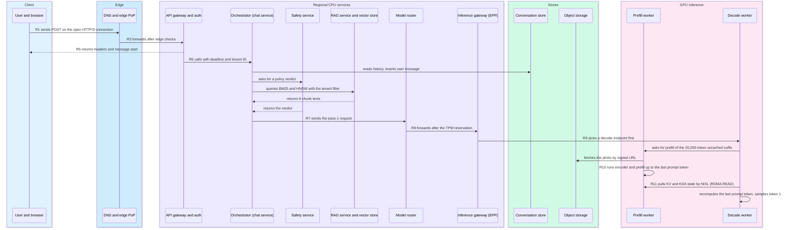
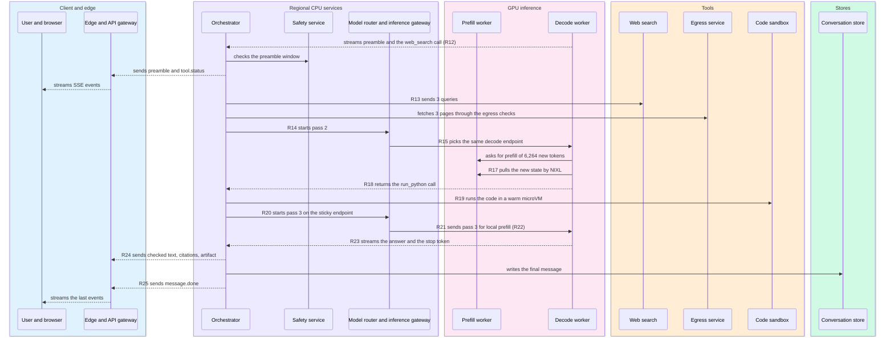
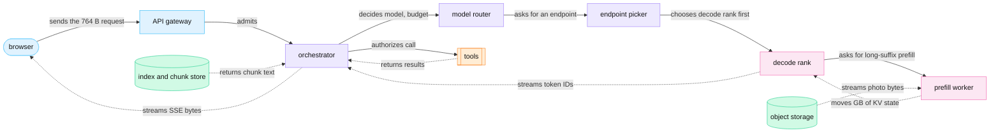

<!-- GENERATED from manuscript/src/part-21-super-trace-and-system-state.md by tools/render_manuscript.py. Edit the source, not this file. -->
# Part 21: The super trace and system state

Your request is one chain of 26 events across about a dozen components. Decode on one GPU rank takes almost all of its time.

Parts 00 to 20 opened each component on its own. This part adds no new mechanism. It joins the earlier numbers into one timeline, from the key press (R0) to the last pixel (R25). Then it asks what state each step creates, who owns that state, and when it goes away. All times come from the earlier parts' data. The few short steps that no part timed are hypothetical and say so.

The part follows the request in nine steps:

1. Every event in time order, with the data form at each boundary (21.1).
2. The request object at ten stages, A to J (21.2).
3. Which steps decide and which steps move bytes (21.3).
4. What blocks your first token, and what runs after (21.4).
5. Which components hold state, and where affinity matters (21.5).
6. What your next turn can reuse (21.6).
7. Every piece of state, with its size and lifetime (21.7).
8. What the system deletes and what it keeps (21.8).
9. The busy time of each component, summed to the end-to-end latency (21.9).

---

## 21.1 One request end to end: events R0 to R25

Your request takes 85.9 s from the key press to the last pixel, and 95% of that time is decode.

### How the timeline is built

The timeline follows the reference request of part 0.2. It carries text, a photo, three earlier turns and a PDF in the workspace. It needs private retrieval, web search and code. A script reads each step's time from the part that computed it. It never computes a step again:

| Step | Time source | Part |
|---|---|---|
| access network and backbone | great-circle fiber delay from Nairobi to the PoP and to `ap_south` (hypothetical locations) | 2.8 |
| edge, gateway, history read | short service times (hypothetical) | 19.1 |
| retrieval | query embedding, index search, chunk fetch, rerank on 4 GPUs | 5.3, 19.1 |
| context assembly | the measured K3 tokenizer speed over the 7,770 text tokens | 4.2, 5.6 |
| queue | gateway queue and engine wait (hypothetical) | 9.5 |
| vision encoder, prefill, decode | the GPU time model of `M-frontier` at the fleet design point | 14.4 |
| KV transfer | state bytes over NVLink, plus a fixed overhead | 13.7 |
| web search | the Monte Carlo p50 of the tool step | 7.2 |
| code | a warm sandbox claim, the run and the artifact upload | 8.1 |
| hold-back check | one output check per 16-token window | 18.3 |
| stream to the screen | 6 forwarders, the backbone, the access link and the wait for the next frame | 15.5 |

Three steps of the request had no time in any earlier part. Each is short and hypothetical:

- The click handler takes 3 ms.
- The model router's rule table and TPM reservation take 1 ms per pass.
- The orchestrator's tool dispatch takes 2 ms per call.

The TPM reservation is the model router's hold on tokens-per-minute quota for one pass (RA-10).

### The events

Each row is an event at a component boundary. The time is the moment the event happens, measured from the key press. "Form" is the representation of your request's data at that boundary.

| Event | Time | Component | Hardware | What happens | Form at the boundary | RA |
|---|---|---|---|---|---|---|
| R0 | 0 ms | browser | renderer | you press Send | DOM `keydown` or `click` event | RA-07 |
| R1 | 3 ms | browser | renderer, then NIC | the handler renders your message and calls `fetch()` | HTTP/3 `POST`, 764 B of JSON | RA-02, RA-07 |
| R2 | 13 ms | edge PoP | NIC, CPU | the PoP receives the QUIC packets | HTTP/3 request | RA-01 |
| R3 | 14 ms | edge PoP | CPU | the checks pass; the edge creates the `traceparent` and forwards | HTTP/2 over TLS on the backbone | RA-04, RA-52 |
| R4 | 36.2 ms | regional ingress, API gateway | CPU | the request reaches `ap_south` | HTTP request | RA-09 |
| R5 | 38.2 ms | API gateway | CPU | the gateway verifies the token, checks the RPM bucket, sends `message.start` and calls the orchestrator | gRPC with Protobuf, deadline, tenant ID | RA-10, RA-11, RA-74 |
| R6 | 219 ms | orchestrator | CPU, retrieval GPUs | history, memory, retrieval and the user-message insert return; the policy verdict joins | rows, 2 memory records, 6 chunk texts | RA-14, RA-17, RA-24 to RA-27, RA-58 |
| R7 | 222 ms | orchestrator | CPU | the context object is complete | 10 segments, 23,322 tokens | RA-62, RA-68 |
| R8 | 223 ms | model router | CPU | pass 1: the rule table picks `M-frontier`; the router reserves TPM | JSON chat request | RA-15, RA-56, RA-73 |
| R9 | 393 ms | inference gateway, decode worker | CPU | the endpoint picker chooses a decode endpoint first; its scheduler admits the sequence; the uncached suffix is too long for local prefill, so it asks a prefill worker | request on one decode endpoint | RA-34, RA-37, RA-38, RA-41 |
| R10 | 923 ms | prefill worker (TEP8) | 8 GB300 GPUs | the vision encoder and prefill run up to the last prompt token | token IDs → KV blocks | RA-38, RA-40 |
| R11 | 927 ms | decode worker (DEP16) | GB300, NVLink | the decode rank pulls the state by NIXL; its next step samples the first reasoning token | 1.09 GB of KV and KDA state → logits → 1 token ID | RA-38, RA-44, RA-55 |
| R12 | 21.0 s | decode worker | GB300 | pass 1 ends with the `web_search` call | token IDs → tool-call JSON | RA-50, RA-65 |
| R13 | 22.6 s | orchestrator, search tool, egress service | CPU, external | 3 queries and 3 page fetches return | tool-result JSON | RA-28, RA-29, RA-67 |
| R14 | 22.6 s | model router | CPU | pass 2: a new TPM reservation | JSON chat request | RA-73 |
| R15 | 22.7 s | inference gateway | CPU | the picker scores the cached prefix and picks the same decode endpoint | request on one endpoint | RA-37, RA-71 |
| R16 | 22.9 s | prefill worker | GB300 | the decode endpoint asks for prefill again; pass 2 prefills 6,264 new tokens | token IDs → KV blocks | RA-38 |
| R17 | 22.9 s | decode worker | NVLink | the decode rank pulls the new state | 0.62 GB | RA-38 |
| R18 | 43.7 s | decode worker | GB300 | pass 2 ends with the `run_python` call | tool-call JSON | RA-65 |
| R19 | 45.0 s | code sandbox | microVM CPU | the code runs and uploads a PNG chart | stdout + artifact file ID | RA-30, RA-69 |
| R20 | 45.0 s | model router | CPU | pass 3: a new TPM reservation | JSON chat request | RA-73 |
| R21 | 45.2 s | inference gateway | CPU | the affinity filter keeps only the sticky endpoint | request on one endpoint | RA-71 |
| R22 | 45.2 s | decode worker | GB300 | pass 3 prefills 187 tokens locally; this prefill step samples its first token | token IDs → KV blocks → 1 token ID | RA-38 |
| R23 | 85.9 s | decode worker | GB300 | pass 3 emits the stop token | token IDs → text deltas | RA-44, RA-72 |
| R24 | 85.94 s | browser | renderer, GPU compositor | the last text delta reaches the screen | SSE event → DOM text | RA-47, RA-75 |
| R25 | 85.94 s | browser | renderer | `message.done` arrives after the final write; the cursor goes away | SSE `message.done` → DOM | RA-18, RA-74 |

In this reference system, the orchestrator starts four branches at the same time (RA-14). They are the history read, the memory read, retrieval and the user-message insert. So R6 waits only for the slowest branch, retrieval at 0.181 s.

In this reference system, selection is decode-first (RA-38, part 13.7). The inference gateway picks a decode endpoint, and that endpoint decides where the uncached suffix runs. Pass 1 has 23,322 prompt tokens, and no endpoint holds more than 3,072 of them (part 9.3). So the uncached suffix is at least 23,322 − 3,072 = 20,250 tokens, 87% of the prompt. The local limit is 2,048 tokens and 70% of the prompt.

So the decode worker asks a prefill worker for pass 1 (R10), then pulls the state (R11). vLLM's NIXL connector stops the prefill one token short of the prompt end [vllm@v0.31.0:vllm/distributed/kv_transfer/kv_connector/v1/nixl/base_scheduler.py#L384-L408]. In this reference system, the decode worker then recomputes that token and samples token 1 itself (RA-38). Pass 2 repeats this with 6,264 new tokens. Pass 3 prefills on the decode endpoint, because only 187 tokens are new.

### What you see, and when

The stream carries more than text. In this reference system, the API gateway sends the response headers and `message.start` at once (RA-74). The raw reasoning never leaves the server; the client gets only a reasoning-status event (RA-72). Tool-call tokens never reach the screen; the client gets a tool-status event instead (RA-50). Each text window waits for one output check before release (RA-75).

| Moment | Time after the key press | Why then |
|---|---|---|
| `message.start` painted | 80 ms | the gateway sends it before the orchestrator starts |
| first token at the engine | 0.97 s | the KV pull and one decode step after the pass-1 prefill |
| reasoning status painted | 1.02 s | the first reasoning token travels back |
| first visible text: the preamble | 15.6 s | 300 reasoning tokens, then 9 preamble tokens, then one check |
| first token of the answer painted | 64.8 s | two tool steps, then 400 reasoning tokens, then one 16-token window |
| last text painted | 85.94 s | the last window passes its check |
| `message.done` painted (R25) | 85.94 s | the final message write commits first |

The engine samples the first token 0.97 s after the key press. The p95 TTFT target of 1,500 ms covers text-only requests without tools (part 19.1). Your request has tools, so that target does not apply to it. The first visible text comes much later, and the reason is arithmetic. The fleet design point puts 94 sequences on each DEP16 rank (part 14.2). There, one decode step takes 47.2 ms:

```
first visible text = R11 + (reasoning + preamble tokens) × step + check + engine-to-pixel
                   = 0.927 s + (300 + 9) × 0.0472 s + 0.02 s + 0.0421 s
                   = 15.59 s
```

Part 19.1 names two nearby moments differently. Its trace starts at the edge, 13 ms after the key press. It has no span for context assembly, the model router or the KV transfer. So its pass-1 prefill ends at 0.91 s. Its first preamble token reaches the edge at 15.1 s, before the hold-back check releases it. The first visible text is the moment in the table above.

### What the sum shows

The 25 intervals between the 26 events add up to the end-to-end latency with no gap and no overlap:

| Group | Time | Share |
|---|---|---|
| browser handler, network and frame wait | 78 ms | 0.09% |
| CPU before the first pass: gateway, fan-out, assembly | 185 ms | 0.22% |
| router and queue, three passes | 513 ms | 0.60% |
| prefill and vision encoder | 691 ms | 0.80% |
| KV transfers | 5.9 ms | 0.007% |
| decode, three passes | 81.53 s | 94.9% |
| tool steps | 2.91 s | 3.4% |
| last check, final write | 22 ms | 0.03% |
| **end-to-end latency** | **85.94 s** | 100% |

Part 14.4 put the wall time of this request at 85.13 s. That model counts GPU time and tool steps only. The trace adds 0.81 s of network, CPU, queue, transfer and check time. The top-level deadline is 120 s (RA-11), so the request ends with 34 s to spare.

The math changes the design in three places:

- **Decode step time decides the user's wait.** Each millisecond of step time adds 1,726 ms to this request, one per decode step. A smaller batch per rank lowers the step time but raises the GPU count (part 14.5).
- **Reasoning tokens decide the first visible text.** 900 of the 1,727 output tokens carry reasoning. They cost decode time but show no text, so the status events matter.
- **The steps before the first pass are small but come first.** They take 222 ms, before the first GPU cycle. So they bound how early any token can appear.

### The transformation chain

Your data changes form 13 times between the key press and the screen:

1. **HTTP JSON.** The browser sends 764 B: IDs, your text and two file IDs (part 2.1).
2. **Internal Protobuf.** The API gateway turns the request into a gRPC message. It adds the verified tenant, a deadline and the trace context (part 3.1).
3. **Context object.** The orchestrator orders 10 segments and counts 23,322 tokens (part 5.6).
4. **Token IDs.** The model server tokenizes the messages again; its tokenization is authoritative (RA-62). The image becomes 15,552 visual positions (part 4.3) [SRC-378, SRC-384].
5. **GPU tensors.** The embedding table turns IDs into rows of 7,168 values (part 10.1) [SRC-378].
6. **Tool-call JSON.** Pass 1 ends in a `web_search` call that the orchestrator parses and validates (part 6.2).
7. **Search results.** The tool returns 8 results and 3 page texts with source IDs (part 7.6).
8. **Token IDs again.** The result enters the context of pass 2 as 6,040 tokens (part 5.6).
9. **Logits.** Every decode step produces 163,840 scores for each sequence (part 10.9) [SRC-378, SRC-380].
10. **Token IDs.** The sampler picks one `int64` ID; only its 8 bytes leave the GPU (RA-44) [vllm@v0.31.0:vllm/v1/worker/gpu/sample/gumbel.py#L352] [vllm@v0.31.0:vllm/v1/worker/gpu/sample/gumbel.py#L378-L381].
11. **UTF-8 text.** The detokenizer turns IDs into bytes and holds back an unfinished character (part 10.11) [SRC-115].
12. **SSE frames.** The API gateway wraps each delta into an SSE event of about 49 B (part 15.2).
13. **DOM text.** The browser parses the event and appends text to the message node (part 15.5).

### The sequence diagrams

The super trace has more components than one readable diagram can hold. So it splits at R11, where decode starts. The first diagram runs from the key press to the KV transfer.



Legend: blue = client and edge; violet = regional CPU services; green = stores; pink = GPU workers. Solid arrows carry control (a call or a decision); dashed arrows carry data (results, state, stream events). The one thing to notice: three reads and a verdict run in parallel. The gateway picks the decode worker first, and that worker sends the long suffix to a prefill worker. The diagram leaves out DNS on purpose, because the browser resolved the name before Send (part 2.3).

The second diagram runs from the start of decode to the last pixel.



Legend: as above; orange = tools outside the GPU tier. The one thing to notice: every arrow from the decode worker to a CPU service goes to the orchestrator. Only the orchestrator calls tools and talks to the client (RA-14). The diagram leaves out the per-pass usage events on purpose (21.4).

**Meanwhile in the fleet.** At the ap_south peak, about 11,741 other requests per second enter the same region (part 14.8). While your pass 1 decodes for 20 s, its rank runs 93 other sequences in the same steps. Each finished sequence frees its blocks, and a new one takes its slot. Your three passes are three separate entries in the pool's queue, so other tenants' passes run between them.

Counters at R11, on your decode rank:

- `vllm:num_requests_running`: 94 (the design point, part 14.2).
- `vllm:kv_cache_usage_perc`: rises by the 1.09 GB of your state.
- TTFT timer, from the key press: token 1 leaves the engine at 0.97 s, one decode step after R11. The status event reaches the screen at 1.02 s.

You can now place every event of one request on one time axis, with its component.

---

## 21.2 The request object at stages A to J

Your request is ten successive representations, not one object. Each stage keeps only the fields that the next stage needs.

### The ten stages

| Stage | Form | Where it lives | Concrete example from your request | Size |
|---|---|---|---|---|
| A | browser JSON | the page's memory, then the HTTP/3 stream | `conversation_id` `conv_6f1d2a9c3b7e4058`, `message_id`, two file IDs, your text, the model, `Idempotency-Key` | 764 B |
| B | validated internal request | gRPC between the API gateway and the orchestrator | the same IDs, plus tenant ID from the verified token, deadline 119 s, `traceparent`, priority band | small: IDs and fixed fields |
| C | context object | orchestrator memory | 10 ordered segments: tools, effort, system prompt, 3 history turns, 2 memory records, 6 chunks, your turn, the generation prefix; `max_tokens` 4,096; `cache_salt` = tenant ID | 23,322 tokens |
| D | token IDs | model server CPU | `input_ids` of shape `[1, 23,322]`; your text is 52 tokens; the image wrapper is `[163602, 4017, 220, 27154, 17, 87, 25401, 19, 163603, 163605, 163604]` | 4 B per ID |
| E | batched tensors | GPU HBM | prefill hidden states `[20,250, 7,168]` in BF16; in decode, one row per sequence: `[94, 7,168]` per rank | 290 MB per layer input in prefill |
| F | KV cache + logits | GPU HBM | MLA latent blocks and KDA state; logits `[1, 163,840]` in FP32 per step | 1.09 GB after the pass-1 prompt; 655 kB of logits |
| G | sampled token IDs | GPU → engine core | `[116389, 673, 60896, 131100, 230]` | 8 B each, `int64` (RA-44) |
| H | text deltas | API server process | ` Margin by competitor 📈`; the detokenizer held 1 step because the emoji's bytes span two tokens | a few bytes each |
| I | SSE events | API gateway → edge → browser | `event: output_text.delta` + `data: {"delta":" the"}` | 49 B each; 477 events in total |
| J | rendered message | the browser DOM | a table, 5 citations, a chart link; the parser reads about 1,794 characters once each | one message node |

In this reference system, the tenant ID that appears at stage B never comes from the client (RA-09). The API gateway reads it from the verified token. From stage B on, every service keys its decisions on that verified value (part 18.1). Quotas, the retrieval filter, the cache salt and the fairness key all use it.

### Fields that live and die

A field exists only between the stage that creates it and the last stage that reads it:

| Field | Created at | Last read at | Why it exists |
|---|---|---|---|
| `message_id`, `conversation_id` | A (client) | the final write after R23 | match the optimistic message, store the answer |
| `Idempotency-Key` | A (client) | B (gateway) | make a retried Send run once (part 17.8) |
| tenant ID | B (gateway, from the token) | the usage events after R25 | quotas, filters, salts, billing |
| deadline | B | every child call | children stop when the parent's time is up (RA-11) |
| `traceparent` | R3 (edge) | the last span | join every span of the request (RA-52) |
| token counts and TPM reservation | C, per pass | the settle at each pass end | quota and billing (RA-73) |
| cache keys: block hashes with the salt | D, in the engine | eviction of the blocks | prefix-cache hits (RA-40) |
| block table | E, in the scheduler | the end of each pass | map token positions to KV blocks |
| source IDs 1 to 6 and 7 onward | C and R13 | the citation check at R24 | resolve each citation to a span (RA-67) |

**Meanwhile in the fleet.** Every in-flight request holds all ten forms at once, each in a different component. Stage A is a few hundred bytes in a browser. Stage F is more than a gigabyte in HBM. So the KV cache, not the request object, sets how many requests fit in the fleet (part 13.1).

You can now name the form, location and size of your request's data at any stage.

---

## 21.3 Control flow versus data flow

In this part, control flow is the set of decisions that pick where work runs and when it stops. Data flow is the bytes that those decisions move, up to about 10⁶ times larger than the request itself.

### The decisions

Each decision reads a few counters or fields and writes a few bytes. Each one belongs to deterministic code, except the two that the model makes through tokens:

| Decision | Who decides | Inputs | Output | Part |
|---|---|---|---|---|
| which PoP | BGP anycast [SRC-133] | network paths | one PoP | 2.4 |
| which region | global traffic management | health, capacity, latency, residency | `ap_south` (RA-06, RA-78) | 2.7 |
| admit or reject | API gateway | RPM bucket of the tenant | pass, or `429` (RA-10) | 3.2 |
| which model | model router rule table | model choice, plan, modality, context length | `M-frontier` (RA-56) | 3.7 |
| which endpoint | endpoint picker | prefix overlap, queue, KV usage | one DEP16 rank (RA-37, RA-71) | 9.3 |
| when to run | engine scheduler [vllm@v0.31.0:vllm/v1/core/sched/scheduler.py#L628-L682] | token budget, free KV blocks | admit, wait or preempt | 11.6 |
| call search, call code | the model, through tokens | its context | a tool-call token sequence | 6.1 |
| allow the call | orchestrator policy | schema, allowlist, scopes | run or refuse (RA-14) | 6.2 |
| release the text | hold-back check | one 16-token window | release or stop (RA-75) | 18.3 |
| stop | engine stop conditions [vllm@v0.31.0:vllm/v1/core/sched/utils.py#L104-L119] | stop token, `max_tokens`, cancel [vllm@v0.31.0:vllm/v1/core/sched/scheduler.py#L2585] | end of the sequence | 11.9 |

### The bytes

| Data movement | Bytes for your request | From → to |
|---|---|---|
| photo upload, before Send | 2,900,000 B | browser → object storage (RA-08) |
| PDF upload, before Send | 2,100,000 B | browser → object storage |
| the Send request | 764 B | browser → edge → region |
| visual tokens from the encoder | 223 MB | vision encoder → LLM prefill (part 4.3) |
| KV and KDA state, pass 1 | 1.09 GB | prefill worker → decode rank (NVLink) |
| KV and KDA state, pass 2 | 0.62 GB | prefill worker → decode rank |
| token IDs | 8 B per token | GPU → engine core |
| the whole client stream | 24,229 B | API gateway → browser |
| usage, audit and analytics events | 4,500 B | orchestrator → event log (RA-20) |

The pass-1 KV transfer is 1,432,135 times the Send request. Inside one NVL72 rack it takes 3.2 ms over NVLink. Between racks, an 800 Gb/s NIC would take about 14 ms for a 32k-token state (part 12.7). So the data flow, not the control flow, decides where prefill and decode may sit: in one NVLink domain (RA-55).



Legend: solid arrows = control flow; dotted arrows = data flow; violet = CPU; pink = GPU; green = stores; orange = tools. The one thing to notice: the decisions pass through CPU services. The large bytes move between stores and GPUs, around the decision makers. The diagram leaves out the usage events on purpose.

The split explains two design rules of this reference system:

1. **Control services stay small and stateless.** Each decision reads counters and writes a few bytes. So one gateway, model router or endpoint picker process decides for many requests (RA-09, RA-34).
2. **Large data goes by reference.** The request carries file IDs, not file bytes (RA-08). The model server reads the photo through a signed URL (RA-63). The KV state moves GPU to GPU, never through the orchestrator (RA-38).

**Meanwhile in the fleet.** One endpoint picker makes a decision for every pass in the pool, from counters that the engines publish. One decode rank streams token IDs for 94 sequences at once. So the control flow scales with the number of passes, and the data flow scales with tokens and bytes.

You can now mark each arrow of a trace as control or data, and say which one limits placement.

---

## 21.4 Synchronous versus asynchronous work

In this part, a step sits on the critical path only when the next step needs its output. In this reference system, work that only records what happened runs after or beside it (RA-20).

### The critical path

So the critical path is the chain of steps whose sum sets the end-to-end latency. For your request, it contains:

1. **Authentication and the RPM check** (0.002 s). No work may start for an unknown or over-limit tenant.
2. **The context inputs**: history, memory, retrieval, and the policy verdict (0.181 s, the slowest branch). Pass 1 cannot start without its prompt.
3. **The user-message insert** (2 ms, inside the same fan-out). Your text must survive a crash before any GPU second goes to it (RA-18, part 3.5).
4. **The TPM reservation per pass** (1 ms each). Hard quota state stays in the strongly consistent path (RA-20, RA-73).
5. **Inference**: queue, prefill, KV transfer and decode of all three passes (82.74 s).
6. **The two tool steps** (2.91 s). Passes 2 and 3 read their results.
7. **The hold-back checks** (one per window). Text reaches the screen only after its check (RA-75).
8. **The final message write** (2 ms), before `message.done` (RA-18).

### The side work

Side work records, counts or improves later turns. Nothing in your answer reads it. So in this reference system it never blocks a token (RA-20):

| Side work | When it runs | Mode | Time it would add if the request waited |
|---|---|---|---|
| usage events: one per pass and one per tool call (5) | at each pass end and tool end | append to the event log; the request does not wait | 5 × 5 ms |
| audit (2), analytics (1), `turn_completed` (1) | after the final write | append | 20 ms |
| memory extraction (RA-27) | a worker consumes `turn_completed` | a low-priority model call | 3 s |
| conversation indexing | the same event | embed and insert on a background band (RA-24, RA-68) | 0.3 s |
| trace spans and log records | in batches from each process | export later (RA-52, RA-77) | one export call per span batch |
| billing aggregation | per aggregation window | consumer of the usage topic (part 16.4) | none for the request |

If all of it ran in line, `message.done` would arrive 3.34 s later, an increase of 3.9%. That sounds small next to decode. But the loss is larger than the percentage:

- The stream and the orchestrator's memory for your request stay open longer.
- The memory-extraction model would sit on the user's critical path, so its queue would add its own tail latency.
- A slow event log would slow every answer in the region, because each request would wait for its appends.

The asynchronous design moves those failure modes away from the user. The cost is delay in the records. A new memory record or a billing row appears seconds after the answer, not with it.

### What must not move off the path

Two pieces of state look like bookkeeping but must stay synchronous:

1. **The user-message insert.** If it were asynchronous, a crash after the GPU work could lose your text while the answer exists.
2. **The TPM reservation.** Suppose the router counted quota only after each answer. Then a burst of long requests could run far beyond the limit before the first count (part 3.2).

**Meanwhile in the fleet.** The usage topic receives about 100,000 usage events per second at the global peak (part 16.2). Memory workers and indexers drain their topics at low priority. When they fall behind, new memory records arrive later, and no answer slows down.

You can now sort every step of a request into the critical path or side work, with its cost.

---

## 21.5 Stateful versus stateless, and affinity

Most components forget your request once it passes them. The inference worker and the sandbox keep state for a while, and that state creates affinity.

### The classification

This part uses two definitions. A stateless component keeps nothing between requests that another replica would need. Any replica can take the next request. A stateful component keeps data that only it holds, so the next request must find it.

| Component | Class | State it holds for your request | How long | RA |
|---|---|---|---|---|
| edge PoP | stateless per request; holds connection state | the open QUIC connection and its TLS keys | the connection's idle timeout | RA-01, RA-02 |
| API gateway | stateless | a local token bucket as a safety net; the open stream | the stream | RA-09, RA-10 |
| orchestrator | stateless between requests; soft state during one | the context object, the partial answer, the source-ID map | 86 s | RA-14 |
| conversation store | stateful, durable | your messages and the quota counters | until deleted | RA-17 |
| decode worker (one DEP16 rank) | temporarily stateful | 1.31 GB of KV and KDA state after pass 3 | the pass, then the prefix cache | RA-38 |
| prefix KV cache | soft state: it can be computed again | blocks with tenant-salted hashes | until LRU eviction | RA-39, RA-40 |
| code sandbox | stateful session | a microVM with 2,048 MiB of memory and your files | 120 s idle; files 3,600 s | RA-69 |

### Why the inference worker becomes stateful

A decode step on your sequence reads all of its KV and KDA state (part 10.4, 13.1) [SRC-384]. In this reference system, that state exists only in the HBM of one DEP16 rank (RA-38, RA-55). Another rank could continue the sequence only after a copy of 1.09 GB or more. So for the length of a pass, your sequence belongs to one rank. The rank's slot count limits the pool (part 14.2).

The state outlives the pass as prefix-cache blocks. It is soft state: losing it costs time, never correctness. The orchestrator still sends the full history with every pass, and the engine recomputes what it lacks (part 5.7).

### Four kinds of affinity

In this part, affinity is a rule that sends a request to the component that holds its state. Your request meets four kinds:

| Affinity | State that creates it | Who enforces it | What happens if it breaks |
|---|---|---|---|
| conversation home region | your rows have one home region with quorum replication inside it (RA-17) | global traffic management prefers the home region | the request runs in `eu_west` and pays a round trip of 74 ms per synchronous store call (part 2.8) |
| existing KV | the blocks of the previous pass on one rank | the endpoint picker's affinity filter: sticky above 0.8 of the prompt cached (RA-71) | the pass prefills the whole prompt on another rank |
| an active stream | the open HTTP/3 connection to one PoP and one gateway pod | the connection itself | the stream ends; the client fetches the message by ID (RA-48) |
| a warm session | the sandbox session: its microVM and files (RA-69) | the orchestrator keeps the session ID → host mapping | a new microVM restores from the snapshot pool and copies the files back |

The four rows are one store affinity, one GPU affinity, one network affinity and one tool affinity. Only the GPU affinity is a scoring choice. In pass 2, no endpoint reached the threshold, so the filter kept all three. The cost scorer then picked the endpoint with the cache (part 9.3). In pass 3, the filter kept only that endpoint. Its estimated TTFT penalty was 128 ms, far below the 18,000 ms bound.

**Meanwhile in the fleet.** Affinity conflicts with load balance. A rank that holds many conversations' prefixes attracts their next passes, while an idle rank holds nothing useful. So the endpoint picker weighs the cache against queue depth and KV usage. A hot prefix can spread to more ranks (part 9.3).

You can now classify any component as stateless, soft-stateful or durable, and name its affinity.

---

## 21.6 The second turn

A follow-up reuses everything durable and some soft state. The prefix cache helps less than it seems, because the new history moves your photo.

### The follow-up

Assume you read the answer and send, after a pause: "Redo the chart with Cedar Systems' price 10% lower." (hypothetical). The mean pause between turns in the routing simulation is 15 s (part 9.2). In this reference system, turn 4 enters the history of turn 5 as the user message with its attachments, and the final answer text with its citations (RA-84). The raw reasoning and the tool results stay in the message metadata (RA-72).

### What the follow-up finds

| Item | Re-fetched, reused or recomputed | Why | Part |
|---|---|---|---|
| auth session and signing key | reused | the token is valid; the key stays in process memory for 3,600 s | 3.4, 16.3 |
| entitlements | reused or re-read | Redis TTL of 60 s | 16.3 |
| history | re-fetched | the conversation store is the source of truth; now 4 turns | 3.4 |
| memory records | re-fetched by a new search | the query text changed | 5.5 |
| retrieval | runs again; the query-result cache misses | the cache key includes the query text, which changed | 5.3 |
| photo and PDF bytes | reused in object storage | file IDs in the history point to them | 2.2 |
| processed pixels | reused if the processor cache still holds them | content hash of the image | 4.3 |
| visual tokens | reused only if the encoder cache on that GPU still holds them | content hash; LRU over unused entries [vllm@v0.31.0:vllm/v1/core/encoder_cache_manager.py#L19-L45] | 4.3 |
| prefix KV | partly reused, only on the same endpoint | see below | 13.3 |
| sandbox session | reused if its microVM is still live | 120 s idle limit (RA-69) | 8.1 |
| routing | runs again | the endpoint picker scores every pass anew | 9.3 |

### The prefix cache, worked

The turn-5 prompt starts with the same segments as turn 4: tools, effort, system prompt, history turns 1 to 3. Then it diverges. In turn 4, the memory message and the chunks followed history turn 3. In turn 5, history turn 4 sits at that position (part 5.6):

1. Match: 315 + 67 + 1,200 + 780 + 840 + 980 = 4,182 tokens.
2. Hash-block rule, 512-token blocks: 4,096 tokens hit.
3. Saved-state rule: 0 tokens hit. The match ends inside the turn-4 prompt, where vLLM keeps no KDA state (part 13.3) [SRC-343].
4. History turn 4 holds at least 16,075 tokens: your turn with its photo, plus the 450-token answer. All of it prefills again.

The photo's 15,552 visual tokens now start at a new offset. With its 10 wrapper tokens, the photo fills 15,562 positions (part 4.3). Their block hashes differ, so their KV misses [vllm@v0.31.0:vllm/v1/core/kv_cache_utils.py#L499-L652]. The LLM prefill of those positions costs about 0.32 s on a prefill worker. An encoder-cache hit would still skip the vision encoder: 69 ms and 0.55 GPU-seconds.

So the possible benefit is real, but it is small and conditional. Four conditions must all hold:

1. The endpoint picker sends pass 1 to the rank that holds the blocks. With 4,096 of more than 20,257 tokens cached, the hit ratio stays below the 0.8 affinity threshold. So the load scorer may pick a different rank, exactly as in turn 4's pass 1 (part 9.3).
2. The blocks survive LRU eviction during your pause (part 13.2).
3. The engine holds a KDA state at the hit boundary; under vLLM's saved-state rule it does not.
4. The deployment did not change. A new model version prefills the history from scratch (part 17.10).

### The sandbox, worked

The microVM went idle when `run_python` ended at 45.0 s. Pass 3 then ran until 85.9 s. Assume a pause of 15 s before the next Send. Then the microVM has been idle for 56 s, under the 120 s limit. The new code call finds the live microVM with the chart's input files.

A pause longer than 79 s finds the microVM stopped. The files stay until 3,600 s after the last call. So a warm claim with copy-in costs only 25 ms (part 8.1).

**Meanwhile in the fleet.** Many conversations return within seconds, so the ranks keep their recent prefixes hot. Others return after hours, and their blocks are long gone. The fleet's prefix-cache hit fraction (60%, hypothetical) is an average over both kinds, not a promise for one turn.

You can now predict what a follow-up reuses, and why its prefix-cache benefit is not guaranteed.

---

## 21.7 The state table

Your request creates or touches eighteen pieces of state. Each has exactly one owner that decides its lifetime.

| State | Example from your request | Location | Size | Lifetime | Owner | Shared? |
|---|---|---|---|---|---|---|
| browser state | the message store: your message, the streamed answer, IDs | browser memory | about 1.8 k characters of answer text | the tab | client code | no: one tab |
| auth session | an opaque bearer token → user, expiry | identity store, cached in the gateway | one token | the session; revoked on logout | identity service | no: one user |
| idempotency record | the key → outcome of the first attempt | backend store (part 2.1) | a few hundred bytes | a limited window | orchestrator | no |
| conversation rows | your message and the answer, each one row | distributed SQL, home region (RA-17) | 508 B + 2,100 B, × 3 replicas | until you delete them | orchestrator | no: your conversation |
| object files | the photo and `q3-report.pdf` | S3-class object store (RA-21) | 2.9 MB + 2.1 MB | until deleted; the tenant's retention rule | upload service | within the tenant, by ACL |
| retrieval embeddings | the PDF's chunks as 1,024-dim FP16 vectors | search engine (RA-23, RA-24) | about 24 × 2,048 B = 49 kB | until the file is deleted; rebuilt on a model change | ingestion pipeline | within the tenant, by ACL (RA-26) |
| memory records | 2 records read; new ones may follow | per-user record store (RA-27) | 46 tokens in the context | until you edit or delete them | memory worker | no: one user |
| model weights | `M-frontier` replica | HBM of the rack's GPUs | 1,560.9 GB per replica | the replica | deployment controller | yes: all tenants, read-only |
| prefix KV | your blocks after pass 3 | decode rank HBM, then G2 to G4 (RA-39) | 1.31 GB | until LRU eviction | engine block manager | only within your tenant (RA-40) |
| active request KV | the block table and blocks of each running pass | decode rank HBM | peaks 1.11, 1.29, 1.31 GB | one pass | engine scheduler | no: one sequence |
| encoder cache entry | your photo's visual tokens | GPU memory of the prefill worker | 223 MB | until no running request uses it and space runs out | engine | keyed by the image's content hash (part 4.3) |
| tool state | search results, page texts, source-ID map, the code's stdout | orchestrator memory | 6,040 tokens of web results | the request; summarized in message metadata | orchestrator | no |
| search cache | normalized query → results | Redis-compatible store (RA-19) | small JSON | 1 h for pricing queries | search tool | within the tenant |
| sandbox | the microVM and `/workspace` with the chart | sandbox host | 2,048 MiB of memory | 120 s idle; files 3,600 s | sandbox manager | no: one session |
| stream buffer | bounded per-hop buffers of SSE events (RA-49) | 6 hops, gateway to edge | at most 96 KiB | the stream | each proxy | no |
| TPM reservation | tokens held for each pass | sharded counters in the strongly consistent store (RA-73) | 95,821 tokens over 3 passes | from reservation to settle | model router | no: one tenant's bucket |
| usage and audit events | 9 events | event log (RA-20) | 4,500 B | 7 days in the log; ledger rows longer | orchestrator, then consumers | no |
| trace and logs | 17 spans; 16 log records | trace store, log store | 5,600 B of logs | traces 14 days; app logs 30 days (RA-77) | each service | operators only |

The table shows one pattern. Durable state lives in stores with replication and an owner who deletes on request. Soft state lives near the compute and disappears under pressure. The system can rebuild every piece of soft state from durable state. The KV comes from the history, the visual tokens from the photo, the search results from the queries.

**Meanwhile in the fleet.** The weights row is the only one that many tenants share. The replica's weights are about 1,188 times your request's final state of 1.314 GB (part 18.2). So adding a user adds per-request rows only, never another weights row (part 14.1).

You can now list every piece of state a request creates, with its location, size, lifetime and owner.

---

## 21.8 Cleanup after the response

After `message.done`, the system deletes ephemeral state at once or on a timer. It keeps durable state under retention rules.

### The cleanup sequence

The cleanup runs in this order for your request:

1. **At each pass end.** The engine frees the pass's blocks. Full blocks keep their hashes in the free queue [vllm@v0.31.0:vllm/v1/core/block_pool.py#L777-L808]. They serve as prefix cache until a new allocation takes them [vllm@v0.31.0:vllm/v1/core/block_pool.py#L669-L693]. A request frees its blocks tail first, so the end of a prefix leaves before its start [vllm@v0.31.0:vllm/v1/core/kv_cache_utils.py#L255-L262].
2. **At each pass end.** The model router settles the TPM reservation. Over the three passes, it reserved 95,821 tokens and used 85,260. So it returns 10,561 tokens to your tenant's bucket (RA-10).
3. **After the fetches.** The egress service discards the raw page bodies (RA-29). Only the extracted text enters the context, and only the search cache keeps a copy, for 1 h.
4. **After the last token.** The orchestrator resolves the citations, writes the final message once, and sends `message.done` (RA-18).
5. **After `message.done`.** The orchestrator drops the context object and the tool state (RA-14). Each proxy releases its stream buffer, at most 96 KiB across the six hops.
6. **79 s after `message.done`.** The microVM stops, 120 s after its last call (RA-69).
7. **3,600 s after the last call.** The sandbox host deletes the session's files. The chart stays, because the artifact upload copied it to object storage.

### Ephemeral and durable state

| Ephemeral: deleted | When | Durable: kept | Retention rule |
|---|---|---|---|
| the request object and context | after `message.done` | your message and the answer | until you delete them (RA-17) |
| active KV blocks | at each pass end; hashed blocks stay until reused | uploads: photo, PDF, chart | until deleted; the tenant's policy |
| the sandbox microVM | 120 s idle | usage records in the billing ledger | the billing retention period |
| sandbox files | 3,600 s | events in the log | 7 days (part 16.2) |
| fetched page bodies | after extraction | audit events | 400 days (RA-77) |
| stream buffers | at stream end | new memory records | until you edit or delete them (RA-27) |
| TPM reservation | settled at each pass end | traces and logs | 14 and 30 days (RA-77) |

### Cleanup when the request does not finish

A request that stops early must clean up the same state, and the order matters more:

1. **You press Stop, or the connection breaks.** The cancel travels down to the scheduler, which frees the KV blocks at once (RA-49, part 17.2).
2. **The orchestrator writes a partial message** with status `interrupted` or `stopped` and the text you saw (RA-59, RA-74).
3. **The model router settles the reservation** for the tokens produced so far, so the refund still happens.
4. **A running sandbox call reaches its deadline or receives the cancel.** The microVM follows the same idle timer.

The partial write keeps the history consistent with the screen. A hold-back stop stores only the released text, so the next turn's context contains no blocked text (part 18.3).

**Meanwhile in the fleet.** Cleanup is continuous work. Every scheduler step frees the blocks of finished sequences. Every second, thousands of microVMs cross their idle timers and return memory to their hosts (part 8.1). Retention jobs delete expired logs and events in bulk, far from the request path.

You can now list what disappears after a response, when it disappears, and what keeps it from leaking or lingering.

---

## 21.9 The request lifetime table

The critical-path slices of all components add up to 85.94 s. The GPU work adds up to 7.53 GPU-seconds.

### What each stage does

| Stage | Component | Input | Processing | Output | Typical resource | Durable? | Can be cached? | Latency sensitivity |
|---|---|---|---|---|---|---|---|---|
| send | browser | key press | handler, optimistic render, `fetch()` | HTTP/3 request | renderer main thread | no | static assets, connection | high: first visible feedback |
| edge | edge PoP | QUIC packets | TLS, limits, WAF, bot score | HTTP/2 to the region | CPU, network | no | static responses only | high: every request |
| gateway | API gateway | HTTP request | token check, RPM bucket | gRPC call, `message.start` | CPU, Redis | no | signing keys, entitlements | high |
| context | orchestrator, conversation store, retrieval | IDs, query | reads, search, rerank, assembly | context object | CPU, retrieval GPUs | messages yes | embeddings, query results | high: before the first pass |
| routing | model router, endpoint picker | chat request | rule table, TPM reservation, scoring | one endpoint | CPU, Redis | no | prefix-index state | high |
| prefill | prefill worker | token IDs, photo | vision encoder, layer passes | KV blocks; token 1 only in a local prefill | GPU compute | no | prefix KV, encoder cache | high: sets TTFT |
| transfer | NIXL over NVLink | KV blocks | RDMA reads | KV on the decode rank | NVLink bandwidth | no | no | medium |
| decode | decode rank | KV, last token | one step per token; after a remote prefill, the first step samples token 1 | token IDs | HBM bandwidth | no | prefix KV for later passes | high: sets TPOT |
| tools | search, egress service, sandbox | tool-call JSON | queries, fetches, code | tool results | CPU, external APIs | artifacts yes | search results | medium: between passes |
| stream | gateway, ingress, edge, browser | token IDs | detokenize, check, frame, paint | pixels | CPU, network | no | no | high: every token |
| finalize | orchestrator, conversation store, event log | final text | write, events | rows, events | store, log | yes | no | low after `message.done` |

### How long each component works

| Component | On the critical path | GPU-seconds | Note |
|---|---|---|---|
| browser handler | 3 ms | — | then one paint per frame |
| access link and backbone | 32.2 ms | — | request direction |
| edge PoP | 1 ms | — | |
| API gateway | 2 ms | — | then forwards the stream |
| orchestrator fan-out | 180.8 ms | 0.59 (H100, retrieval pool) | retrieval is the slowest branch |
| context assembly | 2.7 ms | — | token count at the measured tokenizer speed |
| model router, 3 passes | 3 ms | — | |
| queue, 3 passes | 510 ms | — | waiting, not working |
| vision encoder | 69 ms | 0.55 (GB300) | inside pass-1 prefill |
| prefill, 3 passes | 621 ms | 4.97 (GB300) | 8 GPUs per TEP8 worker |
| KV transfers | 5.9 ms | — | NVLink time, counted in the link |
| decode, 3 passes | 81.53 s | 2.01 (GB300) | your share of one rank |
| web search | 1,607 ms | — | 1,605 ms p50 (part 7.2) + 2 ms dispatch; external provider and egress service |
| code sandbox | 1,307 ms | — | 1,305 ms run (part 8.1) + 2 ms dispatch; one microVM |
| hold-back check, last window | 20 ms | — | the earlier checks overlap decode |
| stream back to pixels | 42.1 ms | — | last delta |
| final write | 2 ms | — | then `message.done` |
| **total** | **85.94 s** | **7.53 GB300 + 0.59 H100** | |

Three measures give three different answers:

- **Wall time.** Decode holds the request for 81.5 of 85.9 s.
- **GPU-seconds.** Prefill costs more than decode: 4.97 against 2.01. Prefill uses 8 GPUs at full speed for a short time. Decode uses a small share of one rank for a long time: 2.2% in pass 1.
- **Held open.** The orchestrator and the stream stay open for 85.9 s. The orchestrator's CPU works for only a few milliseconds of that time.

At the hypothetical GB300 price, your request's GPU work costs 0.0126 USD (part 14.4). The web search adds 0.015 USD. So the long wall time does not make the request expensive. The decode rank shares each step with 93 other sequences.

**Meanwhile in the fleet.** Every in-flight request has its own version of this table. The fleet's capacity plan sums the GPU-seconds column over all of them. The latency SLOs watch the wall-time column (part 19.3). The two columns conflict. A larger batch lowers GPU-seconds per request and raises the wall time (part 14.5).

You can now build the lifetime table of any request and compare its wall time with its GPU cost.

---

## What Part 21 established

One request is a chain of small decisions that move large state across about a dozen components. Decode on one shared GPU rank sets most of its time.
