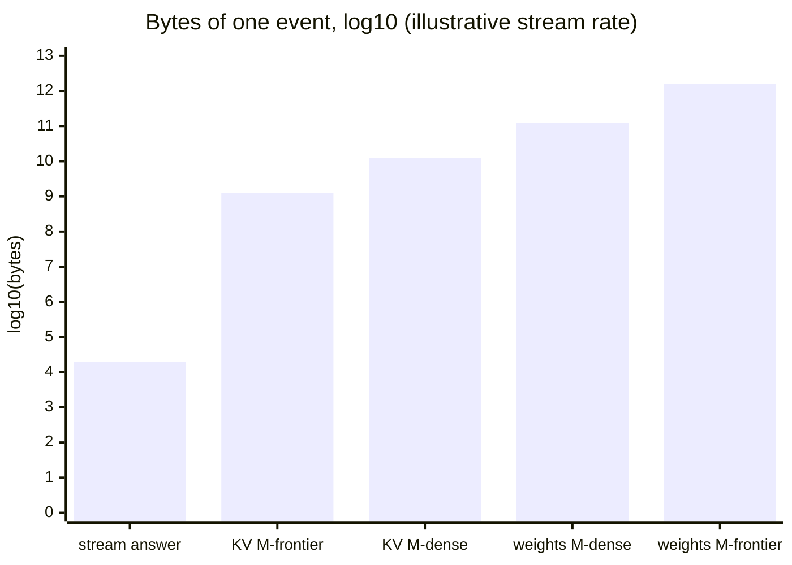
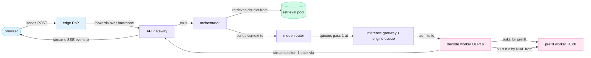
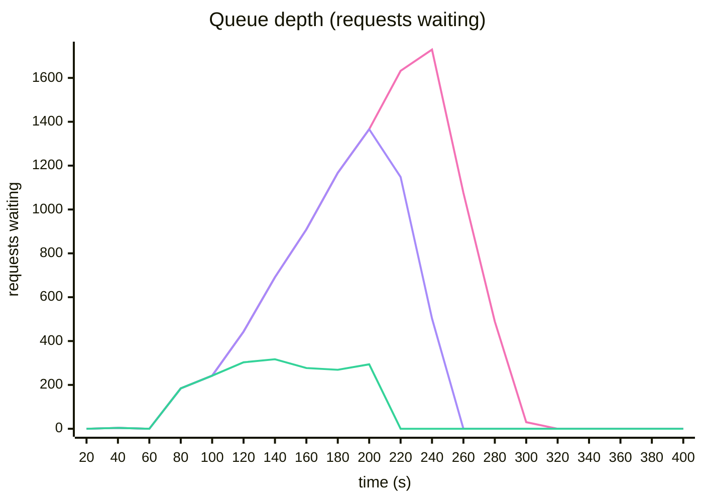
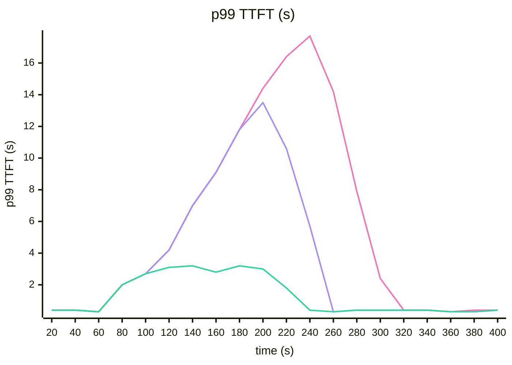

<!-- GENERATED from manuscript/src/part-22-quantitative-workbook.md by tools/render_manuscript.py. Edit the source, not this file. -->
# Part 22: The quantitative workbook

Every number in this reference system follows from a few formulas. They give bytes per parameter, FLOPs per token, bytes per second per link, time per hop and price per resource.

Parts 00 to 21 derived these numbers one at a time, each where the request first needed it. This part gathers them into tables. Each table gives the formula, the numbers and the part that derived them. New arithmetic appears only in the latency budget (22.5), the cost model (22.6) and two simulations (22.8). All traffic, prices and efficiencies are hypothetical and say so.

The workbook has eight sections:

1. Weight memory of both reference models in every format (22.1).
2. FLOPs per token, and why GPUs reach only part of their peak (22.2).
3. One table of compute and memory per token and per request (22.3).
4. Bandwidth from the GPU to the user, over ten orders of magnitude (22.4).
5. Your time to first token, hop by hop, with a tail (22.5).
6. What a request costs, in a hypothetical model (22.6).
7. Twenty optimizations, the bottleneck each one attacks and its price (22.7).
8. Two simulations small enough to check by hand (22.8).

---

## 22.1 Weight memory ⚙

Weight memory is the parameter count times the bytes per parameter, so the number format decides it.

### The formula

```
weight bytes = parameters × bits per parameter / 8
```

Integer and plain floating-point formats store only the values. Block-scaled 4-bit formats also store one 8-bit scale per block of values [SRC-012] [SRC-014]:

```
MXFP4: 4 + 8 / 32 = 4.25 bits per parameter
NVFP4: 4 + 8 / 16 = 4.5 bits per parameter (plus one FP32 scale per tensor)
```

### `M-dense` in six formats

`M-dense` has 125,025,988,608 parameters in its text model (part 10.2). The same parameters in each format:

| Format | Bits per parameter | Arithmetic | Weight memory | Share of one H100 (80 GB) |
|---|---|---|---|---|
| FP32 | 32 | 125,025,988,608 × 4 B | 500.1 GB | 6.3× |
| BF16 | 16 | × 2 B | 250.1 GB | 3.1× |
| FP8 | 8 | × 1 B | 125.0 GB | 1.6× |
| INT8 | 8 | × 1 B (plus scales) | 125.0 GB | 1.6× |
| 4-bit integer | 4 | × 0.5 B (scales not counted) | 62.5 GB | 0.78× |
| FP4 as MXFP4 | 4.25 | × 0.53125 B | 66.4 GB | 0.83× |
| FP4 as NVFP4 | 4.5 | × 0.5625 B | 70.3 GB | 0.88× |
| released checkpoint | mixed | FP8 decoder linears, BF16 rest and vision | 133.6 GB | 1.7× |

H100 has no FP4 Tensor Core path (part 11.1) [SRC-001] [SRC-007]. A common design on `H-teach` dequantizes 4-bit weights inside the kernel and multiplies in a wider format. vLLM's Marlin kernel is one example. It converts each 4-bit weight to FP16 or BF16 inside the kernel, then runs the Tensor Core multiply [vllm@v0.31.0:csrc/libtorch_stable/quantization/marlin/marlin_template.h#L1026-L1085]. vLLM enables Marlin on GPUs of compute capability 7.5 and newer, so H100 qualifies [vllm@v0.31.0:vllm/model_executor/layers/quantization/utils/marlin_utils.py#L60-L67].

The capacity model of part 13.1 runs the released FP8 checkpoint with TP=8. Each GPU then holds 16.7 GB of weights.

### `M-frontier`: total, active and resident

A mixture-of-experts model has three different weight numbers. Total parameters set the memory. Active parameters set the work per token. Resident memory is what the GPUs actually hold after the parallel layout copies some weights.

| Quantity | Formula | Value | Part |
|---|---|---|---|
| total parameters | all tensors | 2,779,931,837,184 | 1.6 |
| routed-expert parameters | 896 experts × 92 MoE layers × 3 matrices | 2,722,740,830,208 (97.9%) | 1.6 |
| active parameters per token | non-expert + 16 routed experts per layer | 104,189,614,848 (3.75% of the total) | 10.8 |
| released checkpoint | routed × 0.53125 B + rest × 2 B | 1,560.9 GB | 1.6 |
| the same model, all BF16 | total × 2 B | 5,560 GB | 1.6 |
| bytes one token touches | active parameters in the released format | 137.0 GB (8.8% of the checkpoint) | 1.6 |
| resident per DEP16 decode rank | non-expert + routed / 16 (documented: 210 GB) | 210 GB | 13.1 |
| resident per DEP16 decode worker | 16 × per rank | 3,360 GB = 2.15× the checkpoint | 1.6 |
| resident per TEP8 prefill rank | documented | 213 GB | 1.6 |

The same parameters in other uniform formats, for comparison:

| Format | Total | Active per token |
|---|---|---|
| BF16 | 5,560 GB | 208.4 GB |
| FP8 | 2,780 GB | 104.2 GB |
| MXFP4 | 1,477 GB | 55.4 GB |
| NVFP4 | 1,564 GB | 58.6 GB |

Why is resident memory 2.15 times the checkpoint? DEP16 splits the routed experts over 16 GPUs. Every GPU still keeps a full copy of the non-expert weights (114.4 GB). The copies add 1,716 GB per worker (part 1.6). The copies exist because attention runs data-parallel: each rank runs whole attention layers for its own sequences (part 12.4) [SRC-389].

### What the numbers change

1. **The GPU count floor.** The released `M-frontier` checkpoint needs at least 20 H100 GPUs or 6 GB300 GPUs for the weights alone. The FP8 `M-dense` checkpoint needs 2 H100 GPUs. That floor is why `M-frontier` runs on rack-scale NVLink (RA-55).
2. **The KV pool.** Every byte of weights per GPU is a byte that the KV cache cannot use (part 13.1). So the format also sets the batch size.
3. **The decode step.** A decode step reads the weights that its batch touches. For `M-frontier` that is every local expert at the design batch (part 14.2). So the weight bytes per rank set a floor under the step time.

**Meanwhile in the fleet.** Every replica of the same model holds the same weight bytes. Only the KV pool differs between replicas, because it holds different users' sequences.

You can now compute weight memory in any format and explain why resident memory exceeds the checkpoint.

---

## 22.2 FLOPs per token ⚙

A token costs about 2 FLOPs per active parameter, plus an attention term that grows with the context.

### The rough figure

Each weight takes part in one multiply-add per token, and a multiply-add counts as 2 FLOPs. A common estimate is therefore 2 × active parameters per token (part 10.8):

```
M-dense:    2 × 123,413,200,896 matmul parameters = 246.8 GFLOP per token
M-frontier: 2 × 104,189,614,848 active parameters ≈ 208.4 GFLOP per token
```

`M-frontier` has 22 times more parameters than `M-dense`. Yet it does fewer weight FLOPs per token, because each token activates only 16 of 896 experts per layer.

### The attention term

The weight term does not depend on the context. The attention term does. For a new token at position T, each `M-dense` layer computes T scores (Q·Kᵀ) and sums T values. Each of the two costs 2 × heads × head_dim × T FLOPs:

```
attention FLOPs per decode token = 4 × H × d_head × L × T = 4 × 96 × 128 × 88 × T
```

Take the first decode step after your pass-1 prompt. It attends to 23,323 keys: 23,322 prompt tokens plus token 1. Its next token costs (part 10.8):

| Term | FLOPs | Share |
|---|---|---|
| weight matmuls (all layers + LM head) | 246.8 GFLOP | 71% |
| attention | 100.9 GFLOP | 29% |
| total | 347.7 GFLOP | 100% |

During prefill, token t attends to t tokens, so the attention FLOPs of a whole prompt grow as T². The mean per prompt token grows linearly with T (part 13.6):

| Prompt length T | Weight FLOPs per token | Attention FLOPs per token (mean) | Attention share of prefill |
|---|---|---|---|
| 8,192 | 246.8 GFLOP | 17.7 GFLOP | 7% |
| 32,768 | 246.8 GFLOP | 70.9 GFLOP | 22% |
| 131,072 | 246.8 GFLOP | 283.5 GFLOP | 53% |

`M-frontier` has attention over a growing context in only its 24 MLA layers. Its 69 KDA layers do a fixed amount of work per token, whatever the context. In pass 3 of your request, one decode token costs 1.22 times the weight term (part 14.4).

**The qualifications.**

1. The LM head runs for the last position only, so a prefill count of 2 × N × T over-counts it [vllm@v0.31.0:vllm/v1/worker/gpu_model_runner.py#L2225-L2234]. It is about 1.1% of the matmul FLOPs for `M-frontier` (part 4.2).
2. Norms, RoPE, SiLU, softmax and residual adds are not counted. They cost little arithmetic but real memory traffic (part 10.2).
3. The expert router, the KDA update and the absorbed MLA decode kernel do work that 2 × N ignores.
4. In this count, causal masking halves the useful prefill attention [SRC-054]. A kernel that computes masked tiles does more arithmetic than this count (part 10.7).

### Peak FLOPS against achieved FLOPS

The peaks are dense datasheet numbers [SRC-001] [SRC-007]. One H100 reaches 989.5 TFLOP/s in BF16 and 1,979 TFLOP/s in FP8. One GB300 GPU reaches 2.5 PFLOP/s in BF16. Model FLOPs utilization (MFU) is the achieved FLOP/s of a step over the peak (part 11.12). The part 11 step model of one `M-dense` replica gives:

| Decode batch | Step time | Tokens/s per replica | MFU |
|---|---|---|---|
| 1 | 9.9 ms | 101 | 0.17% |
| 64 | 13.6 ms | 4,719 | 7.8% |
| 342 (the KV limit) | 33.2 ms | 10,293 | 17.0% |

Even at the KV limit, decode uses less than a fifth of the peak. For `M-frontier` at the design point, compute takes 15.7 ms of each 47.2-ms decode step (part 14.2). These are models, not measurements.

### Why the gap exists

Six causes take the achieved rate below the peak. Each has a number in an earlier part:

1. **Bandwidth limits.** In the decode-step model, a decode GEMM does about 2 × B FLOPs per weight byte (part 11.4). At batch 64, the step does 81.55 FLOP per byte. The H100 needs 590.7 FLOP per byte to keep its FP8 Tensor Cores busy. So the linear layers take 6.1 ms for their bytes and only 2.0 ms for their FLOPs.
2. **Kernel efficiency.** Real kernels reach part of the peak. The decode-step model assumes 50% of peak compute and 80% of peak bandwidth (hypothetical, part 11.4). With these assumptions, the modelled `M-frontier` decode step is 1.11 times a measured TensorRT-LLM TPOT, under that recipe's conditions [SRC-389].
3. **Communication.** At TP=8 on NVLink, the all-reduces take 29% of an `M-dense` decode step at batch 64 (part 12.1). The `M-frontier` all-to-all takes 2.3 ms of each 47.2 ms step (part 14.2).
4. **Batching.** One sequence reads all weights to produce one token. MFU grows 100 times from batch 1 to batch 342 in the table above.
5. **Padding.** CUDA Graphs replay fixed batch sizes, so a step of 70 sequences runs as 72 (part 11.11) [SRC-088]. Static batching keeps finished rows as padding [SRC-097]. In part 11.5 it used only 21% of its batch slots.
6. **Scheduler and launch overhead.** The decode-step model charges 4.02 ms per step for per-layer and per-step overheads (hypothetical). That is 30% of the batch-64 step. Without CUDA Graphs, kernel launches alone would add about 4.0 ms per step (2019 figures, an order of magnitude only) [SRC-089].

**Meanwhile in the fleet.** The `nvidia-smi` utilization of a decode GPU can read 100% while its MFU stays in single digits. That counter reports the share of time with any kernel running, not the share of peak FLOPs [SRC-581].

You can now estimate the FLOPs of a token at any context and name six causes of the gap.

---

## 22.3 The compute and memory table ⚙

One table holds the per-token and per-request costs of both models, each row with its formula and source.

### Per token and per sequence

`M-dense` runs on one `H-teach` node (RA-36). It uses TP=8, FP8 weights and BF16 KV (parts 12.1, 13.1). `M-frontier` runs on `H-frontier` with TEP8 prefill and DEP16 decode (RA-55). Model and hardware inputs are public. Efficiencies, traffic and the design batch are hypothetical.

| Quantity | Formula | `M-dense` | `M-frontier` | Part |
|---|---|---|---|---|
| weight memory | parameters × bytes per parameter | 133.6 GB | 1,560.9 GB | 1.6, 22.1 |
| weights per GPU | checkpoint / TP; non-expert + routed / 16 | 16.7 GB | 210 GB | 13.1 |
| KV per token | 2 × L × H_kv × d_head × b; L_MLA × (512 + 64) × b | 360,448 B | 27,648 B | 13.1 |
| fixed state per sequence | KDA recurrent + conv state | – | 449.4 MB | 13.1 |
| KV per request, 32,768 tokens | per token × T (+ fixed state) | 11.81 GB | 1.36 GB | 13.1 |
| KV pool per GPU | HBM × 0.92 − weights − overhead | 52.6 GB | 50.7 GB | 13.1 |
| batch KV: sequences at 8,192 tokens | pool / bytes per sequence | 142 per node | 74 per rank, 1,184 per worker | 13.1 |
| batch KV at the design point | B × bytes per sequence | – | 94 × 537.8 MB = 50.56 GB per rank | 14.2 |
| weight FLOPs per token | 2 × active parameters | 246.8 GFLOP | 208.4 GFLOP | 10.8, 22.2 |
| attention FLOPs per decode token | 4 × H × d_head × L × T | 100.9 GFLOP at 23,323 keys (23,322 prompt tokens plus token 1) | MLA layers only (22.2) | 10.8 |
| prefill of 32,768 tokens | 2 × N × T + 2 × H × d_head × L × T(T + 1) | 1.04 × 10¹⁶ FLOP, 2,630 ms on the node | at least 762 ms on one TEP8 worker for one 32,768-token prompt | 13.6, 13.7 |
| disaggregated transfer, 32,768 tokens | KV bytes of the prompt | 11.81 GB (1.48 GB per GPU) | 1.36 GB into one rank, 3.5 ms on NVLink | 13.7 |
| decode speed per sequence | 1 / step time | 73.7 tokens/s at batch 64 | 21.17 tokens/s at batch 94 | 11.8, 14.2 |
| decode throughput | batch / step time | 4,719 tokens/s per replica | 1,990 tokens/s per GPU | 11.8, 14.2 |
| prefill throughput | uncached tokens / prefill time | 12,458 tokens/s per node at 32k | 47,188 tokens/s per TEP8 worker at the traffic mix | 13.6, 14.3 |

### Per request: your request on `M-frontier`

Part 14.4 turned these rates into the cost of your request's three passes:

| Quantity | Formula | Value |
|---|---|---|
| prompt tokens over three passes | sum of the three prompts | 83,533 |
| uncached tokens, prefilled | prompt − prefix-cache hits | 26,701 |
| output tokens | reasoning + tool calls + answer | 1,727 |
| FLOPs | prefill + decode + vision encoder | 7.34 × 10¹⁵ |
| GPU-seconds | prefill × 8 + decode × share of a rank + vision | 7.53 GPU-s |
| peak KV state | fixed state + MLA bytes × context | 1.31 GB |
| KV GB·s | state bytes × time held | 102 GB·s |

### What the table changes

1. **KV per token sets the batch.** `M-frontier` keeps 13 times fewer KV bytes per token than `M-dense`. Its fixed state still caps a rank at 74 sequences of 8,192 tokens.
2. **Transfer size decides disaggregation.** 1.36 GB moves in 3.5 ms on NVLink, far below the prefill time. So prefill and decode can run in separate pools (RA-38).
3. **Decode speed sets the wait.** At 21.17 tokens/s, your 1,727 output tokens take 82 s of decode (22.5).

**Meanwhile in the fleet.** At the design point, every DEP16 rank holds 94 sequences like yours. Each decode step reads 50.6 GB of their state plus the rank's weights.

You can now fill in this table for any context and say which row limits a deployment.

---

## 22.4 Bandwidth orders of magnitude ⚙

The data rates of this system span about ten orders of magnitude, from one user's stream to one GPU's HBM.

### The ladder

Each row is the rate of one link or one flow, per direction. Vendor rates are peak values [SRC-001] [SRC-007] [SRC-011]:

| Level | Rate | What moves over it | Part |
|---|---|---|---|
| registers, shared memory, L2 | not published in the datasheets | tiles of weights and activations | 11.1 |
| HBM, H100 | 3.35 TB/s | weights and KV, every decode step | 11.1 |
| HBM, GB300 | 8 TB/s | weights and KV, every decode step | 11.1 |
| NVLink 5, GB300 | 900 GB/s | all-to-all, KV transfer inside the rack | 12.4, 13.7 |
| NVLink 4, H100 | 450 GB/s | TP all-reduce | 12.1 |
| NIC, GB300 (800 Gb/s) | 100 GB/s | KV between racks, peer weight pulls | 12.7 |
| PCIe Gen5 x16, H100 | 63 GB/s | host DRAM to HBM | 13.6 |
| NIC, H100 (400 Gb/s) | 50 GB/s | KV between nodes | 13.7 |
| local NVMe, one Gen5 drive | 14 GB/s | checkpoint cache, KV tier G3 | 1.7, 13.6 |
| object store port per node (hypothetical) | 12.5 GB/s | checkpoint download | 1.7 |
| slow TCP path per node (hypothetical) | 3.125 GB/s | the KV path without RDMA | 13.7 |
| all streams of the fleet at the global peak | 2.2 GB/s | 20 million tokens/s as SSE events | 15.2 |
| your stream at 21.2 tokens/s | 2,350 B/s | one SSE event per token, on the wire: each event is one QUIC packet (part 15.3) | 15.2 |

The last two rows surprise most engineers. The text stream of every user at the global peak is smaller than one PCIe link. One user's stream is about 3.4 × 10⁹ times slower than one GB300's HBM.

### The three flows

Three flows cross the system for very different reasons. The stream example uses the illustrative rate of 100 tokens/s. Your own stream runs at about 21 tokens/s (part 14.2).

| Flow | Formula | Bytes | Time | log₁₀ bytes |
|---|---|---|---|---|
| user stream, one answer of 450 tokens | tokens × 49 B of SSE payload per event (part 15.3) | 22,050 B | 4.5 s at 100 tokens/s (illustrative) | 4.3 |
| KV transfer, `M-frontier`, 32,768 tokens | fixed state + MLA bytes × T | 1.36 GB | 13.6 ms on an 800 Gb/s NIC | 9.1 |
| KV transfer, `M-dense`, 32,768 tokens | 2 × L × H_kv × d_head × 2 B × T | 11.81 GB | 29.5 ms per GPU, 8 GPUs in parallel at 400 Gb/s | 10.1 |
| weight loading, `M-dense` | checkpoint bytes / link rate | 133.6 GB | 10.7 s through one object-store port | 11.1 |
| weight loading, `M-frontier` | checkpoint bytes / link rate | 1,560.9 GB | 124.9 s through one object-store port | 12.2 |



Legend: one bar per flow; the height is the exponent of ten. The one thing to notice: the `M-dense` KV transfer is about 5.4 × 10⁵ times the stream of a whole answer. The chart leaves out time on purpose, because each flow uses a different link.

The ratios:

1. `M-dense` KV of 32,768 tokens over one streamed answer: 5.36 × 10⁵.
2. `M-dense` weights over its KV of 32,768 tokens: 11.3.
3. `M-frontier` weights over one streamed answer: 7.08 × 10⁷.
4. A 400 Gb/s NIC over the illustrative stream rate: 1.02 × 10⁷.

### Inside the rack, every step

The flows above happen once per request or once per deployment. Two flows happen at every decode step:

- `M-dense` at TP=8 all-reduces its activations twice per layer. At batch 64, the 177 all-reduces of one forward pass take 2.06 ms on NVLink (part 12.1).
- `M-frontier` at DEP16 sends 237 MB per rank in each decode step of 16 tokens (part 12.4).

### What the orders change

1. **Three different networks.** The stream crosses the public internet and needs low latency, not bandwidth. KV moves over NVLink or RDMA inside a region. Weights come from local NVMe or a peer GPU node (RA-61).
2. **Where the bytes go decides placement.** NVLink is 9 times faster than the NIC. So expert all-to-all and KV transfer stay inside one NVLink domain (RA-55).
3. **Startup is a bandwidth problem.** Loading 1,561 GB takes minutes through one port. So autoscaling cannot react within one TTFT (22.8).

**Meanwhile in the fleet.** While your stream sends a few kilobytes per second, the rack that runs it moves terabytes per second through HBM. Its NVLink domain carries the all-to-all of 94 sequences per rank at every step.

You can now place any data flow on the bandwidth ladder and say which link it needs.

---

## 22.5 TTFT decomposition and the latency budget ⚙

Your first token reaches the screen 1.02 s after the click; prefill, retrieval and the queue take 87% of it.

The sim `latency_budget` reads the super trace of part 21.1 hop by hop. It recomputes no time. Network times come from `network_latency` (part 2.8). The stream path comes from `sse_framing` (part 15.5), and GPU times from `request_cost` (part 14.4).

### The definitions

| Term | Definition | Your request |
|---|---|---|
| TTFT | time to first token: from the click until the first generated token, reasoning included, reaches the browser; the engine's part is `vllm:time_to_first_token_seconds` | token 1 reaches the screen as a reasoning-status event at 1.02 s; the first visible text at 15.6 s |
| TPOT | time per output token after the first, averaged over one request | 47.2 ms, one decode step (part 14.2) |
| ITL | inter-token latency: the time between two consecutive tokens of one request | 47.2 ms inside a pass; a tool step between passes |
| end-to-end latency | from the click to the last token | 85.9 s |
| throughput | work completed per second, with the unit stated | 1,990 tokens/s per decode GPU |
| goodput | requests completed within their SLO per second | 22.8 shows it fall under overload |
| p50, p95, p99 | the 50th, 95th and 99th percentiles of a distribution | the Monte Carlo below |

The hypothetical p95 TTFT SLO of 1,500 ms applies to text-only requests without tools (RA-80, part 19.3). Your request has tools, so the SLO does not cover it (RA-80). Its token 1 still reaches the screen within that time at the p50.

### The eight terms

TTFT splits into eight terms. This section splits the time to token 1 on the screen; the reasoning before the first visible text follows below. Each hop of the trace belongs to one term:

| Term | Hops | p50 | Share |
|---|---|---|---|
| client and network | browser handler; access link and backbone, request direction | 35.2 ms | 3.5% |
| edge | TLS, limits, WAF, bot score, `traceparent` | 1.0 ms | 0.1% |
| auth and orchestration | API gateway; model router | 3.0 ms | 0.3% |
| queue | inference gateway queue and engine wait | 170 ms | 16.7% |
| context preparation | history, memory, retrieval in parallel; assembly and token count | 183 ms | 18.1% |
| prefill | vision encoder and prefill on a TEP8 worker | 531 ms | 52.2% |
| first decode step | KV pull; one decode step that recomputes the last prompt token and samples token 1 | 50.5 ms | 5.0% |
| stream propagation | 6 forwarders, backbone, access link, next frame | 42.1 ms | 4.1% |
| **TTFT** | | **1,016 ms** | 100% |

A prefill worker runs pass 1, so token 1 comes from the decode worker, not from the prefill worker. vLLM's NIXL connector stops the prefill one token short of the prompt end [vllm@v0.31.0:vllm/distributed/kv_transfer/kv_connector/v1/nixl/base_scheduler.py#L384-L408]. In this reference system, the decode worker pulls the KV of the other prompt tokens and recomputes the last one. That first decode step of 47.2 ms samples token 1 (RA-38). A pass that the decode endpoint prefills itself gets token 1 from its prefill step, and this term is zero.



Legend: light blue = client and edge; violet = CPU services; green = the retrieval pool; pink = GPU work. The one thing to notice: the retrieval pool, the queue and the prefill worker hold almost all of the time. The decode worker adds the KV pull and one step. The diagram leaves out the history and memory reads on purpose; they run beside retrieval and finish first.

Every hop, with its source:

| Hop | Term | p50 | Tail assumption (p95) | Class | From |
|---|---|---|---|---|---|
| browser handler, render, `fetch()` | client and network | 3.0 ms | 9 ms | few ms | 21.1 |
| access link, user to PoP | client and network | 10 ms | 20 ms | tens of ms | 2.8 |
| edge checks | edge | 1 ms | 3 ms | few ms | 19.1 |
| backbone, PoP to `ap_south` | client and network | 22.2 ms | 26.7 ms | tens of ms | 2.8 |
| API gateway | auth and orchestration | 2 ms | 6 ms | few ms | 19.1 |
| orchestrator fan-out (slowest: retrieval) | context preparation | 181 ms | 362 ms | hundreds of ms | 5.3, 19.1 |
| context assembly and token count | context preparation | 2.7 ms | 8.0 ms | few ms | 4.2, 21.1 |
| model router | auth and orchestration | 1 ms | 3 ms | few ms | 21.1 |
| queue, pass 1 | queue | 170 ms | 680 ms | hundreds of ms | 9.5 |
| vision encoder and prefill, pass 1 | prefill | 531 ms | 796 ms | hundreds of ms | 14.4 |
| KV pull by NIXL, pass 1 | first decode step | 3.2 ms | 4.8 ms | few ms | 13.7 |
| first decode step: token 1 | first decode step | 47.2 ms | 60.0 ms | tens of ms | 14.2 |
| forwarders, engine to edge | stream propagation | 1.5 ms | 4.5 ms | few ms | 15.5 |
| backbone, `ap_south` to PoP | stream propagation | 22.2 ms | 26.7 ms | tens of ms | 2.8 |
| access link, PoP to user | stream propagation | 10 ms | 20 ms | tens of ms | 2.8 |
| wait for the next display frame | stream propagation | 8.3 ms | 15.8 ms | few ms | 15.5 |

Only 74% of your TTFT happens inside the inference engine. vLLM's TTFT histogram starts when the request reaches the engine [vllm@v0.31.0:vllm/v1/metrics/stats.py#L466-L475]. So that histogram never sees the other 265 ms.

### The tail assumption

This reference system has no measured per-hop tail (RA-80). So `latency_budget` states one, per kind of hop, and draws 200,000 requests from it (seed 22). Each hop keeps the p50 of the trace. Its time follows a log-normal distribution with the p95/p50 ratio below (all hypothetical, `hypothetical.latency_tail_ref`):

| Kind of hop | p95 / p50 | Reason |
|---|---|---|
| access link | 2 | Wi-Fi and mobile radio, home router queues |
| backbone | 1.2 | fixed fiber delay; router queues add a little |
| short CPU service | 3 | garbage-collection pauses, CPU contention |
| retrieval fan-out | 2 | reranker batch wait, the slowest index shard |
| queue | 4 | an exponential wait has a p95/p50 of about 4.3 |
| GPU work of one pass | 1.5 | other prompts share each step's token budget |
| decode step | 1.27 | the fleet keeps p95 TPOT within 60 ms (part 19.3) |
| frame wait | uniform | 0 to 16.7 ms at 60 Hz |
| web search step | from part 7.2 | p50 1,605 ms, p95 3,279 ms |

The decode step draws once per pass, not once per token. Batch fill changes slowly, so a slow rank stays slow for the whole pass.

The result for TTFT:

| Statistic | Value |
|---|---|
| p50 of the trace (the sum of hop p50s) | 1.02 s |
| Monte Carlo p50 | 1.08 s |
| Monte Carlo p95 | 1.63 s |
| Monte Carlo p99 | 2.13 s |
| the sum of every hop's p95 | 2.05 s |
| share of draws within 1,500 ms | 91.5% |

Two lessons follow from the table:

1. **Percentiles do not add.** The sum of the hop p95s is 1.25 times the real p95 of the sum. The reason: the hops rarely run slow all at once. A latency budget that adds p95s over-provisions.
2. **A few hops carry the variance.** The queue holds 70% of the TTFT variance, prefill 21% and retrieval 9%. Every network and CPU hop together holds the rest.

### The micro-timeline

Each moment from the click, as a range: the p50 and the p95 of the Monte Carlo. These are illustrative ranges, not measurements.

| Moment | p50 path of the trace | Range: p50 to p95 |
|---|---|---|
| T+0: you press Send | 0 ms | – |
| the request reaches the API gateway in `ap_south` | 36 ms | 40–53 ms |
| `message.start` painted (RA-74) | 80 ms | about the same |
| the context object is ready, before any GPU work | 222 ms | 225–407 ms |
| token 1 at the engine | 0.97 s | 1.0–1.6 s |
| TTFT: the reasoning-status event painted | 1.02 s | 1.1–1.6 s |
| first visible text (the preamble) | 15.6 s | 16–20 s |
| first token of the answer painted | 64.8 s | 66–75 s |
| last text painted | 85.9 s | 87–100 s |
| `message.done` painted | 85.9 s | 87–100 s |

The first visible text waits for 300 reasoning tokens and 9 preamble tokens:

```
first visible text = pass-1 prefill end + KV transfer + (reasoning + preamble) × step + hold-back check + engine to pixel
                   = 0.923 s + 0.0032 s + (300 + 9) × 0.0472 s + 0.02 s + 0.0421 s
                   = 15.59 s
```

Decode steps are 94% of that wait.

### Total time

```
total ≈ TTFT + (N_out − 1) × TPOT
      = 1.016 s + (1,727 − 1) × 0.0472 s
      = 1.016 s + 81.53 s = 82.5 s
```

The trace ends at 85.9 s. The formula misses 3.39 s (3.9%), and every second of the gap has a cause:

| What the formula leaves out | Time |
|---|---|
| the two tool steps between passes | 2.91 s |
| router, queue, prefill and KV transfer of passes 2 and 3 | 0.50 s |
| the last hold-back check and the final message write | 22 ms |
| a decode step that the formula counts and the trace does not: pass 3 gets token 1 from its prefill step | -47.2 ms |

The caveats of the formula:

1. **TPOT is not constant.** Each step's time depends on the batch on the rank at that moment (part 11.8). At the p95 TPOT SLO of 60 ms, the same formula gives 105 s.
2. **N_out counts hidden tokens.** 900 of the 1,727 output tokens carry reasoning, which never reaches the screen (RA-72). Tool-call tokens stay hidden too (RA-50).
3. **A tool request has several TTFTs.** Each pass has its own queue and prefill, and each tool step stops decode.
4. **The last token is not the end.** The last hold-back check, the final write and `message.done` follow it (RA-75, RA-18).

### Latency classes

Each component on the path falls in one class by its p50. The classes are illustrative:

| Class | Components on your path (p50) |
|---|---|
| sub-ms | none on the critical path; sampling sends only 8-byte `int64` token IDs to the CPU (RA-44, part 10.12) |
| few ms | edge checks (1 ms), API gateway (2 ms), model router (1 ms), context assembly (2.7 ms), KV transfer (3.2 ms), browser handler (3 ms), frame wait (8.3 ms), final write (2 ms) |
| tens of ms | access link (10 ms), backbone (22.2 ms), hold-back check (20 ms), stream to the screen (42 ms), one decode step (47.2 ms) |
| hundreds of ms | queue per pass (170 ms), retrieval fan-out (181 ms), prefill of pass 1 (531 ms) |
| seconds | web search step (1.6 s), `run_python` step (1.3 s), decode of pass 1 (20 s) |

### The biggest variance sources

The Monte Carlo ranks the sources for the whole request. The decode step level holds 98% of the end-to-end variance. The ranked list, with the part that measures each source:

1. **The decode step.** A fuller batch makes every step longer, and your request takes 1,727 steps. The total is 83 s at the design step (part 14.2). At the p95 TPOT SLO, it is 105 s.
2. **Output and reasoning length.** Every token adds one step. 300 reasoning tokens alone delay the first visible text by 14 s (part 10.13).
3. **Queueing.** In part 9.5, an M/M/1 queue waits 175 ms at 70% utilization and 1,425 ms at 95%. The queue already holds 70% of the TTFT variance.
4. **Prefix-cache hit or miss.** An 8,000-token cached prefix cuts an `M-dense` prefill from 570 ms to 36 ms (part 13.3).
5. **Tools.** The search step waits for the slowest of three queries and three pages (part 7.2). So its p95 is 2.0 times its p50.
6. **The network path.** A failover to `eu_west` raises the network floor of TTFT from 64 ms to 91 ms (part 2.8).

### The answer never has to exist before display starts

Streaming sends each token as soon as the hold-back check releases it (RA-47, RA-75). So the screen shows text while most of the answer does not exist yet:

- The first visible text appears after 309 of 1,727 output tokens, 18% of the work.
- The first answer token appears when 416 of the 863 tokens of pass 3 exist, 48% of that pass.
- A system that buffered the whole answer would show the first visible text at 85.9 s, not at 15.6 s. That adds 70 s of blank screen. Even the first answer token would appear 21 s later than at 64.8 s.

**Meanwhile in the fleet.** While your request waits 170 ms in the queue, many endpoints of its pool show `vllm:num_requests_waiting` above zero (RA-53). The endpoint picker reads those counters at every metrics tick [SRC-284]. Its token-load scorer then favors the endpoint with the fewest queued prefill tokens (RA-71, part 9.3) [SRC-284].

You can now split a TTFT into eight terms, give each hop a tail, and explain why added p95s over-provision.

---

## 22.6 A hypothetical cost model ⚙

In this hypothetical model, GPU time and the search provider dominate your request's cost, and GPU utilization moves it most.

Every price in this section is hypothetical. The GPU-hour prices come from part 12.9. The other unit prices are round numbers chosen for this model (`hypothetical.cost_model_ref`). None of these numbers describes any company's economics. The sim `cost_model` multiplies them by quantities that earlier parts computed.

### The cost centers of your request

Costs per million requests of your kind, at full GPU utilization:

| Cost center | Quantity per request | Unit price | Formula | USD per million requests | Share |
|---|---|---|---|---|---|
| GPUs: prefill, decode, vision | 7.53 GB300 GPU-s | 6.00 USD per GPU-hour | GPU-s × price / 3,600 | 12,551 | 43.7% |
| KV transfer (NVLink) | 0.047 GB300 GPU-s | the same | transfer time × 8 prefill GPUs | 79 | 0.27% |
| embeddings and rerank | 0.59 H100 GPU-s | 2.50 USD per GPU-hour | GPU-s × price / 3,600 | 410 | 1.4% |
| CPU orchestration | 0.100 vCPU-s | 0.04 USD per vCPU-hour | (path CPU + events × hops × 20 µs) × price | 1.1 | 0.004% |
| database | 8 writes, 2 reads, 7,824 B stored | 1.25 USD per million writes | operations + one month of storage | 12.5 | 0.04% |
| object storage | 5.0 MB (photo and PDF) | 0.023 USD per GB-month | bytes × price × 1 month | 115 | 0.4% |
| network: egress and cross-region copy | 24,229 B out, 2,608 B to the standby | 0.08 and 0.02 USD per GB | bytes × price | 2.0 | 0.007% |
| search and crawling | 3 provider queries | 5 USD per 1,000 queries | queries / 1,000 × price | 15,000 | 52.2% |
| sandboxes | 121 VM-s (run + idle window) | 0.016 USD per VM-hour | VM-s × host price / VMs per host | 539 | 1.9% |
| telemetry | 17 spans, 5,600 B of logs, 4,500 B of events | 0.3 USD per GB | bytes × price | 5.1 | 0.02% |
| **total** | | | | **28,714** | 100% |

Five things in this table need a word:

1. **The sandbox price.** Sandbox hosts are memory-bound (RA-30, part 8.1). One VM-second costs one host-second divided by the 480 VMs that fit in its memory. Your VM stays alive for its 120-s idle window (RA-69), so the idle time costs more than the run.
2. **The search provider.** 3 queries cost 1.2 times the inference GPUs at full utilization. That is why the search cache of part 7.8 matters (RA-19, RA-28).
3. **The KV transfer.** NVLink inside a rack has no per-byte bill. Its cost is the GPU time while the prefill worker holds the KV for the pull (RA-55).
4. **Embeddings and rerank.** These are batch-1 times, an upper bound, because the retrieval pool batches queries (part 5.3).
5. **The small lines.** CPU, database, network and telemetry together cost 21 USD per million requests. They matter for operations, not for the price of a token.

### Four requests, per request and per million output tokens

The four request types of part 14.4, at full GPU utilization. Requests 1 to 3 have no tools, no retrieval and no files:

| Request | GPU lines (USD per million requests) | Other lines | Total | GPU share | USD per million output tokens | GPU-hours per million requests |
|---|---|---|---|---|---|---|
| 1: short chat | 31 | 10 | 40 | 76% | 1.34 | 5.1 |
| 2: long document | 37,764 | 318 | 38,082 | 99% | 1,269 | 6,294 |
| 3: long generation | 4,522 | 54 | 4,576 | 99% | 0.92 | 754 |
| 4: your request | 13,039 | 15,675 | 28,714 | 45% | 16.63 | 2,269 |

The cost per million output tokens differs 1,387 times between the four types. A long document produces only 30 output tokens for 100,000 input tokens. So a price per output token alone cannot cover its cost. A common pricing design therefore charges input and output tokens separately (part 16.4).

### Sensitivity to utilization

A GPU costs the same whether it computes or waits. At utilization u, every GPU line costs 1 / u times more:

```
cost(u) = GPU lines / u + other lines
```

The sim adds the fleet's daily utilization from part 14.8: 39.8% with background work in the troughs, 31.3% without.

| GPU utilization | Short chat (USD / M output tokens) | Long document | Long generation | Your request (USD / M output tokens) | Your request (USD per million requests) | GPU share of your cost |
|---|---|---|---|---|---|---|
| 100% | 1.34 | 1,269 | 0.92 | 16.63 | 28,714 | 45% |
| 70% | 1.78 | 1,809 | 1.30 | 19.86 | 34,302 | 54% |
| 50% | 2.37 | 2,528 | 1.82 | 24.18 | 41,753 | 62% |
| 30% | 3.73 | 4,207 | 3.03 | 34.24 | 59,139 | 73% |
| fleet with background work (40%) | 2.89 | 3,175 | 2.28 | 28.06 | 48,452 | 68% |
| fleet, interactive only (31%) | 3.59 | 4,029 | 2.90 | 33.18 | 57,302 | 73% |

The fleet's utilization is low, because the plan sizes it for the peak plus headroom and failover (RA-06, RA-42). At the fleet's daily utilization, idle GPUs cost 19,738 USD per million requests of your kind. Its GPU work at full utilization would cost 13,039 USD. So idle time still costs more than the work.

The hypothetical list price of part 16.4 bills your request 0.1087 USD. In this model it costs 0.0485 USD at the fleet's daily utilization. The bill covers the cost down to a GPU utilization of 14%. All three numbers are hypothetical.

### What the model changes

1. **Utilization is the largest lever.** Background work in the troughs raises the fleet's utilization from 31% to 40% (RA-42, part 14.8). That cuts the cost of every interactive token without any change to a kernel.
2. **Tools can cost more than tokens.** The search provider is the largest single line of your request. The search cache (part 7.8) attacks that line directly.
3. **Prefill-heavy requests need input pricing.** Request 2 spends almost all its GPU time in prefill (part 14.4), so its cost follows input tokens.
4. **Idle windows cost money.** The sandbox's 120-s window keeps Python state for a second call (part 8.1). It also holds memory that another session could use.

**Meanwhile in the fleet.** At the hypothetical peak, the fleet sends 10,500 queries per second to the search provider. Its hypothetical daily search bill is 3.15 million USD (part 7.2).

You can now build a request's cost from its GPU-seconds and other quantities, and show how utilization changes it.

---

## 22.7 The optimization checklist

Each optimization removes work from one bottleneck and pays for it with memory, complexity, latency or quality somewhere else.

Seven bottlenecks appear in the table: compute, HBM bandwidth, KV memory, network, queueing, TTFT and TPOT. Each row gives the number from the part that derived it.

| Optimization | Bottleneck it attacks | What it saves (number, part) | What it costs |
|---|---|---|---|
| smaller model | compute, HBM bandwidth, KV memory | `M-frontier` weights fill at least 20 H100 GPUs, the FP8 `M-dense` weights 2 (1.6) | answer quality; the rule table must pick the model (RA-56) |
| quantization, weights | HBM bandwidth, KV memory | BF16 to FP8 halves `M-dense` from 250 to 125 GB (22.1) | accuracy checks per deployment; scale tensors |
| quantization, KV | KV memory, TPOT | FP8 KV raises `M-dense` sequences at 8k from 142 to 285 per node (13.1) [vllm@v0.31.0:vllm/config/cache.py#L123-L131] | rounding error in every stored K and V |
| continuous batching | queueing, compute, TTFT | 4.3× the saturated throughput of static batching; TTFT p50 10.7 s → 37 ms at 1.2 requests/s (11.5) [SRC-097] | a scheduler decision every step; needs paged KV |
| PagedAttention | KV memory | real tokens fill 99.5% of the pool instead of 1.3%; 347 sequences instead of 4 (13.2) [SRC-098] | a block table lookup in every attention kernel |
| prefix caching | compute, TTFT | an 8,000-token hit cuts prefill 570 → 36 ms; your request reuses 68% of its prompt tokens (13.3, 5.6) [SRC-040] | HBM held by cached blocks; the tenant salt limits sharing (RA-40) |
| KV-aware routing | TTFT, queueing, compute | prefix-hit share 11% → 66%; TTFT p50 320 → 63 ms (9.2) [SRC-284] | hot endpoints; block-hash events from every engine |
| FlashAttention | HBM bandwidth | one layer's attention on the pass-1 prompt: 52.4 GB of HBM traffic naive, 0.16–13.4 GB tiled (10.7) [SRC-054] | kernels written per GPU generation (RA-43) |
| fused kernels | HBM bandwidth, TPOT | in the decode-step model, unfused, each layer launches 12 kernels: 1,056 launches per step (11.11) | engineering per model and per GPU |
| CUDA Graphs | TPOT | launch overhead of 4.0 ms, 40% of a batch-1 step (11.11) [SRC-088] | fixed batch sizes: padding, graph memory, capture time at start |
| speculative decoding | TPOT | EAGLE speed-up 2.24× at batch 1, 1.26× at batch 64 (11.10) [SRC-108] | draft compute; a slowdown (0.70×) at batch 256 |
| chunked prefill | TPOT | a 100,000-token prompt stalls 64 decodes for 8,551 ms unchunked, 1,090 ms with an 8,192-token budget (11.7) [SRC-100] | the long prompt's TTFT grows to 10,695 ms at a 512-token budget |
| disaggregation | TPOT, TTFT | 32,768 tokens of `M-frontier` KV move in 3.5 ms on NVLink, against a prefill of at least 762 ms (13.7) [SRC-101] | two pools to size; prefill binds in this traffic mix (14.3) |
| tensor parallelism | KV memory, HBM bandwidth | `M-dense` weights per GPU drop to 16.7 GB at TP=8 (13.1) [SRC-600] | all-reduces: 29% of a batch-64 step (12.1) |
| expert parallelism | KV memory, HBM bandwidth | DEP16 holds 210 GB per GPU of a 1,561 GB model (12.4) [SRC-389] | all-to-all of 237 MB per rank per step; expert imbalance |
| network topology | network, TPOT | in the decode-step model, TP=8 over NICs instead of NVLink adds 28.6 ms to every batch-64 decode step (12.7) | rack-scale NVLink costs more per GPU-hour in the hypothetical prices of 12.9 |
| prompt shortening | compute, KV memory, TTFT | compaction at 24,000 tokens removes 19,600 tokens from every later pass (5.7) | lost detail; one prefix-cache miss after compaction |
| RAG filtering | compute, TTFT | 100 candidates → 20 reranked → 6 chunks of 3,459 tokens; the rerank cap cuts 992 → 585 GPU-ms (5.3) | a relevant chunk can fall below the cut |
| connection reuse | network, TTFT | an open HTTP/3 connection saves 20 ms against a new QUIC connection and 40 ms against new TCP + TLS 1.3 (2.5) [SRC-140] [SRC-136] | idle connections hold memory at the edge |
| caching of results | network, queueing, TTFT | a 30% search-cache hit rate cuts provider queries from 15,000 to 10,500 per s (7.2) | stale results; one freshness lifetime per query class (7.8) |
| warm pools | TTFT | a warm sandbox claim takes 25 ms instead of 1,857 ms (8.1) [SRC-521]; a warm spare joins in 5 s instead of 102–797 s (22.8, RA-86) | idle memory and idle GPUs: 8 spare GPUs per rack (RA-55) |

### The levers for your request

Your request spends 95% of its time in decode (part 21.1). So the levers that shorten the decode step or remove output tokens matter most:

1. **Fewer reasoning tokens.** 900 reasoning tokens cost 43 s of decode at the design step. A lower reasoning effort removes them directly (RA-72, part 10.13).
2. **A shorter decode step.** A smaller batch per rank, FP8 KV or speculative decoding each shorten the step. Each one costs GPUs or adds draft work.
3. **Prefix caching.** It already saves 68% of your prompt tokens across the three passes. Passes 2 and 3 reuse pass 1's prefix on the same sticky endpoint (RA-37, RA-71, part 9.3).
4. **The search step.** Cache hits on all three queries remove 1.6 s at p50 and 15,000 USD per million requests.

**Meanwhile in the fleet.** Every lever above runs at the same moment on different requests. One rank decodes with CUDA Graphs while its neighbor prefills a chunk. The endpoint picker meanwhile sends a third request to the endpoint whose cached blocks match its prefix.

You can now name each optimization's bottleneck, quote its saving from an earlier part, and state its cost.

---

## 22.8 The two paper simulations: continuous batching and the overload burst ⚙

Continuous batching keeps the GPU busy by admitting and freeing sequences at every iteration. A burst above capacity grows the queue until capacity arrives. A warm spare arrives in seconds, a new serving unit in minutes.

Both simulations are real scripts with small inputs. Every cell below comes from a data file.

### Simulation 1: continuous batching on paper

The sim `paper_batching` runs the same scheduler code as part 11.5 (`sim/batching_lib.py`), the vLLM V1 policy [vllm@v0.31.0:vllm/v1/core/sched/scheduler.py#L757-L813]. Running requests come first. Waiting requests enter while the token budget, the sequence limit and the free KV blocks allow. The scheduler chunks a prompt that is larger than the budget left. Six illustrative requests run for 10 iterations:

| Limit (illustrative) | Value |
|---|---|
| token budget per iteration | 64 tokens |
| `max_num_seqs` | 4 sequences |
| KV pool | 12 blocks of 16 tokens = 192 token slots |

| Request | Arrives at iteration | Prompt tokens | Output tokens | Blocks for the prompt | Blocks at the end |
|---|---|---|---|---|---|
| A | 0 | 40 | 3 | 3 | 3 |
| B | 0 | 30 | 6 | 2 | 3 |
| C | 1 | 100 | 2 | 7 | 7 |
| D | 2 | 20 | 4 | 2 | 2 |
| E | 3 | 50 | 3 | 4 | 4 |
| F | 5 | 16 | 2 | 1 | 2 |

A block holds 16 tokens, so a sequence of n tokens needs ceil(n / 16) blocks. The scheduler reserves blocks for the whole prompt at admission. "Prefill" lists each request with the prompt tokens it computes in that iteration. A request emits a token when its prompt is complete:

| Iteration | Queue | Prefill (tokens) | Decode batch | Tokens emitted | Completions | Freed blocks | Blocks in use | Still waiting |
|---|---|---|---|---|---|---|---|---|
| 0 | A, B | A 40, B 24 | – | A | – | 0 | 5 | – |
| 1 | C | B 6, C 57 | A | A, B | – | 0 | 12 | – |
| 2 | D | C 43 | A, B | A, B, C | A | 3 | 9 | D |
| 3 | D, E | D 20 | B, C | B, C, D | C | 7 | 4 | E |
| 4 | E | E 50 | B, D | B, D, E | – | 0 | 9 | – |
| 5 | F | F 16 | B, D, E | B, D, E, F | – | 0 | 10 | – |
| 6 | – | – | B, D, E, F | B, D, E, F | B, D, E, F | 11 | 0 | – |
| 7 | – | – | – | – | – | 0 | 0 | – |
| 8 | – | – | – | – | – | 0 | 0 | – |
| 9 | – | – | – | – | – | 0 | 0 | – |

Check four cells by hand:

1. **Iteration 0.** A takes 40 tokens of the budget. B gets the 24 tokens left. So the scheduler chunks B's prefill, and B emits no token yet.
2. **Iteration 1.** C needs 7 blocks for its 100-token prompt. After C's admission all 12 blocks are in use.
3. **Iteration 2.** D arrives, but no block is free, so D waits in the queue. A emits its last token and frees 3 blocks at the end of the iteration.
4. **Iteration 3.** D enters with 2 blocks. E needs 4 and only 1 are free, so E waits one iteration. C finishes and frees 7 blocks.

Three engine counters map onto the columns. "Queue" is `vllm:num_requests_waiting`. The decode batch plus the prefills is `vllm:num_requests_running` [vllm@v0.31.0:vllm/v1/metrics/loggers.py#L508-L524]. "Blocks in use" over the pool is `vllm:kv_cache_usage_perc` (RA-53).

Static batching runs the same six requests by a different rule. A batch forms only when the engine is idle. It prefills in one iteration and decodes until its longest member ends. Each member reserves blocks for its prompt and output for the batch's whole life. A real static engine reserves `max_tokens`, which wastes more:

| Iteration | Queue | Prefill (tokens) | Decode batch | Padding rows | Completions | Freed blocks | Blocks in use |
|---|---|---|---|---|---|---|---|
| 0 | A, B | A 40, B 30 | – | – | – | 0 | 6 |
| 1 | C | – | A, B | – | – | 0 | 6 |
| 2 | C, D | – | A, B | – | A | 0 | 6 |
| 3 | C, D, E | – | B | A | – | 0 | 6 |
| 4 | C, D, E | – | B | A | – | 0 | 6 |
| 5 | C, D, E, F | – | B | A | B | 6 | 0 |
| 6 | C, D, E, F | C 100, D 20 | – | – | – | 0 | 9 |
| 7 | E, F | – | C, D | – | C | 0 | 9 |
| 8 | E, F | – | D | C | – | 0 | 9 |
| 9 | E, F | – | D | C | D | 9 | 0 |

The result over the same 10 iterations:

| | Continuous | Static |
|---|---|---|
| requests finished | 6 of 6 | 4 of 6 (E and F still wait) |
| tokens emitted | 20 | 15 |
| mean TTFT of the requests that started | 0.67 iterations | 2.25 iterations |
| C's TTFT | 1 iteration | 5 iterations |

Static batching wastes the GPU in two ways. Finished rows stay in the batch as padding, and arrivals wait until the whole batch ends. At scale, part 11.5 measured the same effect: continuous batching reaches 4.3 times the saturated throughput of static batching.

### Simulation 2: the overload burst

The sim `overload_burst` keeps the toy service of part 17.7: Poisson arrivals, exponential service, one first-in-first-out queue. TTFT here is the queue wait plus the service time, because the service ends with the first token. The inputs are hypothetical (`hypothetical.overload_burst_ref`):

| Input | Value | Why |
|---|---|---|
| serving units | 8 | the 64 active GPUs of one RA-55 rack, in 8-GPU units |
| capacity | 100 requests/s (12.5 per unit) | the same toy rate as part 17.7 |
| arrivals before and after the burst | 70 requests/s | utilization 0.7 |
| arrivals during the burst | 110 requests/s for 180 s, from t = 60 s | 10% above capacity, the overload of part 17.7 |
| autoscaler | KEDA polls every 30 s; the HPA acts within 15 s; target utilization 0.8 | RA-42 [SRC-304] [SRC-305] |
| cold start of a new serving unit | 102 s (best case) to 797 s | part 19.4 |
| warm spare | 1 unit, joins 5 s after the decision | 8 spare GPUs per 64 active (RA-55) join as one serving unit (RA-86); one readiness probe (RA-51) |

**The fluid arithmetic first.** Without help, the queue grows by 110 − 100 = 10 requests/s. After 180 s it holds 10 × 180 = 1800 requests. The last arrival of the burst then waits 1800 / 100 = 18.0 s. The queue drains in 1800 / (100 − 70) = 60 s after the burst. With the spare, capacity is (8 + 1) × 12.5 = 112.5 requests/s, above the burst rate.

**When each kind of capacity arrives.**

1. The burst starts at 60 s.
2. The first KEDA poll that sees it is at 90 s. The HPA decides at 105 s, 45 s after the burst began.
3. The warm spare takes traffic at 110 s.
4. In the autoscaling run, 3 new serving units take traffic at 207 s in the best case. That is 147 s into a 180-s burst. In the spare run, the autoscaler counts the spare as capacity. So it orders only 2 serving units, and they join at the same time.
5. In the slow case the new serving units arrive at 902 s, 662 s after the burst ended.

Queue depth over time, at the end of each 20-s window, with the same random draws in all three runs:



Legend: pink = no help; violet = autoscaling only; green = warm spare plus autoscaling. The one thing to notice: the green queue stops growing soon after the spare joins. The other two grow until new serving units arrive. The chart leaves out the per-request waits on purpose; the next chart shows them.

p99 TTFT of the requests that arrive in each window:



Legend: pink = no help; violet = autoscaling only; green = warm spare plus autoscaling. The one thing to notice: autoscaling changes the curve only late in the burst. The spare levels it soon after the decision. The charts leave out the slow cold start on purpose; its capacity arrives after the end of the time axis.

Selected windows (10-s windows; TTFT p95 / p99 of the arrivals in the window):

| Window ends at | Arrivals/s | No help: queue; p95 / p99 | Autoscaling: units; queue; p95 / p99 | Spare + autoscaling: units; queue; p95 / p99 |
|---|---|---|---|---|
| 50 s | 68 | 0; 0.23 / 0.37 s | 8; 0; 0.23 / 0.37 s | 8; 0; 0.23 / 0.37 s |
| 100 s | 104 | 242; 2.5 / 2.7 s | 8; 242; 2.5 / 2.7 s | 8; 242; 2.5 / 2.7 s |
| 160 s | 119 | 909; 9.0 / 9.1 s | 8; 909; 9.0 / 9.1 s | 9; 277; 2.6 / 2.8 s |
| 210 s | 110 | 1,511; 15.4 / 15.5 s | 11; 1,416; 12.4 / 12.5 s | 11; 204; 2.9 / 3.1 s |
| 240 s | 110 | 1,729; 17.6 / 17.7 s | 11; 503; 5.6 / 5.7 s | 11; 0; 0.3 / 0.4 s |
| 280 s | 72 | 489; 7.7 / 7.9 s | 12; 0; 0.2 / 0.4 s | 12; 0; 0.2 / 0.4 s |
| 320 s | 73 | 0; 0.26 / 0.43 s | 12; 0; 0.25 / 0.38 s | 12; 0; 0.25 / 0.38 s |

The whole run, for each scenario:

| | No help | Autoscaling only | Spare + autoscaling |
|---|---|---|---|
| largest queue | 1,729 | 1,416 | 317 |
| worst window p99 TTFT | 17.7 s | 13.5 s | 3.3 s |
| requests over the 1,500-ms p95 TTFT SLO | 22,017 (45%) | 18,502 (38%) | 15,135 (31%) |
| p99 back under the SLO from | 310 s | 260 s | 230 s |

No request waits longer than the 60-s wait limit of RA-41 in any run. So no request gets a 429 here. Part 17.7 shows the same toy with a bounded queue.

**What the simulation shows.**

1. **Autoscaling arrives too late.** Even the best cold start puts new serving units into service 147 s after the burst began. By then the queue has grown for most of the burst. Autoscaling mostly shortens the drain and trims the peak only a little.
2. **The detection delay remains.** The spare skips the cold start but not the 45 s of polling and sync. The queue built in those seconds drains only at 2.5 requests/s. So p99 stays near 3 s until the autoscaled units join.
3. **Warm capacity cuts the worst wait.** The spare cuts the worst p99 from 18 s to 3 s. It costs 8 idle GPUs per rack.

These results set four choices of this reference system. A rack's spare GPUs join as one serving unit during a burst (RA-86). A hypothetical headroom of 15% above the forecast peak covers bursts shorter than the autoscaler's reaction (part 14.6). A warm floor keeps one replica per pool ready (RA-42). The bounded wait with 429 protects goodput when even the spare is not enough (RA-41, part 17.7).

**Meanwhile in the fleet.** During a real burst, many pools see it at once, because users react to the same event. Each pool's autoscaler asks for new nodes from the same cluster. So the slow cold start of part 19.4 becomes the common case, and the spares carry the burst.

You can now run both simulations by hand, one scheduler iteration or one queue window at a time.

---

## What Part 22 established

Every number of the reference system reduces to a formula over earlier inputs; decode time, utilization and warm capacity dominate.
