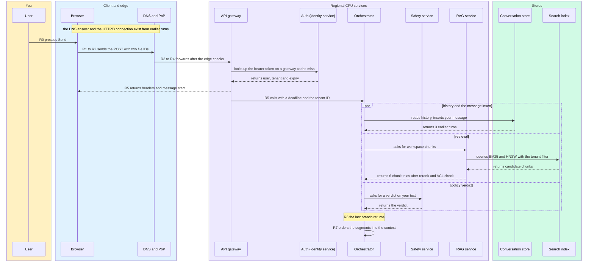
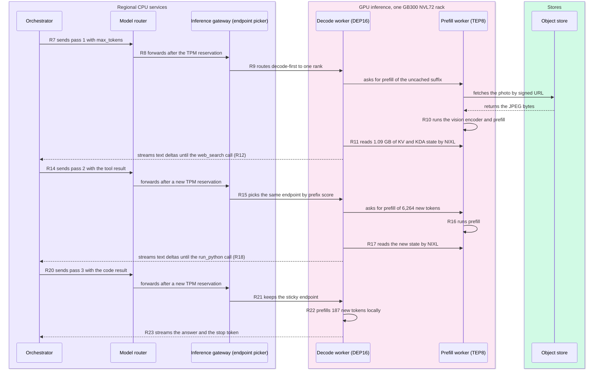
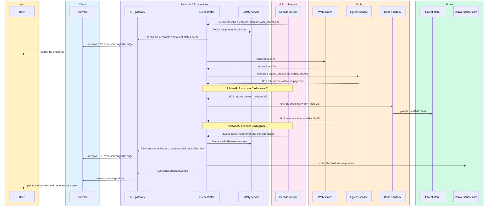
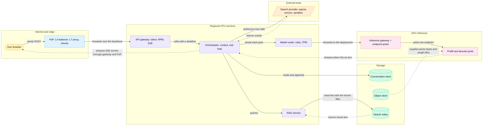
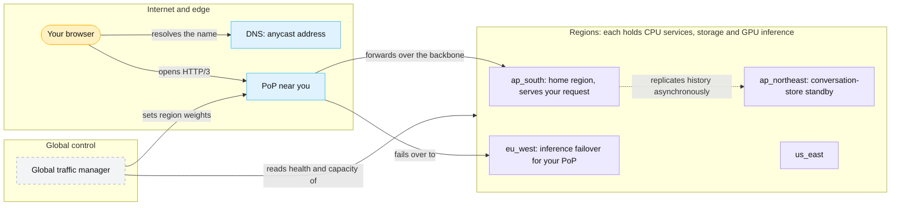
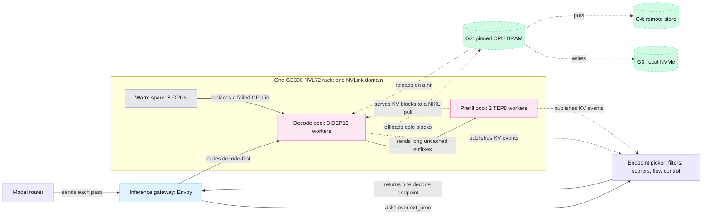
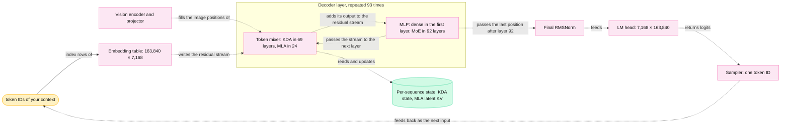
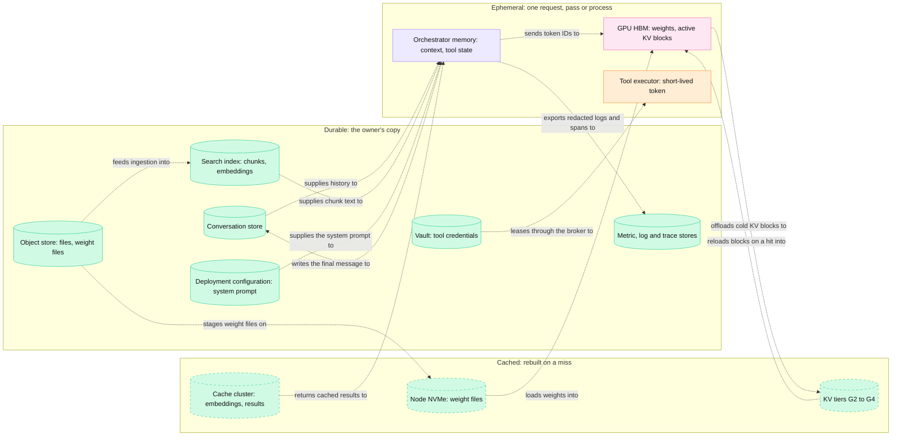

<!-- GENERATED from manuscript/src/part-23-diagram-atlas.md by tools/render_manuscript.py. Edit the source, not this file. -->
# Part 23: Diagram atlas

Four views show the whole reference system: its messages, its layout, its GPU tier and the owners of its data.

Parts 00 to 22 open one component at a time. Each part draws only the boxes that it needs. This part puts the boxes back together. It adds no new mechanism, and every arrow points to the part that opened it. The part has five steps:

1. Every message of your request, in time order (23.1).
2. The five groups of the system, in one region and across the globe (23.2).
3. The GPU tier, from the request router to the streamer and inside one forward pass (23.3).
4. Every store, what it owns, and who writes and reads it (23.4).
5. An index of every diagram in the other parts (23.5).

### How to read the atlas

Every diagram in this part uses one visual language. The colours and shapes are the same as in the earlier parts:

| Colour or shape | Kind of thing |
|---|---|
| amber | you, and your request's data |
| light blue, rounded | the client: your browser |
| blue | the edge and the network |
| violet | CPU services and the decisions they make |
| pink | GPU work and GPU memory |
| green cylinder | a durable store: the owner's copy of the data |
| green cylinder with a dashed outline | a cache: a copy that the system can rebuild |
| orange | tools outside the GPU tier |
| grey | spares, other users' work and control-plane parts |

The arrows follow the rule of part 21.3. A **solid arrow** is control flow: a call, a request or a decision. A **dotted arrow** is data flow: the bytes that the decisions move. In a sequence diagram, a solid arrow is a call, and a dashed arrow carries data back.

Each diagram has at most 12 nodes. Each arrow carries a verb. A legend follows each diagram. At most three sentences follow the legend: the one thing to notice, and one thing left out on purpose.

---

## 23.1 Sequence diagram of the super trace

Three sequence diagrams show every message of your request, from the key press (R0) to `message.done` (R25).

### The participants

The super trace of part 21.1 numbers 26 events, R0 to R25. They cross about a dozen components of this reference system, plus you, your browser and the external tools. The diagrams draw them as eighteen participants. One readable sequence diagram holds about 12 participants, so the trace splits into three diagrams:

1. **Diagram A** runs from the key press to the finished context (R0 to R7).
2. **Diagram B** runs the three inference passes (R7 to R23).
3. **Diagram C** runs the tool loop and the stream back to your screen (R12 to R25).

The table maps each participant to its component in this reference system:

| Participant | Component in this reference system | Diagrams | RA |
|---|---|---|---|
| User | you, at the keyboard and the screen | A, C | RA-07 |
| Browser | the chat page: `fetch()`, the SSE reader and the renderer | A, C | RA-07 |
| DNS and PoP | the DNS answer, cached from earlier turns, and the PoP: L4 balancer, L7 proxy and checks | A | RA-01, RA-04 |
| API gateway | the regional API gateway, tier one of the gateway software: token check, RPM bucket, SSE framing | A, C | RA-09, RA-10, RA-74 |
| Auth (identity service) | the identity service and its session store; the gateway caches its answers | A | RA-09 |
| Orchestrator | the only component that calls models and tools; it also owns the conversation | A, B, C | RA-14 |
| Conversation store | distributed SQL, home region `ap_south` | A, C | RA-17, RA-18 |
| Object store | the S3-class store of your photo, your PDF and the code's chart | B, C | RA-21, RA-63 |
| RAG service | the retrieval service: query embedding, BM25 and HNSW search, RRF, reranking and the ACL check | A | RA-25, RA-26 |
| Search index | BM25 and HNSW in one engine | A | RA-23, RA-24 |
| Model router | tier two of the same gateway software: the rule table and the TPM reservation | B | RA-09, RA-56, RA-73 |
| Inference gateway | Envoy with the llm-d endpoint picker | B | RA-34, RA-37, RA-71 |
| Prefill worker | one TEP8 prefill worker, 8 GB300 GPUs | B | RA-38, RA-55 |
| Decode worker | one DEP16 decode worker; one rank holds your sequence | B, C | RA-38, RA-55 |
| Web search | the external search provider | C | RA-28 |
| Egress service | the service that fetches pages and runs no page code | C | RA-29 |
| Code sandbox | the sandbox manager and a Firecracker microVM from the warm pool | C | RA-30, RA-69 |
| Safety service | the policy classifier on your text, and the output check on each window | A, C | RA-58, RA-75 |

In this reference system, one process owns the conversation and the tool loop: the orchestrator (RA-14). So the diagrams give it one name. A common crawler design renders pages in a headless browser (part 7.3). The egress service of your request does not, because it never runs page code (part 7.4).

### Diagram A: from Send to the context

Legend: amber = you; blue = client and edge; violet = regional CPU services; green = stores. Solid arrows are calls; dashed arrows carry data back. The one thing to notice: the three branches start together, so R6 waits only for the slowest one. The diagram leaves out the memory read on purpose, a fourth branch beside these three (part 5.5).

### Diagram B: the three inference passes

Legend: violet = regional CPU services; pink = GPU workers; green = the object store. Solid arrows are calls and reads; dashed arrows carry data back. The one thing to notice: the decode worker gets every pass and sends only long uncached suffixes to prefill (RA-38). The diagram leaves out the proxy hops of the text stream on purpose (part 15.1).

### Diagram C: the tool loop and the stream

Legend: as in diagram A; pink = the decode worker; orange = tools outside the GPU tier. The one thing to notice: every arrow out of the decode worker ends at the orchestrator. So only the orchestrator calls tools (RA-14). The diagram leaves out the usage events of each pass on purpose (part 16.2).

### What the three diagrams show together

The three diagrams share one time axis. Diagram A takes 222 ms. Diagram B holds almost all of the time, because decode runs one token per step. At the fleet design point, one decode step takes 47.2 ms (part 14.2). Your three passes decode for 81.5 s of the 85.9 s from key press to last pixel. Diagram C adds the two tool steps, 2.9 s in all.

Three patterns repeat across the diagrams:

1. **Fan-out at the orchestrator.** The orchestrator starts reads in parallel and waits for the slowest one (diagram A).
2. **Decode-first routing.** Each pass reaches a decode endpoint first, and the prefill worker serves only long uncached suffixes (diagram B).
3. **One exit for the model's output.** Token IDs leave the GPU only toward the orchestrator, and the orchestrator decides what the client sees (diagram C).

**Meanwhile in the fleet.** At the `ap_south` peak, about 11,741 other requests per second send the same kinds of messages (part 14.8). Your decode rank runs 93 other sequences in each of your steps. In this reference system, other tenants' passes enter the pool's queue between your three passes (RA-41). The PoP in Nairobi forwards streams for many other users on the same backbone.

You can now follow one request through all eighteen participants and name the event at each arrow.

---

## 23.2 Global architecture

Every region holds the same five groups, and a global layer picks the region and protects the history.

### One region: the five groups

Part 00.7 drew the five groups with closed boxes. This diagram opens one level more and marks control flow apart from data flow.

Legend: amber = your browser; blue = edge; violet = CPU services; green cylinder = store; pink = GPU; orange parallelogram = tools. Solid arrows = control flow; dotted arrows = data flow. The one thing to notice: the photo and the weights go from the object store straight to the GPUs. The diagram leaves out the caches, the event log and the control plane on purpose (23.4, part 1.8).

The solid arrows form one chain of decisions. In this reference system, the gateway admits (RA-09), and the orchestrator builds the context (RA-14). The model router picks a model (RA-56), the endpoint picker picks an endpoint (RA-37), and the pools run (RA-38). Each decision reads a few counters and writes a few bytes (part 21.3).

The dotted arrows carry the bulk: chunk text, image bytes, weights, tokens and the stream. In this reference system, files travel by reference (RA-08). The model server reads the photo by signed URL, so its bytes skip the orchestrator (RA-63).

### Across the globe: the PoP, the regions and the standby

Legend: amber = your browser; blue = edge; violet = a region; dashed grey = global control. Solid arrows = control flow; the dotted arrow = data flow. The one thing to notice: inference fails over to `eu_west`, but the history standby sits in `ap_northeast` (RA-79). The diagram leaves out the other PoPs on purpose; every PoP follows the same rules.

Anycast picks the PoP, and the global traffic manager picks the region (RA-01, RA-06). In this reference system, the home region keeps the conversation store with quorum replication across zones (RA-17). It also sends an asynchronous copy to a standby in another region (RA-79). So a region loss costs at most the replication lag of history. Inference moves to the next healthy region at once.

### Every box, opened

Part 00.7 promised that every box opens somewhere. The table lists each box of the two diagrams above, what is inside it, and where it opens:

| Box | What is inside | Opened in | RA |
|---|---|---|---|
| your browser | the click handler, `fetch()`, the SSE reader, the message store, the renderer | 2.1, 15.5 | RA-07 |
| DNS | the browser, OS and resolver caches; the anycast answer; the HTTPS record | 2.3 | RA-01, RA-02 |
| PoP | the L4 consistent-hash balancer, the L7 proxies, TLS, WAF, bot score, coarse rate limit | 2.6 | RA-01, RA-04 |
| global traffic manager | region weights from health, capacity, latency, residency and model availability | 1.1, 2.7 | RA-06, RA-78 |
| API gateway | token check, entitlements, the RPM token bucket, SSE framing | 3.1, 3.2, 15.2 | RA-09, RA-10, RA-74 |
| orchestrator | context construction, the tool loop, policy checks, citation checks, the final write | 3.6, 5.6, 6.2, 7.6 | RA-14, RA-18 |
| RAG service | query embedding, BM25, HNSW, RRF, reranking, the ACL check | 5.2, 5.3 | RA-24, RA-25, RA-26 |
| model router | the rule table, the TPM reservation, fallback | 3.7, 9.1 | RA-56, RA-57, RA-73 |
| conversation store | distributed SQL with a home region, quorum writes and a standby | 3.4, 16.1, 17.4 | RA-17, RA-79 |
| object store | uploads, artifacts and model files | 2.2, 4.4, 1.4 | RA-08, RA-21, RA-61 |
| search index | BM25 postings and the HNSW graph in one engine | 5.2 | RA-23, RA-24 |
| inference gateway + endpoint picker | Envoy, the `InferencePool`, filters, scorers and flow control | 9.1 to 9.4 | RA-34, RA-37, RA-41, RA-71 |
| prefill and decode pools | TEP8 and DEP16 workers, the engine scheduler, KV blocks, NIXL | 11.5, 12.4, 13.7 | RA-38, RA-55 |
| external tools | the search provider, the egress service, the code sandbox | 7.2, 7.4, 8.1 | RA-28, RA-29, RA-30 |

Part 00.7 also left four boxes out on purpose. Each one now has a place:

| Box left out of part 00.7 | Where it sits | Opened in | RA |
|---|---|---|---|
| object store | storage group, shown above | 4.4 | RA-21 |
| caches | a Redis-compatible cache cluster per region, and the cache layers of 16.3 | 16.3, 23.4 | RA-19 |
| event log | a Kafka-class log per region, off the token path | 16.2, 23.4 | RA-20 |
| ingress balancers | the regional L4 and L7 layer behind the backbone | 1.1, 3.1 | RA-01 |

**Meanwhile in the fleet.** At the same instant, all four regions run the same five groups for their own users. The global traffic manager shifts new requests away from any region that fills up (RA-06). The conversation stores of all home regions copy their changes to their standbys, about 10 s behind (RA-79). No request crosses regions unless its region fails or is full.

You can now place every component in one of five groups and mark each arrow as control or data.

---

## 23.3 GPU inference

One pass crosses eight steps in order: request router, scheduler, continuous batch, prefill, KV cache, decode, sampler, streamer.

### From the request router to the streamer

In this section, the **request router** is the first step: the inference gateway plus the endpoint picker. It differs from the model router, which picks the deployment before this step.

```mermaid
flowchart LR
  REQ([one pass of your request]):::yours -->|arrives at| RR[Request router: inference gateway + endpoint picker]:::cpu
  RR -->|picks one endpoint| SCH[Engine scheduler: waiting and running queues]:::cpu
  SCH -->|fills the token budget| CB[Continuous batch: decode tokens + prefill chunks]:::cpu
  CB -->|launches prompt tokens| PF[Prefill: all prompt positions]:::gpu
  CB -->|launches one token per sequence| DC[Decode: one new token]:::gpu
  PF -.->|writes KV and KDA state| KV[(KV cache: blocks in HBM)]:::store
  KV -.->|supplies the cached state| DC
  DC -.->|appends new state| KV
  DC -.->|produces logits| SMP[Sampler on the GPU]:::gpu
  SMP -.->|returns token IDs| SCH
  SMP -.->|copies token IDs| STR[Streamer: detokenizer, SSE chunks]:::cpu
  classDef yours fill:#fff1c2,stroke:#FFC53D,color:#111
  classDef cpu fill:#ede9fe,stroke:#A78BFA,color:#111
  classDef gpu fill:#fce7f3,stroke:#F472B6,color:#111
  classDef store fill:#d1fae5,stroke:#34D399,color:#111
```

Legend: amber = your pass; violet = CPU processes; pink = GPU work; green = state in HBM. Solid arrows = control flow; dotted arrows = data flow. The one thing to notice: the scheduler-to-sampler loop runs once per decode step for the whole batch. The diagram leaves out the split into prefill and decode pools on purpose; the next diagram adds it.

Each node maps to one component of this reference system:

| Step | Component | What it holds or decides | Opened in | RA or source |
|---|---|---|---|---|
| request router | the inference gateway (Envoy) and the endpoint picker | which endpoint gets the pass, from prefix overlap and load | 9.1 to 9.3 | RA-34, RA-37 |
| scheduler | vLLM's engine scheduler in each worker | which sequences run this step, within free KV blocks | 11.6 | RA-35, RA-36 [vllm@v0.31.0:vllm/v1/core/sched/scheduler.py#L630-L873] |
| continuous batch | one step's batch: one token per decode sequence plus prefill chunks | the flattened token rows and their block tables | 11.5 | RA-36 |
| prefill | the forward pass over the prompt positions | KV and KDA state for every prompt token | 10.2, 13.1 | RA-43 |
| KV cache | paged blocks in HBM, with a block table per sequence | your state until the pass ends | 13.2 | RA-39, RA-40 [SRC-098] |
| decode | the forward pass over one new position per sequence | one new token's state, appended | 11.3 | RA-43 |
| sampler | GPU kernels after the LM head | one `int64` token ID per sequence; 8 bytes leave the GPU | 10.12 | RA-44 [vllm@v0.31.0:vllm/v1/worker/gpu/async_utils.py#L137-L140] |
| streamer | the API server's detokenizer and output parsers | text deltas, tool-call hold-back | 10.11, 15.1 | RA-50, RA-74 [SRC-115] |

vLLM's scheduler puts decode tokens and prefill chunks into the same step under one token budget (part 11.6) [vllm@v0.31.0:vllm/v1/core/sched/scheduler.py#L628-L682]. So prefill and decode in the first diagram can be parts of one forward pass. A long prompt still takes several steps, one chunk per step [vllm@v0.31.0:vllm/v1/core/sched/scheduler.py#L1112-L1123].

### The pools, the rack and the KV tiers

In this reference system, `M-frontier` runs prefill and decode in separate pools inside one GB300 NVL72 rack (RA-38, RA-55):

Legend: violet = CPU processes; blue = the proxy; pink = GPU pools; dashed green = KV tiers below HBM; grey = the spare. Solid arrows = control flow; dotted arrows = data flow. The one thing to notice: the endpoint picker scores endpoints from the engines' own KV events, not from request counts. The diagram leaves out the tiers of the other workers on purpose; each has its own G2 and G3.

In this reference system, the rack serves on 64 of its 72 GPUs (RA-55). All KV moves stay inside one NVLink domain (part 12.4, RA-55). The tier names come from NVIDIA Dynamo's KV block manager [SRC-288]. G1 is HBM, G2 pinned CPU DRAM, G3 local NVMe and G4 a remote store. In this reference system, hits in G1, G2 and G3 earn routing credits 1.0, 0.75 and 0.25 (RA-39). The decode worker reads the prefill worker's blocks with NIXL in vLLM's default pull mode [SRC-042] [SRC-291].

### Inside the GPU: one forward pass of `M-frontier`

Legend: amber = your token IDs; pink = GPU computation; green = per-sequence state in HBM. Every arrow carries tensors, so every arrow is data flow. The one thing to notice: only the token mixer touches state that outlives the step. The diagram leaves out the RMSNorms and K3's attention residuals on purpose.

Attention residuals let each layer weight the outputs of all earlier layers, instead of adding them with equal weight [SRC-380]. K3 groups its layers into blocks of 12 [SRC-378] [SRC-380]. vLLM mixes the stored block sums before each attention sub-block and each MLP sub-block [vllm@v0.31.0:vllm/models/kimi_k3/nvidia/model.py#L999-L1061].

The layers follow one fixed pattern from the model's config. Before the last layer, three KDA layers come before each MLA layer. The last layer is MLA too [SRC-378]. Each MoE layer runs 16 of 896 routed experts plus 2 shared experts per token (part 10.8) [SRC-378] [SRC-380]. So each token reaches only a small part of the weights at each layer. On a DEP16 worker, each MoE layer's dispatch and combine cross the NVLink domain (part 12.4, RA-55) [vllm@v0.31.0:docs/serving/expert_parallel_deployment.md#L24-L31].

The per-sequence state explains the shape of the pools. Your sequence holds 449.4 MB of fixed KDA state plus 27,648 B of latent KV per token (part 13.1) [SRC-378] [SRC-384]. That state moves once per pass from prefill to decode, and decode reads it at every step.

**Meanwhile in the fleet.** Your decode rank runs one forward pass for 94 sequences at once (part 14.2). The sequences share each read of the weights, and each one reads only its own state. The counters on the rank at your R11 (RA-53):

- `vllm:num_requests_running`: 94, the fleet design point.
- `vllm:num_requests_waiting`: the sequences that wait for free KV blocks.
- `vllm:kv_cache_usage_perc`: rises by your 1.09 GB of state.
- prefix-cache hits and queries: rise again at each of your later passes.

You can now trace one pass from the request router to the streamer and name the state each layer touches.

---

## 23.4 Data ownership

Each item has one owner, and the system can rebuild every cached copy from a durable store.

### Where each item lives

The table follows the nine items of the data-ownership question. "Durable" means the owner's copy, which survives restarts (durable state, part 21.7). "Cached" means a copy that the system can rebuild from the durable home: soft state in part 21.5. "Ephemeral" means a copy that lives only for one request, pass or process (ephemeral state, part 21.8).

| Item | Durable home | Cached copies | Ephemeral copies | Writer | Readers | RA |
|---|---|---|---|---|---|---|
| weights | weight files in the model registry, in the regional object store | node NVMe caches; HBM of every rank for the life of the replica | none | the release pipeline | GPU processes at start; peer nodes at scale-out | RA-55, RA-61 |
| conversation text | the conversation store in the home region, with a standby in another region | none: no result cache sits in front of the store | the context object in orchestrator memory; the message store in your browser tab | the orchestrator: your message at R6, the answer at R25 | the orchestrator; your browser through the API | RA-17, RA-18, RA-79 |
| files | the object store | the encoder cache of your photo's visual tokens on the prefill GPU | the photo bytes in the prefill worker during the fetch | your browser, by presigned URL; the sandbox manager for artifacts | the parser workers; the prefill worker by signed URL | RA-08, RA-21, RA-63 |
| embeddings | the search index, derived from the files | the embedding cache in the cache cluster, keyed by tenant | the query embedding in the RAG service | the ingestion pipeline | the RAG service | RA-19, RA-23, RA-24 |
| KV cache | none: the system never needs a durable copy | prefix blocks in G1 HBM, then G2 DRAM, G3 NVMe and G4 remote store | the active blocks of each pass on the decode rank | the engine, at prefill and decode | the engine; the decode worker by NIXL | RA-38, RA-39, RA-40 |
| system prompts | the deployment configuration of each release | its token IDs in the tokenizer cache; its KV blocks in the prefix cache, per tenant | its copy in each request's context object | the operators, through a release | the orchestrator | RA-85, RA-40, RA-54 |
| tool credentials | the vault, under a path per user and connection | a short-lived token in the credential broker for its lifetime | the same token in the tool executor for one call | the OAuth flow when you connect an account | the credential broker | RA-31 |
| metrics | the metric store, as time series | none | counters in each process, scraped every 15 s | every service and engine | the autoscaler, the endpoint picker, alerts and dashboards | RA-42, RA-52, RA-53 |
| logs | the log store and the trace store, kept for a fixed retention | none | records in each service before export | each service, after redaction | operators only | RA-52, RA-77 |

Where a provider keeps its system prompt is not public. Two realistic options are a versioned configuration that ships with each release, and a row in a configuration database. Here we use the first, because the system prompt changes once per deployment (part 5.6, RA-85). It rolls out with each release by canary (RA-54, RA-85). In this reference system, a request with tenant content carries the tenant's cache salt (RA-40). So the system prompt's KV blocks repeat once per tenant in the prefix cache.

### How the copies flow

Legend: green cylinder = durable store; dashed green cylinder = cache; violet = CPU process memory; pink = GPU memory; orange = the tool executor. Every arrow copies data, so every arrow uses the dotted style. The one thing to notice: every cache and every ephemeral copy fills from a durable store or another copy. The diagram leaves out the browser's copies and the event log on purpose; the tables cover both.

In this reference system, the loss of any cache loses no data (part 21.7, RA-19, RA-39). The flow shows why. The KV comes back from the history, the visual tokens from the photo, the search results from the queries. Writes into durable stores are few. Your request inserts your message, writes the answer once, and appends its usage events and telemetry (RA-18, RA-20).

### Every store: what it owns, who writes, who reads

| Store | What it owns | Who writes | Who reads | Kind | RA |
|---|---|---|---|---|---|
| conversation store | conversations, messages, settings, quota counters | the orchestrator; the model router for TPM shards | the orchestrator; the model router | durable, quorum in the home region | RA-17, RA-73, RA-79 |
| object store | uploads, sandbox artifacts, model files | your browser by presigned URL; the sandbox manager; the release pipeline | parser workers; prefill workers; GPU nodes at a cold start | durable | RA-08, RA-21, RA-61 |
| search index | chunk text with BM25 postings and HNSW vectors | the ingestion pipeline | the RAG service | durable, derived | RA-22, RA-23, RA-24 |
| memory record store | your memory records and their embeddings | the memory worker; you, in settings | the orchestrator, for your user only | durable | RA-27 |
| cache cluster | embedding cache, query results, search results, entitlements, rate buckets | each service, after a miss | the same services | cached, LRU with TTLs | RA-10, RA-19 |
| event log | usage, audit, analytics and `turn_completed` events | the orchestrator and the model router | the billing aggregator, the memory worker, analytics | durable for 7 days | RA-20, RA-73 |
| KV tiers G1 to G4 | prefix KV blocks, salted per tenant | the engines | the engines | cached, LRU per tier | RA-39, RA-40 |
| node NVMe cache | checkpoint files for the versions a node serves | the node's loader | GPU processes; peer nodes over RDMA | cached | RA-61 |
| vault | connector credentials as leases | the OAuth flow; operators | the credential broker | durable | RA-31 |
| metric, log and trace stores | time series, redacted log records, sampled traces | every service and engine | operators; the autoscaler reads metrics | durable, with retention | RA-52, RA-77, RA-80 |

The retention rules differ by store. In this reference system, application logs stay 30 days, traces 14 days and audit events 400 days (RA-77). A broker token lives 300 s (part 6.4, RA-31). Sandbox files stay 3,600 s after the last call (RA-69).

**Meanwhile in the fleet.** Each region's stores serve all of its tenants at once. The tenant ID sits in every cache key and every index filter (RA-19, RA-26). The cache salt separates the KV blocks (RA-40). Only the weights carry no tenant mark, because every tenant reads the same weights and none writes them. Retention jobs delete expired logs and events in bulk, far from any request path.

You can now name the durable home of each item, every copy of it, and who writes each copy.

---

## 23.5 Index of every diagram in the manuscript

The other parts hold 95 Mermaid diagrams in 25 parts, and the table below lists each one.

### How the index is built

A script reads every rendered part except this one. It finds each Mermaid block and records the section and the heading above it. It also records the diagram type and the "one thing to notice" sentences after the legend. When a part changes, the script runs again and the table follows.

The diagrams split by type:

| Type | Diagrams | Use |
|---|---|---|
| flowchart | 71 | parts and links, and the steps of one mechanism |
| sequence | 12 | who talks to whom, in time order |
| state | 2 | the states of one object and the events between them |
| chart | 10 | numbers against a model input, such as batch size or time of day |

Part 14 has the most diagrams, 10. A flowchart, sequence or state diagram has 7.5 nodes on average. The largest has 12, and the standard allows 12.

### The index

The "Section" column names the section. The "Heading" column names the subsection, when the section has one. The last column quotes the sentence that follows each diagram's legend.

| Part | Section | Heading | Kind | What it shows |
|---|---|---|---|---|
| 00 | 0.7 The reference system at a glance | — | flowchart | CPUs decide everything before the GPU runs, and the answer returns on your open connection. |
| 01 | 1.1 The global layout | From your device to a region | flowchart | Anycast picks the PoP, but the global traffic manager picks the region. |
| 01 | 1.1 The global layout | Inside one region | flowchart | The GPUs talk only to CPU services and the object store, never to the internet. |
| 01 | 1.4 The model deployment lifecycle | The release pipeline, once per model version | flowchart | Every arrow produces a stored artifact, so a later replica reuses the work. |
| 01 | 1.4 The model deployment lifecycle | The replica start, once per replica | flowchart | A replica receives traffic only after its health check passes. |
| 01 | 1.8 Control plane and data plane | — | flowchart | No solid arrow touches the control plane, so a request never waits for it. |
| 01 | 1.9 Service discovery | A custom control plane: the endpoint picker | flowchart | Two chains carry the same Ready bit, to the proxies and to the endpoint picker. |
| 02 | 2.1 Pressing Send | Handing the bytes to the network code | flowchart | One click updates the screen and sends the request, and neither waits for the other. |
| 02 | 2.2 Why uploads happen before Send | The upload flow | sequence | The file bytes go straight to the object store, and no API server touches them. |
| 02 | 2.3 DNS resolution and what is already cached | The resolvers | flowchart | Each layer answers from its cache when it can. So a full lookup from the root is rare. |
| 02 | 2.5 Opening the connection: round trips, reuse and 0-RTT | Path 1: TCP, then TLS 1.3, then an HTTP/2 stream | sequence | The request leaves only on the third flight, after two full round trips. |
| 02 | 2.5 Opening the connection: round trips, reuse and 0-RTT | Path 2: QUIC with TLS 1.3 inside, then an HTTP/3 stream | sequence | QUIC merges the transport and TLS handshakes, so the request leaves after one round trip. |
| 02 | 2.6 The edge: what must pass before the backend | Inside the PoP | flowchart | The checks run from cheapest to most expensive, and a failed check stops the request. |
| 02 | 2.7 Eight kinds of routing, the routing hierarchy and its signals | The routing hierarchy | flowchart | Each level chooses among the children of the level above. Only the last levels know the GPUs' state. |
| 03 | 3.1 The API gateway and regional ingress | The filter chain | flowchart | A rejected request never reaches the orchestrator or the GPUs. |
| 03 | 3.3 Concurrency before the GPU | The three levels of concurrency | flowchart | One request passes all three levels, but it stays at each for a different time. |
| 03 | 3.5 Message persistence | When each write happens | sequence | No write happens while tokens stream, because the orchestrator keeps the partial answer in memory. |
| 03 | 3.6 The request orchestrator | The boundary between code and model | flowchart | Every arrow out of the model enters code that checks it. No arrow goes from the model to a tool. |
| 03 | 3.8 Safety checks before inference | What runs in sequence and what runs in parallel | flowchart | Four branches start together, so the slowest branch sets the wait, not the sum. |
| 04 | 4.3 The image path | The steps | flowchart | Image and text meet only in the input sequence, as vectors of equal width. |
| 04 | 4.4 The PDF path | Intake at upload time | flowchart | The bytes skip the application servers, so every check runs on the stored object. |
| 04 | 4.4 The PDF path | Parse, OCR, layout, chunks and index | flowchart | OCR runs only on the scanned pages, and both branches rejoin before layout analysis. |
| 05 | 5.1 RAG ingestion: chunks, embeddings and the index | Ingestion time and query time | flowchart | The cache sits in front of the embedding model. So an unchanged chunk never reaches the GPU again. |
| 05 | 5.2 Vector search: exact similarity, HNSW and IVFFlat | HNSW: a layered neighbour graph | flowchart | Each upper layer only finds a good starting node for the layer below. |
| 05 | 5.3 Hybrid retrieval: BM25, fusion and reranking | What reranking costs | flowchart | The expensive model sees only the candidates that two cheap retrievers agree on. |
| 05 | 5.5 Long-term user memory | The read path | flowchart | Writes happen after a turn and reads during the next one. So memory adds no model call to your TTFT. |
| 05 | 5.6 Context construction: the context budget of your request | What these numbers change | flowchart | Each pass only appends, so each pass reuses the previous prompt. |
| 06 | 6.2 The 13-step tool loop | The 13 steps for pass 1 of your request | flowchart | Every path ends in the context, including every failure. So the model sees it in the next pass. |
| 06 | 6.4 Secrets stay outside the model | The design | flowchart | The token moves only between the broker, the executor and the service. |
| 06 | 6.5 The Model Context Protocol | The boundary | flowchart | MCP is only the protocol between the executor and the remote server. |
| 07 | 7.1 Deciding to search | From the call to the second pass | sequence | The model only writes the call and reads the result. All network work happens outside the model. |
| 07 | 7.3 Option B: an own index: crawling, rendering, indexing, ranking | The crawl loop | flowchart | The parser feeds new URLs back into the frontier. So the crawl is a loop. |
| 07 | 7.4 Live page fetching and SSRF defense | The fetch path | flowchart | A redirect goes back to the start, so every hop meets every rule. |
| 07 | 7.6 Citations and provenance | The chain | flowchart | The URL goes from the store to the client, never through the model's output. |
| 08 | 8.1 The code execution tool: isolation layers, limits, warm pools, results and artifacts | From tool call to virtual machine | sequence | The VM talks only to the sandbox manager. Only the manager talks to the object store. |
| 08 | 8.1 The code execution tool: isolation layers, limits, warm pools, results and artifacts | Files out: from `/mnt/output` to a link | flowchart | The model gets a file ID, never the bytes or a URL. |
| 08 | 8.2 The computer-use and browser tool | The observe-act loop | flowchart | Every action passes the orchestrator's policy before the browser sees it. |
| 09 | 9.1 The inference hierarchy | The levels | flowchart | Envoy never chooses the endpoint itself. It asks the endpoint picker and connects to the returned address. |
| 10 | 10.2 The pre-norm decoder layer | The block in two lines | flowchart | Both sub-blocks write into the residual stream by addition. Only attention touches state that outlives the step. |
| 10 | 10.7 FlashAttention: same math, less HBM traffic | Bytes moved for one real layer | flowchart | Scores live only in registers, one block at a time. |
| 10 | 10.12 Where sampling runs, seeds, and batch-dependent nondeterminism | GPU, CPU or mixed sampling | flowchart | The full logits never leave the GPU; only 8 bytes per sequence do. |
| 11 | 11.1 GPU hardware and the memory hierarchy | The memory levels | flowchart | Every Tensor Core operand travels up this chain. Each level is smaller and faster than the one below it. |
| 11 | 11.5 Continuous batching and sequence isolation inside one batch | Sequence isolation inside one batch | flowchart | Isolation comes from indexing, not from separate tensors, so the batch keeps its shared-weight speed. |
| 11 | 11.9 The output token loop and stop conditions | The stop conditions and where each one runs | state | Every exit frees the request's KV blocks [vllm@v0.31.0:vllm/v1/core/sched/scheduler.py#L2649-L2701] in the same scheduler step. The next request can use them at once. |
| 12 | 12.1 Tensor parallelism and its collectives | Tensor parallelism in `M-dense` | flowchart | Each layer needs exactly two AllReduces, and both carry the full hidden state. |
| 12 | 12.2 Pipeline parallelism | Stages and activation transfer | flowchart | One boundary carries only `[tokens, hidden]`, once per chunk, instead of two AllReduces per layer. |
| 12 | 12.4 Expert parallelism and MoE, including `M-frontier`'s deployment | The MoE block | flowchart | The router decides the network traffic, token by token, at every MoE layer. |
| 12 | 12.4 Expert parallelism and MoE, including `M-frontier`'s deployment | Experts per GPU | flowchart | 64 of 72 GPUs serve, and all their traffic stays inside one NVLink domain. |
| 12 | 12.6 The multi-GPU node | What is inside the node | flowchart | GPU-to-GPU traffic never touches PCIe [SRC-006]. With GPUDirect RDMA on, GPU-to-NIC traffic never touches the CPU [SRC-028]. |
| 13 | 13.1 What the KV cache is, and how big it is | What is reused and what is computed | flowchart | The layer projects only the new token and reads everything older. |
| 13 | 13.2 Paged KV cache and PagedAttention | Your request's blocks | flowchart | Logical order and physical order are unrelated, and one physical block can serve two requests. |
| 13 | 13.3 Prefix caching | How vLLM finds the shared blocks | flowchart | The chain divides at the first different block. Nothing after that point can match. |
| 13 | 13.6 The multi-tier KV cache | The tiers | flowchart | Every hit, from any tier, must land in HBM before attention can read it. |
| 13 | 13.7 Disaggregated prefill and decode | The design | sequence | The decode worker pulls the KV blocks, and decode starts only after they arrive. |
| 13 | 13.8 Preemption under KV pressure | — | flowchart | Preemption frees blocks for running sequences and pauses admission for that step. |
| 14 | 14.1 Why billions of users do not need billions of model copies | One process does not serve one user | flowchart | Only the in-flight generations reach the GPUs, and users never do. |
| 14 | 14.3 The arrival-rate capacity model | `M-dense`: one pool for both terms | flowchart | One arrival rate feeds two separate formulas, and the larger rack count wins. |
| 14 | 14.5 The two central curves | M-dense decode per H100 GPU (model) | chart | Up to the KV limit of 342, throughput per GPU grows 102 times. Over the same range, speed per sequence drops only 3.4 times. The x-axis is not linear, and batches above 342 do not fit a BF16 KV pool. The curve rises because each step reads the weights once for the whole batch (part 11.4). It saturates because the KV reads and the compute grow with the batch, while the weight read does not. Beyond the KV limit, throughput grows only 9% more by batch 1,024. The speed per sequence falls to 10.9 tokens/s, far below the TPOT target. |
| 14 | 14.5 The two central curves | M-dense speed per sequence (model) | chart | Up to the KV limit of 342, throughput per GPU grows 102 times. Over the same range, speed per sequence drops only 3.4 times. The x-axis is not linear, and batches above 342 do not fit a BF16 KV pool. The curve rises because each step reads the weights once for the whole batch (part 11.4). It saturates because the KV reads and the compute grow with the batch, while the weight read does not. Beyond the KV limit, throughput grows only 9% more by batch 1,024. The speed per sequence falls to 10.9 tokens/s, far below the TPOT target. |
| 14 | 14.5 The two central curves | One M-dense replica: cost per million output tokens | chart | Cost falls and then flattens, while p99 TTFT stays flat and then climbs. |
| 14 | 14.5 The two central curves | One M-dense replica: p99 TTFT | chart | Cost falls and then flattens, while p99 TTFT stays flat and then climbs. |
| 14 | 14.7 The thundering herd | A breaking event | flowchart | Jitter shapes the arrivals before the edge, and flow control decides what the GPUs see. |
| 14 | 14.8 The daily demand curve and background work | Hypothetical demand by region (thousand requests/s) | chart | The regional peaks are steep, and the global sum is much flatter. |
| 14 | 14.8 The daily demand curve and background work | Hypothetical global demand (thousand requests/s) | chart | The regional peaks are steep, and the global sum is much flatter. |
| 14 | 14.8 The daily demand curve and background work | M-frontier racks in use, all regions (hypothetical) | chart | Background work rises when interactive load falls. |
| 15 | 15.1 The stream path and its transports | Why SSE, and how it sits on HTTP/2 and HTTP/3 | flowchart | The framing changes four times, but no hop waits for more than one token. |
| 15 | 15.4 Backpressure, for one stream and for the whole system | What a slow client changes | flowchart | A full buffer stops reading upstream instead of growing. |
| 15 | 15.5 The browser: from NIC to pixels | The path, step by step | flowchart | Events update the state at network speed, but the DOM changes only once per frame. |
| 16 | 16.2 The event log | The producer path, and why the token path never waits | flowchart | No arrow returns from a consumer to a producer. So no consumer can slow the request. |
| 17 | 17.2 Cancellation, end to end | The chain | sequence | The cancel follows the request's path, and GPU work ends only at the scheduler. |
| 17 | 17.9 Circuit breakers | Three states | state | Only real trial calls lead back to closed, never a timer alone. |
| 18 | 18.1 The threat model | Trust boundaries along your request's path | flowchart | Untrusted text enters at the browser, the internet and the sandbox output. All three meet at the orchestrator. |
| 18 | 18.3 Safety during output streaming | The output check on your answer | sequence | Decode never waits for the classifier. So the check delays only the release. |
| 18 | 18.5 Data residency | Cross-region fallback for a residency-bound tenant | flowchart | The residency filter runs before distance, so it can leave an empty list. |
| 19 | 19.1 Distributed tracing of the reference request | The span tree of your request | flowchart | One root span holds the whole request, and the orchestrator holds all three passes. |
| 19 | 19.4 Autoscaling, and the cold-start trace | KEDA on EPP and engine metrics | flowchart | The pools scale from the same metrics that the router reads, not from CPU use. |
| 19 | 19.4 Autoscaling, and the cold-start trace | The cold-start trace | flowchart | Four of the nine boxes run on the GPU and hold most of the time. |
| 19 | 19.6 Finding the bottleneck | The diagnostic walk | flowchart | The first question splits the search space in half. |
| 20 | 20.1 Image generation | Where the request branches | flowchart | The image bytes never travel through the token stream; only a URL does. |
| 20 | 20.2 Audio and voice | The pipeline, stage by stage | flowchart | Every arrow carries a stream of small frames, and barge-in runs against the flow. |
| 20 | 20.3 Long-running agents and deep research | Task checkpoints, retries and resumption | flowchart | The browser reaches the task only through the task API and the event log. |
| 21 | 21.1 One request end to end: events R0 to R25 | The sequence diagrams | sequence | Three reads and a verdict run in parallel. The gateway picks the decode worker first, and that worker sends the long suffix to a prefill worker. |
| 21 | 21.1 One request end to end: events R0 to R25 | The sequence diagrams | sequence | Every arrow from the decode worker to a CPU service goes to the orchestrator. Only the orchestrator calls tools and talks to the client (RA-14). |
| 21 | 21.3 Control flow versus data flow | The bytes | flowchart | The decisions pass through CPU services. The large bytes move between stores and GPUs, around the decision makers. |
| 22 | 22.4 Bandwidth orders of magnitude | Bytes of one event, log10 (illustrative stream rate) | chart | The `M-dense` KV transfer is about 5.4 × 10⁵ times the stream of a whole answer. |
| 22 | 22.5 TTFT decomposition and the latency budget | The eight terms | flowchart | The retrieval pool, the queue and the prefill worker hold almost all of the time. The decode worker adds the KV pull and one step. |
| 22 | 22.8 The two paper simulations: continuous batching and the overload burst | Queue depth (requests waiting) | chart | The green queue stops growing soon after the spare joins. The other two grow until new serving units arrive. |
| 22 | 22.8 The two paper simulations: continuous batching and the overload burst | p99 TTFT (s) | chart | Autoscaling changes the curve only late in the burst. The spare levels it soon after the decision. |
| 24 | 24.1 The miniature stack and its five evolution stages | The sixteen components | flowchart | Only `handle_chat` talks to the endpoint picker and the tools (RA-14). |
| 24 | 24.2 The orchestration loop | The run trace | sequence | No store write happens while tokens stream. |
| 24 | 24.5 RAG | Why the ACL check runs twice | flowchart | The permission filter appears inside both searches and again after fusion. |
| 24 | 24.6 Cache-aware routing | Four policies, one request | flowchart | The endpoint picker hashes the prompt as the engine does. So a match means a hit. |
| 25 | 25.1 Sixteen misconceptions, corrected | Where the work actually runs | flowchart | Every arrow out of the model carries only tokens. Every action on the world starts at the orchestrator. |
| 25 | 25.2 The infrastructure engineer's questionnaire | From answers to a GPU count | flowchart | Decode GPUs follow memory per sequence, while prefill GPUs follow uncached tokens. |
| 25 | 25.3 Why latency stays low | The decisions, with what each saves | flowchart | Each node names the decision that removes its wait. The stream returns on the connections that carried the request. |

To find every diagram of one component, scan the "What it shows" column for its name. The "Section" column then gives the part that opens it.

You can now find the diagram for any component or mechanism of the reference system, and say what it shows.

---

## What Part 23 established

Every component now appears in the atlas with its group, its messages, its GPU path and its data. Each one points back to the part that opens it.
