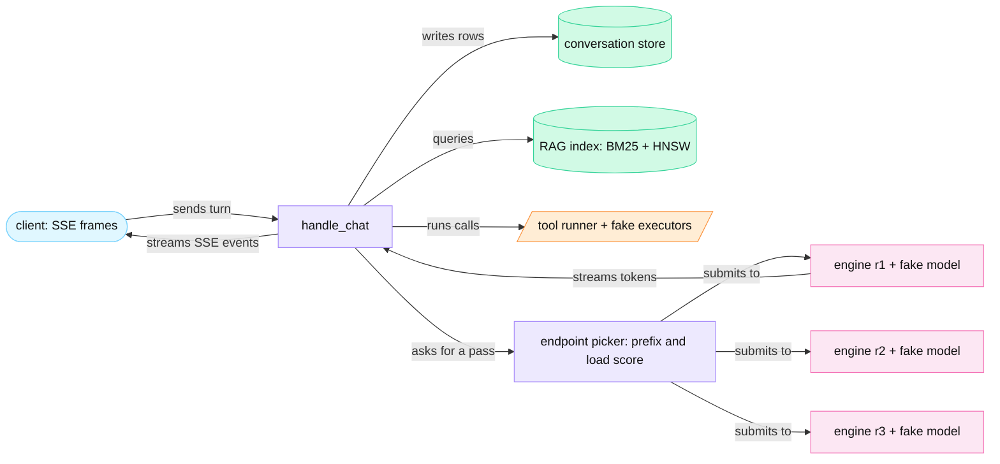
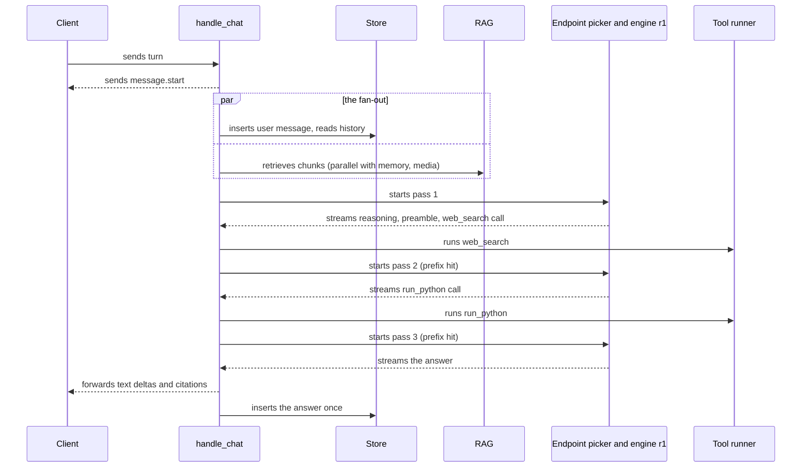
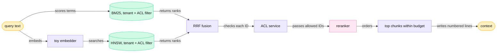
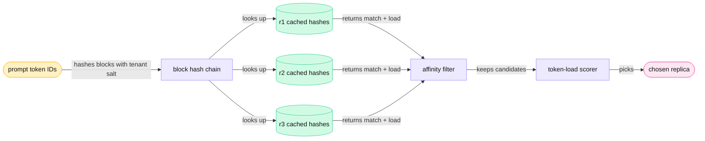

<!-- GENERATED from manuscript/src/part-24-build-a-miniature.md by tools/render_manuscript.py. Edit the source, not this file. -->
# Part 24: Build a miniature version

A miniature of the reference system runs every layer of the path on one CPU core, around a fake model. It has an async orchestrator, a scheduler loop per replica, a tool loop, retrieval and a cache-aware endpoint picker.

The earlier parts explain each component at production scale. This part builds each one small, in runnable Python, and sends your request through all of them. The code lives in `sim/mini/`. It uses only the Python standard library and numpy. It downloads nothing and opens no network connection.

Three stand-ins keep the miniature small. The code and every output file label each one:

1. **The fake model.** A deterministic script takes the place of the language model. At each inference pass, it reads the context and returns fixed text: reasoning, visible text and tool calls. It has no weights, and it computes nothing that a model computes. The engine still emits that text one token per scheduler iteration. So batching, the KV cache and streaming behave as with a real model.
2. **The toy tokenizer.** It makes one token from each word, number or punctuation mark. The token ID comes from a CRC-32 checksum of the token text. So the same text always gives the same IDs. The block hashes of two passes then match wherever their text matches.
3. **The virtual clock.** The code is real asyncio code: coroutines, tasks, task groups, timeouts and cancellation. Only the clock is not real.

**How the virtual clock works.** asyncio's event loop reads the time from `loop.time()`, and `call_at` schedules callbacks on that same clock [SRC-821]. When no task can run, a real loop waits in `select()` until its next timer. The miniature's loop replaces both pieces. Its `time()` returns a counter, and its `select(timeout)` adds `timeout` to the counter at once instead of a wait.

So `await asyncio.sleep(0.0099)` costs no wall time. Events still happen in the order of a real loop with the same durations. Every run therefore gives the same trace. The whole reference run of 24.2 takes well under one second of wall time.

**Where the durations come from.** The miniature invents no duration. Each model step costs the time of the roofline model of part 11.4 for `M-dense` on `H-teach`. Short service calls take the hypothetical span times of part 19.1, for example 2 ms for the token check.

The user-message insert and the final message write each take the hypothetical commit time of part 21.4, 2 ms. The web search takes the tool-step median of part 7.2, 1,605.3 ms. The sandbox call takes the warm-pool time of part 8.1, 1,305 ms.

This part has six steps:

1. The components and the five stages of growth (24.1).
2. The orchestration loop, with a run trace of your request (24.2).
3. The continuous-batching scheduler (24.3).
4. The tool loop (24.4).
5. Retrieval (24.5).
6. Cache-aware routing (24.6).

---

## 24.1 The miniature stack and its five evolution stages

A chat system needs sixteen kinds of component, and the miniature replaces each one with a small stand-in. Each stand-in keeps the interface of the real component.

### The sixteen components

Each row gives the task of one component, its stand-in, and the part that opens the real version.

| Component | Responsibility | Stand-in in the miniature | Real version |
|---|---|---|---|
| React client | sends the chat `POST` with `fetch` and reads the SSE event stream from its body (RA-07) [SRC-153] [SRC-146]; renders Markdown as deltas arrive | `Client`: keeps every SSE frame with its time; can disconnect after a set number of text tokens | part 15 |
| Nginx or Envoy | terminates TLS, enforces size and time limits, forwards the request; must not buffer an SSE response (RA-47) | none: the client calls `handle_chat` directly | parts 2.6, 3.1 |
| FastAPI or Go API | verifies the bearer token, runs one orchestrator coroutine per turn | `handle_chat` in `orchestrator.py` | parts 3.1, 3.6 |
| PostgreSQL | holds conversations, messages and quotas; writes the user message at the start of the turn and the answer once (RA-18) | `Services.rows`: one list of message rows | parts 3.4, 3.5 |
| Redis | holds rate-limit token buckets and short-lived caches with TTLs (RA-10, RA-19) | one per-user tool-call bucket inside `ToolRunner` | parts 3.2, 16.3 |
| Object storage | holds uploads and tool artifacts; services pass file IDs and signed URLs, not bytes (RA-08, RA-63) | `Services.files`: file metadata and a signed-URL string | part 4.1 |
| pgvector or Qdrant | stores chunk vectors with tenant and ACL metadata (RA-26); answers filtered nearest-neighbour queries [SRC-230] [SRC-244] | `rag.Index`: BM25 and a toy HNSW graph over the part 5.2 corpus | parts 5.2–5.4 |
| Embedding model | turns a query or a chunk into a vector | `toy_embed`: the illustrative 8-dimensional topic vector of part 5.2 | part 5.1 |
| vLLM or SGLang | runs continuous batching over a paged, prefix-cached KV store; streams tokens [vllm@v0.31.0:vllm/v1/core/sched/scheduler.py#L564-L573] | `engine.Engine` | parts 11, 13 |
| GPUs | run each model step | the roofline step time of `M-dense` on `H-teach` | part 11.4 |
| An endpoint picker | picks a replica for each inference pass from cache and load signals | `router.LiveRouter` | part 9.3 |
| A web search API | returns ranked results and page text for each query | `FakeWebSearch`: the three competitor pages of the story | part 7 |
| A sandbox | runs model-written code in isolation | `FakeSandbox`: returns the part 6.2 result for the story's code; it runs no code | part 8 |
| SSE | frames each event as an `event:` line, a `data:` line and a blank line [SRC-146] | `toytext.sse` | part 15.2 |
| OpenTelemetry | records spans with a parent, a start, an end and attributes [SRC-196] (RA-52) | `Tracer` | part 19.1 |
| Prometheus and Grafana | scrape counters and histograms [SRC-199] and plot them | `Engine.metrics()` with vLLM's metric names (RA-53) | part 19.2 |

The engine's counters use vLLM's exact metric names: `vllm:num_requests_running`, `vllm:num_requests_waiting`, `vllm:kv_cache_usage_perc`, `vllm:prefix_cache_queries`, `vllm:prefix_cache_hits` and `vllm:num_preemptions` [vllm@v0.31.0:vllm/v1/metrics/loggers.py#L502-L694].



Legend: light blue = client; violet = CPU code; green cylinders = stores; orange = tools; pink = engine replicas. The one thing to notice: only `handle_chat` talks to the endpoint picker and the tools (RA-14). The diagram leaves out the edge proxy on purpose, because the miniature has none.

### The five evolution stages

Each stage keeps the interfaces of the stage before it. `handle_chat` always sends a pass to the same interface: the model router, then the endpoint picker. Only what sits behind that interface changes.

| Stage | What it adds | The limit it removes | In the miniature | Real version |
|---|---|---|---|---|
| 1. One machine | one API process, one engine on one 8-GPU node, the database and the cache on the same host | — | runs: `Stack(replicas=1)` | parts 3, 11 |
| 2. Several GPU replicas | an endpoint picker in front of several engine replicas; placement by cached prefix and load | the step budget and the KV pool of one node | runs: `Stack(replicas=3, policy="llmd")` | part 9 |
| 3. Kubernetes | Deployments, Services and EndpointSlices, readiness probes, an `InferencePool` with an endpoint picker, autoscaling on queue and KV metrics (RA-34, RA-42, RA-51) | manual placement, restarts and scaling | not run | parts 1.8, 1.9, 9.1, 19.4 |
| 4. Multi-region | global traffic management, a home region per user, replicated stores, region failover (RA-05, RA-06, RA-17, RA-79) | the capacity and the failure domain of one region | not run | parts 2.7, 2.8, 17.4 |
| 5. Frontier-scale distributed inference | tensor and expert parallelism, separate prefill and decode pools, KV transfer over NVLink and RDMA (RA-38, RA-55) | one model copy per node; prefill and decode in one batch | not run | parts 12, 13.7 |

Stages 3 to 5 add machines and control loops. They add no new step to the path of one request. So the miniature's `handle_chat`, scheduler loop, tool loop, retrieval and endpoint picker stay valid at every stage.

### What stage 2 changes, measured

The miniature runs your reduced request (24.2) twice: on one replica, and on three replicas behind the endpoint picker. Both runs carry the same seeded background load from other tenants. On three replicas, the arrival rates are 6.0, 3.0, 1.5 requests per second on r1, r2 and r3 (illustrative). On one replica, that replica gets the sum.

| | Stage 1: one replica | Stage 2: three replicas, llm-d policy |
|---|---|---|
| replica per pass | r1 / r1 / r1 | r1 / r1 / r1 |
| cached prompt tokens, passes 1 / 2 / 3 | 0 / 656 / 0 | 0 / 992 / 1,456 |
| time to the first engine token of each pass (ms) | 40.7 / 40.7 / 85.4 | 45.1 / 16.0 / 12.8 |
| prefix-cache evictions on the replica of your request | 3,437 | 1,231 |
| first answer text at the client | 7,621 ms | 7,333 ms |
| turn complete | 9,060 ms | 8,678 ms |

One replica holds one third of the KV blocks of three replicas and carries all the load. Other requests take free blocks so fast that the engine evicts your request's cached blocks during each tool wait. Pass 2 still finds 656 of its 1,186 prompt tokens. Pass 3 finds none, because the first block of its chain is gone. A hit must start at block 0 (part 13.3) [vllm@v0.31.0:vllm/v1/core/kv_cache_manager.py#L264-L321].

On three replicas, the free queue of r1 turns over more slowly. So pass 2 reuses 992 tokens and pass 3 reuses 1,456. Section 24.6 compares the routing policies.

**Meanwhile in the fleet.** During the stage-2 run, 117 requests from other tenants arrive at the three replicas. Each one is a prefill and then a decode in the same scheduler loops as your passes. None of them shares a block with your request, because each tenant has its own cache salt (RA-40).

You can now name the sixteen components, give each one's task, and say what each stage adds.

---

## 24.2 The orchestration loop

`handle_chat` is one coroutine per turn that loops over inference passes and tool calls. A client disconnect cancels it, and the cancellation reaches the engine.

### The pseudocode

```python
async def handle_chat(request):
    deadline = now() + TOP_LEVEL_DEADLINE                                # RA-11
    user = await auth.verify(request.token)                              # 1 auth
    client.send("message.start")
    try:
        async with TaskGroup() as tg:                                    # 2-4 run in parallel
            tg.create_task(store.insert_user_message(request))           #   durable before inference (RA-18)
            history = tg.create_task(store.history(request.conversation_id))      # 2 context fetch
            memory  = tg.create_task(memory_store.read(user))
            images  = tg.create_task(media.preprocess(request.file_ids))          # 3 multimodal
            chunks  = tg.create_task(rag.retrieve(query_of(request), user))       # 4 RAG
        ctx = build_context(SYSTEM_PROMPT, history, memory, chunks, images, request.text)
        deployment = route_model(ctx)                                    # 5 model routing (rule table)
        status, reason = "complete", None
        for pass_no in range(1, MAX_TOOL_PASSES + 2):
            if pass_no > MAX_TOOL_PASSES:
                ctx.append(NO_TOOLS_NOTICE)                              #   the loop limit
            stream = await inference.infer(deployment, ctx)              # 6 inference stream
            try:
                async with timeout_at(child_deadline(PASS_CAP, FINAL_WRITE_RESERVE)):
                    text, calls = await relay(stream, client)            # 9 streaming
            except TimeoutError:                                         #   the deadline ends the turn
                status, reason = "interrupted", "deadline"               #   (RA-59)
                break
            if not calls:
                break
            results = await run_tool_calls(calls, user, deadline)        # 7 tool calls (24.4)
            ctx.append(assistant_message(text, calls), results)          # 8 re-inference in the next pass
        await store.insert_assistant_message(all_text, status, reason)   # 10 persistence
        client.send("message.done")
    except CancelledError:                                               # 11 cancellation
        await store.insert_assistant_message(partial_text, "interrupted")
        raise
```

The eleven steps of the turn handler appear as numbered comments. The runnable version is `handle_chat` in `sim/mini/orchestrator.py`. It has the same structure line for line, plus spans, counters and SSE events.

### Line by line: the runnable code and the real version

| # | Step | What the miniature does | Real version |
|---|---|---|---|
| 1 | auth | `Services.verify` maps the bearer token to the user, the tenant and the ACL principals (RA-26) | API gateway (RA-09), part 3.4 |
| 2 | context fetch | reads 1 earlier turn from the conversation store and 2 memory records | parts 3.4, 5.5 |
| 3 | multimodal preprocessing | reads the photo's metadata and computes its visual tokens with the `M-vision` resize rule; the bytes stay in the object store (RA-63) | part 4.3 |
| 4 | RAG | runs the pipeline of 24.5 and returns numbered chunks | part 5 |
| 5 | model routing | the model router walks a rule table: image input, context length, the user's choice (RA-56) | part 3.7 |
| 6 | inference stream | the endpoint picker picks a replica, and the engine streams tokens on an `asyncio.Queue` | parts 9, 11 |
| 7 | tool calls | `ToolRunner.run`: check, run, normalize (24.4) | part 6.2 |
| 8 | re-inference | appends the re-rendered assistant message and the tool results, then starts the next pass | part 6.2 |
| 9 | streaming | `relay` forwards text deltas, keeps reasoning on the server (RA-72), holds back call tokens (RA-50) | part 15 |
| 10 | persistence | one user row, written in parallel with steps 2 to 4 (RA-18); one assistant row at the end; one usage event per pass that nobody awaits (RA-20, RA-73) | parts 3.5, 16, 21 |
| 11 | cancellation | a disconnect cancels the task; the stream's `finally` block aborts the engine sequence; one partial row with status `interrupted` (RA-59, RA-74) | part 17.2 |

### Why the loop is truly asynchronous

While a task awaits a result, for example from I/O, the event loop runs other tasks [SRC-820]. While one turn waits for a search, the same process runs other turns (part 3.3). Three asyncio features carry the rest of the design:

1. **Task groups.** The user-message insert and the four fetches of steps 2 to 4 start at the same instant (RA-18). If one of them fails, the task group cancels the others [SRC-820].
2. **Timeouts.** `asyncio.timeout` cancels the current task when its deadline passes and raises `TimeoutError` outside the block [SRC-820]. The orchestrator turns that error into a tool result, or it ends the turn (RA-11). A turn that ends this way is stored as `interrupted` with reason `deadline` (RA-59).
3. **Cancellation.** `Task.cancel()` throws `CancelledError` into the coroutine on the next cycle of the event loop [SRC-820]. `handle_chat` catches it, writes the partial answer once and raises it again.

The task group shortens the wait before inference. The insert and the four fetches take 2, 6, 20, 5 and 180.82 ms. In sequence they would take 213.82 ms. Together they take the longest one, 180.82 ms.

### Deadlines

Every wait has a child deadline. A child deadline is the earlier of two times (RA-11). One is now plus the call's cap. The other is the parent deadline minus a reserve, which keeps time for the final write. The caps are hypothetical:

| Wait | Cap | Source of the cap |
|---|---|---|
| the whole turn | 120 s | `hypothetical.slo` |
| history read | 1.0 s | part 17.1 |
| memory read | 0.5 s | part 17.1 |
| retrieval | 3.0 s | part 17.1 |
| an inference pass that may call tools | 40 s | part 17.1 |
| the final inference pass | 60 s | part 17.1 |
| one `web_search` call | 20 s | part 6.2 |
| one `run_python` call | 35 s | part 6.2 |
| reserve for the final write | 2 s | part 17.1 |

In this reference system, the tool loop has a second bound (RA-14). After 8 tool passes (hypothetical), the orchestrator adds a notice that forbids tool calls (part 6.2). The next pass must answer. The notice comes after the history, so the cached prefix stays valid.

### Your request, reduced

The miniature runs a reduced copy of your request. The question is the same, and the story values are the same. The sizes are smaller, so every table fits on a page:

| Item | The reference request | The reduced request in the miniature |
|---|---|---|
| earlier turns in the context | 3 | 1 (illustrative) |
| workspace | 4,200 documents | the 12-chunk toy corpus of part 5.2 |
| chunks in the context | 6 | 4 |
| the photo | 4032 × 3024 pixels | 448 × 336 pixels, 192 visual tokens |
| prompt tokens, passes 1 / 2 / 3 | 23,322 / 29,816 / 30,395 | 906 / 1,186 / 1,593 (toy tokens) |
| reasoning tokens, passes 1 / 2 / 3 | 300 / 200 / 400 | 24 / 28 / 19 |
| visible answer tokens | 450 | 130 |

The photo's 192 tokens come from the resize rule of part 4.3. The rule cuts 768 patches of 14 × 14 pixels. It merges them 2 × 2 into a 12 × 16 grid [SRC-378] [SRC-384].

The prompt of pass 1 has 906 toy tokens:

| Part of the prompt | Tokens |
|---|---|
| system prompt | 38 |
| tool schemas (`web_search`, `run_python`) | 430 |
| the earlier turn | 34 |
| memory records | 13 |
| workspace chunks with source IDs | 138 |
| the photo | 192 |
| the question | 51 |
| role, end, image and label tokens | 10 |
| total | 906 |

### The run trace

The trace starts when `handle_chat` starts (t = 0). It runs on stage 2: three replicas with the llm-d policy, under background load.

| t (ms) | Event | Component |
|---|---|---|
| 2.0 | the token check passes; `message.start` goes to the client; the fan-out starts | auth, stream |
| 4.0 | the user message is durable | store |
| 7.0 | the photo becomes 192 visual tokens | media |
| 8.0 | the earlier turn arrives | store |
| 22.0 | the memory records arrive | memory |
| 182.8 | 4 chunks arrive with source IDs 1 to 4 | RAG |
| 182.8 | pass 1 (906 tokens) goes to r1 | endpoint picker |
| 227.9 | first engine token; `reasoning.status` goes to the client | engine |
| 498.0 | first visible text: the preamble | stream |
| 1,257.7 | the `web_search` call ends the pass | tool-call parser |
| 1,259.7 to 2,865.0 | the fake web search runs | tool runner |
| 2,865.0 | pass 2 goes to r1; 992 of 1,186 tokens hit the prefix cache | endpoint picker, engine |
| 5,786.1 | the `run_python` call ends the pass | tool-call parser |
| 5,788.1 to 7,093.1 | the fake sandbox returns the margins and the chart's file ID | tool runner |
| 7,093.1 | pass 3 goes to r1; 1,456 of 1,593 tokens hit | endpoint picker, engine |
| 7,332.8 | first token of the answer at the client | stream |
| 8,676.3 | the stop token ends the pass; 5 `citation` events follow | engine, orchestrator |
| 8,678.3 | the answer is durable; `message.done` goes to the client | store, stream |

The turn spends 183 ms before the first pass, 5,579 ms in three inference passes and 2,914 ms in tools. The orchestrator's own work takes no measurable time here, because the miniature charges time only for waits.

The first visible text comes 270 ms after the first engine token. The model writes 24 reasoning tokens first, and those stay on the server (RA-72). Part 21 shows the same effect at full size.



Legend: solid arrows = calls; dashed arrows = streams and replies. The one thing to notice: no store write happens while tokens stream. The diagram leaves out the usage events on purpose; they go to the event log without a wait.

**The first frames on the wire.** The client receives SSE frames in the format of part 15.2:

~~~text
event: message.start
data: {"request_id":"turn4"}

event: reasoning.status
data: {"status":"thinking"}

event: output_text.delta
data: {"delta":"I"}


~~~

In total the client receives 154 frames. They are 139 text deltas, 3 reasoning-status events and 4 tool-status events. The rest are 1 artifact event, 5 citation events, `message.start` and `message.done`.

**The stored answer.** The fake model builds its table from the tool results in its context. The orchestrator writes this text once, as one row:

~~~text
I will check the current list prices first.

Gross margin at each competitor's list price, at our unit cost of 17.60 EUR per seat-month [4]:

| Competitor | List price | Gross margin |
|---|---|---|
| AlderSoft | 42.00 EUR [5] | 58.1% |
| Birchline | 55.00 EUR [6] | 68.0% |
| Cedar Systems | 38.00 EUR [7] | 53.7% |

Our policy allows a price match only while the gross margin stays above 60% [1]. Only a match with Birchline stays above that floor. Chart: file_9c41d2e07b
~~~

Every source ID in the answer resolves (RA-67). IDs 1 and 4 point to workspace chunks, and IDs 5 to 7 point to fetched pages.

**Meanwhile in the fleet.** While your turn waits 1,605.3 ms for its search, replica r1 runs 155 scheduler iterations. In that time it emits 1,398 tokens for other sequences, finishes 8 of them and admits 9 new ones. At most 11 sequences run at once. Your request holds no running sequence in that window, only cached blocks.

You can now write an async turn handler with parallel fetches, deadlines, a tool loop and cancellation.

---

## 24.3 The continuous-batching scheduler

Each engine replica runs one loop without end, and each scheduler iteration fills one model step under a token budget [vllm@v0.31.0:vllm/v1/core/sched/scheduler.py#L564-L573]. Running sequences come first, KV blocks bound admission, and every sequence that completes its tokens gets one new token.

### The loop in seven lines

```python
while True:
    admit_requests()
    allocate_kv_blocks()
    build_batch()
    run_model_step()
    sample_tokens()
    stream_tokens()
    free_finished_sequences()
```

### Every line explained

The engine keeps four data structures. The **waiting queue** holds requests in arrival order. The **running list** holds admitted sequences in admission order [vllm@v0.31.0:vllm/v1/core/sched/scheduler.py#L212-L220]. The **block pool** holds the KV blocks, a free queue and a map from hash to block (part 13.2) [vllm@v0.31.0:vllm/v1/core/block_pool.py#L172-L181]. Each sequence has a **block table**: its list of physical blocks in token order [vllm@v0.31.0:vllm/v1/core/single_type_kv_cache_manager.py#L125-L128].

1. **`admit_requests()`** moves requests from the waiting queue to the running list. A request enters only if three conditions hold. The step still has budget, fewer than `max_num_seqs` sequences run, and its whole prompt fits in free blocks [vllm@v0.31.0:vllm/config/scheduler.py#L191]. The queue is first come, first served. If the head does not fit, no request behind it enters.
2. **`allocate_kv_blocks()`** gives each scheduled sequence the blocks that its new tokens need. A new request first reuses cached blocks of its prefix, and their reference counts rise by one (part 13.3). If a running sequence cannot get a block, the engine preempts the newest running sequence and frees its blocks [vllm@v0.31.0:vllm/v1/core/sched/scheduler.py#L757-L813].
3. **`build_batch()`** lists each scheduled sequence with its token count for this step. A decode gets 1 token. A prefill gets `min(tokens it still needs, budget left)`. That `min` is the whole of chunked prefill [vllm@v0.31.0:vllm/v1/core/sched/scheduler.py#L1123].
4. **`run_model_step()`** runs one forward pass over all scheduled tokens [vllm@v0.31.0:vllm/v1/engine/core.py#L630-L658]. In the miniature, the step costs the roofline time of part 11.4. The coroutine sleeps for that time on the virtual clock.
5. **`sample_tokens()`** samples one token for each sequence whose computed tokens now equal its known tokens [vllm@v0.31.0:vllm/v1/core/sched/scheduler.py#L564-L573]. A prefill chunk that leaves part of the prompt keeps no token: vLLM discards its sample [vllm@v0.31.0:vllm/v1/worker/gpu_model_runner.py#L2087-L2092]. The fake model's sampler returns the next scripted token.
6. **`stream_tokens()`** puts each new token on its sequence's `asyncio.Queue`. The orchestrator's `relay` reads that queue (24.2).
7. **`free_finished_sequences()`** checks the stop conditions: the stop token, `max_tokens`, or an abort. A finished sequence returns its blocks to the free queue [vllm@v0.31.0:vllm/v1/core/kv_cache_utils.py#L255-L262]. Full blocks keep their hashes, so a later pass can still hit them (part 13.3). That holds until the engine gives the blocks to another sequence.

### The loop the miniature runs

The first three lines are one decision in vLLM V1, because block allocation decides admission [vllm@v0.31.0:vllm/config/scheduler.py#L191]. The miniature calls the decision function of part 11.6, `sim/batching_lib.schedule`. It applies each decision to a vLLM-style block pool, `sim/kvalloc_lib.BlockPool`. The expanded loop adds the token budget, the two queues, the KV capacity and cancellation:

```python
while True:
    drop_aborted_sequences()                          # cancellation: free their blocks now
    if not running and not waiting:
        await work_arrives()                          # an idle replica costs nothing
    for r in waiting:
        r.cached = longest_cached_prefix(r)           # full blocks only, at most tokens - 1
    budget = TOKEN_BUDGET
    for r in running:                                 # admission order: decodes and unfinished prefills
        n = min(r.tokens_needed, budget)
        while blocks_needed(r, n) > free_blocks:      # KV capacity
            victim = running.pop()                    # the newest running sequence
            free(victim); waiting.push_front(victim)  # it recomputes later
        allocate(r, n); budget -= n
    if no_preemption_this_step:
        while waiting and budget > 0 and len(running) < MAX_NUM_SEQS:
            r = waiting[0]
            if blocks_for_whole_prompt(r) > free_blocks:
                break                                 # first come, first served
            admit(r); n = min(r.tokens_needed, budget); budget -= n
    await sleep(step_time(batch))                     # run_model_step: the roofline time
    for r, n in batch:
        r.computed += n
        cache_full_blocks(r)                          # hash new full blocks (part 13.3)
        if r.computed == r.num_tokens and not r.aborted:
            r.queue.put(next_token(r))                # sample_tokens + stream_tokens
    for r in finished(running):
        free(r)                                       # free_finished_sequences
```

**Prefill and decode queues.** vLLM V1 has no separate prefill and decode phases [vllm@v0.31.0:vllm/v1/core/sched/scheduler.py#L564-L573]. It keeps only the waiting queue and the running list. The two queues that this part names are views of them:

- The engine's **prefill queue** is the waiting queue plus each running sequence whose prompt is not complete.
- The engine's **decode queue** is each running sequence whose prompt is complete.

The step gives tokens to the decode queue and the unfinished prefills first, then to the waiting queue. So a new prefill never delays a decode token. Sarathi-Serve calls this stall-free batching [SRC-100].

### A hand-checkable run: A, B, C and D

The toy engine uses small sizes, so you can check every number by hand. Its sizes are illustrative: blocks of 4 tokens and 10 usable blocks. The budget is 16 tokens per step, for at most 4 sequences.

| Request | Arrives during step | Prompt tokens | Output tokens |
|---|---|---|---|
| A | 1 | 7 | 4 |
| B | 1 | 7 | 9 |
| C | 1 | 20 | 2 |
| D | 2 | 7 | 3 |

The client of B disconnects during step 6. Each step, as the loop runs it:

| Step | Prefill queue | Decode queue | Scheduled (tokens) | Budget left | Free blocks after the step |
|---|---|---|---|---|---|
| 1 | A, B, C | none | A 7 prefill · B 7 prefill · C 2 chunk | 0 | 1 |
| 2 | C | A, B | A 1 decode · B 1 decode · C 14 chunk | 0 | 1 |
| 3 | D, C | A, B | A 1 decode · B 1 decode | 14 | 4 |
| 4 | C, D | A, B | A 1 decode · B 1 decode | 14 | 7 |
| 5 | C, D | B | B 1 decode · C 4 prefill · D 7 prefill | 4 | 0 |
| 6 | none | B, C, D | B 1 decode · C 1 decode | 14 | 7 |
| 7 | D | none | D 4 prefill | 12 | 8 |
| 8 | none | D | D 1 decode | 15 | 10 |

The queues show their state before each step's decision. "Chunk" marks a prefill that leaves part of the prompt for a later step.

1. **Step 1.** A, B and C enter. Their whole prompts need 2 + 2 + 5 blocks, so 1 block stays free. A and B take 7 tokens each, and C gets the last 2.
2. **Step 2.** A and B decode first, one token each. C gets the rest of the budget: 16 − 1 − 1 = 14 tokens. D arrives during this step.
3. **Step 3.** A and B each cross a block boundary, so each needs one new block. A takes the last free block. B finds none, so the engine preempts C, the newest running sequence. C goes back to the front of the waiting queue, before D. No request enters in a step with a preemption, so 14 tokens of budget stay unused.
4. **Step 4.** A finishes. Now 7 blocks are free, but C needs 5 for its whole prompt. C heads the queue, so D cannot pass it.
5. **Step 5.** C and D enter. C computes only 4 tokens. Its first 16 tokens still sit in 4 freed blocks that kept their hashes. The step uses every free block.
6. **Step 6.** B needs a new block again, and none is free. The engine preempts D, the newest sequence. C writes its last token and finishes.
7. **Step 7.** B's client went away during step 6, so the loop drops B before this step and frees all its blocks. B's token from step 6 never reaches the client. D re-enters with 4 tokens in 1 cached block. So it computes only 4 of its 8 tokens.
8. **Step 8.** D decodes its last token, and every block returns to the free queue.

A, C and D receive 4, 2 and 3 tokens, exactly their output lengths. B stops at the disconnect after 5 tokens. Preemption cost C and D some repeated work, and the prefix cache took back most of it.

### The same loop under your request

On replica r1, the first step of pass 1 starts at t = 190.8 ms. Its batch holds 9 decodes of other sequences and the first chunk of pass 1: 10 sequences in all. The miniature's token budget is 512 tokens per step (illustrative, reduced from 8,192 so that a reduced prompt still splits). So the 906-token prompt runs in two chunks:

```
chunk 1 = 512 − 9 decodes = 503 tokens      (step time 20.0 ms)
chunk 2 = 906 − 503 = 403 tokens, then the first token
```

The first engine token comes 45.1 ms after `handle_chat` starts pass 1. That includes 8.0 ms of wait for the step already in progress. Over the whole turn, your sequences take part in 535 steps. The mean step lasts 10.4 ms, and the mean batch holds 6.5 sequences, at most 12.

Pass 2 enters with a prefix hit. Its prompt starts with pass 1's prompt and output, token for token. The orchestrator re-renders the assistant message exactly, so the tokens match (part 6.2). So the hit, 992 tokens, is longer than the whole pass-1 prompt of 906 tokens. It stops at the last full block of 16 tokens that pass 1 computed.

**Cancellation, measured.** In a variant run, the client disconnects after 40 text tokens, at t = 7,646 ms. The orchestrator task receives `CancelledError`, and the stream's `finally` block aborts the engine sequence. At the next scheduler iteration, t = 7,656 ms, the engine drops pass 3 and frees its 103 blocks. The store keeps one partial answer with status `interrupted` (RA-74).

**Meanwhile in the fleet.** At t = 0, when `handle_chat` starts, r1 already runs 10 sequences of other tenants. `vllm:num_requests_waiting` reads 0, and `vllm:kv_cache_usage_perc` reads 29.1%. Sequences finish and enter at every step, so 9 other sequences run when pass 1 arrives. Each step of your pass advances each of their decodes by one token. A real replica runs the same loop with up to 1,024 sequences (RA-36).

You can now run a scheduler loop by hand, with decodes first, chunked prefill, preemption and cancellation.

---

## 24.4 The tool loop

The base tool loop is four calls in a cycle, and five extensions make it safe for production. The extensions are several calls per pass, parallel runs, errors as results, deadlines and permission checks.

### The base loop

```python
ctx = build_context(request)
while True:
    out = model(ctx)
    if not out.tool_call:
        return out.text
    validate(out.tool_call)
    result = execute(out.tool_call)
    ctx.append(out, result)
```

This loop has five gaps. It runs one call per pass. It waits for each call in turn. An invalid call or a failed tool stops the turn. A stuck tool blocks the turn forever. And it runs any tool the model names.

### The extended loop

```python
async def run_tool_calls(calls, user, pass_no, deadline):
    results, runnable = {}, []
    for call in calls:                                            # several calls, kept in call order
        error = (unknown_tool(call)
                 or schema_errors(call)                           # JSON Schema check (part 6.2)
                 or not_on_allowlist(call, user.tenant)           # permissions (RA-32)
                 or rate_limited(user))                           # per-user token bucket
        execution_record(call, pass_no, "rejected" if error else "started")
        if error:
            results[call.id] = error                              # errors as tool results
        else:
            runnable.append(call)
    limit = MAX_PARALLEL if all(no_side_effect(c) for c in runnable) else 1
    gate = Semaphore(limit)                                       # parallel only without side effects

    async def one(call):
        async with gate:
            at = min(now() + tool_deadline(call), deadline - FINAL_WRITE_RESERVE)   # RA-11
            try:
                async with timeout_at(at):
                    results[call.id] = normalize(await executor[call.name](call.arguments))
            except TimeoutError:
                results[call.id] = error("timeout", "the tool timed out after N s")
            except Exception as e:
                results[call.id] = error("tool_failed", str(e))

    async with TaskGroup() as tg:
        for call in runnable:
            tg.create_task(one(call))
    return [tool_message(call, results[call.id]) for call in calls]
```

The runnable version is `ToolRunner.run` in `sim/mini/tools.py`. Its schema check is the same function as part 6.2. The orchestrator wraps it as in 24.2. It parses the calls from the stream and appends the re-rendered assistant message and the tool messages. Then it starts the next pass.

Three details matter:

1. **Parsing.** An incremental tool-call parser reads the token stream. It forwards text, keeps reasoning on the server (RA-72) and holds back call tokens until a call is complete (RA-50). In pass 2 of your request, it holds back the 251 tokens of the `run_python` call.
2. **Normalizing.** The orchestrator gives each web result a numeric source ID after the workspace chunks (RA-67). With 4 chunks in the context, the three pages get IDs 5, 6 and 7.
3. **Re-rendering.** The orchestrator serializes each parsed call again with the same function that the fake model used. In all three passes, the re-rendered message has the same token IDs as the emitted one: `True`. So the prefix hit can reach into the previous output.

In this reference system, the engine also constrains each call to its schema (RA-65). The call's end token stops the pass. The fake model writes valid calls by script instead. The orchestrator validates every call in both cases.

In this reference system, the tenant's allowlist is the first permission check (RA-32). A side-effecting tool would also need human approval (RA-32). The miniature's example tool `send_email` never reaches that check. It fails the allowlist first, because the reference tenant allows only `web_search` and `run_python` (RA-32, part 6.3).

### Seven variants, run

Each variant changes one thing: the fake model's script, a fake executor, the client or the turn's deadline. The rest of the run equals the reference run.

| Variant | What changes | What the loop does | Passes | Turn time | Status |
|---|---|---|---|---|---|
| invalid arguments | pass 1 asks for `fetch_top` = 8; the schema maximum is 5 | returns the error as a tool result; the model calls again with valid arguments | 4 | 9,642 ms | complete |
| parallel calls | pass 1 asks for three searches as three calls | runs the three calls at the same time | 3 | 9,461 ms | complete |
| denied tool | pass 1 adds a `send_email` call | rejects `send_email` before it runs; runs `web_search` | 3 | 9,154 ms | complete |
| stuck sandbox | the sandbox never returns | cancels the call at its deadline; returns a timeout result | 3 | 41,887 ms | complete |
| loop limit | the model asks for one more search in every pass | after 8 tool passes, adds the notice and gets a final answer | 9 | 19,997 ms | complete |
| client disconnect | the client leaves after 40 text tokens | cancels the turn down to the engine; writes the partial text as one row | 3, the last one cut | 7,646 ms | interrupted |
| turn deadline | the turn's deadline is 2.5 s (illustrative), not 120 s | forbids tools, because less time remains than one tool pass; cuts the pass at its deadline; writes the partial text as one row | 1, cut | 502 ms | interrupted, reason `deadline` |

The error results are ordinary tool messages. The model reads them in the next pass:

~~~text
{"error":"invalid_arguments","tool":"web_search","details":["$.fetch_top: 8 is above the maximum 5"],"hint":"fix the arguments and call the tool again"}
{"error":"not_allowed","tool":"send_email","details":["this tool is not enabled for your organization"]}
{"error":"timeout","tool":"run_python","details":["the tool timed out after 35 s"]}
~~~

**Parallel calls.** The three searches start together and each take 1,605.3 ms. So the tool phase lasts 1,605.3 ms instead of 4,815.9 ms in sequence. The limit is 4 calls at once (hypothetical). In this reference system, a side-effecting call sets the limit to 1 (RA-12, RA-14). So a failed call can stop the calls after it.

**The stuck sandbox.** The call's deadline is 35 s, its `timeout_s` plus the restore margin (part 6.2). At that deadline, `asyncio.timeout` cancels the executor coroutine. The model then answers with prices only.

During the long wait, r1 gives the blocks of pass 2 to other requests. So no replica matches pass 3, and it lands on r3 with 0 cached tokens. A long tool call costs the cache as well as the time (part 6.2).

**The loop limit.** Each extra pass grows the prompt, and each one still hits the prefix cache: pass 9 reuses 1,968 tokens. The forced final pass declares no new tools and keeps the old prefix, so the hit survives the notice.

**The turn deadline.** The pass stops at t = 500 ms: the deadline minus the 2-s reserve for the final write. The engine drops the sequence at its next iteration and frees its blocks. The final write ends at t = 502 ms, inside the reserve. The row and `message.done` carry status `interrupted` with reason `deadline` (RA-59).

**Meanwhile in the fleet.** While a tool runs, your request has no running sequence on any replica. Its slot in the batch goes to other sequences at the next step. Its cached blocks wait in the free queue, and only a busy replica takes them before the next pass arrives.

You can now extend a base tool loop with call checks, parallel runs, deadlines, error results and a loop limit.

---

## 24.5 RAG

Retrieval runs eight steps in a fixed order, and the user's permissions apply at two points. The filter runs inside both index queries, and a check by chunk ID repeats it before text enters the context.

### The pseudocode

```python
async def retrieve(query, user):
    q = await embed(query)                                                     # 1 embed
    async with TaskGroup() as tg:                                              # 2 and 3 in parallel
        lexical = tg.create_task(bm25.search(query, tenant=user.tenant,
                                             principals=user.principals))      # 2 lexical search
        vector = tg.create_task(hnsw.search(q, ef=EF_SEARCH,
                                            allow=tenant_and_acl(user)))       # 3 ANN search
    fused = rrf([lexical.result(), vector.result()], k=RRF_K)                  # 4 fusion
    allowed = [c for c in fused if acl_service.allows(user, c)]                # 5 ACL filter by chunk ID
    ranked = await rerank(query, allowed)                                      # 6 rerank
    top = take_within_budget(ranked, K, CHUNK_TOKEN_BUDGET)                    # 7 top chunks
    return format_with_source_ids(top)                                         # 8 context
```

The runnable version is `retrieve` in `sim/mini/rag.py`. It reuses the toy corpus, topic vectors, BM25, HNSW graph and RRF of part 5.2 and part 5.3. It also reuses their illustrative reranker. Its query is the retrieval query of part 5.3: "pricing policy competitor list price gross margin per seat".

### Each step, on the toy corpus

| # | Step | What it computes | Result for your query | Time (ms) |
|---|---|---|---|---|
| 1 | embed | the query vector; here the illustrative topic vector of part 5.2 | 8 dimensions | 4.52 |
| 2 | lexical search | BM25 inside the tenant's partition, with the user's ACL principals as a filter in the query | c03, c01, c04, c02, c06, c08 | 25, in parallel with step 3 |
| 3 | ANN search | HNSW with the same tenant and ACL filter inside the graph search | c03, c04, c01, c06, c02, c05, c09, c11, c08 | 25 |
| 4 | fusion | RRF with k = 60 over the two rank lists | c03, c01, c04, c02, c06, c08, c05, c09, c11 | CPU only, no wait |
| 5 | ACL filter | a check of every chunk ID against the ACL service | all c03, c01, c04, c02, c06, c08, c05, c09, c11 pass | 5 |
| 6 | rerank | the illustrative cross-encoder score of part 5.3 | c03, c04, c01, c06, c02, c05, c09, c08, c11 | 146.3 |
| 7 | top chunks | the best 4 after rerank, within 300 toy tokens | c03, c04, c01, c06, 86 tokens | — |
| 8 | context | one line per chunk: source ID, document, heading, text | IDs 1 to 4 | — |

The whole pipeline takes 180.82 ms. The rerank step costs the most, as in part 5.3. The times come from part 5.3's real-scale costs and the span times of part 19.1.

**Fusion, worked for the first three.** RRF adds `1 / (k + rank)` over the lists [SRC-236]:

```
c03: rank 1 in BM25, rank 1 in ANN:  1/(60+1) + 1/(60+1) = 0.032787
c01: rank 2 in BM25, rank 3 in ANN:  1/(60+2) + 1/(60+3) = 0.032002
c04: rank 3 in BM25, rank 2 in ANN:  1/(60+3) + 1/(60+2) = 0.032002
```

c01 and c04 tie, and the tie goes to the lower chunk ID. The reranker then moves c04 above c01: their scores are 0.8143 and 0.5736.

**The context block.** Step 8 writes this text into the user message:

~~~text
[1] pricing-policy / 3 Competitor price matching: When a competitor list price is lower than ours, we may match it if our gross margin stays above 60 percent.
[2] q3-report / 3.2 Gross margin by plan: In Q3 the gross margin per seat stayed above the 60 percent floor on every plan.
[3] pricing-policy / 1 List prices: Acme list prices are set per seat per month. Each plan has one list price per seat.
[4] q3-report / 3.3 Cost of revenue: Cost of revenue is cloud hosting and support: 17.60 EUR per seat-month in Q3 (plan code PRO-M29).
~~~

**Agreement with part 5.** The BM25 ranks, the filtered ANN ranks, the RRF order and the rerank order all equal part 5's results: `True`. The ANN step reaches the exact order because its search width covers the whole toy graph.

### Why the ACL check runs twice

In this reference system, the tenant ID is a hard filter inside the index (RA-26). ACL principals are metadata on each chunk. A final check by chunk ID runs before any text enters the context. The filter inside the query keeps chunks c07, c10 out of both rank lists, because their groups exclude the user. The tenant filter keeps c12 out, because another tenant owns it.

The final check covers stale index metadata. In a variant run, an administrator removes `group:finance` from chunk c04 after indexing. The index still lists `group:finance`, so both searches still return c04. The final check drops c04, and the context gets c03, c01, c06, c02 instead.



Legend: amber = your request's data; violet = CPU code; green = the index; pink = the reranker. The one thing to notice: the permission filter appears inside both searches and again after fusion. The diagram leaves out the context budget of the whole prompt on purpose (part 5.6).

**Meanwhile in the fleet.** In this reference system, the embedding pool runs query batches first and fills idle time with ingestion batches (RA-68). So your query's embedding never waits behind a large document upload of another tenant.

You can now write the eight retrieval steps in order and explain the two ACL checks.

---

## 24.6 Cache-aware routing

The endpoint picker scores each replica by the cached prefix it holds and the load it carries. The miniature's two scoring functions give exactly the part 9.3 result for the three endpoints.

### The score, with endpoint signals

The general score of part 9.3 trades a cache benefit against load:

```
score = cache_benefit − α·load − β·queue − γ·kv_pressure
```

The miniature implements two concrete forms of it. The endpoint picker reads the same signals for both:

```python
def route(prompt_ids, tenant, replicas, policy):
    hashes = chain_hashes(prompt_ids, BLOCK, salt=tenant)          # same hashes as the engine (RA-40, RA-62)
    for r in replicas:
        r.match = leading_blocks_found(hashes, r.cached_hashes)    # from KV events (RA-37)
        r.load = r.metrics()            # waiting, running, queued prefill tokens, decode blocks
    if policy == "dynamo":                                         # the cost taught in part 9.3
        def cost(r):
            prefill = max(0, (r.queued_prefill_tokens + ISL) / BLOCK - r.match)
            return prefill + r.decode_blocks + ceil(ISL / BLOCK)
        return min(replicas, key=cost)
    total = ceil(ISL / BLOCK)                                      # llm-d default (RA-37, RA-71)
    sticky = [r for r in replicas if r.match / total >= AFFINITY_THRESHOLD]
    keep = sticky if sticky and ttft_penalty(sticky) <= MAX_TTFT_PENALTY else replicas
    def score(r):
        return 1 - min(1, (r.queued_prefill_tokens + (total - r.match) * BLOCK) / QUEUE_THRESHOLD)
    return max_score_with_tie_rotation(keep, score)
```

In Dynamo's form, the overlap credit is the cache benefit, and the prefill and decode blocks are the load [dynamo@2946153:lib/kv-router/src/scheduling/selector/reference.rs#L286-L423]. In llm-d's form, the affinity filter turns the cache benefit into a threshold [llm-d-router@a9f2f71:pkg/epp/framework/plugins/scheduling/filter/prefixcacheaffinity/plugin.go#L196-L259]. The token-load scorer measures load in queued prefill tokens [llm-d-router@a9f2f71:pkg/epp/framework/plugins/scheduling/scorer/tokenload/token_load.go#L94-L139]. The constants equal part 9.3's values. The affinity threshold is 0.8, the TTFT gate is 18,000 ms, and the queue threshold is 4,194,304 tokens.

### The part 9.3 result, reproduced

The miniature's functions run on part 9.3's inputs. These are the three hypothetical endpoint states and the token totals of passes 2 and 3.

| Endpoint | Dynamo cost in part 9.3 | Dynamo cost in the miniature |
|---|---|---|
| E1 | 5,745.875 | 5,745.875 |
| E2 | 5,887.875 | 5,887.875 |
| E3 | 6,055.875 | 6,055.875 |

Both pick E1, by 142 blocks. Under llm-d's policy, pass 2 matches 79.0% on E1, below the threshold. So the filter keeps all endpoints, and the scorer picks E1. Pass 3 matches 99.4%, so only E1 stays, and it wins. Every value equals part 9.3: `True`.

### The endpoint picker on live replicas

In the reference run, the endpoint picker reads each replica's state at the moment each pass arrives:

| Pass | Matched share of the prompt on r1, r2, r3 | Filter decision | Winner |
|---|---|---|---|
| 1 | 0%, 0%, 0% | no endpoint reaches the threshold: keep all | r1 |
| 2 | 82.7%, 0%, 0% | keep only the sticky endpoints | r1 |
| 3 | 91.0%, 0%, 0% | keep only the sticky endpoints | r1 |

At pass 1, no replica has queued prefill tokens: the token loads are 0, 0 and 0. So all three scores tie. llm-d's max-score picker rotates among tied endpoints with a counter [llm-d-router@a9f2f71:pkg/epp/framework/plugins/scheduling/picker/maxscore/picker.go#L88-L118]. The miniature's counter starts at 0, so its first pick is r1.

That pick lands on the busiest replica. r1 holds 294 decode blocks, against 107 on r2 and 93 on r3. In llm-d's default setting, the token load counts only the uncached prompt tokens of each request in flight [llm-d-router@a9f2f71:pkg/epp/framework/plugins/requestcontrol/dataproducer/inflightload/producer.go#L56-L61]. It drops them when the first response chunk arrives [llm-d-router@a9f2f71:pkg/epp/framework/plugins/requestcontrol/dataproducer/inflightload/producer.go#L586-L609]. So the token-load scorer does not see decode load. Dynamo's cost counts decode blocks, so under Dynamo pass 1 goes to r3.

llm-d also ships scorers that see decode load: a KV-cache-utilization scorer [llm-d-router@a9f2f71:pkg/epp/framework/plugins/scheduling/scorer/kvcacheutilization/README.md#L1-L17] and an active-request scorer [llm-d-router@a9f2f71:pkg/epp/framework/plugins/scheduling/scorer/activerequest/README.md#L1-L7]. The miniature runs only the default token-load scorer, so it shows the blind spot. The reference system avoids it. Its decode pool adds the KV-cache-utilization scorer (RA-71), so decode load counts. Part 9.3 ("Decode load on the decode pool") describes that scorer. It also shows why the cache term wins at full size.

### Four policies, one request

| Policy | Replica per pass | Cached tokens per pass | Time to the first engine token per pass (ms) | Turn complete (ms) |
|---|---|---|---|---|
| one replica (stage 1) | r1 / r1 / r1 | 0 / 656 / 0 | 40.7 / 40.7 / 85.4 | 9,060 |
| round-robin | r1 / r2 / r3 | 0 / 0 / 0 | 45.1 / 52.3 / 72.0 | 8,646 |
| llm-d default (the reference policy) | r1 / r1 / r1 | 0 / 992 / 1,456 | 45.1 / 16.0 / 12.8 | 8,678 |
| Dynamo cost | r3 / r3 / r3 | 0 / 992 / 1,456 | 42.8 / 15.1 / 14.5 | 8,447 |

Read the table in three steps:

1. **Round-robin loses every hit.** Each pass lands on a replica that has never seen the conversation. So passes 2 and 3 prefill their whole prompts. Pass 2's time to its first engine token grows from 16 to 52 ms. Pass 3's grows from 13 to 72 ms.
2. **Round-robin still finishes before llm-d here.** Its passes 2 and 3 decode on lighter replicas, and decode steps there run slightly faster. At the reduced size, the hit of pass 2 saves only 992 tokens of prefill.
3. **At full size, the hit dominates.** Pass 2 of the reference request reuses 23,552 of 29,816 prompt tokens (part 9.3). A miss on that pass costs seconds of prefill, not tens of milliseconds.

Dynamo's cost gets both effects in this run: the cache hits of llm-d and the light replica of round-robin. The reference system still runs llm-d's filter and scorers (RA-37, RA-71), with the KV-cache scorer added on the decode pool. At full size, part 9.3 shows that the cache term wins against the load terms. The TTFT gate then stops a sticky choice that is too slow.

In this reference system, the endpoint picker also runs flow control with priority bands before it routes (RA-41). The miniature leaves admission control out on purpose; part 9.4 runs it.

The miniature's endpoint picker reads each engine's block map directly. A real endpoint picker learns the cached blocks from KV events, which arrive late. It fills the gap with a speculative insert after each pick (RA-71). The miniature leaves that lag out on purpose.



Legend: amber = your request's data; violet = endpoint picker code; green = each replica's cached hashes; pink = the chosen engine replica. The one thing to notice: the endpoint picker hashes the prompt as the engine does. So a match means a hit. The diagram leaves out the TTFT gate on purpose, because it matters only for a slow sticky replica.

**Meanwhile in the fleet.** Every other request on the three replicas goes through the same score. Requests of other tenants never match your blocks, because the cache salt differs (RA-40). So their placement depends only on load, and your passes stay where your blocks are.

You can now compute a cache-aware routing decision from block hashes and load signals, and say when each policy wins.

---

## What Part 24 established

Small asyncio code reproduces every layer of the reference system, because growth changes only what sits behind each interface.
