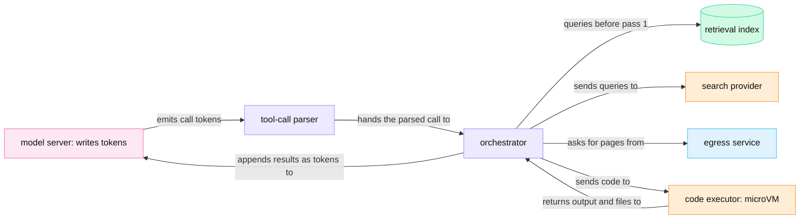
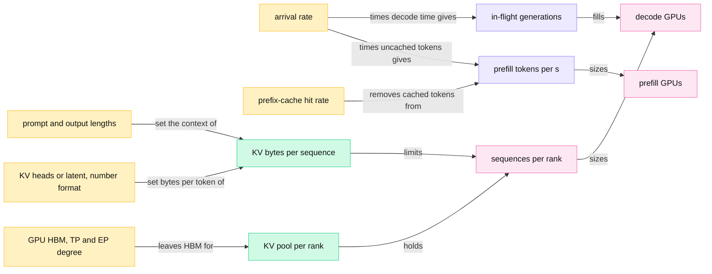
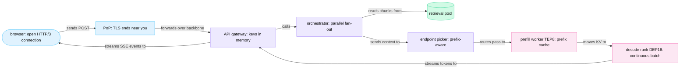

<!-- GENERATED from manuscript/src/part-25-misconceptions-and-synthesis.md by tools/render_manuscript.py. Edit the source, not this file. -->
# Part 25: Misconceptions, diagnostics and synthesis

Many layers, not one technique, make your first token fast: each removes one wait or shares one resource.

Parts 00 to 24 opened every component on the path of your request. This part adds no new mechanism. It uses their numbers in four steps:

1. Correct sixteen common wrong beliefs, each with the number from your request that disproves it (25.1).
2. List the questions that size a deployment, and the diagnostic questions that follow an alert (25.2).
3. Connect each design decision to the time it saves for your request (25.3).
4. Answer the central question of part 0.1 in one page (25.4).

Every number comes from the data of an earlier part, except the results of three counterfactual families. The families are prefill without the prefix cache or on another endpoint, decode without a KV cache, and length percentiles. The script `counterfactuals` computes them with the same models as part 14.4. All traffic, fleet and price values stay hypothetical.

---

## 25.1 Sixteen misconceptions, corrected

Each misconception treats one layer of the system as the whole system, and one number from your request disproves it.

Each entry has four parts: the wrong belief, the correction, the proof number and the parts that explain the mechanism. The numbers belong to your request on `M-frontier`, unless the entry names another source.

### 1. One user gets one GPU

**Wrong belief.** Each chat user holds a GPU, or a whole model replica, while the chat is open.

**Correction.** A decode step runs many users' sequences at once [SRC-097]. A sequence holds a share of a GPU only while its pass decodes. In this reference system, a pass ends at each tool call (RA-14). Between passes and between turns, your request holds no batch slot (RA-38).

**The number.** The DEP16 rank of your decode runs up to 94 sequences in each step. It uses 7.53 GB300 GPU-seconds in 85.9 s. So on average it occupies 0.09 of one GPU. If all 1,000,000 generations of the hypothetical global peak ran on `M-frontier`, they would need 10,640 decode GPUs.

**Where.** Parts 11.5, 14.1, 14.2, 21.9 and 25.2.

### 2. One chat gets one model copy

**Wrong belief.** The service loads a private copy of the model for each conversation.

**Correction.** A replica holds one read-only copy of the weights, and every sequence in its batch reads that copy [SRC-389]. Each conversation adds only its own KV state, and that state is about a thousandth of the weights.

**The number.** The `M-frontier` weights take 1,561 GB. DEP16 spreads them over 16 GPUs, 210 GB per rank. Your request's state peaks at 1.314 GB, so the weights are 1,188 times larger. One DEP16 decode worker holds 1,504 sequences of the mean length against that one copy.

**Where.** Parts 1.3, 14.1 and 18.2.

### 3. Every new token recomputes the whole conversation

**Wrong belief.** For each new token, the model runs again over every earlier token of the conversation.

**Correction.** Within a pass, each decode step computes Q, K and V for the new token only. It reads the stored K and V of all earlier tokens from the KV cache [SRC-098]. The work per token still grows with the context, because attention reads every earlier token. But no earlier token goes through the layers again.

**The number.** Without a KV cache, the 1,726 decode steps of your request would cost 26,418 times the decode FLOPs. One TEP8 worker would need at least 19 minutes for your sequence alone. With the cache, your decode takes 81.5 s on a rank that it shares.

**What stays true.** Across turns, the engine does prefill earlier text again when the prefix cache misses. Your pass 1 prefilled 20,250 of its 23,322 prompt tokens. A follow-up turn would find only 4,096 tokens of cached KV. That costs one prefill per pass, not one per token.

**Where.** Parts 10.4, 13.1, 13.3 and 21.6.

### 4. "The cloud" automatically solves scaling

**Wrong belief.** When load rises, the cloud provider adds GPUs, and users never notice.

**Correction.** A new GPU worker needs minutes, while a first token has about a second. So the fleet keeps warm capacity ahead of demand. A common further limit is the power, cooling and GPU supply of a region. It bounds how fast the region can grow.

**The number.** A cold `M-frontier` decode worker needs 102 to 797 s before its first token. That is 68 to 531 times the p95 TTFT SLO of 1,500 ms. In this reference system, each rack keeps 8 GPUs as a warm spare with loaded weights (RA-55). A warm spare joins in 5 s. During one cold start in the steepest hour, `ap_south` demand grows by 0.16 to 1.2 racks.

**Where.** Parts 1.2, 1.10, 19.4 and 22.8.

### 5. More users always means proportionally more latency

**Wrong belief.** Twice the users make every response twice as slow.

**Correction.** In the `M-dense` model, extra sequences below saturation share each read of the weights. So throughput rises much faster than latency. Near saturation, queues grow fast, and latency rises sharply. The curve stays flat first and then turns steep; it is never a straight line.

**The number.** The seeded simulation of one `M-dense` replica raises arrivals from 0.25 to 8 requests/s, 32 times as many. Median TTFT goes from 33 to 65 ms. Median TPOT goes from 10 to 20 ms, and throughput from 94 to 2,499 tokens/s. At 16 requests/s, past saturation, the median TTFT jumps to 2,361 ms.

**Where.** Parts 9.5, 11.8, 11.12 and 14.5.

### 6. The LLM accesses the internet directly

**Wrong belief.** The model opens connections and browses the web while it thinks.

**Correction.** The model only writes a `web_search` call as tokens, and its pass ends there. In this reference system, deterministic code checks the call and runs it (RA-14). The orchestrator queries a search provider (RA-28), and a separate egress service fetches the pages (RA-29). The results return to the model as tokens in the next pass.

**The number.** Your pass 1 ends with the call after 424 output tokens. The search step takes 1.6 s at the median and fetches 3 pages. It returns 6,040 tokens of results into the prompt of pass 2. The model server receives those tokens; it never fetches a page itself.

**Where.** Parts 6.1, 6.2, 7.2 and 7.4.

### 7. The LLM executes Python

**Wrong belief.** The model runs the code that it writes, on the GPU or inside the model server.

**Correction.** The model writes code as the argument of a `run_python` call. In this reference system, the code executor runs it in a Firecracker microVM (RA-30). The VM has no network interface (RA-69) and no credential (RA-30). The model reads only the result, as tokens in the next pass.

**The number.** The `run_python` step of your request takes 1.3 s on a CPU host, outside every GPU. A warm microVM from the snapshot pool starts in 25 ms, against 1,857 ms for a cold start.

**Where.** Part 8.1.

### 8. RAG means the model searches a database by itself

**Wrong belief.** The model queries the vector database whenever it needs a fact.

**Correction.** In this reference system, the orchestrator runs retrieval before pass 1, beside the history read (RA-14, RA-26). The model receives the selected chunks as prompt tokens and never sends a query to the index. A model can also ask for more retrieval through a tool call, but deterministic code then runs that query too.

**The number.** Retrieval reduces 4,200 workspace documents to 6 chunks of 3,459 tokens. It takes 181 ms, and the reranker takes 146 ms of that. All of it ends before the first GPU step of your request.

**Where.** Parts 5.3, 5.4, 5.6 and 24.5.

### 9. The whole answer is generated before streaming starts

**Wrong belief.** The server writes the full answer first and then sends it.

**Correction.** Each token leaves the engine in the step that samples it [vllm@v0.31.0:vllm/v1/engine/async_llm.py#L793-L874]. It crosses about ten hops, and no hop waits for later tokens (RA-47). In this reference system, the API gateway sends the response headers and `message.start` before the first token (RA-74).

**The number.** `message.start` reaches your screen after 80 ms, and the reasoning-status event after 1.02 s. The first visible text appears at 15.6 s, and the last text at 85.9 s. A gateway that buffered the whole answer would show your first visible text 70 s later. Each token needs only 42 ms from the engine to the pixels.

**What stays true.** Two holds remain on purpose. The raw reasoning never streams (RA-72). Each window of output text waits for its safety check before release (RA-75).

**Where.** Parts 15.1, 15.5, 18.3 and 21.1.

### 10. A vector database stores knowledge "inside vectors"

**Wrong belief.** The vector index holds the facts, and the model reads them out of the vectors.

**Correction.** In this part, a vector is a list of numbers that only ranks chunks by similarity (part 5.1). In this reference system, the index stores each chunk's text and metadata beside its vector (RA-23). Only that text enters the context (RA-26). No step of the path turns a vector back into text.

**The number.** Each stored vector holds 1,024 float16 values, 2,048 B. The chunk that it indexes holds about 550 tokens of text. Your context receives 3,459 tokens of chunk text and no vector at all.

**Where.** Parts 5.1, 5.2 and 5.3.

### 11. Conversation history and the KV cache are the same thing

**Wrong belief.** The service remembers a conversation by keeping its KV cache.

**Correction.** The history is durable text in the conversation store, replicated and kept under retention rules (RA-17). The KV cache is soft GPU state that prefill derives from that text (part 21.5). The engine frees it when a sequence ends and evicts cached blocks under memory pressure. On every turn, the orchestrator builds the context from the history again; the prefix cache only shortens the prefill.

**The number.** The conversation store keeps your turn as two rows of 508 B and 2,100 B. The KV state of the same conversation at the end of pass 3 takes 1.31 GB of HBM. The history also holds less than your context did. In this reference system, your reasoning and the tool results stay out of later contexts (RA-84).

**Where.** Parts 3.4, 5.7, 13.4, 21.6 and 21.7.

### 12. The CDN cache and the prefix cache are the same thing

**Wrong belief.** The CDN at the edge stores model answers, or the prefix cache is a CDN for prompts.

**Correction.** A CDN's HTTP cache keys a response by the method and the URL. Every user may receive the same entry [SRC-270]. The prefix cache maps a chain of block hashes to KV blocks in GPU memory [vllm@v0.31.0:vllm/v1/core/kv_cache_utils.py#L614-L713]. In this reference system, the tenant ID salts that chain, so a block of tenant content serves one tenant (RA-40). The prefix cache never returns an answer; it only skips the prefill of a matching prefix.

**The number.** A hashed static asset lives 365 days in the browser and the CDN. Your chat request is a `POST` with an `Authorization` header. A shared cache must not reuse such a response, unless the response explicitly allows it [SRC-270]. In pass 3, the prefix cache holds 30,208 of 30,395 prompt tokens, so only 187 tokens need prefill.

**Where.** Parts 13.3, 13.4, 13.5 and 16.3.

### 13. A 1T-parameter MoE computes with all 1T parameters per token

**Wrong belief.** A trillion-parameter mixture-of-experts model multiplies every token by every parameter.

**Correction.** The expert router sends each token to a few experts per MoE layer. So the FLOPs of a token follow the active parameters [SRC-380]. Memory still follows the total, because every expert must sit in the HBM of some GPU [SRC-378] [SRC-389].

**The number.** `M-frontier` has 2.78 trillion parameters, and one token uses 104.2 billion of them (3.7%) [SRC-378]. Each MoE layer picks 16 of 896 experts. But one decode step carries 94 sequences on each of the 16 ranks. Under uniform routing, the share of a rank's experts that no token picks is about 10⁻¹². So each step still reads nearly all 210 GB of weights on each rank.

**Where.** Parts 1.6, 10.8, 12.4 and 14.2.

### 14. GPU utilization equals good user latency

**Wrong belief.** A GPU at 100% utilization serves users well, and a lower number means waste.

**Correction.** GPU utilization counts the time in which at least one kernel runs [SRC-581]. It says nothing about how much of the GPU that kernel uses, or how long requests wait. Goodput counts the requests per second that meet both latency SLOs, so it measures what users get.

**The number.** In the same `M-dense` simulation, utilization reads 100% already at 2 requests/s, with an MFU of 5.2%. At 16 requests/s, utilization still reads 100%. Goodput there falls to 0.90 requests/s, from a best of 7.48.

**Where.** Parts 11.12, 14.5, 19.3 and 19.6.

### 15. Requests/s alone describes LLM capacity

**Wrong belief.** A pool that serves N requests/s of one product serves N requests/s of any product.

**Correction.** One request can cost thousands of times more GPU work than another. In the cost model of part 14.4, prefill cost follows the uncached prompt tokens. Decode cost follows the output tokens. Long contexts also hold KV memory for the whole decode. So capacity needs tokens per second in each phase, KV bytes and tool time, not only a request rate.

**The number.** A question about a 100,000-token document costs 1,231 times the GPU-seconds of a short chat. Your request costs 409 times as much. At the same requests/s, the long-PDF workload needs 52 times the GPUs of the short-chat workload.

**Where.** Parts 9.2, 14.3, 14.4 and 14.6.

### 16. The same prompt with the same seed always gives the same output

**Wrong belief.** A fixed seed makes generation reproducible.

**Correction.** A seed fixes the random draws of the sampler, not the logits. Kernels choose their reduction order from the batch shape. So the other sequences in your step can change your logits in the last bits [SRC-085]. Batch-invariant kernels remove this effect at a cost in speed. vLLM offers them as an option that is off by default [SRC-090], and this reference system leaves it off (RA-44).

**The number.** Thinking Machines Lab sampled one prompt 1,000 times at temperature 0 and got 80 different completions [SRC-085]. The first divergence came at token 103. In the toy LM head of part 10.12, greedy decoding picks ` New` at batch size 1. At batch size 8, it picks ` Queens`.

**Where.** Parts 10.9 and 10.12.

### Where the work actually runs

Misconceptions 6, 7 and 8 share one error: they put work inside the model that deterministic code does around it. The diagram shows who runs each step of a tool or retrieval round trip.

Legend: pink = GPU work; violet = deterministic CPU services; green = a store; orange = tools; blue = the egress path. The one thing to notice: every arrow out of the model carries only tokens. Every action on the world starts at the orchestrator. The diagram leaves out the authorization checks between parser and executor on purpose (part 6.3).

### The pattern behind the sixteen

The sixteen beliefs fall into four groups:

1. **Sharing.** Misconceptions 1, 2, 5, 13 and 15 forget two facts. One step shares one read of the weights across many sequences, and cost follows tokens.
2. **State.** Misconceptions 3, 10, 11 and 12 confuse durable data, derived data and soft GPU state.
3. **Boundaries.** Misconceptions 6, 7, 8 and 9 put work inside the model that code around it does.
4. **Single signals.** Misconceptions 4, 14 and 16 trust one mechanism: an autoscaler, a utilization gauge or a seed.

**Meanwhile in the fleet.** While your pass 1 decodes, the same weights on your rank serve every other sequence of the batch. Each of those sequences has its own KV blocks and its own tool loop. None of them holds a GPU between its passes, and none of them shares your blocks.

You can now name the mechanism behind each of the sixteen corrections, and quote the number that proves it.

---

## 25.2 The infrastructure engineer's questionnaire

Eleven answers fix an LLM deployment, so an engineer who knows them can predict its GPU count and first bottleneck.

### The eleven sizing questions

Each row gives the question, this reference system's answer, the design number it sets, and the parts that derive it. All traffic values are hypothetical.

| # | Question | Answer in this reference system | Why it matters | Parts |
|---|---|---|---|---|
| 1 | What are the p95 prompt and output lengths? | prompt p95 9,188 tokens (mean 3,000); output p95 1,276 tokens (mean 400); your request: a 23,322-token first prompt and 1,727 output tokens | Prompt length sets prefill FLOPs and TTFT. Output length sets decode time and, by Little's Law, the count of concurrent sequences. The tail sets the largest KV per sequence, the chunk budget and `max_tokens`, because the longest requests hold the most KV for the longest time. | 5.6, 11.7, 14.4 |
| 2 | What is the arrival rate at the peak? | 50,000 requests/s at the global peak, 1.45 times the daily mean; `ap_south` peaks at 11,741 requests/s | Rate × decode time gives the in-flight generations; rate × uncached prompt tokens gives the prefill work. Plans follow the peak, not the mean. | 9.5, 14.1, 14.3, 14.8 |
| 3 | What are the TTFT and TPOT SLOs? | p95 TTFT 1,500 ms for text-only requests without tools; p95 TPOT 60 ms (RA-80) | TPOT caps the batch per decode rank. TTFT caps queue time plus prefill, so it sets prefill headroom and the chunk budget. | 11.12, 19.3 |
| 4 | Which attention design, with how many KV heads or how large a latent? | `M-frontier`: 24 MLA layers with a latent of 512 + 64 values, 27,648 B per token in BF16, plus 449.4 MB of fixed KDA state; `M-dense`: 8 KV heads, 360,448 B per token | KV bytes per token × context gives the memory per sequence. That sets sequences per GPU, the admission check and the routing signals. | 10.4, 13.1 |
| 5 | Which number formats for weights and KV? | `M-frontier`: MXFP4 routed experts and BF16 for the rest, 1,561 GB; KV in BF16 | Bytes per weight set the GPUs per replica and the bytes that each decode step reads. Bytes per KV value set the batch: FP8 KV needs 13,824 B per token. | 1.5, 1.6, 13.1 |
| 6 | Which GPU? | GB300: 288 GB of HBM at 8 TB/s, in racks of 72 GPUs that share one NVLink domain | HBM capacity minus weights gives the KV pool. HBM bandwidth sets the decode step. The NVLink domain bounds the TP and EP groups. | 11.1, 12.8 |
| 7 | Which TP and EP degree? | prefill TEP8, decode DEP16 (RA-55) | The degree sets the weights per GPU (210 GB per DEP16 rank), the KV pool per rank (50.7 GB) and the collective traffic of each step. | 12.1, 12.4, 13.1 |
| 8 | What prefix-cache hit rate? | 60% of prompt tokens in the traffic mix; your request reuses 68% over its three passes | Prefill work scales with (1 − hit rate), so the hit rate sizes the prefill pool. It also decides whether cache-aware routing pays. | 5.6, 13.3, 14.3 |
| 9 | What fraction of requests calls tools? | 25%; code execution 5% | Each tool round trip adds one inference pass, one more prefill and the tool time to the critical path. The warm sandbox pool and the tool executors size from it. | 6.2, 8.1, 14.6 |
| 10 | What fraction of requests searches the web? | 15% | It sets the provider query rate (15,000 queries/s at the peak, before the search cache), the fetch rate of the egress service and the search share of the cost. | 7.2, 22.6 |
| 11 | How does traffic split across regions? | `us_east` 37%, `eu_west` 29%, `ap_south` 19%, `ap_northeast` 15% of requests, each with its own peak hour | Each region plans for its own peak, so the fleet holds more than the global peak needs, and the troughs host background work. Distance sets the network floor of TTFT. | 2.8, 14.6, 14.8 |

### From answers to a GPU count

The answers feed one chain. Here it runs for the hypothetical global peak, with every generation on `M-frontier` (part 14.2):

1. Arrival rate × mean output tokens gives the decode tokens per second: 50,000 × 400 = 20,000,000 tokens/s.
2. Arrival rate × decode time gives the in-flight generations (Little's Law): 50,000 × 20 s = 1,000,000. The plan takes the decode time from the per-user target of 20 tokens/s (part 14.2). At the 47.2 ms step of step 6, the same answer takes 18.9 s. So the target keeps a small margin.
3. Arrival rate × uncached prompt tokens gives the prefill work: 50,000 × 1,200 = 60,000,000 tokens/s.
4. The attention design and the number format give the state of one sequence at 3,200 tokens: 538 MB.
5. The GPU and the DEP16 degree give a KV pool of 50.7 GB per rank. It holds 94 sequences.
6. The TPOT SLO checks that batch: one step takes 47.2 ms, inside 60 ms. So KV memory binds, not TPOT.
7. In-flight generations ÷ sequences per rank give 10,640 decode GPUs, or 222 racks.

Change one answer and the chain moves. A lower hit rate raises step 3 and the prefill pool. A longer context raises step 4, so fewer sequences fit in step 5, and step 7 needs more GPUs.

Legend: amber = an answer to the questionnaire; violet = a rate; green = memory; pink = GPU counts. The one thing to notice: decode GPUs follow memory per sequence, while prefill GPUs follow uncached tokens. The diagram leaves out the TPOT check and the tool fractions on purpose; the table above covers them.

### Diagnostic questions

After an alert, an engineer should be able to answer these questions without a guess:

| Question | Short answer | Parts |
|---|---|---|
| TTFT p95 rises while TPOT stays flat. Where do you look first? | At the queue: `vllm:num_requests_waiting` [vllm@v0.31.0:vllm/v1/metrics/loggers.py#L508-L524], the pool saturation of the endpoint picker and prefill-pool load. Admission or prefill saturates before decode does. | 9.4, 19.6 |
| TPOT rises while TTFT stays flat. Why? | The batch per decode rank grew, or long prefills share decode steps. Check `vllm:num_requests_running`, KV usage and the chunk budget. | 11.7, 13.7, 19.6 |
| GPU utilization reads 100% and users still complain. What does it mean? | Utilization saturates long before goodput does. Compare goodput and TTFT p99 with the arrival rate, and shed load through bounded queues. | 11.12, 17.7 |
| Preemptions rise. What ran out? | The KV block pool: vLLM preempts a running request when no KV block is free [vllm@v0.31.0:vllm/v1/core/sched/scheduler.py#L757-L813]. Admission must count KV blocks, and the longest contexts show first in free KV blocks. | 9.4, 13.8 |
| The prefix-cache hit rate drops after a release. Why? | A change early in the prompt changes every later block hash: the system prompt, a tool schema, the date or the cache salt [vllm@v0.31.0:vllm/v1/core/kv_cache_utils.py#L614-L713]. A routing change can also break affinity. | 5.6, 9.3, 13.3 |
| One endpoint runs hot while others idle. Why? | A hot prefix pulls traffic to the endpoint that holds it. The load scorer and the affinity threshold decide how far it spreads. | 9.3, 24.6 |
| One region returns many `429` responses. What now? | Its pool saturates. It needs warm capacity, or global traffic management must move new requests away. Check the warm floor and the autoscaler lag. | 9.4, 17.4, 19.4 |
| Streams stall in the middle of an answer. Where? | A proxy buffers, a flow-control window closes, or an idle timeout cuts the stream. Check buffering headers, buffer bounds and keep-alive comments. | 15.2, 15.4, 15.6 |
| The same prompt gives two different answers. Is it a bug? | Not by itself: without batch-invariant kernels, the batch changes the reduction order [SRC-085]. | 10.12 |
| The cost per token rises at night. Why? | Demand falls while warm capacity stays, so utilization falls. Preemptible background work fills the trough. | 14.8, 22.6 |
| The engine's TTFT histogram looks fine, but users see slow starts. Why? | The engine histogram starts when the request reaches the engine. Network, retrieval and the gateway queue sit outside it, so read the trace. | 19.1, 22.5 |

The last row matters for your own request. vLLM's TTFT histogram starts when a request reaches the engine [vllm@v0.31.0:vllm/v1/metrics/stats.py#L466-L475]. So it never sees 265 ms of your 1016 ms TTFT.

You can now answer the eleven sizing questions, say what each answer sets, and trace an alert to its cause.

---

## 25.3 Why latency stays low

Fifteen design decisions each remove one wait or share one resource, so your reasoning-status event appears after 1.02 s.

### The decisions, with what each saves

The table follows the order in which your request meets each decision. "Without" is the cost of the same step if the decision were absent. "With" is the cost for your request. Some rows act on a first connection, on other requests or on a later turn, and the row says so.

| Decision | What it removes | Without | With | Parts |
|---|---|---|---|---|
| nearby edge | handshake round trips to a distant region | a new TCP + TLS 1.3 connection that ends in `ap_south`: 129 ms of handshakes | the same connection ending at the PoP: 40 ms (first connection only) | 1.1, 2.5, 2.6 |
| connection reuse | every handshake round trip | 20 ms for a new QUIC connection, 40 ms for new TCP + TLS 1.3 | 0 ms: your request leaves at once on an open HTTP/3 connection | 2.3, 2.5 |
| warm services and warm GPUs | process start, image pull, CUDA and NCCL setup | a cold decode worker: 102–797 s; a cold microVM: 1,857 ms | a warm spare joins in 5 s; a warm microVM starts in 25 ms | 1.2, 8.1, 19.4 |
| weights already in HBM | weight loading, CUDA Graph capture and warm-up | weights into HBM: 2.1–191 s; profiling, KV pool and graphs: 78–95 s | 0 s: both ran before your request existed | 1.3, 1.7, 19.4 |
| side work off the path | work that only records what happened | 3.34 s more on the critical path | 0 s: event appends, memory extraction and turn indexing run beside or after the path | 16.2, 21.4 |
| local caches | reads and calls whose answer is already known | signing keys, entitlements and DNS answers each cost a round trip; a search-cache miss costs 1.6 s | keys, entitlements and DNS come from memory; your search misses the cache and pays the full step | 2.3, 7.8, 16.3 |
| inference-aware routing | a pass on an endpoint that lacks its prefix | pass 2 on `E2`: 0.655 s of prefill | pass 2 on `E1`: 0.155 s | 9.2, 9.3 |
| prefix cache | prefill of tokens that an earlier pass already computed | 1.91 s of prefill over the three passes | 0.62 s, and 10.3 GPU-seconds saved | 5.6, 13.3 |
| continuous batching | the wait for a whole batch to finish | static batching in the `M-dense` simulation: median TTFT 10.7 s | 37 ms; your pass joins a running batch after 170 ms in the queue | 11.5, 22.8 |
| chunked prefill | decode steps that stall behind one long prompt | a 100,000-token prompt stalls 64 decodes for 8,551 ms (`M-dense`) | 1,090 ms with a budget of 8,192 tokens | 11.7 |
| disaggregation | your prefill inside other users' decode steps, and theirs inside yours | the decode rank would also run your 20,250-token prefill between its decode steps | the prefill runs on a TEP8 worker; the KV moves in 3.2 ms, and the rank keeps its 47.2 ms step | 13.7, 21.1 |
| GPU parallelism | one GPU that computes and stores everything | pass-1 prefill as 3.69 s of work on one GPU, if the weights fitted, which they do not | 0.46 s on 8 GPUs (TEP8); decode reads 210 GB per rank on 16 ranks at once | 12.1, 12.4, 12.8 |
| optimized kernels | HBM traffic and CPU launch overhead | naive attention: 52.4 GB of HBM traffic per layer and GPU for the 23,322-token prompt (`M-dense`); separate launches: 40% of a batch-1 step | tiled attention: at most 13.4 GB; one CUDA Graph launch per step | 10.7, 11.11 |
| immediate streaming | the wait for the last token before the first one shows | your first visible text at about 86 s | 15.6 s | 15.1, 21.1 |
| a large replicated fleet | a queue in front of one busy replica | 8 separate queues at 80% utilization: mean wait 300 ms | one shared queue for 8 servers: 21 ms | 9.5, 12.3, 14.6 |

The rows do not add up to one total, for two reasons. Each acts on a different step. The largest rows also act on rare events: a cold start, or a whole answer held back. The point of the table is that every row is necessary, and no row is enough.

Legend: light blue = client and edge; violet = CPU services; green = the retrieval pool; pink = GPU work. The one thing to notice: each node names the decision that removes its wait. The stream returns on the connections that carried the request. The diagram leaves out the warm fleet and the side work on purpose; they act before and after the path.

### The decisions, one by one

1. **Nearby edge.** Anycast sends your packets to a nearby PoP, and TLS ends there (RA-01, RA-04). The long backbone leg then runs over connections that the PoP keeps open. For your request, the network part of TTFT has a floor of 64.5 ms to `ap_south`. The same floor to `us_east` would be 139 ms.
2. **Connection reuse.** A new QUIC connection needs one round trip before the request can leave [SRC-140]. TCP with TLS 1.3 needs two [SRC-136]. Your browser already holds an open HTTP/3 connection, and the DNS answer sits in its cache (RA-02). So your request leaves in the same millisecond.
3. **Warm services and warm GPUs.** In this reference system, every process on your path runs before you press Send (RA-42). A cold `M-frontier` worker would need minutes, so the autoscaler keeps a warm floor in each pool (RA-42). A warm microVM claim costs 25 ms, 74 times less than a cold start.
4. **Weights already in HBM.** Each DEP16 rank holds its 210 GB of weights for the life of the replica. The engine captures its CUDA Graphs at start-up [SRC-088]. So the first step of your pass is an ordinary step.
5. **Side work off the path.** The orchestrator reads history, memory and retrieval at the same time. The slowest branch, retrieval at 181 ms, sets the wait, not their sum. Event appends, memory extraction and turn indexing run off the path (RA-20, RA-27). Together they would add 3.34 s.
6. **Local caches.** The API gateway checks your token with a signing key in process memory (RA-09). It reads your entitlements from Redis, not from the store (RA-19). A search-cache hit would remove the whole 1.6 s search step. Your queries are new, so they miss.
7. **Inference-aware routing.** The endpoint picker scores endpoints by cached prefix and load (RA-37, RA-71) [llm-d@2f95c24:guides/optimized-baseline/router/optimized-baseline.values.yaml#L21-L30]. Pass 2 on `E1` needs 6,264 new tokens. On `E2` it would need 28,280, and 0.50 s more prefill.
8. **Prefix cache.** Passes 2 and 3 reuse the KV that pass 1 and pass 2 left on `E1` [SRC-040]. The cache saves 1.29 s of prefill over the three passes. Pass 3 prefills 187 tokens in 5 ms instead of 701 ms.
9. **Continuous batching.** The scheduler rebuilds the batch at every step, so a new sequence joins at the next step [SRC-097]. Your pass waits in the queue, not behind a batch that must finish. In the `M-dense` simulation, this cuts the median TTFT from 10.7 s to 37 ms.
10. **Chunked prefill.** A token budget per step splits a long prompt into pieces beside the running decodes [SRC-100]. Decodes keep moving, and the long prompt's TTFT grows a little. In this reference system, disaggregation keeps long prefills off the decode ranks (RA-38). So chunking acts mostly inside the prefill pool, with the budget of RA-36.
11. **Disaggregation.** Prefill and decode run in separate pools, and the KV moves between them [SRC-101]. In this reference system, a short uncached suffix stays on the decode worker, so pass 3 needs no transfer (RA-38). Pass 1 moves 1.09 GB of state in 3.2 ms over NVLink.
12. **GPU parallelism.** In this reference system, TEP8 runs the pass-1 prefill of 3.69 GPU-seconds in 0.46 s (RA-55). DEP16 splits the experts over 16 GPUs, so each step reads 16 slices of the weights at the same time [SRC-389].
13. **Optimized kernels.** FlashAttention computes the same attention without writing the score matrix to HBM [SRC-054]. A CUDA Graph replays a whole step's kernels with one launch [SRC-088]. In this reference system, vLLM selects FlashAttention-4 on Blackwell and full graphs for pure-decode batches (RA-43).
14. **Immediate streaming.** Each token crosses the stream path in about 42 ms, and no hop waits for later tokens (RA-47, RA-74). Without streaming, your first visible text would wait for the last.
15. **A large replicated fleet.** Many replicas behind one queue absorb random arrivals better than separate queues [SRC-903]. At 80% utilization, one shared queue for 8 servers waits 14 times less than 8 separate queues. Replicas in other regions also take new requests when `ap_south` fails (RA-06, part 17.4).

### What the decisions do not remove

The decisions above shorten everything before the first token. Your TTFT of 1,016 ms still splits into prefill (52%), context preparation (18%) and the queue (17%). Every network and CPU hop together takes the rest (part 22.5).

After the first token, decode sets the time. Your request decodes for 81.5 s, 95% of its 85.9 s. Each step takes 47.2 ms, because the rank runs up to 94 sequences in each step (RA-55). That shared step keeps the cost per token low. It stays inside the p95 TPOT SLO of 60 ms.

Three costs remain on purpose:

1. **Reasoning tokens.** The first visible text waits for 300 reasoning tokens: 14.6 s of decode steps (RA-72, part 10.13).
2. **The output check.** Each 16-token window waits for its classifier before release (RA-75). At the 47.2 ms step, the first window adds about 0.7 s (part 18.3).
3. **Tool steps.** The search and the Python run add 2.9 s, and each starts a new pass.

The levers for these three are fewer reasoning tokens, a shorter decode step and cached tool results. Each has a price in quality, GPUs or freshness (part 22.7).

**Meanwhile in the fleet.** When your pass 1 starts to decode, its endpoint is one of many. In the snapshot of part 9.5, endpoint `E1` reports `vllm:num_requests_running` = 60 and `vllm:num_requests_waiting` = 1. Its step carries 2,108 batched tokens and holds 5,150 KV blocks.

Across the `ap_south` pool, 30,000 sequences decode. The plan of part 9.5 counts 600,000 tokens/s at the per-user target of 20 tokens/s. At the 47.2 ms step, they emit about 635,100 tokens/s. Each of those sequences gets the same fifteen decisions as yours.

You can now connect each design decision to the time it saves your request, and name the costs that remain.

---

## 25.4 The answer to the central question

Your first token comes fast because the slow work happens earlier, the costly work is shared, and the rest streams.

You press Send in Nairobi (a hypothetical location). Your request leaves at once on an HTTP/3 connection that is already open to a nearby PoP. Anycast picked that PoP, and TLS ends there. The request crosses the private backbone and reaches the API gateway in `ap_south` after 36 ms. Over the whole request, the network adds only 78 ms to the critical path. That is **global networking**: distance sets a floor, and the edge keeps each round trip short.

In this reference system, every process on the path already runs (RA-42). The gateway, the orchestrator, the retrieval pool and the GPU workers started minutes or days before your request. The weights sit in HBM, and the CUDA Graphs exist. A new worker would need 102 s or more, so the fleet keeps warm capacity ahead of demand. That is **warm infrastructure**.

The CPU services hold your request as a small object in an event loop (RA-14). Each service runs as many identical replicas, and any replica can take your request. The orchestrator reads history, memory and retrieval in parallel, and builds your context in 222 ms. Writes that only record the turn run off the path. That is **horizontal replication** and **async software**: side work stays off the path.

The endpoint picker reads queue depth, KV usage and cached prefixes for every endpoint (RA-37, RA-71). Your pass waits 170 ms in the queue. The picker sends passes 2 and 3 to the endpoint that holds their prefix. That is **inference scheduling**: inference-aware routing.

On the GPUs, eight prefill GPUs finish your 20,250-token prefill in 0.46 s. Your decode then joins a running batch of up to 94 sequences on one DEP16 rank. Each step reads the **shared weights** once for the whole batch: 1,561 GB across the worker. Your **per-request KV** of 1.31 GB stays private. **Batching** and **GPU parallelism** let one copy of the weights serve 1,504 sequences per decode worker.

The batch and its memory traffic set each step at 47.2 ms (25.3). **Optimized kernels** and CUDA Graphs only remove extra HBM traffic and launch overhead from that step.

**Caching** removes work that already happened. The prefix cache saves 1.29 s of prefill across your three passes. DNS answers, signing keys and entitlements come from memory.

The model only writes tokens (RA-14, RA-50). When it asks for a search or for Python, it ends its pass. Deterministic code then runs the **tools** outside the GPU. While a tool runs, your sequence holds no batch slot. Its cached blocks wait for the next pass.

**Streaming** shows progress at once (RA-74). `message.start` reaches your screen after 80 ms, and the reasoning-status event after 1.02 s. Each later token reaches your pixels about 42 ms after the engine samples it.

No single technique explains this speed. Remove any one layer, and the earlier parts show what breaks:

1. Without the edge and an open connection, each new connection pays 129 ms of handshakes.
2. Without warm GPUs, the first token waits 102 s or more.
3. Without continuous batching, the median TTFT in the `M-dense` simulation grows from 37 ms to 10.7 s.
4. Without the prefix cache and cache-aware routing, your passes prefill 1.29 s longer.
5. Without the KV cache, your answer needs at least 19 minutes on eight GPUs.
6. Without streaming, your screen stays empty 70 s longer.
7. Without a large fleet behind shared queues, waits grow 14 times at the same utilization.

"About a second" holds for TTFT. The hypothetical SLO bounds it at a p95 of 1,500 ms for text-only requests (RA-80). In part 22.5, the reasoning-status event of your heavy request arrives within that bound in 91% of the draws. Its visible text waits for its reasoning, and its full answer for 81.5 s of shared decode. The fleet accepts a longer decode step per token, so that it can serve 1,000,000 generations at once.

**Meanwhile in the fleet.** At the hypothetical global peak, 50,000 requests start every second, and as many finish. Each finish frees KV blocks that a new prefill takes in the next step. In `ap_south` alone, 30,000 `M-frontier` sequences decode beside yours.

You can now explain, layer by layer and with numbers, how your request starts fast while a million others run.

---

## What Part 25 established

Sixteen beliefs fail against one request's numbers, eleven answers size a fleet, and fifteen decisions keep first tokens fast.

No single component makes a first token fast; many prepared, shared and parallel layers do, and each removes one wait.
